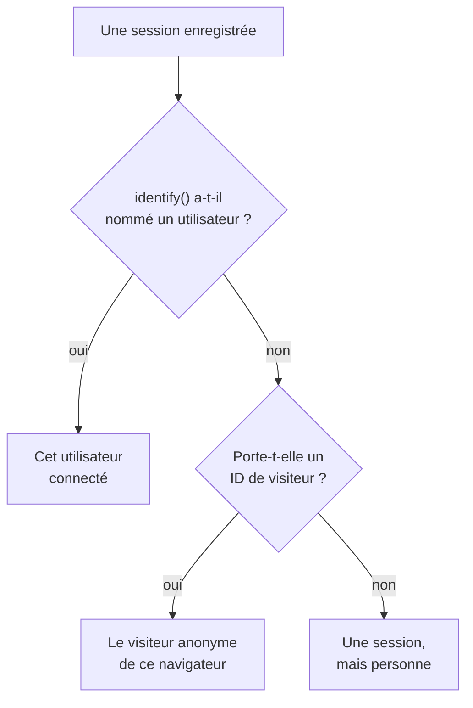

# Analyse produit

L'analyse produit compte les personnes qui utilisent une application RUM, le déroulement de leurs sessions et ce qu'elles font : utilisateurs actifs, nouveaux, récurrents, connectés et inactifs, sessions par appareil, navigateur, pays et page, et les événements que votre app envoie, en tendances, entonnoirs et rétention. Elle compte les sessions que la [Relecture de session](/docs/telemetry/session-replay) enregistre et les événements que son enregistreur envoie : elle n'a donc besoin d'aucun extrait de code à elle, et elle garde ses chiffres pendant 13 mois, bien après l'expiration des enregistrements.

:::cards
- [Utilisateurs](#utilisateurs): Utilisateurs actifs, nouveaux, récurrents, connectés, au total et inactifs.
- [Sessions](#sessions): Combien, combien de temps, et par appareil, navigateur, pays et page.
- [Envoyer des événements et des métriques](#envoyer-des-événements-et-des-métriques): Ce que font les gens, et les valeurs que votre page mesure.
- [Événements](#événements): À quelle fréquence quelque chose s'est produit, qui l'a fait, et où.
- [Entonnoirs](#entonnoirs): Qui a continué, étape par étape, et en combien de temps.
- [Rétention des utilisateurs](#rétention-des-utilisateurs): Qui est revenu, cohorte par cohorte.
:::

## Comment les personnes sont comptées

Le menu latéral d'une application a une section **Analyse produit** : **Utilisateurs**, **Sessions**, **Événements**, **Entonnoirs**, **Rétention des utilisateurs**, **Parcours utilisateur** et **Paramètres d'analyse**. **Utilisateurs** et **Sessions** comptent les sessions que la Relecture de session enregistre : elles commencent donc quand l'enregistreur de l'application commence, et une session que la politique de relecture n'enregistre pas n'est pas comptée. Chaque session compte pour une personne, ou pour personne :



- **Un utilisateur connecté compte une fois**, sur chaque navigateur et chaque appareil qu'il utilise : il est reconnu par le hachage à sens unique de la référence que votre page a donnée à `identify()` (voir [Identifier vos utilisateurs](/docs/telemetry/session-replay#identifier-vos-utilisateurs)).
- **Un navigateur anonyme compte une fois**, par son [ID de visiteur anonyme](/docs/telemetry/session-replay#visiteurs-anonymes). Deux navigateurs sont deux visiteurs, et les sessions qu'un navigateur a eues avant que quelqu'un s'y connecte restent celles de son visiteur.
- **Une session d'un ancien enregistreur**, qui n'envoyait pas d'ID de visiteur, compte comme une session mais pas comme une personne.

**Événements**, **Entonnoirs** et **Rétention des utilisateurs** comptent les personnes de la même façon, à partir des événements que l'enregistreur envoie depuis chaque session, enregistrée ou non (voir [Envoyer des événements et des métriques](#envoyer-des-événements-et-des-métriques)).

Les jours sont comptés dans votre propre fuseau horaire.

## Utilisateurs

**Utilisateurs** compte les personnes de la période que vous choisissez :

| Tuile | Ce qu'elle compte |
| --- | --- |
| **Utilisateurs actifs** | Tous ceux qui sont venus pendant la période : chaque utilisateur connecté une fois, et chaque navigateur anonyme une fois. |
| **Nouveaux utilisateurs** | Les utilisateurs actifs dont la première visite a eu lieu pendant la période. |
| **Utilisateurs récurrents** | Les utilisateurs actifs qui étaient déjà venus avant le début de la période. |
| **Utilisateurs connectés** | Les utilisateurs actifs que votre application a connectés avec `identify()`, et leur part de tous les utilisateurs actifs. |
| **Total des utilisateurs** | Tous ceux que l'application a vus au cours des 13 derniers mois. |
| **Utilisateurs inactifs** | Les personnes venues auparavant mais pas au cours des 30 derniers jours, ou des 7, 14, 60 ou 90 jours que vous choisissez. |

Les trois premières indiquent aussi leur évolution par rapport à la période précédente. Sous les tuiles, **Utilisateurs actifs** trace, pour chaque jour, les personnes venues ce jour-là, celles venues dans les 7 jours jusqu'à ce jour et celles venues dans les 30 jours jusqu'à ce jour, et **Nouveaux utilisateurs et utilisateurs récurrents** partage en deux les personnes de chaque jour.

**Personnes** liste tous ceux que les tuiles comptent, une ligne par personne, les plus récemment vus en premier, et son filtre affiche les personnes d'une tuile, les visiteurs anonymes ou tout le monde. Ouvrez une personne pour voir sa première et sa dernière visite et chacune de ses sessions des 13 derniers mois, avec **Regarder** sur chacune dont l'enregistrement est encore conservé.

## Sessions

**Sessions** compte les sessions qui ont commencé pendant la période : **Sessions**, **Sessions connectées**, **Durée médiane des sessions**, **Pages par session**, **Sessions avec erreurs** et **Sessions frustrées**. Sous les tuiles :

- **Sessions par appareil** trace les sessions de chaque jour venues d'ordinateurs, de téléphones et de tablettes. La session d'une application mobile sur un écran dont le petit côté mesure 600 points ou plus compte comme celle d'une tablette.
- **Durée des sessions** range les sessions terminées selon leur durée, de moins de 10 secondes à plus de 30 minutes. Une session encore en cours d'enregistrement n'a pas encore de durée.
- **Répartition** classe les utilisateurs et les sessions par type d'appareil, navigateur, système d'exploitation, pays, version de l'application, page d'entrée ou page, les plus d'utilisateurs en premier.

## Envoyer des événements et des métriques

Les événements sont envoyés tant que **Envoyer les événements d'analyse produit** est activé, sur la page **Paramètres d'analyse** de l'application. Il est activé dès le départ pour une nouvelle application, et désactivé pour une application créée avant qu'il n'existe : activez-le alors là. La Relecture de session doit aussi être activée pour l'application, car son enregistreur envoie les événements ; l'enregistreur React Native n'en envoie encore aucun.

Chaque session dans laquelle l'enregistreur du navigateur s'exécute envoie d'elle-même son début et chaque page qu'elle affiche, changements de route d'une application monopage compris, que l'échantillon et la politique de relecture enregistrent cette session ou non. Vos propres événements et valeurs viennent du code de votre page :

```js
OneUptimeReplay.track("Signed up", { plan: "pro" });
OneUptimeReplay.metric("cart.value", 42.5, { currency: "EUR" });
```

| Appel | Ce qu'il envoie |
| --- | --- |
| `track(name, properties?)` | Un événement que **Événements**, **Entonnoirs** et **Rétention des utilisateurs** comptent, et un repère sur la chronologie de la relecture quand la session est enregistrée. `name` ≤ 64 caractères ; ≤ 20 propriétés aux valeurs de type chaîne, nombre ou booléen, clé ≤ 40 caractères, valeur ≤ 200 caractères. |
| `metric(name, value, attributes?)` | Une valeur que votre page a mesurée, comme point d'une métrique de l'application (voir [Tableaux de bord et alertes](#tableaux-de-bord-et-alertes)). `name` ≤ 100 caractères parmi les lettres, les chiffres, `_`, `.`, `-` et `/`, commençant par une lettre et pas par `oneuptime.` ; `value` un nombre fini ; `attributes` comme les propriétés de `track()`. |

Avant que l'enregistreur soit chargé, poussez les mêmes appels dans `window.OneUptimeReplayQueue` sous la forme `["track", name, properties]` et `["metric", name, value, attributes]` (voir [API JavaScript](/docs/telemetry/session-replay#api-javascript)).

- **Chaque session, enregistrée ou non.** L'échantillon et la politique d'envoi de la relecture décident quelles sessions sont enregistrées, pas lesquelles sont comptées. Rien n'est envoyé sous Do Not Track ou Global Privacy Control, et rien n'est conservé d'une origine que l'application n'autorise pas. Quand la politique exige le consentement, les événements attendent `grantConsent()`, 500 au plus, et `revokeConsent()` les abandonne.
- **Masqués comme l'enregistrement.** Sous _Mask all text_, les valeurs des propriétés et des attributs sont masquées avant de quitter la page. Une page est envoyée sous la forme de son chemin, sans sa requête ni son fragment.
- **Par petits lots**, toutes les 5 secondes et quand l'onglet est masqué. Un événement qui atteint OneUptime plus de 3 jours après s'être produit est abandonné, et un projet peut envoyer 60 000 événements et points de métrique par minute, toutes ses applications réunies ; au-delà, l'enregistreur attend et les renvoie.

`metric()` n'envoie rien tant que les événements sont désactivés, et `getDiagnostics().productAnalytics` indique s'ils sont activés (voir [`getDiagnostics()`](/docs/telemetry/session-replay#getdiagnostics)).

### Propriétés utilisateur

Pour répartir et segmenter les événements selon qui les a faits, listez des clés de traits de `identify()` sous **Propriétés utilisateur pour l'analyse** dans **Paramètres d'analyse**, par exemple `["plan", "role"]`, 20 au plus, comparées telles qu'elles sont écrites. Chaque événement porte alors ces traits de l'utilisateur connecté, tels que votre page les a passés à `identify()`. Les autres traits ne quittent jamais la page, et aucun ne la quitte tant que **Capturer l'identité de l'utilisateur final** est désactivé. Ne listez pas de traits contenant des données personnelles, comme une adresse e-mail.

## Événements

**Événements** montre un événement à la fois : l'événement le plus fréquent de votre app jusqu'à ce que vous en choisissiez un autre, ou la page la plus vue tant qu'elle n'en envoie aucun. Le sélecteur liste aussi **Session démarrée** et chaque page vue, et **Tous les événements**, en dessous, liste chaque événement de la période avec le nombre de fois où il s'est produit et le nombre de personnes qui l'ont fait ; choisissez-en un pour le voir au-dessus.

- Les tuiles comptent les **Événements** de l'événement, avec combien chaque personne en a fait en moyenne, ses **Utilisateurs** et ses **Sessions**.
- **Événements et utilisateurs** trace pour chaque jour le nombre de fois où l'événement s'est produit, et celui des personnes qui l'ont fait ce jour-là.
- **Répartition** classe l'événement par type d'appareil, navigateur, système d'exploitation, pays, version de l'app, page, propriété d'événement ou propriété utilisateur, avec les événements, les utilisateurs et la part de chaque valeur. Choisissez une valeur pour n'afficher qu'elle.

**Segment** limite la page aux événements dont les champs ont les valeurs que vous choisissez : **Ajouter un filtre**, puis un champ et une valeur, comparés exactement. Un segment contient 5 filtres au plus, et un événement doit tous les respecter. L'adresse de la page garde l'événement, la période, le segment et la répartition, si bien qu'un lien ouvre la même vue.

## Entonnoirs

**Entonnoirs** suit les personnes à travers 2 à 6 étapes dans l'ordre, chacune un événement tel que **Événements** les liste. Parmi les personnes qui ont fait la première étape dans la période, il compte combien ont fait ensuite la deuxième, puis la troisième, toutes dans le délai que vous choisissez à partir de leur première étape : **Sous 1 heure**, **Sous 1 jour**, **Sous 7 jours**, **Sous 14 jours** ou **Sous 30 jours**. **Ajouter une étape** en ajoute une.

Sous **Conversion** figurent la part des personnes qui ont fait toutes les étapes et, pour chaque étape, combien de personnes l'ont atteinte, quelle part des personnes de la première étape cela représente, combien ont abandonné depuis l'étape précédente, et le temps médian qu'elles ont mis depuis celle-ci. Quelqu'un qui a essayé plusieurs fois compte une fois, selon l'essai qui est allé le plus loin.

Le segment d'un entonnoir, comme celui d'un tableau de rétention, prend les champs que porte chaque événement et les propriétés utilisateur, pas les propriétés propres d'un événement, puisque ses étapes sont des événements différents.

## Rétention des utilisateurs

**Rétention des utilisateurs** regroupe les personnes par jour, semaine ou mois de la période où elles ont fait pour la première fois un événement, **Personnes ayant fait**, et montre quelle part de chaque groupe en a fait un autre, **Et revenues pour faire**, pendant cette période et chacune des suivantes. Les deux sont **Session démarrée** jusqu'à ce que vous en choisissiez d'autres.

**Cohortes** fixe la période : **Par jour**, **Par semaine** ou **Par mois**. Quand la plage contient plus de périodes qu'un tableau n'en montre, 32 jours, 26 semaines ou 13 mois, la page allonge les cohortes et le signale.

Chaque ligne est une cohorte et le nombre de personnes qu'elle contient, et chaque cellule la part d'entre elles revenues pendant cette période, plus foncée quand elles sont plus nombreuses. Une période qui n'a pas encore commencé reste vide.

## Tableaux de bord et alertes

Chaque événement est aussi compté, minute par minute, comme une métrique de l'application, et chaque appel à `metric()` est un point d'une métrique à part, sous le nom qu'il donne. Tracez-les sur la page **Métriques** de l'application, ajoutez-les à un tableau de bord, ou déclenchez des alertes dessus avec un moniteur de métriques ; **Ouvrir Métriques**, sous **Tous les événements**, ouvre la page.

| Métrique | Ce qu'elle compte | Par |
| --- | --- | --- |
| `oneuptime.rum.product.events` | Vos événements `track()`, par minute | `event.name` |
| `oneuptime.rum.product.sessions` | Les sessions qui ont commencé, par minute | `device.type` |
| `oneuptime.rum.product.page.views` | Les pages vues, par minute | `device.type` |

Ces trois-là ne sont pas facturées, et `metric()` refuse un nom qui commence par `oneuptime.`, si bien que rien de ce qu'envoie votre page ne passe pour elles. Vos points `metric()` sont conservés et facturés comme les autres métriques de l'application.

## Confidentialité et conservation

- **13 mois.** Les chiffres d'un mois sont supprimés le premier jour du 13e mois qui suit, si bien que les 12 derniers mois complets sont toujours là, quelle que soit la conservation propre des enregistrements (7 jours par défaut). Les événements sont conservés de la même façon.
- **Aucun nom stocké.** Les chiffres gardent la clé à sens unique d'un utilisateur connecté et l'ID de visiteur d'un navigateur, jamais la référence ni une adresse IP, et des traits seulement les propriétés utilisateur que vous listez. Une ligne ne nomme un utilisateur connecté que tant que l'un de ses enregistrements est encore conservé, et seulement pour un rôle qui peut lire l'identité ; sinon elle affiche **Utilisateur connecté** ou **Visiteur anonyme** et le début de l'ID.
- **Effacé sur demande.** Une demande d'effacement supprime aussi les chiffres et les événements correspondants ici (voir [Effacer des sessions](/docs/telemetry/session-replay#effacer-des-sessions)).

## Qui peut la voir

Lire ces pages demande ce que demande la liste des sessions : `ReadRumSessionReplay` (_List Session Replays_) ou `ReadRumSessionReplayPayload` (_Watch Session Replays_), que les propriétaires et les administrateurs du projet détiennent. Voir qui est un utilisateur connecté, et rechercher des personnes par leur nom, demande la permission d'identité décrite dans [Qui peut regarder un enregistrement](/docs/telemetry/session-replay#qui-peut-regarder-un-enregistrement).

Activer ou désactiver les événements demande `EditRumApplication` (_Edit RUM Application_) ou le rôle de propriétaire, d'administrateur ou de membre du projet. Lister des propriétés utilisateur demande `EditRumApplication` ou le rôle de propriétaire ou d'administrateur, car cela décide de ce qui est conservé sur les personnes connectées.

## Prochaines étapes

:::cards
- [Relecture de session](/docs/telemetry/session-replay): Enregistrez les sessions que ces pages comptent, et regardez-les.
- [Gérer les applications](/docs/rum/applications): Noms, étiquettes, propriétaires et conservation.
- [Vue d'ensemble du RUM](/docs/rum/index): Ce qu'une application RUM montre d'autre.
:::
