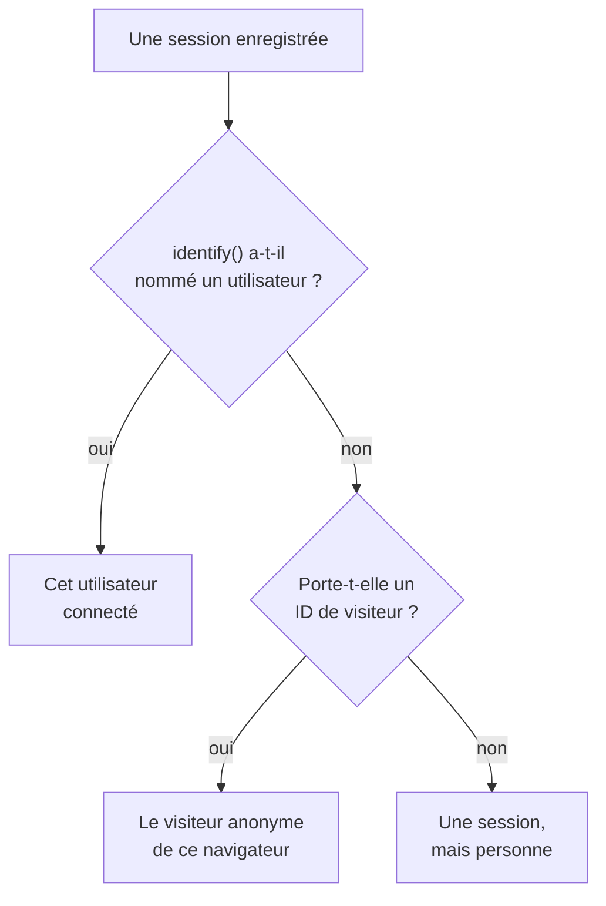

# Analyse produit

L'analyse produit compte les personnes qui utilisent une application RUM et le déroulement de leurs sessions : utilisateurs actifs, nouveaux, récurrents, connectés et inactifs, et sessions par appareil, navigateur, pays et page. Elle compte les sessions que la [Relecture de session](/docs/telemetry/session-replay) enregistre : elle n'a donc besoin d'aucun extrait de code à elle, et elle garde ses chiffres pendant 13 mois, bien après l'expiration des enregistrements.

:::cards
- [Comment les personnes sont comptées](#comment-les-personnes-sont-comptées): Un utilisateur connecté une fois, un navigateur anonyme une fois.
- [Utilisateurs](#utilisateurs): Utilisateurs actifs, nouveaux, récurrents, connectés, au total et inactifs.
- [Sessions](#sessions): Combien, combien de temps, et par appareil, navigateur, pays et page.
- [Confidentialité et conservation](#confidentialité-et-conservation): 13 mois, aucun nom stocké, effacé sur demande.
:::

## Comment les personnes sont comptées

Le menu latéral d'une application a une section **Analyse produit** avec deux pages, **Utilisateurs** et **Sessions**. Toutes deux comptent les sessions que la Relecture de session enregistre : elles commencent donc quand l'enregistreur de l'application commence, et une session que la politique de relecture n'enregistre pas n'est pas comptée. Chaque session compte pour une personne, ou pour personne :

- **Un utilisateur connecté compte une fois**, sur chaque navigateur et chaque appareil qu'il utilise : il est reconnu par le hachage à sens unique de la référence que votre page a donnée à `identify()` (voir [Identifier vos utilisateurs](/docs/telemetry/session-replay#identifier-vos-utilisateurs)).
- **Un navigateur anonyme compte une fois**, par son [ID de visiteur anonyme](/docs/telemetry/session-replay#visiteurs-anonymes). Deux navigateurs sont deux visiteurs, et les sessions qu'un navigateur a eues avant que quelqu'un s'y connecte restent celles de son visiteur.
- **Une session d'un ancien enregistreur**, qui n'envoyait pas d'ID de visiteur, compte comme une session mais pas comme une personne.

Les jours sont comptés dans votre propre fuseau horaire.

## Utilisateurs

**Utilisateurs** compte les personnes de la période que vous choisissez :

| Tuile | Ce qu'elle compte |
| --- | --- |
| **Utilisateurs actifs** | Tous ceux qui sont venus pendant la période : chaque utilisateur connecté une fois, et chaque navigateur anonyme une fois. |
| **Nouveaux utilisateurs** | Les utilisateurs actifs dont la première visite a eu lieu pendant la période. |
| **Utilisateurs récurrents** | Les utilisateurs actifs qui étaient déjà venus avant le début de la période. |
| **Utilisateurs connectés** | Les utilisateurs actifs que votre application a connectés avec `identify()`, et leur part de tous les utilisateurs actifs. |
| **Total des utilisateurs** | Tous ceux que l'application a vus au cours des 13 derniers mois. |
| **Utilisateurs inactifs** | Les personnes venues auparavant mais pas au cours des 30 derniers jours, ou des 7, 14, 60 ou 90 jours que vous choisissez. |

Les trois premières indiquent aussi leur évolution par rapport à la période précédente. Sous les tuiles, **Utilisateurs actifs** trace, pour chaque jour, les personnes venues ce jour-là, celles venues dans les 7 jours jusqu'à ce jour et celles venues dans les 30 jours jusqu'à ce jour, et **Nouveaux utilisateurs et utilisateurs récurrents** partage en deux les personnes de chaque jour.

**Personnes** liste tous ceux que les tuiles comptent, une ligne par personne, les plus récemment vus en premier, et son filtre affiche les personnes d'une tuile, les visiteurs anonymes ou tout le monde. Ouvrez une personne pour voir sa première et sa dernière visite et chacune de ses sessions des 13 derniers mois, avec **Regarder** sur chacune dont l'enregistrement est encore conservé.

## Sessions

**Sessions** compte les sessions qui ont commencé pendant la période : **Sessions**, **Sessions connectées**, **Durée médiane des sessions**, **Pages par session**, **Sessions avec erreurs** et **Sessions frustrées**. Sous les tuiles :

- **Sessions par appareil** trace les sessions de chaque jour venues d'ordinateurs, de téléphones et de tablettes. La session d'une application mobile sur un écran dont le petit côté mesure 600 points ou plus compte comme celle d'une tablette.
- **Durée des sessions** range les sessions terminées selon leur durée, de moins de 10 secondes à plus de 30 minutes. Une session encore en cours d'enregistrement n'a pas encore de durée.
- **Répartition** classe les utilisateurs et les sessions par type d'appareil, navigateur, système d'exploitation, pays, version de l'application, page d'entrée ou page, les plus d'utilisateurs en premier.

## Confidentialité et conservation

- **13 mois.** Les chiffres d'un mois sont supprimés le premier jour du 13e mois qui suit, si bien que les 12 derniers mois complets sont toujours là, quelle que soit la conservation propre des enregistrements (7 jours par défaut).
- **Aucun nom stocké.** Les chiffres gardent la clé à sens unique d'un utilisateur connecté et l'ID de visiteur d'un navigateur, jamais la référence, les traits ni une adresse IP. Une ligne ne nomme un utilisateur connecté que tant que l'un de ses enregistrements est encore conservé, et seulement pour un rôle qui peut lire l'identité ; sinon elle affiche **Utilisateur connecté** ou **Visiteur anonyme** et le début de l'ID.
- **Effacé sur demande.** Une demande d'effacement supprime aussi les chiffres correspondants ici (voir [Effacer des sessions](/docs/telemetry/session-replay#effacer-des-sessions)).

## Qui peut la voir

Lire les deux pages demande ce que demande la liste des sessions : `ReadRumSessionReplay` (_List Session Replays_) ou `ReadRumSessionReplayPayload` (_Watch Session Replays_), que les propriétaires et les administrateurs du projet détiennent. Voir qui est un utilisateur connecté, et rechercher des personnes par leur nom, demande la permission d'identité décrite dans [Qui peut regarder un enregistrement](/docs/telemetry/session-replay#qui-peut-regarder-un-enregistrement).

## Prochaines étapes

:::cards
- [Relecture de session](/docs/telemetry/session-replay): Enregistrez les sessions que ces pages comptent, et regardez-les.
- [Gérer les applications](/docs/rum/applications): Noms, étiquettes, propriétaires et conservation.
- [Vue d'ensemble du RUM](/docs/rum/index): Ce qu'une application RUM montre d'autre.
:::
