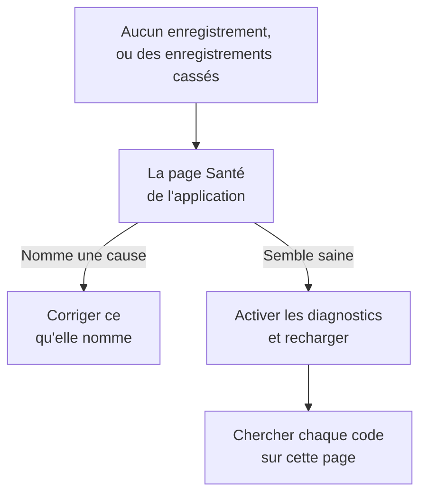

# Dépannage de la relecture de session

Quand aucun enregistrement n'arrive, ou qu'ils arrivent cassés, cette page en trouve la raison. La relecture de session enregistre chaque session par défaut et l'envoie au fil de l'eau : une page saine envoie donc un fragment environ toutes les 15 secondes tant que l'utilisateur fait quelque chose. Un onglet inactif ne produit aucun événement et n'envoie rien, et après cinq minutes sans saisie l'enregistreur se met carrément en pause (`recording-paused-idle`) : déplacez donc la souris ou cliquez avant de juger une installation depuis l'onglet Réseau. Si même alors vous ne voyez aucune requête vers OneUptime, l'une des causes ci-dessous en est la raison.

:::cards
- [Activer les diagnostics](#activer-les-diagnostics): Faites expliquer chaque décision par l'enregistreur dans la console.
- [Codes](#codes): Chaque ligne que l'enregistreur affiche, et que faire.
- [Un pare-feu devant OneUptime refuse les fragments](#un-pare-feu-devant-oneuptime-refuse-les-fragments): Les règles à vérifier, et les exclusions à ajouter.
- [Des images, icônes ou styles manquent dans la relecture](#des-images-icônes-ou-styles-manquent-dans-la-relecture): Des enregistrements qui se lisent, mais pas comme votre utilisateur les a vus.
:::



Le seul réglage où le silence est normal est l'envoi _On error or frustration_ (`OnErrorOrFrustration`) : l'enregistreur garde alors un tampon tournant en mémoire et n'envoie que lorsque quelque chose tourne mal, ce qui ressemble exactement à une installation cassée tant qu'aucun déclencheur ne s'est produit. Vérifiez lequel vous utilisez avant de chercher autre chose : la ligne `config-accepted` ci-dessous l'affiche.

Commencez côté serveur si vous le pouvez. La page **Santé** de l'application, dans la section **Relecture de session** de son menu latéral, nomme la cause quand rien n'arrive : l'enregistreur ne s'est jamais chargé, il s'est chargé mais rien n'a été envoyé et pourquoi, les envois sont refusés et pour quelle raison, ou le budget est épuisé. Voir [Santé de l'enregistrement](/docs/telemetry/session-replay#santé-de-lenregistrement). Ce qui suit est le côté navigateur : activez les diagnostics, rechargez une fois et lisez la console.

Les enregistrements arrivent, mais se lisent avec des images cassées, des icônes manquantes ou des zones sans style ? C'est une question de lecture, traitée dans [Des images, icônes ou styles manquent dans la relecture](#des-images-icônes-ou-styles-manquent-dans-la-relecture).

## Activer les diagnostics

Choisissez l'interrupteur que vous pouvez atteindre. Ils font tous la même chose.

:::tabs
@tab Dans le navigateur
Dans le navigateur qui échoue. Il ne demande aucun redéploiement, fonctionne en production et survit aux rechargements :

```js
localStorage.setItem("oneuptime.sessionReplay.debug", "true");
// then reload the page
```

Désactivez-le avec :

```js
localStorage.removeItem("oneuptime.sessionReplay.debug");
```
@tab Avec un lien
Pour une personne non technique, ou une page sur laquelle vous ne pouvez pas ouvrir de console, ajoutez `oneuptime_debug=1` à l'URL. Cela fonctionne aussi dans le fragment, qui survit à un serveur qui retire les paramètres de requête qu'il ne connaît pas :

```text
https://your-app.example.com/checkout?oneuptime_debug=1
https://your-app.example.com/checkout#oneuptime_debug=1
```
@tab Sur la balise script
Pour un environnement de préproduction, où vous le voulez activé pour tout le monde :

```html
<script
  src="https://oneuptime.com/telemetry/session-replay/v1/recorder.js"
  data-oneuptime-token="YOUR_TELEMETRY_INGESTION_KEY"
  data-oneuptime-app-identifier="YOUR_RUM_APP_IDENTIFIER"
  data-oneuptime-debug="true"
  crossorigin="anonymous"
  async
></script>
```
@tab Dans l'objet global d'initialisation
Si vous configurez l'enregistreur avec l'objet global d'initialisation :

```js
window.__ONEUPTIME_SESSION_REPLAY__ = {
  host: "https://oneuptime.com",
  token: "YOUR_TELEMETRY_INGESTION_KEY",
  appIdentifier: "YOUR_RUM_APP_IDENTIFIER",
  debug: true,
};
```
@tab Sur le déploiement
Sur le déploiement OneUptime, le seul interrupteur qui ne demande personne devant le navigateur en échec. Définissez `SESSION_REPLAY_DEBUG=true` et redémarrez. Chaque enregistreur que cette instance sert journalise alors, sur chaque page où il s'exécute : activez-le, recueillez un rechargement, puis désactivez-le. Il ne change aucune politique : ni l'échantillonnage, ni le masquage, ni le consentement. Voir [Notes pour l'auto-hébergement](/docs/telemetry/session-replay#notes-pour-lauto-hébergement) pour les autres réglages du déploiement.
@tab À l'exécution
Une fois l'enregistreur chargé :

```js
OneUptimeReplay.setDebug(true);
```
:::

La sortie ressemble à ceci :

```text
[OneUptime Session Replay] loader-start: Loader running.
[OneUptime Session Replay] init-options-read: Init options read. {host: "https://oneuptime.com", appIdentifier: "checkout-web", …}
[OneUptime Session Replay] config-fetch-start: Requesting the policy. {url: "https://oneuptime.com/telemetry/session-replay/v1/config", …}
[OneUptime Session Replay] config-accepted: Policy accepted. {captureTrigger: "Always", samplePercentage: 100, …}
[OneUptime Session Replay] recording: Recording and uploading …
```

## Obtenir la chronologie sans rien activer d'abord

L'enregistreur garde ses 250 dernières décisions, que les diagnostics soient activés ou non. Si le problème s'est déjà produit, vous n'avez pas besoin de le reproduire avec la journalisation activée — demandez plutôt ceci :

```js
copy(JSON.stringify(OneUptimeReplay.getDiagnostics(), null, 2));
```

Cela renvoie la version de l'enregistreur, l'id de session, son `state` (`recording`, `uploading`, `not-sampled`, `stopped`…), pourquoi il s'est arrêté le cas échéant, le `bootstrapDecision`, la réponse de chaque barrière sous `decisions` (échantillonné ou non, état du consentement, si les envois sont autorisés et ce qui les bloque, la dernière directive du serveur), les `capabilities` de l'enregistreur et la liste complète des enregistrements — y compris ceux du chargeur, qui s'exécute avant que l'artefact de l'enregistreur existe et où la plupart des renoncements se décident. Elle ne contient par construction aucun contenu de page ; voir [Ce que les diagnostics ne contiennent jamais](#ce-que-les-diagnostics-ne-contiennent-jamais). Les champs sont décrits dans [`getDiagnostics()`](/docs/telemetry/session-replay#getdiagnostics).

**Si `OneUptimeReplay is not defined`**, l'artefact de l'enregistreur ne s'est jamais chargé — ce qui est en soi la réponse à une bonne moitié des codes ci-dessous, et précisément le moment où vous voulez le plus la chronologie. Les enregistrements sont quand même là, sur un objet global dans lequel le chargeur écrit avant que l'artefact existe :

```js
copy(JSON.stringify(window.__ONEUPTIME_SESSION_REPLAY_DEBUG__.records, null, 2));
```

Collez l'un ou l'autre dans votre ticket de support — ou dans **Interroger le navigateur** sur la page **Santé** de l'application, qui explique chaque code qu'il contient. Cela suffit en général à lui seul.

## Quand le silence est normal : la politique déclenchée par les erreurs

Cette section ne s'applique que si `config-accepted` a affiché `captureTrigger: "OnErrorOrFrustration"`. Avec la politique `Always` par défaut, l'enregistreur envoie au fur et à mesure qu'il enregistre, et un silence sur une page avec laquelle l'utilisateur interagit signifie que quelque chose ne va vraiment pas — poursuivez la lecture au-delà de cette section.

Si la console affiche ceci :

```text
[OneUptime Session Replay] recording: Recording into memory. Nothing uploads until a trigger fires - call OneUptimeReplay.captureSession() to force one.
```

…alors l'enregistreur fonctionne. Avec une politique déclenchée par les erreurs, une page saine fait exactement une requête vers OneUptime par chargement de page (la récupération de la configuration) et n'envoie rien d'autre tant qu'une erreur, un 5xx, un signal de frustration ou un dépassement de budget de performance ne se produit pas.

Pour prouver tout le chemin de bout en bout, forcez un envoi :

```js
OneUptimeReplay.captureSession("installation test");
```

Vous devriez voir aussitôt un `POST /telemetry/session-replay/v1/chunk` dans l'onglet Réseau et une ligne `chunk-accepted` dans la console. Si c'est le cas, l'installation est correcte et la relecture apparaîtra dans le tableau de bord en une minute environ, avec votre raison marquée sur sa chronologie.

Un `202` avec `chunk-accepted` est celui à rechercher. Un `204` journalise plutôt `chunk-not-recorded` : la requête était correcte et le serveur a choisi de ne pas la stocker — budget dépassé, non échantillonnée, ou application désactivée. C'est une réponse de la politique, pas un défaut d'installation, et la ligne `server-directive` à côté dit laquelle.

Pour revenir à l'enregistrement de chaque session, réglez **Quand envoyer un enregistrement** sur _Always_ et **Pourcentage d'échantillonnage** au-dessus de 0 dans la page **Replay Policy** de l'application. C'est le réglage livré par défaut.

## Codes

Chaque ligne porte un `code` stable. Cherchez le vôtre ici.

### Démarrage

| code | signification |
| --- | --- |
| `loader-start` | Le script de l'enregistreur s'est exécuté. Si vous ne voyez pas ceci alors que les diagnostics sont activés, le script lui-même ne s'est jamais exécuté — vérifiez la requête `<script>` dans l'onglet Réseau et votre `script-src` de CSP. |
| `init-options-read` | Des options ont été trouvées. Vérifiez `host` et `appIdentifier` dans le détail : `appIdentifier` doit correspondre exactement à l'application RUM, et `host` doit être votre origine OneUptime, pas celle de votre propre application. |
| `init-options-incomplete` | Une option obligatoire manque. Le détail indique lequel de `hasHost` / `hasToken` / `hasAppIdentifier` vaut false. Si `hasHost` vaut false, la balise script n'a pas de `src` dont l'hôte puisse être déduit — ajoutez `data-oneuptime-host`. |
| `privacy-signal` | Le navigateur envoie Do Not Track ou Global Privacy Control et ce signal est respecté — par la page (rien sur la balise script ne dit le contraire) ou par la politique du serveur. Rien n'est enregistré ; avec `stage: "before-config-fetch"`, aucune requête de configuration n'est faite non plus. Ce n'est pas une panne. Ne définissez `data-oneuptime-respect-do-not-track="false"` que si votre base légale ne dépend vraiment pas du signal. |
| `init-options-missing` | Rien à lire sur la page : ni balise `script[data-oneuptime-token]` ni `window.__ONEUPTIME_SESSION_REPLAY__`. L'attribut marqueur est mal orthographié, l'extrait est allé dans un autre document, ou un gestionnaire de balises l'a supprimé. |
| `loader-threw` | Un bug dans l'enregistreur lui-même, pas dans votre configuration. Merci de le signaler avec la sortie des diagnostics. |

### Politique

| code | signification |
| --- | --- |
| `config-fetch-start` | Sur le point de demander la politique. L'`url` du détail est l'URL exacte — vérifiez qu'elle répond depuis un navigateur. |
| `config-fetch-rejected` | Le point de terminaison a répondu autre chose que 2xx. Voir [Statuts de récupération de la configuration](#statuts-de-récupération-de-la-configuration) ci-dessous. |
| `config-fetch-failed` | La requête ne s'est jamais terminée : `connect-src` de CSP, un bloqueur de publicité, le DNS, le TLS, une absence de réseau ou un délai de 5 secondes. Le navigateur journalise généralement sa propre ligne à côté de celle-ci. |
| `config-body-unparseable` | Le point de terminaison a répondu 2xx avec un corps qui n'est pas du JSON du tout. À distinguer de `config-fetch-failed` : la requête s'est *bien* terminée, donc quelque chose sur le chemin — un proxy, un portail captif, une page intermédiaire SSO — a répondu à la place de OneUptime. |
| `config-unparseable` | Le corps *était* du JSON valide, mais pas un objet — `null`, une chaîne, un tableau. Un proxy qui réécrit, ou un serveur qui répond à une autre route. |
| `config-disabled` | Le serveur dit que la relecture est désactivée ici. Le `disabledReason` du détail est la réponse : voir [disabledReason](#disabledreason) ci-dessous. |
| `config-recorder-version-invalid` | La politique ne nommait pas exactement `latest` en minuscules, donc aucune URL d'artefact n'a pu être construite. Un proxy qui réécrit ou une réponse altérée — un déploiement sans build signale plutôt `config-disabled` avec `recorder-not-built`. |
| `config-accepted` | La politique a été acceptée. Le détail est la politique entière — `captureTrigger`, `samplePercentage`, `consentMode`, `maskingMode`. |
| `config-field-defaulted` | Le serveur n'a envoyé aucune valeur pour un champ de la politique (nommé dans le détail), donc cet enregistreur a utilisé la valeur par défaut du produit. À titre informatif : en général un serveur plus ancien que l'enregistreur. Si le tableau de bord affiche une autre valeur pour ce champ, mettez à jour OneUptime. |
| `config-value-unrecognised` | Le serveur a envoyé une valeur que ce build de l'enregistreur ne connaît pas, donc il s'est rabattu sur la plus sûre — qui n'est peut-être pas celle qu'affiche votre tableau de bord. En général, une page exécute encore un enregistreur d'un déploiement plus ancien. |
| `directive-stop` | Le serveur a demandé à cet enregistreur de renoncer. Vérifiez la santé de l'enregistrement de l'application : budget, limite de débit ou coupure d'urgence. |

#### Statuts de récupération de la configuration

| statut | correction |
| --- | --- |
| `401` | Le jeton d'ingestion est faux, révoqué, expiré ou d'un autre projet. Créez-en un sous **Paramètres du projet → Télémétrie & APM → Clés d'ingestion** et confirmez-le avec `GET /session-replay/v1/validate` — envoyez la clé comme le fait l'enregistreur et ajoutez l'en-tête `x-oneuptime-app-identifier` : la réponse porte aussi `isSessionReplayEnabled` pour cette application, `sessionReplayDisabledDetail` qui nomme l'interrupteur désactivé quand ce n'est pas le cas, `isIngestEnabledOnThisInstance` et le `keyType`. |
| `400` | `data-oneuptime-app-identifier` manque. |
| `403` | L'origine de la page n'est pas dans les **Origines autorisées** de la clé d'ingestion. Ajoutez-la, ou utilisez une clé dont la liste d'autorisation couvre cette page. |
| `404` | Le chemin n'a pas abouti sur l'origine OneUptime. C'est presque toujours un `data-oneuptime-host` faux — ou un proxy inverse devant OneUptime qui ne transmet pas `/telemetry/*`. |
| `5xx` | Une panne côté serveur ; consultez les journaux de l'application OneUptime. |

#### disabledReason

| valeur | que faire |
| --- | --- |
| `not-enabled-for-application` | La relecture de session est désactivée pour cette application RUM, l'identifiant ne correspond à aucune, ou le projet n'a pas droit à la relecture. `disabledDetail` dit laquelle : `application-not-enabled` (l'interrupteur de cette application), `project-not-allowed` (l'interrupteur de tout le projet, sous **Surveillance des utilisateurs réels → Paramètres → Relecture de session**), `application-unknown` (aucune application n'a cet `appIdentifier` — vérifiez l'orthographe sur la page **Replay Policy** de l'application) ou `project-killed` (une coupure d'urgence de l'opérateur sur ce déploiement). |
| `budget-exhausted` | Le budget quotidien d'octets du projet ou le budget mensuel de l'application est déjà épuisé : les enregistreurs reçoivent l'ordre de ne pas enregistrer plutôt que d'envoyer des fragments qui seraient refusés. `disabledDetail` vaut `project-daily-budget-exhausted` ou `app-monthly-budget-exhausted`, et `budgetResetsAt` indique quand la limite se lève. Augmentez le budget sur la page **Replay Policy**, ou attendez la remise à zéro. |
| `recorder-not-built` | **Le déploiement n'a pas d'artefact d'enregistreur.** Rien sur la page du client ne peut corriger cela. Le build qui produit `packages/App/FeatureSet/BrowserRecorder/public/dist/manifest.json` ne s'est pas exécuté, ou son résultat n'a pas atteint l'image en cours d'exécution. Reconstruisez et redéployez l'application OneUptime. C'est la réponse habituelle sur une installation auto-hébergée où la relecture n'a jamais fonctionné. |
| `disabled-by-default` | `SESSION_REPLAY_ENABLED_BY_DEFAULT=false` sur ce déploiement. Passez-le à `true` — et définissez d'abord `SESSION_REPLAY_MAX_BYTES_PER_PROJECT_PER_DAY` si vous êtes auto-hébergé, car la relecture est votre plus grosse table. |
| `ingest-disabled` | `SESSION_REPLAY_INGEST_ENABLED=false` sur ce déploiement. |
| `policy-unavailable` | Le serveur n'a pas pu résoudre la politique — en général Redis ou Postgres. Il échoue en position fermée à dessein. Consultez les journaux de l'application OneUptime. |
| `not-reported` | Le serveur est plus ancien que ce champ. Utilisez plutôt le panneau **Test your installation** du tableau de bord, sur la page **Replay Policy**. |

### L'artefact

| code | signification |
| --- | --- |
| `artifact-requested` | Le dernier bundle de l'enregistreur est en cours d'injection. L'`url` est l'URL exacte. |
| `artifact-load-failed` | Il ne s'est pas chargé. Par ordre de probabilité : un `script-src` de CSP qui n'autorise pas votre origine OneUptime, une non-concordance SRI (un proxy qui réécrit le bundle), ou une 404 parce que ce déploiement n'a pas construit l'enregistreur. |
| `artifact-url-invalid` | La politique ne nommait pas exactement `latest` en minuscules, donc aucune URL n'a été construite. Une réponse de configuration altérée ou passée par un proxy. |
| `artifact-api-missing` | Le bundle s'est chargé mais n'a pas publié `window.OneUptimeReplay` — un autre script de la page l'a écrasé. |
| `bootstrap` | L'artefact de l'enregistreur démarre. |
| `bootstrap-already-started` | Deux copies de l'extrait sur une même page. Retirez-en une. |
| `bootstrap-already-running` | `bootstrap()` a été rappelé alors qu'un enregistreur tournait déjà. Sans gravité ; en général une intégration en double. |
| `bootstrap-cancelled` | Un `revokeConsent()` ou un `stop()` mis en file sur `window.OneUptimeReplayQueue` s'est exécuté avant le démarrage de l'enregistreur, donc cette session n'est pas enregistrée. Normal si votre bannière avait déjà été refusée. |
| `prerender-wait` | Le navigateur a pré-rendu cette page, comme Chrome le fait pour une page qu'il s'attend à voir ouvrir ensuite, et personne ne l'a encore ouverte. L'enregistreur démarre lorsque le visiteur ouvre la page, donc une page qui n'est jamais ouverte n'enregistre rien ; les appels que votre page fait entre-temps sont appliqués à ce moment-là. |
| `start-stopped` | `start()` n'a reçu aucune politique utilisable sur le chemin du bundle auto-hébergé. La raison précise figure sur la ligne `config-*` juste au-dessus. |
| `rrweb-did-not-start` | L'enregistreur du DOM a refusé de démarrer. Merci de le signaler. |
| `rrweb-error` | L'enregistreur du DOM a rencontré une erreur interne sur cette page (le nom de l'erreur est dans le détail ; elle est journalisée une fois). L'enregistrement peut sauter ou se figer autour de ce point, et après trois erreurs de ce type la session porte un avis de fidélité qui le dit. Merci de le signaler avec le framework de la page et le nom de l'erreur. |

### Enregistrement et envoi

| code | signification |
| --- | --- |
| `not-sampled` | Cette session a perdu le tirage de l'échantillon, donc rien du tout n'est enregistré. L'échantillonnage est déterministe selon l'id de session, donc recharger n'aidera pas cette session. Augmentez le pourcentage d'échantillonnage. |
| `recording` | Enregistrement en cours. Lisez le détail : `uploading: true` est l'état normal avec le déclencheur par défaut `Always`. `uploading: false` avec `captureTrigger: "OnErrorOrFrustration"` est l'autre état sain, sans requêtes. |
| `same-origin-propagation` | Journalisé une fois au démarrage de l'enregistreur : s'il ajoute un contexte de trace (`traceparent`, et un `tracestate` portant l'id de session) aux requêtes vers l'origine propre de la page. `enabled: true` avec `reason: "on"` est le défaut. `reason: "policy-off"` signifie que **Propagation des traces de même origine** est désactivé sur la page **Replay Policy** de l'application ; `reason: "opaque-origin"` signifie que la page n'a pas d'origine propre (une iframe en bac à sable, `about:blank`, `srcdoc` ou `file:`), donc rien ne compte comme même origine. Même activés, les en-têtes ne vont que sur les requêtes faites pendant que la session envoie, et jamais sur un `POST` vers un chemin se terminant par `/v1/traces`, `/v1/logs` ou `/v1/metrics` (les exports OpenTelemetry de la page elle-même). Journalisé une fois de plus, avec `reason: "agent-stand-down"` et un champ `agent` (`DD_RUM`, `NREUM` ou `elasticApm`), la première fois dans un chargement de page où l'enregistreur laisse le `traceparent` d'une requête de même origine à cet agent parce qu'il est configuré pour tracer la requête (Datadog RUM seulement dans une session qu'il suit) ; la requête reçoit quand même le membre `tracestate`, et n'est liée que si l'agent envoie vraiment un `traceparent`, ce que Datadog ne fait que dans une session Datadog suivie et échantillonnée pour les traces. New Relic (`NREUM`) envoie son propre `tracestate` à la place du membre, donc ses requêtes ne sont liées que par id de trace (voir [les onglets Logs et Traces sont vides](#les-onglets-logs-et-traces-du-lecteur-sont-vides)). Voir [Corréler avec le reste de votre télémétrie](/docs/telemetry/session-replay#corréler-avec-le-reste-de-votre-télémétrie). |
| `same-origin-propagation-tripped` | Une requête à laquelle l'enregistreur avait ajouté un contexte de trace a échoué au niveau réseau, en général une requête de même origine redirigée vers une autre origine qui n'autorise pas `traceparent` et `tracestate`. L'enregistreur a cessé de les ajouter pour le reste de ce chargement de page. `retried: true` signifie que c'était un `fetch` `GET` ou `HEAD` sans corps, renvoyé une fois exactement comme votre page l'avait fait ; `false` signifie qu'il ne pouvait pas être renvoyé et a échoué : tout sauf un `fetch` `GET` ou `HEAD` sans corps (tout XHR, toute autre méthode, toute requête avec un corps) n'est pas renvoyé. Les abandons et délais de votre propre page ne le déclenchent pas, ni un échec pendant que le navigateur se déclare hors ligne ; le chargement de page suivant repart de zéro. Voir [Des téléchargements ou des redirections échouent après l'activation de la relecture de session](#des-téléchargements-ou-des-redirections-échouent-après-lactivation-de-la-relecture-de-session). |
| `trigger` | Quelque chose qui mérite d'être gardé s'est produit. La `reason` est l'une de `error`, `frustration`, `performance`, `sampled` ou `manual`. |
| `upload-started` | Le pré-enregistrement en tampon est vidé. Les POST de fragments commencent ici. |
| `upload-blocked-consent` | Un déclencheur s'est produit et rien n'a été envoyé parce que le consentement n'a jamais été donné. Avec le mode de consentement `RequireExplicit`, votre page doit appeler `OneUptimeReplay.grantConsent()` une fois votre bannière acceptée. |
| `chunk-discarded-consent` | La même cause, une couche plus bas : un fragment complet a été jeté. |
| `chunk-accepted` | Un fragment est arrivé et a été stocké. L'installation fonctionne. |
| `chunk-not-recorded` | Le serveur a accepté la requête et a délibérément choisi de ne pas l'enregistrer — budget dépassé, non échantillonnée, application désactivée, ou plafond de fragments par session. La ligne `server-directive` à côté porte la raison. L'installation est correcte ; c'est la politique ou le budget qui n'est pas celui que vous attendez. |
| `chunk-post-failed` | Le POST n'a jamais atteint le serveur, avant que cette page ait jamais réussi un envoi. `connect-src` de CSP, un bloqueur de publicité, ou CORS sur l'origine d'ingestion — ou une page qui a perdu sa connexion avant son premier envoi. Compte pour le disjoncteur. |
| `chunk-held-offline` | Mode hors ligne : l'appareil n'a pas de connexion (le navigateur se déclare hors ligne, ou une requête n'a jamais atteint un serveur qui avait répondu auparavant). L'enregistrement continue et le fragment attend ; `queueDepth` indique combien attendent et `retryInMs` quand aura lieu la prochaine tentative. Ne compte pas comme un échec et rien n'est perdu. |
| `back-online` | La première requête après une coupure a atteint le serveur. Les fragments en file sont envoyés, du plus ancien au plus récent. |
| `browser-offline` | Le navigateur a émis son événement `offline`. L'enregistrement continue ; l'enregistreur ouvre son stockage hors ligne pour que les fragments d'un onglet fermé maintenant soient conservés. |
| `browser-online` | Le navigateur a émis son événement `online`, et les `queuedChunks` sont envoyés maintenant plutôt qu'au minuteur de nouvelle tentative. |
| `offline-queue-full` | La coupure a duré plus longtemps que la file d'envoi (240 fragments ou 4 Mo) : les `dropped` fragments les plus anciens ont été jetés pour garder les plus récents. La session montre une lacune à leur place. |
| `offline-flush-stored` | La page a été masquée ou fermée hors ligne, donc ses derniers fragments ont été écrits dans l'IndexedDB du navigateur au lieu d'être envoyés. `storeOpen: false` signifie que le stockage n'avait pas fini de s'ouvrir et qu'un onglet en train de fermer peut encore les perdre. La page suivante de l'application les envoie. |
| `final-flush-deferred` | La requête de clôture ne pouvait pas porter tous les fragments, et le reste (`kept`) a été écrit dans IndexedDB pour la page suivante au lieu d'être jeté. |
| `offline-chunks-restored` | Cette page a trouvé des `chunks` qu'une page précédente avait enregistrés hors ligne sans pouvoir les envoyer, et les envoie avant les siens. |
| `offline-chunk-claimed-elsewhere` | Un autre onglet de la même application a déjà envoyé un fragment que cet onglet avait stocké, donc cet onglet l'a sauté. Rien ne manque. |
| `chunk-post-server-error` | Le serveur a répondu 5xx. L'enregistreur réessaie ; `consecutiveFailures` face à `maxFlushFailures` dans le détail indique à quel point il est près d'abandonner. |
| `chunk-retry-scheduled` | Un échec réessayable (réseau, 5xx ou limitation par le serveur) a placé le fragment dans la file de nouvelles tentatives ; `inMs` dans le détail est la pause avant la prochaine tentative, et `queueDepth` le nombre de fragments en attente. Rien n'est encore perdu. |
| `chunk-retry` | La pause est terminée et les fragments en file sont renvoyés. |
| `chunk-abandoned` | Un fragment a échoué trop de fois et a été jeté ; l'envoi continue avec le suivant. La session montrera une lacune à sa place. Regardez la ligne `chunk-post-*` qui précède pour la cause. |
| `final-chunk-carried-queue` | La page a été masquée ou fermée alors que des fragments attendaient encore une nouvelle tentative, et ils sont partis comme trames supplémentaires de l'unique requête de masquage de page : `frames` indique combien la requête en portait, `bytes` sa taille totale. Rien n'a été perdu — ce qui n'a pas tenu est signalé par `final-flush-partial`. |
| `final-flush-truncated` | Il y avait plus en tampon au départ de la page qu'une requête keepalive ne peut porter, donc les événements les plus anciens du fragment de clôture ont été jetés pour qu'il tienne ; `droppedEvents` indique combien. La fin de la session — la partie que vous cherchez en général — est ce qui survit. |
| `final-flush-partial` | La requête de clôture n'a pas pu porter tous les fragments qu'on lui a confiés : `sent` trames sont parties, `dropped` non. Le fragment de scellement est choisi en premier, donc ce qui est perdu, ce sont des fragments plus anciens en file, et la session montre une lacune à leur place. |
| `chunk-too-large` | Un fragment dépassait encore le plafond par requête après compression — un instantané pleine page indivisible d'un très grand DOM. Seule sa taille déclarée est envoyée, le serveur répond 422, et la session porte un avis de fidélité à la place de cet instantané au lieu d'échouer. |
| `envelope-trimmed` | Le JSON d'en-tête du fragment dépassait la limite d'enveloppe de 8 KB du serveur, donc des champs facultatifs ont été retirés dans cet ordre jusqu'à ce qu'il tienne : ids de trace, routes, attributs, tags, avis de fidélité (`shed` liste ce qui est parti). Les images ne sont pas touchées ; la session peut manquer de données de corrélation ou de tags. En général 20 tags et 20 attributs à leur longueur maximale sur une même session. |
| `final-chunk-too-large` | Un fragment envoyé au départ de la page dépassait les 56 KB que l'enregistreur s'accorde pour un vidage au masquage de page — volontairement sous le quota keepalive combiné de 64 KB du navigateur. Avec `sealed: true`, c'était le fragment final : ses événements ont été jetés, donc l'enregistrement se termine quelques secondes plus tôt, et un fragment final vide part à sa place, si bien que la session se termine quand même avec l'onglet et que la séquence de fragments n'a pas de trou. Avec `sealed: false`, ce n'était pas un fragment final : il a été jeté en entier, rien n'a été scellé, et la session reste ouverte avec une lacune à la place de ce fragment. Dans les deux cas, ce qui est perdu, ce sont les événements de ce fragment ; un fragment en file qui n'a pas pu voyager dans la même requête est signalé séparément, par `final-flush-partial`. |
| `upload-blocked-transport` | Un déclencheur s'est produit alors que l'envoi était déjà désactivé pour cette page. La ligne `transport-disabled` au-dessus dit pourquoi. |
| `chunk-rejected-terminal` | L'envoi s'est arrêté pour de bon. `status: 401` est un mauvais jeton ; `status: 403` est une origine absente de la liste d'autorisation de l'application ou de la clé ; `status: 404` est un mauvais hôte. Corrigez et rechargez — l'enregistreur ne réessaie pas de lui-même. Lisez d'abord `answeredBy` : `"not-oneuptime"` signifie que le refus ne vient pas du tout de OneUptime — un pare-feu applicatif web, un CDN ou un proxy devant lui a répondu, ou l'hôte n'est pas OneUptime. Voir [Un pare-feu devant OneUptime refuse les fragments](#un-pare-feu-devant-oneuptime-refuse-les-fragments). |
| `chunk-refused` | Un fragment a été refusé (trop gros, ou illisible) et l'enregistrement a continué sans lui. |
| `chunk-refused-terminal` | L'envoi s'est arrêté parce que le serveur refusera chaque fragment de cet enregistreur : soit l'`error` du détail est une erreur à laquelle le serveur répond toujours de la même façon (`unsupported-wire-version` — un enregistreur que le serveur n'accepte plus ; `app-identifier-mismatch` ou `missing-app-identifier` — le fragment nomme une autre application que celle pour laquelle la politique a été récupérée ; `malformed-body` / `malformed-envelope` / `missing-envelope` — un proxy qui réécrit la requête), soit chaque fragment récent a été refusé comme mal formé. Mettez à jour OneUptime pour que l'enregistreur publié corresponde au serveur, et signalez-le avec les diagnostics si cela persiste. |
| `chunk-throttled` | Débit limité. Les envois se mettent en pause et reprennent d'eux-mêmes. |
| `transport-disabled` | Le disjoncteur s'est déclenché après des échecs répétés. La `reason` dit lequel. |
| `server-directive` | Le serveur a changé ce que l'enregistreur doit faire en cours de session. La `reason` est un vocabulaire fermé — voir [Statuts du POST de fragment](#statuts-du-post-de-fragment) ci-dessous. |
| `recorder-stopped-by-server` | Le serveur a dit à l'enregistreur de s'arrêter. En général le budget quotidien d'octets. |
| `recorder-throttled-by-server` | Le serveur a demandé à l'enregistreur de ralentir. Les envois reprennent d'eux-mêmes ; rien à faire. |
| `recorder-stopped-transport` | L'envoi a échoué définitivement, donc l'enregistrement s'est arrêté et le tampon a été libéré. La `reason` est celle qu'a signalée `transport-disabled`. |
| `recorder-stopped` | L'enregistrement s'est terminé, avec les totaux de la session : `droppedEvents`, `droppedChunks`, `flushFailures`. Les trois devraient valoir 0 sur une session saine. |
| `session-ended-idle` | Rien ne s'est passé sur la page pendant 30 minutes, donc la session s'est terminée — datée de la dernière activité, pas du moment où l'enregistreur s'en est aperçu (`idleForMs` indique il y a combien de temps). Plus rien n'est envoyé, et les requêtes vers votre propre origine ne portent aucun id de session, jusqu'au retour de l'utilisateur ; un onglet laissé ouvert sans personne devant ne démarre pas une nouvelle session toutes les demi-heures. |
| `recording-paused-idle` | Personne n'a appuyé sur une touche, cliqué, bougé la souris, fait défiler avec la molette ni touché la page pendant 5 minutes, donc l'enregistrement s'est mis en pause (`idleForMs` indique depuis combien de temps). Rien n'est capturé ni envoyé, et les requêtes vers votre propre origine ne portent aucun id de session, jusqu'à ce que la saisie suivante reprenne la même session — voir [Temps d'inactivité](/docs/telemetry/session-replay#temps-dinactivité). Normal sur tout onglet laissé seul. |
| `recording-resumed` | L'utilisateur est revenu pendant que l'enregistrement était en pause, donc il a repris dans la même session sur un instantané neuf (`pausedForMs` indique pendant combien de temps il était en pause). Le lecteur saute l'intervalle entre les deux. |
| `session-rotated` | Une nouvelle session a démarré (l'utilisateur est revenu après 30 minutes d'inactivité, la session a atteint 4 heures, `identify()` a nommé un autre utilisateur que celui à qui la session appartenait — `rotationReason: "identity-change"` — ou un autre onglet du même visiteur en a démarré une d'abord — `rotationReason: "adopted"`). L'enregistrement continue sous un nouvel id, les écouteurs `onSessionChange` en sont avertis, et les requêtes vers votre propre origine portent le nouvel id à partir de là. |
| `command-queue-not-an-array` | `window.OneUptimeReplayQueue` n'est pas un tableau, donc chaque commande mise en file dessus a été ignorée. Ce doit être un tableau d'entrées `[command, ...arguments]`. |
| `command-queue-unknown-command` | Un nom de commande en file n'a pas été reconnu — vérifiez l'orthographe dans l'[API JavaScript](/docs/telemetry/session-replay#api-javascript). |
| `command-queue-command-failed` | Une commande en file a levé une exception pendant son application — la `command` et le `name` de l'erreur sont dans le détail. Le reste de la file s'est quand même exécuté. En général un argument de la mauvaise forme (une chaîne là où un objet d'attributs est attendu). |

#### Statuts du POST de fragment

Ce que le point de terminaison d'ingestion répond au `POST` d'un fragment, tel que vous le verriez dans l'onglet Réseau. Seuls les 4xx autres que 429 signifient que l'installation est fausse.

| statut | signification |
| --- | --- |
| `202` | Accepté et mis en file pour stockage. S'il porte aussi `directive: "stop"` avec la raison `session-chunk-cap`, les fragments de cette requête qui étaient sous le plafond par session sont arrivés et plus rien après eux n'arrivera — un onglet ouvert longtemps qui atteint la fin de ce qu'une session peut contenir, pas une panne. |
| `204` | Reçu et délibérément non stocké. Un 204 n'a pas de corps, donc la directive voyage dans les en-têtes : `x-oneuptime-replay-directive` vaut `stop` quand l'enregistreur doit renoncer (relecture désactivée, non échantillonnée, budget dépassé, plafond atteint) ou `continue` quand seule cette requête a été refusée, et `x-oneuptime-replay-reason` porte la raison. `consent-required` est celle qui revient avec `continue` : le mode de consentement est _Require explicit_ et la page n'a pas encore appelé `grantConsent()`, donc l'enregistreur continue d'enregistrer et réessaie. Le vocabulaire des raisons est `ingest-disabled`, `instance-not-offering-replay`, `policy-unavailable`, `not-enabled`, `origin-not-allowed`, `session-chunk-cap`, `not-sampled`, `rate-limited`, `rate-counter-unavailable`, `budget-exhausted`, `budget-counter-unavailable`, `app-monthly-budget-exhausted` et `consent-required`, et la page **Santé** les compte par leur nom. |
| `400` | La trame n'a pas pu être servie, et la suivante du même build ne le serait pas non plus, donc le corps porte `directive: "stop"` et un code `error` stable : `empty-body`, `missing-envelope`, `envelope-too-large`, `malformed-envelope`, `malformed-body`, `unsupported-wire-version`, `truncated-payload`, `too-many-frames`, `app-identifier-mismatch`, `missing-app-identifier` ou `chunk-index-malformed` (un `chunkIndex` absent, négatif, fractionnaire ou absurde). Six d'entre eux — `unsupported-wire-version`, `app-identifier-mismatch`, `missing-app-identifier`, `malformed-body`, `malformed-envelope`, `missing-envelope` — arrêtent l'envoi immédiatement (`chunk-refused-terminal`) ; tout autre 400 est pardonné une fois et arrête l'envoi après trois d'affilée. Presque toujours un proxy qui réécrit la requête, ou un enregistreur et un serveur de versions différentes. |
| `401` | La clé d'ingestion est fausse, révoquée, expirée ou d'un autre projet. |
| `403` | L'origine de la page n'est pas dans la liste d'autorisation de la clé d'ingestion ou de l'application. Terminal — l'enregistreur ne réessaie pas. Un 403 dont le corps est une page HTML, ou vide, ne vient pas de OneUptime : un pare-feu applicatif web a refusé la requête — voir [Un pare-feu devant OneUptime refuse les fragments](#un-pare-feu-devant-oneuptime-refuse-les-fragments). |
| `413` | Le corps dépassait le plafond par requête. L'enregistreur découpe les fragments bien en dessous, donc c'est un proxy qui a regonflé un corps compressé. Ce seul fragment est jeté ; la session continue. |
| `422` | `snapshot-too-large` : une trame a déclaré une charge au-dessus du plafond — un instantané pleine page indivisible qui ne tiendra pas. Par fragment, non terminal : la session survit avec un avis de fidélité disant que cet instantané manque, et la lecture reprend au suivant. Allégez le DOM, ou attendez-vous à une lacune à ce chargement de page. |
| `429` | Débit limité. `Retry-After` dit pour combien de temps ; les envois se mettent en pause et reprennent d'eux-mêmes. |
| `503` | Le stockage des fragments était injoignable. L'enregistreur réessaie. |

### Appels faits par votre page

Ces lignes consignent ce que votre propre code a demandé à l'enregistreur. Elles servent à confirmer qu'une bannière de consentement ou une capture manuelle a bien atteint l'enregistreur, et quand.

| code | signification |
| --- | --- |
| `api-capture-session` | `captureSession()` a été appelé. `hasReason` dit s'il portait une raison pour la chronologie. |
| `api-grant-consent` | `grantConsent()` a été appelé. |
| `api-revoke-consent` | `revokeConsent()` a été appelé. Tout ce qui était en tampon a été jeté et l'envoi s'est arrêté ; l'enregistreur continue de tourner en mémoire seulement, donc un `grantConsent()` ultérieur continue sur une session neuve. |
| `api-stop` | `stop()` a été appelé. Le dernier fragment a été envoyé et la session scellée ; plus rien n'est enregistré pour le reste de la vie de la page. |
| `api-no-recorder` | L'un des appels ci-dessus s'est exécuté alors qu'aucun enregistreur n'était actif — en général parce qu'il s'est exécuté avant le chargement de l'artefact de l'enregistreur. Poussez plutôt des entrées `[command, ...arguments]` dans `window.OneUptimeReplayQueue`, et elles sont appliquées dès son arrivée. |

## Aucune requête dans l'onglet Réseau

Parcourez cette liste dans l'ordre ; elle est classée selon la fréquence à laquelle chaque cause est la bonne réponse.

1. **Filtrez sur `session-replay`, pas sur l'identifiant de l'application.** La requête de configuration est un `GET`, et c'est la seule requête que fait une session saine non déclenchée.
2. **Y a-t-il un `GET .../session-replay/v1/config` ?**
   - **Non, et aucun `loader-start` dans la console** → le script ne s'est jamais exécuté. Vérifiez que l'élément `<script>` est dans le DOM, que sa requête a réussi, et votre `script-src` de CSP.
   - **Non, mais `privacy-signal` est dans la console** → Do Not Track ou GPC. Fonctionnement prévu.
   - **Oui, autre que 2xx** → voir [Statuts de récupération de la configuration](#statuts-de-récupération-de-la-configuration).
3. **Aucun `POST` de fragment ?** Interagissez d'abord avec la page — un onglet inactif n'a rien à envoyer. Lisez ensuite la ligne `recording`. Avec le déclencheur par défaut `Always`, `uploading` doit valoir `true` et des fragments doivent partir environ toutes les 15 secondes d'activité ; `uploading: false` avec `OnErrorOrFrustration` est normal — appelez `OneUptimeReplay.captureSession()` pour en forcer un et confirmer que le chemin fonctionne.
4. **Toujours rien après `captureSession()` ?** Cherchez `upload-blocked-consent` (appelez `grantConsent()`), `not-sampled` ou `transport-disabled`.

## Un pare-feu devant OneUptime refuse les fragments

Si l'enregistreur atteint OneUptime en passant par votre propre périphérie — un pare-feu applicatif web comme Azure Front Door ou Application Gateway, Cloudflare, ou un proxy ModSecurity ou Coraza — ce pare-feu inspecte chaque fragment avant que OneUptime ne le voie. Quand il en refuse un, vous verrez :

- des `POST` de fragments qui répondent `403` (parfois `400` ou `406`) avec une page HTML ou un corps vide, au lieu du JSON de OneUptime ;
- `chunk-rejected-terminal` dans la console avec `answeredBy: "not-oneuptime"`, et l'envoi arrêté pour le reste de la page ;
- dans le journal du pare-feu, un id de règle comme `920420` (_Request content type is not allowed by policy_), `921110` (_HTTP Request Smuggling Attack_) puis `949110` (_Inbound Anomaly Score Exceeded_).

La vérification la plus rapide consiste à regarder où vont les requêtes. Si l'hôte de l'enregistreur est votre propre domaine (par exemple `https://app.example.com/telemetry/...`, relayé vers OneUptime), votre pare-feu est sur le chemin. Charger l'enregistreur directement depuis votre hôte OneUptime retire complètement votre pare-feu du chemin.

### Ce que l'enregistreur envoie

Écrivez toute exclusion exactement pour ceci, et rien de plus large :

| Quoi | À quoi cela ressemble |
| --- | --- |
| Requêtes | `GET /telemetry/session-replay/v1/config`, `POST /telemetry/session-replay/v1/chunk`, et la pré-requête CORS `OPTIONS` du navigateur pour chacune. Les mêmes chemins sans le préfixe `/telemetry` sont aussi actifs. |
| `Content-Type` | `application/octet-stream`. Les enregistreurs construits avant ce changement envoyaient `application/vnd.oneuptime.session-replay.v1`, que la règle 920420 refuse. |
| En-têtes | `x-oneuptime-token` et `x-oneuptime-app-identifier` sur les deux requêtes ; `x-oneuptime-user-ref` sur la requête de configuration quand votre page a identifié un utilisateur. Pas de `Content-Encoding`. |
| Corps | Ni JSON, ni formulaire, ni XML : une ou plusieurs trames de `<envelope JSON>` suivies de l'enregistrement, en général compressé en gzip. Un pare-feu le lit comme des octets opaques. |

Indépendamment de cela, l'enregistreur ajoute les en-têtes `traceparent` et `tracestate` aux requêtes de votre page vers sa propre origine (voir [Corréler avec le reste de votre télémétrie](/docs/telemetry/session-replay#corréler-avec-le-reste-de-votre-télémétrie)). Ils vont à votre backend, pas à OneUptime : ils ne comptent donc ici que si le pare-feu placé devant votre propre site refuse ou retire les en-têtes inconnus.

### OWASP Core Rule Set 3.3 et le DRS 2.x d'Azure

Rien à configurer. `application/octet-stream` figure dans la liste d'autorisation par défaut des types de contenu du jeu de règles, donc 920420 le laisse passer, et un corps de ce type n'est jamais décomposé en arguments, donc les règles d'injection ne voient jamais les URL de page ni les valeurs d'attributs qu'il contient. La seule règle qui lit un tel corps brut, 921110, cherche un texte ayant la forme d'une ligne de requête HTTP : un nom de méthode comme `get`, un blanc, puis un saut de ligne ou `HTTP/1.1`. L'enregistreur écrit chaque fragment de sorte que ce motif ne puisse pas apparaître — `%`, `&` et `http/` partent sous forme d'échappements JSON, ce qui ne laisse rien que le décodage d'URL et d'entités du pare-feu puisse transformer en saut de ligne, et le saut de ligne propre à chaque trame est précédé d'une espace. OneUptime lit le fragment exactement comme avant.

Les DRS 2.1 et 2.2 d'Azure Front Door reposent sur CRS 3.3.2 et 3.3.4 : ceci les couvre donc.

Si une page exécute encore un enregistreur d'avant ce changement — un onglet ouvert depuis longtemps, ou un build d'application mobile non mis à jour — ses fragments portent l'ancien type de contenu et sont refusés jusqu'à ce qu'elle se recharge ou se mette à jour. Pour couvrir cette période sur Azure Front Door, ajoutez une règle personnalisée qui sélectionne `RequestUri` contenant `/session-replay/v1/chunk` et l'en-tête de requête `Content-Type` égal à `application/vnd.oneuptime.session-replay.v1`, avec l'action _Allow_. Retirez-la quand ces clients ont disparu.

### OWASP Core Rule Set 4

CRS 4 a retiré `application/octet-stream` de sa liste d'autorisation par défaut, donc 920420 refuse les fragments tant que vous n'autorisez pas ce type — pour la seule route des fragments, pas pour tout le site :

```apache
# REQUEST-900-EXCLUSION-RULES-BEFORE-CRS.conf
SecRule REQUEST_FILENAME "@endsWith /session-replay/v1/chunk" \
    "id:1000100,phase:1,pass,nolog,ctl:ruleRemoveById=920420"
```

Le corps du fragment n'a besoin de rien d'autre : le même encodage garde 921110 silencieuse sous CRS 4.

### Vos requêtes OpenTelemetry sont bloquées aussi

L'exportateur OTLP/HTTP du SDK navigateur OpenTelemetry envoie du `application/json`, qu'un pare-feu analyse bel et bien — et alors chaque attribut de span devient un argument pour les règles d'injection. Un `http.url` de span contenant une chaîne de requête suffit à en déclencher une ; une ligne de journal du pare-feu qui nomme `JsonValue:resourceSpans.scopeSpans.spans.attributes.value.stringValue` correspond à ce cas. OneUptime ne peut pas changer ce qu'envoie ce SDK, donc la correction se fait sur le pare-feu : excluez les valeurs de la charge OTLP de l'inspection sur les seuls chemins OTLP (`/otlp/v1/traces`, `/otlp/v1/logs`, `/otlp/v1/metrics`). Sur Azure Front Door, attachez une politique WAF distincte à la route qui sert ces chemins, et ajoutez-y des exclusions de règles gérées avec la variable de correspondance _Request body JSON arg names_, l'opérateur _Starts with_ et les sélecteurs `resourceSpans`, `resourceLogs` et `resourceMetrics`, limitées aux règles ou groupes de règles que votre journal montre déclenchés.

## La liste des sessions indique « N chunks missing », ou le lecteur dessine des lacunes

Un enregistrement est envoyé sous forme d'une séquence numérotée de fragments par onglet. Le finaliseur signale chaque index jamais arrivé comme un fragment manquant, la liste affiche la session comme **Partiel** avec les secondes manquantes, et le lecteur dessine une lacune étiquetée partout où la séquence saute, et la franchit — délibérément, car l'autre option serait de lire des mutations par-dessus un trou et d'afficher un DOM que l'utilisateur n'a jamais vu.

Le nombre dit donc toujours la vérité. Ce qu'il signifie dépend de l'endroit où se trouve le trou :

- **Un trou tout à la fin** est le cas habituel et bénin : le navigateur a été fermé ou a changé de page en plein vidage. Cherchez `final-flush-partial` ou `final-chunk-carried-queue` dans la console. Un `final-chunk-too-large` avec `sealed: true` perd les dernières secondes sans laisser de lacune dans la séquence de fragments.
- **Un trou au milieu** est un fragment que le serveur a refusé ou n'a jamais reçu. `chunk-refused`, `chunk-abandoned`, `chunk-post-failed`, `chunk-not-recorded` et `final-chunk-too-large` avec `sealed: false` dans la console nomment chacun une cause différente, et la ligne `server-directive` à côté porte la raison du serveur.
- **La même lacune au même endroit dans chaque session, sur une page au DOM volumineux**, était un défaut des anciens enregistreurs, corrigé dans l'enregistreur que publie cette version de OneUptime. Ces builds découpaient un instantané pleine page rrweb plus gros que le seuil de vidage de 256 KB en morceaux étiquetés `snapshotPart`, que rien côté réception ne réassemblait jamais : l'instantané — et chaque index de fragment qu'il occupait — était jeté à chaque chargement de page, et rien sur la page du client ne pouvait le contourner. L'enregistreur actuel ne découpe jamais un instantané. Le serveur compte ce qu'il refuse, si bien qu'un ancien enregistreur apparaît sur la page **Santé** sous forme de rejets avec la raison `snapshot-fragment-unsupported`. Rechargez la page concernée pour récupérer `latest` sans cache du navigateur ; les enregistrements déjà faits restent tels quels.

Les lacunes ne sont pas des périodes d'inactivité : une période d'inactivité est une séquence enregistrée où rien ne s'est passé, dessinée en gris sur la chronologie et que l'on peut sauter ; une lacune est une séquence qui n'est jamais arrivée, dessinée en ambre.

## Le lecteur indique Buffering, ou un fragment n'a pas pu se charger

Le lecteur récupère les images enregistrées par fragments de 15 secondes à mesure que la tête de lecture s'en approche. _Buffering_ signifie que le fragment suivant n'est pas encore arrivé ; après huit secondes, il propose **Réessayer**. Un fragment qui échoue définitivement affiche une erreur avec **Réessayer** et **Copier le diagnostic** — ce dernier porte l'id de session, l'onglet, le fragment et la génération, ce dont le support a besoin. Une session dont les images ont expiré affiche une explication à la place de la scène, tandis que les onglets Logs, Traces et Errors fonctionnent toujours à partir de votre télémétrie.

## Des images, icônes ou styles manquent dans la relecture

Un enregistrement garde l'adresse de chaque image, et de chaque feuille de style que l'enregistreur n'a pas pu lire, plutôt que le fichier, et le lecteur les charge depuis ces adresses dans votre navigateur pendant que vous regardez ; voir [Images, styles et polices pendant la lecture](/docs/telemetry/session-replay#images-styles-et-polices-pendant-la-lecture). Quand l'une ne se charge pas, la relecture diffère de ce que votre utilisateur a vu :

- des icônes d'image cassée, parfois avec le texte alternatif de l'image à côté, comme « web » ou « close » ;
- un logo ou une photo de produit manquant ;
- des zones qui ont perdu leurs styles : texte brut, mises en page empilées, contrôles à l'apparence par défaut du navigateur ;
- une bannière ou une boîte de dialogue que votre site masque normalement, et qui s'affiche, parce que la règle qui la masque se trouve dans une feuille de style qui ne s'est pas chargée. La barre _You're offline. This is a read only version of the page._ d'un portail Power Pages en est un exemple : elle figure sur chaque page du portail, masquée par une feuille de style de `content.powerapps.com`. C'est un élément du portail lui-même, pas le [mode hors ligne](/docs/telemetry/session-replay#mode-hors-ligne) de OneUptime, et elle ne dit rien de la connexion de votre utilisateur ;
- du texte dans une autre police, ce qui peut déplacer les retours à la ligne ;
- des polices d'icônes dessinées comme des carrés vides, ou comme les mots qu'elles représentent.

### Vérifiez d'abord ceci

1. **Lisez les notes de capture sous le lecteur.** Quand des images ou des feuilles de style n'ont pas pu se charger dans votre navigateur, la première note le dit — par exemple _2 images didn't load in this replay_ — et nomme les sites d'où elles venaient. Elle couvre chaque onglet que le lecteur a lu depuis que vous avez ouvert la session. **Détails de la session** (`I`) → **Fidélité** → **Ressources manquantes** liste chaque adresse, jusqu'aux 200 premières. Les polices web, les images d'arrière-plan CSS et les images que votre page a créées dans le navigateur (adresses `blob:`) ne figurent pas dans cette liste ; cherchez-les dans les DevTools (ci-dessous).
2. **Vérifiez le mode de masquage.** Une session enregistrée sous _Mask all text_ ne charge ni ses images ni ses polices web, par conception (une image que la page détenait sous forme d'URL `data:` fait partie de l'enregistrement, et s'affiche quand même), et ses notes de capture indiquent _Images and web fonts are not loaded_. Il en va de même pour une session dont le mode de masquage n'a pas été signalé, ou n'est pas l'un de ceux que le tableau de bord reconnaît. Les feuilles de style se chargent quand même dans les deux cas. **Détails de la session** → **Confidentialité** montre le mode que la session signale, c'est-à-dire celui de son chargement de page le plus récent.
3. **Vérifiez si cela a aussi échoué pour votre utilisateur.** Ouvrez l'onglet **Erreurs** du rail à ce moment-là : une ligne _Resource failed to load_ pour le même fichier signifie qu'il était cassé aussi sur l'écran de votre utilisateur, et que la relecture le montre fidèlement.

### Trouver la cause dans les DevTools

Ouvrez les outils de développement de votre navigateur sur l'onglet du tableau de bord (F12, ou Cmd+Option+I sur Mac), sélectionnez **Network**, rechargez la page et lisez jusqu'à l'endroit où quelque chose manque. Filtrez par l'hôte que nomme la note de capture, ou par type (**Img**, **CSS**, **Font**), et lisez le statut du fichier en échec ; la **Console** dit en toutes lettres pourquoi le navigateur l'a refusé. Les chaînes ci-dessous sont celles qu'affichent Chrome et Edge ; Firefox et Safari les formulent autrement.

| Ce que vous voyez | Pourquoi le fichier ne s'est pas chargé | Que changer |
| --- | --- | --- |
| `401` ou `403` | Le fichier exige la connexion de votre utilisateur, ou son serveur le refuse : une liste d'IP autorisées, une règle de pare-feu, ou une protection contre le hotlinking qui exige un `Referer` de votre propre site. Un lien signé expiré répond en général `403` aussi. | Servez les fichiers statiques comme les logos, icônes et feuilles de style sans connexion, et faites accepter par la protection contre le hotlinking les requêtes sans `Referer` et celles dont le `Referer` est votre origine OneUptime : les requêtes faites par le CSS, comme les images d'arrière-plan et les polices, l'envoient dans Chrome et Edge. Un fichier que seul un utilisateur connecté peut récupérer ne peut pas être affiché dans une relecture. |
| `404` ou `410` | Le fichier a disparu : un déploiement a changé son nom haché, ou il a été supprimé. La relecture demande le fichier tel qu'il est maintenant, pas tel qu'il était quand votre utilisateur l'a vu. | Gardez les fichiers de vos déploiements précédents en ligne aussi longtemps que vous gardez les enregistrements. Un fichier déjà disparu ne peut pas être récupéré. |
| _CORS error_, et dans la console _No 'Access-Control-Allow-Origin' header is present on the requested resource_ | Une police web, ou une image que votre page charge avec `crossorigin`. Le navigateur ne les utilise sur un autre site qu'avec la permission du serveur, et la relecture s'exécute sur l'origine OneUptime. | Envoyez `Access-Control-Allow-Origin: *`, ou votre origine OneUptime, avec ces fichiers. |
| `ERR_BLOCKED_BY_RESPONSE.NotSameOrigin` ou `ERR_BLOCKED_BY_RESPONSE.NotSameSite` dans la console, et `(blocked:CORP not "same-origin")` ou `(blocked:CORP not "same-site")` dans le panneau Network | Le serveur envoie `Cross-Origin-Resource-Policy: same-origin` ou `same-site`, qui refuse le fichier à tout autre site. | Envoyez `Cross-Origin-Resource-Policy: cross-origin` sur les fichiers statiques, ou n'envoyez pas cet en-tête. |
| `(blocked:mixed-content)`, et une erreur de console qui se termine par _This request has been blocked; the content must be served over HTTPS_ | Une feuille de style, une police, un candidat `srcset` ou une image dans `<picture>` en `http://` sur un tableau de bord en `https`. Les autres images `http://` (un simple ``, une affiche de vidéo, un arrière-plan CSS) sont plutôt promues en `https://`, avec un avertissement _Mixed Content_, et échouent là où l'hôte n'a pas de `https`. | Servez les fichiers en `https`. |
| `(blocked:csp)`, et une ligne de console disant que le fichier _violates the following Content Security Policy directive_ | La ligne nomme la directive qui l'a refusé. `img-src data: blob:` ou `font-src data:` est la politique propre de la relecture pour une session lue sans ses images ni ses polices web (_Mask all text_, ou un mode de masquage non signalé ou non reconnu), et `object-src 'none'` ou `media-src 'none'` est sa politique pour les intégrations, la vidéo et l'audio dans chaque enregistrement : les deux sont voulues. Toute autre directive vient d'une `Content-Security-Policy` du tableau de bord OneUptime lui-même, qui s'applique aussi dans la relecture ; sur une installation auto-hébergée, elle est en général ajoutée par un proxy inverse. | Rien, pour la politique propre de la relecture. Pour celle du tableau de bord, autorisez `https:`, ou les hôtes qu'utilisent vos pages, dans ses `img-src`, `style-src` et `font-src`. |
| Une erreur réseau comme `ERR_NAME_NOT_RESOLVED` ou `ERR_CONNECTION_TIMED_OUT` | Votre navigateur ne peut pas atteindre l'hôte : un nom d'intranet, un hôte accessible seulement par VPN, une liste d'IP autorisées qui ne vous inclut pas. | Regardez la relecture depuis un réseau qui peut l'atteindre. |
| `ERR_BLOCKED_BY_CLIENT` dans la console, et `(blocked:other)` dans le panneau Network | Une extension de votre navigateur, comme un bloqueur de publicité ou de traceurs, a refusé le fichier. Votre utilisateur l'a peut-être bien vu ; la note de capture nomme aussi cette cause. | Autorisez le site dans cette extension, ou regardez la relecture dans un profil de navigateur sans elle. Rien ne doit changer sur votre site. |
| `(blocked:origin)` sur le fichier de sprite, dont le type est **Other**, si bien que le filtre **Img** le masque, et dans la console _Unsafe attempt to load URL … Domains, protocols and ports must match._ | L'icône est dessinée à partir d'un fichier de sprite SVG (`<use href="/icons.svg#close">`). Les navigateurs ne laissent `<use>` pointer que vers un fichier de l'origine propre de la page, et la relecture s'exécute sur celle de OneUptime, donc ces icônes ne s'affichent jamais, même depuis votre propre domaine. | Intégrez le sprite dans la page (`<use href="#close">`), ou dessinez l'icône avec `` ou un `<svg>` en ligne. |
| `(blocked:other)` sur une adresse `blob:`, et dans la console _Not allowed to load local resource: blob:…_ | Une image que votre page a créée dans le navigateur avec `URL.createObjectURL` : un aperçu de téléversement, ou une image récupérée avec un jeton. Une adresse `blob:` n'a de sens qu'à l'intérieur de l'onglet qui l'a créée, donc ces images ne se chargent jamais dans une relecture, et les notes de capture ne les listent pas. | Rien : une relecture ne peut pas les afficher. |

### Portails Power Pages

- La feuille de style de la barre hors ligne et ses icônes `web.png` et `close.png` viennent de `content.powerapps.com`, qui les sert à n'importe quel site : le lecteur les charge donc et la barre reste masquée, comme pour votre utilisateur. Si elle s'affiche quand même, les notes de capture nomment la feuille de style de `content.powerapps.com` qui ne s'est pas chargée dans votre navigateur. Vérifiez que votre réseau, ou une politique d'un tableau de bord auto-hébergé, vous laisse atteindre cet hôte ; un `404` signifie que cette version du fichier n'est plus servie.
- Les polices d'icônes que le portail sert depuis son propre domaine, comme Glyphicons (`/fonts/glyphicons-halflings-regular.woff2`), ne se chargent que si le portail autorise votre origine OneUptime via CORS. Ajoutez-la (par exemple `https://oneuptime.com`) au paramètre de site `HTTP/Access-Control-Allow-Origin` dans l'application Portal Management, ou sous **Security** → **Advanced settings** → **CORS** dans le studio de conception Power Pages.
- Les pages, fichiers web et images qui exigent une connexion au portail — derrière des autorisations de page ou de table, ou sur un site privé — restent cassés dans la relecture, car votre navigateur n'a pas la session de portail de votre utilisateur.

Les enregistrements d'un portail faits avant que OneUptime ne charge ces fichiers pendant la lecture, ceux qui affichaient la barre hors ligne à chaque relecture, se lisent désormais eux aussi avec la barre masquée, tant que la feuille de style qu'ils nomment est encore servie : rien dans un enregistrement n'a à changer.

## L'application RUM indique « Déconnecté »

La pastille d'état et **Dernière fois vu** sur la page de l'application indiquent quand de la télémétrie est arrivée pour la dernière fois pour cette application. La relecture de session compte : un enregistreur qui récupère sa politique comme un fragment accepté les actualisent, si bien qu'une application instrumentée avec le seul extrait de relecture reste Connecté. Dans les anciennes versions, seule la télémétrie RUM OpenTelemetry le faisait, si bien qu'une application avec la seule relecture affichait « Déconnecté » avec un Dernière fois vu vieux de plusieurs jours alors que ses enregistreurs fonctionnaient parfaitement.

« Connecté » signifie donc que *quelque chose* rend compte — pas que tout le fait. Les pages vues, le taux d'erreurs, la durée p95 et les clients viennent du SDK navigateur OpenTelemetry, qui s'installe à part ; quand ils sont à zéro alors que des enregistrements arrivent, la page Vue d'ensemble de l'application le dit directement.

## La télémétrie RUM est à part

La relecture de session et les traces RUM sont deux pipelines indépendants, avec deux modes de défaillance indépendants. Un enregistreur qui fonctionne n'implique pas que la télémétrie RUM arrive, et une application RUM qui fonctionne n'est pas un prérequis au chargement de l'enregistreur.

Si vos requêtes OTLP manquent dans l'onglet Réseau, c'est le SDK navigateur OpenTelemetry de votre page qui est en cause, pas cet enregistreur — voir [Dépannage RUM](/docs/rum/troubleshooting), qui couvre dans l'ordre les causes côté SDK.

## Les onglets Logs et Traces du lecteur sont vides

Ces onglets affichent la télémétrie de votre backend liée à l'enregistrement, sans code de votre part : les spans marqués de l'id de session à l'ingestion, à partir du `tracestate` que l'enregistreur ajoute aux requêtes de votre page vers sa propre origine, et les journaux et exceptions des mêmes traces, rattachés par id de trace. Voir [Corréler avec le reste de votre télémétrie](/docs/telemetry/session-replay#corréler-avec-le-reste-de-votre-télémétrie). Quand ils restent vides, parcourez cette liste :

1. **L'enregistreur a-t-il ajouté les en-têtes ?** Avec les diagnostics activés, `same-origin-propagation` doit indiquer `enabled: true`. `reason: "policy-off"` signifie que **Propagation des traces de même origine** est désactivé pour l'application ; `"opaque-origin"` signifie que la page n'a pas d'origine propre. Une ligne `same-origin-propagation-tripped` signifie qu'une requête a échoué et que l'enregistreur a cessé de les ajouter pour le reste du chargement de page (voir [ci-dessous](#des-téléchargements-ou-des-redirections-échouent-après-lactivation-de-la-relecture-de-session)). Dans les DevTools, un `fetch` de même origine fait pendant que la session envoie porte `tracestate: oneuptime=sid:…`. Rien n'est ajouté avant le consentement avec _Require explicit_, ni avant un déclencheur avec _On error or frustration_.
2. **`tracestate` mais pas de `traceparent` ?** Une requête de même origine qui montre `tracestate: oneuptime=…` dans les DevTools mais aucun `traceparent` signifie qu'un autre agent de traçage de la page a fait renoncer l'enregistreur, puis n'a pas ajouté de `traceparent` lui-même. Votre backend jette un `tracestate` qui arrive sans lui, donc rien n'est lié. Avec les diagnostics activés, cherchez `same-origin-propagation` avec `reason: "agent-stand-down"` : son `agent` nomme Datadog RUM (`DD_RUM`) ou Elastic APM (`elasticApm`). Avec Datadog, c'est en général une session que Datadog n'échantillonne pas pour les traces : avec un `traceSampleRate` inférieur à 100 et le `traceContextInjection: "sampled"` par défaut, il n'envoie aucun `traceparent` dans ses autres sessions. Réglez `traceSampleRate: 100` pour lier chaque session qu'il suit ; `traceContextInjection: "all"` envoie aussi un `traceparent` dans ces sessions, mais marqué non échantillonné, donc l'échantillonneur `ParentBased` par défaut de votre backend jette quand même leurs traces. Avec Elastic APM, vérifiez que son `disableInstrumentations` ne liste ni `fetch` ni `xmlhttprequest`. Sinon, configurez cet agent pour qu'il propage un `traceparent` W3C vers votre propre origine. Avec le SDK navigateur OpenTelemetry, vérifiez que l'URL n'est pas dans le `ignoreUrls` de son instrumentation. New Relic (`NREUM`) présente un autre symptôme, traité à l'étape 5.
3. **Votre API est-elle sur une autre origine ?** Ses requêtes ne reçoivent rien, sauf si l'origine figure dans **Origines de propagation des traces**, et alors seulement un `traceparent`, rapproché par id de trace. Si la ligne de la requête dans l'onglet Réseau n'a pas non plus de lien de trace, l'origine n'est pas listée et votre page ne définit pas `traceparent` elle-même.
4. **Votre backend poursuit-il le contexte de trace W3C ?** Ses propagateurs OpenTelemetry doivent inclure `tracecontext` (le SDK Go ne propage rien tant que `otel.SetTextMapPropagator(propagation.TraceContext{})` n'est pas appelé), et aucun proxy ni CDN devant lui ne doit retirer `traceparent` et `tracestate`. Une trace backend dont l'id correspond à celui de la ligne Réseau, mais dont les spans manquent dans l'onglet, renvoie ici.
5. **La requête portait-elle déjà un `tracestate` ?** Datadog RUM, Elastic RUM et certaines configurations OpenTelemetry envoient le leur. L'enregistreur n'écrit pas dans l'en-tête d'un autre fournisseur, donc ces spans ne sont pas marqués et ne sont liés que par id de trace. New Relic avec le traçage distribué activé (`agent-stand-down` nomme `NREUM`) envoie son propre `tracestate` avec chaque `traceparent` qu'il ajoute, à la place du membre : les DevTools montrent un `traceparent` et un `tracestate` sans entrée `oneuptime=`. Ses appels `XMLHttpRequest` et ses appels `fetch` faits avec un objet `Request` sont liés par id de trace ; un `fetch` appelé avec une URL n'est pas lié du tout quand New Relic se charge en premier, car New Relic envoie une copie des options de la requête que l'enregistreur ne voit jamais. Aucun réglage de New Relic ne rétablit le membre ; seule la désactivation de son traçage distribué le fait, et l'enregistreur crée alors le `traceparent` lui-même.
6. **Des traces, mais des journaux vides ?** Les journaux se rattachent par id de trace, donc votre backend doit les écrire à l'intérieur du span de la requête, avec une journalisation OpenTelemetry qui enregistre l'id de la trace active.
7. **Écarté par l'échantillonnage ?** Une trace que votre backend jette n'atteint jamais OneUptime ; voir [Échantillonnage des traces démarrées dans le navigateur](/docs/telemetry/session-replay#échantillonnage-des-traces-démarrées-dans-le-navigateur).

Un onglet verrouillé qui nomme une autorisation signifie que votre rôle ne peut pas lire les journaux ou les traces. Les enregistrements React Native ne lient rien d'eux-mêmes : le SDK n'instrumente pas le réseau, alors attachez vous-même `session.id` depuis `onSessionChange()`.

## Des téléchargements ou des redirections échouent après l'activation de la relecture de session

Une requête vers votre propre origine que le serveur redirige vers une autre origine (un téléchargement renvoyé vers une URL présignée S3, GCS ou Azure Blob, un avatar servi par un CDN) emporte avec elle les en-têtes `traceparent` et `tracestate` que l'enregistreur a ajoutés. Le navigateur doit alors demander la permission de l'autre origine par une pré-requête CORS, et si cette origine n'autorise pas ces en-têtes, la requête échoue avec une erreur CORS dans la console.

L'enregistreur déclenche un disjoncteur au premier échec de ce type. Il journalise `same-origin-propagation-tripped`, cesse d'ajouter des en-têtes pour le reste du chargement de page, et renvoie une fois un `fetch` `GET` ou `HEAD` sans corps, exactement comme votre page l'avait fait (`retried: true` dans le détail), si bien que votre page reçoit le résultat de cette nouvelle tentative. Tout sauf un `fetch` `GET` ou `HEAD` sans corps (tout `XMLHttpRequest`, toute autre méthode, toute requête avec un corps) n'est pas renvoyé, donc cette requête-là échoue quand même, et le chargement de page suivant ajoute à nouveau les en-têtes. Pour corriger durablement, soit :

- autorisez `traceparent` et `tracestate` dans la configuration CORS de l'autre origine (sur S3, les `AllowedHeaders` CORS du bucket), soit
- désactivez **Propagation des traces de même origine** sur la page **Replay Policy** de l'application, et retirez votre propre origine de **Origines de propagation des traces** si vous l'y aviez listée, sinon ses requêtes continuent de recevoir un `traceparent`. La télémétrie backend n'est alors liée que pour les origines de **Origines de propagation des traces** et pour les requêtes que votre page trace elle-même.

Voir [Redirections vers une autre origine](/docs/telemetry/session-replay#redirections-vers-une-autre-origine).

## Chaque session de la liste indique Anonymous ou Visitor

L'enregistreur ne sait pas qui est votre utilisateur tant que votre page ne le lui dit pas. Appelez `OneUptimeReplay.identify(userRef, traits)` dès que vous le savez, ou mettez-le en file sur `window.OneUptimeReplayQueue` avant le chargement du script — voir [Identifier vos utilisateurs](/docs/telemetry/session-replay#identifier-vos-utilisateurs). D'ici là, la liste regroupe les sessions d'un navigateur sous _Visitor a1b2c3_, l'[id de visiteur](/docs/telemetry/session-replay#visiteurs-anonymes) aléatoire que l'enregistreur crée pour chaque navigateur, qui suit un navigateur et jamais une personne d'un appareil à l'autre ; la page **Replay Users** et le menu des autres sessions du lecteur s'en servent, la recherche `user:` non.

Cinq choses que les lignes vous disent :

- **_Visitor_ sur chaque ligne** — l'enregistreur est à jour et votre page n'appelle pas `identify()`, ou l'appelle après la fin de la session. `hasTraits` dans `getDiagnostics()` vaut `true` dès qu'un `identify()` avec des attributs a atteint l'enregistreur.
- **_Anonymous_ plutôt que _Visitor_** — ces sessions viennent d'un enregistreur construit avant l'existence des ids de visiteur. Vérifiez si `visitor-id` apparaît dans `getDiagnostics().capabilities` ; sinon, rechargez la page pour récupérer l'enregistreur `latest` actuel.
- **Un id _Visitor_ différent à chaque chargement de page depuis un même navigateur** — l'enregistreur n'a pas pu écrire dans `localStorage` (navigation privée, données de site bloquées), donc il a créé un id neuf à chaque chargement. L'enregistrement fonctionne toujours ; seul le regroupement entre visites est perdu.
- **_Visitor_ alors que votre page appelle bien `identify()`** — vérifiez que **Capturer l'identité de l'utilisateur final** est activé pour l'application. S'il est désactivé, la référence ne quitte jamais le navigateur, par conception, et la session reste celle d'un visiteur. Une ligne qui affiche _Hidden_ est encore autre chose : la page a identifié quelqu'un et votre rôle ne peut pas lire qui.
- **Certaines sessions d'un utilisateur connecté indiquent _Visitor_, d'autres le nomment** — une session porte le nom de l'utilisateur dès qu'une de ses pages appelle `identify()`, et à partir de là chaque page et chaque onglet de cette session porte l'utilisateur, y compris les pages qui ne l'appellent jamais elles-mêmes (voir [Identifier vos utilisateurs](/docs/telemetry/session-replay#identifier-vos-utilisateurs)). Une ligne _Visitor_ est une session dans laquelle aucune page n'a identifié personne : en général une page de connexion laissée ouverte, une visite terminée avant que l'utilisateur se connecte, ou une nouvelle session — après 30 minutes d'inactivité ou le plafond de 4 heures — sur une page qui n'avait pas appelé `identify()` elle-même. Appeler `identify()` à chaque chargement de page où votre application connaît l'utilisateur, et pas seulement juste après la connexion, couvre le dernier cas. Un utilisateur qui se déconnecte et un autre qui se connecte sur le même navigateur ont chacun leur session : `identify()` avec une autre référence termine la session en cours et en démarre une nouvelle.

## Ce que les diagnostics ne contiennent jamais

Les diagnostics ne portent aucun contenu de page, et c'est imposé plutôt que promis :

- Le détail de chaque enregistrement est limité, au niveau des types, aux chaînes, nombres, booléens et null. Un nœud DOM, une Response ou tout autre objet transmis depuis du JavaScript non typé est remplacé par `<object omitted>` avant la création de l'enregistrement, pas seulement avant son affichage.
- Les valeurs de type chaîne sont tronquées.
- Les URL qui apparaissent dans les enregistrements sont soit les propres points de terminaison de OneUptime, soit déjà débarrassées de leurs chaînes de requête et fragments par le même nettoyeur que celui de l'enregistrement lui-même.

La sortie de `getDiagnostics()` peut donc être collée sans risque dans un ticket de support. Il n'est pas prudent en revanche de laisser les diagnostics activés pour chaque visiteur d'un site de production — non pour des raisons de confidentialité, mais parce que c'est du bruit dans les consoles de vos utilisateurs finaux.

## Toujours bloqué

Rassemblez ces éléments avant de demander de l'aide :

- La sortie de `OneUptimeReplay.getDiagnostics()`.
- Le statut de la requête `session-replay/v1/config`.
- Ce que disent la page **Santé** de l'application et le panneau **Test your installation** de **Replay Policy**. Ils répondent côté serveur, c'est-à-dire la moitié qu'un navigateur ne peut pas voir.
- Pour des images, icônes ou styles manquants : l'adresse d'un fichier qui ne s'est pas chargé (**Ressources manquantes** les liste) et la ligne que la console du navigateur a affichée pour lui.

Contactez ensuite support@oneuptime.com, ou ouvrez un ticket sur [GitHub](https://github.com/OneUptime/oneuptime).

## Prochaines étapes

:::cards
- [Relecture de session](/docs/telemetry/session-replay): L'installation, la politique et chaque réglage que nomme cette page.
- [Dépannage RUM](/docs/rum/troubleshooting): Quand c'est la télémétrie OpenTelemetry qui manque plutôt que les enregistrements.
- [Configuration navigateur](/docs/rum/browser-setup): Clés d'ingestion, origines autorisées et Content Security Policy.
:::
