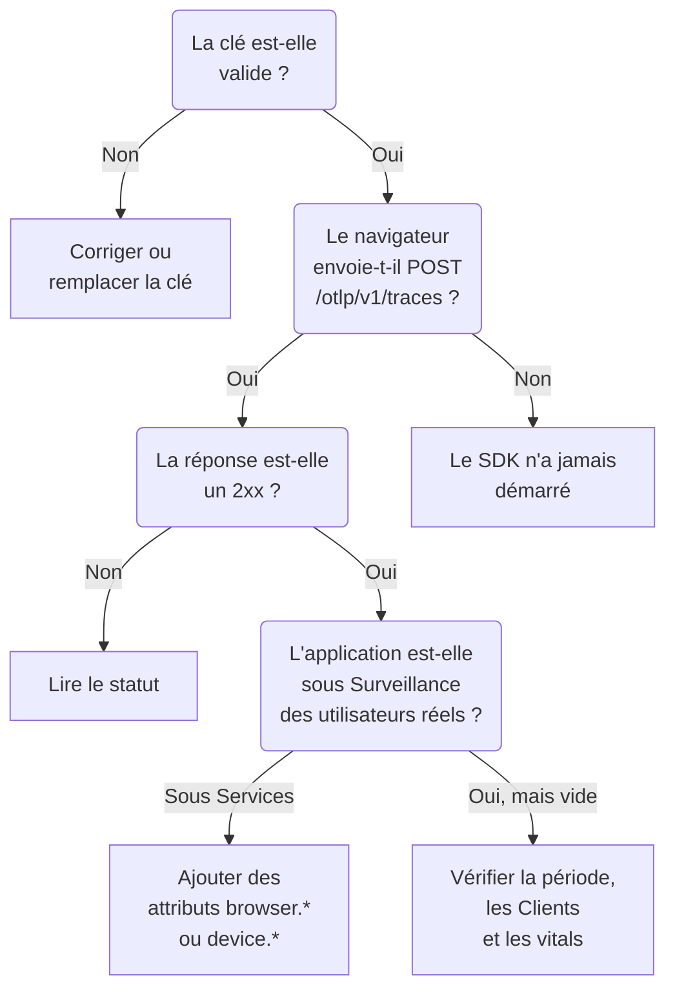

# Dépannage RUM

Lorsqu'une application RUM manque, est vide ou affiche **Déconnecté**, parcourez cette page dans l'ordre. Chaque vérification écarte une partie du chemin entre votre application et OneUptime, dans l'ordre où ces problèmes surviennent d'habitude.

:::cards
- [Vérifier la clé](#vérifier-la-clé): La vérification la plus rapide, et tout ce qui suit en dépend.
- [Vérifier ce qui quitte le navigateur](#vérifier-ce-qui-quitte-le-navigateur): La requête d'export dans les outils de développement de votre navigateur.
- [Vérifier où la télémétrie arrive](#vérifier-où-la-télémétrie-arrive): Une application RUM, ou un service backend.
- [Problèmes de relecture de session](#problèmes-de-relecture-de-session): Un pipeline à part, avec sa propre page.
:::

## Où la télémétrie RUM s'arrête

La télémétrie passe trois vérifications en chemin vers une application RUM. Trouvez la première qui échoue :



## Vérifier la clé

Vérifiez d'abord la clé. C'est la vérification la plus rapide, et rien de ce qui suit ne fonctionne sans une clé que OneUptime accepte :

```bash
curl -i https://oneuptime.com/otlp/v1/validate \
  -H "x-oneuptime-token: YOUR_TELEMETRY_INGESTION_TOKEN"
```

| Réponse | Ce que cela signifie |
| --- | --- |
| `200` avec `"valid": true` | OneUptime accepte la clé. La réponse donne aussi son `keyType` et son `projectId`. Passez à la vérification suivante. |
| `401` avec `"valid": false` | La clé est absente, inconnue, révoquée, désactivée ou expirée, et le `message` dit laquelle de ces raisons. Créez une clé active sous **Paramètres du projet → Télémétrie & APM → Clés d'ingestion**. |

Une application web a besoin d'une clé **Navigateur**, et une application mobile d'une clé **Serveur** : voir [Configuration navigateur](/docs/rum/browser-setup) et [Configuration mobile](/docs/rum/mobile-setup). Les points de terminaison d'export refusent aussi une mauvaise clé avec `401`, comme le demande la spécification OTLP, si bien qu'un SDK bien conçu journalise le refus au lieu de réessayer. Cette ligne passe facilement inaperçue dans une console de navigateur, et cette vérification répond directement.

## Vérifier ce qui quitte le navigateur

Ouvrez les outils de développement de votre navigateur sur la page de l'application, sélectionnez l'onglet Réseau et filtrez sur `otlp`. Vous cherchez `POST /otlp/v1/traces` avec un statut `2xx`.

### Aucune requête

Le SDK n'a jamais démarré. C'est presque toujours l'une de ces causes :

- `telemetry.ts` n'est pas le premier import de votre application, ou votre bundler l'a supprimé. Les instrumentations modifient `fetch` et `XMLHttpRequest`, donc une requête faite avant cette modification n'est pas tracée, et un fichier que le bundler a retiré n'exécute rien du tout.
- Le processeur par lots n'a pas encore exporté. `BatchSpanProcessor` attend quelques secondes pour remplir un lot : attendez, ou passez à une autre page, avant de conclure que rien n'est envoyé.
- Une variable d'environnement de build est devenue `undefined`, et l'URL de l'exportateur est cassée. Journalisez l'URL une fois au démarrage.

### Le navigateur bloque la requête

- **Une erreur de Content Security Policy dans la console.** La politique de votre page n'autorise pas encore OneUptime. Ajoutez-le à votre directive `connect-src` existante, ou utilisez votre propre hôte si vous hébergez OneUptime vous-même :

  ```text
  connect-src 'self' https://oneuptime.com;
  ```

- **Une erreur CORS.** Les points de terminaison OTLP acceptent les requêtes de n'importe quelle origine et autorisent l'en-tête `x-oneuptime-token`, donc un vrai échec CORS signifie presque toujours que la requête n'a jamais atteint OneUptime : cherchez un proxy d'entreprise, un bloqueur de publicité ou une faute de frappe dans l'hôte. Vérifiez l'URL de la requête dans l'onglet Réseau.

### La requête reçoit un statut d'erreur

**`401`.** La clé est inconnue, révoquée ou expirée. Lancez la [vérification de la clé](#vérifier-la-clé), puis utilisez une clé active.

**`404`.** L'URL est fausse. L'exportateur de traces a besoin du chemin complet, `/otlp/v1/traces`. Une erreur courante consiste à donner l'adresse de base (`https://oneuptime.com/otlp`) à un exportateur qui attend l'URL complète, ou l'URL complète à un exportateur qui ajoute lui-même le chemin et aboutit à `/otlp/v1/traces/v1/traces`.

**`413`.** Le lot dépassait ce qu'un proxy accepte. L'ingress de OneUptime accepte jusqu'à 4 MB sur `/otlp`, mais un proxy que vous placez devant OneUptime peut être plus strict — ingress-nginx, par exemple, fixe `proxy-body-size` à 1 MB par défaut — alors, si vous en avez un, augmentez aussi sa limite pour `/otlp`. Dans tous les cas, un `maxExportBatchSize` plus petit sur le `BatchSpanProcessor` réduit chaque export :

```ts
new BatchSpanProcessor(exporter, { maxExportBatchSize: 100 });
```

Un navigateur envoie rarement des lots aussi gros, sauf si des spans portent de gros attributs, comme une pile d'appels entière ou un corps de réponse. Les raccourcir est la meilleure solution.

**`422`.** OneUptime a refusé la clé ici, et le message dit pourquoi. `Origin https://app.example.com is not allowed for this browser ingestion key.` signifie que l'origine exacte de la page, avec son schéma et son éventuel port, manque dans les **Origines autorisées** de la clé. `This telemetry ingestion key has been disabled.` signifie que quelqu'un a désactivé la clé.

**`429`.** La **Requests Per Minute Limit** de la clé est épuisée : `Too many telemetry requests for this ingestion key. Please retry later.` Une clé Navigateur autorise 6 000 requêtes par minute pour tous vos visiteurs ensemble, sauf si vous fixez votre propre limite sur la clé.

**`403` avec une page HTML, ou un corps vide.** OneUptime répond à chaque refus en JSON : celui-ci vient donc de quelque chose placé devant, en général un pare-feu applicatif web sur votre propre domaine, si vous faites passer OneUptime par lui. Le pare-feu analyse OTLP/JSON et confronte chaque attribut de span à ses règles d'injection, si bien qu'une URL avec une chaîne de requête sur un span suffit à être bloquée, et le journal du pare-feu nomme la règle. Excluez la charge OTLP de l'inspection sur les seuls chemins OTLP : [Vos requêtes OpenTelemetry sont bloquées aussi](/docs/rum/session-replay-troubleshooting#vos-requêtes-opentelemetry-sont-bloquées-aussi) montre comment, et couvre l'enregistreur de relecture derrière le même pare-feu.

## Vérifier où la télémétrie arrive

La requête réussit, mais l'application apparaît sous **Produits → Services** au lieu de **Produits → Ressources → Surveillance des utilisateurs réels**. C'est le signalement le plus courant, et la cause est presque toujours une ressource sans attributs client. OneUptime ne range un lot comme RUM que si sa ressource porte l'un de ceux-ci :

| Type | Attributs |
| --- | --- |
| Navigateur | `browser.platform`, `browser.language`, ou un `browser.brands` non vide |
| Mobile | `device.id` ou `device.model.identifier`, ou `device.manufacturer` sur une ressource sans identité d'hôte (`host.name`, `host.id` ou `k8s.node.name`) |

Un `service.name` seul crée un service backend. Le SDK navigateur OpenTelemetry n'ajoute aucun attribut `browser.*` sauf si vous ajoutez le détecteur de ressources du navigateur ou les définissez vous-même : voir [Configuration navigateur](/docs/rum/browser-setup).

Pour voir ce que vous envoyez réellement, ouvrez la requête OTLP dans l'onglet Réseau et regardez sa charge : `resourceSpans[0].resource.attributes` est la liste qui décide. Si aucun attribut `browser.*` n'y figure, le SDK ne l'ajoute pas, quoi qu'en dise sa documentation.

Ajoutez les attributs, et le lot suivant crée l'application RUM. Le service créé en premier ne devient pas une application RUM, car ce sont deux enregistrements distincts : supprimez-le donc sous **Produits → Services** une fois la télémétrie RUM arrivée.

> [!NOTE]
> Une ressource dont le seul attribut client est `device.manufacturer`, et qui a aussi une identité d'hôte, est lue comme une machine plutôt qu'un téléphone, car l'inventaire d'un hôte indique sa marque avec le même attribut. Ajoutez `device.id` ou `device.model.identifier`, et le lot est rangé comme RUM mobile quoi qu'il porte d'autre.

## L'application est vide

L'application existe, mais ses pages n'affichent rien.

- **Vérifiez la période.** La vue d'ensemble montre par défaut la dernière heure : un lot de test de ce matin est donc en dehors.
- **Attendez quelques minutes.** L'ingestion passe par une file, et **Dernière fois vu** est actualisé toutes les quelques minutes plutôt qu'à chaque lot.
- **Vérifiez le projet.** Une clé écrit dans son propre projet : la télémétrie envoyée avec la clé d'un autre projet est là-bas, pas ici.

## La page Clients est vide

La page **Clients** liste `browser.platform` sur le web et `device.model.identifier` sur mobile. Deux raisons pour lesquelles elle reste vide alors que tout le reste fonctionne :

- **Safari et Firefox.** `browserDetector` lit l'API UA Client Hints, que seuls les navigateurs Chromium possèdent. Ailleurs, il définit `browser.language`, ce qui suffit pour ranger la télémétrie comme RUM, mais pas `browser.platform`. Définissez `browser.platform` vous-même pour lister ces clients.
- **Un SDK mobile qui ne définit que `device.manufacturer`.** Cela range la télémétrie comme RUM mobile, mais la page **Clients** a besoin de `device.model.identifier`.

## Les Core Web Vitals affichent « No web vitals reported yet »

La carte ne se remplit qu'à partir des métriques que votre application envoie : les traces seules ne la remplissent jamais. Vérifiez que vous exportez bien des métriques, que leurs noms sont de ceux que OneUptime lit, et qu'elles figurent sur la page **Métriques** de l'application. [La carte affiche « No web vitals reported yet »](/docs/rum/web-vitals#dépannage) passe en revue chaque vérification, y compris les valeurs perdues quand un visiteur ferme l'onglet avant l'export suivant.

## L'état indique Déconnecté alors que des gens utilisent l'application

Une application passe à **Déconnecté** après 15 minutes sans télémétrie. Si des gens utilisent l'application :

- **Un échantillonneur écarte peut-être tout.** Vérifiez que vous n'avez pas défini un échantillonneur toujours désactivé, ou un ratio très bas.
- **L'application n'envoie peut-être de la télémétrie que lors de certaines interactions**, et personne ne les a utilisées pendant ce temps.
- **La clé a peut-être été révoquée ou désactivée** après votre déploiement : relancez la [vérification de la clé](#vérifier-la-clé).

Une application interne ou à faible trafic sans visiteurs la nuit est réellement déconnectée. Ce n'est pas une panne.

## Problèmes de relecture de session

La relecture de session est un pipeline à part, avec ses propres problèmes : le script de l'enregistreur, les listes d'origines autorisées, le consentement, la Content Security Policy et le masquage. [Dépannage de la relecture de session](/docs/rum/session-replay-troubleshooting) les couvre. Commencez par là, et commencez par activer les diagnostics de l'enregistreur, car la plupart de ses échecs sont silencieux à dessein :

```js
localStorage.setItem("oneuptime.sessionReplay.debug", "true");
// then reload the page
```

La page **Santé** de l'application, dans sa section **Relecture de session**, et le panneau **Test your installation** de **Replay Policy** vérifient la clé, les listes d'autorisation et la politique côté serveur, et disent pourquoi rien n'arrive. La console du navigateur vous donne la moitié que le serveur ne peut pas voir.

Avec la politique par défaut, un enregistreur envoie un fragment environ toutes les 15 secondes tant que l'utilisateur interagit avec la page. Un onglet inactif n'a rien à envoyer : cliquez ou déplacez d'abord la souris ; ensuite, l'absence de toute requête de fragment signifie que quelque chose ne va pas. Si l'application n'envoie que _On error or frustration_, le silence est normal jusqu'à ce que quelque chose tourne mal. Appelez `OneUptimeReplay.captureSession()` pour forcer un envoi et prouver le chemin dans les deux cas.

Les deux pipelines sont indépendants. Une application RUM qui fonctionne n'est pas nécessaire au chargement de l'enregistreur, et un enregistreur qui fonctionne ne signifie pas que la télémétrie RUM arrive : chacun peut échouer seul.

## Toujours bloqué

Rassemblez ces éléments avant de demander de l'aide. Ils évitent un aller-retour :

- La liste `resource.attributes` de la charge d'une vraie requête OTLP.
- Le statut HTTP de cette requête.
- Le `service.name` exact que vous envoyez, et si le projet a une application ou un service portant ce nom.
- Si `/otlp/v1/validate` répond `200` pour la clé dans le build déployé.

Contactez ensuite support@oneuptime.com, ou ouvrez un ticket sur [GitHub](https://github.com/OneUptime/oneuptime).

## Prochaines étapes

:::cards
- [Configuration navigateur](/docs/rum/browser-setup): La configuration que supposent ces vérifications, étape par étape.
- [Configuration mobile](/docs/rum/mobile-setup): La clé et les attributs dont une application mobile a besoin.
- [Gérer les applications](/docs/rum/applications): Noms, étiquettes, rétention et état.
- [Dépannage de la relecture de session](/docs/rum/session-replay-troubleshooting): Chaque code de l'enregistreur, et que faire.
:::
