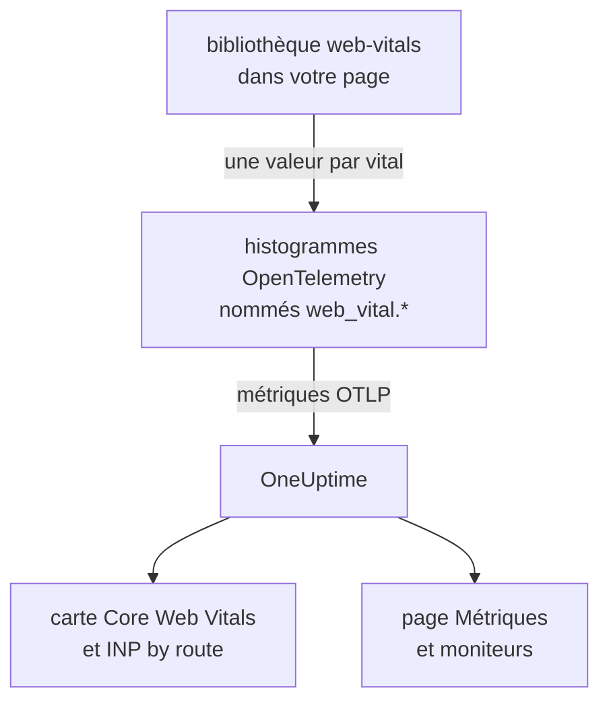
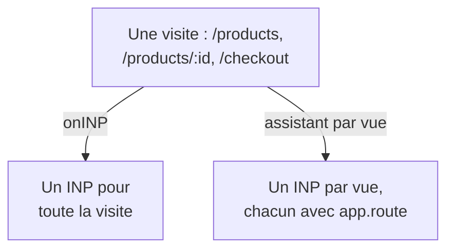

# Core Web Vitals

La carte **Core Web Vitals** de la vue d'ensemble d'une application RUM affiche LCP, INP, CLS, FCP et TTFB, chacun évalué selon les seuils de Google. OneUptime ne mesure lui-même aucune de ces valeurs : la carte se remplit uniquement à partir des métriques que signale votre instrumentation de navigateur, et cette page montre comment les envoyer.

:::cards
- [Les envoyer](#les-envoyer-depuis-votre-application): Transmettre les valeurs de la bibliothèque web-vitals sous forme de métriques OpenTelemetry.
- [Noms lus par OneUptime](#noms-de-métrique-reconnus-par-oneuptime): Les noms de métrique sous lesquels chaque vital peut arriver.
- [Applications monopages](#applications-monopages): L'INP de chaque vue, pas une seule valeur par chargement de page.
- [Alerter sur un vital](#alerter-sur-un-vital): Des moniteurs prêts à l'emploi pour les vitals dégradés.
:::

## Fonctionnement

La bibliothèque [`web-vitals`](https://github.com/GoogleChrome/web-vitals) mesure chaque vital dans la page ; c'est la même bibliothèque qu'utilisent les outils de Chrome. Votre code enregistre chaque valeur dans un histogramme OpenTelemetry, et le pipeline de métriques du navigateur l'exporte vers OneUptime.



OpenTelemetry n'a pas encore de convention de nommage définitive pour les web vitals : OneUptime cherche donc chaque vital sous plusieurs noms et utilise le premier qui a des données. Utilisez les noms `web_vital.*` pour toute nouvelle instrumentation.

## Avant de commencer

- Une application web configurée comme dans [Configuration navigateur](/docs/rum/browser-setup), avec son pipeline de métriques : c'est le `MeterProvider` d'[Ajouter journaux et métriques](/docs/rum/browser-setup#ajouter-journaux-et-métriques) qui exporte ces valeurs.

## Les envoyer depuis votre application

:::steps
### Installer la bibliothèque

```bash
npm install web-vitals
```

### Enregistrer chaque vital dans un histogramme

Créez `src/web-vitals.ts`. Chaque vital est un histogramme, pour que la page **Métriques** puisse calculer des percentiles plus tard, avec des bornes de buckets placées sur les seuils « bon » et « mauvais » de Google.

```ts title="src/web-vitals.ts"
// Import after ./telemetry
import { metrics } from "@opentelemetry/api";
import { onCLS, onFCP, onINP, onLCP, onTTFB, type Metric } from "web-vitals";

const meter = metrics.getMeter("web-vitals");

// Histograms, so the Metrics tab can compute percentiles later. The bucket
// edges sit on each vital's good / poor limits: a percentile is read from
// the buckets, and the defaults are far too coarse for these ranges.
const buckets = (...edges: number[]) => ({ advice: { explicitBucketBoundaries: edges } });

const lcp = meter.createHistogram("web_vital.lcp", { unit: "ms", ...buckets(0, 1000, 1500, 2000, 2500, 3000, 3500, 4000, 5000, 7500, 10000) });
const inp = meter.createHistogram("web_vital.inp", { unit: "ms", ...buckets(0, 50, 100, 150, 200, 250, 300, 400, 500, 750, 1000, 2000) });
const fcp = meter.createHistogram("web_vital.fcp", { unit: "ms", ...buckets(0, 600, 1200, 1800, 2400, 3000, 4000, 6000, 10000) });
const ttfb = meter.createHistogram("web_vital.ttfb", { unit: "ms", ...buckets(0, 200, 400, 600, 800, 1200, 1800, 2500, 4000) });
const cls = meter.createHistogram("web_vital.cls", { unit: "1", ...buckets(0, 0.025, 0.05, 0.1, 0.15, 0.2, 0.25, 0.4, 0.6, 1) });

function record(
  histogram: { record: (v: number, a?: Record<string, string>) => void },
) {
  return (metric: Metric): void => {
    histogram.record(metric.value, {
      // Keep attributes low-cardinality. Never put a full URL or a user id here.
      "web_vital.rating": metric.rating,
    });
  };
}

onLCP(record(lcp));
onINP(record(inp));
onCLS(record(cls));
onFCP(record(fcp));
onTTFB(record(ttfb));
```

### L'importer après votre configuration de télémétrie

```ts
import "./telemetry";
import "./web-vitals";
```

### Vérifier la page Métriques

Chargez quelques pages, puis cherchez `web_vital.lcp` dans la page **Métriques** de l'application. Une fois les métriques présentes, la carte **Core Web Vitals** se remplit pour la période choisie.
:::

## Envoyer les dernières valeurs avant la fermeture de la page

`onINP` et `onCLS` signalent leur valeur quand la page est masquée, pas pendant la visite. Avec l'intervalle d'export de 30 secondes de [Configuration navigateur](/docs/rum/browser-setup), un visiteur qui ferme l'onglet juste après la dernière valeur peut partir avant son export. Si l'exhaustivité compte, raccourcissez `exportIntervalMillis`, ou gardez le `MeterProvider` construit dans `telemetry.ts` et videz-le quand la page est masquée :

```ts
// In telemetry.ts, export the provider you created:
export const meterProvider = new MeterProvider({ /* ... */ });

// Anywhere after setup:
import { meterProvider } from "./telemetry";

document.addEventListener("visibilitychange", () => {
  if (document.visibilityState === "hidden") {
    void meterProvider.forceFlush();
  }
});
```

## Noms de métrique reconnus par OneUptime

OneUptime essaie les noms dans cet ordre, et le premier qui a des données sur la période choisie l'emporte.

| Vital | Noms de métrique, n'importe lequel | Unité |
| --- | --- | --- |
| LCP: Largest Contentful Paint | `web_vital.lcp`, `browser.largest_contentful_paint`, `largest_contentful_paint`, `web.vitals.lcp` | ms |
| INP: Interaction to Next Paint | `web_vital.inp`, `browser.interaction_to_next_paint`, `interaction_to_next_paint`, `web.vitals.inp` | ms |
| CLS: Cumulative Layout Shift | `web_vital.cls`, `browser.cumulative_layout_shift`, `cumulative_layout_shift`, `web.vitals.cls` | score |
| FCP: First Contentful Paint | `web_vital.fcp`, `browser.first_contentful_paint`, `first_contentful_paint`, `web.vitals.fcp` | ms |
| TTFB: Time to First Byte | `web_vital.ttfb`, `browser.time_to_first_byte`, `time_to_first_byte`, `web.vitals.ttfb` | ms |

Les autres noms existent pour qu'une application qui envoie déjà selon une convention de la communauté apparaisse sans modification.

## Seuils d'évaluation

La carte évalue chaque valeur selon les seuils Core Web Vitals publiés par Google :

| Vital | **Good** | **Needs work** | **Poor** |
| --- | --- | --- | --- |
| LCP | moins de 2500 ms | de 2500 à 4000 ms | 4000 ms ou plus |
| INP | moins de 200 ms | de 200 à 500 ms | 500 ms ou plus |
| CLS | moins de 0,1 | de 0,1 à 0,25 | 0,25 ou plus |
| FCP | moins de 1800 ms | de 1800 à 3000 ms | 3000 ms ou plus |
| TTFB | moins de 800 ms | de 800 à 1800 ms | 1800 ms ou plus |

La carte affiche la **moyenne** sur la période choisie, pas le 75e percentile que rapportent les outils de terrain de Google. C'est voulu : OneUptime lit les percentiles d'un histogramme à partir de ses buckets, si bien qu'un percentile n'est jamais plus précis que les buckets, tandis que la moyenne vient de la somme et du nombre exacts de l'histogramme. Avec les buckets par défaut d'OpenTelemetry (`0, 5, 10, 25, 50, …`), chaque valeur de CLS tombe dans le premier bucket, et un 75e percentile afficherait 2,5 pour une page qui bouge à peine.

> [!TIP]
> Lisez la carte comme une tendance. Pour le 75e percentile, enregistrez avec les bornes de buckets ci-dessus, puis tracez la métrique dans la page **Métriques** avec l'agrégation **P75**. Un moniteur de métriques offre le même choix.

## Applications monopages

`onINP` mesure l'INP comme le navigateur le définit : **une valeur par chargement de page**. Une application monopage se charge une fois puis change de route avec `history.pushState` : une visite de `/products`, `/products/42` et `/checkout` produit donc un seul INP pour toute la visite. Les interactions de chaque vue se disputent ce nombre unique, et un attribut de route posé dessus désigne la page affichée au moment du signalement, pas celle qui était lente.



Pour voir l'INP par vue, mesurez-le par vue : chaque changement de route termine la vue en cours et en commence une nouvelle, et chaque vue signale son propre INP. L'assistant ci-dessous le fait avec l'API Event Timing du navigateur, les mêmes données qu'utilise `onINP`, et gère la partie facile à rater : le clic qui a **provoqué** une navigation est livré après le changement de route, mais il appartient à la page sur laquelle il a eu lieu.

```ts title="src/inp-per-route.ts"
// INP for each view of a single-page app.
type Report = (inpMs: number, route: string) => void;

interface View {
  route: string;
  path: string; // the URL path it was opened for
  start: number; // performance.now() when the view began
  latencies: Map<number, number>; // interactionId -> its slowest entry
}

// Long enough for the click that navigated to be delivered: its entry
// arrives after the next paint, i.e. after the route has changed.
const SETTLE_MS = 1000;

let views: Array<View> = [];
let report: Report = () => {};

// The path, plus the hash when a hash router keeps the route there.
const currentPath = (): string =>
  location.pathname + (location.hash.startsWith("#/") ? location.hash : "");

function close(view: View): void {
  if (!views.includes(view)) return; // already reported
  views = views.filter((v) => v !== view);

  const sorted = [...view.latencies.values()].sort((a, b) => b - a);
  if (sorted.length === 0) return; // nobody interacted: no INP, not 0

  // web-vitals' p98: skip one outlier for every 50 interactions.
  report(sorted[Math.min(sorted.length - 1, Math.floor(sorted.length / 50))]!, view.route);
}

function record(entries: PerformanceEntryList): void {
  for (const entry of entries as Array<PerformanceEventTiming & { interactionId?: number }>) {
    if (!entry.interactionId) continue; // hovers, scrolls: not interactions

    // The view the interaction STARTED in, so the click that navigated
    // counts towards the page it was clicked on.
    const view = [...views].reverse().find((v) => entry.startTime >= v.start);
    if (!view) continue;

    const slowest = view.latencies.get(entry.interactionId) ?? 0;
    view.latencies.set(entry.interactionId, Math.max(slowest, entry.duration));
  }
}

export function observeInpPerRoute(route: string, onReport: Report): void {
  if (typeof PerformanceObserver === "undefined" || !PerformanceObserver.supportedEntryTypes?.includes("event")) return;

  report = onReport;
  views = [{ route, path: currentPath(), start: 0, latencies: new Map() }];

  const observer = new PerformanceObserver((list) => record(list.getEntries()));
  observer.observe({ type: "event", durationThreshold: 40, buffered: true } as PerformanceObserverInit);

  // The tab may never come back: report every view now, then keep
  // measuring the current route as a fresh view.
  document.addEventListener("visibilitychange", () => {
    if (document.visibilityState !== "hidden") return;
    record(observer.takeRecords());
    const current = views[views.length - 1]?.route ?? route;
    [...views].forEach(close);
    views = [{ route: current, path: currentPath(), start: performance.now(), latencies: new Map() }];
  });
}

// Call after every navigation, with the route PATTERN ("/products/:id").
// Safe to call when nothing changed (a router's initial navigation, a
// query-string update): the view only ends when the path does.
export function startView(route: string): void {
  const closing = views[views.length - 1];
  if (!closing || closing.path === currentPath()) return;

  views.push({ route, path: currentPath(), start: performance.now(), latencies: new Map() });
  setTimeout(() => close(closing), SETTLE_MS);
}
```

Les deux fonctions prennent le **modèle** de route, jamais l'URL : `/products/42` et `/products/7` doivent former une seule route, sinon chaque produit devient une série à part. Utilisez le modèle de votre routeur s'il en a un ; sinon, regroupez vous-même les identifiants :

```ts
// "/products/42" -> "/products/:id", also for UUIDs.
export const toRoutePattern = (path: string): string =>
  path.replace(/\/(\d+|[0-9a-f]{8}-[0-9a-f-]{27})(?=\/|$)/gi, "/:id");
```

Enregistrez ce que l'assistant signale dans le même histogramme `web_vital.inp`, avec la route dans `app.route`, et **supprimez `onINP`** de l'extrait ci-dessus : garder les deux compterait chaque interaction deux fois.

```ts
// src/web-vitals.ts, in place of onINP(record(inp))
import { observeInpPerRoute } from "./inp-per-route";

observeInpPerRoute(toRoutePattern(location.pathname), (inpMs, route) => {
  inp.record(inpMs, {
    "app.route": route,
    "web_vital.rating": inpMs <= 200 ? "good" : inpMs <= 500 ? "needs-improvement" : "poor",
  });
});
```

Appelez ensuite `startView` partout où votre routeur annonce une navigation terminée. Un appel est ignoré si le chemin de l'URL n'a pas changé : un routeur qui signale aussi le premier chargement, ou une modification de la query string, ne coupe donc pas la vue.

:::tabs
@tab Vue Router
```ts
router.afterEach((to) => startView(to.matched[to.matched.length - 1]?.path ?? toRoutePattern(to.path)));
```
@tab React Router
```tsx
// In a component that stays mounted inside the router
const { pathname } = useLocation();
useEffect(() => startView(toRoutePattern(pathname)), [pathname]);
```
:::

Ce que vous obtenez :

- **INP by route** dans la vue d'ensemble, du plus lent au plus rapide, à partir de `app.route` ; OneUptime lit aussi l'attribut OpenTelemetry `url.template`.
- Un filtre de route pour les alertes : filtrez un moniteur de métriques sur `web_vital.inp` par `app.route` pour surveiller un seul parcours, comme `/checkout`.
- L'INP global de l'application sur la carte **Core Web Vitals** continue de fonctionner : c'est la même métrique, désormais avec une valeur par vue au lieu d'une par chargement de page.

Les navigateurs Chromium fournissent les identifiants d'interaction nécessaires. Safari n'en fournit aucun, ce qui explique aussi pourquoi `onINP` n'y signale rien. L'API expérimentale Soft Navigations de Chrome vise à le faire nativement, mais elle n'est pas disponible pour tous ; cet assistant fonctionne dès aujourd'hui.

> [!NOTE]
> L'enregistreur de la [Relecture de session](/docs/telemetry/session-replay) mesure déjà l'INP par vue, sans code : chaque enregistrement affiche une ligne INP pour chaque route où l'utilisateur a interagi, avec l'élément lent et la répartition de son temps entre délai d'entrée, traitement et présentation.

## Maîtriser la cardinalité

Les attributs de métrique se multiplient. `web_vital.rating` a trois valeurs possibles, ce qui convient, et un attribut de route ou de type de page vaut généralement la peine :

```ts
histogram.record(metric.value, {
  "web_vital.rating": metric.rating,
  "app.route": routePattern, // "/product/:id" — the PATTERN, not "/product/8842"
});
```

Enregistrer l'URL concrète au lieu du modèle de route crée une série temporelle par page produit, ce qui rend la page **Métriques** lente et la facture de stockage élevée. Il en va de même pour les identifiants d'utilisateur, les identifiants de session et les tailles d'écran.

## Alerter sur un vital

La page **Recommendations** de l'application propose un moniteur prêt à l'emploi pour chaque vital. Chacun lit la moyenne sur cinq minutes de sa métrique et se déclenche quand elle atteint le seuil « mauvais » de Google :

| Recommandation | Métrique | Se déclenche à | Gravité |
| --- | --- | --- | --- |
| **Poor Largest Contentful Paint** | `web_vital.lcp` | 4000 ms | **Critique** |
| **Poor Interaction to Next Paint** | `web_vital.inp` | 500 ms | **Critique** |
| **Poor Cumulative Layout Shift** | `web_vital.cls` | 0,25 | **Critique** |
| **Slow First Contentful Paint** | `web_vital.fcp` | 3000 ms | **Warning** |
| **Slow Time to First Byte** | `web_vital.ttfb` | 1800 ms | **Warning** |

Ces moniteurs ne lisent que les noms `web_vital.*`. Si votre application envoie un vital sous un autre nom, modifiez la métrique du moniteur créé. Pour alerter sur une seule route, ajoutez un filtre `app.route` au moniteur. Vous pouvez aussi construire votre propre moniteur sur n'importe laquelle de ces métriques : voir [Surveillance des métriques](/docs/monitor/metrics-monitor).

## Dépannage

:::details La carte affiche « Aucun web vital signalé pour le moment »
La carte se remplit uniquement à partir des métriques que votre application envoie. Vérifiez, dans l'ordre :

1. Vous avez bien un pipeline de métriques : les traces seules ne remplissent jamais cette carte.
2. Les noms de métrique font partie de ceux que lit OneUptime : voir [Noms de métrique reconnus par OneUptime](#noms-de-métrique-reconnus-par-oneuptime).
3. Les métriques figurent dans la page **Métriques** de l'application. Si c'est le cas, l'export fonctionne, et le problème vient du nom ou de la période.
4. L'INP et le CLS sont signalés quand la page est masquée : une visite courte peut donc se terminer avant le prochain export. Voir [Envoyer les dernières valeurs avant la fermeture de la page](#envoyer-les-dernières-valeurs-avant-la-fermeture-de-la-page).

Si rien de tout cela n'aide, [Dépannage RUM](/docs/rum/troubleshooting) vérifie tout le pipeline.
:::

:::details L'INP est signalé, mais pas par route
La carte **INP by route** a besoin de l'attribut `app.route`, ou `url.template`, sur `web_vital.inp`. Enregistrez le modèle de route avec chaque valeur, comme dans [Applications monopages](#applications-monopages).
:::

:::details Les valeurs diffèrent du rapport de Google
La carte affiche la moyenne sur la période choisie, alors que Google rapporte le 75e percentile de ses propres visiteurs. Tracez le **P75** dans la page **Métriques** pour comparer ce qui est comparable.
:::

## Prochaines étapes

:::cards
- [Configuration navigateur](/docs/rum/browser-setup): Le pipeline de traces, de journaux et de métriques sur lequel reposent ces vitals.
- [Surveillance des métriques](/docs/monitor/metrics-monitor): Alerter sur n'importe quel vital, pour toute l'application ou une seule route.
- [Relecture de session](/docs/telemetry/session-replay): Voir l'INP par vue dans les enregistrements, sans code.
- [Dépannage RUM](/docs/rum/troubleshooting): Chaque vérification, dans l'ordre où les problèmes surviennent d'habitude.
:::
