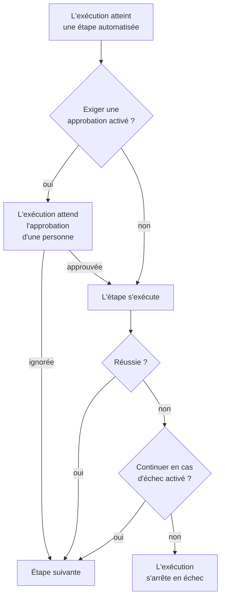

# Rédiger un runbook

Vous écrivez un runbook sous forme de liste ordonnée d'étapes, sur sa page **Étapes**. Cette page montre comment créer un runbook, comment configurer chacun des sept types d'étapes, et comment les échecs et les approbations changent le cours d'une exécution.

:::cards
- [Créer un runbook](#créer-un-runbook): D'un runbook vide à des étapes enregistrées.
- [Types d'étapes](#types-détapes): Manual, JavaScript, HTTP request, Bash, SSH, kubectl et AI.
- [Gestion des échecs et approbations](#gestion-des-échecs-et-approbations): Ce qui se passe quand une étape échoue ou attend une approbation.
- [Un exemple complet](#un-exemple-complet): Une bascule de base de données en cinq étapes.
:::

## Avant de commencer

- **Un rôle qui rédige des runbooks.** Project Owner, Project Admin et Runbook Admin créent des runbooks et enregistrent leurs étapes. Avec des autorisations granulaires, il vous faut **Create Runbook** et **Edit Runbook**. Voir [Autorisations](/docs/runbooks/configuration#autorisations).
- **Un agent Runbook, pour les étapes Bash, SSH et kubectl.** Ces étapes s'exécutent sur un [agent Runbook](/docs/runbooks/agents) dans votre propre infrastructure, jamais sur le Worker OneUptime. Installez-en un d'abord. Une étape qui ne choisit aucun agent s'exécute sur l'[agent Runbook par défaut du projet](/docs/runbooks/agents#lagent-runbook-par-défaut-du-projet), si vous en avez défini un ; une étape JavaScript s'exécute sinon sur un [agent Runbook global](/docs/runbooks/agents#agents-runbook-globaux).
- **Une variable secrète, pour les étapes SSH et kubectl.** La clé, le mot de passe ou le kubeconfig avec lequel une étape se connecte est une [variable de runbook](/docs/runbooks/variables) secrète. Project Owner et Project Admin créent les variables, et Runbook Admin les choisit dans les étapes qu'il écrit. Une étape kubectl peut utiliser à la place l'accès propre de l'agent Runbook.
- **Un fournisseur LLM, pour les étapes IA.** Voir [Fournisseurs LLM](/docs/ai/llm-provider).

## Créer un runbook

:::steps
### Ouvrir Runbooks

Ouvrez **Produits → Runbooks**. Runbooks se trouve dans le groupe **Tableaux de bord et automatisation**.

### Créer le runbook

Cliquez sur **Créer : Runbook**, saisissez un **Nom** et, si vous le souhaitez, une **Description** de l'usage du runbook. Sous **Plus de champs** se trouvent l'interrupteur **Activé**, activé par défaut, et les **Étiquettes**. Le nouveau runbook s'ouvre sur sa page **Étapes**.

### Ajouter des étapes

Sous **Commencez votre runbook**, choisissez le type de la première étape ; sous la dernière étape, **Ajouter une autre étape** propose les mêmes sept types. Chaque étape s'ouvre avec son **Titre** et ce dont son type a besoin ; le reste, comme sa **Description** et ses délais, est replié sous **Plus de champs**. Dès que le runbook a une étape, **Ajouter une étape**, en haut de la carte, ajoute une étape Manual.

### Ordonner les étapes

Les étapes s'exécutent **dans l'ordre**. Pour changer l'ordre, faites glisser une étape par la poignée à gauche de son en-tête ; au clavier, placez le focus sur la poignée, appuyez sur Espace, déplacez l'étape avec les flèches et appuyez de nouveau sur Espace.

### Enregistrer les étapes

Cliquez sur **Enregistrer les étapes**. Tant que vous ne l'avez pas fait, l'éditeur affiche **Modifications non enregistrées**. Une fois l'enregistrement fait, vous voyez **Enregistré**, et le runbook est prêt à être [exécuté](/docs/runbooks/running).
:::

## Anatomie d'une étape

Chaque étape comporte ces champs. Une étape automatisée affiche son **Titre** et les réglages de son type, et replie le reste sous **Plus de champs**, qui indique ce qui en est défini :

| Champ | Rôle |
| --- | --- |
| **Titre** | Un libellé court, affiché dans la liste des étapes et dans chaque exécution. |
| **Description** | Contexte facultatif pour la personne qui intervient, en Markdown, sous **Plus de champs**. Pour une étape Manual, ce sont les **Instructions** qu'elle lit et suit, affichées sous le titre. |
| **Continuer en cas d'échec** | Étapes automatisées uniquement. Si activé, une étape en échec n'arrête pas l'exécution : l'étape suivante s'exécute quand même. |
| **Exiger une approbation** | Étapes automatisées uniquement. Si activé, l'exécution s'arrête avant cette étape jusqu'à ce que quelqu'un l'approuve, et seulement alors l'exécute. L'interrupteur s'intitule **Exiger une approbation avant d'exécuter cette étape**, et l'en-tête de l'étape indique **Approbation requise**. |
| Réglages propres au type | Le script, l'URL, l'agent Runbook, une variable secrète ou le prompt. Voir [Types d'étapes](#types-détapes). |

## Types d'étapes

| Type | S'exécute sur | Nécessite |
| --- | --- | --- |
| [Manual](#manual) | Une personne | Rien |
| [JavaScript](#javascript) | Un agent Runbook | Un agent Runbook |
| [HTTP request](#http-request) | Le Worker OneUptime | Rien |
| [Bash](#bash) | Un agent Runbook | Un agent Runbook |
| [SSH](#ssh) | Un agent Runbook | Un agent Runbook et une variable secrète pour se connecter |
| [kubectl](#kubectl) | Un agent Runbook | Un agent Runbook, et une variable kubeconfig ou l'accès propre de l'agent Runbook |
| [AI](#ai) | Le Worker OneUptime | Un fournisseur LLM |

Dans chaque étape automatisée ci-dessous, **Plus de champs** de l'étape contient d'abord son **Agent Runbook**, pour une étape qui s'exécute sur un agent, puis **Exiger une approbation** et **Continuer en cas d'échec**, puis les réglages propres à l'étape - les en-têtes d'un appel HTTP, le port, la phrase secrète de la clé et la clé d'hôte d'une étape SSH, le fournisseur et les interrupteurs de contexte d'une étape d'IA - et enfin la **Description** et les délais. Replié, il nomme l'agent de l'étape, pour que vous voyiez où une étape s'exécute sans l'ouvrir.

### Manual

Un élément de checklist pour une personne : ses **Instructions** disent quoi faire ou vérifier. L'exécution se met en pause quand elle atteint une étape Manual et reste en `WaitingForManualStep` (**En attente de votre part**) jusqu'à ce que quelqu'un clique sur **Marquer comme terminé** ou **Ignorer**. Une exécution qui attend une personne n'expire jamais. Une étape Manual n'a pas d'interrupteur d'approbation : elle arrête déjà l'exécution pour une personne.

Utilisez-la pour ce que seul un humain peut vérifier ou faire : « Confirmer dans le tableau de bord du répartiteur de charge que le trafic est passé dans la région secondaire. »

### JavaScript

Un extrait de JavaScript, exécuté dans un bac à sable `isolated-vm` sur un [agent Runbook](/docs/runbooks/agents), pas sur le Worker OneUptime : sur l'un des vôtres, ou sur un [agent Runbook global](/docs/runbooks/agents#agents-runbook-globaux) quand l'étape n'en choisit aucun.

| Champ | Ce qu'il fait | Valeur par défaut |
| --- | --- | --- |
| **Agent Runbook** | Sous **Plus de champs**. L'agent Runbook qui exécute l'étape : **Agent Runbook global**, ou l'un des vôtres. Seul l'agent que vous choisissez peut prendre en charge la tâche ; n'importe quel agent global peut prendre en charge une étape sur **Agent Runbook global**. | L'[agent Runbook par défaut du projet](/docs/runbooks/agents#lagent-runbook-par-défaut-du-projet), si vous en avez défini un ; sinon **Agent Runbook global**, s'il y en a un |
| **Script** | Le JavaScript à exécuter. Renvoyez une valeur avec `return` pour la capturer ; chaque ligne de `console.log` est capturée aussi. Lever une erreur fait échouer l'étape. | — |
| **Délai d'exécution** | Combien de temps l'agent Runbook laisse tourner l'extrait avant de détruire le bac à sable. Un agent Runbook global le laisse tourner 5 minutes au plus. | 30 secondes |
| **Délai de prise en charge** | Combien de temps le Worker attend que l'agent Runbook prenne la tâche en charge. | 2 minutes |

```javascript
const start = Date.now();
// ... your logic ...
console.log("replica lag checked");
return { durationMs: Date.now() - start };
```

Le bac à sable dispose de 128 Mo de mémoire et n'a accès ni au système de fichiers ni aux processus. Il peut faire des requêtes HTTP avec `axios`, mais seulement vers des adresses publiques : une requête vers un réseau privé, vers l'hôte même de l'agent Runbook ou vers un point de métadonnées cloud est refusée. Pour joindre un service de votre réseau, utilisez une étape [Bash](#bash) avec `curl`.

### HTTP request

Un appel HTTP sortant, fait par le Worker OneUptime. Aucun agent Runbook n'est nécessaire.

| Champ | Ce qu'il fait | Valeur par défaut |
| --- | --- | --- |
| **Méthode** | `GET`, `POST`, `PUT`, `PATCH`, `DELETE` ou `HEAD`. | `GET` |
| **URL** | Le point de terminaison à appeler. | Vide |
| **En-têtes (JSON)** | Sous **Plus de champs**. Un objet JSON, par exemple `{ "Authorization": "Bearer ..." }`. Des en-têtes qui ne sont pas du JSON valide font échouer l'étape. | Aucun |
| **Corps** | Affiché pour `POST`, `PUT`, `PATCH` et `DELETE`. Envoyé en JSON s'il s'analyse comme du JSON, sinon en texte. | Aucun |
| **Délai d'expiration de la requête** | Combien de temps attendre la réponse du point de terminaison avant de faire échouer l'étape. | 30 secondes |

L'étape réussit sur une réponse `2xx` ou `3xx` et échoue sur tout le reste, avec `HTTP <status>` comme erreur. Les redirections ne sont pas suivies. Le statut, les en-têtes et le corps de la réponse sont capturés, jusqu'à 50 Ko.

> [!NOTE]
> Le Worker n'appelle jamais d'adresses de bouclage ou de lien local, comme un point de métadonnées cloud. Sur OneUptime Cloud, il n'appelle que des adresses publiques. Un OneUptime auto-hébergé atteint aussi les réseaux privés, sauf si `DATA_SOURCE_BLOCK_PRIVATE_ADDRESSES` vaut `true`. Pour appeler un service de votre réseau depuis OneUptime Cloud, utilisez une étape [Bash](#bash) avec `curl`.

Utile pour : ouvrir un incident PagerDuty, publier sur un webhook Slack, appeler l'API publique de votre fournisseur cloud ou la vôtre.

> [!TIP]
> Gardez les jetons hors de l'étape. Stockez-les comme [variables de runbook](/docs/runbooks/variables) secrètes et écrivez `{{global.variables.NAME}}` là où va la valeur, dans l'URL, les en-têtes ou le corps. OneUptime envoie la requête lui-même, il insère donc aussi les secrets, et la réponse que l'étape enregistre affiche `[REDACTED]` à leur place. Dans des en-têtes ou un corps JSON, une valeur va dans sa chaîne, si bien qu'un guillemet ou un saut de ligne qu'elle contient ne casse pas le JSON.

### Bash

Un script bash, exécuté avec `bash -c <script>` sur un [agent Runbook](/docs/runbooks/agents) dans votre propre infrastructure. Bash ne s'exécute jamais sur le Worker OneUptime.

| Champ | Ce qu'il fait | Valeur par défaut |
| --- | --- | --- |
| **Agent Runbook** | Sous **Plus de champs**. L'agent Runbook qui exécute l'étape. Seul cet agent peut prendre en charge la tâche. Les agents Runbook globaux n'exécutent que les étapes JavaScript. | L'agent Runbook par défaut du projet, si vous en avez défini un |
| **Script Bash** | Le script. La sortie (stdout et stderr) est capturée jusqu'à 50 Ko, et un code de sortie non nul fait échouer l'étape. | — |
| **Délai d'exécution** | Combien de temps l'agent Runbook laisse tourner le script avant de le tuer avec `SIGKILL`. Augmentez-le pour les étapes qui prennent légitimement des minutes. | 30 secondes |
| **Délai de prise en charge** | Combien de temps le Worker attend que l'agent Runbook prenne la tâche en charge. | 2 minutes |

Le script s'exécute dans le conteneur de l'agent Runbook, avec les outils que fournit son image, comme `curl`, `wget` et le client `ssh`, et avec l'accès réseau de l'hôte sur lequel il tourne. Par exemple, pour vérifier un service que seul votre réseau peut joindre :

```bash
set -euo pipefail
HTTP_CODE=$(curl -s -o /tmp/resp.txt -w "%{http_code}" "http://payments.internal:8080/health")
echo "HTTP $HTTP_CODE"
cat /tmp/resp.txt
if [[ "$HTTP_CODE" != "200" ]]; then
  echo "Health check failed"
  exit 1
fi
```

Si l'agent Runbook choisi est hors ligne quand l'exécution atteint cette étape, l'étape attend jusqu'au **délai de prise en charge** (2 minutes par défaut) puis échoue pour dépassement de délai. Ajoutez un agent sous **Runbooks → Agents de runbook** avant de compter sur une étape Bash.

> [!TIP]
> Gardez les mots de passe et les jetons hors du script. Stockez-les comme [variables de runbook](/docs/runbooks/variables) secrètes et écrivez `{{global.variables.NAME}}` là où va la valeur : l'agent Runbook reçoit le script avec la valeur insérée, et la sortie de l'étape affiche `[REDACTED]` à sa place.

### SSH

Se connecter à une machine en SSH et y exécuter un script bash. L'agent Runbook ouvre la connexion, donc la machine doit seulement être joignable depuis l'agent Runbook, et la clé ou le mot de passe avec lequel l'étape se connecte est une [variable de runbook](/docs/runbooks/variables) secrète, jamais écrite dans l'étape.

| Champ | Ce qu'il fait |
| --- | --- |
| **Agent Runbook** | Sous **Plus de champs**. L'agent Runbook qui ouvre la connexion. Il doit pouvoir joindre la machine sur le réseau. Une étape qui n'en choisit aucun s'exécute sur l'agent Runbook par défaut du projet. |
| **SSH vers** | L'utilisateur et la machine, comme vous les écririez après `ssh` : `deploy@10.0.4.21`. |
| **Se connecter avec** | La variable secrète qui contient la clé privée ou le mot de passe ; la valeur indique de quoi il s'agit. Seules les variables secrètes sont proposées, et l'étape signale quand son agent Runbook n'a pas le droit d'utiliser celle choisie. |
| **Script Bash** | S'exécute avec `bash` sur la machine, sous l'utilisateur avec lequel l'étape se connecte. La sortie est capturée jusqu'à 50 Ko, et un code de sortie non nul fait échouer l'étape. |
| **Port** | Sous **Plus de champs**. 22 s'il est laissé vide. |
| **Phrase secrète de la clé** | Sous **Plus de champs**. La variable secrète qui contient la phrase secrète d'une clé qui en a une. |
| **Clé d'hôte** | Sous **Plus de champs**. L'empreinte SHA256 de la machine, ou sa clé publique telle que `ssh-keyscan` l'affiche, une par ligne. L'étape ne se connecte que si la machine présente l'une d'elles. Laissée vide, toute clé est acceptée, et la sortie de l'étape nomme celle que la machine a présentée. |
| **Délai d'exécution** | Couvre ensemble la connexion, l'authentification et l'exécution du script, de sorte qu'un script bloqué ne peut pas maintenir l'étape ouverte. 30 secondes par défaut. |
| **Délai de prise en charge** | Combien de temps le Worker attend que l'agent Runbook prenne la tâche en charge. 2 minutes par défaut. |

Par exemple, pour redémarrer un service et montrer qu'il est revenu :

```bash
sudo systemctl restart nginx
systemctl status nginx --no-pager
```

Indiquez la clé d'hôte de la machine pour que l'étape se connecte à cette machine et à aucune autre : `ssh-keyscan 10.0.4.21` affiche ses clés publiques, et `ssh-keygen -lf /etc/ssh/ssh_host_ed25519_key.pub` sur la machine elle-même son empreinte. Une étape qui en indique une échoue sur un agent Runbook trop ancien pour la vérifier, en disant de mettre à jour l'agent.

### kubectl

Exécuter des commandes kubectl sur un cluster. Le script s'exécute avec bash sur l'agent Runbook, qui embarque `kubectl`, avec `KUBECONFIG` pointant vers le cluster : n'importe quelle commande kubectl fonctionne, ainsi que n'importe quel bash autour.

| Champ | Ce qu'il fait |
| --- | --- |
| **Agent Runbook** | Sous **Plus de champs**. L'agent Runbook qui exécute kubectl. Il doit pouvoir joindre le serveur d'API du cluster. Une étape qui n'en choisit aucun s'exécute sur l'agent Runbook par défaut du projet. |
| **Kubeconfig** | La variable secrète qui contient le kubeconfig du cluster, ou **L'accès propre de l'agent Runbook** : le kubeconfig propre de l'agent Runbook, ou son compte de service quand il s'exécute dans le cluster. L'agent Runbook écrit un kubeconfig dans un fichier que lui seul peut lire, et le supprime quand le script se termine. |
| **Script** | Les commandes kubectl. La sortie est capturée jusqu'à 50 Ko, et un code de sortie non nul fait échouer l'étape. |
| **Délai d'exécution** | Le temps pendant lequel l'agent Runbook laisse le script s'exécuter avant de l'arrêter avec `SIGKILL`. 30 secondes par défaut. |
| **Délai de prise en charge** | Combien de temps le Worker attend que l'agent Runbook prenne la tâche en charge. 2 minutes par défaut. |

Par exemple, pour redémarrer un deployment et attendre que ses nouveaux pods soient prêts :

```bash
kubectl rollout restart deployment/checkout-api --namespace checkout
kubectl rollout status deployment/checkout-api --namespace checkout --timeout=120s
```

**Exemples — cliquez pour insérer**, sous chaque script, insère des scripts courants comme ceux-ci. Ne donnez à l'utilisateur du kubeconfig que ce que vos scripts font : un Role dans les namespaces où ils agissent, avec les verbes qu'ils utilisent. Si le serveur d'API refuse une commande, le message de kubectl figure dans la sortie de l'étape, de sorte qu'un échec d'autorisation vous indique quel role binding élargir.

### AI

Demandez à l'IA d'analyser, de résumer ou de décider quelque chose en cours d'exécution. La réponse devient la sortie de l'étape sur l'exécution. Les étapes IA s'exécutent sur le Worker OneUptime ; aucun agent Runbook n'est nécessaire.

| Champ | Ce qu'il fait |
| --- | --- |
| **Prompt** | Ce que l'IA doit faire. Par exemple : « Examine la sortie des étapes précédentes et dis s'il est sûr de poursuivre la remédiation. » |
| **Fournisseur LLM** | Facultatif. **Par défaut du projet** utilise le fournisseur par défaut du projet. Fixez un fournisseur quand l'étape a besoin d'un modèle précis, par exemple un modèle auto-hébergé pour des données qui ne doivent pas quitter votre réseau. Voir [Fournisseurs LLM](/docs/ai/llm-provider). |
| **Inclure le contexte des étapes précédentes** | Si activé, l'IA voit tout des étapes exécutées avant celle-ci : titre, type, statut, sortie et messages d'erreur. Elle reçoit jusqu'à 4 000 caractères de la sortie de chaque étape. |
| **Inclure le contexte du déclencheur** | Si activé, l'IA voit ce qui a lancé l'exécution : l'incident, l'alerte ou l'événement de maintenance planifiée lié (sa description, sa gravité, son état actuel, les moniteurs touchés, la cause racine, la chronologie des états et les notes publiques), ou la personne qui a lancé le runbook à la main. |

Pour garder une personne dans la boucle, activez **Exiger une approbation** sur l'étape qui suit une étape IA : l'IA analyse, une personne lit sa réponse, et l'étape de remédiation ne s'exécute qu'une fois que cette personne l'a approuvée.

**Ce que l'IA ne voit jamais.** La réponse d'une étape IA est stockée comme sortie d'étape sur l'exécution, et les exécutions sont lisibles par toute personne ayant le droit de lire les runbooks, un public plus large que celui de l'incident. Le contexte du déclencheur laisse donc de côté les **notes internes privées** et les **messages des canaux Slack et Microsoft Teams**. La sortie des étapes précédentes est analysée à la recherche de secrets (jetons, clés, identifiants), qui sont masqués avant l'envoi au modèle. Les images intégrées et les longues données encodées, comme une capture d'écran collée dans la description d'un incident, sont aussi laissées de côté, avec une courte note à leur place.

Les étapes IA sont mesurées et facturées comme toute autre fonctionnalité d'IA. L'étape échoue, avec un message qui dit pourquoi, quand elle n'a pas de prompt, quand les fonctionnalités d'IA sont désactivées pour le projet, quand aucun fournisseur LLM n'est disponible, ou quand le fournisseur fixé n'est plus disponible pour le projet. Activez **Continuer en cas d'échec** si le reste du runbook doit tout de même s'exécuter.

## Gestion des échecs et approbations



Par défaut, une étape en échec arrête l'exécution et la marque `Failed`, avec l'erreur de l'étape comme motif. Avec **Continuer en cas d'échec**, l'échec est enregistré et l'étape suivante s'exécute, ce qui convient aux runbooks du type « essayer ces trois choses, puis prévenir ».

**Exiger une approbation** s'applique avant qu'une étape s'exécute, quoi qu'il se soit passé avant : l'exécution attend que quelqu'un clique sur **Approuver et exécuter**, et l'étape s'exécute, ou sur **Ignorer**, et elle ne s'exécute jamais. Activez-le pour l'étape qui change quelque chose - le redémarrage, le basculement, la réduction d'échelle - afin qu'une personne regarde d'abord ce que les étapes précédentes ont trouvé. L'approbation appartient à l'étape : déplacer l'étape la déplace aussi.

:::note
Via l'API et Terraform, l'interrupteur est le champ `requireApprovalBeforeRunning` d'une étape. Le champ `requireApproval` d'une étape, que les runbooks écrivaient avant que les approbations passent sur l'étape qu'elles protègent, fonctionne toujours et garde son sens : une approbation après cette étape. OneUptime le lit comme une approbation avant l'étape suivante ou, après la dernière étape, comme une étape Manual à la fin, intitulée **Approve the result**.
:::

## Enregistrer et modifier

Les modifications des étapes prennent effet quand vous cliquez sur **Enregistrer les étapes**. Chaque exécution travaille sur l'instantané pris à son démarrage : les exécutions en cours gardent les étapes avec lesquelles elles ont commencé, et une modification ne réécrit jamais l'historique des exécutions passées.

## Un exemple complet

Un runbook pour « DB primary unreachable » :

| # | Type | Ce qu'elle fait |
| --- | --- | --- |
| 1 | JavaScript | Récupérer l'hôte primaire actuel depuis votre service de configuration et le journaliser. |
| 2 | Manual | « Confirmer que le retard de réplication du secondaire est inférieur à 5 secondes. » |
| 3 | HTTP request | `POST` vers l'API de votre orchestrateur de bascule. |
| 4 | Manual | « Vérifier que les écritures vont désormais vers le nouveau primaire. » |
| 5 | HTTP request | `POST` d'un message de fin d'alerte vers un webhook Slack. |

La personne qui intervient regarde l'étape 1 s'exécuter, coche l'étape 2, regarde l'étape 3 s'exécuter, coche l'étape 4, et l'exécution se termine par l'étape 5. La sortie de chaque étape est capturée pour le postmortem.

## Prochaines étapes

:::cards
- [Exécuter un runbook](/docs/runbooks/running): Lancer une exécution, et terminer, approuver ou ignorer ses étapes.
- [Règles de runbook](/docs/runbooks/rules): Lancer ce runbook automatiquement sur les incidents correspondants.
- [Agents de runbook](/docs/runbooks/agents): Installer l'agent Runbook dont vos étapes de script ont besoin.
- [Variables de runbook](/docs/runbooks/variables): Garder les hôtes, clés, mots de passe et kubeconfigs hors de vos étapes.
:::
