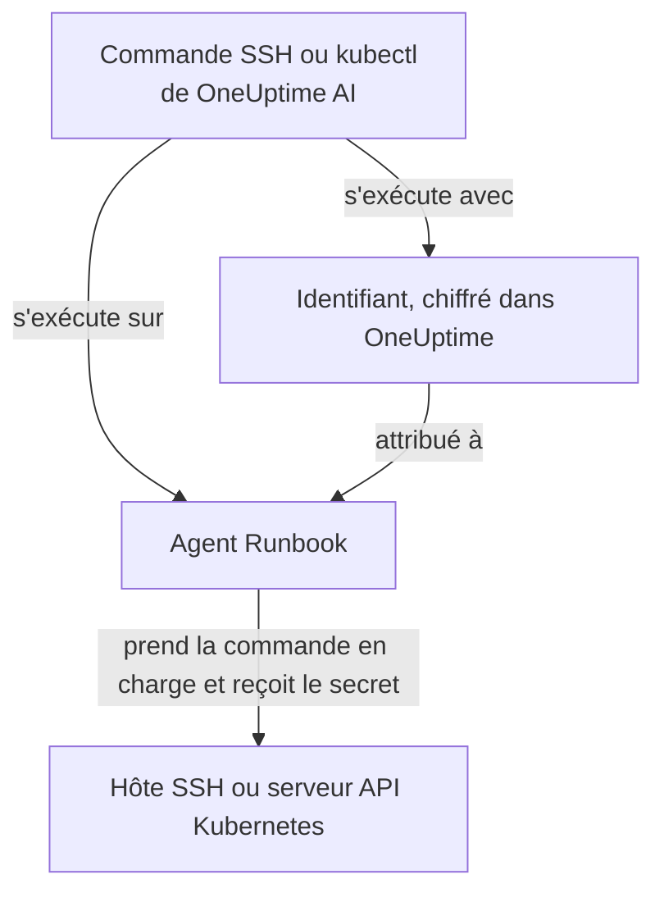

# Accès de l'IA

L'accès de l'IA est la façon dont les commandes de OneUptime AI atteignent ce qui n'est **pas** l'hôte propre d'un agent Runbook — un serveur en SSH, ou le serveur d'API d'un cluster Kubernetes qui n'exécute pas le chart de l'agent Kubernetes. Chaque accès est un identifiant : cet accès sous forme d'objet géré, chiffré au repos, attribué à des agents Runbook précis, et choisi par OneUptime AI plutôt qu'écrit dans une commande. Les étapes de runbook ne les utilisent pas : une étape SSH ou kubectl se connecte avec une [variable de runbook](/docs/runbooks/variables) secrète.

Gérez-les sous **Runbooks → Agents de runbook → Accès de l'IA**.

:::cards
- [Créer un identifiant](#créer-un-identifiant): Son accès, et les agents Runbook qui peuvent l'utiliser.
- [Moindre privilège de l'autre côté](#moindre-privilège-de-lautre-côté): Limiter ce que la clé ou le jeton peut faire.
- [Agents Runbook qui exécutent les commandes de OneUptime AI](#agents-runbook-qui-exécutent-les-commandes-doneuptime-ai): Qui peut donner un identifiant SSH à un tel agent.
:::

## Comment un identifiant est utilisé

OneUptime AI exécute une commande SSH avec l'un des identifiants SSH attribués à l'agent Runbook sur lequel elle s'exécute, et une commande kubectl pour un cluster qui n'exécute pas le chart de l'agent Kubernetes avec l'identifiant Kubernetes lié à ce cluster, comme le montre [IA SRE](/docs/ai/ai-sre). Quand l'agent Runbook prend la commande en charge, OneUptime vérifie que l'identifiant lui est attribué, déchiffre le secret et ne le remet que dans la réponse à cette prise en charge. Le secret n'est jamais stocké sur le job et n'est jamais lisible par l'API.

## Avant de commencer

- **Un rôle qui gère les identifiants.** Project Owner et Project Admin, ou toute personne ayant l'autorisation **Create Runbook Credential**. Le rôle Runbook Admin ne l'inclut pas. Attribuer un identifiant SSH à un agent qui exécute les commandes d'OneUptime AI demande aussi **Read Runbook Credential** ; voir [Agents Runbook qui exécutent les commandes d'OneUptime AI](#agents-runbook-qui-exécutent-les-commandes-doneuptime-ai).
- **Une offre qui les inclut.** Sur OneUptime Cloud, les identifiants de runbook demandent l'offre **Growth** ou supérieure.
- **Un [agent Runbook](/docs/runbooks/agents)** qui joint l'hôte ou le serveur API du cluster sur le réseau.

## Créer un identifiant

:::steps
### Ouvrir l'accès de l'IA

Ouvrez **Runbooks → Agents de runbook → Accès de l'IA** et cliquez sur **Créer : Identifiant**.

### Le nommer et choisir son type

À l'étape **Identifiant**, saisissez un **Nom**, par exemple `prod-cluster`, une **Description** facultative et le **Type** : **SSH** ou **Kubernetes**. Le type ne peut pas être modifié ensuite ; créez plutôt un nouvel identifiant.

### Saisir l'accès

:::tabs
@tab SSH
À l'étape **Hôte SSH**, saisissez le **Nom d'hôte**, le **Port** (22 s'il est vide) et le **Nom d'utilisateur**. À l'étape **Authentification SSH**, choisissez comment **Se connecter avec** : une **Clé privée**, la meilleure option quand vous avez le choix, puis collez la **Private Key (PEM)**, avec sa **Private Key Passphrase** si elle en a une ; ou un **Mot de passe**, pour un hôte sans accès par clé, puis saisissez le **Mot de passe**.
@tab Kubernetes
À l'étape **Kubernetes**, saisissez l'**URL du serveur API**, par exemple `https://10.0.0.1:6443`, le **Service Account Token**, et le **Certificat CA (PEM)** pour que l'agent Runbook puisse vérifier le serveur API. Ne laissez la CA vide que si le serveur API présente un certificat auquel l'agent fait déjà confiance.
:::

### L'attribuer à des agents Runbook

À l'étape **Agents de runbook**, choisissez les agents qui peuvent utiliser l'identifiant, puis cliquez sur **Créer : Identifiant**. Un identifiant attribué à aucun agent ne peut être utilisé par aucune commande.

### Laisser OneUptime AI l'utiliser

OneUptime AI exécute ses commandes SSH sur l'agent Runbook qu'une règle de remédiation automatique choisit pour elles, avec l'un des identifiants SSH qui lui sont attribués. Un identifiant Kubernetes est utilisé dès qu'il est lié, avec l'un de ses agents Runbook, à un cluster : voir [IA SRE](/docs/ai/ai-sre).
:::

## Ce qui est stocké

| Type | Champs |
| --- | --- |
| SSH | Nom d'hôte, port (22 par défaut), nom d'utilisateur, et soit une clé privée PEM (avec une phrase secrète facultative), soit un mot de passe. |
| Kubernetes | URL du serveur API, un jeton de compte de service et le certificat de l'autorité de certification du cluster. |

## Les valeurs secrètes sont en écriture seule

Les clés privées, phrases secrètes, mots de passe et jetons de compte de service sont chiffrés au repos et l'API **ne les renvoie jamais** — ni au tableau de bord, ni à un workflow, ni à un export. Le tableau peut vous montrer ce qu'*est* un identifiant sans jamais montrer ce qu'il contient.

Il n'y a donc pas d'« afficher » pour une valeur secrète, seulement « remplacer » : saisir de nouveau une valeur est la façon de la faire tourner. Si vous avez perdu l'original, émettez une nouvelle clé sur le système cible et mettez à jour l'identifiant.

## Attribuer un identifiant à des agents Runbook

Un identifiant n'est utilisable que par les agents Runbook auxquels vous l'attribuez. Une commande qui désigne un identifiant non attribué à son agent Runbook **échoue au lieu de s'exécuter** — un agent qui ne fait rien en silence ressemble exactement à un agent qui a fonctionné.

L'attribution est la frontière d'accès, alors gardez-la étroite : un agent qui ne fait jamais que redémarrer un cluster n'a pas besoin de la clé SSH de vos hôtes de base de données.

### Agents Runbook qui exécutent les commandes d'OneUptime AI

Un agent exécute les commandes d'OneUptime AI dès qu'il est choisi pour elles : comme agent Runbook d'une règle de remédiation automatique, ou pour l'accès IA d'un cluster Kubernetes. Sur un tel agent, OneUptime AI choisit parmi les identifiants SSH attribués à l'agent pour les commandes qu'il y exécute. Un identifiant SSH n'atteint donc un tel agent que par une personne qui peut lire les identifiants de runbook (**Read Runbook Credential**, ou un Project Owner ou un Project Admin), selon ce qui est enregistré en premier :

- **Attribuer l'identifiant.** Créer un identifiant SSH avec un tel agent, ou ajouter un tel agent à un identifiant, demande cette autorisation. Sans elle, l'enregistrement est refusé et nomme l'agent : attribuez l'identifiant à des agents qui n'exécutent pas de commandes de remédiation IA, ou demandez à une personne qui a l'autorisation de l'attribuer.
- **Choisir l'agent.** Choisir un agent qui détient des identifiants SSH pour les commandes d'OneUptime AI - comme agent d'une règle, ou pour un cluster - demande la même autorisation, la première fois qu'il est choisi.

Retirer des agents d'un identifiant, enregistrer un identifiant avec les agents qu'il a déjà, et les identifiants Kubernetes ne demandent rien de plus : les commandes kubectl d'OneUptime AI s'exécutent avec l'identifiant lié à leur cluster. Les attributions d'identifiants et le choix d'un agent par une personne sans cette autorisation sont enregistrés un à la fois dans un projet, pour que les deux ne puissent pas réussir leurs vérifications ensemble ; un enregistrement qui arrive pendant qu'un autre est en cours l'attend, et si cela prend trop longtemps il est refusé avec *Try again in a moment*. Enregistrez de nouveau. Enregistrer un agent, par exemple pour modifier sa description, n'attend jamais.

Les étapes d'un workflow agissent en tant que Project Admin, mais ne se voient pas prêter la lecture des identifiants de runbook d'un Project Admin : une étape ne l'a que si la personne qui a enregistré en dernier les étapes du workflow l'a. Voir [Ce que peuvent faire les étapes de workflow](/docs/workflows/configuration#ce-que-les-étapes-dun-workflow-peuvent-faire).

## Moindre privilège de l'autre côté

OneUptime ne peut pas restreindre ce que votre identifiant a le droit de faire sur le système cible — c'est le rôle du système cible, et cela vaut la peine :

- **SSH** — préférez une clé à un mot de passe, ne donnez à l'utilisateur que les commandes dont il a besoin (une commande forcée ou un shell restreint quand c'est possible), et ne réutilisez pas la clé personnelle d'un administrateur.
- **Kubernetes** — liez le compte de service à un Role qui n'autorise que ce que vous laissez faire à OneUptime AI, dans les namespaces où il peut agir. Un compte de service qui ne peut que lire laisse OneUptime AI enquêter et refuse toute correction.

## Qui peut les voir

Créer, modifier et supprimer des identifiants demande les autorisations sur les identifiants de runbook (ou Project Owner/Admin). Lire un identifiant n'en montre que les champs non secrets.

Notez que la **clé d'agent** d'un agent Runbook équivaut aux identifiants qui lui sont attribués : tout ce qui détient la clé peut prendre du travail en charge au nom de cet agent et recevoir des identifiants. C'est pourquoi les clés d'agent ne sont lisibles que par les Project Owners, les Project Admins et les Runbook Admins — traitez-les comme vous traiteriez les identifiants eux-mêmes.

## Prochaines étapes

:::cards
- [Variables de runbook](/docs/runbooks/variables): Les secrets avec lesquels les étapes SSH et kubectl se connectent.
- [Agents de runbook](/docs/runbooks/agents): Installer l'agent Runbook auquel un identifiant est attribué.
- [Configuration & sécurité des runbooks](/docs/runbooks/configuration): Autorisations et durcissement de toute la pile des runbooks.
:::
