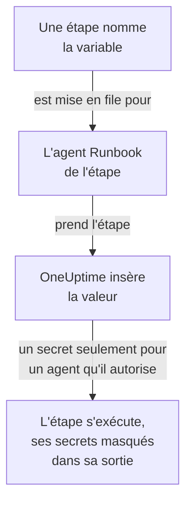

# Variables de runbook

Une variable de runbook est une valeur que vos étapes utilisent par son nom au lieu de la contenir elles-mêmes : un hôte, un namespace ou une URL, ou un secret comme une clé SSH, un mot de passe, un kubeconfig ou un jeton d'API. Modifiez la valeur une fois, et chaque étape qui la nomme utilise la nouvelle à sa prochaine exécution. Un secret est chiffré, n'est plus jamais affiché et est masqué dans ce que les étapes affichent.

:::cards
- [Créer une variable](#créer-une-variable): Une valeur simple, ou un secret et les agents Runbook qui peuvent l'utiliser.
- [Utiliser une variable dans une étape](#utiliser-une-variable-dans-une-étape): Dans un script ou une requête HTTP, ou comme connexion d'une étape SSH et kubeconfig d'une étape kubectl.
- [Qui reçoit un secret](#qui-reçoit-un-secret): Vos agents Runbook, les agents Runbook globaux si vous les y autorisez, et OneUptime pour une étape de requête HTTP.
:::

## Comment une variable atteint une étape



Une étape contient le nom de la variable, jamais sa valeur. Quand l'agent Runbook de l'étape la prend, OneUptime insère la valeur - dans le script, dans la machine et la connexion d'une étape SSH, ou dans le kubeconfig d'une étape kubectl - et ne la remet qu'à cet agent. Une étape qui nomme une variable qu'elle n'a pas le droit d'avoir échoue avec la raison, au lieu de s'exécuter avec le nom à la place de la valeur.

Les étapes Bash, JavaScript, SSH, kubectl et de requête HTTP utilisent les variables. Les étapes d'IA ne les insèrent pas. OneUptime envoie lui-même une étape de requête HTTP, sans agent Runbook : l'étape reçoit donc chaque variable qu'elle nomme, secrets compris, et les masque dans la réponse qu'elle enregistre.

## Variables globales et variables de runbook

| | Variables globales | Les variables propres à un runbook |
| --- | --- | --- |
| Gérées sous | **Runbooks → Paramètres → Variables globales** | **Paramètres → Variables** du runbook |
| Utilisées par | Chaque runbook du projet | Les étapes de ce runbook seulement |
| Écrites dans une étape sous la forme | `{{global.variables.NAME}}` | `{{local.variables.NAME}}` |

Un nom n'est utilisé qu'une fois, quelle que soit sa casse, parmi les variables globales du projet, et une fois parmi les variables propres à un runbook. Une variable d'un runbook peut partager un nom avec une variable globale : chacune s'écrit à sa manière.

## Avant de commencer

- **Un rôle qui gère les variables.** Project Owner et Project Admin, ou l'autorisation **Create Runbook Variable**. Runbook Admin lit les variables, pour les choisir dans les étapes qu'il écrit, mais ne les modifie pas.
- **Un forfait qui les inclut.** Sur OneUptime Cloud, les variables de runbook nécessitent le forfait **Growth** ou supérieur.

## Créer une variable

:::steps
### Ouvrir les variables

Ouvrez **Runbooks → Paramètres → Variables globales**, ou **Paramètres → Variables** d'un runbook, et cliquez sur **Créer : Variable**.

### La nommer et saisir sa valeur

À l'étape **Variable**, saisissez un **Nom** : lettres, chiffres, traits d'union et tirets bas, jusqu'à 100 caractères, comme `PROD_DB_SSH_KEY`. **Secret** est activé au départ : collez la clé, le mot de passe, le jeton ou le kubeconfig dans **Valeur du secret** et cliquez sur **Suivant**. Pour une valeur que tout le monde peut lire, comme un hôte, désactivez **Secret**, saisissez-la dans **Valeur** et cliquez sur **Créer : Variable**. Une **Description** facultative attend sous **Plus de champs**.

### Choisir qui peut utiliser un secret

À l'étape **Qui peut l'utiliser**, choisissez vos agents Runbook sous **Vos agents Runbook qui peuvent l'utiliser**. Sur un serveur avec des [agents Runbook globaux](/docs/runbooks/agents#agents-runbook-globaux), **Les agents Runbook globaux peuvent l'utiliser** permet aussi aux étapes de ce projet qui s'exécutent sur un agent Runbook global d'utiliser le secret : ce réglage est activé au départ tant que le projet utilise des agents Runbook globaux. Un secret a besoin de l'un ou de l'autre. Cliquez sur **Créer : Variable**.
:::

Le fait qu'une variable soit un secret ne peut pas être modifié par la suite. Supprimez-la plutôt et recréez-la avec le même nom : les étapes nomment les variables par leur nom, elles continuent donc de fonctionner. L'agent Runbook interne d'un cluster, celui qu'installe le chart de l'agent Kubernetes, ne reçoit jamais de secret.

## Les valeurs secrètes sont en écriture seule

La valeur d'un secret est chiffrée au repos et l'API **ne la renvoie jamais** : ni au tableau de bord, ni à un workflow, ni à un export. La liste indique **Secret** là où une variable simple affiche sa valeur, et sa colonne **Agents de runbook** indique quels agents Runbook reçoivent chaque secret. Pour la modifier, cliquez sur **Remplacer la valeur** dans sa ligne : la nouvelle valeur est chiffrée, l'ancienne disparaît définitivement, et les étapes reçoivent la nouvelle à leur prochaine exécution.

Quand une étape affiche un secret qui lui a été remis, l'agent Runbook le remplace par `[REDACTED]` avant que la sortie ne quitte son hôte, et OneUptime le fait de nouveau avant de stocker la sortie. Une ligne d'une clé privée, ou le jeton d'un kubeconfig, est masqué aussi. Un secret de moins de 4 caractères n'est pas recherché.

## Utiliser une variable dans une étape

:::tabs
@tab Dans un script
Écrivez la référence là où va la valeur, dans un script Bash, JavaScript, SSH ou kubectl :

```bash
curl -s -X POST \
  -H "Authorization: Bearer {{global.variables.CDN_API_TOKEN}}" \
  "https://api.cdn.example.com/v1/purge"
```
@tab Dans une requête HTTP
Écrivez la référence dans l'URL, les en-têtes ou le corps d'une [étape de requête HTTP](/docs/runbooks/authoring#http-request) :

```json
{ "Authorization": "Bearer {{global.variables.API_TOKEN}}" }
```
@tab Connexion SSH
Une [étape SSH](/docs/runbooks/authoring#ssh) choisit sous **Se connecter avec** la variable secrète qui contient sa clé privée ou son mot de passe, et sous **Plus de champs → Phrase secrète de la clé** la phrase secrète de sa clé. La valeur indique s'il s'agit d'une clé ou d'un mot de passe.
@tab Kubeconfig
Une [étape kubectl](/docs/runbooks/authoring#kubectl) choisit sous **Kubeconfig** la variable secrète qui contient le kubeconfig du cluster, ou **L'accès propre de l'agent Runbook** pour utiliser celui de l'agent Runbook.
:::

Sur la page **Étapes** d'un runbook, chaque script et chaque requête HTTP listent sous **Variables — cliquez pour copier** les variables que leur étape peut utiliser, et l'éditeur signale quand une étape nomme une variable qui n'existe pas, ou un secret que son agent Runbook n'a pas le droit d'utiliser.

## Qui reçoit un secret

| Qui exécute l'étape | Une variable simple | Un secret |
| --- | --- | --- |
| Un de vos agents Runbook | Toujours | Quand le secret le liste sous **Vos agents Runbook qui peuvent l'utiliser** |
| Un agent Runbook global | Toujours | Quand **Les agents Runbook globaux peuvent l'utiliser** est activé, pour une étape du propre projet du secret |
| OneUptime lui-même, pour une étape de requête HTTP | Toujours | Toujours |

Une étape qui nomme un secret que son agent Runbook n'a pas le droit d'utiliser échoue, en nommant le secret et ce qu'il faut changer, et rien n'est remis.

## Les secrets et identifiants de runbook sont devenus des variables

Les variables de runbook ont pris la place des secrets de runbook, et des identifiants que nommaient les étapes SSH et Kubernetes. Lors de la mise à niveau de OneUptime, ce que chaque projet avait a été déplacé une fois, si bien que chaque runbook s'exécute comme avant :

- chaque secret de runbook est devenu une variable globale secrète du même nom, avec la même valeur, les mêmes agents Runbook et le même réglage pour les agents Runbook globaux ;
- `{{runbookSecrets.NAME}}` dans un script a été réécrit en `{{global.variables.NAME}}`, et l'ancienne écriture lit toujours la variable globale `NAME` ;
- chaque identifiant qu'une étape nommait est devenu des variables globales secrètes avec les mêmes agents Runbook, nommées d'après lui : `<name>-ssh-key` (et `<name>-ssh-key-passphrase`, pour une clé qui en avait une), `<name>-ssh-password` ou `<name>-kubeconfig` ;
- chaque étape SSH qui nommait un identifiant se connecte à sa machine avec elles et exécute sa commande comme son script, et chaque étape Kubernetes est devenue une étape kubectl qui exécute le `kubectl patch` que faisait son action, sans avoir besoin de plus d'accès que l'étape n'en avait.

Un agent Runbook antérieur à cette version (14.0.79) ne peut pas exécuter de script kubectl : il fait échouer une étape kubectl en indiquant qu'il faut le mettre à jour. Chaque étape Kubernetes ainsi transformée a d'abord gardé son identifiant et son action à côté de son script, pour un tel agent ; ils sont partis avec les identifiants de runbook, si bien que chaque étape kubectl nécessite un agent Runbook de la version 14.0.79 ou ultérieure.

Les identifiants de runbook ont depuis été supprimés, et une étape qui en nommait encore un a d'abord été transformée de la même façon. Une étape qui nomme un identifiant ne s'exécute plus, et sa page des étapes propose **Transformer en étape de script** ; un enregistrement par l'API ou Terraform qui en donne un à une étape est refusé. Voir [Les identifiants de runbook sont supprimés](/docs/installation/upgrading#les-identifiants-de-runbook-sont-supprimés).

## Étapes suivantes

:::cards
- [Écrire un runbook](/docs/runbooks/authoring): Écrire les étapes SSH et kubectl qui utilisent une variable.
- [Agents de runbook](/docs/runbooks/agents): Installer l'agent Runbook auquel un secret est remis.
- [Configuration et sécurité des runbooks](/docs/runbooks/configuration): Autorisations et durcissement de toute la pile des runbooks.
:::
