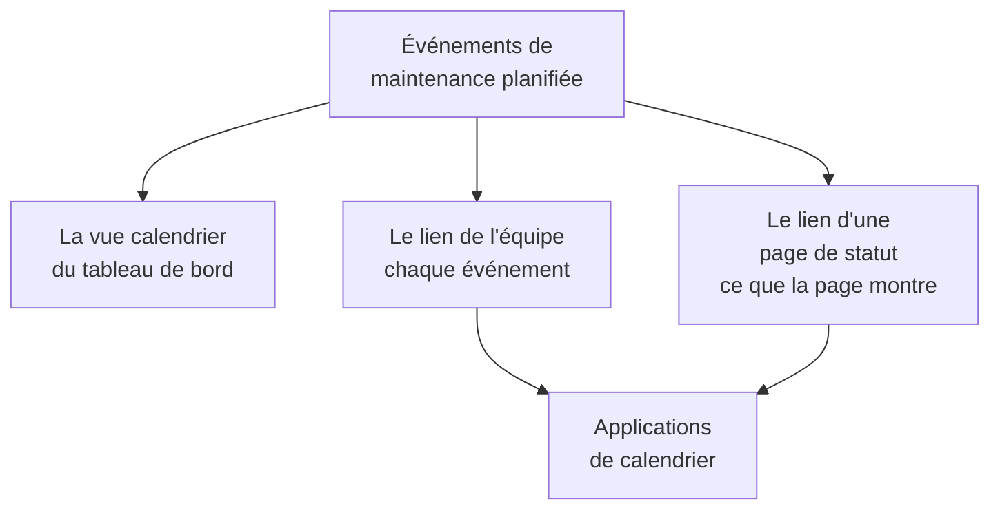

# Calendrier de maintenance

Le calendrier de maintenance montre votre maintenance planifiée par date : comme calendrier dans le tableau de bord, dans les applications de calendrier de votre équipe grâce à un lien secret, et dans les calendriers des personnes qui suivent vos pages de statut. Cette page explique la vue calendrier, le lien de calendrier de l'équipe, le calendrier d'une page de statut et ce que contient chaque événement de calendrier.

:::cards
- [La vue calendrier](#la-vue-calendrier): Chaque événement sur un mois, une semaine ou un jour, dans la couleur de son état.
- [Le lien de calendrier de l'équipe](#le-lien-de-calendrier-de-léquipe): Chaque événement du projet dans Google Agenda, Outlook ou Apple Calendrier.
- [Le calendrier d'une page de statut](#le-calendrier-dune-page-de-statut): Ce qu'une page de statut montre, dans les calendriers de ses visiteurs.
- [Ce que contient un événement de calendrier](#ce-que-contient-un-événement-de-calendrier): Le titre, la plage horaire, l'état et un lien de retour.
:::



## La vue calendrier

Ouvrez **Maintenance planifiée → Tous les événements**. À l'extrémité droite de la barre de filtres, **Liste** et **Calendrier** basculent entre le tableau des événements et un calendrier de ceux-ci. Votre navigateur retient ce choix, et la page s'ouvre donc sur le calendrier la fois suivante.

- Le calendrier s'ouvre sur le mois en cours, avec aujourd'hui mis en évidence. **Mois**, **Semaine** et **Jour** changent ce qu'il montre, et **Retour**, **Suivant** et **Aujourd'hui** le font défiler. Les heures sont dans votre propre fuseau horaire.
- Chaque événement est un bloc de la couleur de son état, et les couleurs des états sont nommées sous le calendrier. Cliquez sur un événement pour l'ouvrir.
- Les filtres au-dessus du calendrier fonctionnent comme sur la liste : choisissez un état, une étiquette ou un propriétaire pour ne voir que ces événements.
- Un jour encore à venir affiche un **+** quand vous pointez sa semaine. Il ouvre **Créer un événement de maintenance planifiée** avec **Commence le** à ce jour, à l'heure que le formulaire choisirait aujourd'hui. Vous ne le voyez que si vous pouvez créer des événements.
- Une vue montre jusqu'à 500 événements. Un mois plus chargé le signale : affinez-le avec les filtres, ou regardez une semaine.

## Le lien de calendrier de l'équipe

**S'abonner au calendrier**, sous le calendrier ou dans le menu **⋯** de la liste, ouvre le lien de calendrier du projet : un lien iCalendar (`.ics`) secret qui place chaque événement de maintenance planifiée du projet dans Google Agenda, Outlook, Apple Calendrier ou toute application qui s'abonne à un calendrier par URL.

:::steps
### Publier le lien

Cliquez sur **Publier le lien**. Un projet a un seul lien, pour toute l'équipe, il suffit donc de le faire une fois.

### L'ajouter à votre application de calendrier

**Google Agenda** ouvre Google Agenda, qui demande s'il faut ajouter le calendrier. **Apple Calendrier / Outlook** ouvre le lien dans l'application de calendrier de votre ordinateur ou de votre téléphone. **Copier le lien** le copie pour toute autre application.

### Vérifier qu'il fonctionne

Le panneau **Statut** indique quand une application de calendrier a lu le lien pour la dernière fois, et laquelle. Un nouveau lien indique **En attente de la première synchronisation** jusqu'à ce qu'une application le lise.
:::

Le lien ressemble à ceci :

```text
https://<your host>/api/scheduled-maintenance-calendar/project/<token>/maintenance.ics
```

> [!WARNING]
> Toute personne qui a le lien voit chaque événement de maintenance planifiée du projet, sans se connecter. Traitez-le comme un mot de passe, et régénérez-le s'il est partagé par erreur.

### Qui peut voir le lien

Le lien montre chaque événement du projet, la boîte de dialogue ne le montre donc qu'aux personnes qui peuvent lire chaque événement. Une personne dont le rôle la limite à certains événements, par étiquette ou aux événements dont elle est propriétaire, en apprend plutôt la raison.

| Action | Qui peut le faire |
| --- | --- |
| Copier le lien | Toute personne qui peut lire chaque événement de maintenance planifiée du projet |
| **Publier le lien** | Toute personne qui peut aussi créer des événements de maintenance planifiée |
| **Régénérer le lien**, **Désactiver le lien** | Toute personne qui peut aussi modifier des événements de maintenance planifiée |

### Gérer le lien

**Régénérer le lien** et **Désactiver le lien** se trouvent dans le menu **Gérer le lien** de la boîte de dialogue.

| Action | Ce qui se passe |
| --- | --- |
| **Régénérer le lien** | Crée un nouveau lien. Pendant 30 jours, l'ancien sert un calendrier vide, pour que les applications qui le détiennent vident leur copie ; ensuite, il est introuvable. Abonnez-vous de nouveau avec le nouveau lien. |
| **Désactiver le lien** | Conserve le lien, mais il sert un calendrier vide jusqu'à **Activer le lien**. |

Le calendrier contient chaque événement de 90 jours en arrière à un an en avant, jusqu'à 1 000 événements.

## Le calendrier d'une page de statut

Les personnes qui suivent une page de statut peuvent placer sa maintenance planifiée dans leur propre calendrier. Sur la page des événements planifiés de la page de statut, **S'abonner au calendrier** propose Google Agenda, l'application de calendrier de leur appareil ou le lien à copier. Le lien est l'adresse de la page suivie de `/maintenance.ics`, par exemple `https://status.example.com/maintenance.ics`.

- **Ce qu'il contient.** Exactement ce que la page montre : les événements de la période d'historique de la page, chaque événement à venir et chaque événement en cours, tant que **Visible sur la page de statut** est activé. Ce que chaque événement touche est nommé comme la page nomme ses ressources, jamais par les noms propres de vos moniteurs.
- **Une page privée.** Une application de calendrier ne peut pas se connecter : une page privée ne propose donc pas **S'abonner au calendrier**, et son lien sert un calendrier vide qui indique que la page est privée.
- **Un seul événement.** **Ajouter au calendrier** sur la page d'un événement ajoute cet événement seul : Google Agenda s'ouvre avec l'événement rempli, ou il se télécharge sous forme de fichier que l'application de calendrier de l'appareil ouvre. Cela fonctionne aussi sur une page privée, pour un visiteur connecté, et n'est plus proposé une fois l'événement terminé.

## Ce que contient un événement de calendrier

Chaque calendrier, celui de l'équipe comme celui d'une page de statut, écrit un événement de la même façon.

| Partie | Ce qu'elle contient |
| --- | --- |
| Titre | Le titre de l'événement |
| Début et fin | Sa plage prévue, en UTC ; l'application de calendrier l'affiche dans votre propre fuseau horaire |
| Description | Sa description en texte brut, son état, ce qu'il touche et un lien vers l'événement ; le lien de l'équipe nomme aussi ses pages de statut |
| État | Annulé quand l'événement a été annulé : terminé sans jamais avoir été en cours |
| Libre ou occupé | Libre, pour qu'une fenêtre de maintenance ne bloque jamais votre disponibilité |
| Catégories | Ses étiquettes ; le calendrier d'une page de statut ne les montre que si la page montre les étiquettes |

Un événement modifié dans OneUptime est mis à jour sur place dans chaque calendrier qui le contient, et un événement supprimé, ou retiré d'une page de statut, quitte le calendrier à sa prochaine actualisation.

## Fréquence d'actualisation des calendriers

Les applications de calendrier lisent un lien abonné selon leur propre rythme. Google Agenda le fait toutes les quelques heures, parfois une seule fois par jour ; Apple Calendrier et Outlook en général toutes les heures. OneUptime garde un calendrier au plus cinq minutes, l'attente que vous voyez est donc celle de l'application de calendrier. Les étapes pour chaque application se trouvent sur [Flux de calendrier](/docs/on-call/calendar-feeds#sabonner-dans-votre-application-de-calendrier), qui fonctionnent de la même façon pour les gardes d'astreinte.

## Dépannage

:::details L'application de calendrier n'affiche plus les nouveaux événements
Le lien a été régénéré ou désactivé : ouvrez **S'abonner au calendrier** pour voir son statut. Un lien régénéré demande de s'abonner de nouveau avec le nouveau lien ; un lien désactivé revient avec **Activer le lien**.
:::

:::details Google Agenda ne parvient pas à ajouter le lien
Google Agenda lit le lien depuis les serveurs de Google, le serveur OneUptime doit donc être joignable depuis Internet. Pour un serveur auto-hébergé, voir [Flux de calendrier](/docs/on-call/calendar-feeds#dépannage).
:::

:::details Un événement manque dans le calendrier d'une page de statut
Le calendrier de la page contient ce que la page montre. Vérifiez que l'événement nomme la page, que **Visible sur la page de statut** est activé dans ses **Paramètres**, et qu'il a commencé dans la période d'historique de la page.
:::

## Prochaines étapes

:::cards
- [Créer des événements de maintenance](/docs/scheduled-maintenance/creating-events): Le formulaire, champ par champ, et ce qui se passe ensuite.
- [Abonnés et annonces](/docs/status-pages/subscribers#événements-de-maintenance-planifiée): Ce que les abonnés d'une page de statut apprennent de la maintenance.
- [Flux de calendrier](/docs/on-call/calendar-feeds): Le même genre de lien, pour les gardes d'astreinte.
:::
