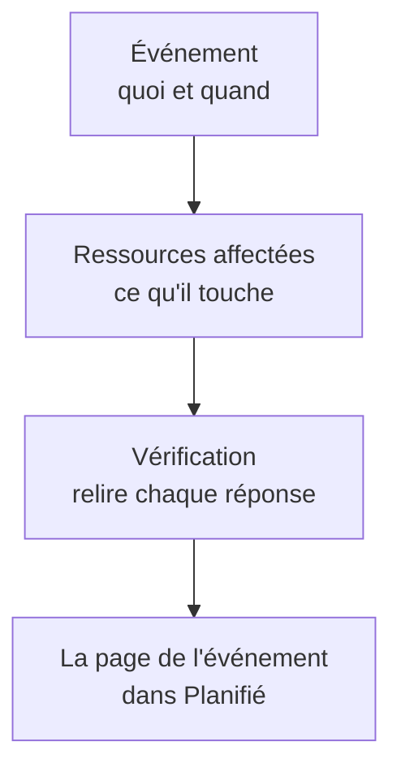

# Créer des événements de maintenance

Planifiez une maintenance en deux étapes courtes : dites ce qui se passe et quand, puis ce que cela affecte et qui doit en être informé. Seul le titre doit être saisi ; tout le reste démarre avec une valeur par défaut raisonnable. Cette page parcourt le formulaire, ce qui se passe au moment où vous créez un événement, comment le modifier ensuite et comment créer des événements par le code.

:::cards
- [Créer un événement](#créer-un-événement): Deux étapes et une vérification.
- [Ce qui se passe à la création](#ce-qui-se-passe-à-la-création): Son numéro, ses règles, ses propriétaires et les premiers messages.
- [Modifier un événement ensuite](#modifier-un-événement-ensuite): Sa fenêtre, ses ressources, ses pages de statut et ses notes.
- [Créer des événements par le code](#créer-des-événements-par-le-code): L'API, Terraform, les workflows et le chat.
:::

## Comment ça marche

Le formulaire pose deux questions, une par étape, puis affiche tout dans une vérification avant de créer l'événement. L'événement commence dans votre état planifié, et sa page s'ouvre.



## Avant de commencer

- **Votre rôle.** Créer un événement requiert **Propriétaire du projet**, **Administrateur du projet**, **Membre du projet**, **Administrateur de la maintenance planifiée** ou **Membre de la maintenance planifiée**, ou un rôle personnalisé avec **Create Scheduled Maintenance**.
- **Vos pages de statut.** Pour informer vos clients, il vous faut une page de statut qui affiche les événements de maintenance planifiée. Voir [Vue d'ensemble des pages de statut](/docs/status-pages/index).

## Créer un événement

:::steps
### Ouvrir le formulaire

Allez dans **Maintenance planifiée → Tous les événements** et cliquez sur **Créer un événement de maintenance planifiée**. Le formulaire s'ouvre sur sa première étape, **Événement**.

### Dire ce qui se passe et quand

Saisissez un **Titre** et ajoutez une **Description** si elle aide : elle est en Markdown et s'affiche sur vos pages de statut. **Commence le** est déjà réglé sur la prochaine heure pleine de votre horloge, et **Se termine le** une heure plus tard ; ne les changez que s'ils sont faux. Déplacer **Commence le** déplace **Se termine le** avec lui, pour que la fenêtre garde sa durée. **Propriétaires** et **Étiquettes** attendent sous **Plus de champs**, repliés.

### Choisir ce qu'il affecte

Cliquez sur **Suivant** pour atteindre **Ressources affectées**. Choisissez les **Moniteurs** que les travaux touchent. Dès que vous en choisissez un, **Changer le statut du moniteur en** apparaît en dessous : le statut que prennent les moniteurs quand l'événement commence. Choisissez ensuite d'éventuelles **Autres ressources affectées**, comme des hôtes, des clusters, des bases de données, des sites réseau ou des services.

### Choisir qui en est informé

Choisissez les pages de statut sous **Afficher l'événement sur ces pages de statut**. **Notifications aux abonnés**, replié, indique en une ligne qui est prévenu et quand ; ouvrez-le pour modifier **Lorsque l'événement est planifié**, **Lorsque l'événement commence**, **Lorsque l'événement se termine** ou **Rappels avant l'événement**.

### Le créer

Cliquez sur **Suivant** pour voir la vérification, relisez-la, puis cliquez sur **Créer un événement de maintenance planifiée**. La page de l'événement s'ouvre.
:::

Rien n'est envoyé tant que vous ne choisissez pas de page de statut : un événement affiché sur aucune page de statut ne prévient aucun abonné.

## Les champs du formulaire

| Champ                                | Étape              | Valeur de départ                | Ce qu'il fait                                                                    |
| ------------------------------------ | ------------------ | ------------------------------- | -------------------------------------------------------------------------------- |
| **Titre**                            | **Événement**      | Vide, et obligatoire            | Nomme l'événement partout, sur vos pages de statut aussi.                        |
| **Description**                      | **Événement**      | Vide                            | Explique les travaux à vos clients, en Markdown.                                 |
| **Commence le**                      | **Événement**      | La prochaine heure pleine       | Quand l'événement commence, tout seul.                                           |
| **Se termine le**                    | **Événement**      | Une heure après **Commence le** | Quand l'événement se termine, tout seul. Il doit venir après **Commence le**.    |
| **Propriétaires**                    | **Événement**      | Personne                        | Les personnes et équipes à qui appartient l'événement et qui en sont informées. |
| **Étiquettes**                       | **Événement**      | Aucune                          | Des étiquettes que les règles et les filtres peuvent cibler.                     |
| **Moniteurs**                        | **Ressources affectées** | Aucun                     | Les moniteurs qui ne sont pas vérifiés pendant que l'événement est en cours.     |
| **Changer le statut du moniteur en** | **Ressources affectées** | Aucun changement          | Le statut que ces moniteurs affichent pendant l'événement. Demandé dès qu'un moniteur est choisi. |
| **Autres ressources affectées**      | **Ressources affectées** | Aucune                    | Hôtes, clusters, bases de données, sites réseau, services et plus.               |
| **Afficher l'événement sur ces pages de statut** | **Ressources affectées** | Aucune    | Les pages de statut qui affichent l'événement et préviennent leurs abonnés.      |
| **Notifications aux abonnés**        | **Ressources affectées** | Les trois moments activés, aucun rappel | Quand les abonnés de ces pages sont prévenus.               |

Deux choses remplissent le formulaire pour vous en cours de route :

- **Ressources liées.** Quand vous choisissez un moniteur, les hôtes, clusters, services et autres ressources auxquels il est lié sont ajoutés sous **Autres ressources affectées**, et une ligne sous le champ les nomme. Retirez ceux dont vous ne voulez pas.
- **Pages de statut suggérées.** Sous **Afficher l'événement sur ces pages de statut**, les pages qui affichent vos moniteurs sont suggérées : cliquez sur le nom d'une page pour l'ajouter, ou sur **Tout ajouter**. Rien n'est choisi pour vous. Voir [Événements de maintenance planifiée](/docs/status-pages/subscribers#événements-de-maintenance-planifiée).

## Partir d'une ressource ou d'un modèle

Dans l'onglet **Maintenance planifiée** d'un hôte, d'un cluster Kubernetes, Proxmox, Ceph ou Docker Swarm, d'un hôte Docker ou Podman, d'un vCenter, d'une baie de stockage, d'une flotte IoT, d'une base de données, d'un service ou d'un site réseau, **Créer un événement de maintenance planifiée** ouvre le même formulaire avec cette ressource déjà choisie sous **Autres ressources affectées**, et l'onglet liste les événements qui l'affectent. L'onglet d'un élément d'inventaire choisit l'hôte, le service ou le cluster Kubernetes vers lequel pointe l'élément.

**Créer à partir d'un modèle**, à côté du bouton de création, vous demande de **Sélectionner le modèle de maintenance planifiée**, puis ouvre le formulaire rempli à partir du modèle. Voir [Modèles et événements récurrents](/docs/scheduled-maintenance/templates).

## Ce qui se passe à la création

Au moment où vous cliquez sur **Créer un événement de maintenance planifiée**, OneUptime enchaîne ces étapes, dans cet ordre :

1. **Il reçoit un numéro et un état.** Le numéro vient d'un compteur par projet, affiché avec votre préfixe (`SM-42`). L'événement commence dans votre état planifié, quel que soit l'état indiqué par une requête.
2. **Vos outils de chat en sont informés.** Les règles Slack et Microsoft Teams sous **Espace de travail** le publient dans leurs canaux, et une règle peut créer un canal pour l'événement. Son fil d'activité enregistre sa création.
3. **Sa chronologie d'état commence.** La première ligne de sa **Chronologie d'état** est votre état planifié.
4. **Les propriétaires et étiquettes sont ajoutés** : ceux que vous avez choisis, puis ceux des règles de propriétaire et d'étiquettes qui correspondent.
5. **Les règles de runbook démarrent** les runbooks qui correspondent à l'événement.
6. **Les rappels sont planifiés**, quand une règle de rappel correspond, pour ses propriétaires.

Dans la minute, les abonnés de ses pages de statut sont prévenus qu'il est planifié, sauf si vous avez désactivé **Lorsque l'événement est planifié**. Le déclencheur de workflow **On Create Scheduled Maintenance Event** démarre tout workflow construit dessus, et ses propriétaires en sont informés s'ils ont activé cette notification : voir [Paramètres de notification](/docs/notifications/notification-settings).

## Modifier un événement ensuite

Tout ce que contient le formulaire peut être modifié sur les pages de l'événement, sauf les trois moments des abonnés, fixés une fois pour toutes à la création de l'événement.

| Pour modifier                               | Allez dans                                                                     |
| ------------------------------------------- | ------------------------------------------------------------------------------ |
| Le titre, la fenêtre ou les étiquettes      | **Modifier** sur la carte **Détails de la maintenance** de sa **Vue d'ensemble**, étape **Événement** |
| Les pages de statut ou les rappels          | Le même **Modifier**, étape **Pages de statut**                                 |
| Les moniteurs, leur statut ou les autres ressources | **Modifier** sur la carte **Ressources affectées**                       |
| La description                              | **Description** dans son menu latéral                                          |
| Les propriétaires                           | **Propriétaires** dans son menu latéral                                        |

**Changer le statut du moniteur en** peut être modifié jusqu'au début de l'événement. Ensuite, la carte l'affiche en lecture seule, car les moniteurs sont déjà dans ce statut. Une modification ajoute au **Fil d'activité de la maintenance planifiée** une entrée qui nomme ce qu'elle a changé ; enregistrer sans rien changer n'en ajoute aucune.

## Publier des notes pendant les travaux

- Les **Notes publiques** sont des mises à jour pour vos clients : elles s'affichent sur les pages de statut de l'événement, et chacune peut prévenir leurs abonnés avec **Notifier les abonnés à la page de statut**.
- Les **Notes privées** sont réservées à votre équipe.

Rédigez-en une sur la page **Notes publiques** ou **Notes privées** de l'événement, ou depuis le menu **Actions** du **Fil d'activité de la maintenance planifiée** avec **Ajouter une note publique** ou **Ajouter une note privée**. Le même menu lance un runbook avec **Exécuter le runbook**. Un modèle de note remplit un texte que votre équipe écrit souvent : voir [Règles et paramètres de la maintenance](/docs/scheduled-maintenance/settings#modèles-de-notes).

## Créer des événements par le code

Le modèle d'événement a une API standard, donc `POST /api/scheduled-maintenance` crée un événement. Authentifiez-vous avec une clé API de **Paramètres du projet → Avancé → Clés API**, envoyée dans l'en-tête `apikey` ; la clé désigne le projet.

```bash
curl -X POST https://oneuptime.com/api/scheduled-maintenance \
  -H "apikey: $ONEUPTIME_API_KEY" \
  -H "Content-Type: application/json" \
  -d '{
    "data": {
      "title": "Database upgrade",
      "description": "Writes pause for a few minutes while the primary restarts.",
      "startsAt": "2030-06-01T02:00:00Z",
      "endsAt": "2030-06-01T04:00:00Z"
    }
  }'
```

| Champ                                                 | Remarques                                                                                 |
| ----------------------------------------------------- | ----------------------------------------------------------------------------------------- |
| `title`, `startsAt`, `endsAt`                          | Obligatoires, comme dans le formulaire.                                                   |
| `monitors`, `statusPages`, `labels`                   | Les moniteurs, pages de statut et étiquettes de l'événement, tous du projet de la clé API. |
| `changeMonitorStatusToId`                             | Le statut que prennent ses moniteurs quand il commence.                                   |
| `currentScheduledMaintenanceStateId`                  | Ignoré : chaque événement commence dans votre état planifié.                              |
| `shouldStatusPageSubscribersBeNotifiedOnEventCreated` | L'interrupteur **Lorsque l'événement est planifié**. Les deux autres moments ont leurs propres champs. |

Le même événement en code est la ressource Terraform `oneuptime_scheduled_maintenance_event` : voir [Exemples](/docs/terraform/examples#maintenance-planifiée). Un workflow en crée un avec son étape **Create One Scheduled Maintenance Event**, et `/oneuptime maintenance` ouvre le formulaire dans Slack : voir [Slack](/docs/workspace-connections/slack#créer-des-incidents-et-des-maintenances-depuis-slack).

## Dépannage

:::details Se termine le doit venir après Commence le
La fenêtre doit être dans l'ordre : l'événement se termine après avoir commencé. Déplacez d'abord **Commence le**, puisque **Se termine le** le suit, puis réglez **Se termine le**.
:::

:::details Changer le statut du moniteur en manque dans le formulaire
Ce champ n'est demandé qu'une fois que l'événement a un moniteur. Choisissez-en un sous **Moniteurs**, et il apparaît juste en dessous.
:::

:::details Changer le statut du moniteur en ne peut plus être modifié
L'événement a commencé, et ses moniteurs sont déjà dans ce statut. Le statut s'applique du début de l'événement jusqu'à sa fin.
:::

## Prochaines étapes

:::cards
- [États de la maintenance](/docs/scheduled-maintenance/states): Ce qui démarre et termine un événement, et comment le faire avancer à la main.
- [Modèles et événements récurrents](/docs/scheduled-maintenance/templates): Enregistrer les réponses du formulaire pour la prochaine fois.
- [Abonnés et annonces](/docs/status-pages/subscribers#événements-de-maintenance-planifiée): Exactement qui est prévenu, et quand.
- [Règles et paramètres de la maintenance](/docs/scheduled-maintenance/settings): Ajouter propriétaires, étiquettes et rappels automatiquement.
:::
