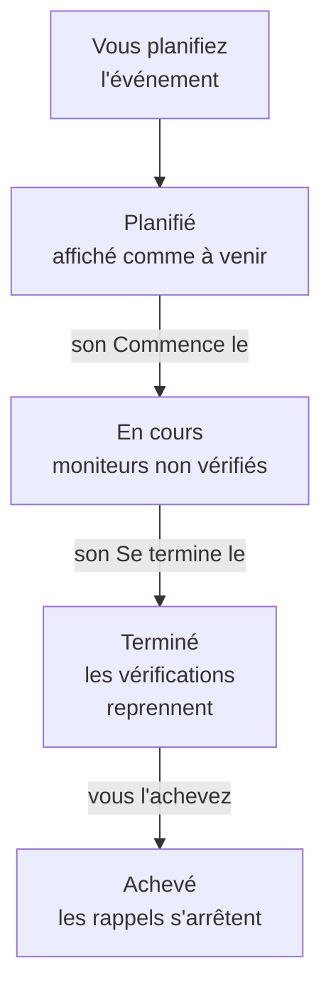

# Vue d'ensemble de la maintenance planifiée

Un événement de maintenance planifiée annonce des travaux prévus avant qu'ils ne commencent : une mise à niveau de base de données, un changement réseau, un déménagement vers de nouveaux serveurs. OneUptime démarre et termine l'événement à l'heure, cesse de vérifier les moniteurs concernés pendant les travaux et l'affiche sur vos pages de statut, pour qu'une indisponibilité prévue ne ressemble jamais à une panne. Cette page explique comment se déroule un événement, où tout se trouve dans le tableau de bord et ce qu'un événement change dans le reste de OneUptime.

:::cards
- [Comment se déroule un événement](#comment-se-déroule-un-événement): De planifié à achevé, en grande partie tout seul.
- [D'où viennent les événements](#doù-viennent-les-événements): Le formulaire, les modèles, une planification, les formulaires, le chat et le code.
- [Ce qu'un événement affecte](#ce-quun-événement-affecte): Moniteurs, pages de statut, abonnés et alertes.
- [Les pages d'un événement](#les-pages-dun-événement): Sa vue d'ensemble, sa chronologie, ses notes et ses paramètres.
:::

## Comment se déroule un événement

Chaque événement a une fenêtre prévue, son **Commence le** et son **Se termine le**, et descend votre liste d'états de maintenance. Une tâche qui s'exécute chaque minute le fait avancer aux deux extrémités de la fenêtre : vous planifiez les travaux une fois et OneUptime s'occupe du reste.

Un nouvel événement commence dans **Planifié**. À son **Commence le**, il passe à **En cours** : OneUptime cesse de vérifier ses moniteurs et, si vous avez choisi un statut pour eux, les affiche dans ce statut. À son **Se termine le**, il passe à **Terminé** : les vérifications reprennent et chaque moniteur revient à « opérationnel ». **Achevé** est la dernière étape, et rien ne la franchit tout seul : une personne, un bouton de chat ou l'API marque les travaux comme validés, ce qui arrête aussi les rappels aux propriétaires.

Vous pouvez démarrer ou terminer un événement plus tôt, ou ajouter vos propres états entre ces quatre-là. Voir [États de la maintenance](/docs/scheduled-maintenance/states).

## Maintenance et annonces

Les deux informent les visiteurs de vos pages de statut. Utilisez un événement de maintenance pour des travaux qui ont un début et une fin, et une annonce pour tout ce qu'ils doivent lire d'autre.

|                              | Maintenance planifiée                                                   | Annonce                                        |
| ---------------------------- | ----------------------------------------------------------------------- | ---------------------------------------------- |
| **Ce que c'est**             | Des travaux prévus, avec une fenêtre                                    | Un message pour les visiteurs de vos pages de statut |
| **Ses moniteurs**            | Non vérifiés pendant qu'il se déroule, et affichés dans le statut choisi | Inchangés                                     |
| **Comment il avance**        | Par vos états de maintenance, à l'heure                                 | Elle s'affiche de son heure de début jusqu'à son heure de fin, si elle en a une |
| **Quand les abonnés sont prévenus** | Quand il est planifié, commence et se termine, et avant qu'il commence si vous le demandez | Une fois, quand elle commence à s'afficher |
| **Numéros dans un nouveau projet** | `SM-42`                                                           | Aucun                                          |

Les annonces sont traitées dans [Abonnés et annonces](/docs/status-pages/subscribers#annonces).

## D'où viennent les événements

- **Le formulaire.** Cliquez sur **Créer un événement de maintenance planifiée** dans la liste des événements, ou dans l'onglet **Maintenance planifiée** d'un hôte, d'un cluster, d'un service, d'un site réseau ou d'une autre ressource, qui sélectionne cette ressource pour vous. Voir [Créer des événements de maintenance](/docs/scheduled-maintenance/creating-events).
- **Un modèle.** **Créer à partir d'un modèle** remplit le formulaire à partir d'un modèle que vous avez enregistré pour des travaux fréquents. Voir [Modèles et événements récurrents](/docs/scheduled-maintenance/templates).
- **Une planification.** Un modèle récurrent crée un nouvel événement selon une planification, par exemple chaque semaine ou chaque mois, sans que personne n'ouvre le formulaire.
- **Un formulaire.** Un formulaire dont les soumissions créent des événements de maintenance transforme une demande de changement en événement. Voir [Ce que crée une soumission](/docs/forms/on-submit#comment-une-soumission-devient-un-événement-de-maintenance-planifiée).
- **Le chat.** `/oneuptime maintenance` dans Slack, ou `maintenance` écrit au bot OneUptime dans Microsoft Teams, ouvre le formulaire dans votre outil de chat. Voir [Slack](/docs/workspace-connections/slack#créer-des-incidents-et-des-maintenances-depuis-slack).
- **Le code.** L'API sous `/api/scheduled-maintenance`, la ressource Terraform `oneuptime_scheduled_maintenance_event` et l'étape **Create One Scheduled Maintenance Event** d'un workflow.

## Où se trouve la maintenance dans le tableau de bord

Ouvrez **Maintenance planifiée** depuis le menu **Produits** de la barre supérieure. La liste des événements se trouve sous `/dashboard/{projectId}/scheduled-maintenance-events`, et son menu latéral contient tout ce qui concerne la maintenance :

| Section       | Ce que vous y faites                                                                                                       |
| ------------- | -------------------------------------------------------------------------------------------------------------------------- |
| **Vue d'ensemble** | **Tous les événements** et **Événements en cours**, dont le badge compte les événements en cours en ce moment.         |
| **Calendrier** | **Calendrier de maintenance** : chaque événement sur un mois, une semaine ou un jour, à côté des calendriers extérieurs au projet que vous ajoutez. |
| **Espace de travail** | **Slack** et **Microsoft Teams**, selon ce que le projet a connecté, ou **Connecter Slack ou Teams** s'il n'a ni l'un ni l'autre. |
| **Règles**    | **Règles de propriétaire**, **Règles de runbook**, **Règles d'étiquettes**, **Reminder Rules**.                              |
| **Paramètres** | **État de l'événement**, **Modèles d'événement**, **Modèles de notes**, **Champs personnalisés**, **Mesures**, **Paramètres du calendrier**, **Numérotation**. |

**Vue d'ensemble** et **Calendrier** sont ouvertes ; **Espace de travail**, **Règles**, **Paramètres** et **Développeurs** sont repliées au départ, et une section s'ouvre d'elle-même quand vous êtes sur l'une de ses pages. **Développeurs** contient **Terraform**, **API** et **Assistants IA**, pour gérer la maintenance par le code. Tout ce qui concerne la maintenance se trouve ici, pas dans les **Paramètres du projet**.

La liste affiche **Numéro de maintenance planifiée**, **Titre**, **État actuel**, **Ressources affectées**, **Affiché sur la page de statut**, **Commence le**, **Durée**, **Se termine le**, **Étiquettes** et **Propriétaires**. Sélectionnez des événements pour agir sur plusieurs à la fois : **Marquer comme {{state}}**, **Modifier l'état**, **M'attribuer**, **Ajouter un propriétaire**, **Remove Owner**, **Ajouter des étiquettes**, **Remove Labels** ou **Supprimer**. Le menu **⋯** au bout de la ligne de chaque événement fait de même pour ce seul événement : les étapes **Marquer comme {{state}}** tant que l'événement peut les franchir, **Modifier l'état**, **M'attribuer** tant que vous n'en êtes pas propriétaire, et **Ajouter un propriétaire**.

**Calendrier de maintenance**, dans la section **Calendrier**, affiche les mêmes événements sur un mois, une semaine ou un jour, et peut afficher à côté d'eux des calendriers extérieurs au projet. Voir [Calendrier de maintenance](/docs/scheduled-maintenance/calendar).

## Ce qu'un événement affecte

Pendant qu'un événement est en cours, OneUptime considère la panne qu'il prévoit comme attendue :

- **Ses moniteurs ne sont pas vérifiés.** Chaque moniteur sous **Moniteurs** cesse d'être vérifié, et ses pages indiquent **Ce moniteur est désactivé**. Si vous avez choisi un **Changer le statut du moniteur en**, les moniteurs affichent ce statut, sur vos pages de statut aussi. Quand l'événement se termine ou est supprimé, les vérifications reprennent et chaque moniteur revient à « opérationnel », sauf si un autre événement en cours le retient encore.
- **Ses autres ressources restent silencieuses.** Un moniteur de télémétrie qui surveille de nombreux hôtes, clusters, bases de données ou services, une série chacun, ne crée ni incident ni alerte pour une série dont la ressource est couverte par l'événement, tandis que les autres séries continuent d'alerter.
- **Les sites réseau et les SLO se retiennent.** Un site réseau couvert par l'événement cesse de compter sa panne prévue contre les sites au-dessus de lui, et les règles de taux de consommation d'un SLO ne déclenchent rien tant que l'un de ses moniteurs est en maintenance. Voir [Sites réseau](/docs/monitor/network-sites#maintenance-planifiée-pour-les-sites-réseau) et [Alertes et incidents de taux de consommation](/docs/slo/burn-rate-alerts#maintenance-planifiée).
- **Vos pages de statut l'affichent.** L'événement apparaît sur les pages de statut choisies, d'abord à venir, puis en cours, puis passé, tant que **Visible sur la page de statut** est activé dans ses **Paramètres**.
- **Les abonnés en sont informés.** Par défaut, les abonnés de ces pages sont prévenus quand il est planifié, quand il commence et quand il se termine, et reçoivent un rappel avant le début si vous définissez des rappels. Voir [Événements de maintenance planifiée](/docs/status-pages/subscribers#événements-de-maintenance-planifiée).
- **Votre équipe en est informée.** Ses propriétaires sont prévenus comme le prévoient leurs [paramètres de notification](/docs/notifications/notification-settings), et les règles Slack et Microsoft Teams sous **Espace de travail** le publient dans vos canaux.

## Les pages d'un événement

Ouvrez un événement depuis la liste pour voir ses pages. Son menu latéral contient :

| Section du menu latéral | Pages                                                                                   |
| ----------------- | --------------------------------------------------------------------------------------------- |
| **Vue d'ensemble** | **Vue d'ensemble**, **Chronologie d'état**, **Description**, **Runbooks** |
| **Équipe** | **Propriétaires** |
| **Notifications**      | **Journaux de notification** et **Journaux IA** : chaque message envoyé au sujet de l'événement, et tout ce que l'IA a fait pour lui |
| **Notes**         | **Notes privées** et **Notes publiques**                                                       |
| **Développeurs**  | **Terraform**, **API** et **Assistants IA** : l'événement géré par le code                     |
| **Avancé**        | **Champs personnalisés**, **Paramètres**, **Journaux d'audit**, **Supprimer l'événement**      |

**Vue d'ensemble**, **Équipe** et **Notes** sont ouvertes ; les autres sections restent repliées jusqu'à ce que vous cliquiez dessus.

- **Vue d'ensemble** — l'en-tête affiche le numéro, le titre et l'état de l'événement, le temps restant avant son début ou depuis combien de temps il dure, ses propriétaires, les pages de statut où il apparaît et qui l'a créé, et les boutons qui le font avancer. En dessous, **Commence**, **Se termine** et **Durée** montrent la fenêtre prévue dans votre fuseau horaire. Le **Fil d'activité de la maintenance planifiée** enregistre tout ce qui est arrivé à l'événement, à côté des cartes **Détails de la maintenance** et **Ressources affectées**, ainsi que des cartes **Mesures** et **Champs personnalisés** quand votre projet en a.
- **Chronologie d'état** — chaque état dans lequel l'événement a été, quand et pendant combien de temps. Voir [États de la maintenance](/docs/scheduled-maintenance/states#la-chronologie-détat).
- **Notes publiques** — des mises à jour pour vos pages de statut et leurs abonnés. Les **Notes privées** sont réservées à votre équipe.
- **Paramètres** — **Visible sur la page de statut**, qui affiche ou masque l'événement sur ses pages de statut, et **Envoyer des rappels**, qui rappelle l'événement à ses propriétaires jusqu'à ce qu'il soit achevé. Chaque interrupteur enregistre dès que vous le basculez.

## Dépannage

:::details Un événement n'a pas commencé à son Commence le
La tâche qui démarre les événements s'exécute chaque minute, laissez donc passer une minute. Si l'en-tête indique **Début en retard**, l'événement a manqué son début de plus de deux minutes : démarrez-le avec le bouton de l'en-tête, qui fait tout ce que fait la tâche, et ouvrez sa **Chronologie d'état** pour voir où il en était.
:::

:::details Un moniteur a encore été vérifié pendant la maintenance
Seuls les moniteurs que l'événement nomme sous **Moniteurs** cessent d'être vérifiés, et seulement pendant que l'événement est en cours. Un moniteur d'un hôte ou d'un service que l'événement nomme sous **Autres ressources affectées** est toujours vérifié. Modifiez la carte **Ressources affectées** de l'événement pour ajouter le moniteur.
:::

:::details L'événement n'apparaît pas sur ma page de statut
Vérifiez que l'événement nomme la page sous **Afficher l'événement sur ces pages de statut** et que **Visible sur la page de statut** est activé dans les **Paramètres** de l'événement. Vérifiez ensuite la page de statut elle-même : elle doit afficher les événements de maintenance planifiée, et un événement qui a commencé depuis plus longtemps que la fenêtre d'historique de la page, 14 jours sauf si vous l'avez modifiée, n'est plus listé.
:::

## Prochaines étapes

:::cards
- [Créer des événements de maintenance](/docs/scheduled-maintenance/creating-events): Le formulaire, champ par champ, et ce qui se passe ensuite.
- [États de la maintenance](/docs/scheduled-maintenance/states): Ce qui démarre et termine un événement, et vos propres états.
- [Modèles et événements récurrents](/docs/scheduled-maintenance/templates): Réutiliser un événement, ou le planifier chaque semaine.
- [Règles et paramètres de la maintenance](/docs/scheduled-maintenance/settings): Propriétaires, étiquettes, runbooks et rappels, automatiquement.
:::
