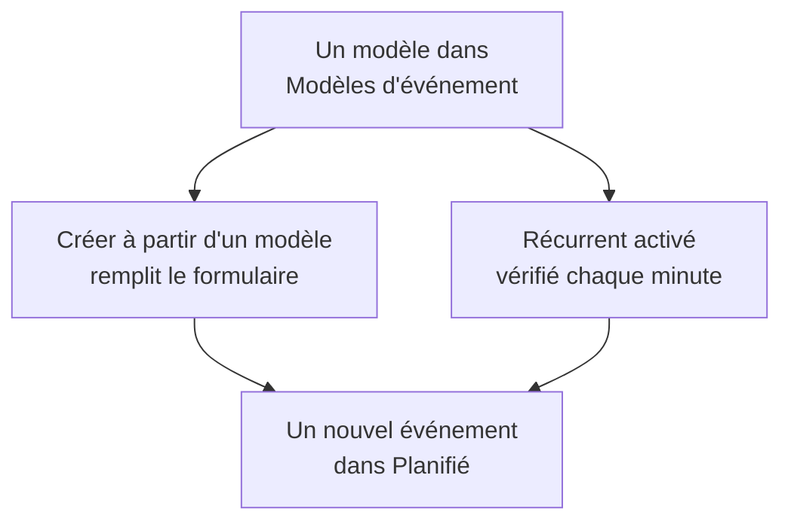

# Modèles et événements récurrents

Un modèle de maintenance planifiée enregistre un événement que vous planifiez souvent : son titre et sa description, les moniteurs qu'il met en pause, les pages de statut où il apparaît et qui est prévenu. Utilisez-en un pour remplir le formulaire en un clic, ou rendez-le récurrent pour que OneUptime planifie l'événement à votre place, chaque semaine, chaque mois ou à l'intervalle de votre choix.

:::cards
- [Créer un modèle](#créer-un-modèle): Les étapes du formulaire, avec un nom au début et une planification à la fin.
- [Utiliser un modèle](#utiliser-un-modèle): Remplir un nouvel événement à partir de lui.
- [Événements récurrents](#événements-récurrents): Laisser OneUptime planifier l'événement tout seul.
- [Modifier ou arrêter un modèle](#modifier-ou-arrêter-un-modèle): Le modifier, suspendre sa planification ou le supprimer.
:::

## Comment ça marche

Un modèle est un point de départ. Un événement créé à partir de lui est une copie avec ses propres valeurs : modifier le modèle ensuite ne change que les événements créés après.

## Avant de commencer

- **Votre forfait.** Sur OneUptime Cloud, les modèles requièrent le forfait **Growth** ou supérieur.
- **Votre rôle.** Créer un modèle requiert **Propriétaire du projet**, **Administrateur du projet**, **Membre du projet**, **Administrateur de la maintenance planifiée** ou **Membre de la maintenance planifiée**, ou un rôle personnalisé autorisé à créer des modèles de maintenance planifiée.

## Créer un modèle

:::steps
### Ouvrir les modèles

Allez dans **Maintenance planifiée → Paramètres → Modèles d'événement**. **Paramètres** est replié au départ dans le menu latéral : dépliez-le d'abord. Cliquez sur **Créer : Modèle de maintenance planifiée**.

### Nommer le modèle

Dans **Informations du modèle**, donnez-lui un **Nom du modèle** et une **Description du modèle**, pour que votre équipe sache quand l'utiliser. Les deux sont obligatoires.

### Décrire l'événement

Dans **Événement**, renseignez le **Titre** et la **Description** avec lesquels démarre chaque événement issu du modèle. **Propriétaires** et **Étiquettes** attendent sous **Plus de champs**.

### Choisir ce qu'il affecte

Dans **Ressources affectées**, choisissez les **Moniteurs**, le **Changer le statut du moniteur en** pour eux, d'éventuelles **Autres ressources affectées**, les pages de statut sous **Afficher l'événement sur ces pages de statut** et les **Notifications aux abonnés**.

### Décider s'il est récurrent

Dans **Récurrent**, laissez **Événement récurrent** désactivé pour un modèle que vous utilisez à la main, ou activez-le et renseignez sa planification. Cliquez sur **Suivant** pour relire la vérification, puis créez le modèle.
:::

Un modèle demande **Changer le statut du moniteur en** même quand il ne nomme aucun moniteur : le statut s'applique aussi aux moniteurs que vous ajoutez quand vous planifiez un événement à partir de lui. Sous **Autres ressources affectées**, un modèle accepte des hôtes, des clusters Kubernetes, des hôtes Docker, des hôtes Podman et des services.

## Ce qu'un modèle remplit

| Partie de l'événement                             | Créer à partir d'un modèle           | Un événement récurrent          |
| ------------------------------------------------- | ------------------------------------ | ------------------------------- |
| **Titre** et **Description**                      | Remplis, et vous pouvez les modifier | Copiés                          |
| **Moniteurs** et **Changer le statut du moniteur en** | Remplis                          | Copiés                          |
| **Autres ressources affectées**                   | Remplies                             | Copiées                         |
| Les pages de statut et **Notifications aux abonnés** | Remplies                          | Copiées                         |
| **Propriétaires** et **Étiquettes**               | Remplis                              | Copiés                          |
| **Commence le** et **Se termine le**              | La prochaine heure pleine, pour une heure | Calculés à partir de la planification |

## Utiliser un modèle

:::steps
### Choisir le modèle

Dans **Maintenance planifiée → Tous les événements**, cliquez sur **Créer à partir d'un modèle**, puis choisissez un modèle sous **Sélectionner le modèle de maintenance planifiée**.

### Vérifier le formulaire

Cliquez sur **Créer à partir d'un modèle**. Le formulaire de création s'ouvre avec les réponses du modèle déjà remplies. Réglez la fenêtre et modifiez ce dont cet événement a besoin.

### Créer l'événement

Parcourez les étapes avec **Suivant**, puis cliquez sur **Créer un événement de maintenance planifiée** dans la vérification.
:::

Quand le projet n'a encore aucun modèle, **Créer à partir d'un modèle** le dit et renvoie vers **Modèles d'événement**.

## Événements récurrents

Un modèle récurrent crée l'événement selon une planification. Vous fixez quand le premier événement est créé, quand il commence et quand il se termine ; chaque événement suivant garde les mêmes écarts, un intervalle plus tard.

| Champ                                    | Ce qu'il signifie                                                                                   |
| ---------------------------------------- | --------------------------------------------------------------------------------------------------- |
| **Événement récurrent**                  | Active la planification.                                                                            |
| **Premier événement planifié à**         | Quand OneUptime crée le premier événement, c'est-à-dire quand ses abonnés apprennent qu'il est planifié. |
| **Le premier événement commence à**      | Quand le premier événement commence.                                                                |
| **Le premier événement se termine à**    | Quand le premier événement se termine.                                                              |
| **À quelle fréquence souhaitez-vous que cet événement se reproduise ?** | Un nombre et une unité : heures, jours, semaines, mois ou années. |

Par exemple, une fenêtre hebdomadaire dont le premier événement est créé un lundi pour le samedi suivant :

| Événement    | Créé               | Commence           | Se termine         |
| ------------ | ------------------ | ------------------ | ------------------ |
| Le premier   | `2030-06-03 09:00` | `2030-06-08 02:00` | `2030-06-08 04:00` |
| Le deuxième  | `2030-06-10 09:00` | `2030-06-15 02:00` | `2030-06-15 04:00` |

Placez **Premier événement planifié à** aussi longtemps avant le début que vous voulez que vos clients soient informés des travaux. Les trois heures doivent être dans le futur quand vous créez le modèle, l'événement doit être créé avant de commencer et de se terminer, et il doit commencer avant de se terminer ; le formulaire indique quelle règle une heure enfreint.

Une tâche vérifie les modèles récurrents chaque minute. Quand arrive la prochaine heure d'un modèle, elle décale cette heure d'un intervalle et crée l'événement. La liste des modèles affiche cette heure dans sa colonne **Événement récurrent**, et **Non** pour un modèle qui ne se répète pas. Un événement créé par la planification est comme les autres : ses règles s'exécutent, ses propriétaires sont ajoutés et ses abonnés apprennent qu'il est planifié.

## Modifier ou arrêter un modèle

Ouvrez un modèle depuis la liste pour voir sa page :

- **Détails du modèle de maintenance planifiée** montre ce avec quoi démarrent les nouveaux événements. Son **Modifier** parcourt **Informations du modèle**, **Événement**, **Pages de statut** et **Récurrent**.
- **Ressources affectées** contient ses **Moniteurs**, leur **Changer le statut du moniteur en** et ses **Autres ressources affectées**, avec son propre **Modifier**.
- **Propriétaires** liste les personnes et équipes à qui appartient chaque événement planifié à partir de lui.

Les modifications s'appliquent aux événements créés après leur enregistrement ; les événements déjà créés gardent leurs propres valeurs. Pour arrêter une planification, désactivez **Événement récurrent** dans **Modifier**, ou supprimez le modèle. Un modèle désactivé garde sa planification : réactivez-le, et il reprend à la prochaine heure de la planification, en sautant les heures où il était désactivé. Supprimer un modèle laisse en place les événements qu'il a créés.

## Dépannage

:::details La création d'un modèle récurrent indique qu'une heure devrait être dans le futur
Les trois premières heures doivent être après l'instant présent quand vous créez le modèle. Avancez-les : la planification se poursuit ensuite à partir du premier événement.
:::

:::details Un modèle récurrent n'a créé aucun événement
Vérifiez que **Événement récurrent** est toujours activé, et regardez l'heure dans la colonne **Événement récurrent** de la liste : l'événement est créé à ce moment-là, pas à son début. La tâche s'exécute chaque minute, laissez donc passer une minute.
:::

:::details Il manque à un événement issu d'un modèle une ressource que j'avais choisie
Sous **Autres ressources affectées**, un modèle accepte des hôtes, des clusters Kubernetes, des hôtes Docker, des hôtes Podman et des services. Ajoutez les autres types de ressources à l'événement lui-même, avec **Modifier** sur sa carte **Ressources affectées**.
:::

## Prochaines étapes

:::cards
- [Créer des événements de maintenance](/docs/scheduled-maintenance/creating-events): Le formulaire qu'un modèle remplit.
- [États de la maintenance](/docs/scheduled-maintenance/states): Comment chaque événement avance une fois créé.
- [Règles et paramètres de la maintenance](/docs/scheduled-maintenance/settings): Ajouter automatiquement propriétaires et étiquettes à chaque nouvel événement.
- [Vue d'ensemble de la maintenance planifiée](/docs/scheduled-maintenance/index): La place des modèles dans le reste de la maintenance.
:::
