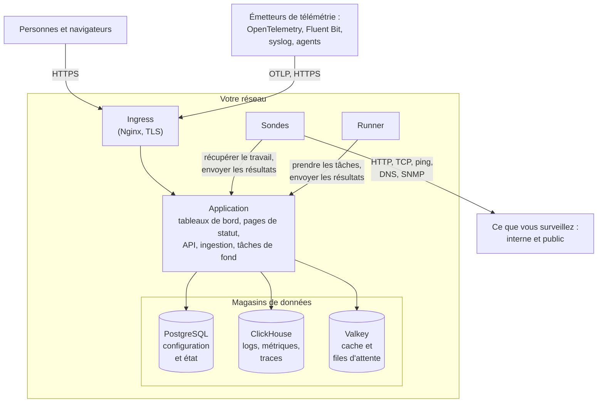

# Architecture

Une installation auto-hébergée de OneUptime tient en quelques conteneurs : un ingress par lequel entre chaque requête, une image d'application qui fait le travail, des sondes qui exécutent les vérifications de vos moniteurs, et trois magasins de données. Cette page montre comment ils s'assemblent, ce que fait chacun et quelles connexions traversent votre réseau.

## Ce que cela montre

- Les personnes accèdent à OneUptime par l'**ingress**, qui termine TLS et achemine chaque requête vers l'application : le Dashboard, les pages de statut, l'API et chaque point d'ingestion vers lequel la télémétrie est envoyée.
- L'**application** lit et écrit son état dans PostgreSQL, conserve la télémétrie dans ClickHouse et utilise Valkey (le fork sous licence BSD de Redis 7.2) pour le cache et pour les files d'attente que traitent ses tâches de fond.
- Les **sondes** peuvent s'exécuter dans votre cluster (recommandé) et/ou ailleurs sur votre réseau. Elles peuvent surveiller :
  - Les services internes/privés derrière votre pare-feu.
  - Les ressources externes/publiques sur Internet.
- Les résultats des sondes sont envoyés à l'application, mis en file d'attente dans Valkey, puis traités par les tâches de fond vers vos magasins de données. Une sonde située ailleurs sur votre réseau joint l'application par l'ingress, à votre URL OneUptime.
- La télémétrie (métriques, traces, logs et plus) est ingérée par la même application et stockée dans ClickHouse.

> [!NOTE]
> Si vous utilisez un PostgreSQL, un Valkey (ou Redis) ou un ClickHouse externe au lieu de ceux fournis, l'application se connecte à vos points de terminaison externes à la place. Le flux logique reste le même.

## Les composants

| Composant | Service Docker Compose | Chart Helm | Ce qu'il fait |
| --- | --- | --- | --- |
| Ingress | `ingress` | `nginx` | Termine TLS, sert votre nom d'hôte et les domaines de vos pages de statut, et achemine chaque requête vers l'application. |
| Application | `app` | `app` | Le Dashboard, les pages de statut, les points d'API et d'ingestion et, à moins que vous ne les sépariez, les tâches de fond. |
| Worker | Fait partie de `app` | `worker` (désactivé par défaut) | Les tâches de fond, dans leurs propres pods, pour que le traitement lourd des files d'attente ne concurrence jamais les requêtes d'API. |
| Telemetry writer | Fait partie de `app` | `telemetryWriter` (désactivé par défaut) | Un niveau de taille fixe qui effectue chaque insertion ClickHouse, pour que les insertions restent bornées quel que soit le nombre de workers. |
| Sonde | `probe-1` | `probes` | Exécute les vérifications des moniteurs et renvoie les résultats. Chaque sonde fournie est une sonde globale que tous les projets peuvent utiliser. |
| Runner | `runner` | `runner` | Le Runner propre à l'instance, qui peut exécuter les corrections de code par IA pour chaque projet. Les étapes des runbooks s'exécutent sur les [Runners](/docs/runbooks/agents) que vous installez là où elles doivent s'exécuter. |
| PostgreSQL | `postgres` | `postgresql`, ou `postgresOperator.cnpg` | Les projets, moniteurs, incidents, utilisateurs et tous les autres paramètres et états. |
| ClickHouse | `clickhouse` | `clickhouse`, ou `clickhouseOperator.altinity` | Les logs, métriques, traces, exceptions, profils et logs de moniteurs. |
| Valkey | `valkey` | `valkey` | Le cache, les files de tâches et l'état de courte durée, comme les accusés de push en attente. |

Tous les rôles de l'application utilisent la même image : Docker Compose les exécute dans un seul conteneur `app`, et le chart Helm peut exécuter le worker et le telemetry writer dans leurs propres déploiements. Pour dimensionner chaque niveau, consultez [Dimensionnement et planification de capacité](/docs/installation/sizing).

## Connexions sortant de votre réseau

L'application ne se connecte vers l'extérieur que pour ce que vous activez. Chacune de ces connexions est facultative, et chacune a une page qui indique les adresses exactes à autoriser :

| Connexion sortante | Utilisée pour | Pour en savoir plus |
| --- | --- | --- |
| E-mail (SMTP, ou l'API de SendGrid) | Notifications et invitations | [SMTP](/docs/emails/smtp) |
| Twilio | SMS et appels téléphoniques | [Intégration Twilio](/docs/self-hosted/twilio-integration) |
| Le relais push de OneUptime, ou Expo | Notifications push mobiles | [Notifications push](/docs/self-hosted/push-notifications) |
| Slack et Microsoft Teams | Notifications et actions dans l'espace de travail | [Intégration Slack](/docs/self-hosted/slack-integration) |
| Un fournisseur de LLM, comme OpenAI, Anthropic, Microsoft Foundry ou un modèle que vous exécutez vous-même | OneUptime AI | [Fournisseurs de LLM](/docs/ai/llm-provider) |
| `oneuptime.com` | Activer une licence Enterprise en ligne | [Édition Enterprise](/docs/self-hosted/enterprise) |

Les connexions dans l'autre sens – SendGrid qui livre les e-mails entrants, Slack et Microsoft Teams qui rappellent – exigent que l'ingress soit joignable depuis Internet. Les adresses privées que l'application et les sondes peuvent joindre, c'est vous qui les choisissez : voir [Accès au réseau privé](/docs/self-hosted/private-network-access).

## Étapes suivantes

:::cards
- [Docker Compose](/docs/installation/docker-compose): Installer tous les composants sur une seule machine.
- [Dimensionnement et planification de capacité](/docs/installation/sizing): Combien de CPU, de mémoire et de disque chaque niveau nécessite.
- [Sondes personnalisées](/docs/probe/custom-probe): Exécuter une sonde dans un autre réseau.
- [Édition Enterprise](/docs/self-hosted/enterprise): Ce qu'ajoutent les images Enterprise, et comment fonctionnent les licences.
:::
