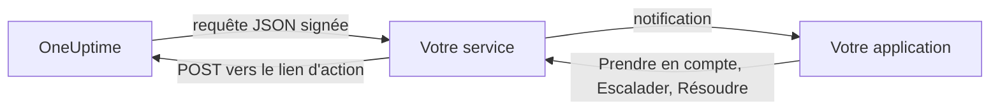

# Canaux de notification personnalisés

Un canal personnalisé envoie les alertes d'astreinte à un service que vous exploitez : l'application de votre entreprise, un système de pager ou une passerelle qui contrôle ce qui sort de votre réseau. Vous l'ajoutez une seule fois, pour tout le serveur, et chacun peut être alerté par ce canal sans rien configurer. Dans l'Admin Dashboard, ils s'appellent **Custom Channels**.

> [!NOTE]
> Les canaux personnalisés font partie de l'[édition Enterprise d'OneUptime](/docs/self-hosted/enterprise) et nécessitent une licence Enterprise qui les inclut. La Community Edition n'a pas de page **Custom Channels** et n'envoie rien à un canal. Voir [Sans licence](#sans-licence).

:::cards
- [Ajouter un canal](#ajouter-un-canal): Un nom, une URL et un secret de signature.
- [Ce que reçoit votre service](#ce-que-reçoit-votre-service): Une requête JSON signée par personne et par alerte.
- [Agir sur une alerte](#agir-sur-une-alerte): La prendre en compte, l'escalader ou la résoudre depuis votre propre application.
- [Livraison et nouvelles tentatives](#livraison-et-nouvelles-tentatives): Ce qui se passe quand votre service est indisponible.
- [Autres notifications](#autres-notifications): Notifications aux propriétaires, notes et permanences, pour ceux qui les veulent.
- [Sans licence](#sans-licence): Ce qui s'arrête, et ce qui est conservé.
:::

## Fonctionnement



Lorsqu'une politique d'astreinte alerte quelqu'un et que sa règle d'astreinte utilise le canal, OneUptime envoie une requête à l'URL du canal. Elle indique à qui l'alerte est destinée (son nom et son e-mail) et de quoi il s'agit, et contient les liens que votre service appelle quand la personne la prend en compte, l'escalade ou la résout dans votre application.

## Ajouter un canal

1. Dans l'Admin Dashboard, ouvrez **Paramètres**, puis **Custom Channels**, et sélectionnez **Add**.
2. À l'étape **Channel**, renseignez :
   - **Nom** : ce que les personnes voient dans leurs méthodes de notification et leurs règles d'astreinte, par exemple `CorpoApp`.
   - **Webhook URL** : l'adresse où OneUptime envoie chaque alerte. Elle peut se trouver sur votre réseau privé.
   - **Signing Secret** : OneUptime en génère un pour vous. Copiez-le dans votre service, qui vérifie chaque requête avec ce secret. Vous pouvez le revoir en modifiant le canal.
3. À l'étape **Delivery**, enregistrez, puis sélectionnez **Send test** pour envoyer à votre service une [requête de test](#requêtes-de-test).

À l'étape **Delivery**, **Page everyone through this channel** est activé. OneUptime ajoute alors le canal aux règles d'astreinte de chacun dans chaque projet, ainsi qu'aux règles de tous ceux qui rejoignent un projet plus tard, et s'en sert pour joindre un intervenant qui n'a aucune règle pour ce qui s'est déclenché. Désactivez-le pour laisser chacun ajouter le canal à ses règles.

Les personnes voient le canal sous **Paramètres utilisateur**, puis **Méthodes de notification**, puis **Custom Channels**, avec un bouton **Send test**, et le choisissent dans leurs règles d'astreinte sous le nom `Custom Channel: CorpoApp`. Elles n'ont rien à configurer : votre service apprend à qui chaque alerte est destinée.

Pour arrêter les envois sans modifier les règles de qui que ce soit, modifiez le canal et désactivez **Activé**. Les alertes qui lui auraient été envoyées sont enregistrées dans le journal d'astreinte comme non envoyées. Supprimer un canal supprime toutes les règles d'astreinte qui l'utilisent.

## Ce que reçoit votre service

Chaque alerte est une requête `POST` avec un corps JSON :

| En-tête | Ce qu'il contient |
| --- | --- |
| `Content-Type` | `application/json` |
| `X-OneUptime-Event` | L'événement, par exemple `on-call.incident.created` |
| `X-OneUptime-Signature` | `sha256=` suivi du HMAC-SHA256 hexadécimal du corps brut, calculé avec le secret de signature du canal |

```json title="An incident page"
{
  "version": 1,
  "event": "on-call.incident.created",
  "notificationId": "5f2c8a1e-6b1d-4c3a-9e7f-2a4b6c8d0e1f",
  "sentAt": "2026-10-27T03:14:15.000Z",
  "channel": { "id": "0b7e…", "name": "CorpoApp" },
  "title": "New Incident INC-42: API latency high",
  "message": "A new incident has been created: INC-42 (API latency high) in Agency A. Click to view details.",
  "project": { "id": "8d1f…", "name": "Agency A" },
  "team": { "id": "2c9a…", "name": "SRE" },
  "user": { "id": "4e6b…", "name": "Jane Tan", "email": "jane@example.com" },
  "recordType": "incident",
  "record": {
    "id": "9a3c…",
    "number": "INC-42",
    "title": "API latency high",
    "description": "p95 latency above 2 seconds for 5 minutes.",
    "severity": "Critical",
    "state": "Created",
    "url": "https://oneuptime.example.com/dashboard/8d1f…/incidents/9a3c…"
  },
  "onCallPolicy": { "id": "1d4e…", "name": "Primary" },
  "escalationRule": { "id": "7b2f…", "name": "Level 1" },
  "isPageAgain": false,
  "actions": {
    "acknowledge": "https://oneuptime.example.com/api/custom-notification-channel/page/5f2c…/acknowledge?token=…",
    "escalate": "https://oneuptime.example.com/api/custom-notification-channel/page/5f2c…/escalate?token=…",
    "resolve": "https://oneuptime.example.com/api/custom-notification-channel/page/5f2c…/resolve?token=…"
  }
}
```

| Champ | Ce que c'est |
| --- | --- |
| `version` | `1`. Cette version ne fait que gagner des champs. |
| `event` | `on-call.incident.created`, `on-call.alert.created`, `on-call.incidentEpisode.created`, `on-call.alertEpisode.created`, `notification` pour les [autres notifications](#autres-notifications), ou `test` |
| `notificationId` | Un par personne et par alerte. Servez-vous-en pour écarter une requête déjà traitée. |
| `title`, `message` | Prêts à afficher, comme une notification push les afficherait |
| `user` | La personne à qui l'alerte est destinée. Retrouvez son compte dans votre application par `email` ou `id`. |
| `team` | L'équipe par laquelle elle a été alertée, ou `null` si elle a été alertée directement |
| `recordType`, `record` | L'objet de l'alerte : un `incident`, `alert`, `incidentEpisode` ou `alertEpisode` |
| `onCallPolicy`, `escalationRule` | La politique et le niveau qui l'ont alertée |
| `isPageAgain` | `true` quand l'élément a été pris en compte il y a un moment et n'est toujours pas résolu |
| `actions` | Les liens que votre service appelle pour [agir sur l'alerte](#agir-sur-une-alerte) |

Une alerte destinée à plusieurs personnes donne une requête par personne, chacune avec ses propres liens, pour que OneUptime sache qui a répondu. Le titre, le message et la description réunis sont limités à 16 384 caractères ; une description plus longue est coupée et se termine par « … (truncated — see OneUptime for the full text) ».

### Vérifier la signature

Calculez le HMAC du corps brut de la requête, avant de l'analyser, et comparez-le à l'en-tête :

```javascript title="Node.js"
const crypto = require("crypto");

function isFromOneUptime(rawBody, signatureHeader, secret) {
  const expected =
    "sha256=" + crypto.createHmac("sha256", secret).update(rawBody).digest("hex");
  const received = String(signatureHeader || "");

  return (
    received.length === expected.length &&
    crypto.timingSafeEqual(Buffer.from(received), Buffer.from(expected))
  );
}
```

## Agir sur une alerte

Quand la personne appuie sur un bouton dans votre application, votre service envoie une requête `POST` au lien correspondant dans `actions`. Aucune clé API n'est nécessaire : chaque lien porte un jeton propre à cette alerte, valable 7 jours, et l'action est enregistrée comme faite par la personne alertée.

| Action | Ce qu'elle fait |
| --- | --- |
| `acknowledge` | Prend en compte l'alerte reçue, et avec elle l'incident, l'alerte ou l'épisode |
| `escalate` | La personne ne peut pas s'en charger : alerte tout de suite le niveau suivant de la politique d'astreinte et cesse de l'alerter |
| `resolve` | Résout l'incident, l'alerte ou l'épisode, si ses propres autorisations le permettent |

```bash title="Acknowledge a page"
curl -X POST "https://oneuptime.example.com/api/custom-notification-channel/page/5f2c…/acknowledge?token=…"
```

La réponse dit ce qui s'est passé, en mots que votre application peut afficher tels quels :

```json title="The answer"
{
  "action": "acknowledge",
  "result": "acknowledged",
  "message": "Acknowledged."
}
```

`result` vaut `acknowledged`, `alreadyAcknowledged`, `escalated`, `notEscalated`, `resolved` ou `alreadyResolved`. Un lien expiré ou erroné est refusé avec un statut 4xx et un message.

## Autres notifications

Les alertes ne sont pas les seules notifications que reçoivent les personnes : OneUptime les prévient aussi quand un incident dont elles sont propriétaires change d'état, quand une note est publiée, quand leur permanence d'astreinte commence, et plus encore. Chacun choisit où va chacune d'elles dans **Paramètres utilisateur > Paramètres de notification**, qui a une colonne **Custom Channels** tant qu'un canal est activé. Elle est désactivée pour tout le monde jusqu'à ce que chacun l'active.

Une notification part vers chaque canal activé, en une requête par canal, avec `event` défini sur `notification` :

```json title="A notification"
{
  "version": 1,
  "event": "notification",
  "notificationId": null,
  "sentAt": "2026-10-27T03:20:00.000Z",
  "channel": { "id": "0b7e…", "name": "CorpoApp" },
  "title": "Incident INC-42 acknowledged",
  "message": "Incident INC-42 (API latency high) was acknowledged in Agency A.",
  "project": { "id": "8d1f…", "name": "Agency A" },
  "team": null,
  "user": { "id": "4e6b…", "name": "Jane Tan", "email": "jane@example.com" },
  "recordType": null,
  "record": null,
  "onCallPolicy": null,
  "escalationRule": null,
  "isPageAgain": false,
  "actions": null,
  "notificationType": "Send incident state changed notification when I am the owner of the incident",
  "url": "https://oneuptime.example.com/dashboard/8d1f…/incidents/9a3c…"
}
```

`title` et `message` sont ce que dirait la notification push de la personne. `notificationType` nomme le paramètre pour lequel elle a été envoyée, et `url` renvoie vers ce dont il s'agit, ou vaut `null`. Il n'y a rien à faire, donc `actions` vaut `null`.

## Livraison et nouvelles tentatives

Une requête compte comme livrée quand votre service répond avec un statut 2xx en moins de 10 secondes. Une requête restée sans réponse, ou à laquelle il a répondu par 408, 429 ou un statut 5xx, est renvoyée après 1 seconde, puis après 4 secondes de plus : trois tentatives en tout. Aucun autre statut 4xx n'entraîne de nouvel envoi.

Le résultat de chaque tentative figure dans le journal d'astreinte de la personne, avec le nom du canal et le statut renvoyé par votre service, jamais l'URL. Une alerte non livrée n'arrête pas la politique d'astreinte : si personne ne la prend en compte, elle s'escalade comme d'habitude. Gardez une règle e-mail ou SMS plus loin dans vos règles si votre service est le seul moyen de joindre les personnes.

## Requêtes de test

**Send test**, sur la page de l'Admin Dashboard ou dans les méthodes de notification d'une personne, envoie une requête avec `event` défini sur `test`, la personne qui a appuyé comme `user`, et `notificationId`, `record` et `actions` définis sur `null`. Servez-vous-en pour essayer votre service avant qu'une vraie alerte n'arrive.

## Sans licence

Les canaux personnalisés fonctionnent pendant l'essai de 14 jours de l'édition Enterprise et pendant le délai de grâce de 30 jours qui suit l'expiration d'une licence. Ensuite, ou avec une licence qui ne les inclut pas :

- **Rien n'est envoyé à un canal personnalisé.** Une alerte qui y serait partie est enregistrée dans le journal d'astreinte de la personne comme non envoyée, tout comme un test.
- **Les canaux ne sont plus proposés.** Ils disparaissent des méthodes de notification, des règles d'astreinte et des paramètres de notification des personnes, et la disponibilité d'astreinte et le repli cessent de les compter.
- **La page est en lecture seule.** Vous pouvez voir et supprimer des canaux, mais pas en ajouter ni les modifier, et personne ne peut diriger une règle ou un paramètre de notification vers l'un d'eux.
- **Rien n'est supprimé.** Les canaux, ainsi que les règles d'astreinte et les paramètres qui les utilisent, sont conservés.

Tout reprend dès qu'une licence est activée, sans redémarrage. Les personnes qui ont rejoint un projet pendant l'arrêt des canaux personnalisés n'ont pas, dans leurs règles, de canal qui alerte tout le monde : elles peuvent l'ajouter elles-mêmes.
