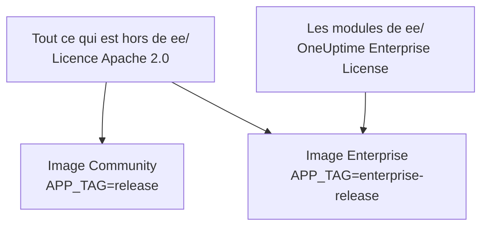
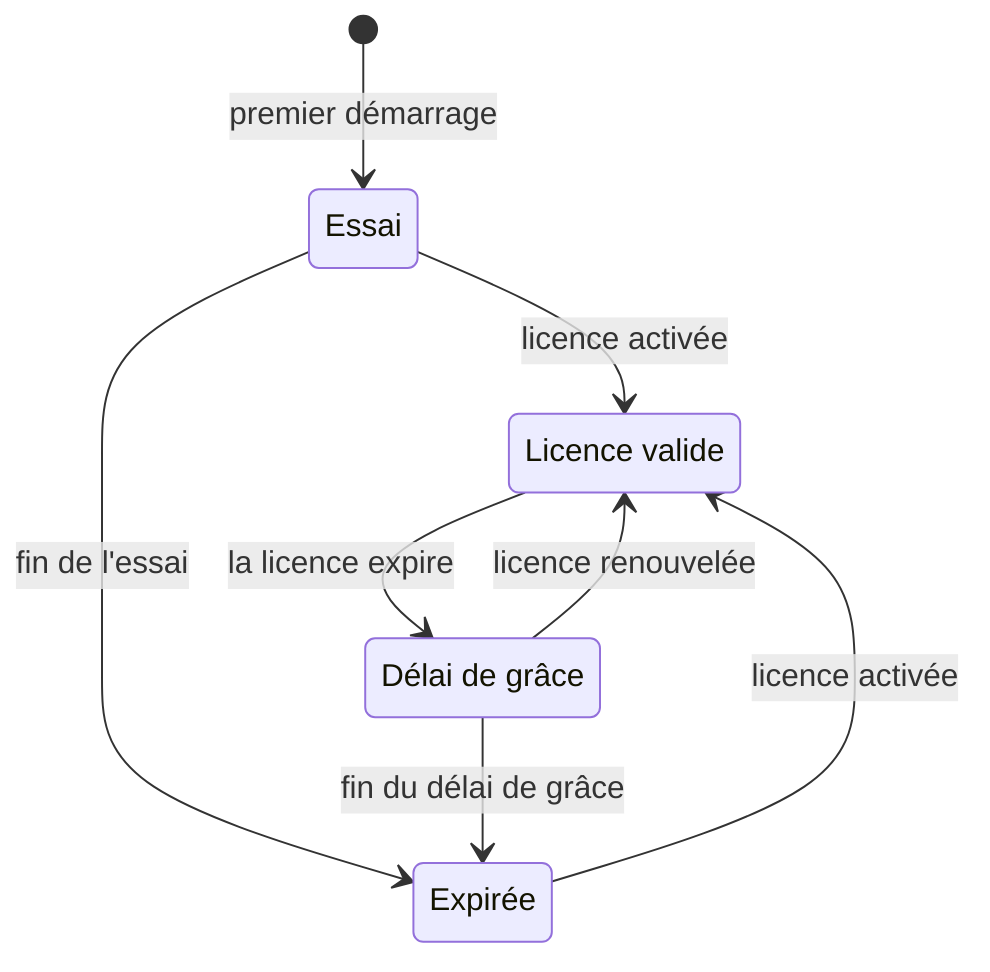

# Édition Enterprise

OneUptime est construit à partir d'un seul dépôt et livré en deux éditions :

- **Community Edition** : toute la plateforme de supervision, d'incidents et d'observabilité, y compris l'authentification unique SAML et OpenID Connect, open source sous licence Apache 2.0 et gratuite à auto-héberger, quelle que soit l'échelle.
- **Enterprise Edition** : la Community Edition plus les modules Enterprise du répertoire [`ee/`](https://github.com/OneUptime/oneuptime/tree/master/ee) du dépôt. Ces modules ajoutent le provisionnement SCIM ainsi que des fonctions de gouvernance et d'administration de l'instance. Ils sont publiés sous la [OneUptime Enterprise License](https://github.com/OneUptime/oneuptime/blob/master/ee/LICENSE), et l'usage en production exige une licence Enterprise pour votre nombre d'utilisateurs.

Les deux éditions sont des images de conteneur distinctes. L'image Community ne contient aucun code de `ee/`. OneUptime Cloud exécute l'Enterprise Edition, et dans le cloud c'est votre plan qui décide des fonctions auxquelles vous avez droit.



> [!NOTE]
> **L'authentification unique est présente dans chaque édition.** La connexion SAML et OIDC aux projets et aux pages de statut, le SSO global et « Require SSO for login » font partie de la Community Edition, et aucun état de licence ne les désactive.

Cette page décrit ce que comprend chaque édition, comment exécuter l'Enterprise Edition, comment fonctionnent les licences et ce qui se passe lorsque vous changez d'édition.

:::cards
- [Comparer les éditions](#ce-que-comprend-chaque-édition): Ce qu'ajoute l'Enterprise Edition.
- [Exécuter l'image Enterprise](#exécuter-lenterprise-edition): Un seul réglage, sur Kubernetes ou Docker Compose.
- [Activer une licence](#licences): En ligne avec une clé, ou hors ligne avec un jeton signé.
- [Quand une licence expire](#quand-une-licence-expire-ou-manque): Ce qui s'arrête, ce qui ne s'arrête jamais, et comment tout revient.
:::

## Ce que comprend chaque édition

| Fonction | Community | Enterprise | OneUptime Cloud |
| --- | --- | --- | --- |
| Supervision, alertes, incidents, astreinte, pages de statut, journaux, métriques, traces, exceptions, tableaux de bord, workflows, fonctions d'IA, API et Terraform | Oui | Oui | Tous les plans |
| Connexion par mot de passe, authentification à deux facteurs, équipes, rôles et clés API | Oui | Oui | Tous les plans |
| [SSO SAML et OpenID Connect](/docs/identity/sso) pour la connexion aux projets | Oui | Oui | Plan Scale et supérieurs |
| SSO SAML et OpenID Connect pour la connexion aux pages de statut privées | Oui | Oui | Plan Scale et supérieurs |
| [SSO et OIDC globaux (à l'échelle de l'instance)](/docs/identity/global-sso) | Oui | Oui | Sans objet |
| [Provisionnement SCIM](/docs/identity/scim) pour les projets et les pages de statut | Non | Oui | Plan Scale et supérieurs |
| Paramètres de conformité d'équipe | Non | Oui | Plan Scale et supérieurs |
| Journaux d'audit | Non | Oui | Plan Enterprise |
| Remplacements de rétention : rétention par type de télémétrie (journaux, traces, métriques, profils, avec des règles par gravité de journal et statut de trace), et rétention par service et par ressource | Non | Oui | Plan Scale et supérieurs |
| Tableaux de bord **Health** de l'administration : vue d'ensemble de l'instance, files d'attente en arrière-plan, journaux de l'instance, PostgreSQL, Valkey, cluster ClickHouse, journaux de diagnostic et ingestion de télémétrie | Non | Oui | Sans objet |
| **Query Console** de l'administration | Non | Oui | Non disponible |
| Alertes de santé PostgreSQL et Valkey (Redis) | Non | Oui | Sans objet |
| Vue de la capacité ClickHouse, alertes de capacité et purge automatique du disque | Oui | Oui | Sans objet |
| État des migrations, bundle de support et sondes globales dans le tableau de bord admin | Oui | Oui | Sans objet |
| Gestion de la licence Enterprise, des sièges et des instances | Non | Oui | Sans objet |

L'authentification unique comprend « Require SSO for login » pour les projets, les pages de statut privées et toute l'instance, dans les deux éditions.

Chaque édition dispose de la rétention de télémétrie par défaut du projet, dans **Paramètres du projet > Télémétrie & APM > Rétention des données**. Les remplacements de rétention sont ce que l'Enterprise Edition ajoute par-dessus.

Sur OneUptime Cloud, une fonction payante peut toujours être désactivée, quel que soit le plan. Un remplacement de rétention qu'un essai (ou un passage à un plan inférieur) a laissé en place continue de s'appliquer à la nouvelle télémétrie ; en dessous du plan Scale, les pages de rétention l'affichent donc sous la carte de mise à niveau avec un bouton **Supprimer le remplacement**. La suppression fonctionne dans tous les plans ; en définir un à nouveau exige le plan Scale. La télémétrie déjà stockée garde la rétention avec laquelle elle a été stockée. De la même manière, **Paramètres du projet > Sécurité > SSO** affiche l'interrupteur **Exiger le SSO pour la connexion** sous sa carte de mise à niveau tant que le projet exige encore le SSO, afin de pouvoir le désactiver.

Les lignes « Sans objet » concernent des fonctions d'administration de l'instance. Sur OneUptime Cloud, OneUptime exploite l'instance pour vous.

## Exécuter l'Enterprise Edition

Les deux éditions utilisent la même configuration, les mêmes bases de données et les mêmes données. Changer d'édition change l'image que vous exécutez, et rien d'autre. Aucune migration n'est nécessaire, dans un sens comme dans l'autre.

:::tabs
@tab Kubernetes
Définissez le type d'image dans votre `values.yaml` :

```yaml title="values.yaml"
image:
  type: enterprise-edition
```

Puis mettez à niveau comme d'habitude :

```bash
helm upgrade my-oneuptime oneuptime/oneuptime -f values.yaml
```

Le chart récupère alors la variante `enterprise-` de chaque tag d'image, par exemple `oneuptime/app:enterprise-release`, ou `enterprise-<version>` lorsque vous fixez `image.tag`. Définissez `image.type: community-edition` (la valeur par défaut) pour exécuter la Community Edition.
@tab Docker Compose
Définissez `APP_TAG` dans votre `config.env` :

```bash title="config.env"
APP_TAG=enterprise-release
```

Utilisez `enterprise-<version>` pour fixer une version. Puis récupérez les images et redémarrez :

```bash
npm run update
```

Pour revenir à la Community Edition, définissez `APP_TAG=release` **et** `IS_ENTERPRISE_EDITION=false`. Tant que `IS_ENTERPRISE_EDITION=true` est défini, `npm run update` remet `APP_TAG` à `enterprise-release`, et l'image Community refuse de démarrer.
:::

### `IS_ENTERPRISE_EDITION` est obsolète

C'est l'image que vous exécutez qui décide de l'édition. `IS_ENTERPRISE_EDITION` n'active plus les fonctions Enterprise et sera supprimée dans une version future. Vous pouvez la laisser non définie.

Définir `IS_ENTERPRISE_EDITION=true` sur l'image Community n'active **pas** les fonctions Enterprise. L'application **refuse de démarrer** à la place, de sorte qu'une mise à niveau qui aboutit sur l'image Community ne puisse jamais arrêter en silence le provisionnement SCIM (déprovisionnement compris) et la journalisation d'audit. L'erreur vous indique quoi définir : `APP_TAG=enterprise-<version>` pour garder l'Enterprise Edition, ou `IS_ENTERPRISE_EDITION=false` pour exécuter la Community Edition. Avec Helm, cela ne peut pas arriver : le chart déduit la variable de `image.type`.

`ONEUPTIME_EDITION=community` fait fonctionner l'image Enterprise comme la Community Edition. C'est utile pour essayer un passage à l'édition inférieure avant de le faire. L'image Enterprise définit elle-même `ONEUPTIME_EDITION=enterprise` ; ne la remplacez par rien d'autre que `community`.

## Licences

Le fichier [`LICENSE`](https://github.com/OneUptime/oneuptime/blob/master/LICENSE) à la racine du dépôt indique quelle licence couvre quoi : tout ce qui se trouve dans le répertoire `ee/` relève de la [OneUptime Enterprise License](https://github.com/OneUptime/oneuptime/blob/master/ee/LICENSE), les composants tiers gardent les licences sous lesquelles leurs propriétaires les fournissent, et tout le reste relève de la licence Apache 2.0.

Une nouvelle installation de l'Enterprise Edition fonctionne en **essai de 14 jours**, compté à partir du premier démarrage de l'Enterprise Edition par l'installation. L'essai sert à l'évaluation : l'usage en production de l'Enterprise Edition exige un abonnement sous la OneUptime Enterprise License. Activez une licence avant la fin de l'essai : ensuite, SCIM, la journalisation d'audit et les remplacements de rétention s'arrêtent et la configuration Enterprise passe en lecture seule (voir [Quand une licence expire ou manque](#quand-une-licence-expire-ou-manque)). Pour obtenir une licence, contactez [sales@oneuptime.com](mailto:sales@oneuptime.com).

La licence se gère depuis le **libellé d'édition**, que les administrateurs principaux voient dans l'en-tête du tableau de bord admin et dans le pied de page du Dashboard. Il affiche l'état de la licence, l'utilisation des sièges et, pour les administrateurs principaux, l'ID d'instance.

### Activation en ligne (clé de licence)

:::steps
1. Connectez-vous en tant qu'administrateur principal et ouvrez le libellé d'édition.
2. Saisissez votre clé de licence et validez-la.
:::

L'installation vérifie la clé auprès de OneUptime et stocke la licence qu'elle reçoit. Elle tient ensuite la licence à jour grâce à une synchronisation quotidienne. Utilisez **Refresh license** dans le libellé d'édition pour récupérer immédiatement les changements, comme des sièges supplémentaires ou un renouvellement.

L'activation en ligne nécessite un accès HTTPS sortant du serveur OneUptime vers `https://oneuptime.com`. Si le serveur n'atteint Internet qu'à travers un relais, définissez `ENTERPRISE_LICENSE_SERVER_URL` sur l'adresse `https://` du relais. Le relais doit transmettre `/api/enterprise-license/` à oneuptime.com.

### Activation hors ligne (installations isolées du réseau)

Une installation sans route vers Internet peut utiliser un **jeton de licence signé** au lieu d'une clé :

:::steps
1. Connectez-vous en tant qu'administrateur principal, ouvrez le libellé d'édition et notez l'**ID d'instance**.
2. Demandez à OneUptime ([sales@oneuptime.com](mailto:sales@oneuptime.com)) un jeton de licence hors ligne pour cet ID d'instance.
3. Collez le jeton dans le champ de jeton du libellé d'édition et activez-le.
:::

L'installation vérifie elle-même le jeton, avec les clés de signature de OneUptime intégrées à votre version. Elle ne contacte jamais OneUptime. Un jeton émis pour un ID d'instance est refusé par toutes les autres installations, et un jeton émis sans ID d'instance (comme celui que reçoit une installation activée en ligne) est refusé aussi. Pour renouveler ou ajouter des sièges, activez un nouveau jeton avant l'expiration de l'actuel.

> [!IMPORTANT]
> **L'activation hors ligne nécessite une version qui fait confiance à la clé de signature des licences de OneUptime.** Si votre version n'inclut pas encore cette clé, l'activation échoue avec « this build does not trust the key that signed this token ». Dans ce cas, activez en ligne, ou passez à une version qui inclut la clé.

### Ce qu'envoie la synchronisation quotidienne de la licence

Une installation activée en ligne envoie un rapport à OneUptime une fois par jour. Il contient :

- la clé de licence ;
- l'ID d'instance (un identifiant aléatoire généré par l'installation) et le nom d'hôte avec lequel l'installation est configurée (`HOST`) ;
- la version de OneUptime qu'exécute l'installation ;
- le nombre d'utilisateurs de l'installation ;
- un **hachage SHA-256** de l'adresse e-mail de chaque utilisateur, en minuscules. OneUptime utilise ces hachages pour compter comme un seul siège une personne qui a des comptes sur plusieurs de vos installations. Les adresses e-mail en clair des utilisateurs ordinaires ne sont jamais envoyées ;
- les adresses e-mail des **administrateurs principaux** de l'installation, afin que OneUptime puisse vous contacter au sujet des renouvellements et des limites de sièges.

La réponse contient la licence telle que OneUptime la connaît ce jour-là : nom de l'entreprise, date d'expiration, limite de sièges, nombre total d'utilisateurs sur l'ensemble de vos installations, et installations enregistrées pour la licence. Les autres réplicas de l'installation prennent en compte un changement en une minute environ.

Lorsque vous activez ou actualisez la licence, l'installation n'envoie que la clé de licence, l'ID d'instance, le nom d'hôte et la version.

Rien d'autre n'est envoyé. Aucune donnée de supervision, de télémétrie, de journaux ou de configuration ne quitte l'installation. La Community Edition n'envoie rien de tout cela, pas plus qu'une installation activée hors ligne.

### Quand une licence expire ou manque

Chaque fonction Enterprise fonctionne pendant l'essai de 14 jours, et pendant 30 jours après l'expiration d'une licence (le délai de grâce). Le libellé d'édition avertit avant la fin de l'un comme de l'autre. Ensuite, **SCIM, la journalisation d'audit et les remplacements de rétention s'arrêtent** jusqu'à l'activation d'une licence, comme sur la Community Edition, et la configuration Enterprise passe en lecture seule. L'authentification unique n'est pas une fonction Enterprise : la connexion SAML et OIDC, le SSO global et « Require SSO for login » fonctionnent de la même façon dans tous les états de licence.



| État | Ce qui se passe |
| --- | --- |
| **Licence valide** | Chaque fonction Enterprise fonctionne. Aucun nouvel utilisateur ne peut être ajouté au-delà du nombre de sièges sous licence. Les utilisateurs existants ne sont jamais supprimés. |
| **Essai ou délai de grâce** (les 14 premiers jours d'une installation sans licence, ou 30 jours après l'expiration d'une licence), ou une installation qui détient une licence dont l'expiration n'a jamais été enregistrée | Chaque fonction Enterprise fonctionne, et le libellé d'édition affiche un avertissement. Pendant le délai de grâce qui suit une expiration, la limite de sièges s'applique toujours. Une installation qui détient une licence sans expiration enregistrée suit le même essai de 14 jours qu'une installation sans licence, et la limite de sièges n'est pas appliquée, car l'enregistrement de licence qu'elle détient est déjà incomplet. |
| **Après l'essai ou le délai de grâce** (licence expirée, absente ou invalide, ou licence qui n'inclut pas la fonction) | Le provisionnement SCIM, la journalisation d'audit et les remplacements de rétention **s'arrêtent** (voir ci-dessous). La configuration Enterprise passe en **lecture seule** : vous pouvez la consulter et la supprimer, mais pas la créer ni la modifier. Une modification fonctionne toujours, pour que vous puissiez réagir à un incident : remplacer un jeton bearer SCIM. Les pages de paramètres SCIM la proposent alors que tout le reste est en lecture seule : **Réinitialiser le jeton Bearer** sur une configuration SCIM, qui affiche le nouveau jeton une seule fois. Par l'API, envoyez `bearerToken` seul (au moins 32 caractères). La journalisation d'audit ne peut être ni activée ni élargie. Les tableaux de bord Health Enterprise et la Query Console sont verrouillés. La limite de sièges n'est plus appliquée. |

Ce qui s'arrête lorsqu'une licence expire :

- **Le provisionnement SCIM s'arrête.** Les requêtes SCIM de votre fournisseur d'identité sont refusées, déprovisionnement compris, et les verrous d'équipe SCIM sont levés, de sorte que les équipes gérées par des groupes push SCIM peuvent être modifiées à la main.
- **La journalisation d'audit cesse d'enregistrer.** Les journaux d'audit déjà enregistrés sont conservés.
- **Les remplacements de rétention cessent de s'appliquer.** La nouvelle télémétrie est conservée pendant la rétention par défaut du projet. La télémétrie déjà stockée garde la rétention avec laquelle elle a été écrite. Vous pouvez toujours effacer un remplacement par l'API, mais pas en définir un.

Ce qui ne s'arrête **pas** :

- **L'authentification unique.** La connexion SAML et OIDC aux projets, aux pages de statut privées, à toute l'instance (SSO global) et aux applications mobiles, ainsi que « Require SSO for login », font partie de chaque édition. Une licence expirée n'y change rien, et la configuration de l'authentification unique reste modifiable.
- **La supervision de base n'est jamais affectée** : moniteurs, alertes, incidents, astreinte, pages de statut et télémétrie continuent tous de fonctionner.
- **Les administrateurs principaux peuvent toujours se connecter avec leur mot de passe.**
- **Rien n'est supprimé.** La configuration SCIM, les journaux d'audit et les remplacements de rétention restent tels quels.

**Tout reprend dès qu'une licence est activée**, sans redémarrage : le provisionnement SCIM, la journalisation d'audit et les remplacements de rétention reviennent avec la configuration que vous avez. OneUptime ne les désactive que lorsqu'il sait que la licence a expiré. Tant qu'il ne peut pas lire l'état de la licence, par exemple un instant pendant le démarrage du serveur, SCIM, la journalisation d'audit et les remplacements de rétention restent actifs.

> [!WARNING]
> **Si votre fournisseur d'identité déprovisionne des utilisateurs par SCIM, activez une licence avant la fin de l'essai ou du délai de grâce.** Après cela, SCIM ne déprovisionne plus les personnes que vous retirez chez votre fournisseur d'identité : leurs comptes OneUptime restent, et à moins que « Require SSO for login » ne s'applique à elles, quiconque peut encore accéder à la boîte de réception d'un tel compte peut définir un mot de passe et se connecter. Si vous laissez la licence expirer, supprimez vous-même ces utilisateurs dans OneUptime.

## Passer d'Enterprise à Community

Votre configuration reste dans la base de données. Revenir à l'image Enterprise rétablit tout comme avant, tant que l'installation a une licence valide ou se trouve encore dans son essai ou son délai de grâce. L'authentification unique ne change pas : la connexion SAML et OIDC, le SSO global et « Require SSO for login » fonctionnent de la même façon sur les deux images. Sur l'image Community :

- **SCIM s'arrête.** Ses endpoints de provisionnement n'existent plus, donc les appels SCIM pilotés par l'IdP échouent. Cela inclut le déprovisionnement SCIM.
- **Les verrous d'équipe SCIM sont levés**, de sorte que les équipes qui étaient gérées par des groupes push SCIM peuvent être modifiées à la main. Au démarrage, le serveur journalise les projets dont les verrous d'équipe SCIM ont été levés.
- **La journalisation d'audit s'arrête.** Les journaux d'audit déjà enregistrés sont conservés, mais les pages des journaux d'audit affichent une invitation à passer à un plan supérieur.
- **Les remplacements de rétention cessent de s'appliquer.** La nouvelle télémétrie est conservée pendant la rétention par défaut du projet, et les cartes de rétention de **Paramètres du projet > Télémétrie & APM > Rétention des données** et de la page de paramètres de chaque service et de chaque ressource affichent une invitation à passer à un plan supérieur. Les remplacements restent dans la base de données et s'appliquent de nouveau lorsque vous revenez en arrière.
- **Les pages de paramètres Enterprise affichent une invitation à passer à un plan supérieur.** Par l'API, vous pouvez toujours lire et supprimer la configuration Enterprise et réinitialiser un jeton bearer SCIM, mais rien créer ni modifier d'autre. La journalisation d'audit ne peut pas être activée.
- **Les tableaux de bord Health Enterprise, la Query Console et les alertes de santé PostgreSQL et Valkey s'arrêtent.** La surveillance de la capacité et la purge ClickHouse, l'état des migrations et le bundle de support continuent de fonctionner.

> [!CAUTION]
> **Avant de passer à l'image Community une installation dont le fournisseur d'identité déprovisionne des utilisateurs par SCIM, vérifiez qui a accès.** Sans SCIM, les personnes que vous retirez chez votre fournisseur d'identité gardent leurs comptes OneUptime, et à moins que « Require SSO for login » ne s'applique à elles, quiconque peut encore accéder à la boîte de réception d'un tel compte peut définir un mot de passe et se connecter. Supprimez d'abord ces utilisateurs.

## Dépannage

:::details L'application refuse de démarrer après une mise à niveau
`IS_ENTERPRISE_EDITION=true` est défini sur l'image Community. Définissez `APP_TAG=enterprise-<version>` pour garder l'Enterprise Edition, ou `IS_ENTERPRISE_EDITION=false` pour exécuter la Community Edition, puis relancez `npm run update`.
:::

:::details L'activation hors ligne échoue avec « this build does not trust the key that signed this token »
Votre version a été construite avant de faire confiance à la clé de signature des licences de OneUptime. Activez en ligne, ou passez à une version qui inclut la clé.
:::

:::details Les requêtes SCIM de votre fournisseur d'identité sont refusées
Sur l'image Enterprise, la licence a expiré : activez-en une, et le provisionnement reprend sans redémarrage. Sur l'image Community, les endpoints SCIM n'existent pas du tout.
:::

## Étapes suivantes

:::cards
- [Mise à niveau](/docs/installation/upgrading): Passer à une nouvelle version, et d'une image d'édition à l'autre.
- [SSO](/docs/identity/sso): L'authentification unique, dans chaque édition.
- [SSO global](/docs/identity/global-sso): Un seul fournisseur d'identité pour toute l'instance.
- [SCIM](/docs/identity/scim): Provisionner les utilisateurs et les équipes depuis votre fournisseur d'identité.
:::
