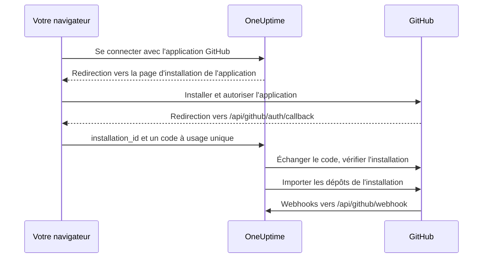

# Intégration GitHub

Connectez votre OneUptime auto-hébergé à GitHub avec une GitHub App qui vous appartient. Une fois l'application installée depuis OneUptime, les dépôts de l'installation sont importés dans votre projet et maintenus synchronisés, les tâches de correction IA ouvrent des pull requests, et votre équipe peut confier du travail à l'application depuis GitHub en la mentionnant.

Cette page s'adresse à la personne qui administre le serveur OneUptime : vous créez l'application une fois, puis chaque projet la connecte depuis **Dépôts de code**.

:::cards
- [Créer la GitHub App](#créer-la-github-app): Enregistrer l'application avec les bonnes URL, permissions et événements.
- [Configurer OneUptime](#configurer-oneuptime): Donner au serveur les six valeurs de l'application.
- [Connecter des dépôts](#connecter-des-dépôts): Installer l'application depuis OneUptime.
- [Dépannage](#dépannage): Ce que signifient les messages de Dépôts de code.
:::

## Fonctionnement

L'installation commence dans OneUptime, pas sur GitHub : c'est le lien avec lequel OneUptime vous envoie sur GitHub qui rattache l'installation à votre projet.



- La redirection du navigateur transporte l'installation et un code OAuth à usage unique. OneUptime échange ce code pour confirmer que le compte GitHub qui a installé l'application administre bien cette installation, puis importe ses dépôts.
- Les webhooks maintiennent la liste des dépôts synchronisée et confient du travail à l'application : mentions, assignations, labels déclencheurs et demandes de revue. GitHub signe chacun avec le webhook secret, et OneUptime rejette ceux qu'il ne peut pas vérifier.

## Avant de commencer

- Un compte GitHub qui peut créer des GitHub Apps pour l'organisation ou l'utilisateur sur lequel l'application sera installée. Pour l'installer sur une organisation, vous devez en être propriétaire, ou faire approuver la demande par un propriétaire.
- Un nom d'hôte HTTPS public pour OneUptime que GitHub peut joindre pour les webhooks. Voir [Accès réseau](#accès-réseau-pour-les-déploiements-auto-hébergés).
- Un accès à la configuration du serveur : `config.env` pour Docker Compose, ou vos values Helm pour Kubernetes.

## Créer la GitHub App

:::steps
### Ouvrir les paramètres des GitHub Apps

- **Pour une organisation :** `https://github.com/organizations/YOUR_ORG/settings/apps`
- **Pour un compte personnel :** `https://github.com/settings/apps`

Sélectionnez **New GitHub App**.

### Remplir le formulaire d'enregistrement

| Champ | Valeur |
| --- | --- |
| **GitHub App name** | Un nom unique au choix, par exemple `OneUptime`. Notez-le exactement : c'est `GITHUB_APP_NAME`. |
| **Homepage URL** | `https://your-oneuptime-domain.com` |
| **Callback URL** | `https://your-oneuptime-domain.com/api/github/auth/callback` |
| **Request user authorization (OAuth) during installation** | Activé. **C'est obligatoire** : voir la note ci-dessous. |
| **Setup URL** | `https://your-oneuptime-domain.com/api/github/auth/callback`, si GitHub vous laisse en saisir une (voir ci-dessous). |
| **Redirect on update** | Facultatif. Après qu'une personne a modifié une installation sur GitHub, OneUptime la ramène sur **Dépôts de code**. |
| **Webhook URL** | `https://your-oneuptime-domain.com/api/github/webhook`, avec le webhook **Active**. |
| **Webhook secret** | Une longue chaîne aléatoire. Notez-la : c'est `GITHUB_APP_WEBHOOK_SECRET`. **Obligatoire** : OneUptime rejette les webhooks non signés, donc laisser `GITHUB_APP_WEBHOOK_SECRET` vide arrête la synchronisation des dépôts au lieu d'accepter des charges utiles non vérifiées. |

Selon la documentation de GitHub, avec **Request user authorization (OAuth) during installation** activé, [vous ne pouvez pas saisir de Setup URL](https://docs.github.com/en/apps/creating-github-apps/registering-a-github-app/about-the-setup-url) : les utilisateurs sont envoyés vers la Callback URL après l'installation de l'application. Les deux pointent vers la même adresse OneUptime, donc la redirection arrive au bon endroit dans tous les cas.

> [!IMPORTANT]
> **Pourquoi « Request user authorization (OAuth) during installation » est obligatoire.** Après une installation, GitHub redirige avec un `installation_id` dans l'URL. Ce nombre seul ne prouve rien sur le propriétaire de l'installation — n'importe qui peut en saisir un autre. Avec cette option, GitHub renvoie aussi un `code` OAuth à usage unique, lié au compte GitHub qui a effectué l'installation, que OneUptime échange pour confirmer que ce compte administre réellement l'installation avant de la connecter à votre projet.
>
> Sans elle, OneUptime refuse de connecter l'installation et le tableau de bord affiche une erreur qui vous demande d'activer ce paramètre. C'est voulu : accepter l'ID d'installation sans vérification permettrait à un projet OneUptime de revendiquer les dépôts d'une autre organisation.

### Définir les permissions

Sous **Permissions & events**, définissez ces **Repository permissions** :

| Permission | Accès | Ce que OneUptime en fait |
| --- | --- | --- |
| Contents | Read and write | Lire les fichiers du dépôt et pousser les branches des pull requests de correction IA |
| Pull requests | Read and write | Ouvrir et mettre à jour des pull requests, et publier des revues |
| Issues | Read and write | Publier les commentaires de l'application — **y compris sur les pull requests**, dont GitHub fait passer la conversation par l'API des issues |
| Checks | Read-only | Facultatif. Lire le résultat de CI des pull requests de correction. Sans elle, leur statut de CI reste non vérifié |
| Metadata | Read-only | Métadonnées de base du dépôt (exigées par GitHub) |

**C'est Issues: Read and write qui rend l'application interactive.** Sans elle, les mentions sont reçues puis échouent silencieusement quand l'application tente de répondre — GitHub sert les commentaires des conversations de pull request via l'API des issues, donc cette seule permission conditionne chaque réponse de l'application. Voir [Travailler avec OneUptime depuis GitHub](/docs/ai/github-app).

OneUptime n'a besoin d'aucune permission d'organisation ni de compte.

### S'abonner aux événements webhook

OneUptime utilise deux ensembles d'événements, qui remplissent des rôles différents.

**Synchronisation des dépôts** — `installation` et `installation_repositories`. Les GitHub Apps les reçoivent automatiquement ; ils alignent l'ensemble des dépôts connectés sur ceux où l'application est installée.

**L'application interactive** — ces événements doivent être souscrits explicitement, et chacun permet une façon précise de confier du travail à l'application :

| Événement | Ce qu'il permet |
| --- | --- |
| **Issue comment** | les commandes `@mention` dans les issues **et** dans les pull requests |
| **Issues** | assigner une issue à l'application, et le label déclencheur du dépôt |
| **Pull request** | demander une revue à l'application |
| **Pull request review** | une mention écrite dans le corps d'une revue soumise |
| **Pull request review comment** | une mention dans un commentaire en ligne du diff |

Si aucun de ces événements n'est souscrit, la GitHub App connecte quand même les dépôts et ouvre quand même des pull requests de correction depuis OneUptime — elle ne répond simplement jamais à ce qui est écrit dans GitHub. C'est la cause la plus fréquente de « le bot m'ignore ». Voir [Travailler avec OneUptime depuis GitHub](/docs/ai/github-app) pour les commandes et pour qui a le droit de les donner.

Les autres événements (**Push**, **Workflow run**) sont acquittés puis ignorés ; s'y abonner n'active ni notifications ni automatisation CI/CD.

### Choisir où l'application peut être installée

Sous **Where can this GitHub App be installed?**, choisissez :

- **Only on this account** - Pour un usage privé/interne
- **Any account** - Si vous voulez que d'autres installent votre application

### Créer l'application et noter ses identifiants

Sélectionnez **Create GitHub App**. GitHub ouvre la page des paramètres de l'application. Notez l'**App ID**, en haut de la page, et le **Client ID**, dans la section **About**.

### Générer un client secret

Sous **Client secrets**, sélectionnez **Generate a new client secret**. Copiez-le immédiatement : GitHub ne l'affiche qu'une fois.

### Générer une clé privée

Sous **Private keys**, sélectionnez **Generate a private key**. GitHub télécharge un fichier `.pem`. Conservez-le en lieu sûr : il permet à OneUptime de s'authentifier en tant que l'application.
:::

## Configurer OneUptime

:::tabs
@tab Docker Compose
`config.env` contient une valeur par ligne : fournissez donc la clé privée encodée en base64, sur une seule ligne. OneUptime la décode :

```bash
base64 < private-key.pem | tr -d '\n'
```

```bash title="config.env"
GITHUB_APP_ID=YOUR_APP_ID
GITHUB_APP_NAME=YOUR_APP_NAME
GITHUB_APP_CLIENT_ID=YOUR_CLIENT_ID
GITHUB_APP_CLIENT_SECRET=YOUR_CLIENT_SECRET
GITHUB_APP_PRIVATE_KEY=YOUR_BASE64_ENCODED_PRIVATE_KEY
GITHUB_APP_WEBHOOK_SECRET=YOUR_WEBHOOK_SECRET
```

Appliquez la modification avec `npm run start`, qui recrée les conteneurs. `docker compose restart` ne relit pas `config.env`.
@tab Kubernetes
```yaml title="values.yaml"
gitHubApp:
  id: "YOUR_APP_ID"
  name: "YOUR_APP_NAME" # The exact name of your GitHub App
  clientId: "YOUR_CLIENT_ID"
  clientSecret: "YOUR_CLIENT_SECRET"
  privateKey: "<BASE64_ENCODED_PRIVATE_KEY_CONTENT>"
  webhookSecret: "YOUR_WEBHOOK_SECRET"
```

`privateKey` accepte aussi le PEM lui-même, sous forme de bloc multiligne (`privateKey: |`). Appliquez la modification avec `helm upgrade`.
:::

Une fois OneUptime revenu, **Dépôts de code** affiche **Se connecter avec l'application GitHub** au lieu de **L'application GitHub n'est pas configurée sur ce serveur**.

### Référence des variables d'environnement

| Docker Compose (`config.env`) | Helm (`values.yaml`) | Valeur |
| --- | --- | --- |
| `GITHUB_APP_ID` | `gitHubApp.id` | L'**App ID**. Sert à s'authentifier en tant que l'application. |
| `GITHUB_APP_NAME` | `gitHubApp.name` | Le nom exact de l'application. Le lien d'installation et l'identifiant `@mention` de l'application (en minuscules, espaces remplacées par des tirets) en sont dérivés. Sans lui, **Dépôts de code** ne peut pas se connecter. |
| `GITHUB_APP_CLIENT_ID` | `gitHubApp.clientId` | Le **Client ID**. Nécessaire pour vérifier qui a installé l'application. |
| `GITHUB_APP_CLIENT_SECRET` | `gitHubApp.clientSecret` | Le client secret que vous avez généré. Nécessaire avec le client ID. |
| `GITHUB_APP_PRIVATE_KEY` | `gitHubApp.privateKey` | La clé privée : le PEM, ou le PEM encodé en base64. |
| `GITHUB_APP_WEBHOOK_SECRET` | `gitHubApp.webhookSecret` | Le webhook secret. Chaque webhook est vérifié avec lui, et aucun n'est accepté sans lui. |

Les six sont obligatoires.

## Connecter des dépôts

Lancez la connexion depuis OneUptime, pas depuis la page de l'application sur GitHub : c'est le lien avec lequel OneUptime vous envoie sur GitHub qui rattache l'installation à votre projet.

:::steps
1. Connectez-vous à votre tableau de bord OneUptime
2. Allez dans **Produits** > **Tâches** > **Dépôts de code**
3. Cliquez sur **Se connecter avec l'application GitHub**. OneUptime vous emmène sur GitHub
4. Sélectionnez l'organisation ou le compte sur lequel installer l'application, et choisissez à quels dépôts elle peut accéder : **All repositories** (tous les dépôts actuels et futurs) ou **Only select repositories**
5. Cliquez sur **Install** (ou **Save**, si l'application y est déjà installée)
6. GitHub vous renvoie sur **Dépôts de code**, et chaque dépôt de l'installation est importé. Les dépôts ajoutés à l'installation ou retirés plus tard sont synchronisés automatiquement.
:::

**Qui peut connecter.** La connexion importe les dépôts de l'installation dans le projet : elle exige donc la permission d'ajouter des dépôts de code : **Project Owner**, **Project Admin**, **Project Member**, **Settings Admin**, **Settings Member**, ou une équipe avec **Create Code Repository**. Une équipe qui bloque la permission la retire. Sur OneUptime Cloud, les dépôts de code exigent le forfait Growth ou supérieur. Pour toute autre personne, la carte est verrouillée et indique ce qu'il faut.

**Terminez en moins de 15 minutes, dans le même navigateur.** Le lien fonctionne une fois, pendant 15 minutes, dans le navigateur qui l'a lancé. Quand GitHub vous renvoie, OneUptime vérifie de nouveau la permission avant d'importer quoi que ce soit.

## Accès réseau pour les déploiements auto-hébergés

### Sens du trafic et points de terminaison

| Trafic | Accès requis |
| --- | --- |
| OneUptime vers GitHub | DNS et HTTPS sortant sur TCP 443 vers `api.github.com` pour les jetons de la GitHub App et les appels d'API aux dépôts, et vers `github.com` pour l'échange de jeton OAuth et les opérations Git en HTTPS |
| GitHub vers OneUptime | HTTPS public sur TCP 443 vers `POST /api/github/webhook` pour la synchronisation des installations et des accès aux dépôts, et pour l'application interactive |
| Navigateur de l'utilisateur vers OneUptime | Accès au tableau de bord et `GET /api/github/auth/callback` pour les redirections d'installation et d'autorisation ; ils peuvent rester accessibles via le VPN de l'utilisateur |

Le callback est une [redirection du navigateur](https://docs.github.com/en/apps/creating-github-apps/registering-a-github-app/about-the-user-authorization-callback-url), alors que le webhook est une requête venant des serveurs de GitHub. La connexion VPN d'un utilisateur ne donne pas à GitHub l'accès au webhook. Les domaines ci-dessus couvrent les requêtes essentielles de l'intégration ; d'autres outils de dépôt, téléchargements, LFS ou paquets peuvent exiger d'autres destinations. Ces paramètres décrivent GitHub.com ; modifier le pare-feu ne configure pas la prise en charge d'un nom d'hôte GitHub Enterprise Server.

### Déploiements privés et sécurité des callbacks

Exposez `/api/github/webhook` via une passerelle publique dotée d'un DNS public, d'un certificat HTTPS reconnu publiquement avec sa chaîne complète, et d'une route privée vers l'ingress de OneUptime. Autorisez le TCP 443 entrant vers la passerelle et limitez le transfert public à cette route POST. Gardez le tableau de bord et le callback du navigateur sur l'ingress privé si les utilisateurs y accèdent par VPN ; un DNS scindé peut servir le même nom d'hôte en interne et en externe.

Définissez `HOST=oneuptime.example.com` et `HTTP_PROTOCOL=https` dans `config.env`, ou `host: oneuptime.example.com` et `httpProtocol: https` dans Helm. Appliquez la configuration et attendez que OneUptime redémarre. Ces valeurs génèrent des URL ; elles ne fournissent ni DNS, ni TLS, ni accès réseau. Si le nom d'hôte change, mettez à jour les URL de webhook, de callback, de configuration et de page d'accueil de la GitHub App.

Préservez la méthode, le chemin d'origine, la chaîne de requête, le corps, `Content-Type`, `X-Hub-Signature-256`, `X-GitHub-Event` et `X-GitHub-Delivery`. Préservez l'hôte public et le schéma HTTPS via des en-têtes de proxy de confiance. Exemptez le webhook du SSO du navigateur, des CAPTCHA et des pages de connexion du proxy. Laissez activée la vérification SSL de GitHub et configurez le même `GITHUB_APP_WEBHOOK_SECRET` dans les deux systèmes : OneUptime rejette les requêtes non signées et ne peut pas valider les webhooks sans ce secret. Voir les [conseils de GitHub sur la validation des webhooks](https://docs.github.com/en/webhooks/using-webhooks/validating-webhook-deliveries).

Si vous restreignez aussi les IP sources des webhooks, utilisez les plages `hooks` actuelles de la Meta API de GitHub et actualisez-les régulièrement ; ne les remplacez pas par les plages des runners GitHub Actions et ne supprimez pas la vérification de signature. GitHub avertit que [ses adresses changent et que la liste publiée n'est pas exhaustive](https://docs.github.com/en/authentication/keeping-your-account-and-data-secure/about-githubs-ip-addresses).

### Vérifier l'accès et comprendre les limites

:::steps
1. Connectez une installation depuis **Dépôts de code**.
2. Dans les paramètres de la GitHub App, ouvrez **Advanced** et consultez **Recent Deliveries**. Relivrez une livraison et confirmez que la passerelle la transfère et que OneUptime l'accepte.
3. Ajoutez ou retirez un dépôt de test de l'installation, et vérifiez que la liste des dépôts dans OneUptime suit.
:::

GitHub documente le [diagnostic des livraisons](https://docs.github.com/en/webhooks/testing-and-troubleshooting-webhooks/viewing-webhook-deliveries) et exige [un accusé de réception 2xx en moins de dix secondes](https://docs.github.com/en/webhooks/using-webhooks/best-practices-for-using-webhooks). Un GET du navigateur sur le webhook ne teste pas un POST signé.

> [!WARNING]
> Sans accès entrant, l'autorisation dans le navigateur et les opérations sortantes d'API et Git peuvent fonctionner, mais les webhooks ne peuvent pas joindre OneUptime : les installations supprimées et les changements d'accès aux dépôts ne se synchronisent pas, et l'application ne répond jamais aux mentions, aux assignations ni aux demandes de revue.

Le [paramètre d'accès au réseau privé](/docs/self-hosted/private-network-access) contrôle les requêtes sortantes vers des destinations privées et ne rend pas le webhook joignable par GitHub.

## Dépannage

### La connexion n'a pas abouti

Quand GitHub vous renvoie et que l'installation n'a pas été connectée, **Dépôts de code** affiche **GitHub n'a pas été connecté**, avec une phrase dans votre langue qui en donne la raison. Le reste de la page se charge normalement, vous pouvez donc vous reconnecter sur place. Elle n'affiche jamais ce que GitHub a lui-même répondu : cela figure dans le log du serveur OneUptime, avec la raison.

| La page indique | Que faire |
| --- | --- |
| **"Ce lien de connexion n'est pas valide, a expiré ou a déjà été utilisé. Veuillez recommencer."** | Le lien fonctionne une fois, pendant 15 minutes, dans le navigateur qui l'a lancé. Recommencez depuis **Dépôts de code** et terminez sur GitHub en moins de 15 minutes, dans le même navigateur. Installer l'application depuis sa page sur GitHub ne la connecte à aucun projet. |
| **"Vous n'avez pas l'autorisation d'ajouter des dépôts de code à ce projet."** | La connexion exige la permission d'ajouter des dépôts de code (voir [Connecter des dépôts](#connecter-des-dépôts)). Demandez à un administrateur du projet de vous l'accorder. Elle est vérifiée de nouveau quand GitHub vous renvoie ; une permission retirée entre-temps met donc fin à la connexion ici aussi. |
| **"Connecter GitHub demande le forfait ...."** | Sur OneUptime Cloud, les dépôts de code exigent le forfait que nomme la phrase. Passez le projet à ce forfait, puis reconnectez-vous. |
| **"GitHub n'a pas confirmé qui a installé l'application, l'installation n'a donc pas pu être vérifiée."** | Activez **Request user authorization (OAuth) during installation** dans les paramètres de la GitHub App (voir [Créer la GitHub App](#créer-la-github-app)), puis reconnectez-vous. |
| **"OneUptime n'a pas pu confirmer que votre compte GitHub peut gérer cette installation."** | Le compte GitHub qui a terminé l'installation ne l'administre pas. Installez l'application avec un compte propriétaire de l'organisation ou de l'utilisateur sur lequel elle est installée, ou demandez-le à un propriétaire. |
| **"GitHub n'a renvoyé aucune installation."** | Quand un membre de l'organisation demande l'application au lieu de l'installer, un propriétaire de l'organisation doit d'abord approuver la demande. Reconnectez-vous une fois que c'est fait. |
| **"La GitHub App n'est pas configurée sur ce serveur OneUptime."** | Définissez à la fois `GITHUB_APP_CLIENT_ID` et `GITHUB_APP_CLIENT_SECRET` (voir [Configurer OneUptime](#configurer-oneuptime)) et redémarrez OneUptime. |
| **"OneUptime n'a pas pu terminer la connexion. Veuillez réessayer."** | GitHub a répondu par une erreur, ou une requête ou une écriture a échoué pendant la finalisation. Le log du serveur OneUptime précise laquelle. Réessayez ; si cela se reproduit, consultez le log et les paramètres de la GitHub App. |

### Autres problèmes

:::details Dépôts de code indique « L'application GitHub n'est pas configurée sur ce serveur »
`GITHUB_APP_NAME` n'est pas défini. Définissez-le sur le nom exact de l'application, avec les cinq autres valeurs, et redémarrez OneUptime.
:::

:::details Je ne suis pas renvoyé vers OneUptime après avoir installé l'application
Vérifiez que la **Callback URL** de l'application est `https://your-oneuptime-domain.com/api/github/auth/callback`, ainsi que la **Setup URL** si elle est définie. Les deux doivent pointer vers le même point de terminaison `/api/github/auth/callback`, sur le nom d'hôte de `HOST`.
:::

:::details Les Recent Deliveries de GitHub affichent "Invalid webhook signature"
Le webhook secret de la GitHub App et `GITHUB_APP_WEBHOOK_SECRET` diffèrent, `GITHUB_APP_WEBHOOK_SECRET` n'est pas défini, ou un proxy a modifié le corps de la requête. Définissez le même secret des deux côtés, redémarrez OneUptime et assurez-vous que la passerelle transfère le corps sans le modifier.
:::

:::details Les événements webhook n'arrivent pas
Vérifiez que l'URL du webhook est joignable publiquement en HTTPS, puis consultez **Advanced > Recent Deliveries** dans les paramètres de la GitHub App pour chaque tentative et sa réponse. Les webhooks sont refusés tant que `GITHUB_APP_WEBHOOK_SECRET` n'est pas défini.
:::

:::details Les dépôts ou les tâches de correction échouent avec une erreur d'authentification
OneUptime s'authentifie en tant que l'application avec `GITHUB_APP_ID` et `GITHUB_APP_PRIVATE_KEY`. Vérifiez que l'App ID est correct et que la clé est le PEM complet, y compris ses lignes `BEGIN` et `END`, ou ce PEM encodé en base64. Si l'application a été désinstallée de GitHub, reconnectez-la depuis **Dépôts de code**.
:::

:::details Des dépôts manquent après l'installation
Vérifiez à quels dépôts l'installation peut accéder, dans les paramètres de l'installation sur GitHub. Les dépôts que vous y ajoutez sont importés automatiquement, tant que les webhooks parviennent à OneUptime.
:::

:::details L'application ignore les mentions dans GitHub
Donnez à l'application **Issues: Read and write** et abonnez-la aux événements interactifs de [S'abonner aux événements webhook](#sabonner-aux-événements-webhook). Les mentions ne correspondent en outre qu'à l'identifiant dérivé de `GITHUB_APP_NAME` : définissez-le sur le vrai nom de l'application.
:::

## Bonnes pratiques de sécurité

- **Renouvelez régulièrement les secrets.** Générez périodiquement de nouveaux client secrets et de nouvelles clés privées.
- **Gardez le webhook secret défini.** OneUptime refuse les webhooks qu'il ne peut pas vérifier.
- **Limitez l'accès aux dépôts.** N'accordez à l'installation que les dépôts qui doivent être connectés.
- **Surveillez les livraisons de webhooks.** Cherchez régulièrement les livraisons échouées ou les activités suspectes.
- **Gardez les clés privées hors du contrôle de version.**

## Étapes suivantes

:::cards
- [Travailler avec OneUptime depuis GitHub](/docs/ai/github-app): Les commandes qu'on peut donner à l'application, et qui peut les donner.
- [Tâches de correction](/docs/ai/ai-agent): Comment l'agent IA ouvre des pull requests de correction.
- [Accès au réseau privé](/docs/self-hosted/private-network-access): Permettre aux workflows et aux webhooks de joindre les outils internes.
:::
