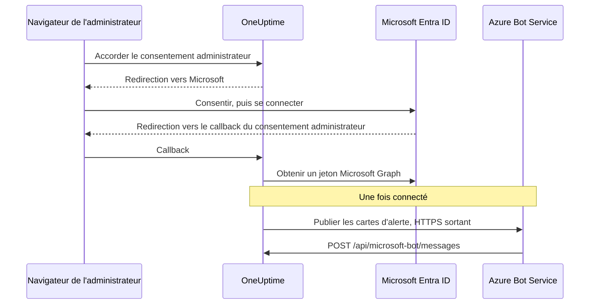

# Intégration Microsoft Teams

Connectez votre OneUptime auto-hébergé à Microsoft Teams. Vous enregistrez une application dans Microsoft Entra ID, créez un Azure Bot pour elle, donnez à OneUptime les identifiants de l'application et installez le package d'application Teams que construit votre serveur. OneUptime publie ensuite les alertes et les incidents dans vos canaux et vos discussions, et votre équipe les traite depuis Teams.

Cette page s'adresse à la personne qui administre le serveur OneUptime. Une fois Teams connecté, les règles de notification se configurent par projet : voir [Microsoft Teams](/docs/workspace-connections/microsoft-teams).

:::cards
- [Configurer l'intégration](#configurer-lintégration): Neuf étapes, du portail Azure à votre première équipe.
- [Variables d'environnement](#variables-denvironnement): Les trois valeurs dont OneUptime a besoin de l'inscription d'application.
- [Accès réseau](#accès-réseau): Le point de terminaison du bot que Microsoft doit pouvoir joindre.
- [Dépannage](#dépannage): Points de terminaison injoignables, installations manquantes et connexions échouées.
:::

## Fonctionnement

OneUptime utilise un Azure Bot pour son intégration Teams. Le trafic circule dans les deux sens, et les deux sens sont indépendants : OneUptime appelle Microsoft pour publier des messages, et Azure Bot Service appelle votre serveur quand quelqu'un appuie sur un bouton, écrit au bot ou l'ajoute à une discussion.



Un Incoming Webhook ou une URL de workflow Teams ne remplace pas le point de terminaison de messagerie de ce bot.

Les appels vidéo (une réunion Teams pour un incident) n'utilisent pas ce bot : ils ont besoin de leur propre inscription d'application, décrite dans [Appels vidéo](/docs/workspace-connections/video-calls#one-click-connect-on-a-self-hosted-server).

## Avant de commencer

- Un abonnement Azure, pour la ressource Azure Bot.
- Un compte qui peut créer des inscriptions d'application dans Microsoft Entra ID, et un administrateur Microsoft 365 pour accorder le consentement administrateur.
- Un nom d'hôte HTTPS public pour OneUptime que Azure Bot Service peut joindre. Voir [Accès réseau](#accès-réseau).
- Un accès à la configuration du serveur : `config.env` pour Docker Compose, ou vos values Helm pour Kubernetes.
- Pour connecter un projet, le rôle **Project Owner**, **Project Admin** ou **Project Member** dans ce projet.

## Configurer l'intégration

:::steps
### Étape 1 : créer l'inscription d'application Azure

Dans le [portail Azure](https://portal.azure.com), ouvrez **App registrations** et sélectionnez **New registration**. Remplissez le formulaire :

- **Name:** oneuptime
- **Supported account types:** Accounts in this organizational directory only (Single tenant)
- **Redirect URI:** Web - `https://your-oneuptime-domain.com/api/microsoft-teams/auth`

Sélectionnez **Register**, puis ajoutez une deuxième URI de redirection Web, `https://your-oneuptime-domain.com/api/microsoft-teams/admin-consent/callback`. Notez l'**Application (client) ID** et le **Directory (tenant) ID** : vous aurez besoin des deux plus tard.

> [!NOTE]
> **Pourquoi un seul locataire :** une instance OneUptime auto-hébergée sert une seule organisation, et son bot est enregistré pour le locataire unique que vous définissez dans `MICROSOFT_TEAMS_APP_TENANT_ID` (étape 6). Enregistrer l'application comme multilocataire n'étend pas cela, et introduit un mode de défaillance : les utilisateurs invités / B2B dont le locataire Microsoft d'origine diffère du vôtre joignent le bot avec leur propre ID de locataire, que OneUptime ne peut pas rattacher à votre projet. Si vous avez déjà enregistré une application multilocataire, elle continuera de fonctionner — assurez-vous simplement que `MICROSOFT_TEAMS_APP_TENANT_ID` est votre propre locataire, et attendez-vous à ce que les comptes invités aient besoin d'un compte dans votre locataire pour utiliser le bot.

### Étape 2 : configurer les autorisations de l'application

Dans votre inscription d'application, ouvrez **API permissions**, sélectionnez **Add a permission** et choisissez **Microsoft Graph**.

**Ajouter les autorisations déléguées** (pour agir au nom d'un utilisateur connecté) :

- **User.Read** - Nécessaire pour obtenir les informations de profil de l'utilisateur authentifié (nom d'affichage, e-mail) pendant le flux OAuth
- **Team.ReadBasic.All** - Nécessaire pour lister les équipes dont l'utilisateur est membre au moment de choisir l'équipe à connecter
- **Channel.ReadBasic.All** - Nécessaire pour lire les informations des canaux et lister les canaux des équipes pour la livraison des notifications
- **ChannelMessage.Send** - Nécessaire pour envoyer les notifications d'alerte et d'incident aux canaux Teams

**Ajouter les autorisations d'application** (pour agir en tant que l'application elle-même, sans utilisateur connecté) :

- **Team.ReadBasic.All** - Nécessaire pour lister toutes les équipes de l'organisation une fois le consentement administrateur accordé
- **Channel.ReadBasic.All** - Nécessaire pour vérifier l'existence des canaux et récupérer leurs détails
- **TeamsAppInstallation.ReadForTeam.All** - Nécessaire au diagnostic. Permet à OneUptime de lire quel package d'application est réellement installé dans une équipe et de le comparer à l'ID client de ce déploiement, pour qu'un envoi échoué puisse vous dire *laquelle* des causes possibles est en jeu. Sans elle, OneUptime ne peut pas distinguer « non installée » de « installée, mais c'est le package de quelqu'un d'autre », et se contente de rapporter ce que Microsoft a dit — la principale raison pour laquelle le débogage de cette intégration prend des jours au lieu de minutes. Accordez-la.
- **Chat.ReadBasic.WhereInstalled** - Facultative. Permet à OneUptime de lire le nom de chaque discussion où se trouve l'application OneUptime. Sans elle, chaque discussion l'accorde via l'autorisation **ChatSettings.Read.Chat** du manifeste (ci-dessous), qu'une discussion ajoutée avec un ancien manifeste n'obtient qu'une fois l'application mise à jour dans cette discussion.

`ChannelMessage.Send` est uniquement une autorisation déléguée ; elle n'a pas de variante en autorisation d'application dans la [référence des autorisations Microsoft Graph](https://learn.microsoft.com/en-us/graph/permissions-reference#channelmessagesend). Gardez-la dans la liste déléguée ci-dessus.

Sélectionnez ensuite **Grant admin consent** pour votre organisation.

Le bot lui-même utilise des autorisations de consentement spécifique à la ressource (RSC) définies dans le manifeste de l'application Teams. Elles sont accordées quand l'application est installée ou mise à jour dans une équipe ou une discussion, pas dans Entra ID :

- **ChannelMessage.Send.Group** - Permet au bot d'envoyer des messages aux canaux d'équipe
- **ChannelMessage.Read.Group** - Permet au bot de lire les messages des canaux pour les commandes interactives
- **Channel.Create.Group** - Permet au bot de créer des canaux si nécessaire
- **ChatMessage.Read.Chat** - Permet au bot de lire les messages des discussions auxquelles il a été ajouté (pour les commandes interactives)
- **ChatMember.Read.Chat** - Permet au bot de lire les membres des discussions auxquelles il a été ajouté (pour nommer les discussions dans OneUptime)
- **ChatSettings.Read.Chat** - Permet à OneUptime de lire le nom des discussions de groupe auxquelles l'application a été ajoutée. Teams n'envoie pas de façon fiable le nom d'une discussion de groupe au bot, donc sans elle une discussion de groupe nommée est listée sous les noms de ses membres
- **TeamsAppInstallation.Read.Group** - Permet à OneUptime de confirmer que l'application est installée dans une équipe où il s'apprête à publier

Si vous avez téléversé le manifeste de l'application avant que ces autorisations existent, téléchargez-le de nouveau depuis **Paramètres du projet > Espace de travail > Microsoft Teams** et téléversez-le dans Teams comme mise à jour de l'application OneUptime. Teams accorde les autorisations d'équipe et de discussion quand l'application est installée ou mise à jour dans cette équipe ou cette discussion : acceptez donc la mise à jour dans chaque équipe et chaque discussion qui contient déjà l'application. Pour les discussions, voir [Une discussion de groupe est listée sous les noms de ses membres](#une-discussion-de-groupe-est-listée-sous-les-noms-de-ses-membres).

### Étape 3 : créer un secret client

Dans votre inscription d'application, ouvrez **Certificates & secrets** et sélectionnez **New client secret**. Ajoutez une description, choisissez une expiration (24 mois est un choix raisonnable) et sélectionnez **Add**. Copiez immédiatement la valeur du secret : Azure ne l'affiche qu'une fois.

> [!IMPORTANT]
> Copiez la **Value** du secret, pas son **Secret ID**. La valeur est la chaîne la plus longue.

### Étape 4 : créer un Bot Service

Dans le portail Azure, créez une ressource **Azure Bot** :

- **Bot handle:** oneuptime-bot
- **Subscription** et **Resource group:** les vôtres
- **Pricing tier:** F0 (Free) suffit pour les tests
- **Type of App:** Single Tenant, avec l'inscription d'application existante : son **Application (client) ID** et son **Directory (tenant) ID** de l'étape 1

Sélectionnez **Review + create**, puis **Create**. Une fois le bot déployé, ouvrez sa page **Configuration**, réglez **Messaging endpoint** sur `https://your-oneuptime-domain.com/api/microsoft-bot/messages` et enregistrez.

**Vérifiez le point de terminaison avant de continuer.** Azure Bot Service appelle cette URL depuis l'Internet public : vérifiez-la donc depuis un endroit situé hors de votre réseau — pas depuis le cluster, ni depuis un VPN qui voit l'hôte quand Azure ne le voit pas :

```bash
curl -sS -i https://your-oneuptime-domain.com/api/microsoft-bot/messages
```

Utilisez `-i` plutôt que le seul code de statut : sur un 404, **le corps est la seule chose qui vous dit qui l'a produit**, et cette distinction est tout le diagnostic.

- **405** est correct et signifie que vous avez terminé. Le point de terminaison n'accepte que POST, donc un GET reçoit `405 Method Not Allowed`, avec `Allow: POST` et une description du point de terminaison. Le joindre tout court est précisément ce qui est testé.
- **Un 404 avec le corps JSON `{"message":"Page not found - /api/microsoft-bot/messages"}`** vient de OneUptime : la requête est donc *bien* arrivée. Soit ce déploiement est antérieur à la réponse 405 ci-dessus — les anciennes versions ne servaient ce chemin que pour POST, et un GET tombait dans le gestionnaire générique « not found » —, soit un élément placé devant OneUptime réécrit le chemin et retire le préfixe `/api` avant que l'application ne le voie (un ingress Kubernetes avec `rewrite-target: /` est le coupable habituel).
- **Un 404 avec une page d'erreur HTML** de nginx, de votre ingress ou d'un équilibreur de charge signifie l'inverse : la requête n'a jamais atteint OneUptime, et ce qui se trouve devant ne route pas `/api` vers l'application.
- **Une erreur TLS, un délai d'attente dépassé ou une connexion refusée** signifie qu'Azure ne le joindra pas non plus. Voir [la section de dépannage du point de terminaison de messagerie](#les-boutons-des-cartes-affichent-unable-to-reach-app-et-les-discussions-napparaissent-jamais) ci-dessous.

### Étape 5 : ajouter le canal Microsoft Teams au bot

Dans votre ressource Azure Bot, ouvrez **Channels** et ajoutez **Microsoft Teams**. Gardez les options de messagerie par défaut sauf besoin particulier, et enregistrez. Sans ce canal, le bot n'est jamais provisionné dans les conversations Teams.

### Étape 6 : configurer les variables d'environnement de OneUptime

Donnez à OneUptime les identifiants de l'application :

:::tabs
@tab Docker Compose
```bash title="config.env"
MICROSOFT_TEAMS_APP_CLIENT_ID=YOUR_TEAMS_APP_CLIENT_ID
MICROSOFT_TEAMS_APP_CLIENT_SECRET=YOUR_TEAMS_APP_CLIENT_SECRET
MICROSOFT_TEAMS_APP_TENANT_ID=YOUR_MICROSOFT_TENANT_ID
```

Appliquez la modification avec `npm run start`, qui recrée les conteneurs. `docker compose restart` ne relit pas `config.env`.
@tab Kubernetes
```yaml title="values.yaml"
microsoftTeamsApp:
  clientId: YOUR_TEAMS_APP_CLIENT_ID
  clientSecret: YOUR_TEAMS_APP_CLIENT_SECRET
  tenantId: YOUR_MICROSOFT_TENANT_ID
```

Pour garder les valeurs dans un Secret Kubernetes que vous gérez, définissez plutôt `microsoftTeamsApp.existingSecret` : son `name`, et les clés `clientIdKey`, `clientSecretKey` et `tenantIdKey`. Appliquez la modification avec `helm upgrade`.
:::

Une fois OneUptime revenu, **Paramètres du projet > Espace de travail > Microsoft Teams** affiche la carte **Accorder le consentement administrateur** à la place du guide de configuration.

### Étape 7 : accorder le consentement administrateur dans OneUptime

Ouvrez **Paramètres du projet > Espace de travail > Microsoft Teams** et sélectionnez **Accorder le consentement administrateur**. Connectez-vous à Microsoft en tant qu'administrateur Microsoft 365 et acceptez les autorisations. Microsoft vous renvoie sur la même page, et la carte indique **Consentement administrateur accordé** : le projet est maintenant connecté à votre locataire.

Sélectionnez ensuite **Connect my account with Microsoft Teams** pour lier votre propre compte. Tous les autres membres du projet font de même depuis **Paramètres utilisateur > Espace de travail > Microsoft Teams**.

### Étape 8 : téléverser le manifeste de l'application Teams

Après le consentement administrateur, **Paramètres du projet > Espace de travail > Microsoft Teams** affiche la carte **Action requise : installez l'application de ce déploiement sur Microsoft Teams**. Sélectionnez **Télécharger le zip du manifeste de l'application** : le package porte l'ID de bot de ce déploiement.

Dans Microsoft Teams, ouvrez **Apps > Manage your apps**, sélectionnez **Upload an app**, puis **Upload a custom app**, et choisissez le zip téléchargé.

> [!WARNING]
> N'installez pas « OneUptime » depuis le store Microsoft Teams pour un déploiement auto-hébergé. L'application du store pointe vers le bot de OneUptime Cloud : Teams l'accepte, puis refuse chaque message que ce déploiement envoie.

### Étape 9 : ajouter OneUptime à chaque équipe (obligatoire)

Téléverser le manifeste installe l'application pour **vous**. Cela ne donne **pas** au bot l'accès aux canaux d'une équipe. Microsoft n'accepte les messages que dans une équipe à laquelle l'application a été ajoutée : vous devez donc le faire pour chaque équipe où vous voulez des notifications :

1. Dans Microsoft Teams, cliquez sur « ... » à côté du **nom de l'équipe** (pas du nom du canal)
2. Choisissez **Manage team** > **Apps** > **More apps**
3. Trouvez **OneUptime** et cliquez sur **Add**

Remarques :

- Installer OneUptime pour vous-même, ou l'ajouter à une discussion, est une installation **différente**. Aucune des deux ne lui permet de publier dans les canaux d'une équipe.
- **Les canaux privés** ont besoin que l'application soit installée dans le canal lui-même : ouvrez le canal > « ... » > **Manage channel** > **Apps** > **Add an app**. Une installation au niveau de l'équipe ne couvre pas les canaux privés.
- **Les canaux partagés** ne peuvent recevoir aucune notification — Microsoft Teams ne prend pas en charge les bots dans les canaux partagés. OneUptime les masque dans le sélecteur de canaux.
- Si **Manage team > Apps > More apps** est vide ou grisé, votre stratégie de configuration des applications Teams bloque les applications personnalisées. Corrigez cela dans le centre d'administration Teams sous **Teams apps > Manage apps** et **Setup policies**.
:::

## Variables d'environnement

| Docker Compose (`config.env`) | Helm (`values.yaml`) | Valeur |
| --- | --- | --- |
| `MICROSOFT_TEAMS_APP_CLIENT_ID` | `microsoftTeamsApp.clientId` | L'**Application (client) ID**. C'est aussi l'ID du bot dans le package d'application Teams, il doit donc être un GUID. |
| `MICROSOFT_TEAMS_APP_CLIENT_SECRET` | `microsoftTeamsApp.clientSecret` | La **Value** du secret client, pas son ID. |
| `MICROSOFT_TEAMS_APP_TENANT_ID` | `microsoftTeamsApp.tenantId` | Le **Directory (tenant) ID**. Le bot s'authentifie comme application à locataire unique dans ce locataire. |
| `HOST` | `host` | Votre nom d'hôte public. Les URI de redirection, le point de terminaison de messagerie et le package d'application Teams sont construits à partir de lui. |
| `HTTP_PROTOCOL` | `httpProtocol` | `https`. Azure Bot Service n'appelle que des points de terminaison HTTPS. |

Les trois valeurs `MICROSOFT_TEAMS_APP_*` sont obligatoires :

- Sans l'ID client, la page Microsoft Teams affiche le guide de configuration au lieu de **Accorder le consentement administrateur**.
- Sans l'ID client ou le secret, la connexion se termine par **"Microsoft Teams n'est pas configuré sur ce serveur OneUptime."**
- Sans l'ID de locataire, le bot ne peut pas s'authentifier : la publication et le point de terminaison du bot échouent.

## Accès réseau

Microsoft exige un [point de terminaison HTTPS accessible publiquement pour un bot auto-hébergé](https://learn.microsoft.com/en-us/azure/bot-service/bot-service-resources-faq-security?view=azure-bot-service-4.0). Une adresse IP privée, un nom DNS interne ou la connexion VPN d'un employé ne donnent pas à Azure Bot Service l'accès à OneUptime.

| Sens | Destination | Rôle |
| --- | --- | --- |
| OneUptime vers Microsoft | HTTPS sur TCP 443 vers Microsoft Graph, l'identité Microsoft et les services du Bot Framework | Échange de jetons, recherche d'équipes et de canaux, et livraison des notifications |
| Microsoft vers OneUptime | `POST /api/microsoft-bot/messages` | Messages du bot, événements d'installation des conversations et actions des cartes |
| Navigateur de l'utilisateur vers OneUptime | `/api/microsoft-teams/auth` et `/api/microsoft-teams/admin-consent/callback` | Redirections de connexion et de consentement administrateur |

Les redirections de l'inscription d'application vers `/api/microsoft-teams/auth` et `/api/microsoft-teams/admin-consent/callback` reviennent par le navigateur de l'utilisateur. Ce navigateur doit joindre OneUptime, par exemple via votre réseau d'entreprise ou votre VPN. Les messages du bot et les actions des cartes arrivent des serveurs de Microsoft et ont besoin de leur propre ingress joignable. La livraison sortante des alertes ne vérifie pas à elle seule la connectivité entrante.

### Publier le point de terminaison du bot depuis un déploiement privé

```mermaid title="Publier le point de terminaison du bot depuis un déploiement privé"
flowchart LR
    Azure["Azure Bot Service"] -->|HTTPS 443| GW["Passerelle publique"]
    GW -->|"POST /api/microsoft-bot/messages"| ING["Ingress OneUptime"]
    Users["Employés sur le VPN"] --> ING
    ING --> App["Application OneUptime"]
```

:::steps
1. Faites pointer le DNS public de votre nom d'hôte OneUptime vers un reverse proxy ou un équilibreur de charge exposé à Internet. Autorisez le TCP 443 entrant et servez un certificat TLS reconnu publiquement avec sa chaîne complète.
2. Reliez la passerelle à l'ingress privé de OneUptime, directement ou via votre propre VPN site à site / liaison privée, et autorisez son port de service en amont. Un service Kubernetes `ClusterIP` a besoin d'un ingress joignable ou d'une autre route depuis la passerelle. Gardez les bases de données et les autres services internes privés.
3. Publiez `/api/microsoft-bot/messages` via cette passerelle et réglez le **Messaging endpoint** de l'Azure Bot de l'étape 4 sur l'URL HTTPS publique complète. Préservez la méthode, le préfixe `/api`, la chaîne de requête, le corps et l'en-tête `Authorization`. Préservez le `Host` public et définissez des en-têtes de transfert de confiance pour l'hôte public et le schéma HTTPS. N'ajoutez à cette route ni redirections, ni SSO du navigateur, ni CAPTCHA, ni connexion au proxy ; l'adaptateur Bot Framework de OneUptime doit recevoir et authentifier la requête.
4. Gardez les autres routes privées si besoin. Avec un DNS scindé, les employés peuvent résoudre le même nom d'hôte vers l'ingress privé via le réseau d'entreprise ou le VPN. Cet ingress doit lui aussi servir HTTPS avec un certificat valide pour le nom d'hôte, et autoriser les redirections du navigateur du tableau ci-dessus. Limitez l'accès à l'origine à la passerelle et aux clients internes autorisés.
5. Définissez `HOST=oneuptime.example.com` et `HTTP_PROTOCOL=https` dans le `config.env` de Docker Compose, ou `host: oneuptime.example.com` et `httpProtocol: https` dans les values Helm. Remplacez l'exemple par votre domaine, appliquez la mise à jour du déploiement et attendez le redémarrage de l'application. Ces valeurs génèrent des URL ; elles ne fournissent ni DNS, ni TLS, ni accès réseau. Si le nom d'hôte change, mettez à jour le point de terminaison de l'Azure Bot et les redirections de l'inscription d'application, puis téléchargez et téléversez de nouveau le manifeste Teams.
:::

Les [paramètres d'accès au réseau privé](/docs/self-hosted/private-network-access) de OneUptime régissent les requêtes sortantes vers les services internes. Activer `ALLOW_PRIVATE_NETWORK_WEBHOOKS` ne rend pas le point de terminaison du bot joignable par Microsoft.

### Accès sortant et restrictions d'IP

Autorisez la résolution DNS et le HTTPS sortant depuis l'application OneUptime. Elle utilise `graph.microsoft.com`, `login.microsoftonline.com`, les points de terminaison d'authentification et de canal du Bot Framework, et l'URL du service connecteur fournie pour une conversation. Le connecteur de repli du cloud commercial est `https://smba.trafficmanager.net/teams/` ; les URL de service des conversations peuvent différer. Appliquez les [recommandations de Microsoft sur le pare-feu](https://learn.microsoft.com/en-us/azure/bot-service/bot-service-resources-faq-security?view=azure-bot-service-4.0) et examinez le trafic bloqué pendant les tests ; ceci n'est pas une liste exhaustive de noms d'hôte.

Microsoft ne prend pas en charge de listes fixes d'IP autorisées en entrée pour le Bot Framework, car ses adresses sources changent. Les plages d'IP des médias des clients Teams ne décrivent pas les sources des webhooks des bots. Gardez l'authentification du Bot Framework activée plutôt que de traiter une IP source comme une preuve d'identité.

### Tests et déploiements sans accès entrant

Utilisez l'étape 4 pour vérifier le DNS public, le TLS et le routage depuis l'extérieur de votre réseau et de votre VPN. Connectez ensuite Teams, envoyez une notification de test, écrivez au bot et appuyez sur un bouton de carte. Confirmez l'action dans OneUptime et rapprochez les diagnostics de livraison de Microsoft des logs de la passerelle et de l'application. Une route GET joignable ou une notification livrée ne vérifie pas à elle seule un POST entrant authentifié du bot.

Pour le développement, le [guide de Microsoft pour tester un bot Teams en local](https://learn.microsoft.com/en-us/microsoftteams/platform/bots/how-to/authentication/add-authentication#testing-the-bot-locally-in-teams) décrit comment exposer un service local avec un tunnel. Transférez vers un proxy qui autorise le point de terminaison du bot et utilisez `/api/microsoft-bot/messages`, à la place du chemin d'exemple `/api/messages` de Microsoft. Mettez à jour le nom d'hôte configuré et le point de terminaison de l'Azure Bot chaque fois que l'URL publique du tunnel change, arrêtez le tunnel après les tests et utilisez un ingress stable en production. Un tunnel ouvre lui aussi un accès entrant.

> [!WARNING]
> Si une politique interdit la connectivité entrante, l'intégration complète du bot Teams ne peut pas fonctionner : les commandes, les actions des cartes et la découverte des conversations dépendent de la capacité de Microsoft à joindre OneUptime. Azure Bot Private Endpoint ne résout pas cette exigence. Les [instructions d'isolement réseau](https://learn.microsoft.com/en-us/azure/bot-service/dl-network-isolation-how-to?view=azure-bot-service-4.0) de Microsoft décrivent l'isolement de Direct Line et indiquent que désactiver l'accès au réseau public déconfigure les canaux Teams. Une installation entièrement déconnectée ne peut pas utiliser Teams.

## Dépannage

Commencez par ces vérifications :

- L'inscription d'application a les autorisations ci-dessus, et le consentement administrateur est accordé.
- Les URI de redirection correspondent exactement (remplacez `your-oneuptime-domain.com` par votre vrai domaine).
- Les variables d'environnement sont définies, et OneUptime a été redémarré après les avoir définies.
- Le point de terminaison de messagerie du bot est joignable depuis Internet, et le bot a le canal Microsoft Teams.
- Le package d'application Teams que vous avez téléversé est celui téléchargé depuis ce déploiement.

### Les boutons des cartes affichent "Unable to reach app", et les discussions n'apparaissent jamais

Ces symptômes signifient souvent qu'**Azure Bot Service ne parvient pas à livrer d'activités authentifiées à votre point de terminaison de messagerie**. Vérifiez le routage, l'authentification du bot et la configuration du projet.

Ce qui trompe, c'est que les cartes d'alerte continuent d'arriver dans Teams, ce qui donne à l'intégration l'air d'être presque en bonne santé. Elle ne l'est pas — les deux sens sont indépendants, et un seul des deux fonctionne :

| Sens | Comment il circule | Azure doit-il vous joindre ? |
| --- | --- | --- |
| OneUptime publie une carte d'alerte dans un canal | OneUptime appelle Microsoft, en s'authentifiant avec votre secret client | **Non** |
| Vous appuyez sur un bouton de cette carte | Azure Bot Service envoie un POST à `/api/microsoft-bot/messages` | **Oui** |
| Vous écrivez `help` au bot | Azure Bot Service envoie un POST à `/api/microsoft-bot/messages` | **Oui** |
| Une discussion s'enregistre sous **Discussions Microsoft Teams** | Azure Bot Service envoie une activité de bot par POST à `/api/microsoft-bot/messages` | **Oui** |

Une alerte qui fonctionne vérifie donc cet envoi sortant précis ; elle ne vérifie ni chaque autorisation Graph ni le point de terminaison entrant du bot. Les fonctionnalités interactives exigent un traitement réussi des activités entrantes du bot.

OneUptime enregistre les discussions à partir des activités du bot, par exemple l'installation de l'application, l'ajout du bot à la conversation, ou un message envoyé au bot dans cette discussion. Toutes arrivent par le même point de terminaison entrant. Une liste **Discussions Microsoft Teams** vide après avoir ajouté l'application et lui avoir écrit signifie qu'aucune discussion n'a été enregistrée pour ce projet ; vérifiez les requêtes entrantes, les erreurs d'authentification et la correspondance entre locataire et projet. Cliquer sur **Refresh Chats** relit les discussions stockées par OneUptime, et relit auprès de Microsoft le nom de chaque discussion de groupe stockée.

**Diagnostiquez dans cet ordre :**

1. **Cherchez le POST, pas les 404.** C'est là que la plupart des enquêtes se trompent :

   ```bash
   grep 'POST /api/microsoft-bot/messages' <your access log>
   ```

   S'il n'y a aucune ligne POST, confirmez que le bon log d'accès enregistre les requêtes, puis vérifiez le point de terminaison configuré dans Azure et le chemin réseau. Si des POST arrivent, examinez leurs réponses et les erreurs d'authentification ou de correspondance de projet de OneUptime. Les lignes `GET` qui renvoient 404 sont une vérification distincte — voir la remarque ci-dessous.

2. **Appelez le point de terminaison depuis l'extérieur de votre réseau,** comme à l'étape 4, avec `curl -i` pour voir le corps. Un `405` prouve que la route est active et joignable depuis l'endroit où vous avez lancé la commande. Une erreur TLS, un délai dépassé ou une connexion refusée est votre réponse.

3. **Vérifiez la chaîne de certificats.** Azure exige HTTPS avec un certificat reconnu publiquement servi avec sa chaîne complète. Un certificat auto-signé, une AC interne ou un intermédiaire manquant fait échouer la négociation TLS avant que OneUptime ne voie la requête — votre log d'accès reste alors vide et donne l'impression qu'Azure n'a jamais essayé :

   ```bash
   openssl s_client -connect your-oneuptime-domain.com:443 -servername your-oneuptime-domain.com -verify_return_error </dev/null
   ```

4. **Vérifiez que l'hôte peut être résolu publiquement.** Un nom DNS privé, un enregistrement en split-horizon ou un ingress uniquement interne vous joignent, vous et votre VPN, tout en restant invisibles pour Azure. Résolvez-le depuis un réseau sans accès au vôtre.

5. **Confirmez le point de terminaison sur la ressource Azure Bot** : il doit correspondre exactement à ce déploiement, schéma et chemin compris : `https://your-oneuptime-domain.com/api/microsoft-bot/messages`.

**Un 404 sur `GET /api/microsoft-bot/messages` n'est pas le bug, et ce n'est pas la preuve qu'Azure n'a pas pu vous joindre.** Le point de terminaison n'a toujours accepté que POST : sur les versions antérieures à celle-ci, un GET du navigateur tombait dans le gestionnaire générique « not found » de OneUptime et revenait sous la forme `{"message":"Page not found - /api/microsoft-bot/messages"}`. Cela ressemble à une route manquante et a envoyé plus d'un administrateur chercher une régression qui n'existait pas — mais notez ce que cela prouve réellement : OneUptime a généré cette réponse, donc la requête a atteint l'application. Elle fait 58 octets, c'est pourquoi elle apparaît dans un log d'accès sous la forme `"GET /api/microsoft-bot/messages HTTP/1.1" 404 58`.

Cette version répond à un GET par `405 Method Not Allowed` et une description d'elle-même : la distinction n'a donc plus besoin d'être expliquée. Si vous êtes encore sur une version plus ancienne, jugez un 404 à son corps : le JSON de OneUptime signifie que la requête est arrivée, une page d'erreur HTML de votre proxy signifie qu'elle n'est pas arrivée.

### Une discussion de groupe est listée sous les noms de ses membres

Teams n'envoie pas de façon fiable le nom d'une discussion de groupe au bot ; OneUptime le lit donc dans Microsoft Graph. Il faut pour cela l'autorisation **ChatSettings.Read.Chat** du manifeste, que chaque discussion accorde quand l'application OneUptime y est installée ou mise à jour. Les discussions auxquelles l'application a été ajoutée avec un ancien manifeste ne l'ont pas, et **Refresh Chats** les signale. Corrigez cela de l'une de ces deux façons :

1. Téléchargez de nouveau le manifeste depuis **Paramètres du projet > Espace de travail > Microsoft Teams**, téléversez-le dans Teams comme mise à jour de l'application OneUptime, acceptez la mise à jour dans chacune de ces discussions, puis cliquez sur **Refresh Chats**.
   - Teams ne prend le téléversement pour une mise à jour que si sa version est supérieure à celle installée. Les images des releases la définissent à partir de `APP_VERSION`. Une build sans `APP_VERSION` utilise une valeur de repli fixe qui ne change que lorsque OneUptime modifie le manifeste ; si Teams indique que le package n'est pas plus récent, augmentez la `version` du manifeste avant de le téléverser.
   - Si votre locataire ne laisse utiliser les autorisations de discussion qu'aux applications préapprouvées, ajoutez d'abord **ChatSettings.Read.Chat** à la stratégie de préapprobation de OneUptime (par exemple `Update-MgBetaTeamAppPreapproval -TeamsAppId <app id> -ResourceSpecificApplicationPermissionsAllowedForChats @('ChatMember.Read.Chat','ChatMessage.Read.Chat','ChatSettings.Read.Chat')`), sinon l'application mise à jour ne pourra pas être ajoutée aux discussions.
2. Ou accordez à l'inscription d'application l'autorisation d'application **Chat.ReadBasic.WhereInstalled** (étape 2) avec le consentement administrateur, puis cliquez sur **Refresh Chats**. Cela couvre d'un coup chaque discussion où se trouve l'application, sans mise à jour discussion par discussion. OneUptime continue d'utiliser son jeton Microsoft Graph actuel jusqu'à son expiration : une autorisation nouvellement accordée peut donc mettre jusqu'à une heure à prendre effet.

Une discussion de groupe qui n'a pas de nom dans Teams est listée sous les noms de ses membres, par conception. Une discussion renommée dans Teams prend son nouveau nom la prochaine fois que quelqu'un clique sur **Refresh Chats**.

### Vérifier la configuration du bot de ce déploiement

```bash
curl -sS https://your-oneuptime-domain.com/api/microsoft-bot/test | jq
```

Cela indique ce que OneUptime peut voir localement : si `MICROSOFT_TEAMS_APP_CLIENT_ID` et `MICROSOFT_TEAMS_APP_CLIENT_SECRET` sont définis, le point de terminaison de messagerie qu'attend ce déploiement et — le plus utile — l'**ID du bot** que doit porter votre package d'application Teams.

Cela lit les variables d'environnement et rien d'autre. Cela n'appelle pas Azure : cela ne peut donc pas vous dire si la ressource Azure Bot existe, si son point de terminaison de messagerie pointe bien ici, si le canal Teams est activé, si le secret est encore valide ou si Azure peut vous joindre. La réponse le dit elle-même, en listant ce qui a été vérifié et ce qui ne l'a pas été, pour qu'elle ne soit jamais prise pour un feu vert.

La seule vérification décisive qu'elle permet : comparez le `botId` renvoyé à l'ID de bot de l'application OneUptime installée dans Teams. S'ils diffèrent, ce package ne peut pas recevoir de messages de ce déploiement — voir l'étape 8.

### "The OneUptime app is not installed in the Microsoft Teams team ..."

OneUptime a vérifié auprès de Microsoft Graph, et l'application est réellement absente de cette équipe (ou, pour un canal privé, de ce canal). Effectuez l'**étape 9** ci-dessus. OneUptime peut lister chaque canal de votre locataire avec les autorisations d'application Graph, mais il ne peut *publier* que dans les équipes dont l'application est membre.

### "Microsoft Teams refused the message ... because the OneUptime bot is not a member of that conversation"

Microsoft a rejeté la publication (dans ses propres termes : `BotNotInConversationRoster`) et OneUptime n'a **pas** pu confirmer que l'application manque — ne le supposez donc pas. Passez les causes en revue dans l'ordre ci-dessous ; les deux premières ressemblent, vues de Teams, exactement à une configuration correcte.

1. **L'application dans l'équipe est un autre package.** Voir une vignette nommée « OneUptime » sous **Manage team > Apps** ne suffit pas — ce qui compte, c'est que l'ID de bot de ce package soit le `MICROSOFT_TEAMS_APP_CLIENT_ID` de *ce* déploiement. L'application OneUptime publique du store Teams pointe vers le bot de OneUptime Cloud et n'acceptera jamais de publications de votre instance auto-hébergée. Seul le manifeste téléchargé depuis **Paramètres du projet > Espace de travail > Microsoft Teams** (étape 8) est construit pour votre déploiement. En cas de doute, retirez l'application de l'équipe, téléversez de nouveau votre propre manifeste et ajoutez celui-ci.
2. **L'Azure Bot n'a pas de canal Microsoft Teams.** Effectuez l'**étape 5**. Sans lui, le bot n'est jamais provisionné dans les conversations Teams : il ne figure donc dans la liste des membres d'aucun canal — même si l'application s'installe proprement et que la liste des applications semble correcte.
3. **L'application est installée pour vous, ou dans une discussion, mais pas dans l'équipe.** Effectuez l'**étape 9**.
4. **Le canal est privé.** Une installation au niveau de l'équipe ne couvre pas les canaux privés — voir les remarques de l'étape 9.

Accordez **TeamsAppInstallation.ReadForTeam.All** (étape 2) pour que OneUptime vous dise laquelle de ces causes est en jeu au lieu de les énumérer.

### Les notifications fonctionnent dans une équipe mais pas dans une autre

L'installation se fait par équipe. Ajouter OneUptime à une équipe ne fait rien pour les autres, et connecter l'intégration non plus — cela accorde un accès Graph en *lecture* à l'échelle du locataire, ce qui explique pourquoi le sélecteur de canaux peut vous montrer des canaux d'équipes où le bot ne peut pas publier. Effectuez l'**étape 9** pour chaque équipe où vous voulez des notifications.

### "Tester la règle" réussit mais les vraies notifications n'arrivent jamais

Vérifiez quelles destinations la règle a réellement activées. Une règle n'exerce que ce pour quoi elle est configurée : avec **Create Microsoft Teams Channel** activé, le test crée un canal et y publie, ce qui prouve que le bot peut publier *dans l'équipe où ce canal a été créé* — et rien sur aucune autre équipe. **Paramètres du projet > Notifications > Journaux de notification** enregistre chaque envoi de test, y compris l'erreur brute de Microsoft en cas d'échec.

### "Sorry, I couldn't find your project configuration"

Le locataire Microsoft d'où vient l'activité du bot n'est le locataire connecté d'aucun projet OneUptime. Vérifiez l'ID de locataire dans les logs de votre serveur :

```bash
grep "Project auth not found for tenant ID" <your app logs>
```

Comparez-le au locataire enregistré pour le projet :

```sql
SELECT "projectId", "workspaceProjectId"
FROM "WorkspaceProjectAuthToken"
WHERE "workspaceType" = 'MicrosoftTeams';
```

S'ils diffèrent, l'utilisateur qui écrit au bot est connecté à un autre locataire Microsoft (souvent un compte invité / B2B dont le locataire d'origine n'est pas le vôtre). Faites-lui utiliser un compte du locataire connecté, ou mentionner le bot avec @ dans un canal de l'équipe connectée plutôt que dans une discussion en tête-à-tête.

### "This Microsoft 365 organization is connected to more than one OneUptime project"

Deux projets OneUptime ou plus ont connecté le même locataire Microsoft. Un message du bot ne porte qu'un ID de locataire : OneUptime ne peut donc pas savoir de quel projet il s'agit et refuse plutôt que de deviner. Déconnectez Microsoft Teams de tous les projets sauf un.

### "Microsoft Teams App Client ID must be a valid GUID"

**Télécharger le zip du manifeste de l'application** refuse de construire un package quand `MICROSOFT_TEAMS_APP_CLIENT_ID` n'est pas un GUID, car Teams en exige un pour l'ID de l'application et du bot. Copiez de nouveau l'**Application (client) ID** depuis la vue d'ensemble de l'inscription d'application, définissez-le et appliquez la configuration.

### La connexion n'a pas abouti

Quand Microsoft vous renvoie et que la connexion n'a pas été établie (en accordant le consentement administrateur, ou en vous connectant avec Microsoft), la page Microsoft Teams d'où vous êtes parti (**Paramètres du projet > Espace de travail > Microsoft Teams**, ou vos propres **Paramètres utilisateur > Espace de travail > Microsoft Teams** si vous connectiez votre compte) affiche **Microsoft Teams n'a pas été connecté**, avec une phrase dans votre langue qui en donne la raison. Le reste de la page se charge normalement, vous pouvez donc réessayer sur place. Elle n'affiche jamais ce que Microsoft a lui-même répondu (un code `AADSTS`, par exemple) : cela figure dans le log du serveur OneUptime, avec la raison.

| La page indique | Que faire |
| --- | --- |
| **"Ce lien de connexion n'est pas valide, a expiré ou a déjà été utilisé. Veuillez recommencer."** | Le lien fonctionne une fois, pendant 15 minutes, dans le navigateur qui l'a lancé. Recommencez depuis la page Microsoft Teams et terminez en moins de 15 minutes, dans le même navigateur. |
| **"Vous n'avez pas l'autorisation de connecter ce projet à Microsoft Teams."** | Accorder le consentement administrateur pour le projet exige **Project Owner**, **Project Admin** ou **Project Member**. C'est vérifié de nouveau quand Microsoft vous renvoie. |
| **"Vous n'êtes plus membre de ce projet."** | Pour connecter votre propre compte Microsoft, vous devez être membre du projet au moment où Microsoft vous renvoie. |
| **"Vous vous êtes connecté à une autre organisation Microsoft 365 que celle à laquelle cette connexion est destinée."** | Connectez-vous avec un compte de l'organisation Microsoft 365 qui a accordé le consentement administrateur, ou à laquelle le projet est connecté. |
| **"Votre organisation Microsoft 365 n'a encore aucune équipe."** | Créez une équipe dans Microsoft Teams, puis accordez de nouveau le consentement administrateur. |
| **"La connexion a été annulée, rien n'a donc été modifié."** | Le consentement n'a pas été accordé dans Microsoft. Recommencez et acceptez-le. |
| **"Microsoft Teams n'est pas configuré sur ce serveur OneUptime."** | Définissez l'ID client et le secret de l'application Microsoft Teams (voir l'[étape 6](#étape-6-configurer-les-variables-denvironnement-de-oneuptime)) et redémarrez OneUptime. |
| **"OneUptime n'a pas pu terminer la connexion. Veuillez réessayer."** | Microsoft a répondu par une erreur, ou une requête ou une écriture a échoué pendant la finalisation. Le log du serveur OneUptime précise laquelle. Réessayez ; si cela se reproduit, consultez le log et les paramètres de l'inscription d'application. |

Nous aimerions améliorer cette intégration : vos retours sont les bienvenus à [hello@oneuptime.com](mailto:hello@oneuptime.com).

## Étapes suivantes

:::cards
- [Microsoft Teams](/docs/workspace-connections/microsoft-teams): Créer des règles de notification et des résumés pour le projet.
- [Intégration Slack](/docs/self-hosted/slack-integration): Configurer aussi l'application Slack sur votre serveur.
- [Accès au réseau privé](/docs/self-hosted/private-network-access): Permettre aux workflows et aux webhooks de joindre les outils internes.
:::
