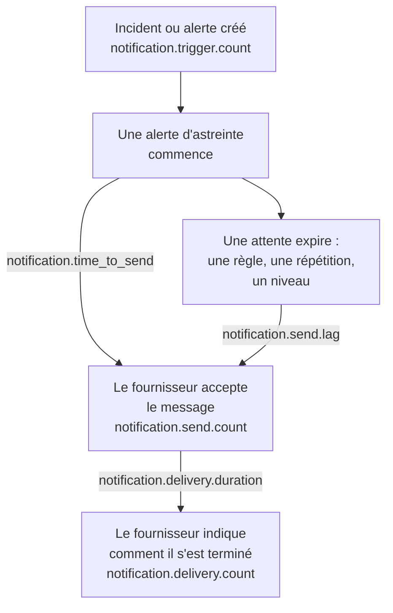

# Métriques de distribution des notifications

OneUptime enregistre le sort des notifications qu'il envoie : combien d'incidents et d'alertes en déclenchent, si chaque message a atteint son fournisseur, combien de temps une alerte d'astreinte a mis à partir, et si elle a atteint le téléphone. Envoyez la télémétrie de OneUptime lui-même à un projet OneUptime, ou à n'importe quel backend OpenTelemetry, pour fixer des objectifs de distribution envers les personnes que votre installation sert et vérifier que vous les tenez.

:::cards
- [Les activer](#les-activer): Deux paramètres, et rien n'est enregistré sans eux.
- [Les métriques](#les-métriques): Sept métriques, du déclencheur au téléphone.
- [Comment une alerte est chronométrée](#comment-une-alerte-est-chronométrée): D'où partent le délai d'envoi et le retard d'envoi.
- [Des SLO pour commencer](#des-slo-pour-commencer): Quatre objectifs, requête par requête.
:::

## Fonctionnement



Chaque message compte dans `notification.send.count`, sur chaque canal, pas seulement les alertes d'astreinte. Les deux durées, `notification.time_to_send` et `notification.send.lag`, ne couvrent que les alertes d'astreinte.

## Les activer

Rien n'est enregistré tant que OneUptime n'a pas d'exportateur OpenTelemetry : sans lui, les métriques ne coûtent rien et ne sont conservées nulle part. Dirigez-le vers un projet OneUptime, avec une [clé d'ingestion](/docs/telemetry/ingestion-keys) Server de ce projet, ou vers n'importe quel backend qui accepte OTLP sur HTTP.

:::tabs
@tab Kubernetes
```yaml
openTelemetryExporter:
  endpoint: https://oneuptime.example.com/otlp
  headers: x-oneuptime-token=YOUR_INGESTION_KEY
```
Les déploiements `app` et `worker` les envoient : laissez `app.disableTelemetryCollection` et `worker.disableTelemetryCollection` à `false`, leur valeur par défaut.
@tab Docker Compose
```bash
OPENTELEMETRY_EXPORTER_OTLP_ENDPOINT=https://oneuptime.example.com/otlp
OPENTELEMETRY_EXPORTER_OTLP_HEADERS=x-oneuptime-token=YOUR_INGESTION_KEY
DISABLE_TELEMETRY_FOR_APP=false
```
Définissez-les dans `config.env`, puis lancez `npm start`. `DISABLE_TELEMETRY_FOR_APP` vaut `true` par défaut, et alors rien n'est envoyé.
:::

OneUptime a besoin à la fois du point de terminaison et des en-têtes : sans en-tête, il n'envoie rien. Écrivez chaque en-tête sous la forme `name=value`, et séparez-en plusieurs par `;`. Une valeur peut contenir `=`. OneUptime ajoute lui-même `/v1/metrics` au point de terminaison, et les mêmes paramètres envoient aussi ses propres traces et journaux. Chaque métrique apparaît dès que OneUptime l'enregistre pour la première fois : `notification.send.count` avec le premier message envoyé.

### Envoyer des deltas à un projet OneUptime

OneUptime envoie les compteurs et les histogrammes comme OpenTelemetry le fait par défaut : chaque point contient le total cumulé depuis le démarrage de ce processus serveur. L'explorateur de métriques additionne les points de chaque pas d'un graphique, il ne lit donc exactement les comptes et les percentiles d'une période qu'à partir de deltas, des points qui contiennent ce qui s'est passé depuis le précédent. Quand les métriques vont vers un projet OneUptime, envoyez des deltas :

:::tabs
@tab Kubernetes
```yaml
extraEnv:
  - name: OTEL_EXPORTER_OTLP_METRICS_TEMPORALITY_PREFERENCE
    value: delta
```
La liste propre à un service remplace celle de tout le chart : si vous définissez `app.extraEnv` ou `worker.extraEnv`, ajoutez-la là aussi.
@tab Docker Compose
```yaml title="docker-compose.override.yml"
services:
  app:
    environment:
      OTEL_EXPORTER_OTLP_METRICS_TEMPORALITY_PREFERENCE: delta
```
Créez-le à côté de `docker-compose.yml`, ou ajoutez ceci à celui que vous avez, puis lancez `npm start`.
:::

Cela s'applique à chaque métrique que OneUptime envoie sur lui-même. Un backend qui lit lui-même les totaux cumulés, comme Prometheus, n'a besoin d'aucun changement.

## Les métriques

| Métrique | Type | Unité | Ce qu'elle indique |
| --- | --- | --- | --- |
| `notification.trigger.count` | Compteur | `1` | Combien d'enregistrements ont déclenché des notifications |
| `notification.send.count` | Compteur | `1` | Comment s'est passé chaque message remis à un fournisseur |
| `notification.send.duration` | Histogramme | `ms` | Combien de temps le fournisseur a mis à le prendre |
| `notification.time_to_send` | Histogramme | `ms` | Combien de temps après son déclencheur une alerte a atteint son fournisseur |
| `notification.send.lag` | Histogramme | `ms` | Combien de temps après son échéance une notification envoyée plus tard a atteint son fournisseur |
| `notification.delivery.count` | Compteur | `1` | Comment se sont terminés les messages que les fournisseurs ont acceptés |
| `notification.delivery.duration` | Histogramme | `ms` | Combien de temps après son acceptation par le fournisseur un message s'est terminé |

Chaque attribut prend l'une de quelques valeurs fixes, jamais un projet, une personne, un numéro de téléphone ou un enregistrement. La seule exception est l'ID et le nom d'un canal personnalisé : une installation en a une poignée, et les distinguer est tout l'intérêt.

### Les enregistrements qui notifient des personnes

`notification.trigger.count` compte chaque incident, alerte, épisode d'incident et épisode d'alerte au moment de sa création.

| Attribut | Valeurs |
| --- | --- |
| `notification.trigger.type` | `incident`, `alert`, `incident_episode`, `alert_episode` |
| `notification.trigger.source` | `automatic` quand OneUptime l'a créé, depuis un moniteur ou une règle ; `manual` quand une personne ou l'API l'a fait |
| `monitor.type` | Le type du moniteur qui a créé un incident ou une alerte, comme `Incoming Request`, `Logs` ou `Metrics` ; absent quand aucun moniteur ne l'a fait |

### Les messages remis à un fournisseur

`notification.send.count` compte chaque message remis à un fournisseur, et `notification.send.duration` chronomètre l'appel au fournisseur. Les deux portent ces attributs :

| Attribut | Valeurs |
| --- | --- |
| `notification.channel` | `email`, `sms`, `call`, `whatsapp`, `telegram`, `push`, `webhook`, `slack`, `microsoft_teams`, `mattermost`, `custom_channel` |
| `notification.provider` | `twilio`, `sms_and_call_gateway`, `smtp`, `sendgrid`, `amazon_ses`, `mailgun`, `postmark`, `resend`, `microsoft_graph`, `expo`, `push_relay`, `web_push`, `meta_whatsapp`, `telegram_bot_api`, `slack`, `microsoft_teams`, `mattermost`, `webhook`, `custom_channel`, ou `none` quand rien n'a été remis à un fournisseur |
| `notification.provider.config` | `global` pour le compte et les paramètres de l'installation ; `project` pour le propre compte Twilio, le serveur SMTP, le webhook ou la connexion à l'espace de travail d'un projet, dont les échecs relèvent du projet |
| `notification.on_call_page` | `true` pour une notification d'une alerte d'astreinte, sinon `false` |
| `outcome` | `success`, `failure` ou `not_sent`, comme ci-dessous |
| `notification.destination` | Slack, Microsoft Teams et Mattermost : `direct_message` vers une personne, `channel` pour une publication dans un canal ou une conversation de groupe Teams, `incoming_webhook` pour un webhook entrant, comme celui d'un abonné à une page de statut. Webhooks : `status_page_subscriber` pour le webhook propre d'un abonné à une page de statut. Absent pour le webhook d'une personne et pour tous les autres canaux |
| `notification.custom_channel.id`, `notification.custom_channel.name` | Canaux personnalisés uniquement : l'ID du canal, et son nom tronqué à 100 caractères |

- `success` : le fournisseur a accepté le message.
- `failure` : le fournisseur l'a refusé ou était injoignable, ou l'envoi a échoué. Un canal de discussion introuvable est un échec sans durée.
- `not_sent` : volontairement non envoyé. Le projet a désactivé le canal, n'a pas assez de solde ou est bloqué, le push est désactivé sur ce serveur, ou un canal personnalisé est désactivé, supprimé ou non couvert par la licence. Un taux de réussite les laisse de côté : ce sont des paramètres à l'œuvre, pas une plateforme en panne.

Un message vers le webhook propre d'un abonné à une page de statut compte une fois, quel que soit le nombre de tentatives : `success` quand le point de terminaison a répondu avec un statut 2xx, et `failure` quand il a répondu avec un autre statut, n'a pas pu être joint ou que son adresse n'est pas autorisée.

### Ce qui a atteint le téléphone

`notification.delivery.count` compte comment s'est terminé chaque message accepté par un fournisseur, tel que le fournisseur le signale plus tard, une fois par message. `notification.delivery.duration` chronomètre combien de temps après l'acceptation par le fournisseur. Les deux portent `notification.channel`, `notification.provider`, `notification.provider.config`, `notification.on_call_page` et `outcome`, le statut final :

| Canal | Fournisseur | `outcome` | Durée |
| --- | --- | --- | --- |
| `sms` | `twilio` | `delivered`, `undelivered`, `failed` | Jusqu'à ce que Twilio signale le statut |
| `call` | `twilio` | `answered`, `not_answered`, `failed` | Jusqu'à ce que l'appel soit décroché, ou sinon terminé |
| `push` | `expo`, `push_relay` | `delivered`, `undelivered`, `failed` | Non chronométré : un reçu dit si Apple ou Google a pris le push, pas quand |
| `whatsapp` | `meta_whatsapp` | `delivered`, `failed` | Jusqu'à ce que Meta signale le statut |

Un appel qui a sonné dans le vide, était occupé ou a été refusé est `not_answered`. Un push vers une application qui n'existe plus est `undelivered`, et un message WhatsApp lu compte comme distribué. `notification.provider.config` vaut `project` uniquement pour les SMS et les appels passés par le propre compte Twilio d'un projet.

Les statuts n'arrivent que là où le fournisseur peut les signaler :

- SMS et appels : par Twilio, quand Twilio peut joindre votre serveur à son `HOST` (voir [Intégration Twilio](/docs/self-hosted/twilio-integration#3-configurer-laccès-réseau)). La passerelle SMS et appels n'en signale aucun.
- WhatsApp : quand le webhook de Meta est configuré pour votre installation.
- Push : à partir des reçus d'Expo, que OneUptime lit environ 15 minutes après le push, y compris par le relais push. L'installation qui a envoyé le push le compte.
- Les e-mails, Telegram, les webhooks, les discussions et les canaux personnalisés ne signalent aucun statut final.

## Comment une alerte est chronométrée

### Délai d'envoi

`notification.time_to_send` va du déclencheur d'une alerte à l'acceptation de la notification par son fournisseur. Elle ne chronomètre que les notifications dues au démarrage de l'alerte : les personnes de la première règle d'escalade, selon leurs règles d'astreinte qui n'attendent rien, et tout niveau auquel l'alerte passe aussitôt parce qu'elle n'a joint personne. Les attentes demandées par la configuration d'astreinte ne sont pas un retard de la plateforme, elles sont donc exclues : elles figurent dans le [retard d'envoi](#retard-denvoi). Seules les notifications acceptées par leur fournisseur sont chronométrées ; un échec apparaît dans `notification.send.count`.

| Attribut | Valeurs |
| --- | --- |
| `notification.channel` | Comme pour `notification.send.count` |
| `notification.page.start` | Le point de départ de la durée, comme ci-dessous |
| `notification.trigger.type` | L'enregistrement auquel l'alerte se rapporte : `incident`, `alert`, `incident_episode`, `alert_episode` |
| `notification.custom_channel.id`, `notification.custom_channel.name` | Canaux personnalisés uniquement |

| `notification.page.start` | La durée part de |
| --- | --- |
| `monitor_data_received` | Quand OneUptime a reçu les données qui ont déclenché le moniteur : une requête entrante, le rapport d'un agent serveur, un e-mail entrant, la vérification d'une sonde, un trap SNMP ou l'interrogation d'un équipement réseau. Elle inclut le temps que les données ont attendu dans la file avant d'être évaluées. |
| `record_created` | Quand l'incident, l'alerte ou l'épisode a été créé : par un moniteur de télémétrie, une règle ou une personne, et pour une vérification d'absence, comme un heartbeat qui s'est arrêté. |
| `page_started` | Quand une alerte a démarré plus tard : une personne, un workflow ou une règle qui correspond désormais l'a démarrée, ou c'est une alerte directe. Pour une alerte retenue par sa règle d'astreinte ou par OneUptime AI, quand sa suspension a pris fin, ou quand elle a démarré si c'était plus tôt. Pour une nouvelle alerte, quand le délai après prise en compte a expiré. Un worker arrivé en retard à l'une ou l'autre se voit donc dans le temps. |

Pour une requête entrante, la durée part de la dernière requête reçue par le point de terminaison, elle peut donc être un peu courte.

### Retard d'envoi

`notification.send.lag` va du moment où une notification envoyée plus tard était due à son acceptation par son fournisseur. Deux workers les envoient, chacun une fois par minute, donc un worker à l'heure affiche jusqu'à environ une minute, et un worker en retard montre de combien.

| `notification.schedule` | Due quand |
| --- | --- |
| `rule_wait` | La règle d'astreinte d'une personne qui attend, comme « appelle-moi après 10 minutes » : ce délai après que la personne a été alertée. Jamais avant le dernier passage du worker sur ses règles, donc une règle ajoutée ou modifiée plus tard est due à partir de là. |
| `repeat` | Un push répété jusqu'à ce que quelqu'un accuse réception : chaque fois que son intervalle expire. |
| `escalation` | Un niveau d'escalade ultérieur : quand le niveau précédent a fini son attente, ou aussitôt quand une personne transmet l'alerte. |
| `policy_repeat` | La politique qui recommence à son premier niveau : quand l'attente de son dernier niveau a expiré. |

Elle porte aussi `notification.channel`, `notification.trigger.type` et, pour les canaux personnalisés, `notification.custom_channel.id` et `notification.custom_channel.name`. Une notification due au démarrage de son alerte n'y figure jamais, même quand un worker a démarré l'alerte en retard, après une suspension ou comme nouvelle alerte : elle est dans le délai d'envoi.

### Compartiments des histogrammes

Chaque histogramme a ses propres bornes de compartiments, en millisecondes, choisies pour qu'un objectif puisse se lire à une borne :

| Histogramme | Bornes des compartiments, en millisecondes |
| --- | --- |
| `notification.send.duration` | `5, 10, 25, 50, 100, 250, 500, 1000, 2500, 5000, 10000, 30000, 60000, 120000` |
| `notification.time_to_send` | `250, 500, 1000, 2000, 5000, 10000, 15000, 30000, 60000, 120000, 300000, 600000, 1800000, 3600000` |
| `notification.send.lag` | `1000, 5000, 10000, 15000, 30000, 45000, 60000, 75000, 90000, 120000, 180000, 300000, 600000, 1800000, 3600000` |
| `notification.delivery.duration` | `500, 1000, 2000, 5000, 10000, 15000, 30000, 60000, 120000, 300000, 600000, 1800000, 3600000, 14400000, 86400000` |

Un percentile est calculé à partir des compartiments, et tracé au milieu du compartiment où il tombe. Comparez-le donc à la borne d'un compartiment : un P95 de `notification.time_to_send` inférieur ou égal à 30000 signifie que 95 % des alertes ont pris 30 secondes ou moins.

## Des SLO pour commencer

Quatre objectifs que la plupart des installations peuvent promettre, chacun construit à partir d'une ou deux requêtes dans l'explorateur de métriques du projet qui reçoit les métriques. Ils lisent une période exactement dès que les métriques arrivent sous forme de deltas : voir [Envoyer des deltas à un projet OneUptime](#envoyer-des-deltas-à-un-projet-oneuptime).

### En construire un dans l'explorateur de métriques

:::steps
1. Ouvrez l'[Explorateur de métriques](/docs/telemetry/metrics-explorer) du projet, et cliquez sur la première métrique de l'objectif. Sa requête est `a`.
2. Choisissez son agrégation sous **Agréger par**. Ouvrez ensuite **Filtres et regroupement**, et ajoutez chacune de ses conditions sous **Filtrer par attributs**.
3. Pour une deuxième requête, cliquez sur **Ajouter une métrique**, et configurez `b` de la même façon.
4. Pour une formule, cliquez sur **Ajouter une formule**, et écrivez-la dans **Formule**.
5. Pour être prévenu quand l'objectif est manqué, cliquez sur **Actions → Créer un moniteur à partir de cette vue**, et alertez quand la valeur dépasse l'objectif : voir [Surveillance des métriques](/docs/monitor/metrics-monitor).
:::

Pour suivre un objectif sur 30 jours avec un budget d'erreur, rattachez ce moniteur à un [SLO](/docs/slo/introduction) : il compte le temps pendant lequel l'objectif a été manqué.

### Les SMS d'astreinte atteignent Twilio

Au plus 1 % des SMS d'astreinte envoyés par le propre compte Twilio de l'installation échouent, donc 99 % sont acceptés.

| Requête | Métrique | Agrégation | Conditions |
| --- | --- | --- | --- |
| `a` | `notification.send.count` | **Somme** | `notification.channel = sms`, `notification.on_call_page = true`, `notification.provider.config = global`, `outcome != not_sent` |
| `b` | `notification.send.count` | **Somme** | Les mêmes, avec `outcome = failure` |

La formule `$b / $a * 100` est la part qui a échoué, et l'objectif tient tant qu'elle reste inférieure ou égale à 1. Un pas sans échec ne trace aucun point, car `b` n'en a pas. `outcome != not_sent` exclut ce que les paramètres propres aux projets ont retenu, et `global` les propres comptes Twilio des projets. Sur une installation qui envoie ses SMS par sa passerelle SMS et appels, les mêmes requêtes mesurent la passerelle. Pour un autre canal, remplacez `sms` : `call`, `push` ou `email`.

### Les alertes partent en moins de 30 secondes

95 % des alertes d'astreinte atteignent leur fournisseur dans les 30 secondes suivant leur déclencheur.

| Requête | Métrique | Agrégation | Conditions |
| --- | --- | --- | --- |
| `a` | `notification.time_to_send` | **P95** | `notification.page.start != page_started` |

L'objectif tient tant que `a` reste inférieur ou égal à 30000. Les alertes démarrées plus tard sont chronométrées depuis leur démarrage ou leur échéance, pas depuis un déclencheur, elles sont donc exclues. Regroupez par `notification.page.start` pour voir la file des moniteurs (`monitor_data_received`) à part du reste, ou par `notification.channel` pour trouver un canal lent.

### Les notifications envoyées plus tard partent en moins de 90 secondes

99 % des notifications envoyées après une attente atteignent leur fournisseur dans les 90 secondes suivant leur échéance.

| Requête | Métrique | Agrégation | Conditions |
| --- | --- | --- | --- |
| `a` | `notification.send.lag` | **P99** | — |

L'objectif tient tant que `a` reste inférieur ou égal à 90000. Regroupez par `notification.schedule` pour voir quel worker a pris du retard : `rule_wait` et `repeat` relèvent d'un worker, `escalation` et `policy_repeat` de l'autre.

### Les SMS d'astreinte atteignent le téléphone

Au plus 5 % des SMS d'astreinte que Twilio a acceptés pour le propre compte de l'installation ne sont pas distribués.

| Requête | Métrique | Agrégation | Conditions |
| --- | --- | --- | --- |
| `a` | `notification.delivery.count` | **Somme** | `notification.channel = sms`, `notification.on_call_page = true`, `notification.provider.config = global` |
| `b` | `notification.delivery.count` | **Somme** | Les mêmes, avec `outcome != delivered` |

La formule `$b / $a * 100` est la part non distribuée. Les opérateurs et les téléphones éteints en décident une partie, fixez donc l'objectif d'après ce que vous observez sur quelques semaines. Pour les appels, utilisez `call` et `outcome != answered`. Twilio doit pouvoir joindre votre serveur : voir [Ce qui a atteint le téléphone](#ce-qui-a-atteint-le-téléphone).

## Dépannage

:::details Aucune métrique de notification n'arrive
Vérifiez que `OPENTELEMETRY_EXPORTER_OTLP_ENDPOINT` et `OPENTELEMETRY_EXPORTER_OTLP_HEADERS` sont tous deux définis, et dans Docker Compose que `DISABLE_TELEMETRY_FOR_APP` vaut `false`, puis redémarrez OneUptime. Au démarrage, OneUptime journalise un avertissement lorsqu'il ne peut pas lire un en-tête, ou lorsqu'il n'envoie rien. Une métrique n'apparaît qu'une fois que quelque chose est enregistré, envoyez donc d'abord une notification.
:::

:::details Un compte ne fait que croître, ou un percentile bouge à peine
Les métriques arrivent sous forme de totaux cumulés. Envoyez des deltas : voir [Envoyer des deltas à un projet OneUptime](#envoyer-des-deltas-à-un-projet-oneuptime).
:::

:::details Aucun statut final n'arrive
Les statuts finaux viennent des fournisseurs, plus tard, et seulement là où ils peuvent les signaler : voir [Ce qui a atteint le téléphone](#ce-qui-a-atteint-le-téléphone). Sur une installation que Twilio ne peut pas joindre, les SMS et les appels sont comptés comme envoyés, mais jamais comme distribués.
:::

## Étapes suivantes

:::cards
- [Explorateur de métriques](/docs/telemetry/metrics-explorer): Tracer, combiner et comparer n'importe quelle métrique.
- [Surveillance des métriques](/docs/monitor/metrics-monitor): Alerter quand un objectif est manqué.
- [Intégration Twilio](/docs/self-hosted/twilio-integration): Laisser Twilio signaler ce qui a atteint le téléphone.
- [Règles d'escalade](/docs/on-call/escalation-rules): Les attentes dont part le retard d'envoi.
:::
