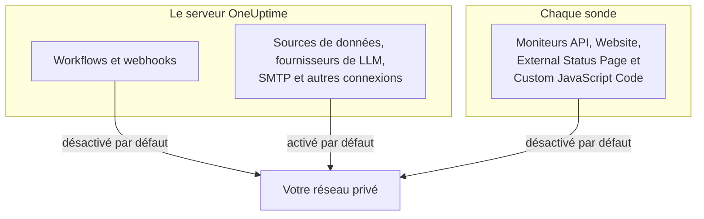

# Accès au réseau privé

OneUptime refuse d'envoyer certaines requêtes sortantes vers des hôtes qui se résolvent dans une plage privée, de loopback ou link-local. Si vous avez essayé de faire pointer un workflow vers un outil interne, vous avez vu ce message :

> Webhook URL resolves to a private, loopback, or link-local address and is not allowed

Ce comportement par défaut est le bon pour le produit hébergé, où n'importe qui peut s'inscrire et où la cible d'un webhook est une saisie non fiable. Sur une instance auto-hébergée, il gêne une chose ordinaire : envoyer une alerte à un Mattermost, un Jira ou un système de tickets auto-hébergé qui n'existe que sur votre propre réseau.

Cette page explique comment l'autoriser, délibérément et de façon restreinte. Trois interrupteurs en décident, chacun pour son type de connexion, et ils se configurent sur des machines différentes :

| Ce que vous voulez joindre en interne | Où se trouve le réglage | Par défaut sur une installation auto-hébergée |
| --- | --- | --- |
| Workflows, webhooks de projet, webhooks utilisateur d'astreinte | L'environnement du **serveur d'API** | Adresses privées refusées |
| Sources de données, fournisseurs de LLM, serveurs SMTP, découverte OIDC et autres connexions | L'environnement du **serveur d'API** | Adresses privées autorisées |
| **Moniteurs** API, Website, External Status Page et Custom JavaScript Code | L'environnement propre de la **sonde** | Adresses privées refusées |



Les types de moniteurs natifs du réseau, comme Ping, Port, Certificat SSL, DNS, DNSSEC, SNMP / Équipement réseau, Requête SQL, Santé de base de données, Synthetic et Network Path, utilisent leurs propres transports. Le réglage de cette page régit les transports HTTP qui renvoient un contenu de réponse arbitraire à un projet : les moniteurs API, Website, External Status Page et Custom JavaScript Code.

:::cards
- [Webhooks et workflows](#webhooks-et-workflows): Autoriser un webhook à publier dans votre réseau.
- [Autres connexions sortantes](#autres-connexions-sortantes): Sources de données, fournisseurs de LLM et serveurs de messagerie.
- [Sondes et moniteurs](#sondes-et-moniteurs): Laisser une sonde vérifier des sites privés.
- [Vérifier que cela fonctionne](#vérifier-que-cela-fonctionne): Lire quel interrupteur nomme un refus.
:::

## Ce qui est bloqué, et ce qui peut être débloqué

Les cibles bloquées se répartissent en deux niveaux.

| Niveau | Plages | Peut-on l'autoriser ? |
| --- | --- | --- |
| **Privé** | RFC-1918 (`10.0.0.0/8`, `172.16.0.0/12`, `192.168.0.0/16`), CGNAT (`100.64.0.0/10`), IPv6 unique-local (`fc00::/7`) et site-local (`fec0::/10`) | Oui |
| **Interdit** | Loopback (`127.0.0.0/8`, `::1`), l'adresse non spécifiée, link-local (`169.254.0.0/16`, `fe80::/10`), multicast, réservé, broadcast, et les noms `localhost` et `metadata.google.internal` | Seulement en nommant l'hôte ou le CIDR exact dans la liste d'autorisation des webhooks. Jamais pour les moniteurs. |

Le point de terminaison des métadonnées cloud `169.254.169.254` se trouve dans le niveau interdit pour une raison. Sur une VM cloud, il distribue les identifiants IAM de l'instance à tout ce qui peut faire une requête HTTP depuis la machine ; aucun réglage global ne l'ouvrira donc jamais.

Les écritures IPv6 qui portent une cible IPv4 – IPv4-mapped (`::ffff:10.0.0.5`), NAT64, 6to4, Teredo – sont classées selon l'adresse IPv4 qu'elles atteignent ; elles ne peuvent donc pas servir à faire passer une adresse interdite derrière une autorisation du niveau privé.

## Webhooks et workflows

Ces destinations sont couvertes, car la cible est une URL écrite par un membre authentifié de votre projet :

- Les composants **API** des workflows (GET / POST / PUT / PATCH / DELETE)
- Les requêtes HTTP faites par le composant de workflow **Custom JavaScript**
- Les notifications par webhook de projet (incidents, alertes, moniteurs, astreinte, maintenance planifiée, événements de page de statut)
- Les **webhooks utilisateur** d'astreinte

**Non** couverts, et ils ne le seront jamais : les **webhooks des abonnés aux pages de statut**. N'importe quel visiteur d'une page de statut publique peut en enregistrer un ; assouplir cette destination permettrait à n'importe qui sur Internet de faire envoyer par votre serveur des POST dans votre réseau privé. Ce n'est pas configurable.

Les connexions sortantes qui ne sont pas des webhooks – sources de données externes, fournisseurs de LLM, serveurs SMTP (les paramètres SMTP d'un projet et le composant de workflow **Email**), points de terminaison de jetons OAuth SMTP, découverte OIDC et étapes HTTP des runbooks – sont régies séparément, par `DATA_SOURCE_BLOCK_PRIVATE_ADDRESSES`, et autorisent déjà les plages privées sur les installations auto-hébergées. Voir [Autres connexions sortantes](#autres-connexions-sortantes).

### Configurer le serveur d'API

Définissez l'une de ces variables, ou les deux, sur le serveur d'API puis redémarrez-le. Elles sont désactivées par défaut : une instance qui ne définit ni l'une ni l'autre se comporte exactement comme avant.

| Variable | Valeur Helm | Ce qu'elle autorise |
| --- | --- | --- |
| `ALLOW_PRIVATE_NETWORK_WEBHOOKS` | `webhooks.allowPrivateNetwork` | Tout le niveau privé, lorsqu'elle vaut `true`. |
| `PRIVATE_NETWORK_WEBHOOK_ALLOWLIST` | `webhooks.privateNetworkAllowlist` | Les hôtes et CIDR qu'elle nomme, quel que soit leur niveau. |

:::tabs
@tab Docker Compose
```bash title="config.env"
ALLOW_PRIVATE_NETWORK_WEBHOOKS=true
PRIVATE_NETWORK_WEBHOOK_ALLOWLIST=mattermost.internal,*.svc.cluster.local,10.20.0.0/16
```
@tab Kubernetes
```yaml title="values.yaml"
webhooks:
  allowPrivateNetwork: true
  privateNetworkAllowlist: "mattermost.internal,10.20.0.0/16"
```
:::

Sous Docker Compose, `config.env` contient une ligne `ALLOW_PRIVATE_NETWORK_WEBHOOKS=false` : modifiez-la plutôt que d'en ajouter une seconde, puis exécutez `npm run start`. Sous Kubernetes, mettez à niveau la release.

Les entrées de la liste d'autorisation peuvent être séparées par des virgules, des espaces ou des retours à la ligne, et chacune peut être :

- un nom d'hôte – `mattermost.internal`
- un joker – `*.svc.cluster.local` (correspond aux sous-domaines, pas au suffixe seul)
- une adresse IPv4 ou IPv6 – `10.20.30.40`, `fd00::1`
- un CIDR – `10.20.0.0/16`, `fd12:3456::/32`

Le schéma, le port, le chemin ou les informations utilisateur d'une entrée sont retirés ; coller l'URL de webhook que vous avez déjà fonctionne donc.

Un nom d'hôte nommé dans la liste d'autorisation est approuvé **sans vérification DNS** – c'est tout l'intérêt de le nommer, puisqu'on s'attend à ce qu'il se résolve vers une adresse que la liste de blocage refuserait. Une entrée d'adresse est comparée au littéral de l'URL et à chaque adresse que le DNS renvoie pour elle.

> [!CAUTION]
> **Ne mettez jamais `169.254.169.254`, ni aucune plage qui la contient, dans la liste d'autorisation.** Sur une VM cloud, cela donne à chaque membre de projet les identifiants IAM de votre instance.

## Autres connexions sortantes

Une seconde protection couvre les connexions sortantes dont un membre de projet choisit la cible mais qui ne sont pas des webhooks :

- les sources de données externes (connexions PostgreSQL, MySQL, SQL Server, ClickHouse, Elasticsearch et API REST), les connexions d'événements de sécurité comme Splunk, et les flux de threat intel
- les fournisseurs de LLM, y compris un Ollama ou un vLLM auto-hébergé
- les serveurs SMTP – les paramètres SMTP d'un projet et le composant de workflow **Email** – ainsi que les URL de jetons OAuth SMTP et de workflow
- la découverte OIDC pour l'authentification unique
- la vérification des domaines personnalisés des pages de statut et des tableaux de bord
- les étapes HTTP des runbooks
- l'URL de l'API Grafana OnCall depuis laquelle lit une importation (**Paramètres du projet** > **Basique** > **Importer depuis un autre outil**)

Cette protection fonctionne à l'inverse des réglages de webhooks. Sur une installation auto-hébergée, elle **autorise** le niveau privé par défaut, car la base de données, le serveur de messagerie ou le serveur de modèles auxquels se connectent ces connexions se trouvent généralement sur votre propre réseau. Le niveau interdit – loopback, link-local et le point de terminaison des métadonnées cloud – est refusé dans tous les cas, et il n'existe pas de liste d'autorisation pour lui.

`DATA_SOURCE_BLOCK_PRIVATE_ADDRESSES` la durcit. Donnez-lui la valeur `true` pour refuser aussi le niveau privé à ces connexions, par exemple quand les projets de votre instance appartiennent à des personnes qui ne devraient pas atteindre votre réseau interne :

:::tabs
@tab Docker Compose
```bash title="config.env"
DATA_SOURCE_BLOCK_PRIVATE_ADDRESSES=true
```
@tab Kubernetes
```yaml title="values.yaml"
outboundConnections:
  blockPrivateNetwork: true
```
:::

Ce réglage ne s'applique pas à un fournisseur de LLM global, qu'un administrateur configure plutôt qu'un projet (avec les variables `GLOBAL_LLM_PROVIDER_*`, la valeur `vllm.globalProvider` du chart Helm, ou dans le Tableau de bord admin sous **Paramètres** > **Fournisseurs LLM globaux**) : un tel fournisseur peut toujours joindre des adresses privées, même si loopback et link-local lui restent refusés à lui aussi.

Seule la valeur exacte `true` l'active. Sur une instance avec `BILLING_ENABLED=true`, il est toujours activé, quoi que vous définissiez. Il ne change pas les cibles qu'autorisent les réglages de webhooks ci-dessus ou le réglage des sondes ci-dessous ; chaque barrière se configure séparément. Il change en revanche la formulation des refus, y compris pour les webhooks et les requêtes de workflow : s'il est activé, un nom d'hôte refusé est signalé sans dire vers quoi il s'est résolu (voir [Vérifier que cela fonctionne](#vérifier-que-cela-fonctionne)).

Sous Docker Compose, `config.env` contient une ligne `DATA_SOURCE_BLOCK_PRIVATE_ADDRESSES=false` (ajoutez-la si votre `config.env` est plus ancien). Passez cette ligne à `true` plutôt que d'en ajouter une seconde, puis exécutez `npm run start` pour que les conteneurs soient recréés avec la nouvelle valeur ; `docker compose restart` ne relit pas `config.env`. Sous Kubernetes, définissez-le dans votre fichier de valeurs et mettez à niveau la release ; le chart le transmet aux pods de l'application et du worker.

S'il est activé, un nom d'hôte refusé est signalé sans dire vers quoi il s'est résolu, par exemple _"LLM provider host ollama.internal could not be reached."_ Un nom qui ne se résout pas du tout reçoit le même message, pour que les membres du projet ne puissent pas utiliser ces champs pour découvrir quels noms internes existent. Une adresse saisie sous forme d'IP est toujours nommée avec la raison, par exemple _"LLM provider host 10.0.4.12 is not allowed: private network address."_ Avec `LOG_LEVEL=DEBUG`, l'application journalise l'adresse vers laquelle chaque nom refusé s'est résolu.

## Sondes et moniteurs

Quatre types de moniteurs sont concernés : **API**, **Site web**, **Page de statut externe** et **Custom JavaScript Code**. Sur une sonde standard, ils peuvent joindre des cibles HTTP(S) publiques, mais refusent l'espace d'adresses privé. Les moniteurs API, Website et External Status Page valident et figent les résultats DNS pour chaque connexion et revalident chaque redirection ; Custom JavaScript Code applique la même politique d'adresses dans le pont de son bac à sable.

L'interrupteur est lu par le **processus de la sonde dans son propre environnement**, pas dans celui du serveur d'API, et chaque sonde le lit : celles fournies avec Docker Compose, celles que déploie le chart Helm, et toute [sonde personnalisée](/docs/probe/custom-probe) que vous exécutez vous-même. Celui qui déploie une sonde contrôle son environnement, et c'est lui qui sait quel réseau cette sonde peut voir – une sonde personnalisée est généralement une autre machine, souvent gérée par une autre personne, et elle ne lit jamais la configuration du serveur d'API.

:::tabs
@tab Docker Compose
`config.env` contient déjà une ligne `PROBE_ALLOW_PRIVATE_NETWORK_MONITORS=false` : passez cette ligne à `true` plutôt que d'en ajouter une seconde, car lorsqu'une variable apparaît deux fois, c'est la dernière ligne qui l'emporte. Exécutez ensuite `npm run start`, qui recrée les conteneurs avec la nouvelle valeur ; `docker compose restart` ne relit pas `config.env`. Chaque sonde fournie lit cette même ligne, qui s'applique donc à `probe-1` et, si votre stack exécute une seconde sonde, à `probe-2`.

```bash title="config.env"
PROBE_ALLOW_PRIVATE_NETWORK_MONITORS=true
```
@tab Kubernetes
Définissez-le pour chaque sonde dans votre fichier de valeurs et mettez à niveau la release. Chaque entrée sous `probes:` est une sonde distincte ; définissez-le donc sur chacune de celles qui doivent joindre des adresses privées :

```yaml title="values.yaml"
probes:
  one:
    allowPrivateNetworkMonitors: true
```
:::

Sur une sonde personnalisée, définissez `PROBE_ALLOW_PRIVATE_NETWORK_MONITORS=true` dans l'environnement propre à cette sonde et redémarrez-la. La valeur doit être exactement `true` ; toute autre, comme `TRUE` ou `1`, laisse l'interrupteur désactivé, et la sonde le signale par un avertissement au démarrage, quelle que soit la valeur de `LOG_LEVEL`.

Les sondes fournies sont des **sondes globales** : elles s'enregistrent avec le `REGISTER_PROBE_KEY` de l'instance, et chaque projet de l'instance peut les sélectionner. Activer l'interrupteur sur une sonde fournie permet donc aux moniteurs de **chaque projet de l'instance** de joindre des adresses privées à travers elle. C'est généralement ce que souhaite une installation pour une seule équipe. Là où les projets ne doivent pas partager cette portée – équipes distinctes ou clients que vous hébergez –, laissez-le désactivé sur les sondes fournies et déployez plutôt une sonde privée (personnalisée) dans chaque réseau, activée uniquement là.

Il y a une exception. Une sonde qui s'enregistre avec `REGISTER_PROBE_KEY` et a `BILLING_ENABLED=true` dans son propre environnement – une sonde globale du produit hébergé à inscription ouverte, où n'importe qui peut s'inscrire et où tous les projets partagent les sondes globales – reste uniquement publique même avec l'interrupteur activé, et journalise au démarrage un avertissement indiquant qu'elle ne le prend pas en compte. Les sondes fournies avec Docker Compose et le chart Helm reçoivent automatiquement le `BILLING_ENABLED` de l'instance ; donnez-le à toute autre sonde `REGISTER_PROBE_KEY` que vous exécutez pour une telle instance. Une sonde ne peut pas savoir autrement qu'elle est globale : une sonde globale créée dans le Tableau de bord admin et exécutée avec `PROBE_ID` et `PROBE_KEY` respecte donc l'interrupteur comme une sonde privée. Ne l'activez pas là si les projets ne doivent pas partager le réseau de cette sonde. Une sonde privée respecte l'interrupteur sur n'importe quelle instance.

Chaque sonde journalise au démarrage sa politique effective de réseau privé : si la surveillance du réseau privé est activée ou désactivée, et pourquoi. Une valeur qui n'est pas prise en compte, et une sonde globale que l'interrupteur ouvre à tous les projets, sont journalisées comme avertissements à tout `LOG_LEVEL`. La ligne habituelle activé ou désactivé, et le JSON « Probe environment » qui consigne la même décision sous `privateNetworkMonitors`, sont journalisés à `LOG_LEVEL=INFO`, la valeur par défaut du chart Helm ; Docker Compose est livré avec `LOG_LEVEL=ERROR`, définissez donc `LOG_LEVEL=INFO` pour les y voir. Consultez d'abord ce journal lorsqu'un moniteur sur une sonde que vous venez de modifier est toujours refusé.

L'activer n'ouvre **pas** le loopback, le link-local ni le point de terminaison des métadonnées cloud. Ceux-ci restent refusés sur chaque sonde, ce qui compte surtout pour les sondes qui s'exécutent dans un réseau qui n'appartient pas à l'auteur du moniteur.

> [!WARNING]
> Laissez-le désactivé sur les sondes que vous exploitez pour le compte d'autres personnes.

## Vérifier que cela fonctionne

Relancez le workflow ou le moniteur. S'il est toujours refusé, le message d'erreur nomme la barrière qui est fermée :

- _"...points to a private network address and is not allowed. Self-hosted instances can allow this by setting `ALLOW_PRIVATE_NETWORK_WEBHOOKS`..."_ – le réglage du serveur d'API manque.
- _"...private network address... Set PROBE_ALLOW_PRIVATE_NETWORK_MONITORS=true on the probe running this monitor to allow it."_ – une sonde privée (personnalisée) a exécuté le moniteur, et son interrupteur est désactivé. Notez qu'il se règle sur la sonde, pas sur le serveur d'API.
- _"...private network address... Set PROBE_ALLOW_PRIVATE_NETWORK_MONITORS=true on the probe running this monitor to allow it (probes.<name>.allowPrivateNetworkMonitors in the Helm chart). This is a global probe, so that allows it for every project on this instance; otherwise, select a private probe deployed on that network."_ – une sonde fournie (globale) a exécuté le moniteur, et son interrupteur est désactivé. Activez-le pour cette sonde comme décrit ci-dessus si chaque projet de l'instance peut joindre ce réseau ; sinon, sélectionnez une sonde privée sur le moniteur.
- _"...Global probes cannot monitor private network addresses. Deploy and select a private probe for this target."_ – une sonde globale avec `BILLING_ENABLED=true` dans son environnement a exécuté le moniteur. Les sondes globales enregistrées automatiquement y restent uniquement publiques, quoi que dise leur interrupteur ; déployez une sonde privée dans le réseau de la cible et sélectionnez-la sur le moniteur.
- _"Monitor target host ... could not be reached."_ – un moniteur API, Website ou External Status Page dont la cible est un **nom d'hôte** le signale aussi bien quand le nom se résout vers une adresse refusée que quand le DNS échoue, pour qu'un moniteur ne puisse pas servir à cartographier les noms internes existants. Les détails d'erreur affichés avec lui mentionnent `PROBE_ALLOW_PRIVATE_NETWORK_MONITORS` dans les deux cas ; ils ne disent pas lequel s'est produit. Si le nom pointe vers une adresse privée, consultez dans le journal de démarrage de la sonde sa politique de réseau privé ; si elle est désactivée, la solution est la même que pour les messages ci-dessus. Avec `LOG_LEVEL=DEBUG`, la sonde journalise aussi la raison exacte de chaque nom refusé.
- _"Request URL could not be reached."_ – la même règle pour un moniteur **Custom JavaScript Code** : un script qui interroge un **nom d'hôte** obtient ce message aussi bien quand le nom se résout vers une adresse refusée que quand le DNS échoue. Avec `LOG_LEVEL=DEBUG`, la sonde journalise la raison exacte.
- _"Webhook URL could not be reached."_ ou, depuis un workflow, _"Request URL could not be reached."_ – l'instance tourne avec `DATA_SOURCE_BLOCK_PRIVATE_ADDRESSES=true` (ou `BILLING_ENABLED=true`), donc un **nom d'hôte** refusé n'est pas expliqué : il s'est soit résolu vers une adresse refusée, soit pas résolu du tout. Avec `LOG_LEVEL=DEBUG`, l'application ou le worker journalise lequel, ainsi que l'adresse.
- _"...points to a private, loopback, or link-local address and is not allowed."_ – la cible est dans le niveau interdit. Pour un webhook, nommez l'hôte ou le CIDR exact dans `PRIVATE_NETWORK_WEBHOOK_ALLOWLIST` si vous en avez vraiment besoin. Pour un moniteur, il n'y a pas de dérogation.
- _"...hostname could not be resolved via DNS."_ – le conteneur ne parvient pas à résoudre le nom. Vérifiez qu'il partage un réseau avec la cible.

## Notes de sécurité

Ouvrir cet accès change réellement ce que votre instance OneUptime peut être amenée à joindre ; mieux vaut donc le faire délibérément :

- **Préférez la liste d'autorisation à l'interrupteur global.** Nommer `mattermost.internal` est une autorisation bien plus restreinte qu'ouvrir toutes les adresses RFC-1918.
- **Quiconque peut créer un workflow ou un moniteur API, Website, External Status Page ou Custom JavaScript Code peut joindre tout ce que vous avez autorisé.** Traitez l'appartenance à ces projets en conséquence.
- **Le corps de la réponse revient.** Un composant API de workflow renvoie le statut, les en-têtes et le corps dans le journal du workflow ; un hôte autorisé est donc lisible, pas seulement accessible en écriture.
- **Les redirections ne sont jamais suivies** sur les requêtes de webhook ; un hôte public autorisé ne peut donc pas renvoyer le serveur vers un hôte interne lors d'un second saut.
- **Limitez par sonde plutôt qu'à l'échelle de l'instance quand c'est possible.** Une sonde déployée dans un réseau est une autorisation plus étroite que l'ouverture du trafic sortant du serveur d'API.

## Étapes suivantes

:::cards
- [Sondes personnalisées](/docs/probe/custom-probe): Exécuter une sonde dans le réseau qu'elle doit vérifier.
- [Configuration des workflows](/docs/workflows/configuration): Ce que les étapes de workflow peuvent joindre et faire.
- [Fournisseurs de LLM](/docs/ai/llm-provider): Connecter OneUptime AI à un modèle de votre réseau.
- [Architecture](/docs/self-hosted/architecture): Quelle partie d'une installation auto-hébergée établit chaque connexion.
:::
