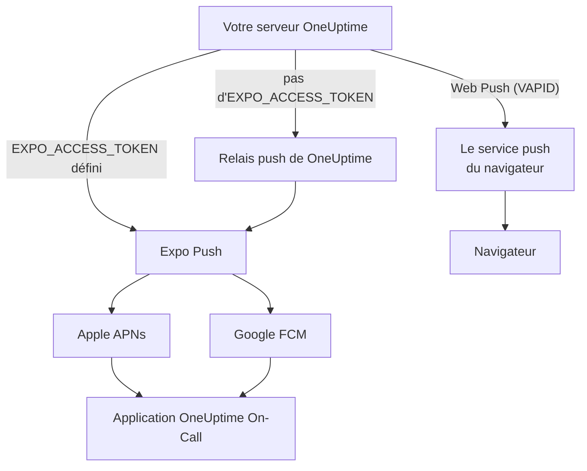

# Notifications push

OneUptime alerte les personnes sur leur téléphone via l'application mobile **OneUptime On-Call**, et dans leur navigateur via Web Push. Les push mobiles reposent sur **Expo Push** : une instance auto-hébergée les envoie par défaut via le relais push de OneUptime ; elle a donc besoin d'un accès réseau sortant vers le relais, et d'aucun identifiant Expo, Apple ou Google qui lui soit propre.

:::cards
- [Choisir comment les push sont envoyés](#configuration-auto-hébergée): Le relais push, ou votre propre jeton d'accès Expo.
- [Ouvrir le pare-feu](#accès-réseau): Les adresses que joignent votre serveur et les appareils de vos équipes.
- [Sonner malgré le mode silencieux](#alertes-dastreinte-critiques-outrepasser-le-mode-silencieux): Faire sonner les alertes d'astreinte sur un téléphone en sourdine.
- [Réparer les push qui n'arrivent jamais](#dépannage): Ce que signifie chaque erreur d'Expo.
:::

## Fonctionnement



L'application mobile OneUptime enregistre un jeton Expo Push auprès du backend. Le backend envoie les notifications via le relais push de OneUptime, ou directement à Expo lorsque `EXPO_ACCESS_TOKEN` est configuré. Expo transmet les messages à Apple APNs ou à Google FCM pour qu'ils soient livrés à l'appareil.

Les notifications Web Push continuent d'utiliser des clés VAPID et le protocole Web Push.

## Configuration auto-hébergée

Aucun identifiant Expo n'est nécessaire sur le serveur avec l'application mobile officielle et le relais par défaut. Pour une livraison directe par Expo, configurez `EXPO_ACCESS_TOKEN` avec des identifiants adaptés au projet Expo de votre application. Le Web Push nécessite `VAPID_PUBLIC_KEY`, `VAPID_PRIVATE_KEY` et `VAPID_SUBJECT`.

| Variable | Valeur Helm | Par défaut | Rôle |
| --- | --- | --- | --- |
| `PUSH_NOTIFICATION_RELAY_URL` | `pushNotification.relayUrl` | `https://oneuptime.com/api/notification/push-relay/send` | Où vont les push mobiles tant que `EXPO_ACCESS_TOKEN` n'est pas défini. |
| `EXPO_ACCESS_TOKEN` | `expo.accessToken` | Vide | Envoie les push mobiles directement à Expo, avec le jeton de votre projet Expo. |
| `VAPID_PUBLIC_KEY` | `vapid.publicKey` | Vide | La moitié publique de la paire de clés avec laquelle les navigateurs s'abonnent. |
| `VAPID_PRIVATE_KEY` | `vapid.privateKey` | Vide | La moitié privée, qui signe chaque Web Push. |
| `VAPID_SUBJECT` | `vapid.subject` | `mailto:support@oneuptime.com` | Une adresse de contact à laquelle les services push des navigateurs peuvent vous joindre. |

Générez une paire de clés VAPID une seule fois avec `npx web-push generate-vapid-keys`, et conservez-la : les navigateurs abonnés avec une paire de clés cessent de recevoir les push quand elle change.

:::tabs
@tab Docker Compose
```bash title="config.env"
VAPID_PUBLIC_KEY=your-public-key
VAPID_PRIVATE_KEY=your-private-key
VAPID_SUBJECT=mailto:oncall@example.com
# Leave unset to send mobile pushes through the push relay.
EXPO_ACCESS_TOKEN=
```
@tab Kubernetes
```yaml title="values.yaml"
vapid:
  publicKey: your-public-key
  privateKey: your-private-key
  subject: mailto:oncall@example.com
# Leave empty to send mobile pushes through the push relay.
expo:
  accessToken:
```
:::

## Accès réseau

| Sens | Destination | Protocole / port | Quand c'est nécessaire |
| --- | --- | --- | --- |
| OneUptime → relais push par défaut | `https://oneuptime.com/api/notification/push-relay/send`, `https://oneuptime.com/api/notification/push-relay/receipts` | HTTPS / TCP 443 | Push mobile lorsque `EXPO_ACCESS_TOKEN` n'est pas défini. |
| OneUptime → Expo | `https://exp.host/--/api/v2/push/send`, `https://exp.host/--/api/v2/push/getReceipts` | HTTPS / TCP 443 | Push mobile direct lorsque `EXPO_ACCESS_TOKEN` est défini. |
| OneUptime → service push du navigateur | Le point de terminaison HTTPS enregistré dans l'abonnement push du navigateur | HTTPS / normalement TCP 443 | Web Push. |
| Application mobile ou navigateur → OneUptime | Votre nom d'hôte OneUptime | HTTPS / TCP 443 | Se connecter, enregistrer l'appareil et ouvrir les liens des notifications. |

Si vous modifiez `PUSH_NOTIFICATION_RELAY_URL`, autorisez son nom d'hôte de destination et le port configuré. Un relais personnalisé doit implémenter l'API de relais de OneUptime. Ces valeurs par défaut et le basculement entre relais et livraison directe sont définis dans [la configuration de OneUptime](https://github.com/OneUptime/oneuptime/blob/master/config.example.env) et dans [le service push](https://github.com/OneUptime/oneuptime/blob/master/packages/Common/Server/Services/PushNotificationService.ts). Les requêtes directes à Expo utilisent le point de terminaison documenté dans [le guide d'envoi d'Expo](https://docs.expo.dev/push-notifications/sending-notifications/). OneUptime lit les accusés de livraison auprès du relais à la même adresse, avec `/receipts` à la place de `/send`. Un relais sans cette route livre quand même les push ; un appareil dont l'application a été supprimée n'est alors repéré que lorsqu'un push ultérieur vers lui est refusé.

Pour le Web Push, autorisez les hôtes réels des points de terminaison d'abonnement des navigateurs qu'utilise votre équipe. OneUptime accepte `fcm.googleapis.com`, `android.googleapis.com`, `push.services.mozilla.com`, `notify.windows.com` et `push.apple.com`, y compris leurs sous-domaines. Des exemples typiques sont `updates.push.services.mozilla.com` et `web.push.apple.com`. L'[abonnement push du navigateur](https://developer.mozilla.org/en-US/docs/Web/API/PushSubscription) fournit la destination ; n'autoriser qu'Expo ou le relais de OneUptime ne permet pas le Web Push.

Autorisez la résolution DNS et le TLS sortant depuis le processus OneUptime qui envoie les notifications. Son magasin de confiance doit valider le certificat de la destination, et les proxys doivent laisser passer les requêtes d'API sans authentification interactive. Les fournisseurs de push n'appellent aucun webhook sur votre serveur OneUptime : le serveur peut donc rester privé si les appareils des utilisateurs y accèdent par un VPN ou une autre connexion privée. Un serveur sans accès à son relais ni aux services push externes ne peut pas livrer ces notifications.

La connectivité des appareils est une exigence distincte. Les appareils iOS ont besoin d'accéder à APNs, généralement en TCP 5223 avec repli sur TCP 443 ; consultez [les exigences réseau actuelles d'Apple](https://support.apple.com/en-us/102266) pour les plages de destination. Les appareils Android ont besoin d'accéder à FCM en TCP 5228–5230 et 443 ; utilisez [les recommandations actuelles de Google sur les hôtes et les pare-feu](https://firebase.google.com/docs/cloud-messaging/network-configuration). Ces ports des appareils n'ont pas besoin d'être ouverts en entrée sur OneUptime, et le flux côté serveur utilise le relais ou Expo au lieu de se connecter directement à APNs/FCM.

:::steps
1. Vérifiez le DNS et le HTTPS depuis le conteneur ou le pod qui envoie les notifications vers la destination de votre mode de livraison : le relais, Expo ou le service push d'un navigateur.
2. Envoyez un test depuis **Paramètres utilisateur > Méthodes de notification > Push Notifications** avec **Notification de test**, et confirmez qu'il arrive sur un appareil enregistré. Pour le Web Push, testez chaque navigateur séparément.
3. Cherchez les erreurs du relais, d'Expo ou du Web Push dans les logs de OneUptime ; un envoi réussi à l'API ne confirme pas à lui seul la livraison sur l'appareil.
:::

Pour les push mobiles, OneUptime lit aussi l'accusé de livraison d'Expo environ 15 minutes après chaque push : un push qui n'a jamais atteint l'appareil apparaît alors comme non livré dans le journal des push et, pour une alerte d'astreinte, sur la chronologie d'astreinte.

## Alertes d'astreinte critiques (outrepasser le mode silencieux)

Par défaut, une notification push obéit au téléphone : un téléphone en silencieux reste silencieux, et Ne pas déranger retient la notification. Pour une personne d'astreinte, c'est le mauvais comportement à 3 h du matin ; l'application mobile propose donc un réglage par appareil – **Settings > Notifications > Critical On-Call Alerts** – qui permet aux *alertes d'astreinte seulement* de faire du son malgré les deux.

La portée est volontairement étroite. Seules les alertes produites par une règle de notification d'astreinte sont concernées. Les notifications aux propriétaires, les avis de nouvelle note, les mises à jour de changement d'état et les notifications de moniteur ne sont jamais escaladées, quoi que dise ce réglage.

```mermaid title="Quand une alerte d'astreinte sonne malgré le mode silencieux"
flowchart TB
    Page["Une alerte d'astreinte"]
    Device{"Critical On-Call Alerts<br/>activé pour cet appareil ?"}
    OS{"Le système du téléphone<br/>autorise les alertes critiques ?"}
    Loud["Joue un son malgré le<br/>mode silencieux et Ne pas déranger"]
    Quiet["Livrée en silence,<br/>comme tout autre push"]
    Page --> Device
    Device -->|"oui"| OS
    Device -->|"non"| Quiet
    OS -->|"oui"| Loud
    OS -->|"non"| Quiet
```

Trois conditions doivent toutes être remplies pour qu'une alerte outrepasse le mode silencieux. S'il en manque une, l'alerte est quand même livrée – simplement en silence.

1. **La personne l'a activé pour cet appareil.** Enregistré par appareil, désactivé par défaut, dans `UserPush.isCriticalAlertEnabled`. Le téléphone et la tablette d'une même personne sont des décisions distinctes.
2. **Le serveur marque l'alerte comme critique.** Il envoie la charge utile de son critique d'APNs plus `interruptionLevel: critical` pour iOS, et cible le canal de notification `oncall_critical` pour Android.
3. **Le système d'exploitation l'autorise**, et c'est là que les deux plateformes diffèrent.

:::tabs
@tab iOS
Les alertes critiques sur iOS nécessitent l'entitlement `com.apple.developer.usernotifications.critical-alerts`, qu'Apple accorde par compte développeur, sur demande, aux applications qui avertissent les gens d'événements urgents. Demandez-le via [le formulaire de demande Critical Alerts d'Apple](https://developer.apple.com/contact/request/notifications-critical-alerts-entitlement/).

L'application officielle **OneUptime On-Call** de l'App Store possède l'entitlement à partir de la **version 1.5.0**. Les versions antérieures ne l'ont pas, et iOS ne leur propose jamais les alertes critiques : mettez donc l'application à jour avant d'activer le réglage.

Si vous compilez l'application vous-même, l'entitlement est facultatif. Un profil de provisionnement ne peut pas porter un entitlement qui n'a pas été accordé à l'équipe, et une compilation qui en déclare un qu'elle ne peut pas porter **échoue à la signature**. Seul le profil `production` de `packages/MobileApp/eas.json` l'active, car Apple l'a accordé à l'équipe qui publie l'application officielle. Un fork qui signe avec sa propre équipe Apple doit supprimer cette entrée `env` jusqu'à ce qu'Apple accorde aussi l'entitlement à cette équipe. Ensuite, activez-le à la compilation :

```bash
EXPO_IOS_CRITICAL_ALERTS_ENTITLEMENT=true npx expo prebuild
```

ou ajoutez `EXPO_IOS_CRITICAL_ALERTS_ENTITLEMENT: "true"` au bloc `env` du profil de compilation dans `packages/MobileApp/eas.json`.

Sur l'appareil, activez **Settings > Notifications > Critical On-Call Alerts** dans l'application, et autorisez les alertes critiques quand iOS le demande. iOS n'ajoute un interrupteur **Critical Alerts** pour l'application, sous **Settings > Notifications > OneUptime On-Call** dans les réglages iOS, qu'après que l'application a demandé l'autorisation : cet interrupteur n'existe donc pas avant que vous activiez le réglage dans l'application. Si vous refusez la demande, vous pourrez autoriser les alertes critiques plus tard avec cet interrupteur dans les réglages iOS.

Sur une compilation sans l'entitlement, iOS n'affiche ni demande ni interrupteur, et l'écran de réglages de l'application indique que cette version de l'application ne peut pas recevoir d'alertes critiques. Elle n'envoie pas la personne chercher un interrupteur qu'iOS n'affiche pas.
@tab Android
Android n'a pas d'étape d'approbation par le fabricant, mais le contournement de Ne pas déranger est accordé par l'utilisateur sur un écran système plutôt que par une demande dans l'application. Quand une personne active le réglage, l'application lui ouvre **Settings > Notifications > Do Not Disturb access** et vérifie à nouveau à son retour.

Deux mécanismes interviennent, et ils couvrent des cas différents :

- Le canal de notification `oncall_critical` demande `bypassDnd`, ce qui couvre Ne pas déranger et nécessite l'accès décrit ci-dessus.
- Le même canal utilise le flux audio **alarme**, audible sur un téléphone dont la sonnerie est simplement coupée. Cette moitié ne nécessite aucune autorisation.

Android fige les réglages d'un canal à sa première création : ils ne peuvent donc pas être modifiés par une mise à jour de l'application – seulement en livrant un nouvel identifiant de canal.
:::

Pour vérifier que cela fonctionne, envoyez une notification de test à l'appareil depuis **Paramètres utilisateur > Méthodes de notification > Push Notifications**. Si l'appareil a les alertes critiques activées, le test est lui aussi envoyé comme alerte critique – mettez donc d'abord le téléphone en silencieux, et vous entendrez si une vraie alerte vous atteindrait.

## Dépannage

### Les notifications push n'arrivent pas

- Assurez-vous que l'application mobile a été compilée avec EAS Build (Expo Go ne prend pas en charge les notifications push)
- Vérifiez que l'appareil est enregistré dans la table `UserPush` de votre base de données
- Cherchez les erreurs de l'API Expo Push dans les logs du serveur OneUptime
- Confirmez que l'appareil a une connexion Internet active et que les notifications sont autorisées
- Consultez **Paramètres utilisateur > Méthodes de notification > Push Notifications** : un appareil marqué **Ne reçoit pas de notifications** a cessé de les recevoir et doit être réenregistré (voir ci-dessous)

### Pas d'interrupteur Critical Alerts dans les réglages iOS

- Mettez à jour OneUptime On-Call depuis l'App Store. Les versions antérieures à 1.5.0 ont été compilées sans l'entitlement d'alertes critiques d'Apple, et iOS n'affiche aucun interrupteur Critical Alerts pour elles
- Activez **Settings > Notifications > Critical On-Call Alerts** dans l'application. iOS n'ajoute l'interrupteur à ses propres réglages qu'après que l'application a demandé l'autorisation, et l'application la demande quand ce réglage est activé
- Supprimer puis rajouter des règles de notification d'astreinte ou des appareils push n'y change rien. Le réglage appartient à l'application sur l'appareil, pas à une règle

### Les alertes critiques n'outrepassent pas le mode silencieux

- Vérifiez que l'interrupteur est activé pour **cet** appareil – le réglage est propre à chaque appareil, et une réinstallation ou un nouveau téléphone configuré de zéro crée un nouvel enregistrement d'appareil (un téléphone configuré à partir d'une sauvegarde de l'ancien reprend l'enregistrement de l'ancien téléphone dès que celui-ci ne reçoit plus de notifications, avec le réglage qu'avait l'application)
- **iOS** : confirmez que la compilation porte l'entitlement d'alertes critiques d'Apple (voir ci-dessus), et que Critical Alerts est autorisé sous iOS Settings > Notifications > OneUptime On-Call
- **Android** : confirmez que l'application a l'accès à Ne pas déranger sous Settings > Notifications > Do Not Disturb access
- L'écran de réglages indique lequel de ces éléments manque ; il relit l'état actuel auprès du système plutôt que de se fier à ce que l'application a demandé en dernier

### Push marqués « non livrés »

Qu'Expo accepte un push ne signifie pas qu'il a atteint l'appareil : Apple ou Google peuvent encore le refuser. OneUptime lit l'accusé de livraison de chaque push mobile environ 15 minutes après l'envoi, via le relais push lorsque `EXPO_ACCESS_TOKEN` n'est pas défini. Quand l'accusé signale une erreur, le journal des push et la chronologie d'astreinte de l'alerte passent de envoyé à **Push notification not delivered**, avec le code d'erreur d'Expo :

- `DeviceNotRegistered` : l'application mobile a été supprimée de l'appareil, ou son jeton push n'est plus valide. Voir la section suivante.
- `MessageRateExceeded` : trop de notifications ont été envoyées à l'appareil en peu de temps. Les push suivants vers lui sont envoyés normalement.
- `MessageTooBig` : la notification dépassait la taille acceptée par les services push. OneUptime raccourcit les notifications pour qu'elles tiennent, cela ne devrait donc pas arriver ; signalez-le si c'est le cas.
- `InvalidCredentials` ou `MismatchSenderId` : les identifiants push du projet Expo qui a envoyé le push ne sont pas valides. Avec `EXPO_ACCESS_TOKEN`, vérifiez les identifiants push de votre projet Expo ; avec le relais par défaut, contactez le support de OneUptime.

Quand Expo refuse un push d'emblée, le journal des push en donne la raison immédiatement. Via le relais push aussi : le relais transmet le code d'erreur d'Expo au lieu de répondre par une erreur serveur.

### Erreurs « DeviceNotRegistered » dans les logs

Expo signale `DeviceNotRegistered` lorsque l'application mobile a été supprimée de l'appareil ou que le jeton push de l'appareil n'est plus valide. Il l'indique généralement dans l'accusé de livraison d'un push, que OneUptime lit environ 15 minutes après le push, et refuse parfois le push d'emblée. Dans les deux cas, OneUptime cesse d'envoyer à cet appareil. Il est marqué comme ne recevant plus de notifications plutôt que supprimé, ses règles de notification restent donc, et le journal des push et la chronologie d'astreinte de l'alerte qui n'est pas arrivée en donnent la raison. **Paramètres utilisateur > Méthodes de notification > Push Notifications** l'affiche comme **Ne reçoit pas de notifications**. Les autres appareils et méthodes de notification de son propriétaire sont toujours alertés.

Pour récupérer l'appareil, ouvrez-y l'application mobile en étant connecté. L'application se réenregistre, ce qui renouvelle son jeton push auprès d'Expo, et l'appareil reçoit de nouveau les notifications avec ses règles. Si l'application a été supprimée, réinstallez-la et connectez-vous. Un accusé pour un push envoyé avant le réenregistrement de l'application ne marque pas l'appareil. Quand une application mobile à jour est configurée sur un nouveau téléphone à partir d'une sauvegarde de l'ancien, elle communique à OneUptime le jeton push qu'elle avait auparavant ; si l'appareil de l'ancien téléphone ne reçoit plus de notifications, le nouveau téléphone le reprend avec ses règles.

Via le relais push (sans `EXPO_ACCESS_TOKEN`), cela fonctionne de la même façon : le relais signale `DeviceNotRegistered` lorsqu'il envoie un push, et lit les accusés de livraison que votre instance lui demande.

Si rien de tout cela n'aide, écrivez-nous à [hello@oneuptime.com](mailto:hello@oneuptime.com) avec les erreurs de vos logs OneUptime.

## Étapes suivantes

:::cards
- [Applications mobiles](/docs/mobile-desktop-apps/index): Installer l'application OneUptime On-Call et se connecter.
- [Dépannage de l'application mobile](/docs/mobile-desktop-apps/faq-troubleshooting): Résoudre les problèmes de connexion et de notification sur le téléphone.
- [Règles d'escalade](/docs/on-call/escalation-rules): Décider qui est alerté, et quand.
- [Accès au réseau privé](/docs/self-hosted/private-network-access): Ce que votre serveur peut joindre sur votre propre réseau.
:::
