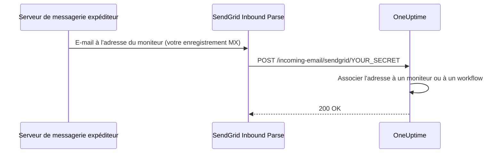

# E-mail entrant SendGrid

Le **Incoming Email Monitor** de OneUptime vous permet de créer et de résoudre des alertes à partir d'e-mails envoyés à des adresses uniques, propres à chaque moniteur. C'est utile pour intégrer des systèmes anciens, des outils d'alerte ou tout service capable d'envoyer des e-mails.

La même configuration permet aussi aux workflows de recevoir des e-mails : un workflow doté du déclencheur **Incoming Email** reçoit sa propre adresse sur le même domaine, et chaque e-mail qui lui est envoyé démarre le workflow. Voir [Déclencheurs](/docs/workflows/triggers#incoming-email).

Ce guide explique comment configurer SendGrid Inbound Parse pour transférer les e-mails entrants vers votre instance OneUptime auto-hébergée. OneUptime Cloud n'en a pas besoin : ses adresses fonctionnent d'emblée.

:::cards
- [Avant de commencer](#prérequis): Un compte SendGrid, un domaine et une adresse HTTPS publique.
- [Configuration](#instructions-de-configuration): Sept étapes, de l'enregistrement MX à un e-mail de test.
- [Variables d'environnement](#référence-des-variables-denvironnement): Les trois paramètres et leurs valeurs par défaut.
- [Dépannage](#dépannage): Les e-mails qui n'arrivent jamais et les webhooks qui échouent.
:::

## Fonctionnement



1. Vous créez un **Incoming Email Monitor** dans OneUptime
2. OneUptime génère une adresse e-mail unique pour ce moniteur (par ex. `monitor-abc123@inbound.yourdomain.com`)
3. Lorsqu'un e-mail est envoyé à cette adresse, SendGrid le reçoit et le transfère à OneUptime par webhook
4. OneUptime évalue l'e-mail selon les critères que vous avez configurés pour créer ou résoudre des alertes

## Prérequis

- Un compte SendGrid avec accès à Inbound Parse
- Un domaine que vous contrôlez, avec accès à ses paramètres DNS
- Un point de terminaison HTTPS public qui transfère les webhooks de SendGrid vers votre instance OneUptime

## Accès réseau

Avec Inbound Parse, c'est SendGrid qui ouvre une connexion vers OneUptime. Autoriser seulement l'accès sortant à Internet depuis OneUptime ne suffit pas.

| Sens | Destination | Protocole / port | Rôle |
| --- | --- | --- | --- |
| SendGrid → OneUptime | `https://your-oneuptime-domain.com/incoming-email/sendgrid/YOUR_SECRET` | HTTPS / TCP 443 | Livrer l'e-mail analysé sous forme de POST multipart. |
| Serveurs de messagerie expéditeurs → SendGrid | `mx.sendgrid.net`, choisi par l'enregistrement MX public de votre domaine entrant | SMTP / TCP 25 | Recevoir l'e-mail chez SendGrid ; cette connexion ne va pas vers votre serveur OneUptime. |
| OneUptime → SendGrid, seulement si l'envoi d'e-mails par le fournisseur SendGrid est configuré séparément | `api.sendgrid.com` | HTTPS / TCP 443 | Envoyer les e-mails de notification par l'API Mail Send. |

Publiez le DNS du nom d'hôte du webhook et servez un certificat reconnu par les clients publics. Un déploiement OneUptime privé peut n'exposer que le chemin du webhook, via un reverse proxy ou une passerelle publics capables de joindre OneUptime en interne. Conservez le chemin, le secret, le type de contenu et le corps multipart de la requête, et laissez passer le POST sans connexion interactive ni défi de navigateur. Le serveur OneUptime n'a pas besoin d'écouter en SMTP entrant. Voir [la configuration d'Inbound Parse chez SendGrid](https://www.twilio.com/docs/sendgrid/for-developers/parsing-email/setting-up-the-inbound-parse-webhook).

Donnez à `INBOUND_EMAIL_WEBHOOK_SECRET` une valeur aléatoire robuste et remplacez `YOUR_SECRET` dans l'URL par cette valeur. La route exige le dernier segment du chemin. OneUptime vérifie sa valeur quand le secret est configuré ; laisser la variable vide désactive cette vérification. Gardez confidentielles l'URL complète et les adresses e-mail des moniteurs, y compris dans les logs des proxys. OneUptime ne valide pas actuellement les en-têtes Inbound Parse signés de SendGrid ni les jetons OAuth. Si vous avez besoin de ces mécanismes, configurez une passerelle qui les valide avant de transférer à OneUptime, en suivant [la documentation de SendGrid sur la sécurité des webhooks](https://www.twilio.com/docs/sendgrid/for-developers/parsing-email/securing-your-parse-webhooks).

SendGrid ne fournit pas de liste fiable d'adresses IP sources statiques pour Inbound Parse. Ses adresses IP d'envoi d'e-mails et les adresses résolues pour `mx.sendgrid.net` ne constituent pas une liste d'autorisation pour les webhooks. Suivez [les recommandations de SendGrid sur les pare-feu](https://support.sendgrid.com/hc/en-us/articles/44375457225371-How-to-Configure-Firewall-Settings-for-SendGrid-Webhook-and-Inbound-Parse-IPs) au lieu de figer un résultat DNS actuel.

Inbound Parse est distinct de l'envoi d'e-mails sortants. Recevoir les e-mails des moniteurs n'oblige pas OneUptime à appeler l'API SendGrid. Si vous choisissez aussi SendGrid pour envoyer les notifications, autorisez la résolution DNS et le HTTPS sortant vers `api.sendgrid.com` ; [Mail Send](https://www.twilio.com/docs/sendgrid/api-reference/mail-send/mail-send) n'a besoin d'aucun rappel entrant pour l'envoi. Si vous utilisez SMTP à la place, autorisez le serveur et le port SMTP configurés dans OneUptime.

## Instructions de configuration

:::steps
### Choisir votre domaine de réception

Choisissez un sous-domaine dédié à la réception des e-mails pour OneUptime, comme `inbound.yourdomain.com`, `email.yourdomain.com` ou `monitor.yourdomain.com`. Il ne sert qu'aux e-mails destinés aux moniteurs et workflows OneUptime : aucune de vos boîtes aux lettres n'y vit.

### Faire pointer son enregistrement MX vers SendGrid

Ajoutez un enregistrement MX qui achemine les e-mails du sous-domaine vers SendGrid :

| Type | Hôte/Nom | Priorité | Valeur |
| --- | --- | --- | --- |
| MX | inbound | 10 | mx.sendgrid.net |

Si votre domaine est `example.com` et que vous utilisez `inbound.example.com`, l'enregistrement s'écrit :

```text
inbound.example.com.  IN  MX  10  mx.sendgrid.net.
```

La propagation des changements DNS peut prendre jusqu'à 48 heures, mais se termine généralement en quelques heures.

### Authentifier le domaine dans SendGrid

Le domaine de réception doit appartenir à l'un de vos [domaines authentifiés dans SendGrid](https://www.twilio.com/docs/sendgrid/ui/account-and-settings/inbound-parse). Dans le [tableau de bord SendGrid](https://app.sendgrid.com), allez dans **Settings** > **Sender Authentication**, cliquez sur **Authenticate Your Domain** et ajoutez les enregistrements DNS demandés (des enregistrements CNAME pour DKIM).

### Ajouter le webhook Inbound Parse

Dans le tableau de bord SendGrid, allez dans **Settings** > **Inbound Parse** et cliquez sur **Add Host & URL**. Remplissez le formulaire comme ci-dessous, puis cliquez sur **Add** :

| Champ | Valeur |
| --- | --- |
| **Receiving Domain** | Votre sous-domaine de réception (par ex. `inbound.yourdomain.com`) |
| **Destination URL** | `https://your-oneuptime-domain.com/incoming-email/sendgrid/YOUR_SECRET` |
| **Check incoming emails for spam** | Facultatif – à activer si vous le souhaitez |
| **Send raw, full MIME message** | Laisser décoché (non requis) |
| **POST the raw, full MIME message** | Laisser décoché (non requis) |

### Configurer OneUptime

Définissez les variables de réception des e-mails, avec le même secret que dans la Destination URL :

:::tabs
@tab Docker Compose
```bash title="config.env"
INBOUND_EMAIL_PROVIDER=SendGrid
INBOUND_EMAIL_DOMAIN=inbound.yourdomain.com
INBOUND_EMAIL_WEBHOOK_SECRET=replace-with-a-strong-random-secret
```
@tab Kubernetes
```yaml title="values.yaml"
inboundEmail:
  provider: "SendGrid"
  domain: "inbound.yourdomain.com"
  webhookSecret: "replace-with-a-strong-random-secret"
```
:::

Appliquez-les ensuite : exécutez `npm run start` sous Docker Compose, ce qui recrée les conteneurs avec les nouvelles valeurs, ou mettez à niveau la release Helm sous Kubernetes.

### Créer un moniteur Incoming Email

[Créez un moniteur Incoming Email](/docs/monitor/incoming-email-monitor#créer-un-moniteur-de-mails-entrants). Sa page **Vue d'ensemble** affiche son adresse, par exemple `monitor-abc123def456@inbound.yourdomain.com`, et ses critères décident quels e-mails créent une alerte et lesquels la résolvent.

Les workflows utilisent le même domaine. Ajoutez le déclencheur **Incoming Email** à un workflow et cliquez dessus : son adresse (`workflow-…@inbound.yourdomain.com`) figure en haut de ses paramètres. Tant que les variables de réception ci-dessus ne sont pas définies, le déclencheur indique que le serveur n'est pas configuré pour recevoir des e-mails.

### Envoyer un e-mail de test

Envoyez un e-mail à l'adresse du moniteur, avec un objet qui correspond à ses critères. Le résumé du moniteur affiche l'e-mail, et une alerte est créée lorsque les critères correspondent.
:::

## Référence des variables d'environnement

| Variable | Valeur Helm | Description | Requise | Par défaut |
| --- | --- | --- | --- | --- |
| `INBOUND_EMAIL_PROVIDER` | `inboundEmail.provider` | Le fournisseur d'e-mails entrants. SendGrid est le seul. | Non | `SendGrid` |
| `INBOUND_EMAIL_DOMAIN` | `inboundEmail.domain` | Le sous-domaine configuré pour les e-mails entrants. La réception des e-mails est désactivée tant qu'il n'est pas défini. | Oui | Vide |
| `INBOUND_EMAIL_WEBHOOK_SECRET` | `inboundEmail.webhookSecret` | Secret comparé au dernier segment de l'URL du webhook : `/incoming-email/sendgrid/YOUR_SECRET`. Configurez-le pour les points de terminaison publics ; une valeur vide désactive la validation. | Recommandée | Vide |

Ce sur quoi un moniteur Incoming Email peut porter – l'objet, l'expéditeur, le corps, le destinataire et l'arrivée ou non d'un e-mail à temps – est décrit dans [Types de filtres disponibles](/docs/monitor/incoming-email-monitor#types-de-filtre-disponibles).

## Dépannage

:::details Les e-mails ne sont pas reçus
1. **Vérifier la propagation DNS :** `dig MX inbound.yourdomain.com` doit renvoyer `mx.sendgrid.net`.
2. **Vérifier les paramètres Inbound Parse de SendGrid :** dans le tableau de bord SendGrid, sous **Settings** > **Inbound Parse**, contrôlez votre domaine et l'URL du webhook.
3. **Consulter les logs de OneUptime :** cherchez les requêtes de webhook d'e-mails entrants, et toute erreur, dans les logs du service OneUptime `app`. SendGrid ne conserve pas de logs détaillés pour Inbound Parse : ces logs sont donc la trace de ce qui est arrivé.
:::

:::details Les webhooks échouent
1. **Vérifier la route publique du webhook :** l'URL complète, secret compris, doit atteindre OneUptime depuis Internet. L'URL sans son dernier segment secret ne correspond pas à la route.
2. **Vérifier les règles du pare-feu :** autorisez les requêtes HTTPS POST vers le chemin du webhook sans redirection de connexion ni défi de navigateur, et n'utilisez pas les adresses IP d'envoi d'e-mails de SendGrid comme liste d'autorisation des sources du webhook.
3. **Vérifier le certificat SSL :** utilisez pour le nom d'hôte du webhook un certificat valide, reconnu publiquement, et incluez sa chaîne de certificats.
:::

:::details Le moniteur ne crée pas d'alertes
1. **Vérifier les critères :** assurez-vous que vos critères de création d'alerte correspondent au contenu de l'e-mail, et testez d'abord avec des chaînes exactes avant d'utiliser des motifs.
2. **Vérifier le moniteur :** assurez-vous qu'il n'est pas désactivé et que son type est Incoming Email.
3. **Consulter le résumé du moniteur :** vérifiez si l'e-mail a été reçu et traité, et lisez les logs d'évaluation pour voir comment les critères ont correspondu.
:::

:::details Le déclencheur indique que le serveur n'est pas configuré pour recevoir des e-mails
`INBOUND_EMAIL_DOMAIN` est vide sur le serveur. Définissez-la, appliquez la modification, puis rouvrez le déclencheur du workflow.
:::

## Bonnes pratiques de sécurité

1. **Utiliser HTTPS :** utilisez toujours HTTPS pour votre point de terminaison de webhook
2. **Secret du webhook :** configurez `INBOUND_EMAIL_WEBHOOK_SECRET` et incluez-le dans l'URL de votre webhook (par ex. `/incoming-email/sendgrid/your-secret`) pour une validation supplémentaire
3. **Vérification du domaine :** vérifiez votre domaine dans SendGrid pour une meilleure sécurité des e-mails
4. **Restreindre l'accès :** ne créez des moniteurs que pour des sources d'e-mails de confiance
5. **Surveiller les logs :** examinez régulièrement les logs des e-mails entrants à la recherche d'activité suspecte

## Étapes suivantes

:::cards
- [Incoming Email Monitor](/docs/monitor/incoming-email-monitor): Critères, formats d'adresse et exemples.
- [Déclencheurs de workflow](/docs/workflows/triggers): Démarrer un workflow à partir d'un e-mail.
- [Accès au réseau privé](/docs/self-hosted/private-network-access): Ce que votre serveur peut joindre sur votre propre réseau.
- [Architecture](/docs/self-hosted/architecture): Où arrive le webhook dans une installation auto-hébergée.
:::
