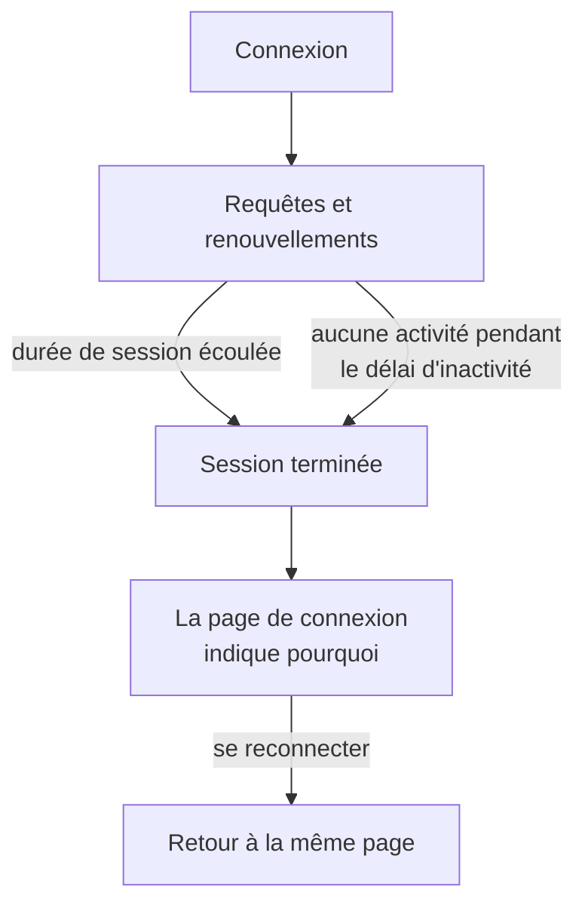

# Durée de session

Choisissez combien de temps les personnes restent connectées à OneUptime avant de devoir se reconnecter : un délai fixe après leur connexion, un délai sans utilisation, ou les deux. Cela s'applique à chaque connexion au tableau de bord, au Admin Dashboard et à l'application mobile, par mot de passe, clé d'accès, connexion avec Google, connexion avec Microsoft ou authentification unique. Les connexions SSO peuvent avoir leurs propres durées.

> [!NOTE]
> La durée de session fait partie de l'[OneUptime Enterprise Edition](/docs/self-hosted/enterprise). La Community Edition n'a pas de page **Durée de session**, et chaque connexion dure comme le décrit [Sans limite](#sans-limite).

:::cards
- [Définir une durée de session](#définir-une-durée-de-session) : Deux paramètres dans le Admin Dashboard.
- [Comment une session se termine](#comment-une-session-se-termine) : Ce que le serveur compte, et quand.
- [Connexions SSO](#connexions-sso) : Des durées propres à l'authentification unique.
- [Ce qui n'est pas une connexion](#ce-qui-nest-pas-une-connexion) : Clés d'API, connexions MCP et lecteurs des pages de statut.
:::

## Sans limite

Tant que vous ne définissez pas de durée, une connexion n'en a pas. Son jeton d'accès dure 15 minutes et est renouvelé en arrière-plan avec un jeton d'actualisation, qui dure 30 jours et repart à zéro à chaque utilisation. Une personne qui ouvre OneUptime au moins une fois tous les 30 jours reste connectée ; une personne qui ne le fait pas se reconnecte.

## Définir une durée de session

:::steps
### Ouvrir Durée de session
Dans le Admin Dashboard, ouvrez **Paramètres**, puis **Durée de session** dans le menu latéral.

### Choisir les durées
- **Déconnecter les personnes après** : combien de temps dure une connexion à partir du moment où la personne se connecte, quelle que soit son activité.
- **Déconnecter les personnes après une inactivité de** : combien de temps une personne peut rester sans cliquer, saisir ni faire défiler dans OneUptime.

Chaque choix est enregistré dès que vous le faites.

### Confirmer qui est déconnecté
Une durée plus courte s'applique à toutes les personnes connectées en ce moment. Quand elle déconnecte des personnes immédiatement, OneUptime indique d'abord combien, et si vous en faites partie. Sélectionnez **Enregistrer et les déconnecter** pour continuer.
:::

| Paramètre | Choix | Par défaut |
| --- | --- | --- |
| **Déconnecter les personnes après** | 1 heure à 90 jours | **Aucune limite** |
| **Déconnecter les personnes après une inactivité de** | 15 minutes à 14 jours | 30 jours, le maximum possible |

Via l'API, `sessionLengthInMinutes` accepte tout nombre entier de minutes de 15 à 525600 (un an) et `sessionIdleTimeoutInMinutes` de 15 à 43200 (30 jours), dans la configuration globale du serveur. Vide correspond à la valeur par défaut.

## Comment une session se termine

- Le serveur compte les deux durées à partir de la session elle-même : quand elle s'est connectée, et quand la personne a été active pour la dernière fois. Il les vérifie à chaque requête, à chaque renouvellement et à chaque mise à jour en direct, et ne laisse jamais la déconnexion au navigateur.
- Le délai d'inactivité compte à partir du dernier clic, de la dernière touche pressée ou du dernier défilement dans un onglet quelconque du tableau de bord ou du Admin Dashboard. Un onglet laissé ouvert ne maintient pas une session en vie.
- L'application mobile compte comme active chaque fois qu'elle est utilisée.
- Quand une session se termine, le navigateur passe à la page de connexion, qui indique pourquoi. Après s'être reconnectée, la personne revient sur la page où elle se trouvait.

| Changement | Ce qui arrive aux personnes connectées en ce moment |
| --- | --- |
| Une durée de session ou un délai d'inactivité plus court | Toutes les personnes qui l'ont dépassé sont déconnectées immédiatement, les autres quand elles l'atteignent |
| Une durée plus longue, ou aucune | Personne n'est déconnecté, et les sessions durent plus longtemps à partir de leur prochain renouvellement |

## Connexions SSO

Les connexions par authentification unique suivent les deux mêmes paramètres. Pour leur donner leurs propres durées, ouvrez **Plus de paramètres** sur la page **Durée de session** et activez **Durées distinctes pour les connexions SSO**. Les deux paramètres situés en dessous s'appliquent alors aux connexions via le fournisseur SAML ou OpenID Connect d'un projet, ou via le [SSO global](/docs/identity/global-sso) du serveur, et les deux en haut de la page à toutes les autres connexions. Elles démarrent avec les mêmes durées que toute autre connexion, donc l'activer ne change rien tant que vous n'en choisissez pas d'autres.

Un projet qui exige le SSO ne laisse aussi entrer une session que tant que sa connexion SSO dure, ce qui n'est jamais plus long que la durée que suivent les connexions SSO.

Via l'API, l'interrupteur est `useSeparateSsoSessionLengths`, et les durées des connexions SSO sont `ssoSessionLengthInMinutes` et `ssoSessionIdleTimeoutInMinutes`, avec les mêmes plages.

## Ce qui n'est pas une connexion

- **Les clés d'API** gardent l'expiration que vous leur donnez.
- **Les connexions MCP**, des assistants IA connectés avec OAuth, gardent leur propre durée de vie. Dans un projet qui exige le SSO, une connexion ne dure jamais plus longtemps que la connexion SSO avec laquelle elle a été approuvée.
- **Les pages de statut privées** ont leur propre durée pour leurs lecteurs : voir [Utilisateurs privés](/docs/status-pages/index#utilisateurs-privés).

## Sans licence

Après la période d'essai ou la période de grâce, sans licence valide ou avec une licence qui n'inclut pas les durées de session, les durées ne peuvent plus être définies ni modifiées. Celles déjà définies continuent de déconnecter les personnes, et vous pouvez toujours les supprimer. Avec l'image de la Community Edition, aucune durée ne s'applique : les valeurs restent dans la base de données et s'appliquent de nouveau quand vous revenez en arrière.

## Étapes suivantes

:::cards
- [SSO](/docs/identity/sso) : Connecter les personnes avec votre fournisseur d'identité.
- [SSO global](/docs/identity/global-sso) : Un seul fournisseur d'identité pour tout le serveur.
- [Enterprise Edition](/docs/self-hosted/enterprise) : Ce qu'ajoute l'Enterprise Edition, et sa licence.
:::
