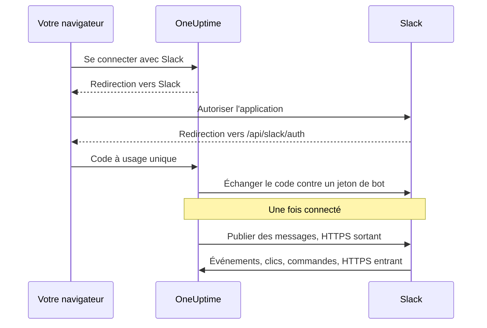
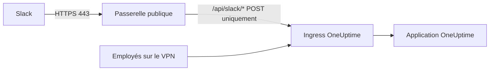

# Intégration Slack

Connectez votre OneUptime auto-hébergé à Slack. Vous créez une application Slack à partir du manifeste que génère votre serveur, vous donnez à OneUptime les identifiants de l'application et vous connectez chaque projet à un espace de travail. OneUptime publie ensuite les incidents, les alertes et la maintenance planifiée dans vos canaux, et votre équipe les traite depuis Slack.

Cette page s'adresse à la personne qui administre le serveur OneUptime. Une fois Slack connecté, les règles de notification se configurent par projet : voir [Slack](/docs/workspace-connections/slack).

:::cards
- [Configurer l'application Slack](#configurer-lapplication-slack): Créer l'application à partir de votre manifeste et connecter un projet.
- [Variables d'environnement](#variables-denvironnement): Les trois valeurs dont OneUptime a besoin de l'application.
- [Accès réseau](#accès-réseau-pour-les-déploiements-auto-hébergés): Les callbacks que Slack doit pouvoir joindre.
- [Dépannage](#dépannage): Ce que signifient les messages de la page Slack, et que faire.
:::

## Fonctionnement

L'application Slack vous appartient : elle est installée dans votre espace de travail et ne parle qu'à votre serveur. Le trafic circule dans les deux sens, et chaque sens a besoin de son propre accès réseau.



- **Sortant** : OneUptime appelle la Web API de Slack pour publier des messages, créer des canaux et téléverser des images.
- **Entrant** : Slack appelle quatre routes sur votre serveur pour les événements, les clics sur les boutons, les menus et les commandes slash. Chaque requête est signée avec le signing secret de l'application. OneUptime rejette une requête dont la signature ne correspond pas ou dont l'horodatage date de plus de cinq minutes.

## Avant de commencer

- Un espace de travail Slack dans lequel vous pouvez créer et installer des applications.
- Un nom d'hôte HTTPS public pour OneUptime que Slack peut joindre. Voir [Accès réseau](#accès-réseau-pour-les-déploiements-auto-hébergés).
- Un accès à la configuration du serveur : `config.env` pour Docker Compose, ou vos values Helm pour Kubernetes.
- Pour connecter un projet, le rôle **Project Owner**, **Project Admin** ou **Project Member** dans ce projet.

## Configurer l'application Slack

:::steps
### Définir l'URL publique

OneUptime construit le manifeste de l'application et chaque URL de callback à partir de `HOST` et `HTTP_PROTOCOL`. Réglez-les sur le nom d'hôte que Slack appellera, en HTTPS :

:::tabs
@tab Docker Compose
```bash title="config.env"
HOST=oneuptime.example.com
HTTP_PROTOCOL=https
```
@tab Kubernetes
```yaml title="values.yaml"
host: oneuptime.example.com
httpProtocol: https
```
:::

Ces valeurs ne font que générer des URL. Elles ne créent ni enregistrements DNS, ni certificats, ni règles de pare-feu.

### Copier le manifeste de l'application

Ouvrez **Paramètres du projet > Espace de travail > Slack**. Tant que Slack n'est pas configuré sur le serveur, la page affiche **Intégrer Slack à votre projet OneUptime** avec le manifeste généré pour votre nom d'hôte. Il est aussi servi à `https://oneuptime.example.com/api/slack/app-manifest`.

Vérifiez que chaque URL du manifeste commence par votre nom d'hôte public. Sinon, corrigez d'abord `HOST` et `HTTP_PROTOCOL` et appliquez la modification.

### Créer l'application Slack

Sur [api.slack.com/apps](https://api.slack.com/apps), créez une nouvelle application à partir d'un manifeste, choisissez votre espace de travail et collez le manifeste. Utilisez toujours le manifeste que génère votre propre serveur, pour que ses URL correspondent à votre nom d'hôte.

### Copier les identifiants de l'application

Sur la page **Basic Information** de l'application, sous **App Credentials**, copiez le **Client ID**, le **Client Secret** et le **Signing Secret**.

### Ajouter les identifiants à OneUptime

:::tabs
@tab Docker Compose
```bash title="config.env"
SLACK_APP_CLIENT_ID=YOUR_SLACK_APP_CLIENT_ID
SLACK_APP_CLIENT_SECRET=YOUR_SLACK_APP_CLIENT_SECRET
SLACK_APP_SIGNING_SECRET=YOUR_SLACK_APP_SIGNING_SECRET
```
@tab Kubernetes
```yaml title="values.yaml"
slackApp:
  clientId: "YOUR_SLACK_APP_CLIENT_ID"
  clientSecret: "YOUR_SLACK_APP_CLIENT_SECRET"
  signingSecret: "YOUR_SLACK_APP_SIGNING_SECRET"
```

Pour garder les valeurs dans un Secret Kubernetes que vous gérez, définissez plutôt `slackApp.existingSecret` : son `name`, et les clés `clientIdKey`, `clientSecretKey` et `signingSecretKey`.
:::

### Appliquer la configuration

:::tabs
@tab Docker Compose
```bash
npm run start
```

Cela recrée les conteneurs avec le nouveau `config.env`. `docker compose restart` ne le relit pas.
@tab Kubernetes
```bash
helm upgrade my-oneuptime oneuptime/oneuptime -f values.yaml
```
:::

Une fois OneUptime revenu, **Paramètres du projet > Espace de travail > Slack** affiche un bouton **Se connecter avec Slack** à la place du manifeste.

### Vérifier l'URL de requête des événements

Dans les **Event Subscriptions** de l'application Slack, vérifiez l'URL de requête. OneUptime ne répond au challenge de Slack qu'une fois le signing secret défini ; réessayez donc si la vérification a échoué pendant que vous créiez l'application.

### Connecter le projet

Dans **Paramètres du projet > Espace de travail > Slack**, sélectionnez **Se connecter avec Slack** et autorisez l'application dans Slack. Slack vous renvoie sur la même page, qui affiche désormais le nom de votre espace de travail.

### Connecter votre propre compte Slack

Les boutons, les formulaires et les commandes agissent au nom de l'utilisateur OneUptime lié au compte Slack qui les utilise. Chaque personne ouvre **Paramètres utilisateur > Espace de travail > Slack** et sélectionne **Connect my account with Slack**. Une personne qui n'a pas connecté de compte reçoit un message direct de l'application qui le lui demande.
:::

## Variables d'environnement

| Docker Compose (`config.env`) | Helm (`values.yaml`) | Obligatoire | Valeur |
| --- | --- | --- | --- |
| `SLACK_APP_CLIENT_ID` | `slackApp.clientId` | Oui | Le **Client ID** de l'application. Sans lui, la page Slack affiche le guide de configuration au lieu de **Se connecter avec Slack**. |
| `SLACK_APP_CLIENT_SECRET` | `slackApp.clientSecret` | Oui | Le **Client Secret** de l'application, utilisé pour échanger contre un jeton le code que renvoie Slack. |
| `SLACK_APP_SIGNING_SECRET` | `slackApp.signingSecret` | Oui | Le **Signing Secret** de l'application. Chaque requête de Slack est vérifiée avec lui. |
| `HOST` | `host` | Oui | Votre nom d'hôte public, sans le schéma. |
| `HTTP_PROTOCOL` | `httpProtocol` | Oui | `https`. Slack n'appelle que des URL HTTPS. |

## Ce que fait l'application

Le manifeste configure ces fonctionnalités. Chacune joint votre serveur sur la route indiquée ; elle ne fonctionne donc que si Slack peut joindre cette route.

| Fonctionnalité | Ce qu'elle fait | Route |
| --- | --- | --- |
| `/incident` et le raccourci **Create New Incident** | Déclarer un incident depuis Slack | `POST /api/slack/interactive` |
| `/maintenance` et le raccourci **Create Scheduled Event** | Planifier une maintenance depuis Slack | `POST /api/slack/interactive` |
| `/oneuptime` | Interroger OneUptime AI sur vos logs, traces, métriques, incidents et moniteurs | `POST /api/slack/command` |
| Boutons et formulaires des messages OneUptime | Accuser réception, résoudre, ajouter une note, changer l'état, exécuter une politique d'astreinte | `POST /api/slack/interactive` et `POST /api/slack/options-load` |
| Événements | Mentions, messages, réactions et épingles, par exemple pour enregistrer un message comme note | `POST /api/slack/events` |

### Images dans les messages

Les descriptions d'incidents et d'alertes peuvent contenir des captures d'écran, par exemple celle d'un moniteur synthétique (voir [Moniteurs synthétiques](/docs/monitor/incident-alert-templating#moniteurs-synthétiques)). OneUptime les affiche dans les messages Slack en téléversant chacune dans votre espace de travail comme fichier privé, ce qui exige le scope de bot `files:write`. Le manifeste généré l'inclut.

Si vous avez créé votre application Slack à partir d'un manifeste plus ancien, ajoutez `files:write` sous **OAuth & Permissions > Bot Token Scopes** (ou mettez à jour l'application à partir du manifeste actuel). Sélectionnez ensuite de nouveau **Se connecter avec Slack** dans **Paramètres du projet > Espace de travail > Slack**, pour que le nouveau scope soit accordé. D'ici là, chaque capture d'écran s'affiche sous forme de son texte alternatif.

## Accès réseau pour les déploiements auto-hébergés

### Sens du trafic et points de terminaison

| Trafic | Accès requis |
| --- | --- |
| OneUptime vers Slack | DNS et HTTPS sortant sur TCP 443 vers `slack.com` pour les appels à la Web API et l'échange de jeton OAuth ; `hooks.slack.com` pour les URL de réponse des commandes et les notifications par webhook entrant, s'ils sont utilisés |
| Slack vers OneUptime | HTTPS public sur TCP 443 vers les quatre routes POST ci-dessous, pour l'intégration complète |
| Navigateur de l'utilisateur vers OneUptime | Accès au tableau de bord et redirections OAuth vers `/api/slack/auth/:projectId/:userId` et `/api/slack/auth/:projectId/:userId/user` ; elles peuvent rester accessibles via le VPN de l'utilisateur |

Les domaines sortants décrivent l'intégration Slack de OneUptime, pas une liste d'autorisation exhaustive pour les clients Slack ou chaque fonctionnalité de Slack. Un *webhook entrant* Slack est hébergé par Slack : OneUptime lui envoie des messages, ce n'est donc pas un point de terminaison entrant sur votre serveur. Voir le [guide des webhooks entrants](https://docs.slack.dev/messaging/sending-messages-using-incoming-webhooks/) de Slack.

Transférez ces callbacks à OneUptime via son ingress :

| Méthode et chemin | Rôle |
| --- | --- |
| `POST /api/slack/events` | Vérification de l'Events API, réactions, épingles, mentions et messages |
| `POST /api/slack/interactive` | Boutons, raccourcis, soumissions de modales, `/incident` et `/maintenance` |
| `POST /api/slack/options-load` | Demandes d'options des menus interactifs |
| `POST /api/slack/command` | Commande `/oneuptime` |

OAuth est une [redirection du navigateur suivie d'un échange de jeton côté serveur](https://docs.slack.dev/authentication/installing-with-oauth/). Le manifeste enregistre `/api/slack/auth` comme préfixe de l'URL de redirection, et OneUptime ajoute les chemins du projet et de l'utilisateur quand il lance l'autorisation. L'accès depuis le navigateur ne suffit pas à Slack pour livrer les événements ou les clics sur les boutons.

### Déploiements privés et sécurité des callbacks



Utilisez un DNS public et une passerelle dotée d'un certificat HTTPS reconnu publiquement, d'une chaîne de certificats complète et d'une route privée vers votre ingress OneUptime. Autorisez le TCP 443 entrant vers la passerelle et ne transférez que les quatre routes de callback ci-dessus. Une `ClusterIP` privée, un nom DNS interne ou la connexion VPN d'un employé ne sont pas joignables par Slack. Un DNS scindé peut garder le tableau de bord et les routes OAuth privés sous le même nom d'hôte.

Régénérez le manifeste et mettez à jour l'application Slack après un changement de nom d'hôte.

À travers la passerelle, préservez :

- la méthode, le chemin, la chaîne de requête et le corps d'origine ;
- `Content-Type`, `X-Slack-Signature` et `X-Slack-Request-Timestamp` ;
- l'hôte public et le schéma HTTPS, via des en-têtes de proxy de confiance.

Exemptez les routes de callback du SSO du navigateur, des CAPTCHA et des pages de connexion du proxy, et conservez les vérifications du signing secret et de l'horodatage dans OneUptime. Gardez l'horloge du serveur synchronisée : une requête décalée de plus de cinq minutes est rejetée. Slack documente la [vérification de la signature des requêtes](https://docs.slack.dev/authentication/verifying-requests-from-slack/) ; une vérification de l'IP source ne la remplace pas.

### Vérifier l'accès et comprendre les limites

:::steps
1. Dans les **Event Subscriptions** de l'application Slack, vérifiez l'URL de requête. Slack envoie un [challenge POST et vérifie le TLS](https://docs.slack.dev/apis/events-api/using-http-request-urls/).
2. Envoyez une notification de test, lancez une commande slash, cliquez sur un bouton d'un message d'incident et déclenchez un événement auquel l'application est abonnée.
3. Consultez les logs de la passerelle et de OneUptime pour repérer les livraisons échouées, sans journaliser de secrets.
:::

Slack attend des accusés de réception rapides, dont [une réponse en moins de trois secondes pour les interactions](https://docs.slack.dev/interactivity/handling-user-interaction/). Un GET depuis le navigateur ou un message sortant réussi ne vérifie pas ces callbacks POST.

> [!WARNING]
> Si toute connexion entrante est interdite, une application déjà autorisée peut encore envoyer des messages en HTTPS sortant, mais les événements, les boutons, les raccourcis et les commandes ne peuvent pas fonctionner. Le manifeste de OneUptime utilise des callbacks HTTP et désactive le Socket Mode ; activer le Socket Mode de Slack ne remplace pas ces routes de manière prise en charge.

Les [paramètres d'accès au réseau privé](/docs/self-hosted/private-network-access) contrôlent les requêtes sortantes vers des destinations privées. Ils n'exposent pas les callbacks à Slack.

## Dépannage

### La connexion n'a pas abouti

Quand Slack vous renvoie et que la connexion n'a pas été établie, la page Slack d'où vous êtes parti (**Paramètres du projet > Espace de travail > Slack**, ou vos propres **Paramètres utilisateur > Espace de travail > Slack** si vous connectiez votre compte) affiche **Slack n'a pas été connecté**, avec une phrase dans votre langue qui en donne la raison. Le reste de la page se charge normalement, vous pouvez donc vous reconnecter sur place. Elle n'affiche jamais ce que Slack a lui-même répondu : cela figure dans le log du serveur OneUptime, avec la raison.

| La page indique | Que faire |
| --- | --- |
| **"Ce lien de connexion n'est pas valide, a expiré ou a déjà été utilisé. Veuillez recommencer."** | Le lien fonctionne une fois, pendant 15 minutes, dans le navigateur qui l'a lancé. Recommencez depuis la page Slack et terminez dans Slack en moins de 15 minutes, dans le même navigateur. |
| **"Vous n'avez pas l'autorisation de connecter ce projet à Slack."** | Installer OneUptime dans Slack exige **Project Owner**, **Project Admin** ou **Project Member**. C'est vérifié de nouveau quand Slack vous renvoie ; un rôle retiré entre-temps met donc fin à la connexion ici aussi. |
| **"Vous n'êtes plus membre de ce projet."** | Pour connecter votre propre compte Slack, vous devez être membre du projet au moment où Slack vous renvoie. |
| **"Ce projet n'est encore connecté à aucun espace de travail Slack."** | Installez d'abord OneUptime dans Slack depuis **Paramètres du projet > Espace de travail > Slack**, puis connectez votre propre compte. |
| **"Vous vous êtes connecté à un autre espace de travail Slack que celui auquel ce projet est connecté."** | Connectez votre compte en étant connecté à l'espace de travail Slack dans lequel le projet est installé. |
| **"La connexion a été annulée, rien n'a donc été modifié."** | La demande n'a pas été autorisée dans Slack. Recommencez et autorisez-la. |
| **"Slack n'est pas configuré sur ce serveur OneUptime."** | Définissez `SLACK_APP_CLIENT_ID` et `SLACK_APP_CLIENT_SECRET` (voir [Variables d'environnement](#variables-denvironnement)) et redémarrez OneUptime. |
| **"OneUptime n'a pas pu terminer la connexion. Veuillez réessayer."** | Slack a répondu par une erreur, ou une requête ou une écriture a échoué pendant la finalisation. Le log du serveur OneUptime précise laquelle. Réessayez ; si cela se reproduit, consultez le log et les paramètres de l'application Slack. |

### Autres problèmes

:::details Slack ne parvient pas à vérifier l'URL de requête des événements
OneUptime ne répond au challenge de Slack que si `SLACK_APP_SIGNING_SECRET` est défini et que la requête lui parvient. Définissez le signing secret, appliquez la configuration et relancez la vérification. Si elle échoue encore, vérifiez que `POST /api/slack/events` est joignable depuis Internet avec un certificat reconnu publiquement.
:::

:::details Les boutons et les commandes slash ne font rien, mais les notifications arrivent
Les notifications sont sortantes : elles fonctionnent donc sans accès entrant. Les boutons, les raccourcis et les commandes sont entrants : vérifiez que Slack peut joindre `POST /api/slack/interactive` et `POST /api/slack/command`, et que la passerelle préserve le corps ainsi que les en-têtes `X-Slack-Signature` et `X-Slack-Request-Timestamp`.
:::

:::details L'application dit que mon compte Slack n'est pas connecté à OneUptime
Les boutons, les formulaires et les commandes ont besoin que votre compte Slack soit lié à votre utilisateur OneUptime. Ouvrez **Paramètres utilisateur > Espace de travail > Slack** et sélectionnez **Connect my account with Slack**. Si vous avez été retiré du projet, l'application vous le dit à la place, et les actions depuis Slack sont refusées.
:::

:::details Les captures d'écran s'affichent sous forme de texte
Il manque à l'application Slack le scope `files:write`. Voir [Images dans les messages](#images-dans-les-messages).
:::

## Étapes suivantes

:::cards
- [Slack](/docs/workspace-connections/slack): Créer des règles de notification et des résumés pour le projet.
- [Intégration Microsoft Teams](/docs/self-hosted/microsoft-teams-integration): Configurer aussi le bot Teams sur votre serveur.
- [Accès au réseau privé](/docs/self-hosted/private-network-access): Permettre aux workflows et aux webhooks de joindre les outils internes.
:::
