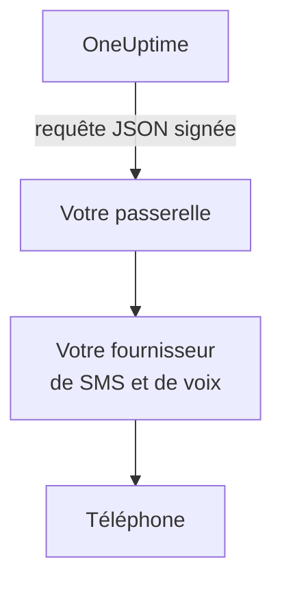

# Passerelle SMS et appels

OneUptime peut envoyer ses SMS et ses appels par une passerelle que vous exploitez, au lieu de Twilio. Utilisez-la quand vos règles exigent que chaque message passe par votre propre fournisseur de SMS et de voix, ou par un système qui le contrôle avant qu'il ne quitte votre réseau. OneUptime envoie chaque SMS et chaque appel à votre passerelle sous forme de requête JSON signée, et votre passerelle le transmet.

:::cards
- [Configurer la passerelle](#configurer-la-passerelle): Une URL, et un secret de signature créé pour vous.
- [Ce que reçoit votre passerelle](#ce-que-reçoit-votre-passerelle): Une requête JSON signée par SMS ou par appel.
- [Agir sur une alerte](#agir-sur-une-alerte): Prendre en compte, escalader ou résoudre depuis un appel ou une réponse.
- [Livraison et nouvelles tentatives](#livraison-et-nouvelles-tentatives): Ce qui se passe quand votre passerelle est indisponible.
:::

## Fonctionnement



La passerelle remplace le compte Twilio propre au serveur pour tout ce qui passerait par lui : alertes d'astreinte, notifications, codes de vérification et SMS aux abonnés des pages de statut. Les projets qui ajoutent leur propre configuration Twilio, sur la carte **Configuration Twilio** dans **Paramètres du projet > Notifications > Paramètres de notification**, continuent d'envoyer par cette configuration. Les interrupteurs SMS et appels de chaque projet, et son solde là où la facturation est activée, sont vérifiés comme pour Twilio.

## Configurer la passerelle

:::steps
1. Dans l'Admin Dashboard, allez dans **Paramètres > Appel et SMS** et cliquez sur **Edit Provider** sur la carte **SMS and Call Provider**.
2. Choisissez **Your own gateway** et saisissez la **Gateway URL**. La passerelle peut se trouver sur votre réseau privé.
3. Enregistrez. OneUptime crée un secret de signature pour vous. Copiez-le depuis la carte dans votre passerelle.
4. Cliquez sur **Send Test**. Votre passerelle doit répondre avec un statut 2xx et ne rien envoyer.
:::

Pour remplacer le secret, videz **Signing Secret** sous **Plus de champs** et enregistrez : OneUptime en crée un nouveau. Pour revenir à Twilio, choisissez **Twilio** et enregistrez.

## Ce que reçoit votre passerelle

Chaque SMS et chaque appel est une requête `POST` avec un corps JSON et ces en-têtes :

| En-tête | Valeur |
| --- | --- |
| `Content-Type` | `application/json` |
| `X-OneUptime-Event` | `sms`, `call` ou `test` |
| `X-OneUptime-Signature` | `sha256=` suivi du HMAC-SHA256 du corps en hexadécimal, calculé avec le secret de signature comme clé |
| `User-Agent` | `OneUptime-CallAndSmsGateway/1.0` |

```json title="An on-call page by SMS"
{
  "version": 1,
  "event": "sms",
  "id": "7c5b0d0e-3e5f-4d1a-9a4f-2b8e6c1d9f00",
  "sentAt": "2026-10-27T09:30:00.000Z",
  "to": "+15551234567",
  "message": "OneUptime: A new alert has been created. Alert #42: Database is down…",
  "isSensitive": false,
  "project": {
    "id": "0f6b8c3a-1d2e-4f5a-8b9c-0d1e2f3a4b5c",
    "name": "Production"
  },
  "actions": {
    "acknowledge": "https://oneuptime.example.com/api/custom-notification-channel/page/5f2c…/acknowledge?token=…",
    "escalate": "https://oneuptime.example.com/api/custom-notification-channel/page/5f2c…/escalate?token=…",
    "resolve": "https://oneuptime.example.com/api/custom-notification-channel/page/5f2c…/resolve?token=…"
  }
}
```

| Champ | Ce que c'est |
| --- | --- |
| `version` | Toujours `1` pour ce format. On ne fait qu'y ajouter des champs. |
| `event` | `sms`, `call` ou `test`, comme dans `X-OneUptime-Event`. |
| `id` | Propre à ce message, et le même à chaque tentative de livraison : utilisez-le pour ignorer un message que vous avez déjà envoyé. |
| `sentAt` | Quand OneUptime l'a envoyé, en ISO 8601. |
| `to` | Le numéro de téléphone, au format E.164. `null` dans un test. |
| `message` | Le SMS, ou ce que dit l'appel. Un SMS fait au plus 1 600 caractères, et le texte d'un appel au plus 16 384. Un texte plus long est coupé et se termine par une note indiquant que la suite se trouve dans OneUptime. |
| `isSensitive` | `true` pour un code de vérification. Gardez le message hors de vos propres logs. |
| `project` | L'`id` et le `name` du projet, ou `null` quand aucun projet ne l'a envoyé. |
| `actions` | Pour une alerte d'astreinte, les liens qui agissent dessus. `null` sinon. |

Un appel est décrit plutôt que scénarisé : `message` est ce qu'il dit, sans le « appuyez sur 1 pour prendre en compte » de Twilio. Proposez les actions à votre façon, par exemple par des touches, et appelez le lien correspondant.

### Vérifier la signature

Calculez le HMAC du corps brut de la requête, avant de l'analyser, et comparez-le à l'en-tête. La vérification est la même que pour un [canal personnalisé](/docs/self-hosted/custom-notification-channels#vérifier-la-signature), si bien qu'un seul vérificateur sert aux deux :

```javascript title="Node.js"
const crypto = require("crypto");

function isFromOneUptime(rawBody, signatureHeader, secret) {
  const expected =
    "sha256=" + crypto.createHmac("sha256", secret).update(rawBody).digest("hex");
  const received = String(signatureHeader || "");

  return (
    received.length === expected.length &&
    crypto.timingSafeEqual(Buffer.from(received), Buffer.from(expected))
  );
}
```

## Agir sur une alerte

Quand la personne répond pendant un appel ou par une réponse, votre passerelle envoie une requête `POST` au lien correspondant dans `actions`. Les liens fonctionnent comme ceux d'un canal personnalisé : ils ne demandent aucune clé d'API, chacun porte un jeton propre à cette alerte, valable 7 jours, et l'action est enregistrée comme faite par la personne alertée. Consultez [Agir sur une alerte](/docs/self-hosted/custom-notification-channels#agir-sur-une-alerte) pour chaque action et la réponse.

```bash title="Acknowledge a page"
curl -X POST "https://oneuptime.example.com/api/custom-notification-channel/page/5f2c…/acknowledge?token=…"
```

## Livraison et nouvelles tentatives

Une requête compte comme livrée quand votre passerelle répond avec un statut 2xx dans les 10 secondes. Une requête à laquelle elle n'a pas répondu, ou à laquelle elle a répondu par 408, 429 ou un statut 5xx, est renvoyée après 1 seconde puis après 4 secondes de plus : trois tentatives en tout. Avec tout autre statut 4xx, elle n'est pas renvoyée.

Le journal des SMS ou des appels, et pour une alerte d'astreinte le journal d'astreinte de la personne, indique `Sent to the SMS and call gateway (HTTP 200).` ou pourquoi le message n'a pas été livré, jamais l'URL. OneUptime ne sait pas si le message a atteint le téléphone : un SMS apparaît donc comme envoyé dès que votre passerelle l'accepte, et le numéro depuis lequel il est parti reste vide.

## Requêtes de test

**Send test** envoie une requête avec `event` à `test`, et `to`, `project` et `actions` à `null`. Répondez-y avec un statut 2xx et n'envoyez rien.

## Étapes suivantes

:::cards
- [Canaux de notification personnalisés](/docs/self-hosted/custom-notification-channels): Alerter les personnes via votre propre application.
- [Notifications push](/docs/self-hosted/push-notifications): Désactiver le push sur tout le serveur.
- [Intégration Twilio](/docs/self-hosted/twilio-integration): Envoyer plutôt par Twilio.
- [Accès au réseau privé](/docs/self-hosted/private-network-access): Ce que votre serveur peut joindre sur votre propre réseau.
:::
