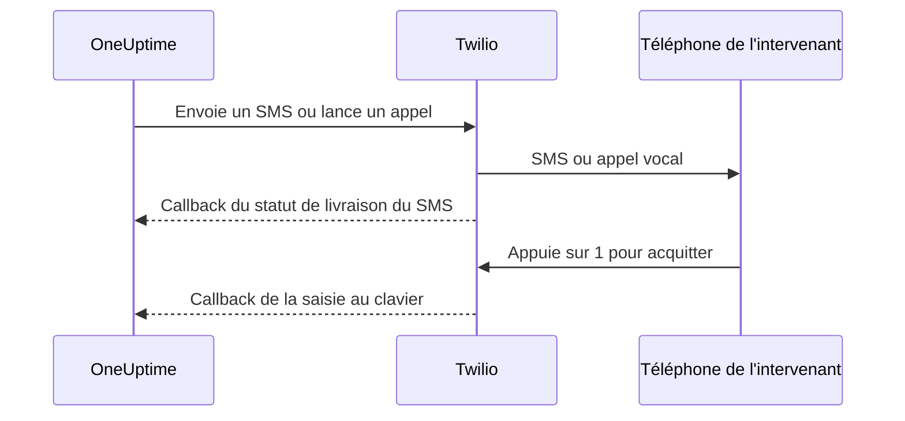

# Intégration Twilio

OneUptime auto-hébergé envoie les alertes SMS et vocales via votre propre compte Twilio, et vous payez Twilio directement. Vous enregistrez les identifiants Twilio dans le tableau de bord de OneUptime, pas dans des variables d'environnement : l'envoi des notifications lit la configuration enregistrée, et le chart Helm n'a aucune valeur pour les identifiants Twilio.

> [!NOTE]
> Une ancienne migration a importé `TWILIO_ACCOUNT_SID`, `TWILIO_AUTH_TOKEN` et `TWILIO_PHONE_NUMBER` ; modifier ces variables n'est pas le moyen de mettre à jour les identifiants d'une installation existante.

:::cards
- [Préparer votre compte Twilio](#1-préparer-votre-compte-twilio): Les identifiants, un numéro de téléphone et les limites du compte.
- [Enregistrer les identifiants](#2-enregistrer-les-identifiants-dans-oneuptime): Pour un projet, ou pour toute l'installation.
- [Configurer l'accès réseau](#3-configurer-laccès-réseau): Ce que Twilio doit pouvoir joindre sur votre serveur, et quand.
- [Vérifier les numéros de téléphone](#5-vérifier-les-numéros-de-téléphone-des-membres-de-léquipe): Comment les numéros des membres de l'équipe sont vérifiés.
:::

## 1. Préparer votre compte Twilio

:::steps
### Copier vos identifiants

Ouvrez la [Twilio Console](https://console.twilio.com/) et copiez votre **Account SID** et votre **Auth Token**.

### Obtenir un numéro de téléphone

Obtenez un numéro de téléphone Twilio doté des capacités SMS et/ou vocales dont vous avez besoin. Utilisez le format E.164, indicatif du pays compris, pour les numéros d'expéditeur et de destinataire.

### Vérifier les limites du compte

Vérifiez le solde du compte, les autorisations des pays de destination et les exigences d'enregistrement des expéditeurs qui s'appliquent. Les comptes d'essai ont des restrictions de destinataires, géographiques et autres qui peuvent empêcher de vraies alertes OneUptime de fonctionner ; consultez la [documentation de Twilio sur les comptes et l'essai](https://www.twilio.com/docs/usage/tutorials/how-to-use-your-free-trial-account) avant de tester. Utilisez un compte mis à niveau en production.
:::

## 2. Enregistrer les identifiants dans OneUptime

Enregistrez les identifiants pour un projet, ou une seule fois pour toute l'installation :

| | Configuration du projet | Configuration de l'installation |
| --- | --- | --- |
| Où | La carte **Configuration Twilio** dans **Paramètres du projet > Notifications > Paramètres de notification** | **Admin Dashboard > Paramètres > Appel et SMS** |
| Qui peut la définir | **Project Owner**, **Project Admin**, ou **Create Call and SMS** dans un rôle personnalisé | Un administrateur principal |
| Utilisée pour | Les SMS et appels vers les membres du projet tant qu'elle est la configuration par défaut du projet, les pages de statut auxquelles elle est attribuée et les politiques d'appels entrants qui l'utilisent | Les SMS et appels vers les membres de tout projet qui n'a pas de configuration par défaut |

Pour ajouter une configuration de projet :

:::steps
1. Allez dans **Paramètres du projet > Notifications > Paramètres de notification**.
2. Dans **Configuration Twilio**, sélectionnez **Créer une configuration Twilio**.
3. Saisissez un nom, **SID de compte Twilio**, **Jeton d'authentification Twilio** et **Numéro de téléphone principal Twilio**. Saisissez éventuellement des **Numéros de téléphone secondaires Twilio** séparés par des virgules pour d'autres pays.
4. **Définir par défaut pour le projet** est activé pour la première configuration du projet : les SMS et les appels vers les membres du projet, notifications d'astreinte comprises, passent par elle dès que vous enregistrez. Désactivez-le si ce compte ne sert qu'aux pages de statut ou aux appels entrants. Une configuration ajoutée ensuite commence avec l'interrupteur désactivé : activez-le, ou choisissez **Définir par défaut pour le projet** dans le menu de la ligne de la configuration, pour y faire passer ces messages. Une requête API qui omet `isProjectDefault` est traitée de la même manière.
5. Enregistrez. Une seule configuration peut être la configuration par défaut du projet. Les pages de statut utilisent la configuration explicitement attribuée à chacune d'elles.

> [!IMPORTANT]
> **SMS** et **Appels téléphoniques** sont désactivés au départ dans chaque projet, et tant qu'ils ne sont pas activés, personne dans le projet ne peut y ajouter de numéro de téléphone. Un propriétaire du projet, un **Billing Admin** ou une personne disposant de **Manage Billing** les active dans la carte **Canaux de notification** de la même page.
:::

Pour une configuration par défaut à l'échelle de l'installation, un administrateur peut plutôt ouvrir **Admin Dashboard > Paramètres > Appel et SMS**, modifier les identifiants et les numéros de téléphone Twilio, puis enregistrer. Les notifications des membres utilisent cette configuration globale quand leur projet n'a pas de configuration par défaut. Gardez l'Auth Token confidentiel.

## 3. Configurer l'accès réseau

L'envoi fonctionne avec un accès sortant seul. Les mises à jour de livraison, l'acquittement par clavier et les appels entrants exigent que Twilio puisse joindre votre serveur.

Un déploiement privé a besoin de la résolution DNS et d'un accès HTTPS sortant sur TCP 443 vers Twilio pour soumettre les SMS et les appels. Twilio recommande d'autoriser le HTTPS sortant vers `*.twilio.com`, car ses adresses d'API sont dynamiques ; voir [les adresses IP de Twilio](https://help.twilio.com/articles/115015934048-All-About-Twilio-IP-Addresses). Appliquez cela au trafic sortant de la charge de travail de l'application OneUptime, y compris les NetworkPolicies Kubernetes et les pare-feu externes.

L'accès entrant dépend de la fonctionnalité :

| Fonctionnalité | Twilio doit-il joindre OneUptime ? |
| --- | --- |
| Envoi de SMS | Non. Les mises à jour du statut de livraison ont toutefois besoin d'un callback. |
| Un simple appel vocal de test | Non. OneUptime fournit les instructions vocales avec la requête API sortante. |
| Appuyer sur 1 pour acquitter une alerte d'astreinte | Oui. Twilio transmet la saisie au clavier à OneUptime. |
| Politiques d'appels entrants | Oui. Twilio demande les instructions d'appel et signale les résultats de numérotation. |

Voici les chemins externes, via la passerelle Nginx de OneUptime. Les paramètres varient d'une notification à l'autre :

| Méthode | Chemin | Rôle |
| --- | --- | --- |
| POST | `/notification/sms/status-callback/:smsLogId/:token` | Statut de livraison du SMS |
| POST | `/api/user-notification-log-timeline/call/gather-input/:itemId?token=...` | Acquittement par clavier |
| POST | `/notification/incoming-call/voice` | Instructions facultatives des appels entrants |
| POST | `/notification/incoming-call/dial-status/:callLogId/:callLogItemId` | Résultats facultatifs du routage des appels entrants |

OneUptime génère automatiquement les URL des SMS et de l'acquittement. Ne remplacez pas leurs jetons par une URL de webhook statique. Pour les appels entrants, suivez [les politiques d'appels entrants](/docs/on-call/incoming-call-policy), qui configurent le webhook du numéro quand vous rattachez un numéro.

Twilio exige des [URL de webhook joignables publiquement](https://www.twilio.com/docs/usage/webhooks/webhooks-overview). Utilisez un certificat TLS reconnu publiquement et préservez à travers les proxys l'hôte, le protocole, le chemin, les paramètres de requête, le corps et l'en-tête `X-Twilio-Signature` d'origine. Les gestionnaires d'appels entrants valident les signatures Twilio ; la livraison des SMS utilise un jeton d'URL propre à chaque message, et l'acquittement par clavier un jeton de requête signé. N'exposez pas les jetons dans des journaux partagés ou des captures d'écran. Voir [la sécurité des webhooks Twilio](https://www.twilio.com/docs/usage/webhooks/webhooks-security).

### Publier les callbacks depuis un déploiement privé

:::steps
1. Publiez le DNS de votre nom d'hôte OneUptime, par exemple `oneuptime.example.com`, en le faisant pointer vers un proxy inverse ou un équilibreur de charge accessible depuis Internet. Autorisez le TCP 443 entrant et configurez un certificat reconnu publiquement avec sa chaîne complète. Une IP privée, un DNS uniquement interne ou la connexion VPN d'un administrateur ne donnent pas accès à Twilio.
2. Donnez à cette passerelle une route réseau vers l'ingress privé de OneUptime, directement ou via votre propre VPN de site à site ou lien privé. Autorisez le port du service en amont. Un service Kubernetes `ClusterIP` a besoin d'un ingress joignable ou d'une autre route depuis la passerelle. Gardez les bases de données et les autres services internes privés.
3. Ne publiez que les chemins de callback du tableau ci-dessus que vous utilisez. Faites-les passer par la passerelle Nginx de OneUptime, qui fait correspondre le préfixe externe `/notification` à l'application. Conservez `/api` sur la route d'acquittement par clavier. Préservez la méthode HTTP et les données de la requête ; ne redirigez pas vers une autre URL. Préservez le `Host` public et définissez sur votre proxy des en-têtes de transfert de confiance pour l'hôte public et le schéma HTTPS.
4. Exemptez ces routes du SSO navigateur, des CAPTCHA et des pages de connexion du proxy. Laissez activée l'authentification des callbacks de OneUptime. Limitez l'accès à l'origine privée à la passerelle et aux clients internes autorisés.
5. Définissez `HOST=oneuptime.example.com` et `HTTP_PROTOCOL=https` dans le `config.env` de Docker Compose, ou `host: oneuptime.example.com` et `httpProtocol: https` dans les valeurs Helm. Appliquez la modification du déploiement et attendez que l'application redémarre. Ces paramètres génèrent des URL ; ils ne créent ni DNS, ni certificats, ni règles de pare-feu. OneUptime n'a pas de paramètre distinct de nom d'hôte pour les callbacks Twilio. Si le nom d'hôte change, mettez aussi à jour le webhook des numéros de téléphone Twilio existants.
:::

Le tableau de bord peut rester sur un ingress privé : avec un DNS scindé, les employés résolvent le même nom d'hôte vers cet ingress via le réseau de l'entreprise ou le VPN, tandis que Twilio le résout vers la passerelle. Servez sur les deux chemins un certificat valide pour ce nom d'hôte. Les [paramètres d'accès aux réseaux privés](/docs/self-hosted/private-network-access) de OneUptime régissent les requêtes sortantes vers les services internes ; `ALLOW_PRIVATE_NETWORK_WEBHOOKS` ne publie aucun point de terminaison entrant.

### Restrictions d'IP et déploiements sans accès entrant

Les adresses sources ordinaires des webhooks de Twilio changent : n'utilisez donc pas les plages d'IP SIP ou média comme liste d'autorisation des callbacks. Les éditions de Twilio éligibles proposent [Static Proxy for Webhooks](https://www.twilio.com/docs/iam/twilio-editions/twilio-static-proxy). Vérifiez l'éligibilité de votre édition et les produits pris en charge, et configurez votre pare-feu avec les plages publiées actuelles de Twilio ; continuez à valider les callbacks même en l'utilisant.

> [!WARNING]
> Si une politique interdit les connexions entrantes, l'envoi de SMS et la simple lecture vocale intégrée peuvent fonctionner avec le HTTPS sortant. Les mises à jour de livraison des SMS, l'acquittement par clavier et le routage des appels entrants ne peuvent pas fonctionner sans callbacks joignables. Une installation complètement déconnectée ne peut pas utiliser Twilio.

Pour le développement, le [guide de test des webhooks](https://www.twilio.com/docs/usage/webhooks/webhook-testing) de Twilio décrit l'usage d'un tunnel public : faites-le aboutir à un proxy qui n'autorise que les routes nécessaires, configurez le nom d'hôte obtenu comme ci-dessus, et arrêtez-le après les tests. Un tunnel ouvre tout de même un accès entrant.

## 4. Tester séparément la livraison et les callbacks

:::steps
1. Depuis l'extérieur du réseau de l'entreprise et du VPN, vérifiez que le nom d'hôte des callbacks se résout vers la passerelle publique et présente un certificat TLS valide. Un GET dans le navigateur ne teste pas ces callbacks POST.
2. Utilisez **Envoyer un SMS de test** et **Envoyer un appel de test** sur la configuration Twilio du projet. Confirmez la réception sur le téléphone de destination. Les deux exigent l'autorisation d'ajouter des configurations Twilio : **Project Owner**, **Project Admin**, ou **Create Call and SMS** et **Read Call and SMS** dans un rôle personnalisé.
3. Configurez le contact SMS ou appel vérifié de l'utilisateur et ses règles de notification, puis déclenchez une alerte d'astreinte contrôlée. Appuyez sur 1 et confirmez l'acquittement dans OneUptime. Si vous utilisez des politiques d'appels entrants, appelez le numéro configuré et vérifiez son routage et son journal d'appels.
4. Confirmez le statut de livraison des SMS dans OneUptime et dans les journaux de messages de Twilio. Un envoi accepté n'est pas une preuve de livraison ; [Twilio signale les changements de statut ultérieurs par des callbacks](https://www.twilio.com/docs/messaging/guides/track-outbound-message-status).
:::

| Symptôme | Où regarder |
| --- | --- |
| Rien n'est envoyé | Les identifiants, les capacités du numéro, les restrictions du compte et la connectivité sortante. |
| Le SMS ou l'appel arrive, mais son statut ou l'acquittement ne se met pas à jour | L'URL de callback et les journaux de l'ingress public. Le [guide de Twilio sur les échecs de récupération HTTP](https://www.twilio.com/docs/api/errors/11200) aide à diagnostiquer les callbacks injoignables, les problèmes TLS et les erreurs HTTP. |

Un appel de test réussi ne prouve pas à lui seul que les callbacks sont joignables.

## 5. Vérifier les numéros de téléphone des membres de l'équipe

Ajouter un numéro de téléphone pour les SMS ou les appels envoie son code de vérification immédiatement, et la boîte de dialogue de vérification s'ouvre. Elle indique quand le code a été envoyé et jusqu'à quand il est valable, et envoie un nouveau code sur demande, au plus une fois par minute. Rien n'a besoin d'être renvoyé avant la vérification.

Quand aucun code ne peut être envoyé, la boîte de dialogue en donne la raison au lieu de prétendre qu'un code a été envoyé : par exemple, qu'aucun compte Twilio n'est configuré, tant qu'il n'existe ni configuration par défaut du projet ni la configuration de l'installation ci-dessus. Un numéro dont le premier code ne peut pas être envoyé n'est pas ajouté, et le formulaire en indique la raison, comme un pays de destination refusé par Twilio.

Un numéro vérifié pour les SMS l'est aussi pour les appels, sans second code. La vérification par appel ne vérifie pas les SMS, car un numéro qui reçoit des appels, comme une ligne fixe, ne peut pas toujours recevoir de SMS. Si Twilio accepte un code qui n'arrive jamais, le journal SMS du projet en montre le statut de livraison.

## Étapes suivantes

:::cards
- [Politique d'appels entrants](/docs/on-call/incoming-call-policy): Permettre aux appelants de joindre vos ingénieurs d'astreinte via un numéro Twilio.
- [Règles d'escalade](/docs/on-call/escalation-rules): Décider qui est alerté à chaque niveau, par SMS, appel ou toute autre méthode.
- [SMTP](/docs/emails/smtp): Envoyer aussi les e-mails par votre propre serveur de messagerie.
- [Accès aux réseaux privés](/docs/self-hosted/private-network-access): Permettre aux workflows et aux webhooks de joindre des outils internes.
:::
