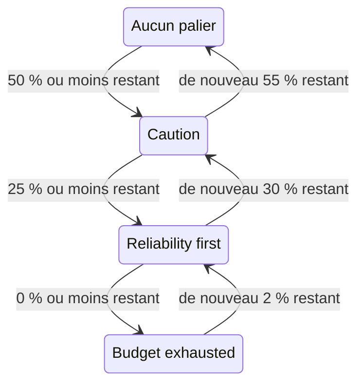

# Politique de budget d'erreur

Une politique de budget d'erreur écrit ce que votre équipe s'est engagée à faire à mesure que le budget d'erreur d'un SLO diminue, par exemple examiner les changements risqués une fois la moitié dépensée, ou geler les mises en production une fois le budget épuisé. OneUptime place le SLO dans le palier de la politique que son budget a atteint, affiche l'engagement de l'équipe pour ce palier sur les pages du SLO, et peut déclencher une alerte ou déclarer un incident quand le SLO entre dans un palier. C'est la pratique de politique de budget d'erreur du [Google SRE Workbook](https://sre.google/workbook/error-budget-policy/).

:::cards
- [Fonctionnement des paliers](#fonctionnement-des-paliers): Quel palier s'applique, et quand le SLO le quitte.
- [Mettre en place une politique](#mettre-en-place-une-politique): Partir de la politique recommandée, ou écrire vos propres paliers.
- [Alertes et incidents](#alertes-et-incidents): Alerter votre équipe quand le SLO entre dans un palier.
- [Lire le palier par l'API](#lire-le-palier-par-lapi): Vérifier le palier depuis la CI et des scripts.
:::

## Fonctionnement des paliers

Une politique est un ensemble de paliers. Chaque palier a trois champs :

| Champ | Ce qu'il contient |
| --- | --- |
| **Nom** | Le nom que l'équipe donne au palier, par exemple « Reliability first ». |
| **Seuil de budget restant (%)** | La part du budget d'erreur restant à partir de laquelle, ou en dessous de laquelle, le palier s'applique. De 0 à 100, décimales autorisées. Chaque palier d'un SLO a son propre seuil. |
| **Ce que nous faisons** | Ce que l'équipe s'est engagée à faire tant que le SLO est dans le palier, en Markdown. Obligatoire, jusqu'à 10 000 caractères. |

Un palier s'applique tant que le budget restant est égal ou inférieur à son seuil : un palier à 0 % est donc celui d'un budget épuisé. Quand plusieurs paliers s'appliquent, le SLO est dans celui qui a le seuil le plus bas : le plus grave. Quand aucun ne s'applique, le SLO n'est dans aucun palier. Avec des paliers à 50 %, 25 % et 0 %, un SLO à qui il reste 30 % de son budget est dans le palier à 50 %, et un SLO à qui il en reste 10 % est dans le palier à 25 %.

### Entrer dans un palier et en sortir

Le palier suit le budget restant comme le fait le statut du SLO :

- L'entrée dans un palier est immédiate : l'évaluation qui trouve le budget égal ou inférieur au seuil d'un palier place le SLO dans ce palier. Un budget qui passe sous plusieurs seuils d'un coup va directement au palier le plus grave.
- La sortie d'un palier vers un palier moins grave attend que le budget soit nettement revenu. Un palier à 0 % est quitté dès qu'il reste de nouveau 2 % du budget. Tout autre palier est quitté dès que le budget dépasse son seuil de 5 points.

Un palier à 0 % évolue donc avec le statut **Budget épuisé**, et un palier au seuil à risque du SLO avec **À risque** : voir [Changements de statut et seuil à risque](/docs/slo/error-budget#changements-de-statut-et-seuil-à-risque). Une fenêtre glissante qui oscille autour d'un seuil ne fait pas aller et venir le palier.



## Mettre en place une politique

Vous devez avoir l'autorisation de créer des paliers de politique de budget d'erreur de SLO.

:::steps
### Ouvrir Politique de budget d'erreur

Ouvrez le SLO et allez dans **Politique de budget d'erreur**, dans la section **Règles** de son menu latéral. La page liste les paliers du SLO, chacun avec son nom, le budget restant auquel il s'applique et ce que fait l'équipe.

### Partir de la politique recommandée

Tant que le SLO n'a aucun palier, la page propose **Utiliser la politique recommandée**. Cliquez dessus, vérifiez les trois paliers qu'il liste et confirmez. Adaptez ensuite le texte de chaque palier à l'engagement propre à votre équipe.

### Ou ajouter un palier vous-même

Cliquez sur **Créer : Palier de politique de budget d'erreur du SLO**. Saisissez un **Nom** et un **Seuil de budget restant (%)**, et écrivez l'engagement de l'équipe dans **Ce que nous faisons**.

### Choisir ce que le palier déclenche

Un palier enregistre et affiche l'engagement. Pour aussi alerter quelqu'un quand le SLO y entre, ouvrez les paramètres repliés d'alerte et d'incident, et activez une alerte, un incident ou les deux. Les deux sont désactivés par défaut. Voir [Alertes et incidents](#alertes-et-incidents).
:::

Ajouter, modifier ou supprimer un palier prend effet tout de suite : OneUptime évalue de nouveau le SLO en une minute environ. Si le budget est déjà égal ou inférieur au seuil d'un palier, le SLO entre alors dans ce palier, et le palier déclenche ce qu'il est configuré pour déclencher. Désactiver un palier ou le supprimer résout ce qu'il a déclenché, et le SLO passe au palier dans lequel se trouve son budget. Désactiver l'alerte ou l'incident d'un palier résout cette alerte ou cet incident.

### La politique recommandée

**Utiliser la politique recommandée** ajoute trois paliers, à la moitié du budget, au quart et à zéro, avec ce texte en anglais :

| Palier | S'applique à | Ce que fait l'équipe |
| --- | --- | --- |
| **Caution** | 50 % restant ou moins | Half of the error budget is spent. Review risky changes before they ship, and find out what has been spending the budget. |
| **Reliability first** | 25 % restant ou moins | Reliability comes first. Only reliability improvements and critical fixes ship until the budget recovers. |
| **Budget exhausted** | 0 % restant ou moins | The error budget is spent. Freeze non-critical releases: only fixes for this SLO's reliability and security fixes ship until the budget is back. |

Aucun d'eux ne déclenche d'alerte ni ne déclare d'incident tant que vous ne l'activez pas. Seuls les paliers que le SLO n'a pas sont ajoutés : un palier avec le même nom, ou avec le même seuil, compte comme présent, qu'il soit activé ou non. Le demander deux fois, depuis un deuxième onglet ou par l'API, n'ajoute donc rien en double. Chaque palier ajouté ainsi est enregistré dans les journaux d'audit du SLO comme ajouté par vous.

## Où le palier apparaît

- La **Vue d'ensemble** du SLO affiche le palier dans lequel il se trouve et ce que l'équipe s'est engagée à y faire, pour que chaque personne qui ouvre le SLO voie l'engagement qui s'applique maintenant.
- Le graphique **Consommation du budget d'erreur** trace une ligne libellée au seuil de chaque palier, à côté de celle du seuil à risque.
- Le **Fil d'activité** du SLO publie chaque changement de palier : le palier que le SLO a quitté et celui où il est entré, le budget restant, et ce que l'équipe s'est engagée à faire dans le nouveau palier.
- Les **Journaux d'audit** du SLO enregistrent chaque changement de palier comme un changement fait par OneUptime lui-même, et ne l'affichent donc qu'avec **Stocker les événements système** activé : voir [Activer les journaux d'audit](/docs/slo/feed-and-audit-logs#activer-les-journaux-daudit). L'ajout, la modification et la suppression d'un palier sont enregistrés au nom de la personne qui les a faits.
- L'API de lecture du SLO renvoie le palier : voir [Lire le palier par l'API](#lire-le-palier-par-lapi).

## Alertes et incidents

Chaque palier peut déclencher une alerte, déclarer un incident, ou les deux, quand le SLO y entre. Ils ont les options de l'alerte et de l'incident d'une règle de taux de consommation : gravité, politiques d'astreinte, modèles de titre, de description et de notes de remédiation, confidentialité, résolution automatique, étiquettes, équipes et utilisateurs propriétaires, et ajout des propriétaires du SLO comme propriétaires. Voir [Ce qu'une règle déclare](/docs/slo/burn-rate-alerts#ce-quune-règle-déclare). Les deux sont désactivés par défaut : un palier n'alerte donc personne tant que vous n'en activez pas un.

- Entrer dans un palier plus grave résout ce que le palier précédent a déclenché, quel que soit son réglage de résolution automatique, car le nouveau palier le remplace. Au plus l'alerte et l'incident d'un seul palier sont donc ouverts à la fois, et ils appartiennent au palier dans lequel se trouve le SLO.
- Revenir à un palier moins grave, ou sortir de tous les paliers, les résout quand la résolution automatique du palier est activée, comme c'est le cas par défaut. Avec la résolution automatique désactivée, ils restent ouverts jusqu'à ce que quelqu'un les résolve.
- Il n'y a pas de suppression de redéclenchement. Un palier ne déclenche de nouveau qu'après que le SLO l'a nettement quitté puis y est revenu, il ne peut donc pas osciller. Si quelqu'un résout à la main ce qu'il a déclenché pendant que le SLO est encore dans le palier, cela reste résolu.
- Tant qu'un moniteur du SLO est en maintenance planifiée, les paliers ne déclenchent rien. Le palier lui-même change quand même, et ce qui est ouvert continue d'être résolu. Si le SLO est encore dans le palier à la fin de la maintenance, le palier déclenche alors ce qu'il est configuré pour déclencher.

Comme pour une règle de taux de consommation, une alerte ou un incident déclenché par un palier liste le SLO sous **Ressources affectées**, et un incident n'est jamais affiché sur les pages de statut. Le fil d'activité du SLO publie chacun d'eux, et le moment où il est résolu.

### Ce qu'ils disent

Le titre, la description et les notes de remédiation d'un palier acceptent des variables de modèle, comme ceux d'une règle : voir [Ce que dit chaque alerte et chaque incident](/docs/slo/burn-rate-alerts#ce-que-dit-chaque-alerte-et-chaque-incident). Les champs d'un palier proposent les variables du SLO et de son budget, et trois propres au palier : `{{sloName}}`, `{{sloId}}`, `{{sloLink}}`, `{{sloStatus}}`, `{{policyTier}}`, `{{policyTierThresholdPercentage}}`, `{{policyTierWhatWeDo}}`, `{{targetPercentage}}`, `{{currentSliPercentage}}`, `{{errorBudgetRemainingPercentage}}`, `{{errorBudgetRemaining}}`, `{{errorBudgetRemainingMinutes}}` et `{{windowDescription}}`. Les variables propres à une règle, comme `{{ruleName}}` et les taux de consommation, ne sont pas proposées et restent vides dans les modèles d'un palier.

Les trois variables de palier fonctionnent aussi dans les modèles des règles de taux de consommation :

| Variable | Ce qu'elle contient |
| --- | --- |
| `{{policyTier}}` | Le nom du palier dans lequel se trouve le SLO après l'évaluation, ou `None` quand il n'est dans aucun palier. |
| `{{policyTierThresholdPercentage}}` | Le seuil de ce palier, par exemple `25`. Vide quand le SLO n'est dans aucun palier. |
| `{{policyTierWhatWeDo}}` | Ce que l'équipe s'est engagée à faire dans ce palier. Vide quand le SLO n'est dans aucun palier. |

Un palier dont le titre reste vide utilise le titre intégré :

```text
SLO error budget policy: {{sloName}} — {{policyTier}}
```

La description intégrée nomme le palier, compare le budget restant au seuil du palier et dit ce que l'équipe s'est engagée à y faire.

## Quand le budget n'est pas mesuré

- Un SLO **En pause** ou **Mal configuré** ne mesure aucun budget : son palier reste donc où il était, et ce que le palier a déclenché reste ouvert jusqu'à la reprise de la mesure. Les règles de taux de consommation, elles, résolvent alors ce qu'elles ont d'ouvert.
- Désactiver l'évaluation du SLO, ou archiver le SLO, résout ce que ses paliers ont déclenché. Le palier dans lequel se trouve le SLO reste tel quel.
- Supprimer le SLO supprime ses paliers et résout ce qu'ils ont déclenché.

## Lire le palier par l'API

L'API de lecture du SLO lui-même renvoie le palier dans lequel il se trouve, pour qu'une tâche de CI ou un script puisse le vérifier avant d'agir, par exemple avant une mise en production. Les trois champs sont vides tant que le SLO n'est dans aucun palier :

| Champ | Ce qu'il contient |
| --- | --- |
| `currentErrorBudgetPolicyTierId` | L'ID du palier. |
| `currentErrorBudgetPolicyTierName` | Le nom du palier. |
| `currentErrorBudgetPolicyTierEnteredAt` | Le moment où le SLO est entré dans le palier. |

Ils se lisent avec l'autorisation de lecture du SLO lui-même, celle que son budget demande aussi. Par exemple, avec une [clé d'API](/docs/api-reference/api-reference) du projet :

```bash
curl -X POST 'https://oneuptime.com/api/service-level-objective/<slo-id>/get-item' \
  -H "ApiKey: $ONEUPTIME_API_KEY" \
  -H 'Content-Type: application/json' \
  -d '{ "select": { "name": true, "errorBudgetRemainingPercentage": true, "currentErrorBudgetPolicyTierName": true, "currentErrorBudgetPolicyTierEnteredAt": true } }'
```

Les paliers eux-mêmes sont une ressource à part entière, `/api/service-level-objective-error-budget-policy-tier`, avec les requêtes de liste, de lecture, de création, de modification et de suppression qu'a chaque ressource. Deux requêtes de plus servent la politique recommandée. Toutes deux prennent `{ "serviceLevelObjectiveId": "..." }` et répondent avec les paliers dans `tiers` :

| Requête | Ce qu'elle fait |
| --- | --- |
| `POST /api/service-level-objective-error-budget-policy-tier/recommended-policy` | Liste les paliers recommandés qui manquent au SLO. Elle n'écrit rien. |
| `POST /api/service-level-objective-error-budget-policy-tier/recommended-policy/add` | Les ajoute, et liste ce qu'elle a ajouté. La demander de nouveau n'ajoute rien. |

## Autorisations

| Autorisation | Permet à un rôle de |
| --- | --- |
| **Read SLO Error Budget Policy Tier** | Voir les paliers d'un SLO. |
| **Create SLO Error Budget Policy Tier** | Ajouter des paliers, à la main ou avec **Utiliser la politique recommandée**. |
| **Edit SLO Error Budget Policy Tier** | Modifier des paliers, et les activer ou les désactiver. |
| **Delete SLO Error Budget Policy Tier** | Supprimer des paliers. |

Ces autorisations se trouvent dans le groupe SLO d'un rôle. Les rôles Project Owner et Project Admin les ont toutes, et les rôles Project Member et Viewer peuvent lire les paliers.

## Pas encore disponible

Certaines parties d'une politique de budget d'erreur ne sont pas encore disponibles : une barrière de déploiement qui bloque les mises en production d'elle-même (une tâche de CI peut lire le palier par l'API à la place), des déclencheurs de workflow et des notifications Slack ou Microsoft Teams pour chaque palier, une politique partagée par plusieurs SLO, l'acquittement d'un palier ou l'octroi d'une exception, et des paliers fondés sur l'autonomie du budget plutôt que sur le budget restant.

## Prochaines étapes

:::cards
- [Budgets d'erreur](/docs/slo/error-budget): Ce qu'est le budget, et comment le statut le suit.
- [Alertes et incidents de taux de consommation](/docs/slo/burn-rate-alerts): Alerter votre équipe quand le budget se consomme trop vite.
- [Fil d'activité et journaux d'audit des SLO](/docs/slo/feed-and-audit-logs): Chaque changement de palier, et ce que les paliers ont déclenché.
:::
