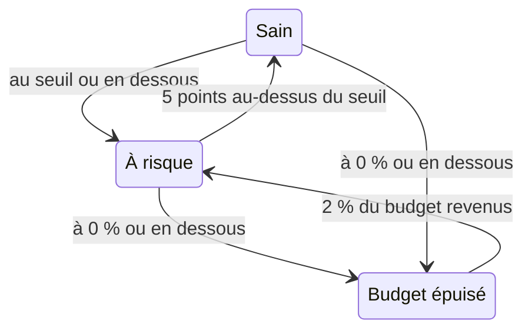

# Budgets d'erreur

Le budget d'erreur est l'indisponibilité que l'objectif d'un SLO autorise. Un objectif de 99,9 % ne veut pas dire « ne jamais tomber » : il veut dire « vous pouvez être indisponible jusqu'à 43 minutes sur 30 jours, alors dépensez-les avec soin ». Cette page explique comment OneUptime compte le budget, combien de temps il dure, comment il revient et qui en est informé.

:::cards
- [Comment le budget est calculé](#comment-le-budget-est-calculé): La formule, et le budget des objectifs courants.
- [Autonomie du budget](#autonomie-du-budget): Combien de temps le budget tient au rythme actuel.
- [Comment le budget se rétablit](#comment-le-budget-se-rétablit): Fenêtres glissantes et mois calendaires.
- [Notifications des propriétaires](#notifications-des-propriétaires): Qui est informé quand le budget s'amenuise.
:::

## Comment le budget est calculé

Le budget total est la part de la fenêtre que votre objectif ne promet pas :

```text
total budget = (100% − target) × window length
```

| Objectif | Fenêtre de 7 jours | Fenêtre de 28 jours | Fenêtre de 30 jours | Fenêtre de 90 jours |
| --- | --- | --- | --- | --- |
| 99% | 1h 40m 48s | 6h 43m 12s | 7h 12m | 21h 36m |
| 99.5% | 50m 24s | 3h 21m 36s | 3h 36m | 10h 48m |
| 99.9% | 10m 5s | 40m 19s | 43m 12s | 2h 9m 36s |
| 99.95% | 5m 2s | 20m 10s | 21m 36s | 1h 4m 48s |
| 99.99% | 1m 0s | 4m 2s | 4m 19s | 12m 58s |

La page **Paramètres** du SLO affiche le budget que son objectif autorise à côté de l'objectif, par exemple « 43m 12s d'indisponibilité par fenêtre de 30 jours ».

### Le budget d'un SLO à plusieurs moniteurs

En mode **Any Monitor Down**, le budget est `(100% − target) × window`, quel que soit le nombre de moniteurs que le SLO mesure : la fenêtre est une seule chronologie.

En mode **Monitor Seconds Average**, le budget est compté en secondes-moniteur, additionnées sur tous les moniteurs, et grandit donc avec leur nombre : un SLO à trois moniteurs à 99,9 % sur 30 jours a environ 129 minutes de budget au lieu de 43. Les pourcentages (SLI, budget restant, taux de consommation) gardent le même sens ; seules les durées changent.

### Le budget d'un mois calendaire

Un SLO par mois calendaire dispose du budget de tout le mois dès le premier jour : un SLO à 99,9 % dans un mois de 31 jours a ses 44m 38s entières le 1er. Le budget n'est pas calculé au prorata de la part du mois écoulée, une panne d'une minute le matin du 1er consomme donc une minute du budget du mois.

## Budget restant

À mesure que l'indisponibilité s'accumule, la **Vue d'ensemble** affiche le budget restant sur sa tuile **Budget d'erreur restant** :

- en pourcentage du total, qui décide aussi du statut du SLO et remplit la barre. La barre a un repère au seuil à risque du SLO ;
- en durée, par exemple "31m 4s left of 43m 12s".

Une fois le budget épuisé, la tuile affiche **No budget left**. Quand l'indisponibilité le dépasse, la tuile affiche **Budget exceeded** et le dépassement en durée, par exemple "4d 23m over budget · 5m 47s allowed" : le SLO a utilisé les 5 minutes et 47 secondes de son budget, plus 4 jours et 23 minutes. La barre reste vide et rouge.

Le budget restant est conservé comme un nombre signé pour les calculs et les graphiques d'historique, un budget dépassé y apparaît donc comme un pourcentage négatif. Un grand pourcentage négatif signifie que le dépassement est grand par rapport au budget ; ce n'est pas la part du temps pendant laquelle le service était indisponible.

Les secondes qui comptent comme indisponibilité dépendent des statuts d'indisponibilité du SLO et, pour un SLO à plusieurs moniteurs, de son mode multi-moniteurs, tous deux dans **Paramètres** → **Calcul de l'indisponibilité**. Voir [Vue d'ensemble des SLO](/docs/slo/introduction).

## Autonomie du budget

La tuile **Autonomie du budget** de la **Vue d'ensemble** répond à « si ça continue comme ça, quand serons-nous à court ? ». Elle divise le budget restant par le taux de consommation des 60 dernières minutes :

```text
runway = budget left ÷ (burn rate × (100% − target))
```

| La tuile affiche | Signification |
| --- | --- |
| Une durée, comme **~2d 5h** | Le budget s'épuise dans environ ce délai au rythme actuel. En orange, et en rouge dès qu'il reste un jour ou moins. **Under 1m** signifie moins d'une minute. |
| **Not burning** | Aucun budget n'a été consommé dans les 60 dernières minutes. |
| **Sustainable** | Fenêtres glissantes uniquement : l'autonomie atteint au moins une fenêtre entière, le budget n'est donc pas consommé plus vite que l'ancienne indisponibilité ne sort de la fenêtre. À ce rythme, il ne peut pas s'épuiser. |
| **Lasts until reset** | Mois calendaires uniquement : le budget est remis à zéro au début du mois suivant avant de s'épuiser. |
| **Overspent** | Le budget est déjà consommé. La tuile indique de combien il est dépassé. |

Pour les SLO par mois calendaire, la tuile indique aussi quand le budget est remis à zéro.

L'autonomie est une projection en ligne droite. Sur une fenêtre glissante, l'ancienne indisponibilité qui sort de la fenêtre rend du budget, ce que la projection ignore : lisez-la comme le temps minimal qu'il vous reste. Elle n'est pas affichée avant la première évaluation, ni pour les SLO en mode **Monitor Seconds Average**, dont le budget est compté en secondes-moniteur et non en temps d'horloge.

## Consommation du budget d'erreur

Le graphique **Consommation du budget d'erreur** de la **Vue d'ensemble** trace le budget restant, en pourcentage, sur la fenêtre de conformité actuelle :

- Une ligne à 0 % marque l'endroit où le budget est épuisé, et une ligne en pointillés marque le seuil à risque du SLO.
- Pour les SLO par mois calendaire, une ligne pâle descend régulièrement d'un budget plein au début du mois à un budget vide à la remise à zéro. En dessous, le mois consomme son budget trop vite.
- Un point est enregistré à chaque évaluation, toutes les 5 minutes, le graphique d'un nouveau SLO reste donc vide jusqu'à sa première évaluation.
- Faites glisser sur le graphique pour zoomer sur une partie de la fenêtre. Double-cliquez, ou cliquez sur **Reset zoom**, pour revoir toute la fenêtre.

**Ouvrir les métriques** ouvre la page **Métriques** du SLO, dont l'onglet **Error Budget History** remonte jusqu'à 400 jours. Voir [Métriques et tableaux de bord des SLO](/docs/slo/metrics).

## Comment le budget se rétablit

La façon dont le budget revient dépend du type de fenêtre du SLO :

:::tabs
@tab Rolling
Une fenêtre glissante regarde toujours la même durée en arrière à partir de maintenant, l'indisponibilité finit donc par en sortir : une panne cesse de compter exactement une fenêtre après s'être produite. Une panne de 30 minutes le 1er juin disparaît des comptes d'un SLO de 30 jours le 1er juillet, et le budget revient peu à peu, à mesure que chaque seconde d'indisponibilité quitte la fenêtre, pas d'un coup.

Le rétablissement se mérite donc, il ne se programme pas. Si de petites pannes continuent d'arriver, l'ancienne indisponibilité sort pendant que la nouvelle arrive, et le budget stagne au lieu de se rétablir.
@tab Calendar Month
Un SLO par mois calendaire est remis à zéro à minuit le premier de chaque mois, dans son fuseau horaire. Tout le budget revient d'un coup, et le mois précédent est clos. Rien n'est reporté, dans un sens comme dans l'autre : un mauvais mois n'entame pas le suivant, et un bon mois ne lui donne pas de marge.
:::

### Les jeunes SLO

Un SLO à fenêtre glissante plus jeune que sa fenêtre est mesuré sur les données qui existent jusqu'ici, et son budget total grandit avec elles : un SLO de 30 jours créé il y a une semaine a pour l'instant un budget de 7 jours. Tant que la fenêtre n'est pas pleine, la **Vue d'ensemble** indique son taux de remplissage, avec une pastille **Window 23% full** et la même note sur la tuile **Budget d'erreur restant**. Attendez-vous à ce que les chiffres se stabilisent à mesure que la fenêtre se remplit.

## Changements de statut et seuil à risque

Le budget restant décide du statut du SLO :

| Statut | Quand |
| --- | --- |
| **Sain** | Il reste plus que le seuil à risque du budget. |
| **À risque** | Le budget restant est au seuil à risque ou en dessous : 20 % par défaut. |
| **Budget épuisé** | Le budget restant est à zéro ou en dessous. |

Réglez le seuil à risque dans **Paramètres** → **Objectif**.

Les fenêtres glissantes se rétablissent seconde par seconde, un SLO proche d'une limite pourrait donc osciller entre deux statuts. Pour que chaque changement de statut ait un sens, un SLO ne quitte un statut qu'une fois nettement au-delà de la limite :



Avec le seuil par défaut de 20 %, un SLO à risque redevient sain à 25 % de budget restant, et un SLO au budget épuisé redevient à risque à 2 %. Chaque changement de statut apparaît dans le **Fil d'activité** du SLO, avec le SLI, le budget et le taux de consommation qui l'expliquent.

## Notifications des propriétaires

Quand un SLO passe **À risque** ou **Budget épuisé**, OneUptime notifie ses propriétaires :

- Les propriétaires sont les utilisateurs et les membres des équipes de la page **Propriétaires** du SLO qui sont encore membres du projet. Un SLO sans propriétaires notifie à la place les propriétaires du projet.
- Chaque propriétaire reçoit un e-mail par défaut, et la notification sur chaque autre canal qu'il active pour **SLO status changed** dans **Paramètres utilisateur** → **Paramètres de notification** → **Surveillance**.
- L'objet de l'e-mail nomme le statut et le SLO, par exemple `[SLO At Risk] API Availability`.

Pour qu'un SLO proche d'une limite ne notifie pas encore et encore, ses propriétaires sont notifiés au plus une fois par heure. Un passage à **Budget épuisé** est toujours envoyé, même dans cette heure.

> [!TIP]
> Les notifications des propriétaires disent aux responsables d'un SLO que son budget est en difficulté. Pour alerter votre équipe d'astreinte via des politiques d'escalade, utilisez les [Alertes et incidents de taux de consommation](/docs/slo/burn-rate-alerts). Une règle de taux de consommation peut aussi ajouter les propriétaires du SLO à chaque alerte et incident qu'elle crée.

## Prochaines étapes

:::cards
- [Alertes et incidents de taux de consommation](/docs/slo/burn-rate-alerts): Alertez votre équipe quand le budget se consomme trop vite.
- [Métriques et tableaux de bord des SLO](/docs/slo/metrics): Affichez le budget dans le temps.
- [Vue d'ensemble des SLO](/docs/slo/introduction): Objectifs, fenêtres et statuts d'indisponibilité.
:::
