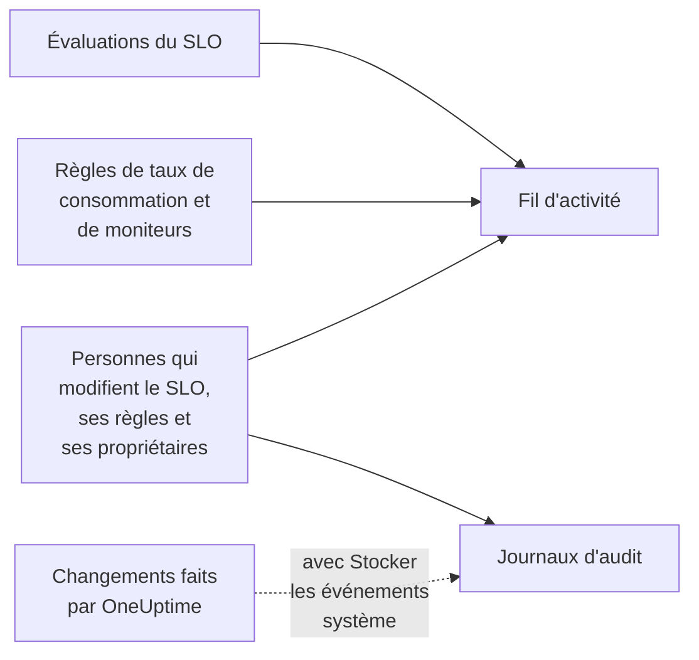

# Fil d'activité et journaux d'audit des SLO

Un SLO garde deux traces de son histoire, et elles répondent à des questions différentes. Le **Fil d'activité** répond à « qu'est-il arrivé à ce SLO ? », pour les personnes qui s'en occupent. Les **Journaux d'audit** répondent à « qui a changé quoi, exactement ? », champ par champ, pour les revues et la conformité.

## Fil d'activité ou journaux d'audit ?

| | **Fil d'activité** | **Journaux d'audit** |
| --- | --- | --- |
| Répond à | Ce qui est arrivé au SLO | Qui a changé quoi, et quand |
| Enregistre | Les changements de statut, les alertes et incidents de taux de consommation, et les changements du SLO, de ses règles, de ses moniteurs et de ses propriétaires | Chaque changement fait par une personne sur le SLO, ses règles de taux de consommation, ses règles de moniteurs et ses propriétaires, avec l'ancienne et la nouvelle valeur |
| Inclut le travail de OneUptime lui-même | Oui : les évaluations et les règles de moniteurs qui rattachent des moniteurs | Seulement avec **Stocker les événements système** activé |
| Offres | Toutes les offres | L'offre Enterprise sur OneUptime Cloud, ou l'Enterprise Edition sur une installation auto-hébergée |
| Conservation | Trois ans sur OneUptime Cloud | 7 jours par défaut, jusqu'à 180 |

## Le fil d'activité du SLO

Le fil d'activité se trouve sur la page **Fil d'activité** du SLO, et ses derniers éléments sous **Recent activity** dans la **Vue d'ensemble** du SLO. Les éléments renvoient vers le SLO, les moniteurs, les alertes et les incidents qu'ils mentionnent, et la plupart ont une section **Plus d'informations** avec les chiffres ou l'ancienne et la nouvelle valeur.

| Événement | Publié quand |
| --- | --- |
| SLO créé | Le SLO est créé. Indique son objectif, sa fenêtre de conformité, son SLI, son seuil à risque, sa description et les règles de taux de consommation par défaut avec lesquelles il a commencé. |
| SLO mis à jour | Le nom, la description, les étiquettes, l'objectif, la fenêtre de conformité, le fuseau horaire, le seuil à risque, le mode multi-moniteurs ou les statuts d'indisponibilité changent. Affiche chaque ancienne et nouvelle valeur. |
| SLO activé ou désactivé | L'évaluation est activée ou désactivée. |
| SLO archivé ou restauré | Le SLO est archivé ou désarchivé. |
| Statut modifié | Une évaluation fait passer le SLO à un nouveau statut. Affiche le SLI, le budget d'erreur, le taux de consommation et le seuil à risque qui l'expliquent, et la raison pour **En pause** ou **Mal configuré**. |
| Alerte de taux de consommation déclenchée | Une règle de taux de consommation crée une alerte. Renvoie vers elle et affiche les taux de consommation qui l'ont déclenchée. |
| Incident de taux de consommation déclaré | Une règle de taux de consommation déclare un incident. Renvoie vers lui et affiche les taux de consommation qui l'ont déclenché. |
| Alerte ou incident de taux de consommation résolu | L'alerte ou l'incident d'une règle se ferme : résolu automatiquement, ou à la main pendant que la résolution automatique était désactivée. |
| Règle de taux de consommation ajoutée, modifiée ou supprimée | Quelqu'un crée, modifie ou supprime une règle de taux de consommation. Les règles par défaut d'un nouveau SLO figurent plutôt dans son élément « SLO créé ». |
| Règle de moniteurs ajoutée, modifiée ou supprimée | Quelqu'un crée, modifie ou supprime une règle de moniteurs. Un enregistrement qui ne change rien d'important n'est pas publié. |
| Moniteurs rattachés ou détachés | Des moniteurs sont ajoutés au SLO ou retirés, à la main ou par une règle de moniteurs. Les longues listes nomment les premiers moniteurs « et N autres ». |
| Propriétaire ajouté ou retiré | Un utilisateur ou une équipe est ajouté aux propriétaires du SLO ou retiré. |
| Règle d'étiquettes appliquée | Une règle d'étiquettes a rattaché des étiquettes au SLO, à sa création ou quand quelqu'un a exécuté la règle. Nomme les règles qui correspondaient. Voir [Règles d'étiquettes et de propriétaires](/docs/slo/label-and-owner-rules). |
| Règle de propriétaire appliquée | Une règle de propriétaire a ajouté des propriétaires au SLO. Nomme les règles qui correspondaient ; chaque propriétaire qu'elle a ajouté reçoit aussi son propre élément « Propriétaire ajouté ». |

Quelques détails :

- Les éléments indiquent qui a fait un changement quand c'est une personne. Les changements que fait OneUptime lui-même, comme une évaluation ou une règle de moniteurs qui rattache un moniteur, et les changements faits par l'API ou une automatisation ne portent aucun utilisateur.
- Une alerte ou un incident qu'une règle reprend parce qu'il était encore ouvert n'est pas publié deux fois.
- Pour une alerte ou un incident privé, l'élément omet son titre, son numéro et son lien, car toute personne qui peut lire le SLO peut lire son fil d'activité. Il indique quand même qu'un enregistrement privé a été créé, et affiche les taux de consommation qui l'ont déclenché.
- Personne ne peut modifier ni supprimer les éléments du fil d'activité. Sur OneUptime Cloud, les éléments de plus de trois ans sont supprimés.

## Journaux d'audit

La page **Journaux d'audit** du SLO liste les changements apportés :

- au SLO lui-même : ses détails, ses paramètres, ses étiquettes, ses moniteurs et son archivage ;
- à ses règles de taux de consommation ;
- à ses règles de moniteurs ;
- à ses utilisateurs propriétaires et à ses équipes propriétaires.

Les changements des règles et des propriétaires sont enregistrés sur la règle ou le propriétaire et remontent jusqu'au SLO, si bien que sa page montre toute son histoire au même endroit, et chaque entrée renvoie vers la page à laquelle elle appartient. Les éléments liés comme les étiquettes et les moniteurs sont enregistrés avec leur nom, pas seulement leur ID.

Deux choses n'y figurent pas :

- **Les résultats d'évaluation.** Le SLI, le budget d'erreur, le taux de consommation, le statut et les heures d'évaluation changent toutes les quelques minutes. Leur historique se trouve dans la **Vue d'ensemble**, la page **Métriques** et le **Fil d'activité**.
- **Les changements que fait OneUptime lui-même**, comme une règle de moniteurs qui rattache ou détache un moniteur, sauf si **Stocker les événements système** est activé pour le projet. Le **Fil d'activité** enregistre les rattachements et détachements de moniteurs dans tous les cas.

### Activer les journaux d'audit

Les journaux d'audit sont une fonctionnalité Enterprise : ils demandent l'offre **Enterprise** sur OneUptime Cloud, ou l'Enterprise Edition sur une installation auto-hébergée. Sur les autres offres, la page **Journaux d'audit** du SLO explique comment l'obtenir. Sur une installation auto-hébergée, la journalisation d'audit cesse d'enregistrer sans licence valide (après l'essai de 14 jours, ou 30 jours après l'expiration d'une licence), et reprend dès qu'une licence est activée (voir [When a license expires or is missing](/docs/self-hosted/enterprise#quand-une-licence-expire-ou-manque)). Les pages **Journaux d'audit** indiquent quand rien n'est enregistré.

Les journaux d'audit sont aussi désactivés par défaut dans chaque projet. Pour les activer :

:::steps
### Ouvrir les paramètres des journaux d'audit

Allez dans **Paramètres du projet**, ouvrez **Journaux d'audit** dans le menu latéral et cliquez sur **Paramètres**.

### Modifier les paramètres

Cliquez sur **Edit Audit Log Settings** et activez **Activer les journaux d'audit**.

### Choisir ce qui est conservé

Définissez **Rétention (jours)**, de 7 (la valeur par défaut) à 180, et activez **Stocker les événements système** pour enregistrer aussi les changements que fait OneUptime lui-même. Enregistrez. Le changement s'applique en une minute environ.
:::

Tant que la journalisation d'audit est désactivée, la page **Journaux d'audit** du SLO affiche **Audit logging is off**, avec un lien pour l'activer. Les entrées enregistrées avant la désactivation restent visibles. Le journal d'audit complet du projet, pour toutes les ressources, se trouve dans **Paramètres du projet** → **Journaux d'audit** → **Journaux d'audit**.

## Prochaines étapes

:::cards
- [Vue d'ensemble des SLO](/docs/slo/introduction): Chaque page qu'a un SLO.
- [Moniteurs et règles de moniteurs](/docs/slo/monitor-rules): Ce qui rattache et détache les moniteurs.
- [Alertes et incidents de taux de consommation](/docs/slo/burn-rate-alerts): Ce qui déclenche et résout les alertes et incidents du fil d'activité.
- [Règles d'étiquettes et de propriétaires](/docs/slo/label-and-owner-rules): Ce qui ajoute automatiquement des étiquettes et des propriétaires.
:::
