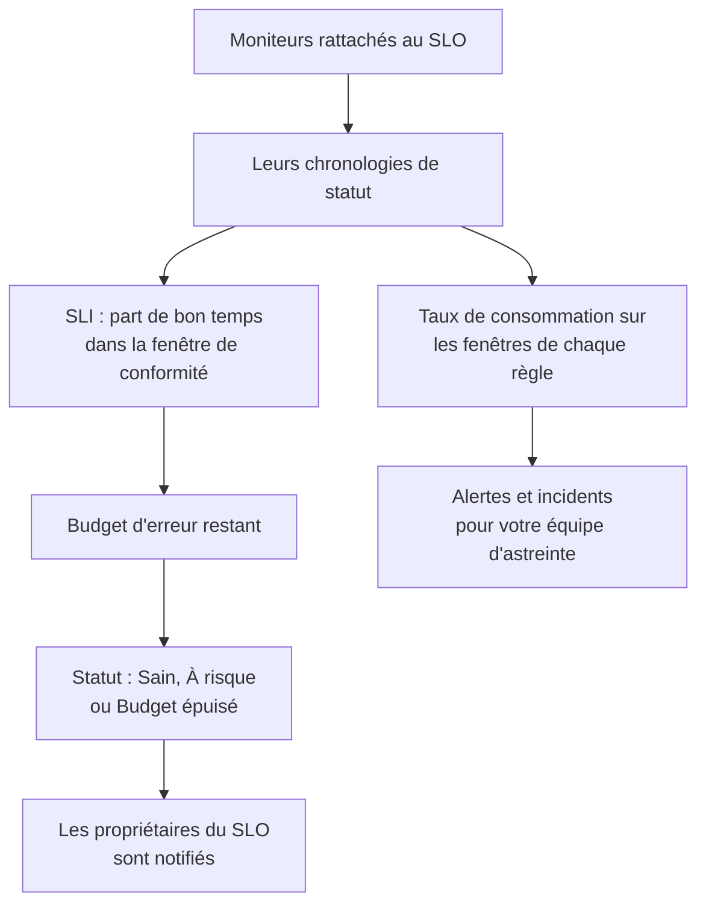

# Vue d'ensemble des SLO

Un objectif de niveau de service (SLO) est un objectif de fiabilité pour ce que vous surveillez, par exemple « disponible 99,9 % du temps sur 30 jours glissants ». OneUptime mesure chaque SLO par rapport à son objectif toutes les 5 minutes : au lieu de « est-ce que ça marche en ce moment ? », vous pouvez répondre à « avons-nous été assez fiables, sur une fenêtre qui compte pour nos utilisateurs, et quelle marge d'échec nous reste-t-il ? »

:::cards
- [Créer un SLO](#créer-un-slo): Un nom et un objectif. Tout le reste part d'une valeur par défaut.
- [Moniteurs et règles de moniteurs](/docs/slo/monitor-rules): Choisissez les moniteurs qu'un SLO mesure.
- [Budgets d'erreur](/docs/slo/error-budget): Combien d'indisponibilité un objectif autorise, et comment elle revient.
- [Alertes et incidents de taux de consommation](/docs/slo/burn-rate-alerts): Alertez votre équipe quand le budget se consomme trop vite.
:::

## Comment ça marche

Un SLO lit les chronologies de statut des moniteurs qui lui sont rattachés : les mêmes données que celles de vos pages de statut. À partir d'elles, OneUptime calcule quelle part de la fenêtre de conformité était du bon temps, ce qu'il reste du budget d'erreur et à quelle vitesse il se consomme.

## Notions clés

| Terme | Signification |
| --- | --- |
| **SLI** (indicateur de niveau de service) | La mesure : le pourcentage de la fenêtre de conformité pendant lequel les moniteurs du SLO étaient disponibles. |
| **SLO** (objectif de niveau de service) | Un objectif pour le SLI, par exemple « au moins 99,9 % sur les 30 derniers jours ». |
| **Budget d'erreur** | L'indisponibilité que l'objectif autorise : `(100% − target) × window`. À 99,9 % sur 30 jours, cela fait 43 minutes et 12 secondes. |
| **Taux de consommation** | La vitesse à laquelle le budget se consomme par rapport à un rythme régulier. Avec un taux de consommation de 1, le budget s'épuise exactement à la fin de la fenêtre. |

Un budget d'erreur fait de la fiabilité quelque chose que vous pouvez dépenser. S'il en reste beaucoup, livrez plus vite et prenez des risques ; s'il en reste peu, ralentissez et investissez dans la stabilité. Le SLO donne à cette discussion un chiffre que tout le monde voit.

## Créer un SLO

Il vous faut un rôle autorisé à créer des SLO : Project Owner, Project Admin ou un rôle personnalisé avec la permission Create Service Level Objective.

:::steps
### Ouvrir les SLO

Ouvrez **SLOs** depuis le menu **Produits** de la barre supérieure. Il se trouve dans le premier groupe, à côté des moniteurs et des incidents. Cliquez sur **Créer : Objectif de niveau de service**.

### Le nommer et fixer un objectif

Saisissez un **Nom**, par exemple « API Availability », et un **Target (%)** : la part du temps pendant laquelle ses moniteurs doivent être disponibles. L'objectif commence à `99.9`. Il doit être supérieur à 0 et au plus égal à 99,999, car un objectif de 100 % ne laisse aucun budget d'erreur à suivre.

### Vérifier les valeurs par défaut sous Plus de champs

**Plus de champs** est replié, avec une ligne qui dit ce que font ses valeurs par défaut : le SLO est mesuré sur une fenêtre glissante de 30 jours et passe à risque quand il reste moins de 20 % de son budget d'erreur. Dépliez-le pour modifier l'un des champs du tableau ci-dessous.

### Enregistrer le SLO

Cliquez sur **Créer : Objectif de niveau de service**. OneUptime ouvre le nouveau SLO. Sa **Vue d'ensemble** affiche **Choisissez ce que ce SLO mesure**, car un nouveau SLO n'a encore aucun moniteur.

### Rattacher des moniteurs

Cliquez sur **Créer une règle de moniteurs** pour rattacher chaque moniteur qui correspond, maintenant et plus tard, ou sur **Ajouter des moniteurs** pour les choisir à la main. Voir [Moniteurs et règles de moniteurs](/docs/slo/monitor-rules).

### Voir arriver les premiers chiffres

OneUptime évalue les SLO activés toutes les 5 minutes. Le SLI, le budget d'erreur et le graphique de consommation apparaissent après la première évaluation qui a des moniteurs à mesurer.
:::

Les champs sous **Plus de champs** :

| Champ | Ce que vous définissez | Par défaut |
| --- | --- | --- |
| **Description** | À quoi sert le SLO. | Vide |
| **Seuil à risque (%)** | La part du budget d'erreur restant à laquelle le SLO passe **À risque**. Un nombre entier de 0 à 100. | 20 |
| **Window Type** | **Rolling** : les N derniers jours, qui se rétablissent à mesure que l'ancienne indisponibilité sort de la fenêtre. **Calendar Month** : chaque mois pris à part, remis à zéro le 1er. | **Rolling** |
| **Window (Days)** | Fenêtres glissantes uniquement : combien de jours regarder en arrière, de 1 à 366. 28 ou 30 sont courants. | 30 |
| **Fuseau horaire** | Mois calendaires uniquement : le fuseau horaire dans lequel chaque mois commence et se termine. | UTC |
| **Étiquettes** | Des étiquettes pour organiser et filtrer les SLO. | Aucune |

Tout ce qui détermine la façon dont le SLO mesure part d'une valeur par défaut que vous modifiez ensuite :

| Réglage | Un nouveau SLO commence avec | À modifier dans |
| --- | --- | --- |
| Moniteurs | Aucun | **Moniteurs** ou **Règles de moniteurs** |
| Statuts d'indisponibilité | Tous les statuts non opérationnels du projet | **Paramètres** → **Calcul de l'indisponibilité** |
| Mode multi-moniteurs | **Any Monitor Down** | **Paramètres** → **Calcul de l'indisponibilité** |
| Évaluation | Activée | **Paramètres** → **Évaluation** |
| Règles de taux de consommation | Une règle **Fast burn** et une règle **Slow burn**, adaptées à la fenêtre | **Règles de taux de consommation** |

## De quoi est fait un SLO

| Élément | Ce qu'il décide |
| --- | --- |
| Moniteurs | D'où vient le SLI. Rattachez-les à la main ou avec des règles de moniteurs : voir [Moniteurs et règles de moniteurs](/docs/slo/monitor-rules). |
| Objectif | La part de bon temps que le SLO promet, supérieure à 0 et au plus égale à 99,999. |
| Fenêtre de conformité | La durée sur laquelle le SLI et le budget sont mesurés : une fenêtre glissante de 1 à 366 jours, ou un mois calendaire. |
| Seuil à risque | La part du budget restant à laquelle le SLO passe **À risque**. |
| Statuts d'indisponibilité | Les statuts de moniteur qui comptent comme indisponibilité. |
| Mode multi-moniteurs | La façon dont l'indisponibilité de plusieurs moniteurs se combine. |

### Quels statuts comptent comme indisponibilité

Chaque SLO a sa propre liste de statuts de moniteur qui comptent comme indisponibilité. Un nouveau SLO commence avec tous les statuts du projet qui ne sont pas marqués comme opérationnels, comme Degraded et Offline, comme le font vos pages de statut. Modifiez la liste dans **Paramètres** → **Calcul de l'indisponibilité**. Laissez-la vide pour compter tous les statuts non opérationnels, y compris ceux ajoutés plus tard au projet.

> [!TIP]
> Mesurez les mêmes moniteurs de deux façons avec deux SLO : un SLO de disponibilité strict où Degraded et Offline comptent tous deux, et un SLO de panne franche plus souple où seul Offline compte.

### Fenêtres de conformité

| Type de fenêtre | Comportement |
| --- | --- |
| **Rolling** | Regarde un nombre fixe de jours en arrière à partir de maintenant. L'ancienne indisponibilité sort de la fenêtre, donc le budget revient peu à peu. |
| **Calendar Month** | Mesure à partir du premier du mois, dans le fuseau horaire du SLO (UTC par défaut). Tout le budget revient au début de chaque mois. |

### Plusieurs moniteurs sur un SLO

Quand un SLO mesure plus d'un moniteur, son **Mode multi-moniteurs** décide comment leur indisponibilité se combine. Un nouveau SLO utilise **Any Monitor Down**.

| Mode | Comment l'indisponibilité compte | À utiliser quand |
| --- | --- | --- |
| **Any Monitor Down** | Tout moment où au moins un moniteur est en panne compte comme indisponibilité pour tout le SLO. Les pannes qui se chevauchent ne comptent qu'une fois. | Les moniteurs forment ensemble un seul service : si l'un d'eux tombe, les utilisateurs le remarquent. |
| **Monitor Seconds Average** | L'indisponibilité de chaque moniteur compte à part, en moyenne sur tout le temps surveillé : SLI = 1 − (secondes de panne de tous les moniteurs ÷ secondes surveillées de tous les moniteurs). | Les moniteurs forment une flotte de ressources similaires, et un impact partiel doit compter partiellement. |

Par exemple, le moniteur A est en panne de 10:00 à 11:00 tandis que le moniteur B reste disponible. **Any Monitor Down** enregistre 60 minutes d'indisponibilité ; **Monitor Seconds Average** enregistre l'équivalent de 30 minutes, car un moniteur sur deux a été en panne pendant une heure. Dans ce mode, le budget aussi est compté en secondes-moniteur : voir [Budgets d'erreur](/docs/slo/error-budget).

## Statut d'un SLO

OneUptime donne un statut à chaque SLO évalué :

| Statut | Signification |
| --- | --- |
| **Sain** | Il reste plus que le seuil à risque du budget. |
| **À risque** | Le budget restant est tombé au seuil à risque ou en dessous : 20 % par défaut. |
| **Budget épuisé** | Le budget est entièrement consommé, voire dépassé. |
| **Mal configuré** | Le SLO ne peut pas être mesuré : il n'a aucun moniteur, ses moniteurs n'existent plus ou n'ont encore enregistré aucun statut dans sa fenêtre, ou son objectif est hors limites. |
| **En pause** | Chaque moniteur qu'il mesure est archivé ou a la surveillance active désactivée, à la main, par un incident manuel ou par une maintenance planifiée. Il reprend tout seul dès que l'un d'eux est de nouveau surveillé. |

Un SLO désactivé ou archivé n'est pas évalué, son statut reste donc tel quel ; la liste des SLO affiche à la place une pastille **Désactivé** ou **Archivé**. Les propriétaires d'un SLO sont notifiés quand le statut passe à **À risque** ou **Budget épuisé** : voir [Budgets d'erreur](/docs/slo/error-budget).

## La liste des SLO

La page **SLOs** liste chaque SLO non archivé, avec son statut, son SLI, le budget restant, le taux de consommation, l'objectif, la fenêtre, les moniteurs, les étiquettes et les propriétaires.

- Les tuiles au-dessus de la liste comptent les SLO par statut : **Sain**, **À risque**, **Budget épuisé**, **Mal configuré**, **En pause** et **Désactivé**. Cliquez sur une tuile pour n'afficher que ces SLO, puis de nouveau pour tous les revoir.
- Sélectionnez des SLO pour ajouter ou retirer des étiquettes et des propriétaires, les archiver ou les supprimer, tous en même temps.
- La section **Paramètres** du menu latéral contient **Règles d'étiquettes** et **Règles de propriétaire**, qui étiquettent les nouveaux SLO et leur donnent des propriétaires : voir [Règles d'étiquettes et de propriétaires](/docs/slo/label-and-owner-rules).
- La section **Avancé** du menu latéral contient **Archivé**, la liste des SLO archivés.

## Les pages d'un SLO

Ouvrez un SLO pour voir ses pages dans le menu latéral :

| Page | Ce qu'elle affiche |
| --- | --- |
| **Vue d'ensemble** | Le statut, les chiffres clés, la consommation du budget d'erreur, l'activité récente, les alertes et incidents ouverts et les règles de taux de consommation. |
| **Métriques** | Les métriques `oneuptime.slo.*` du SLO, l'historique à long terme de son budget d'erreur, et les métriques des incidents et des alertes qui le concernent. Voir [Métriques et tableaux de bord des SLO](/docs/slo/metrics). |
| **Incidents** | Les incidents que ses règles de taux de consommation ont déclarés. Le badge compte ceux qui sont ouverts. |
| **Alertes** | Les alertes que ses règles de taux de consommation ont déclenchées. Le badge compte celles qui sont ouvertes. |
| **Fil d'activité** | Ce qui est arrivé au SLO, sous forme de chronologie. Voir [Fil d'activité et journaux d'audit des SLO](/docs/slo/feed-and-audit-logs). |
| **Moniteurs** | Les moniteurs qu'il mesure, et si c'est une personne ou une règle qui a rattaché chacun d'eux. |
| **Règles de moniteurs** | Les règles qui rattachent les moniteurs correspondants. |
| **Règles de taux de consommation** | Les règles qui déclenchent des alertes et déclarent des incidents quand le budget se consomme trop vite. |
| **Propriétaires** | Les utilisateurs et les équipes informés de ses changements de statut. |
| **Paramètres** | L'objectif, la période de conformité, le calcul de l'indisponibilité, l'interrupteur d'évaluation et la carte d'archivage. |
| **Journaux d'audit** | Qui a modifié le SLO, ses règles et ses propriétaires, et quand. |
| **Supprimer le SLO** | Supprime définitivement le SLO et résout les alertes et incidents de taux de consommation qu'il avait ouverts. |

**Moniteurs**, **Règles de moniteurs** et **Règles de taux de consommation** se trouvent dans une section **Configuration**, et **Propriétaires**, **Paramètres**, **Journaux d'audit** et **Supprimer le SLO** dans une section **Gestion**. Les deux sont repliées au départ, tout comme une section **Développeurs** pour gérer le SLO par le code : cliquez sur le titre d'une section pour l'ouvrir.

Quand quelque chose empêche un SLO de mesurer, un bandeau en haut de chacune de ses pages dit ce qui ne va pas et renvoie vers la page qui permet de le corriger : voir [Dépannage](#dépannage).

### La vue d'ensemble

La **Vue d'ensemble** répond à « sommes-nous dans le budget ? », de haut en bas :

- **Le résumé** : le statut, une phrase sur ce qu'il signifie, et la description. À côté se trouvent **Actualiser** et la date de la dernière évaluation. En dessous figurent l'objectif, la **Fenêtre de conformité** (avec une pastille de remplissage tant qu'une jeune fenêtre glissante se remplit : voir [Les jeunes SLO et l'indicateur de remplissage de la fenêtre](#les-jeunes-slo-et-lindicateur-de-remplissage-de-la-fenêtre)), le nombre de moniteurs et les propriétaires.
- **Les chiffres clés** :
  - **SLI** : la part de bon temps dans la fenêtre, et à quelle distance au-dessus ou en dessous de l'objectif elle se trouve.
  - **Budget d'erreur restant** : un pourcentage, une durée comme "12m 30s left of 43m 12s", et une barre avec un repère au seuil à risque. Une fois le budget dépassé, la tuile affiche **Budget exceeded** et de combien.
  - **Taux de consommation** : la vitesse à laquelle le budget se consomme sur les 60 dernières minutes, la période qu'utilise la règle de consommation rapide par défaut. Il passe à l'orange au-dessus de 1× et au rouge, avec **Rule threshold reached**, au plus bas seuil des règles de taux de consommation activées du SLO.
  - **Autonomie du budget** : combien de temps le budget tient à ce rythme. Voir [Budgets d'erreur](/docs/slo/error-budget#autonomie-du-budget).
- **Consommation du budget d'erreur** : le budget restant sur la fenêtre actuelle. Voir [Budgets d'erreur](/docs/slo/error-budget#consommation-du-budget-derreur).
- **Recent activity** : les derniers éléments du fil d'activité du SLO.
- **SLO Details** : le nom, la description et les étiquettes, les seuls réglages modifiés dans la vue d'ensemble.
- **Alertes et incidents ouverts** : ce que les règles de taux de consommation ont d'ouvert en ce moment.
- **Règles de taux de consommation** : le seuil de chaque règle activée à côté du taux de consommation actuel, et ce que déclare la règle.

### Paramètres

La page **Paramètres** regroupe la façon dont un SLO mesure, une carte chacun :

| Carte | Ce que vous modifiez | Bon à savoir |
| --- | --- | --- |
| **Objectif** | **Target (%)** et **Seuil à risque (%)**, avec **Modifier l'objectif**. | Affiche l'indisponibilité que l'objectif autorise, par exemple « 43m 12s d'indisponibilité par fenêtre de 30 jours ». |
| **Période de conformité** | **Window Type**, **Window (Days)** et **Fuseau horaire**, avec **Modifier la période**. | Les règles de taux de consommation gardent leurs seuils quand la fenêtre change, revoyez-les donc ensuite. |
| **Calcul de l'indisponibilité** | **Mode multi-moniteurs** et **Statuts de moniteur d'indisponibilité**, avec **Modifier le calcul de l'indisponibilité**. | Des statuts vides comptent tous les statuts non opérationnels, y compris ceux ajoutés plus tard. |
| **Évaluation** | L'interrupteur **Évaluer ce SLO**, qui enregistre dès que vous le basculez. | Le désactiver demande d'abord confirmation, car cela résout aussi les alertes et incidents de taux de consommation ouverts du SLO. |
| **Archive SLO** | **Archiver** ou **Désarchiver**. | Voir [Archiver un SLO](#archiver-un-slo). |

Après une modification de l'objectif, de la période ou du calcul de l'indisponibilité, OneUptime réévalue le SLO à son exécution suivante.

## Archiver un SLO

Archivez un SLO que vous ne mesurez plus mais que vous voulez garder, comme un service retiré ou l'objectif de l'an dernier. Archivez-le depuis **Paramètres** → **Archive SLO**, ou sélectionnez des SLO dans la liste et choisissez **Archiver**.

Un SLO archivé :

- est masqué de la liste des SLO, de ses tuiles de statut, et des sélecteurs et listes de SLO des tableaux de bord ;
- n'est pas évalué : ses chiffres restent ceux de la dernière évaluation, ses règles de taux de consommation ne se déclenchent pas et il n'envoie aucune métrique ;
- voit ses alertes et incidents de taux de consommation ouverts résolus ;
- garde ses paramètres, son historique, ses règles et ses propriétaires. Ses règles de moniteurs tiennent sa liste de moniteurs à jour, il reprend donc avec les bons moniteurs.

Les SLO archivés sont listés sur la page **Archivé**, sous **Avancé** dans le menu latéral de la liste des SLO. Sélectionnez-les là et choisissez **Désarchiver** pour les faire revenir : ils sont de nouveau évalués à l'exécution suivante, avec le SLI et le budget recalculés à partir de l'historique de leurs moniteurs.

Archiver et désactiver l'évaluation sont deux interrupteurs distincts. Un SLO désactivé avant d'être archivé reste désactivé quand vous le désarchivez : réactivez-le avec **Activer l'évaluation** dans son bandeau, ou avec **Évaluer ce SLO** dans **Paramètres** → **Évaluation**.

| Vous voulez | Faites ceci |
| --- | --- |
| Arrêter de mesurer un moment, en le gardant dans la liste | Désactiver l'évaluation |
| Le retirer, mais garder son historique et ses paramètres | L'archiver |
| Le supprimer pour de bon | Le supprimer |

## Les SLO sur les alertes, les incidents et les moniteurs

Chaque alerte et chaque incident qu'une règle de taux de consommation crée est lié à son SLO :

- La page de l'alerte ou de l'incident liste le SLO sous **Ressources affectées**, avec un lien vers lui.
- Les listes d'alertes et d'incidents affichent le SLO parmi les ressources affectées, et le filtre **Ressources affectées** restreint une liste à un SLO.
- Les pages **Alertes** et **Incidents** du SLO les listent, et leurs badges dans le menu latéral comptent ceux qui sont ouverts.

OneUptime établit ce lien quand une règle crée l'alerte ou l'incident ; vous ne pouvez pas l'ajouter à la main, et modifier l'alerte ou l'incident ne le retire jamais.

Le menu latéral d'un moniteur a lui aussi une page **SLOs** : les SLO qui mesurent ce moniteur, pour savoir quels objectifs en dépendent avant de le mettre en pause ou de le modifier.

## Les jeunes SLO et l'indicateur de remplissage de la fenêtre

Un SLO à fenêtre glissante plus jeune que sa fenêtre est mesuré sur les données qui existent jusqu'ici : un SLO de 30 jours créé hier a un jour de données. Son budget d'erreur commence petit et grandit à mesure que la fenêtre se remplit, ses premiers chiffres bougent donc plus qu'ils ne le feront ensuite.

Tant que c'est le cas, la **Vue d'ensemble** le dit : le résumé affiche une pastille **Window 23% full** (**Window under 1% full** le premier jour), et la tuile **Budget d'erreur restant** la reprend sous son chiffre. Les deux disparaissent une fois la fenêtre pleine. Les SLO par mois calendaire ne les affichent jamais, car leur budget couvre tout le mois dès le premier jour, pas plus que les SLO en mode **Monitor Seconds Average**, dont le budget est compté sur l'ensemble des moniteurs.

## Dépannage

Un bandeau en haut des pages du SLO dit ce qui l'empêche de mesurer :

| Bandeau | Signification | Que faire |
| --- | --- | --- |
| **No monitors attached** | Le SLO n'a aucun moniteur, il n'y a donc rien à mesurer. | Rattachez des moniteurs ou créez une règle de moniteurs. |
| **Waiting for SLO evaluation** | Des moniteurs sont rattachés, mais la dernière évaluation n'avait aucune donnée de statut venant d'eux. | Vérifiez que les moniteurs sont bien vérifiés. Les chiffres apparaissent après la prochaine évaluation qui a des données. |
| **Measurement is paused** | Chaque moniteur qu'il mesure est archivé ou a la surveillance active désactivée. | Réactivez la surveillance d'au moins un moniteur, ou attendez la fin de la maintenance. |
| **The target is out of range** | L'objectif n'est pas supérieur à 0 et inférieur à 100. | Fixez un objectif comme 99,9 dans **Paramètres** → **Objectif**. |
| **This SLO is disabled** | L'évaluation est désactivée. | Cliquez sur **Activer l'évaluation**. |
| **This SLO is archived** | Le SLO est archivé. | Désarchivez-le dans **Paramètres**. |
| **Pas encore évalué** | Le SLO vient d'être créé. | Attendez la première évaluation, quelques minutes au plus. |

## Prochaines étapes

:::cards
- [Moniteurs et règles de moniteurs](/docs/slo/monitor-rules): Rattachez des moniteurs à la main ou avec des règles.
- [Budgets d'erreur](/docs/slo/error-budget): Le calcul du budget, l'autonomie et la façon dont le budget revient.
- [Alertes et incidents de taux de consommation](/docs/slo/burn-rate-alerts): Alertez votre équipe d'astreinte quand le budget se consomme trop vite.
- [Métriques et tableaux de bord des SLO](/docs/slo/metrics): Affichez les SLO en graphiques et construisez un tableau de bord de SLO.
:::
