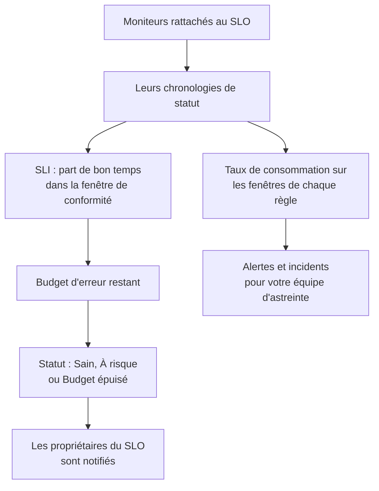

# Vue d'ensemble des SLO

Un objectif de niveau de service (SLO) est un objectif de fiabilité pour ce que vous exploitez, par exemple « disponible 99,9 % du temps sur 30 jours glissants » ou « 99,9 % des requêtes de paiement réussissent ». OneUptime mesure chaque SLO par rapport à son objectif toutes les 5 minutes : au lieu de « est-ce que ça marche en ce moment ? », vous pouvez répondre à « avons-nous été assez fiables, sur une fenêtre qui compte pour nos utilisateurs, et quelle marge d'échec nous reste-t-il ? » Le [Glossaire](/docs/introduction/glossary#slo) place les SLO à côté des autres mots qu'utilise OneUptime.

:::cards
- [Créer un SLO](#créer-un-slo): Ce qu'il mesure, un nom et un objectif. Tout le reste part d'une valeur par défaut.
- [Moniteurs et règles de moniteurs](/docs/slo/monitor-rules): Choisissez les moniteurs qu'un SLO mesure.
- [SLO de requêtes et de latence](/docs/slo/request-slos): Mesurez les requêtes de services, à partir de leurs traces.
- [Budgets d'erreur](/docs/slo/error-budget): Combien d'indisponibilité un objectif autorise, et comment elle revient.
- [Alertes et incidents de taux de consommation](/docs/slo/burn-rate-alerts): Alertez votre équipe quand le budget se consomme trop vite.
:::

## Comment ça marche

Un SLO mesure l'une de deux choses. Un SLO de disponibilité des moniteurs lit les chronologies de statut des moniteurs qui lui sont rattachés : les mêmes données que celles de vos pages de statut. Un SLO de requêtes compte les requêtes que servent ses services, à partir de leurs traces : voir [SLO de requêtes et de latence](/docs/slo/request-slos). La suite de cette page décrit les SLO de disponibilité des moniteurs, et les SLO de requêtes fonctionnent de la même façon, sauf mention contraire. À partir de ces données, OneUptime calcule quelle part de la fenêtre de conformité était du bon temps, ce qu'il reste du budget d'erreur et à quelle vitesse il se consomme. Le temps pendant lequel la surveillance d'un moniteur est désactivée est écarté : rien ne vérifie alors le moniteur, ce temps ne consomme donc pas de budget d'erreur et ne compte pas non plus comme du bon temps. Le temps qui précède la première vérification d'un moniteur l'est aussi : tant que rien n'a vérifié un moniteur, son statut n'est que le statut opérationnel dans lequel tout moniteur est créé, si bien qu'un SLO se mesure à partir des premières vérifications de ses moniteurs, et qu'un SLO dont rien n'a encore vérifié les moniteurs n'a rien à mesurer tant qu'ils ne l'ont pas été.



## Notions clés

Les mots utilisés dans tout OneUptime se trouvent dans le [Glossaire](/docs/introduction/glossary).

| Terme | Signification |
| --- | --- |
| **SLI** (indicateur de niveau de service) | La mesure : le pourcentage de la fenêtre de conformité pendant lequel les moniteurs du SLO étaient disponibles, ou des requêtes de ses services qui étaient bonnes. |
| **SLO** (objectif de niveau de service) | Un objectif pour le SLI, par exemple « au moins 99,9 % sur les 30 derniers jours ». |
| **Budget d'erreur** | L'indisponibilité que l'objectif autorise : `(100% − target) × window`. À 99,9 % sur 30 jours, cela fait 43 minutes et 12 secondes. Pour un SLO de requêtes, ce sont les mauvaises requêtes que l'objectif autorise : une sur 1 000 à 99,9 %. |
| **Taux de consommation** | La vitesse à laquelle le budget se consomme par rapport à un rythme régulier. Avec un taux de consommation de 1, le budget s'épuise exactement à la fin de la fenêtre. |

Un budget d'erreur fait de la fiabilité quelque chose que vous pouvez dépenser. S'il en reste beaucoup, livrez plus vite et prenez des risques ; s'il en reste peu, ralentissez et investissez dans la stabilité. Le SLO donne à cette discussion un chiffre que tout le monde voit.

## Créer un SLO

Il vous faut un rôle autorisé à créer des SLO : Propriétaire du projet, Administrateur du projet ou un rôle personnalisé avec la permission Create Service Level Objective.

:::steps
### Ouvrir les SLO

Ouvrez **SLO** depuis le menu **Produits** de la barre supérieure. Il se trouve dans le premier groupe, à côté des moniteurs et des incidents. Cliquez sur **Créer : Objectif de niveau de service**.

### Choisir ce qu'il mesure

Sous **Ce qui est mesuré**, gardez **Disponibilité des moniteurs** pour mesurer la part du temps pendant laquelle des moniteurs sont disponibles. Pour mesurer plutôt les requêtes de services, choisissez **Réussite des requêtes** ou **Latence des requêtes**, puis leurs **Services** : voir [SLO de requêtes et de latence](/docs/slo/request-slos). Choisissez **Métrique** pour compter les bons événements d'un compteur ou d'un histogramme qu'envoient vos services : voir [SLO à partir d'une métrique](/docs/slo/request-slos#slo-à-partir-dune-métrique). Cliquez sur **Suivant**.

### Le nommer et fixer un objectif

Saisissez un **Nom**, par exemple « API Availability », et une **Cible (%)** : la part du temps, ou des requêtes, qui doit être bonne. L'objectif commence à `99.9`. Il doit être supérieur à 0 et au plus égal à 99,999, car un objectif de 100 % ne laisse aucun budget d'erreur à suivre.

### Vérifier les valeurs par défaut sous Plus de champs

**Plus de champs** est replié, avec une ligne qui dit ce que font ses valeurs par défaut : le SLO est mesuré sur une fenêtre glissante de 30 jours et passe à risque quand il reste moins de 20 % de son budget d'erreur. Dépliez-le pour modifier l'un des champs du tableau ci-dessous.

### Enregistrer le SLO

Cliquez sur **Créer : Objectif de niveau de service**. OneUptime ouvre le nouveau SLO. La **Vue d'ensemble** d'un SLO de disponibilité des moniteurs affiche **Choisissez ce que ce SLO mesure**, car il n'a encore aucun moniteur.

### Rattacher des moniteurs

Pour un SLO de disponibilité des moniteurs, cliquez sur **Créer une règle de moniteurs** pour rattacher chaque moniteur qui correspond, maintenant et plus tard, ou sur **Ajouter des moniteurs** pour les choisir à la main. Voir [Moniteurs et règles de moniteurs](/docs/slo/monitor-rules).

### Voir arriver les premiers chiffres

OneUptime évalue les SLO activés toutes les 5 minutes. Le SLI, le budget d'erreur et le graphique de consommation apparaissent après la première évaluation qui a des moniteurs à mesurer, ou des requêtes à compter.
:::

Les champs sous **Plus de champs** :

| Champ | Ce que vous définissez | Par défaut |
| --- | --- | --- |
| **Description** | À quoi sert le SLO. | Vide |
| **Seuil à risque (%)** | La part du budget d'erreur restant à laquelle le SLO passe **À risque**. Un nombre entier de 0 à 100. | 20 |
| **Type de fenêtre** | **Glissante** : les N derniers jours, qui se rétablissent à mesure que l'ancienne indisponibilité sort de la fenêtre. **Mois calendaire** : chaque mois pris à part, remis à zéro le 1er. | **Glissante** |
| **Fenêtre (jours)** | Fenêtres glissantes uniquement : combien de jours regarder en arrière, de 1 à 366. 28 ou 30 sont courants. | 30 |
| **Fuseau horaire** | Mois calendaires uniquement : le fuseau horaire dans lequel chaque mois commence et se termine. | UTC |
| **Étiquettes** | Des étiquettes pour organiser et filtrer les SLO. | Aucune |

Tout ce qui détermine la façon dont le SLO mesure part d'une valeur par défaut que vous modifiez ensuite :

| Réglage | Un nouveau SLO commence avec | À modifier dans |
| --- | --- | --- |
| Moniteurs | Aucun | **Moniteurs** ou **Règles de moniteurs** |
| Statuts d'indisponibilité | Tous les statuts non opérationnels du projet | **Paramètres** → **Calcul de l'indisponibilité** |
| Mode multi-moniteurs | **Un moniteur hors service** | **Paramètres** → **Calcul de l'indisponibilité** |
| Évaluation | Activée | **Paramètres** → **Évaluation** |
| Règles de taux de consommation | Une règle **Fast burn**, une règle **Slow burn** et une règle **Slow leak**, adaptées à la fenêtre | **Règles de taux de consommation** |

## De quoi est fait un SLO

| Élément | Ce qu'il décide |
| --- | --- |
| Ce qu'il mesure | **Disponibilité des moniteurs**, **Réussite des requêtes** ou **Latence des requêtes**. |
| Moniteurs ou services | D'où vient le SLI : des moniteurs, rattachés à la main ou avec des règles de moniteurs (voir [Moniteurs et règles de moniteurs](/docs/slo/monitor-rules)), ou les services dont un SLO de requêtes compte les requêtes. |
| Objectif | La part de bon temps que le SLO promet, supérieure à 0 et au plus égale à 99,999. |
| Fenêtre de conformité | La durée sur laquelle le SLI et le budget sont mesurés : une fenêtre glissante de 1 à 366 jours, ou un mois calendaire. |
| Seuil à risque | La part du budget restant à laquelle le SLO passe **À risque**. |
| Statuts d'indisponibilité | Les statuts de moniteur qui comptent comme indisponibilité. |
| Mode multi-moniteurs | La façon dont l'indisponibilité de plusieurs moniteurs se combine. |

### Quels statuts comptent comme indisponibilité

Chaque SLO a sa propre liste de statuts de moniteur qui comptent comme indisponibilité. Un nouveau SLO commence avec tous les statuts du projet qui ne sont pas marqués comme opérationnels, comme Degraded et Offline, comme le font vos pages de statut. Modifiez la liste dans **Paramètres** → **Calcul de l'indisponibilité**. Laissez-la vide pour compter tous les statuts non opérationnels, y compris ceux ajoutés plus tard au projet.

> [!TIP]
> Mesurez les mêmes moniteurs de deux façons avec deux SLO : un SLO de disponibilité strict où Degraded et Offline comptent tous deux, et un SLO de panne franche plus souple où seul Offline compte.

### Fenêtres de conformité

| Type de fenêtre | Comportement |
| --- | --- |
| **Glissante** | Regarde un nombre fixe de jours en arrière à partir de maintenant. L'ancienne indisponibilité sort de la fenêtre, donc le budget revient peu à peu. |
| **Mois calendaire** | Mesure à partir du premier du mois, dans le fuseau horaire du SLO (UTC par défaut). Tout le budget revient au début de chaque mois. |

### Plusieurs moniteurs sur un SLO

Quand un SLO mesure plus d'un moniteur, son **Mode multi-moniteurs** décide comment leur indisponibilité se combine. Un nouveau SLO utilise **Un moniteur hors service**.

| Mode | Comment l'indisponibilité compte | À utiliser quand |
| --- | --- | --- |
| **Un moniteur hors service** | Tout moment où au moins un moniteur est en panne compte comme indisponibilité pour tout le SLO. Les pannes qui se chevauchent ne comptent qu'une fois. | Les moniteurs forment ensemble un seul service : si l'un d'eux tombe, les utilisateurs le remarquent. |
| **Moyenne des secondes des moniteurs** | L'indisponibilité de chaque moniteur compte à part, en moyenne sur tout le temps surveillé : SLI = 1 − (secondes de panne de tous les moniteurs ÷ secondes surveillées de tous les moniteurs). | Les moniteurs forment une flotte de ressources similaires, et un impact partiel doit compter partiellement. |

Par exemple, le moniteur A est en panne de 10:00 à 11:00 tandis que le moniteur B reste disponible. **Un moniteur hors service** enregistre 60 minutes d'indisponibilité ; **Moyenne des secondes des moniteurs** enregistre l'équivalent de 30 minutes, car un moniteur sur deux a été en panne pendant une heure. Dans ce mode, le budget aussi est compté en secondes-moniteur : voir [Budgets d'erreur](/docs/slo/error-budget).

## Statut d'un SLO

OneUptime donne un statut à chaque SLO évalué :

| Statut | Signification |
| --- | --- |
| **Sain** | Il reste plus que le seuil à risque du budget. |
| **À risque** | Le budget restant est tombé au seuil à risque ou en dessous : 20 % par défaut. |
| **Budget épuisé** | Le budget est entièrement consommé, voire dépassé. |
| **En attente** | Rien n'a encore vérifié ses moniteurs : un moniteur créé il y a une minute, ou une sonde auto-hébergée qui n'est pas connectée. Il est mesuré à partir de leur première vérification. |
| **Mal configuré** | Le SLO ne peut pas être mesuré : il n'a aucun moniteur, ses moniteurs n'existent plus ou n'ont encore enregistré aucun statut dans sa fenêtre, ou son objectif est hors limites. Un SLO de requêtes est mal configuré sans services, sans seuil de latence, ou tant que ses services n'ont servi aucune requête dans sa fenêtre. |
| **En pause** | Chaque moniteur qu'il mesure est archivé ou a la surveillance active désactivée, à la main, par un incident manuel ou par une maintenance planifiée. Il reprend tout seul dès que l'un d'eux est de nouveau surveillé. |

Un SLO désactivé ou archivé n'est pas évalué, son statut reste donc tel quel ; la liste des SLO affiche à la place une pastille **Désactivé** ou **Archivé**. Les propriétaires d'un SLO sont notifiés quand le statut passe à **À risque** ou **Budget épuisé** : voir [Budgets d'erreur](/docs/slo/error-budget). Une règle peut aussi publier les changements de statut dans Slack, Microsoft Teams ou Mattermost : voir [Changements de statut](/docs/slo/error-budget-policy#changements-de-statut).

## La liste des SLO

La page **SLO** liste chaque SLO non archivé, avec son statut, son SLI, le budget restant, le taux de consommation, l'objectif, la fenêtre, les moniteurs, les étiquettes et les propriétaires. Sa colonne **Ce qui est mesuré** affiche les services d'un SLO de requêtes là où elle affiche les moniteurs d'un SLO de disponibilité, et le filtre **Services** trouve les SLO qui mesurent un service.

- Les tuiles au-dessus de la liste comptent les SLO par statut : **Sain**, **À risque**, **Budget épuisé**, **En attente**, **Mal configuré**, **En pause** et **Désactivé**. Elles s'affichent dès qu'il existe un SLO non archivé. Cliquez sur une tuile pour n'afficher que ces SLO, puis de nouveau pour tous les revoir.
- Sélectionnez des SLO pour ajouter ou retirer des étiquettes et des propriétaires, les activer ou les désactiver, leur donner les [règles de taux de consommation recommandées](/docs/slo/burn-rate-alerts#les-ajouter-à-plusieurs-slo-à-la-fois) qui leur manquent ou la [politique de budget d'erreur recommandée](/docs/slo/error-budget-policy#la-politique-recommandée), les archiver ou les supprimer, tous en même temps.
- Le filtre **Déploiements** affiche les SLO dont la politique de budget d'erreur gèle les déploiements en ce moment, ou ceux où elle les autorise. Affichez la colonne **Déploiements** depuis le sélecteur de colonnes de la liste pour voir depuis quand chacun est gelé : voir [Barrière de déploiement](/docs/slo/error-budget-policy#barrière-de-déploiement).
- La section **Paramètres** du menu latéral contient **Règles d'étiquettes** et **Règles de propriétaire**, qui étiquettent les nouveaux SLO et leur donnent des propriétaires : voir [Règles d'étiquettes et de propriétaires](/docs/slo/label-and-owner-rules).
- La section **Avancé** du menu latéral contient **Archivé**, la liste des SLO archivés.

## Les pages d'un SLO

Ouvrez un SLO pour voir ses pages dans le menu latéral :

| Page | Ce qu'elle affiche |
| --- | --- |
| **Vue d'ensemble** | Le statut, les chiffres clés, la consommation du budget d'erreur, l'activité récente, les alertes et incidents ouverts et les règles de taux de consommation. |
| **Métriques** | Les métriques `oneuptime.slo.*` du SLO, l'historique à long terme de son budget d'erreur, et les métriques des incidents et des alertes qui le concernent. Voir [Métriques et tableaux de bord des SLO](/docs/slo/metrics). |
| **Rapport mensuel** | Comment le SLO s'est comporté chaque mois calendaire, et sur toute la période. Voir [Le rapport mensuel](#le-rapport-mensuel). |
| **Incidents** | Les incidents que ses règles de taux de consommation et sa politique de budget d'erreur ont déclarés. Le badge compte ceux qui sont ouverts. |
| **Alertes** | Les alertes que ses règles de taux de consommation et sa politique de budget d'erreur ont déclenchées. Le badge compte celles qui sont ouvertes. |
| **Fil d'activité** | Ce qui est arrivé au SLO, sous forme de chronologie. Voir [Fil d'activité et journaux d'audit des SLO](/docs/slo/feed-and-audit-logs). |
| **Moniteurs** | Les moniteurs qu'il mesure, et si c'est une personne ou une règle qui a rattaché chacun d'eux. SLO de disponibilité des moniteurs uniquement. |
| **Règles de moniteurs** | Les règles qui rattachent les moniteurs correspondants. SLO de disponibilité des moniteurs uniquement. |
| **Règles de taux de consommation** | Les règles qui déclenchent des alertes et déclarent des incidents quand le budget se consomme trop vite. |
| **Politique de budget d'erreur** | Ce que l'équipe s'est engagée à faire à mesure que le budget d'erreur diminue, et les alertes et incidents que déclenche chaque palier de la politique. Voir [Politique de budget d'erreur](/docs/slo/error-budget-policy). |
| **Propriétaires** | Les utilisateurs et les équipes informés de ses changements de statut. |
| **Paramètres** | Ce qu'il mesure, l'objectif, la période de conformité, le calcul de l'indisponibilité, l'interrupteur d'évaluation et la carte d'archivage. |
| **Journaux d'audit** | Qui a modifié le SLO, ses règles et ses propriétaires, et quand. |
| **Supprimer le SLO** | Supprime définitivement le SLO et résout les alertes et incidents de taux de consommation qu'il avait ouverts. |

**Moniteurs** se trouve dans la section **Vue d'ensemble**, sous **Vue d'ensemble** ; **Règles de moniteurs**, **Règles de taux de consommation** et **Politique de budget d'erreur** dans une section **Règles** ; et **Propriétaires**, **Paramètres**, **Journaux d'audit** et **Supprimer le SLO** dans une section **Gestion**. **Règles** et **Gestion** sont repliées au départ, tout comme une section **Développeurs** pour gérer le SLO par le code : cliquez sur le titre d'une section pour l'ouvrir.

Quand quelque chose empêche un SLO de mesurer, un bandeau en haut de chacune de ses pages dit ce qui ne va pas et renvoie vers la page qui permet de le corriger : voir [Dépannage](#dépannage).

### La vue d'ensemble

La **Vue d'ensemble** répond à « sommes-nous dans le budget ? », de haut en bas :

- **Le résumé** : le statut, une phrase sur ce qu'il signifie, et la description. À côté se trouvent **Actualiser** et la date de la dernière évaluation. En dessous figurent l'objectif, la **Fenêtre de conformité** (avec une pastille de remplissage tant qu'une jeune fenêtre glissante se remplit : voir [Les jeunes SLO et l'indicateur de remplissage de la fenêtre](#les-jeunes-slo-et-lindicateur-de-remplissage-de-la-fenêtre)), le nombre de moniteurs (ou les services d'un SLO de requêtes) et les propriétaires, avec **Ajouter des propriétaires** pour en ajouter un sur place.
- **Les chiffres clés** :
  - **SLI** : la part de bon temps dans la fenêtre, et à quelle distance au-dessus ou en dessous de l'objectif elle se trouve.
  - **Budget d'erreur restant** : un pourcentage, une durée comme "12 min 30 s restant sur 43 min 12 s" (pour un SLO de requêtes, un nombre de mauvaises requêtes), et une barre avec un repère au seuil à risque. Une fois le budget dépassé, la tuile affiche **Budget dépassé** et de combien.
  - **Taux de consommation** : la vitesse à laquelle le budget se consomme sur les 60 dernières minutes, la période qu'utilise la règle de consommation rapide par défaut. Il passe à l'orange au-dessus de 1× et au rouge, avec **Seuil de la règle atteint**, au plus bas seuil des règles de taux de consommation activées du SLO dont la période est de 6 heures ou moins. Une heure en dit peu sur une règle dont la période se compte en jours, comme **Slow leak**, il n'est donc pas comparé à une telle règle.
  - **Autonomie du budget** : combien de temps le budget tient à ce rythme. Voir [Budgets d'erreur](/docs/slo/error-budget#autonomie-du-budget).
- **Consommation du budget d'erreur** : le budget restant sur la fenêtre actuelle. Voir [Budgets d'erreur](/docs/slo/error-budget#consommation-du-budget-derreur).
- **Activité récente** : les derniers éléments du fil d'activité du SLO.
- **Détails du SLO** : le nom, la description et les étiquettes, les seuls réglages modifiés dans la vue d'ensemble.
- **Alertes et incidents ouverts** : ce que les règles de taux de consommation ont d'ouvert en ce moment.
- **Règles de taux de consommation** : le seuil de chaque règle activée à côté du taux de consommation actuel, pour les règles dont la période est de 6 heures ou moins, et ce que déclare la règle.

Quand le SLO est dans un palier de sa politique de budget d'erreur, la **Vue d'ensemble** affiche aussi ce palier et ce que l'équipe s'est engagée à y faire : voir [Politique de budget d'erreur](/docs/slo/error-budget-policy).

La carte **Utilisé par** liste les règles de taux de consommation et les paliers de la politique de budget d'erreur qui agissent sur le SLO, et les tableaux de bord qui l'affichent. Archiver ou supprimer le SLO les dit d'abord : ses règles et paliers partent avec lui.

### Paramètres

La page **Paramètres** regroupe la façon dont un SLO mesure, une carte chacun :

| Carte | Ce que vous modifiez | Bon à savoir |
| --- | --- | --- |
| **Ce qui est mesuré** | **Ce qui est mesuré**, **Services**, **Seuil de latence (ms)**, **Filtre de requêtes** et **Métrique**, avec **Modifier ce qui est mesuré**. | Après une modification, un SLO de requêtes recompte ses requêtes depuis le début. |
| **Objectif** | **Cible (%)** et **Seuil à risque (%)**, avec **Modifier l'objectif**. | Affiche l'indisponibilité que l'objectif autorise, par exemple « 43 min 12 s d'indisponibilité par fenêtre de 30 jours ». |
| **Période de conformité** | **Type de fenêtre**, **Fenêtre (jours)** et **Fuseau horaire**, avec **Modifier la période**. | Les règles de taux de consommation gardent leurs seuils quand la fenêtre change, revoyez-les donc ensuite. |
| **Calcul de l'indisponibilité** | **Mode multi-moniteurs** et **Statuts de moniteur d'indisponibilité**, avec **Modifier le calcul de l'indisponibilité**. | SLO de disponibilité des moniteurs uniquement. Des statuts vides comptent tous les statuts non opérationnels, y compris ceux ajoutés plus tard. |
| **Évaluation** | L'interrupteur **Évaluer ce SLO**, qui enregistre dès que vous le basculez. | Le désactiver demande d'abord confirmation, car cela résout aussi les alertes et incidents de taux de consommation ouverts du SLO. |
| **Archiver : SLO** | **Archiver** ou **Désarchiver**. | Voir [Archiver un SLO](#archiver-un-slo). |

Après une modification de ce qu'il mesure, de l'objectif, de la période ou du calcul de l'indisponibilité, OneUptime réévalue le SLO à son exécution suivante.

### Le rapport mensuel

Le **Rapport mensuel** montre comment le SLO s'est comporté chaque mois calendaire des **3 mois**, **6 mois**, **9 mois** ou **12 mois** écoulés, ou d'une année civile. Chaque mois indique son SLI, son indisponibilité (pour un SLO de requêtes, ses requêtes en échec ou lentes ; pour un SLO de métrique, ses mauvais événements), la part de son budget d'erreur qu'il a consommée, et son résultat :

| Résultat | Signification |
| --- | --- |
| Atteint | Le mois est terminé, et son SLI a atteint l'objectif. |
| Non atteint | Le mois est terminé et n'a pas atteint l'objectif, ou le mois est en cours et a déjà plus d'indisponibilité que tout le mois n'en autorise. |
| En bonne voie | Le mois est en cours, et son SLI jusqu'ici atteint l'objectif. |
| Sous l'objectif | Le mois est en cours, et son SLI jusqu'ici est sous l'objectif. |
| Aucune donnée | Rien n'a été mesuré ce mois-là. |

La ligne **Total** mesure toute la période d'un seul tenant. Un SLO à plusieurs moniteurs a aussi un tableau **Par moniteur** : le SLI propre à chaque moniteur pour chaque mois, le moniteur qui a le plus coûté au SLO en premier. **Télécharger le CSV** enregistre le rapport dans un fichier pour un tableur.

Rien de plus n'est stocké pour le rapport. Chaque mois est calculé à partir de l'historique de statut des moniteurs à l'ouverture du rapport, avec les moniteurs, les statuts d'indisponibilité et l'objectif du SLO tels qu'ils sont aujourd'hui : il remonte donc avant la création du SLO. Les mois d'un SLO de requêtes viennent des requêtes que OneUptime a comptées pour lui, et ceux d'un SLO de métrique des événements de sa métrique, conservés 400 jours. Les mois suivent le fuseau horaire du SLO, ou UTC s'il n'en a pas.

L'API renvoie le même rapport :

```bash
curl -sS "https://oneuptime.com/api/service-level-objective/<slo-id>/monthly-report?months=12" \
  -H "ApiKey: $ONEUPTIME_API_KEY"
```

Demandez avec `months` de 1 à 24 mois se terminant par le mois en cours, ou une année civile avec `year`, par exemple `year=2025`.

## Archiver un SLO

Archivez un SLO que vous ne mesurez plus mais que vous voulez garder, comme un service retiré ou l'objectif de l'an dernier. Archivez-le depuis **Paramètres** → **Archiver : SLO**, ou sélectionnez des SLO dans la liste et choisissez **Archiver**.

Un SLO archivé :

- est masqué de la liste des SLO, de ses tuiles de statut, et des sélecteurs et listes de SLO des tableaux de bord ;
- n'est pas évalué : ses chiffres restent ceux de la dernière évaluation, ses règles de taux de consommation ne se déclenchent pas et il n'envoie aucune métrique ;
- voit ses alertes et incidents de taux de consommation ouverts résolus ;
- garde ses paramètres, son historique, ses règles et ses propriétaires. Ses règles de moniteurs tiennent sa liste de moniteurs à jour, il reprend donc avec les bons moniteurs.

Les SLO archivés sont listés sur la page **Archivé**, sous **Avancé** dans le menu latéral de la liste des SLO. Sélectionnez-les là et choisissez **Désarchiver** pour les faire revenir : ils sont de nouveau évalués à l'exécution suivante, avec le SLI et le budget recalculés à partir de l'historique de leurs moniteurs.

Archiver et désactiver l'évaluation sont deux interrupteurs distincts. Un SLO désactivé avant d'être archivé reste désactivé quand vous le désarchivez : réactivez-le avec **Activer l'évaluation** dans son bandeau, ou avec **Évaluer ce SLO** dans **Paramètres** → **Évaluation**.

| Vous voulez | Faites ceci |
| --- | --- |
| Arrêter de mesurer un moment, en le gardant dans la liste | Désactiver l'évaluation |
| Le retirer, mais garder son historique et ses paramètres | L'archiver |
| Le supprimer pour de bon | Le supprimer |

## Les SLO sur les alertes, les incidents et les moniteurs

Chaque alerte et chaque incident qu'une règle de taux de consommation crée est lié à son SLO :

- La page de l'alerte ou de l'incident liste le SLO sous **Ressources affectées**, avec un lien vers lui.
- Les listes d'alertes et d'incidents affichent le SLO parmi les ressources affectées, et le filtre **Ressources affectées** restreint une liste à un SLO.
- Les pages **Alertes** et **Incidents** du SLO les listent, et leurs badges dans le menu latéral comptent ceux qui sont ouverts.

OneUptime établit ce lien quand une règle crée l'alerte ou l'incident ; vous ne pouvez pas l'ajouter à la main, et modifier l'alerte ou l'incident ne le retire jamais.

Le menu latéral d'un moniteur a lui aussi une page **SLO** : les SLO qui mesurent ce moniteur, pour savoir quels objectifs en dépendent avant de le mettre en pause ou de le modifier.

## Les jeunes SLO et l'indicateur de remplissage de la fenêtre

Un SLO à fenêtre glissante plus jeune que sa fenêtre est mesuré sur les données qui existent jusqu'ici : un SLO de 30 jours créé hier a un jour de données. Son budget d'erreur commence petit et grandit à mesure que la fenêtre se remplit, ses premiers chiffres bougent donc plus qu'ils ne le feront ensuite.

Tant que c'est le cas, la **Vue d'ensemble** le dit : le résumé affiche une pastille **Fenêtre remplie à 23 %** (**Fenêtre remplie à moins de 1 %** le premier jour), et la tuile **Budget d'erreur restant** la reprend sous son chiffre. Les deux disparaissent une fois la fenêtre pleine. Les SLO par mois calendaire ne les affichent jamais, car leur budget couvre tout le mois dès le premier jour, pas plus que les SLO en mode **Moyenne des secondes des moniteurs**, dont le budget est compté sur l'ensemble des moniteurs. Un SLO de requêtes les affiche tant qu'OneUptime compte encore les requêtes plus anciennes de ses services : voir [SLO de requêtes et de latence](/docs/slo/request-slos#comment-les-requêtes-sont-comptées).

## Dépannage

Un bandeau en haut des pages du SLO dit ce qui l'empêche de mesurer :

| Bandeau | Signification | Que faire |
| --- | --- | --- |
| **Aucun moniteur rattaché** | Le SLO n'a aucun moniteur, il n'y a donc rien à mesurer. | Rattachez des moniteurs ou créez une règle de moniteurs. |
| **En attente de l'évaluation du SLO** | Des moniteurs sont rattachés, mais la dernière évaluation n'avait aucune donnée de statut venant d'eux. | Vérifiez que les moniteurs sont bien vérifiés. Les chiffres apparaissent après la prochaine évaluation qui a des données. |
| **En attente de la première vérification** | Des moniteurs sont rattachés, mais rien ne les a encore vérifiés : un moniteur créé il y a une minute, ou une sonde auto-hébergée qui n'est pas connectée. | Rien : le SLO est mesuré à partir de leur première vérification. Si elle n'arrive pas, ouvrez les moniteurs pour voir pourquoi. |
| **La mesure est en pause** | Chaque moniteur qu'il mesure est archivé ou a la surveillance active désactivée. | Réactivez la surveillance d'au moins un moniteur, ou attendez la fin de la maintenance. |
| **L'objectif est hors limites** | L'objectif n'est pas supérieur à 0 et inférieur à 100. | Fixez un objectif comme 99,9 dans **Paramètres** → **Objectif**. |
| **Ce SLO est désactivé** | L'évaluation est désactivée. | Cliquez sur **Activer l'évaluation**. |
| **Ce SLO est archivé** | Le SLO est archivé. | Désarchivez-le dans **Paramètres**. |
| **Pas encore évalué** | Le SLO vient d'être créé. | Attendez la première évaluation, quelques minutes au plus. |
| **Aucun service choisi** | Un SLO de requêtes n'a aucun service, il n'a donc aucune requête à compter. | Choisissez ses services dans **Paramètres** → **Ce qui est mesuré**. |
| **Aucun seuil de latence** | Un SLO de latence des requêtes n'a pas de seuil, aucune requête ne peut donc compter comme assez rapide. | Fixez le **Seuil de latence (ms)** dans **Paramètres** → **Ce qui est mesuré**. |
| **En attente de requêtes** | Aucun des services d'un SLO de requêtes n'a encore servi de requête dans sa fenêtre. | Vérifiez que les services envoient des traces à OneUptime. Les chiffres apparaissent après la prochaine évaluation qui compte une requête. |
| **Aucune métrique à compter** | Un SLO de métrique n'a aucune métrique qu'il puisse compter : aucune n'est choisie, ou il manque la façon de distinguer ses bons événements. | Choisissez la métrique, et sa condition ou sa valeur de bon événement, dans **Paramètres** → **Ce qui est mesuré**. |
| **En attente de sa métrique** | Aucun des services d'un SLO de métrique n'a encore envoyé d'événement de sa métrique dans sa fenêtre. | Vérifiez que les services envoient la métrique à OneUptime, sous le nom que compte le SLO. Les chiffres apparaissent après la prochaine évaluation qui compte un événement. |

## Prochaines étapes

:::cards
- [Moniteurs et règles de moniteurs](/docs/slo/monitor-rules): Rattachez des moniteurs à la main ou avec des règles.
- [SLO de requêtes et de latence](/docs/slo/request-slos): Mesurez les requêtes d'un service à partir de ses traces.
- [Budgets d'erreur](/docs/slo/error-budget): Le calcul du budget, l'autonomie et la façon dont le budget revient.
- [Contrôles de déploiement](/docs/slo/release-checks): Annulez une mise en production qui consomme le budget d'erreur.
:::
