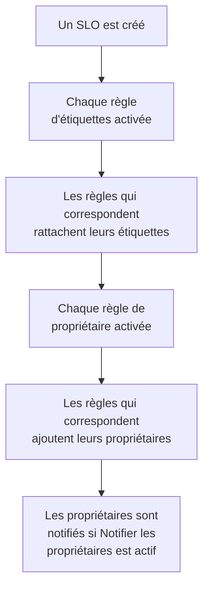

# Règles d'étiquettes et de propriétaires

Les règles d'étiquettes et les règles de propriétaire organisent vos SLO pour vous. Une **règle d'étiquettes** rattache des étiquettes à chaque nouveau SLO auquel elle correspond, et une **règle de propriétaire** lui ajoute des utilisateurs et des équipes propriétaires : un nouveau SLO de checkout reçoit ainsi l'étiquette _Checkout_ et appartient à l'équipe checkout sans que personne ait à y penser. Les deux fonctionnent comme les règles d'étiquettes et de propriétaires de tous les autres produits : voir [Règles d'étiquettes et de propriétaires](/docs/configuration/label-and-owner-rules) pour ce qu'elles ont en commun.

## Comment ça marche

Les règles s'exécutent quand un SLO est créé, depuis le tableau de bord ou par l'API. Les règles d'étiquettes passent en premier, pour qu'une règle de propriétaire puisse correspondre à une étiquette qu'une règle d'étiquettes vient de rattacher.

Les deux s'appliquent à tout le projet. Vous les trouvez dans le menu latéral de la liste des SLO, sous **Paramètres** : **Règles d'étiquettes** et **Règles de propriétaire**. La section **Paramètres** est repliée au départ ; cliquez sur son titre pour l'ouvrir.

## Créer une règle

:::steps
### Ouvrir la liste des règles

Ouvrez **SLOs**, puis **Paramètres** → **Règles d'étiquettes** ou **Paramètres** → **Règles de propriétaire** dans le menu latéral, et cliquez sur **Créer : Règle d'étiquettes des SLO** ou **Créer : Règle de propriétaire des SLO**.

### Choisir ce à quoi la règle correspond

À l'étape **Correspondance**, cliquez sur **Ajouter une condition** pour chaque condition qu'un SLO doit remplir (voir [Critères de correspondance](#critères-de-correspondance)). Avec deux conditions ou plus, choisissez **Toutes requises** ou **Au moins une requise**. Une règle sans condition correspond à chaque nouveau SLO.

### Choisir ce que la règle ajoute

La deuxième étape d'une règle d'étiquettes est **Étiquettes**, où vous choisissez les **Étiquettes à ajouter**. Celle d'une règle de propriétaire est **Propriétaires**, où vous choisissez les **Propriétaires** à ajouter — des personnes et des équipes, choisies dans une même liste avec **Ajouter un propriétaire**. Une règle doit ajouter au moins une étiquette ou un propriétaire.

### Vérifier le nom et les champs repliés

Le **Nom** est rempli à partir de ce que vous choisissez, comme _Ajouter Checkout, Production_ ou _Ajouter Checkout team comme propriétaires_, et suit vos choix jusqu'à ce que vous saisissiez un nom à vous. **Plus de champs** contient la **Description** facultative et, sur une règle de propriétaire, **Notifier les propriétaires**.

### Enregistrer la règle

Cliquez de nouveau sur **Créer : Règle d'étiquettes des SLO** ou **Créer : Règle de propriétaire des SLO** à la dernière étape. La règle est activée au départ.
:::

**Notifier les propriétaires** (sous **Plus de champs**) est activé par défaut : les propriétaires qu'ajoute une règle de propriétaire reçoivent la même notification « vous avez été ajouté comme propriétaire » qu'un propriétaire ajouté à la main. Désactivez-le pour ajouter des propriétaires sans bruit.

Pour mettre une règle en pause sans la supprimer, désactivez **Activé** dans son formulaire de modification. Le formulaire de modification n'exige jamais d'étiquettes ni de propriétaires : une ancienne règle qui n'ajoute rien peut toujours être renommée, désactivée ou supprimée, et la liste la marque **N'ajoute rien**.

Quand une règle correspond à un SLO :

- Une règle d'étiquettes rattache chaque étiquette de **Étiquettes à ajouter**. Les étiquettes que le SLO a déjà ne sont pas ajoutées deux fois, et quand plusieurs règles correspondent, le SLO reçoit toutes leurs étiquettes.
- Une règle de propriétaire ajoute chaque utilisateur et chaque équipe de la règle comme propriétaire. Les propriétaires que le SLO a déjà sont ignorés, et quand plusieurs règles correspondent, le SLO reçoit tous leurs propriétaires. Un utilisateur qui n'est plus membre du projet, ou une équipe d'un autre projet, n'est jamais ajouté ; les autres propriétaires de la règle le sont quand même.

Les propriétaires d'un SLO sont les personnes informées de ses changements de statut : voir [Budgets d'erreur](/docs/slo/error-budget).

## Critères de correspondance

Chaque condition compare un champ du SLO :

| Champ | Comparé avec | Opérateurs |
| --- | --- | --- |
| **Étiquettes du SLO** | Les étiquettes du SLO. | **Contient l'un de**, **Contient tous les**, **Ne contient aucun de** |
| **Nom du SLO** | Le nom du SLO. | **Contient**, **Ne contient pas**, **Égal à**, **Différent de**, **Commence par**, **Se termine par**, **Correspond au modèle**, **Ne correspond pas au modèle** |
| **Description du SLO** | La description du SLO. | Les mêmes que **Nom du SLO** |

Une nouvelle condition sur le nom ou la description commence sur **Contient**. Un modèle est une expression régulière, comme `^checkout-.*`, ou un joker `*`, comme `*checkout*`, et ignore la casse. Un modèle qui n'est ni l'un ni l'autre, comme `checkout-(01`, est refusé à l'enregistrement plutôt que de ne correspondre à rien sans rien dire.

| Vous voulez | Conditions |
| --- | --- |
| Chaque SLO du service checkout | **Nom du SLO** contient `checkout` |
| Chaque SLO de production | **Étiquettes du SLO** contient l'un de _Production_ |
| Les SLO de checkout, mais pas ceux de staging | **Toutes requises** : **Nom du SLO** contient `checkout`, et **Étiquettes du SLO** ne contient aucun de _Staging_ |

## Quand les règles s'exécutent

- **Quand un SLO est créé**, depuis le tableau de bord ou par l'API : chaque règle d'étiquettes activée, puis chaque règle de propriétaire activée.
- **Quand vous exécutez une règle** avec **Run Now** : voir ci-dessous.

Modifier un SLO n'applique pas de nouveau les règles, et une règle ne retire jamais rien : ni les étiquettes ou propriétaires que quelqu'un a ajoutés à la main, ni ceux qu'elle a ajoutés elle-même. Une règle désactivée ne fait rien.

## Appliquer une règle aux SLO existants

Une règle que vous écrivez aujourd'hui s'applique aux SLO créés après elle. Pour l'appliquer aux SLO que vous avez déjà, cliquez sur **Run Now** sur la ligne de la règle, ou sur **Voir** puis sur **Run Now** sur la page de la règle. Vous pouvez aussi sélectionner plusieurs règles et les exécuter depuis les actions groupées du tableau.

Une exécution passe en revue chaque SLO du projet, archivés compris, et indique à combien elle a correspondu et combien elle en a modifié. Les propriétaires qu'ajoute une exécution ne sont notifiés que si vous le choisissez dans la boîte de dialogue d'exécution et que la règle a **Notifier les propriétaires** activé. Voir [Exécuter des règles sur les ressources existantes](/docs/configuration/run-rules-now).

Les règles d'étiquettes peuvent aussi être copiées d'un projet à l'autre : voir [Importer et exporter des règles d'étiquettes](/docs/configuration/label-rule-import-export).

## Historique

Chaque fois qu'une règle modifie un SLO, le **Fil d'activité** du SLO enregistre quelles règles l'ont fait. Chaque propriétaire qu'ajoute une règle reçoit aussi son propre élément « ajouté comme propriétaire » dans le fil, qui dit donc qui a été ajouté et pourquoi. Voir [Fil d'activité et journaux d'audit des SLO](/docs/slo/feed-and-audit-logs).

## Permissions

| Pour | Il vous faut |
| --- | --- |
| Travailler avec les règles d'étiquettes | **Create SLO Label Rule**, **Edit SLO Label Rule**, **Delete SLO Label Rule** ou **Read SLO Label Rule** |
| Travailler avec les règles de propriétaire | **Create SLO Owner Rule**, **Edit SLO Owner Rule**, **Delete SLO Owner Rule** ou **Read SLO Owner Rule** |
| Exécuter une règle d'étiquettes | **Edit SLO Label Rule** et **Edit Service Level Objective** |
| Exécuter une règle de propriétaire | **Edit SLO Owner Rule**, **Edit Service Level Objective**, **Create SLO User Owner** et **Create SLO Team Owner** |

Ces permissions se trouvent dans le groupe SLO d'un rôle, et les rôles Project Owner et Project Admin les ont toutes. Une exécution modifie chaque SLO du projet : une permission limitée à certaines étiquettes, ou aux SLO dont vous êtes propriétaire, ne suffit donc pas pour exécuter une règle.

## Prochaines étapes

:::cards
- [Règles d'étiquettes et de propriétaires](/docs/configuration/label-and-owner-rules): Comment fonctionnent les règles d'étiquettes et de propriétaires de chaque produit.
- [Exécuter des règles sur les ressources existantes](/docs/configuration/run-rules-now): Comment Run Now fonctionne pour chaque type de règle.
- [Vue d'ensemble des SLO](/docs/slo/introduction): Chaque page qu'a un SLO, et la liste des SLO.
:::
