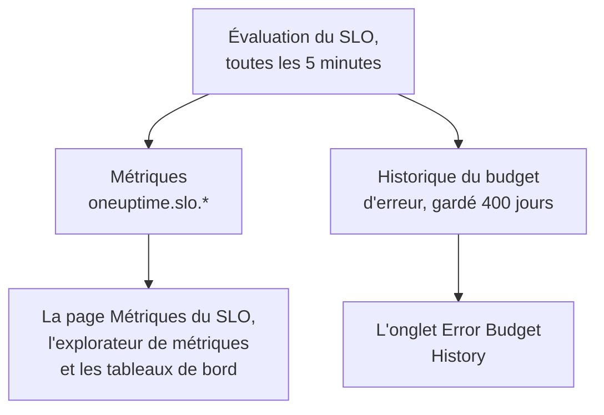

# Métriques et tableaux de bord des SLO

Chaque fois que OneUptime évalue un SLO, toutes les 5 minutes, il écrit les résultats sous forme de métriques nommées `oneuptime.slo.*`. Elles sont dans le même stockage de métriques que vos métriques de moniteurs : vous pouvez donc afficher un SLO en graphique sur sa page **Métriques**, l'ouvrir dans l'explorateur de métriques et le placer sur n'importe quel tableau de bord, filtré et regroupé comme n'importe quelle autre série.

:::cards
- [Les métriques](#les-métriques): Six séries, leurs unités et la façon de les agréger.
- [La page Métriques](#la-page-métriques): Les graphiques, l'historique et les métriques d'incidents et d'alertes d'un SLO.
- [Les SLO sur les tableaux de bord](#les-slo-sur-les-tableaux-de-bord): Le widget SLO et le modèle SLO Dashboard.
:::

## Comment ça marche

## Les métriques

| Métrique | Unité | Agrégation | Ce qu'elle contient |
| --- | --- | --- | --- |
| `oneuptime.slo.sli.percent` | `%` | Avg | Le SLI sur la fenêtre de conformité du SLO : la part du temps mesuré qui était bonne. |
| `oneuptime.slo.target.percent` | `%` | Avg | L'objectif du SLO, publié à chaque évaluation pour qu'un graphique puisse le tracer au-dessus du SLI. |
| `oneuptime.slo.error.budget.remaining.percent` | `%` | Avg | Part du budget d'erreur pas encore dépensée dans la fenêtre. Négative une fois le budget dépassé. |
| `oneuptime.slo.error.budget.remaining.seconds` | `seconds` | Avg | L'indisponibilité que le SLO peut encore absorber avant d'être violé. Négative une fois le budget dépassé. |
| `oneuptime.slo.burn.rate` | `x` | Max | La vitesse à laquelle le budget se consomme, sur les 60 dernières minutes. 1x dépense le budget exactement sur la fenêtre. |
| `oneuptime.slo.status` | — | Max | Le statut du SLO à chaque évaluation : `0` correspond à Sain, `1` à À risque, `2` à Budget épuisé. |

L'agrégation est la façon dont les graphiques du SLO et le modèle SLO Dashboard combinent les points qui tombent dans un même intervalle du graphique. Les pourcentages et les durées sont moyennés. Le taux de consommation et le statut prennent le maximum, pour qu'un court pic de consommation ou un bref passage par Budget épuisé ne soit pas gommé par la moyenne.

Pour un SLO en mode **Monitor Seconds Average**, `oneuptime.slo.error.budget.remaining.seconds` compte des secondes-moniteur additionnées sur ses moniteurs, comme son budget d'erreur : voir [Budgets d'erreur](/docs/slo/error-budget).

### Quand aucun point n'est écrit

- Un SLO désactivé ou archivé n'est pas évalué, il ne publie donc rien.
- Un SLO **En pause** ou **Mal configuré** ne mesure rien, il ne publie donc que `oneuptime.slo.target.percent`, qui est de la configuration et non une mesure. Ses graphiques de SLI, de budget, de taux de consommation et de statut affichent un trou.
- Une valeur qui n'est pas un vrai nombre, comme un taux de consommation sur une fenêtre sans données, est ignorée, jamais écrite comme 0.

### Attributs

Chaque point porte ces attributs :

| Attribut | Valeur |
| --- | --- |
| `sloId` | ID du SLO. Les pages du SLO filtrent dessus, renommer un SLO ne coupe donc jamais ses graphiques en deux. |
| `sloName` | Nom du SLO au moment où le point a été écrit. |
| `projectId` | ID du projet. |
| `oneuptime.label.<key>` | Un attribut par étiquette du SLO. Une étiquette nommée `Tier 1` devient `oneuptime.label.tier_1` = `true`, et une étiquette nommée `product:checkout` devient `oneuptime.label.product` = `checkout`. Les clés sont en minuscules, et les espaces et la ponctuation deviennent `_`. |

Les séries appartiennent au SLO, pas à l'un de ses moniteurs, et ne comptent pas dans l'utilisation de télémétrie.

Les métriques d'incidents et d'alertes portent deux attributs correspondants, `serviceLevelObjectiveIds` et `serviceLevelObjectiveNames` : des listes, séparées par des virgules, des SLO que l'incident ou l'alerte concerne.

### Rétention

Les métriques `oneuptime.slo.*` sont gardées aussi longtemps que les métriques de moniteurs : **30 jours** par défaut. Sur une installation auto-hébergée, un administrateur principal peut changer cela avec **Monitor Metric Retention (Days)** dans les paramètres **Rétention des données** de l'Admin Dashboard.

Cela ne limite pas l'onglet **Error Budget History** de la page **Métriques** du SLO. Cet historique est stocké à part et gardé 400 jours.

## La page Métriques

La page **Métriques** d'un SLO a quatre onglets :

| Onglet | Ce qu'il affiche |
| --- | --- |
| **SLO Metrics** | Les séries `oneuptime.slo.*` dans trois cartes qui partagent une même période, le dernier jour par défaut : **Objectif** (le SLI avec l'objectif tracé dessus, et le budget restant), **Consommation** (taux de consommation et temps de budget restant) et **Statut**. |
| **Error Budget History** | Le SLI, le budget restant et le taux de consommation sur l'historique à long terme, avec des lignes à l'objectif, aux limites à risque et épuisé, et au seuil de chaque règle de taux de consommation activée. |
| **Métriques d'incident** | Le nombre, le délai de prise en charge, le délai de résolution et la durée des incidents qui concernent ce SLO, la dernière semaine par défaut. Les incidents déclarés par ses règles de taux de consommation sont inclus. |
| **Métriques d'alerte** | La même chose pour les alertes. Les alertes déclenchées par ses règles de taux de consommation sont incluses. |

Les onglets **SLO Metrics**, **Métriques d'incident** et **Métriques d'alerte** lisent le stockage de métriques, ce qui demande la permission de lire la télémétrie. Un rôle personnalisé qui peut lire les SLO mais pas la télémétrie voit ces onglets vides, alors que **Error Budget History** fonctionne toujours.

## Les SLO sur les tableaux de bord

### Afficher n'importe quelle métrique de SLO

:::steps
#### Ajouter un graphique

En mode édition d'un tableau de bord, ajoutez un widget de graphique ou de valeur et choisissez l'une des métriques `oneuptime.slo.*`.

#### Regrouper ou filtrer

Regroupez par `sloName` et `sloId` pour une ligne par SLO ; `sloId` sépare deux SLO qui portent le même nom. Ou filtrez sur `sloName`, ou sur un attribut `oneuptime.label.*`.

#### Choisir l'agrégation

Utilisez l'agrégation du tableau ci-dessus : Avg pour les pourcentages et les durées, Max pour le taux de consommation et le statut.
:::

### Le widget SLO

Le [widget SLO](/docs/dashboards/widgets#slo) affiche le SLI, le budget restant ou le taux de consommation d'un SLO, sous forme de tuile ou de graphique. Il obtient son SLO de l'une de deux façons :

| Réglage | Comportement |
| --- | --- |
| **Objectif de niveau de service** | Épingle le widget à un SLO. Le sélecteur liste les SLO qui ne sont pas archivés. |
| **Follow SLO Variable** | Affiche le SLO choisi dans une variable du tableau de bord : une variable **Telemetry Attribute** sur la clé `sloName`. Ignoré tant qu'un SLO est épinglé. |

Sur un [tableau de bord public](/docs/dashboards/sharing), un widget qui suit une variable permet aux visiteurs de choisir par son nom n'importe quel SLO non archivé du projet. Un widget épinglé n'affiche jamais que son propre SLO, et continue d'afficher les derniers chiffres d'un SLO archivé plus tard.

### Le modèle SLO Dashboard

Quand vous créez un tableau de bord, choisissez le modèle **SLO Dashboard** pour obtenir un tableau prêt à l'emploi de tous les SLO du projet, en trois bandes :

1. **Service Level Objectives** : une liste de chaque SLO non archivé, avec son statut, son SLI par rapport à l'objectif, sa barre de budget et son taux de consommation, et un décompte des SLO par statut. Les SLO activés viennent d'abord, le moins de budget en premier ; un SLO désactivé vient en dernier comme **Désactivé**, ses derniers chiffres grisés.
2. **Error Budget & Burn Rate** : les tuiles **Lowest Error Budget Remaining**, **Least Error Budget Time Left** et **Peak Burn Rate**, et les graphiques **Error Budget Remaining by SLO** et **Burn Rate by SLO** avec une ligne par SLO, regroupés par `sloName` et `sloId`.
3. **Selected SLO** : les tuiles **SLI**, **Error Budget Remaining** et **Burn Rate** et les graphiques **SLI History**, **Error Budget History** et **Burn Rate History** d'un SLO.

Une variable SLO dans la barre d'outils délimite tout le tableau. C'est une variable Telemetry Attribute sur `sloName`, ses options sont donc les noms de SLO trouvés dans les métriques. Choisir un SLO restreint la liste à ce SLO, limite les graphiques et tuiles de la bande, et remplit les widgets de **Selected SLO**, qui suivent la variable. Tant que vous n'en choisissez pas, ils vous demandent de choisir un SLO dans la barre d'outils.

## Dépannage

:::details Un SLO manque dans le sélecteur de SLO de la barre d'outils
Le sélecteur liste les noms de SLO publiés le dernier jour. Un nouveau SLO apparaît après sa première évaluation ; un SLO **En pause** ou **Mal configuré** reste sélectionnable parce qu'il publie toujours son objectif ; un SLO désactivé ou archivé disparaît environ un jour après son dernier point.
:::

:::details Choisir un nom affiche deux SLO
Deux SLO portent ce nom. La liste et les graphiques affichent les deux, et les widgets de **Selected SLO** indiquent que le nom est ambigu. Donnez des noms distincts à vos SLO.
:::

:::details L'onglet SLO Metrics est vide
Votre rôle ne peut pas lire la télémétrie, ou le SLO n'a pas encore été évalué. **Error Budget History** lit le SLO lui-même et fonctionne toujours.
:::

## Prochaines étapes

:::cards
- [Widgets de tableau de bord](/docs/dashboards/widgets): Chaque widget, y compris le widget SLO.
- [Variables de tableau de bord](/docs/dashboards/variables): Délimitez tout un tableau avec un seul sélecteur.
- [Budgets d'erreur](/docs/slo/error-budget): Ce que signifient les chiffres du budget.
:::
