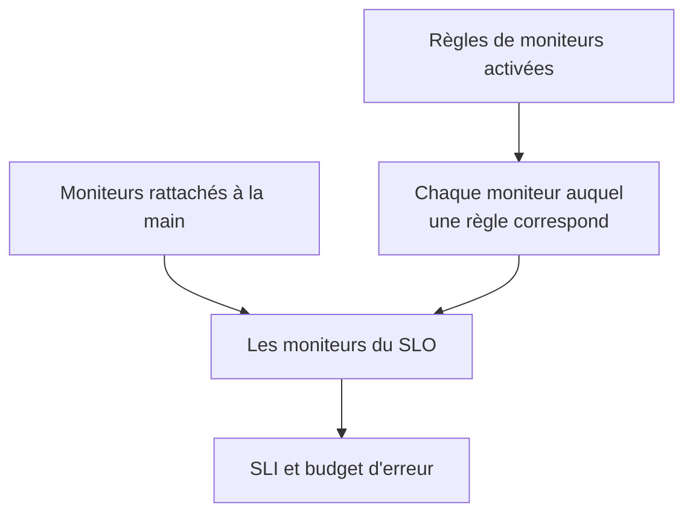

# Moniteurs et règles de moniteurs

Un SLO mesure la disponibilité des moniteurs qui lui sont rattachés. Rattachez-les à la main, laissez des règles de moniteurs rattacher chaque moniteur qui correspond, ou faites les deux. Cette page couvre les pages **Moniteurs** et **Règles de moniteurs** d'un SLO, toutes deux sous **Configuration** dans son menu latéral.

:::cards
- [Choisir les moniteurs à la main](#rattacher-des-moniteurs-à-la-main): Idéal pour un petit ensemble fixe.
- [Rattacher des moniteurs avec une règle](#rattacher-des-moniteurs-avec-une-règle): « Chaque moniteur étiqueté Production », tenu à jour pour vous.
- [Critères de correspondance](#critères-de-correspondance): Les champs et les opérateurs sur lesquels une règle peut porter.
:::

## Quels moniteurs un SLO mesure

Un SLO mesure l'union des moniteurs que vous avez rattachés à la main et de chaque moniteur auquel correspond au moins une de ses règles de moniteurs activées.

Un nouveau SLO n'a aucun moniteur, car le formulaire de création ne les demande pas. Tant qu'il n'en a pas, il ne peut pas être évalué : ses pages affichent **No monitors attached**, et sa **Vue d'ensemble** propose les deux façons de rattacher des moniteurs.

## Rattacher des moniteurs à la main

Il vous faut la permission de modifier le SLO.

:::steps
### Ouvrir la page Moniteurs

Ouvrez le SLO et allez dans **Moniteurs**.

### Choisir les moniteurs

Cliquez sur **Ajouter des moniteurs** et choisissez des moniteurs du projet. Seuls les moniteurs pas encore rattachés sont proposés.

### Enregistrer la liste

Cliquez sur **Ajouter des moniteurs**. Les moniteurs apparaissent dans la liste avec la source **Manuel**, et comptent dans le SLI dès l'évaluation suivante.
:::

Pour retirer un moniteur du SLO, cliquez sur **Supprimer** sur sa ligne. Le moniteur lui-même ne change pas ; il cesse seulement de compter dans le SLI et le budget d'erreur du SLO.

La page **Moniteurs** affiche, pour chaque moniteur :

| Colonne | Ce qu'elle affiche |
| --- | --- |
| **État actuel** | Le statut actuel du moniteur, ou **Archivé**, **Désactivé**, **Sondes non activées**, **Sondes déconnectées** ou **Inconnu** quand il n'est pas vérifié ou n'a encore rien signalé. |
| **Source** | **Rule** si l'une des règles de moniteurs du SLO l'a rattaché, **Manuel** si quelqu'un l'a rattaché à la main. |
| **Étiquettes** | Les étiquettes du moniteur. |

## Rattacher des moniteurs avec une règle

Une règle de moniteurs décrit les moniteurs qu'un SLO doit mesurer, comme « chaque moniteur étiqueté Production » ou « chaque moniteur dont le nom commence par api- ». Chaque moniteur qui correspond est rattaché, maintenant et chaque fois que des moniteurs sont créés ou changent, pour que personne n'ait à penser au moniteur que quelqu'un ajoutera le mois prochain.

:::steps
### Ouvrir Règles de moniteurs

Ouvrez le SLO, allez dans **Règles de moniteurs** et cliquez sur **Créer : Règle de moniteurs du SLO**.

### Nommer la règle

Dans **Informations de base**, saisissez un **Nom** et, si vous le souhaitez, une **Description** expliquant pourquoi ces moniteurs appartiennent à ce SLO.

### Choisir ce à quoi elle correspond

Dans **Critères de correspondance**, cliquez sur **Ajouter une condition**, choisissez un champ et un opérateur, puis saisissez ou choisissez la valeur. Avec deux conditions ou plus, choisissez **Toutes requises** ou **Au moins une requise**. Une règle de moniteurs a besoin d'au moins une condition.

### Enregistrer la règle

Cliquez sur **Créer : Règle de moniteurs du SLO**. La règle est activée au départ, et les moniteurs du SLO sont réévalués aussitôt : chaque moniteur qui correspond est rattaché avec la source **Rule**.
:::

Le tableau des règles affiche, pour chaque règle, son nom, ses critères de correspondance en toutes lettres et si elle est activée. Pour mettre une règle en pause, désactivez **Activé** dans son formulaire de modification. **View Monitors** ouvre la page **Moniteurs** du SLO.

### Critères de correspondance

Chaque condition compare un champ d'un moniteur :

| Champ | Comparé avec | Opérateurs |
| --- | --- | --- |
| **Étiquettes du moniteur** | Les étiquettes du moniteur. | **Contient l'un de**, **Contient tous les**, **Ne contient aucun de** |
| **Type de moniteur** | Le type du moniteur, choisi dans la liste des types. | **Égal à**, **Différent de** |
| **Nom du moniteur** | Le nom du moniteur. | **Contient**, **Ne contient pas**, **Égal à**, **Différent de**, **Commence par**, **Se termine par**, **Correspond au modèle**, **Ne correspond pas au modèle** |
| **Description du moniteur** | La description du moniteur. | Les mêmes que **Nom du moniteur** |

Un modèle est une expression régulière, comme `^api-.*`, ou un joker `*`, comme `*checkout*`, et ignore la casse. Un modèle qui n'est ni l'un ni l'autre, comme `api-(01`, est refusé à l'enregistrement plutôt que de ne correspondre à rien sans rien dire. Pour rattacher chaque moniteur du projet, ajoutez une condition sur **Nom du moniteur** qui correspond au modèle `.*`.

| Vous voulez | Conditions |
| --- | --- |
| Chaque moniteur de production | **Étiquettes du moniteur** contient l'un de _Production_ |
| Chaque moniteur d'API | **Type de moniteur** égal à _API_ |
| Chaque moniteur sauf les manuels | **Type de moniteur** différent de _Manual_ |
| Chaque moniteur dont le nom commence par api- | **Nom du moniteur** correspond au modèle `^api-` |
| Les moniteurs de checkout, mais pas ceux de staging | **Toutes requises** : **Nom du moniteur** correspond au modèle `*checkout*`, et **Étiquettes du moniteur** ne contient aucun de _Staging_ |

### Quand les règles s'exécutent

- Quand vous créez, modifiez, activez, désactivez ou supprimez une règle, les moniteurs du SLO sont réévalués aussitôt.
- Quand un moniteur est créé, ou que ses étiquettes, son nom ou sa description changent, chaque règle de moniteurs du projet le vérifie, y compris les étiquettes que lui donnent vos règles d'étiquettes de moniteurs.
- Quand une étiquette est supprimée, les SLO dont les règles l'utilisaient sont réévalués.
- Les règles tiennent la liste des moniteurs d'un SLO à jour même quand le SLO est désactivé ou archivé, il reprend donc avec les bons moniteurs.

Les règles se resynchronisent à chaque enregistrement, **Run Now** sert donc à rattraper ce qui aurait échappé au SLO. Il se trouve sur chaque ligne, sur la page de la règle (**Voir**) et dans les actions groupées du tableau. Exécuter une règle réévalue ensemble toutes les règles de moniteurs activées du SLO, puis la boîte de dialogue indique combien de moniteurs ont été rattachés et détachés. Exécuter une règle demande la permission de modifier les règles de moniteurs des SLO. Voir [Exécuter des règles sur les ressources existantes](/docs/configuration/run-rules-now).

### Quels moniteurs appartiennent à une règle

- Un moniteur reste rattaché tant qu'une règle activée lui correspond, et il est détaché dès qu'aucune ne correspond plus.
- Désactiver ou supprimer une règle ne détache que les moniteurs auxquels aucune autre règle activée ne correspond encore.
- Les règles ne détachent jamais que des moniteurs qu'une règle a rattachés. Un moniteur rattaché à la main n'est jamais repris par une règle qui lui correspond par hasard, ni détaché quand il ne correspond plus. Sa source reste **Manuel**.

## Choisir à la main quand des règles sont actives

Tant qu'au moins une règle est activée, ce sont les règles qui gèrent les moniteurs du SLO :

- on ne peut pas ajouter de moniteurs à la main : **Ajouter des moniteurs** est désactivé, et un bandeau indique **This SLO's monitors are managed by its monitor rules**, avec un lien **Gérer les règles de moniteurs** ;
- on ne peut pas retirer à la main les moniteurs qu'une règle a rattachés, car la règle les rattacherait de nouveau : leur bouton **Supprimer** est verrouillé, et son info-bulle explique pourquoi ;
- les moniteurs rattachés à la main avant l'activation des règles peuvent toujours être retirés.

Cela vaut aussi pour l'API. Désactivez toutes les règles pour choisir de nouveau les moniteurs vous-même.

## Les SLO auxquels un moniteur contribue

La page d'un moniteur liste les SLO qui le mesurent : ouvrez le moniteur et allez dans **SLOs** dans son menu latéral. Consultez-la avant de mettre en pause ou de modifier un moniteur, pour voir quels objectifs en dépendent. Les SLO archivés n'y figurent pas, car ils ne sont pas évalués.

## Venir de Auto-Add Monitors With Labels

Les versions précédentes avaient un réglage **Auto-Add Monitors With Labels** dans le formulaire du SLO. À la mise à niveau, chaque SLO qui l'utilisait reçoit une règle de moniteurs activée nommée **Auto-add monitors with labels**, qui correspond aux mêmes étiquettes, et continue ainsi de mesurer exactement les mêmes moniteurs. Le champ `monitorLabels` de l'API des SLO est déprécié : utilisez plutôt les règles de moniteurs des SLO.

:::details Et si quelque chose enregistre encore l'ancien réglage ?
Un onglet du tableau de bord ouvert avant la mise à niveau, ou un client d'API ou un workflow écrit pour la version précédente, peut encore enregistrer l'ancien réglage. Pour qu'un SLO ne perde pas des moniteurs sans rien dire de cette façon :

- **Un SLO sans règles de moniteurs** transforme les étiquettes enregistrées en une règle **Auto-add monitors with labels**, et ses moniteurs sont réévalués aussitôt. Enregistrer une liste vide détache les moniteurs que le réglage avait rattachés, comme avant.
- **Un SLO qui a des règles de moniteurs**, activées ou non, ignore les étiquettes enregistrées par l'ancien réglage, car ce sont ses règles qui décident de ce qu'il mesure.
- **La création de la première règle de moniteurs** d'un SLO dont les moniteurs avaient été rattachés par l'ancien réglage convertit d'abord le réglage en règle, si bien que la nouvelle règle s'ajoute à côté au lieu de le remplacer.

Une règle convertie que vous supprimez reste supprimée, sauf si ses moniteurs sont encore rattachés ensuite, par exemple parce qu'un serveur qui exécute encore la version précédente les a rattachés de nouveau pendant la mise à niveau : le prochain changement de moniteur ou la prochaine nouvelle règle convertit alors de nouveau les étiquettes. Supprimez de nouveau cette règle une fois la mise à niveau terminée.
:::

## Historique

Chaque rattachement et chaque détachement, et chaque règle créée, modifiée ou supprimée, apparaît dans le **Fil d'activité** du SLO. Les changements de règles sont aussi enregistrés dans ses **Journaux d'audit**. Voir [Fil d'activité et journaux d'audit des SLO](/docs/slo/feed-and-audit-logs).

## Dépannage

:::details Ajouter des moniteurs est désactivé
Au moins une des règles de moniteurs du SLO est activée, ce sont donc les règles qui gèrent ses moniteurs. Modifiez les règles, ou désactivez-les toutes pour choisir les moniteurs à la main.
:::

:::details Le bouton Supprimer d'un moniteur est verrouillé
Une règle de moniteurs a rattaché ce moniteur et le rattacherait de nouveau. Modifiez ou désactivez la règle qui lui correspond.
:::

:::details Un moniteur auquel une règle devrait correspondre n'est pas rattaché
Vérifiez que la règle est activée et que chaque condition est remplie avec **Toutes requises**. Les étiquettes qu'ajoute une règle d'étiquettes de moniteurs comptent aussi. Cliquez sur **Run Now** sur la règle pour resynchroniser le SLO.
:::

:::details L'enregistrement d'une règle échoue avec une erreur de modèle
La valeur n'est ni une expression régulière ni un joker `*`, par exemple à cause d'une parenthèse non fermée. Corrigez le modèle, ou utilisez plutôt **Contient**.
:::

## Prochaines étapes

:::cards
- [Vue d'ensemble des SLO](/docs/slo/introduction): Comment l'indisponibilité de plusieurs moniteurs se combine.
- [Budgets d'erreur](/docs/slo/error-budget): Ce que l'indisponibilité des moniteurs consomme.
- [Exécuter des règles sur les ressources existantes](/docs/configuration/run-rules-now): Comment Run Now fonctionne pour chaque type de règle.
:::
