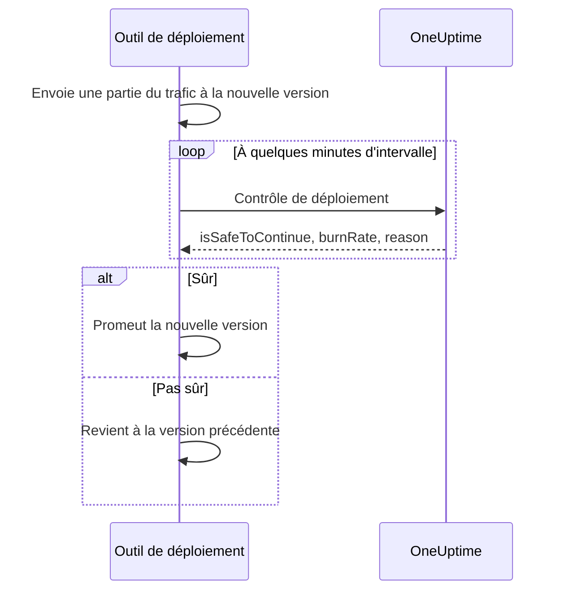

# Contrôles de déploiement

Un contrôle de déploiement pose à un SLO la question « peut-on continuer à déployer cette version sans risque ? » pendant que la version se déploie, et y répond d'après la vitesse à laquelle le SLO a consommé son budget d'erreur au cours des dernières minutes. Argo Rollouts, Flagger ou un pipeline de déploiement l'interroge pendant qu'un canari reçoit du trafic, et annule la mise en production sur un non. OneUptime ne déploie rien lui-même : votre outil de déploiement continue de mener le déploiement, et OneUptime lui dit comment se porte la version.

:::cards
- [Interroger le contrôle](#interroger-le-contrôle): Une seule requête avec une clé d'API, et ce que le contrôle répond.
- [Argo Rollouts](#argo-rollouts): Une analyse qui interrompt le déploiement.
- [Flagger](#flagger): Un webhook qui arrête le canari.
- [GitHub Actions](#github-actions): Une étape qui revient à la version précédente après un déploiement.
:::

## Comment ça marche

La [barrière de déploiement](/docs/slo/error-budget-policy#barrière-de-déploiement) répond avant une mise en production, d'après le budget d'erreur de toute la fenêtre de conformité. Une version qui casse quelque chose n'a presque rien dépensé du budget d'un mois au cours de ses dix premières minutes : le contrôle de déploiement lit donc ce que la version change, le taux de consommation des dernières minutes.



Le contrôle répond par l'un de ces trois verdicts :

| Verdict | Quand | `isSafeToContinue` |
| --- | --- | --- |
| `Pass` | La fenêtre a consommé le budget d'erreur à `maxBurnRate` ou moins vite. | `true` |
| `Fail` | Elle l'a consommé plus vite, ou la politique de budget d'erreur du SLO gèle les déploiements. | `false` |
| `NotEnoughData` | La fenêtre comptait moins de requêtes que `minimumRequestCount`, ou les moniteurs du SLO n'y ont enregistré aucun statut. C'est trop peu pour déclarer la version sûre. | `false` |

À un taux de consommation de 1, la fenêtre a tenu exactement l'objectif du SLO : avec sa valeur par défaut, `1`, `maxBurnRate` fait donc échouer une version qui fait moins bien que l'objectif.

Ce que lit le contrôle dépend de ce que mesure le SLO :

- Un [SLO de requêtes](/docs/slo/request-slos) est jugé sur les requêtes de ses services dans la fenêtre, lues dans leurs spans à mesure qu'ils arrivent. Ajoutez `serviceVersion` pour ne juger que les requêtes de la nouvelle version : OneUptime le compare à l'attribut de ressource `service.version` des spans, qu'un SDK OpenTelemetry définit à partir de `OTEL_RESOURCE_ATTRIBUTES=service.version=1.4.2`. Le canari est ainsi jugé sur ses propres requêtes, sans être dilué par celles de l'ancienne version.
- Un [SLO de métrique](/docs/slo/request-slos#slo-à-partir-dune-métrique) est jugé sur les événements de sa métrique dans la fenêtre, comptés comme son SLI les compte : `minimumRequestCount`, `goodRequestCount` et `totalRequestCount` sont donc des événements. Avec `serviceVersion`, seuls comptent les points de la métrique dont l'attribut de ressource `service.version` a cette valeur : un SDK OpenTelemetry le définit sur ses métriques comme sur ses spans.
- Un SLO de disponibilité des moniteurs est jugé sur les chronologies de statut de ses moniteurs pendant la fenêtre. `minimumRequestCount` ne s'applique pas à lui, et un contrôle avec `serviceVersion` est refusé : les moniteurs n'ont pas de version.

## Avant de commencer

Il vous faut un SLO qui mesure ce que la version affecte. Un SLO de requêtes du service que vous déployez est le meilleur juge d'un canari, car il lit les requêtes de ce service lui-même.

## Mettre en place un contrôle de déploiement

:::steps
### Donner une clé au déploiement

Créez une [clé d'API](/docs/api-reference/api-reference) du projet dont le rôle peut lire les SLO, et enregistrez-la comme secret de votre outil de déploiement ou de votre pipeline.

### Copier l'ID du SLO

Ouvrez le SLO et copiez son ID depuis l'adresse : `/slos/<slo-id>`.

### Interroger le contrôle une fois à la main

Lancez la requête décrite dans [Interroger le contrôle](#interroger-le-contrôle) avec la clé et l'ID. Le contrôle répond avec `isSafeToContinue` et une `reason`.

### L'ajouter à votre déploiement

Interrogez le contrôle depuis [Argo Rollouts](#argo-rollouts), [Flagger](#flagger) ou [GitHub Actions](#github-actions), et revenez à la version précédente quand `isSafeToContinue` vaut `false`.
:::

## Interroger le contrôle

Le contrôle est un `GET` ou un `POST` sur l'adresse `release-check` du SLO. Envoyez les options dans la chaîne de requête, ou dans un corps JSON avec `POST` :

```bash
curl -sS "https://oneuptime.com/api/service-level-objective/<slo-id>/release-check?windowInMinutes=10&serviceVersion=1.4.2" \
  -H "ApiKey: $ONEUPTIME_API_KEY"
```

Il répond d'abord par le verdict, puis par ce sur quoi il s'est fondé :

```json
{
  "isSafeToContinue": false,
  "verdict": "Fail",
  "reason": "The last 10 minutes burned the error budget at 3.2x, faster than the 1x this check allows (SLI 99.68% against the 99.9% target).",
  "sloId": "<slo-id>",
  "sloName": "Checkout requests",
  "sliType": "Request Success",
  "targetPercentage": 99.9,
  "windowInMinutes": 10,
  "maxBurnRate": 1,
  "burnRate": 3.2,
  "sliPercentage": 99.68,
  "deploymentsAllowed": true,
  "errorBudgetPolicyTier": null,
  "sloStatus": "Healthy",
  "checkedAt": "2026-11-15T12:00:00.000Z",
  "goodRequestCount": 2492,
  "totalRequestCount": 2500,
  "minimumRequestCount": 1,
  "serviceVersion": "1.4.2"
}
```

Les options :

| Option | Par défaut | Ce qu'elle fait |
| --- | --- | --- |
| `windowInMinutes` | `10` | Jusqu'où le contrôle regarde en arrière, en minutes entières, de 1 à 360. |
| `maxBurnRate` | `1` | Le taux de consommation le plus rapide qui passe. `2` laisse la fenêtre consommer le budget deux fois plus vite que l'objectif ne le permet. |
| `minimumRequestCount` | `1` | SLO de requêtes : le nombre minimal de requêtes que le contrôle juge. Avec `0`, une fenêtre sans aucune requête passe. |
| `serviceVersion` | Aucune | SLO de requêtes : ne juger que les requêtes dont les spans portent cette `service.version`. |
| `includeDeploymentGate` | `true` | Échouer tant que la politique de budget d'erreur du SLO gèle les déploiements. Avec `false`, seul le taux de consommation décide. |
| `failWithStatusCode` | `false` | Répondre non avec le statut HTTP 412 au lieu de 200, pour les outils qui ne lisent que le code de statut. |

Les champs de la réponse :

| Champ | Ce qu'il contient |
| --- | --- |
| `isSafeToContinue` | `true` pour poursuivre le déploiement, `false` pour revenir à la version précédente. |
| `verdict` | `Pass`, `Fail` ou `NotEnoughData`. |
| `reason` | Une phrase pour le journal du déploiement, qui dit ce qui a été mesuré et pourquoi le contrôle a répondu ainsi. |
| `burnRate` et `sliPercentage` | La vitesse à laquelle la fenêtre a consommé le budget d'erreur, et le SLI sur la fenêtre. |
| `goodRequestCount` et `totalRequestCount` | SLO de requêtes : les requêtes que contenait la fenêtre, et combien d'entre elles étaient bonnes. |
| `deploymentsAllowed` et `errorBudgetPolicyTier` | Si la politique de budget d'erreur du SLO autorise les déploiements, et le palier dans lequel il se trouve. |
| `checkedAt` | Le moment où le contrôle a été mesuré. |

Un SLO qui ne peut pas être mesuré (un SLO de requêtes sans services, un SLO de latence sans seuil, un SLO de métrique sans métrique qu'il puisse compter, un SLO de disponibilité des moniteurs sans moniteurs) reçoit une réponse HTTP 400 qui dit quoi corriger : un déploiement s'arrête ainsi sur une erreur claire plutôt que sur une supposition. Sur une installation auto-hébergée, utilisez sa propre adresse au lieu de oneuptime.com.

## Argo Rollouts

Une analyse avec une métrique `web` interroge le contrôle à chaque étape d'un canari, et quand elle échoue, Argo Rollouts interrompt le déploiement et réduit les réplicas du canari. Enregistrez d'abord la clé d'API comme secret :

```bash
kubectl create secret generic oneuptime --from-literal=api-key="$ONEUPTIME_API_KEY"
```

Ajoutez ensuite le modèle, et exécutez-le après la première étape du canari :

:::tabs
@tab AnalysisTemplate
```yaml title="oneuptime-release-check.yaml"
apiVersion: argoproj.io/v1alpha1
kind: AnalysisTemplate
metadata:
  name: oneuptime-release-check
spec:
  args:
    - name: version
    - name: api-key
      valueFrom:
        secretKeyRef:
          name: oneuptime
          key: api-key
  metrics:
    - name: slo-burn-rate
      interval: 2m
      count: 5
      failureLimit: 0
      successCondition: result == true
      provider:
        web:
          url: "https://oneuptime.com/api/service-level-objective/<slo-id>/release-check?windowInMinutes=10&serviceVersion={{args.version}}"
          headers:
            - key: ApiKey
              value: "{{args.api-key}}"
          jsonPath: "{$.isSafeToContinue}"
```
@tab Rollout
```yaml title="rollout.yaml"
apiVersion: argoproj.io/v1alpha1
kind: Rollout
metadata:
  name: checkout
spec:
  strategy:
    canary:
      steps:
        - setWeight: 10
        - analysis:
            templates:
              - templateName: oneuptime-release-check
            args:
              - name: version
                value: "1.4.2"
        - setWeight: 50
        - pause: { duration: 10m }
```
:::

L'analyse interroge le contrôle cinq fois, à deux minutes d'intervalle, et le premier non interrompt le déploiement. Passez la même version que celle que les pods du canari définissent dans `OTEL_RESOURCE_ATTRIBUTES`. Si le canari risque de ne recevoir aucun trafic à son premier poids, ajoutez `&minimumRequestCount=0` à l'adresse, sinon un canari sans trafic fait échouer l'analyse avec `NotEnoughData`.

## Flagger

Flagger appelle un webhook `rollout` à chaque étape de son analyse, et arrête puis annule le canari quand le webhook continue d'échouer. Les webhooks de Flagger n'envoient aucun en-tête : interrogez donc le contrôle par le load tester de Flagger, qui exécute une commande pour le webhook :

```yaml title="canary.yaml"
apiVersion: flagger.app/v1beta1
kind: Canary
metadata:
  name: checkout
spec:
  analysis:
    interval: 1m
    threshold: 2
    maxWeight: 50
    stepWeight: 10
    webhooks:
      - name: oneuptime-release-check
        type: rollout
        url: http://flagger-loadtester.test/
        timeout: 30s
        metadata:
          type: bash
          cmd: "curl -sSf -H \"ApiKey: $ONEUPTIME_API_KEY\" 'https://oneuptime.com/api/service-level-objective/<slo-id>/release-check?windowInMinutes=5&failWithStatusCode=true'"
```

Avec `failWithStatusCode=true`, un non est un HTTP 412 : `curl -f` se termine donc sur une erreur et le webhook échoue. Donnez la clé au load tester sous le nom `ONEUPTIME_API_KEY` dans son environnement, à partir d'un secret Kubernetes. Une fois que `threshold` contrôles ont échoué, Flagger annule le canari.

## GitHub Actions

Un pipeline qui déploie en une seule fois peut quand même surveiller la mise en production : déployez, interrogez le contrôle quelques fois, et revenez à la version précédente quand il répond non.

```yaml title=".github/workflows/deploy.yml"
name: Deploy
on:
  push:
    branches: [main]

jobs:
  deploy:
    runs-on: ubuntu-latest
    steps:
      - uses: actions/checkout@v4
      - name: Deploy
        run: ./deploy.sh
      - name: Watch the release against the SLO
        env:
          ONEUPTIME_API_KEY: ${{ secrets.ONEUPTIME_API_KEY }}
          SLO_ID: <slo-id>
          VERSION: ${{ github.sha }}
        run: |
          for attempt in 1 2 3 4 5; do
            sleep 120
            CHECK=$(curl -sS "https://oneuptime.com/api/service-level-objective/$SLO_ID/release-check?windowInMinutes=10&serviceVersion=$VERSION" \
              -H "ApiKey: $ONEUPTIME_API_KEY")
            echo "$CHECK" | jq -r '.reason'
            if [ "$(echo "$CHECK" | jq -r '.isSafeToContinue')" != "true" ]; then
              exit 1
            fi
          done
      - name: Roll back
        if: failure()
        run: ./rollback.sh
```

L'étape échoue sur un non, et sur toute réponse sans `isSafeToContinue: true` (un ID erroné, une clé qui ne peut pas lire le SLO, aucune réponse du tout) : le pipeline ne continue donc jamais sur la foi d'une réponse qu'il n'a pas reçue. Définissez `service.version` sur le commit (`${{ github.sha }}`) au démarrage du service, pour que le contrôle ne juge que la nouvelle version.

## Prochaines étapes

:::cards
- [SLO de requêtes et de latence](/docs/slo/request-slos): Mesurez les requêtes d'un service, le SLI qui juge le mieux un canari.
- [Politique de budget d'erreur](/docs/slo/error-budget-policy): Gelez les déploiements tant que le budget est bas.
- [Alertes et incidents de taux de consommation](/docs/slo/burn-rate-alerts): Alertez votre équipe quand le budget se consomme trop vite.
:::
