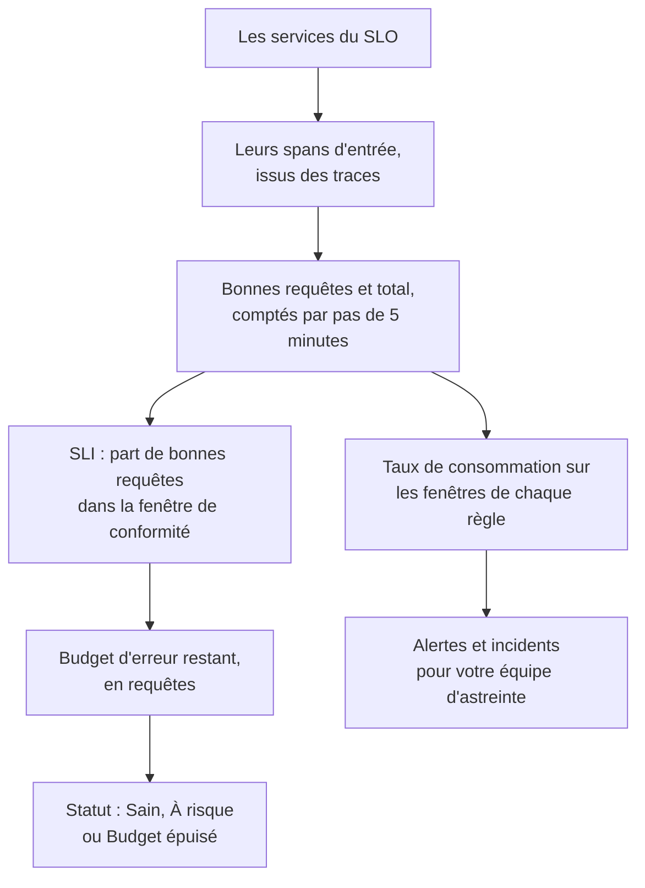

# SLO de requêtes et de latence

Un SLO de requêtes mesure ce que vos utilisateurs obtiennent d'un service : la part de ses requêtes qui réussissent, ou qui sont servies assez vite. OneUptime les compte à partir des traces que vos services envoient déjà, il n'y a donc aucun moniteur à configurer : choisissez les services et un objectif, et OneUptime les mesure toutes les 5 minutes.

:::cards
- [Créer un SLO de requêtes](#créer-un-slo-de-requêtes): Les services, un seuil de latence et un objectif.
- [Comment les requêtes sont comptées](#comment-les-requêtes-sont-comptées): Quels spans comptent, et à quel moment.
- [Contrôles de déploiement](/docs/slo/release-checks): Annulez une mise en production qui consomme le budget d'erreur.
:::

## Réussite et latence des requêtes

| Ce qui est mesuré | Une requête est mauvaise quand | Son budget d'erreur compte |
| --- | --- | --- |
| **Réussite des requêtes** | Le statut de son span est `Error`. Un span sans statut compte comme bon, au sens où l'entend OpenTelemetry. | Les requêtes en échec |
| **Latence des requêtes** | Elle a pris plus de temps que le **Seuil de latence (ms)** du SLO, quel que soit son statut. | Les requêtes lentes |

Le SLI est la part de bonnes requêtes dans la fenêtre de conformité, et le budget d'erreur correspond aux mauvaises requêtes que l'objectif autorise : à 99,9 %, une sur 1 000. Un SLO de latence compte comme bonne une requête qui a échoué vite : mesurez donc un service important des deux façons, avec un SLO qui vérifie qu'il fonctionne et un autre qui vérifie qu'il est rapide.

## Comment ça marche

Une requête est un span d'entrée de l'un des services du SLO : le span où une requête ou un message entre dans le service, tel que la liste des [traces](/docs/telemetry/traces-explorer#traces-et-spans) les affiche par défaut. Une requête qui traverse deux des services du SLO compte une fois dans chacun d'eux.

À partir de là, un SLO de requêtes fonctionne comme n'importe quel autre. Son statut, ses règles de taux de consommation, sa politique de budget d'erreur, ses propriétaires et ses notifications sont les mêmes, avec un budget d'erreur exprimé en requêtes plutôt qu'en minutes.

## Avant de commencer

- Les services envoient des traces à OneUptime : voir [OpenTelemetry](/docs/telemetry/open-telemetry). Chacun d'eux figure dans le [catalogue des services](/docs/telemetry/services) sous son `service.name`.
- Un rôle autorisé à créer des SLO : Propriétaire du projet, Administrateur du projet ou un rôle personnalisé avec la permission Create Service Level Objective.

## Créer un SLO de requêtes

:::steps
### Ouvrir les SLO

Ouvrez **SLOs** depuis le menu **Produits** de la barre supérieure, puis cliquez sur **Créer : Objectif de niveau de service**.

### Choisir ce qu'il mesure

Sous **Ce qui est mesuré**, choisissez **Réussite des requêtes** ou **Latence des requêtes**, puis les **Services** dont il compte les requêtes. Pour **Latence des requêtes**, fixez aussi le **Seuil de latence (ms)** : une requête servie dans ce délai compte comme assez rapide, par exemple `300`. Cliquez sur **Suivant**.

### Le nommer et fixer un objectif

Saisissez un **Nom**, par exemple « Checkout requests », et une **Cible (%)** : la part des requêtes qui doivent être bonnes. Cliquez sur **Créer : Objectif de niveau de service**.

### Voir arriver les premiers chiffres

La première évaluation, dans les 5 minutes, compte les requêtes des 6 dernières heures : le SLO a donc des chiffres tout de suite. Les évaluations suivantes comptent aussi des requêtes plus anciennes, jusqu'à couvrir la fenêtre de conformité.
:::

Pour modifier plus tard ce qu'un SLO mesure, ses services ou son seuil, ouvrez ses **Paramètres** et cliquez sur **Modifier ce qui est mesuré**.

## Comment les requêtes sont comptées

OneUptime compte les bonnes requêtes et le total des requêtes de chaque SLO par pas de 5 minutes, et conserve ces comptes, si bien que le SLO lit sa fenêtre dans ses propres comptes au lieu de relire tous les spans à chaque fois :

- Un pas est compté 2 minutes après sa fin, pour que les spans arrivés en retard y figurent, et l'évaluation suivante recompte les deux derniers pas pour les spans arrivés plus tard encore.
- Un nouveau SLO commence par les 6 dernières heures. Chaque évaluation suivante compte jusqu'à une journée de requêtes plus anciennes, des plus récentes aux plus anciennes, jusqu'à ce que la fenêtre soit couverte.
- Seules les requêtes encore couvertes par votre [rétention de la télémétrie](/docs/telemetry/data-retention#combien-de-temps-la-télémétrie-est-conservée) peuvent être comptées. Les pas comptés sont conservés 400 jours, plus longtemps que n'importe quelle fenêtre de conformité : une fenêtre plus longue que la rétention se remplit donc à mesure que le SLO vieillit.
- Modifier ce que le SLO mesure, ses services ou son seuil de latence fait recompter ses requêtes depuis le début. Une fenêtre de conformité plus longue se remplit en comptant plus loin dans le passé.

Tant que les comptes ne couvrent qu'une partie de la fenêtre de conformité, la **Vue d'ensemble** le signale avec une pastille **Fenêtre remplie à 23 %**, et la tuile **Budget d'erreur restant** la reprend sous son chiffre. Les deux disparaissent dès que les comptes couvrent toute la fenêtre.

## Le budget d'erreur en requêtes

Le budget correspond aux mauvaises requêtes que l'objectif autorise parmi les requêtes comptées dans la fenêtre : il grandit donc avec le trafic. À 99,9 %, une fenêtre de 2 000 000 requêtes en autorise 2 000 en échec. Dans la **Vue d'ensemble** :

- **Budget d'erreur restant** indique combien de mauvaises requêtes il reste, et sur combien, ou de combien le SLO dépasse son budget.
- **Autonomie du budget** indique combien de temps le budget tient au taux de consommation actuel, tant que le trafic reste ce qu'il était.
- Le résumé compte les services du SLO, et un SLO de latence affiche son seuil sous son objectif.

Les alertes de taux de consommation, les notifications et le fil d'activité expriment eux aussi le budget en requêtes. La métrique `oneuptime.slo.error.budget.remaining.seconds` n'est pas publiée pour un SLO de requêtes ; affichez plutôt `oneuptime.slo.error.budget.remaining.percent` dans vos graphiques.

Un SLO de requêtes reçoit les mêmes règles **Fast burn**, **Slow burn** et **Slow leak** que tout nouveau SLO. Pendant une heure calme, avec une poignée de requêtes, un seul échec peut faire consommer le budget très vite : une règle peut donc ignorer les fenêtres qui ont trop peu de requêtes. Définissez le `minimumSampleCount` de la règle par l'API, et la règle ignore une fenêtre longue qui compte moins de requêtes que cette valeur.

## Dépannage

:::details Le SLO affiche Waiting for requests
Aucun de ses services n'a encore servi de requête dans la fenêtre. Vérifiez que les services envoient des traces à OneUptime, et que leurs spans comprennent des spans d'entrée : un service dont tous les spans sont internes n'a aucune requête à compter.
:::

:::details Le SLI a changé après que j'ai modifié les services
Modifier ce que le SLO mesure, ses services ou son seuil de latence fait recompter ses requêtes, en commençant par les 6 dernières heures : le SLI et le budget repartent donc de là. La pastille **Fenêtre remplie à 23 %** montre quelle part de la fenêtre est comptée jusqu'ici.
:::

## Prochaines étapes

:::cards
- [Contrôles de déploiement](/docs/slo/release-checks): Laissez Argo Rollouts, Flagger ou un pipeline annuler une mise en production qui consomme le budget.
- [Alertes et incidents de taux de consommation](/docs/slo/burn-rate-alerts): Alertez votre équipe quand le budget se consomme trop vite.
- [Politique de budget d'erreur](/docs/slo/error-budget-policy): Convenez de ce que fait l'équipe à mesure que le budget diminue.
:::
