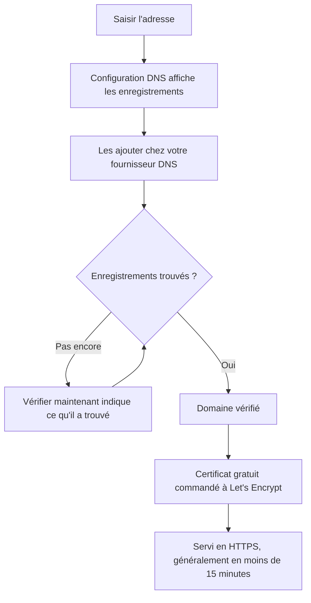

# Personnalisation et domaines de la page de statut

Votre page de statut est l'écran OneUptime que regardent vos clients : elle devrait donc vous ressembler et se trouver sur votre propre domaine, comme `status.yourcompany.com`. Cette page parcourt la page **Image de marque** carte par carte, puis place la page de statut sur votre domaine : ajoutez le domaine, ajoutez ses enregistrements DNS, et le certificat SSL gratuit suit de lui-même.

> [!TIP]
> Vous débutez ? Suivez d'abord le guide : [Publier une page de statut](/docs/guides/status-page).

:::cards
- [La page Image de marque](#la-page-image-de-marque): Logo, thème, titre, favicon, liens, pied de page, couleurs et langues.
- [HTML, CSS et JavaScript personnalisés](#html-css-et-javascript-personnalisés): Tout ce que les réglages intégrés ne couvrent pas.
- [Domaines personnalisés](#domaines-personnalisés): Votre propre nom d'hôte, avec un certificat gratuit.
- [La colonne Statut](#lire-la-colonne-statut-du-domaine): Où en est chaque domaine sur le chemin de HTTPS.
:::

## Où se trouve chaque réglage de personnalisation

Ouvrez une page de statut : la section **Image de marque** de son menu latéral contient trois entrées :

| Page | Ce que vous y réglez |
| ---- | ------------------ |
| **Image de marque** | Logo et image de couverture, thème (clair, sombre, ou selon le réglage de l'appareil de chaque visiteur), titre et description de la page, favicon, liens d'en-tête, description de la page de vue d'ensemble, ligne de copyright et liens du pied de page. Repliés sous **Plus de paramètres** : les couleurs du graphique d'historique, les langues et l'indexation par les moteurs de recherche. |
| **Domaines personnalisés** | Votre propre domaine, son enregistrement DNS et son certificat SSL gratuit. |
| **HTML, CSS et JavaScript** | HTML d'en-tête, HTML du pied de page, CSS personnalisé, JavaScript personnalisé. |

Trois éléments qui ressemblent à de la personnalisation se trouvent plutôt dans **Pages de statut → votre page → Avancé → Paramètres avancés** (`{id}/settings`), parce qu'ils décident de ce que la page montre et non de son apparence : le pourcentage de disponibilité global, les statuts de moniteur qui comptent contre la disponibilité, et la mention « Powered by OneUptime ». Les deux premiers sont des lignes de la carte **Ce que montre votre page de statut**, et la mention a sa propre carte, juste en dessous, repliée sous **Plus de paramètres**.

La personnalisation était autrefois répartie sur des écrans séparés **Personnalisation essentielle**, **En-tête**, **Pied de page**, **Page de vue d'ensemble** et **Langues**. Leurs anciennes adresses (`{id}/header-style`, `{id}/footer-style`, `{id}/overview-page-branding` et `{id}/languages`) ouvrent désormais la page **Image de marque** : les anciens favoris et liens fonctionnent toujours.

## La page Image de marque

**Pages de statut → votre page → Image de marque → Image de marque** (`{id}/branding`). Chaque carte s'enregistre séparément. Après le logo, le thème, le titre et le favicon, les cartes suivent votre page de statut de haut en bas : les liens de l'en-tête, le texte en haut de la vue d'ensemble, puis le pied de page. Ce que peu de gens modifient est replié sous **Plus de paramètres**, en bas.

### Logo et image de couverture

La première carte, **Logo et image de couverture**, a un bouton **Modifier les images** qui ouvre deux étapes :

| Étape | Champs |
| ---- | ------ |
| **Logo** | Le téléversement du logo (texte indicatif `Upload logo`), **Logo du thème sombre** (texte indicatif `Upload logo for the dark theme`), un logo facultatif conçu pour un fond sombre, et **Texte alternatif du logo** (texte indicatif `Logo of My Company`). Laissez le texte alternatif vide et le titre de la page de statut est utilisé à la place. |
| **Image de couverture** | **Couverture**, un téléversement (texte indicatif `Upload cover image`) pour la large bannière derrière l'en-tête, et **Texte alternatif de l'image de couverture**. Laissez le texte alternatif vide si la couverture est purement décorative. |

Le logo, le logo du thème sombre, l'image de couverture et le favicon sont des fichiers téléversés dans le projet de la page de statut lui-même, et c'est vérifié à chaque enregistrement – depuis le tableau de bord, l'API, Terraform ou un workflow. Un fichier téléversé dans un autre projet est refusé avec les mêmes mots qu'un fichier qui n'existe plus : "The logo's file could not be found. Upload the logo again.", "The dark theme logo's file could not be found. Upload the dark theme logo again.", "The cover image's file could not be found. Upload the cover image again." ou "The favicon's file could not be found. Upload the favicon again." Téléverser à nouveau l'image depuis la page règle le problème.

Votre page de statut n'affiche que les images de son propre projet ; une image qu'elle ne peut pas afficher est omise, comme si la page n'en avait pas. Le tableau de bord, l'API et Terraform lisent les images de la page de la même façon : une image d'un autre projet revient comme aucune image. Les e-mails que la page envoie – aux abonnés, et aux utilisateurs privés au sujet de leur connexion – affichent son logo de la même manière : un logo que la page ne peut pas afficher en est omis lui aussi, plutôt qu'affiché comme une image cassée.

Ces e-mails emportent le logo à l'intérieur : il s'affiche donc même là où un client de messagerie ne charge aucune image depuis Internet ou ne peut pas joindre OneUptime. Un logo PNG, JPEG, GIF, WebP ou SVG y entre sous la forme d'une image à la taille de l'en-tête de l'e-mail. Un logo SVG dont les mots sont du texte, et non des formes, s'affiche plutôt depuis son adresse, car le serveur n'a aucune police pour dessiner ces mots : vectorisez le texte dans votre outil de conception, ou importez un PNG.

### Thème

La carte **Thème**, juste sous le logo, définit l'apparence de la page pour ses visiteurs. Choisissez l'une de ses trois options et elle est enregistrée aussitôt ; il n'y a pas de bouton **Modifier**.

| Option | Ce que voient les visiteurs |
| ------ | ----------------- |
| **Clair** | La page claire, quel que soit le réglage de leur appareil. Les pages de statut créées avant l'existence de ce réglage sont en **Clair**, elles gardent donc l'apparence qu'elles ont toujours eue. |
| **Sombre** | La page sombre, quel que soit le réglage de leur appareil. |
| **Selon l'appareil de chaque visiteur** | Claire ou sombre, selon le réglage de leur appareil, et elle change avec lui tant que la page est ouverte. Un bouton soleil ou lune dans le pied de page permet au visiteur de basculer, et son navigateur retient ce choix. |

Sur la page sombre, le logo est posé sur un fond clair, si bien qu'un logo conçu pour une page blanche reste lisible. Une page qui a un **Logo du thème sombre** affiche celui-ci à la place sur la page sombre, tel quel, sans fond, dans son en-tête et sur ses pages de connexion. Les e-mails que la page envoie affichent toujours le logo.

À l'adresse de la page sur OneUptime, `/status-page/:id`, une page en **Clair** ou **Sombre** a elle aussi le bouton soleil ou lune dans son pied de page, pour que vous la voyiez dans l'autre thème, avec son **Logo du thème sombre**, avant de choisir. Un choix fait là dure jusqu'au rechargement de la page et n'est pas mémorisé : la page s'ouvre toujours dans son propre thème, pour vous comme pour toute personne qui ouvre cette adresse. Sur les domaines personnalisés de la page, une page en **Clair** ou **Sombre** n'a pas de bouton.

Une page de statut créée à partir de maintenant commence avec **Selon l'appareil de chaque visiteur**. Dans l'API et dans Terraform, le champ est `theme`, avec l'une des valeurs `Light`, `Dark` ou `System` (**Selon l'appareil de chaque visiteur**), écrites exactement ainsi ; toute autre valeur est refusée. Une configuration Terraform qui ne définit aucun `theme` reçoit `Light`, si bien qu'une configuration écrite avant ce réglage ne planifie jamais de changement sur une page qu'elle gère.

Le thème figure dans le HTML de la page, qui est donc dessinée dans ce thème dès le départ : une page sombre ne clignote pas en blanc pendant son chargement, et le navigateur accorde ses barres de défilement, ses champs de formulaire et, sur les téléphones, sa barre d'adresse. Toutes les parties de la page le suivent, y compris la page de connexion d'une page de statut privée. Les barres de disponibilité gardent les couleurs que vous avez choisies. Sur la page sombre, un texte dans une couleur de statut prend une nuance plus claire de cette couleur là où la couleur elle-même serait difficile à lire, et une barre trop sombre pour être vue reçoit une bordure plus claire.

Votre CSS et votre HTML personnalisés s'appliquent dans les deux thèmes ; [HTML, CSS et JavaScript personnalisés](#html-css-et-javascript-personnalisés) explique comment styliser le thème sombre.

### Titre, description et favicon

- **Titre et description** – le nom de la page dans l'onglet du navigateur et dans les e-mails aux abonnés, et la description que montrent les moteurs de recherche. **Modifier** ouvre **Titre de la page** (texte indicatif `e.g., Acme Status`) et **Description de la page**. Les moteurs de recherche et les aperçus de liens les affichent : écrivez-les pour un client, pas pour votre équipe.
- **Favicon** – **Modifier le favicon** ouvre le téléversement **Favicon** : la petite icône de l'onglet du navigateur.

### Liens d'en-tête

Le tableau **Liens d'en-tête** contient les liens de l'en-tête de la page de statut, comme votre site web, votre documentation ou un portail de support. Chaque lien a un **Titre** et un **Lien** (une URL, texte indicatif `https://link.com`), et vous les réordonnez par glisser-déposer. Sans lien, le tableau dit à quoi ils servent, avec **Ajouter : Lien d'en-tête** en dessous.

### Description de la page de vue d'ensemble

**Description de la page de vue d'ensemble** est la première chose sur la vue d'ensemble de la page de statut, au-dessus des annonces, du statut global et de vos ressources. **Modifier la description** ouvre un champ Markdown. Servez-vous-en pour une phrase de contexte : ce que couvre cette page, et où s'adresser pour obtenir de l'aide. Une image que vous y placez est montrée à chaque visiteur de la page.

### Pied de page

- **Informations de copyright** – **Modifier le copyright** ouvre un champ, **Informations de copyright**, avec le texte indicatif `Acme, Inc.`.
- **Liens du pied de page** – la même paire **Titre** et **Lien** que les liens d'en-tête, ordonnés par glisser-déposer et ajoutés avec **Ajouter : Lien du pied de page**.

Les liens d'en-tête servent à la navigation ; les liens du pied de page aux mentions légales, comme les conditions, la confidentialité et les conditions d'utilisation.

### Plus de paramètres

La dernière section de la page est repliée sous **Plus de paramètres**, car peu de gens modifient ce qu'elle contient. Repliée, son en-tête nomme ses quatre sections – **Couleur de barre par défaut**, **Règles de couleur des barres**, **Langues** et **Indexation par les moteurs de recherche** – et montre chacune de celles qui diffèrent de ce avec quoi commence une nouvelle page de statut : une couleur de barre par défaut autre que le vert de départ de chaque page, des règles de couleur de barre autres que les règles recommandées, une langue par défaut autre que l'anglais, une liste de langues plus courte, ou l'indexation désactivée. Cliquez dessus pour l'ouvrir : c'est une seule carte, ses sections l'une sous l'autre, chacune avec son titre, séparées par des lignes de séparation.

**Couleurs du graphique d'historique.** En dehors du **Thème**, ce sont les seuls réglages de couleur intégrés d'une page de statut. Chaque barre de l'historique de disponibilité représente un jour.

- **Couleur de barre par défaut** – **Modifier la couleur de barre par défaut** ouvre le sélecteur **Couleur de barre par défaut**. C'est la couleur d'un jour auquel aucune règle de couleur des barres ne correspond. Chaque nouvelle page de statut commence avec le vert.
- **Règles de couleur des barres** – un tableau ordonné de règles que vous triez par glisser-déposer. Chaque règle a **Lorsque le % de disponibilité est supérieur ou égal à** et **Ensuite, utilisez cette couleur de barre** ; les colonnes du tableau s'intitulent `When Uptime Percent >=` et `Then, Bar Color is`. Les règles sont vérifiées de haut en bas, et la première que la disponibilité d'un jour atteint fixe sa couleur ; gardez donc les pourcentages élevés au-dessus des plus bas : une règle placée sous une règle de pourcentage égal ou inférieur ne colore jamais aucun jour. La couleur d'une nouvelle règle est déjà choisie, une que les autres règles n'utilisent pas encore ; choisissez plutôt celle que vous voulez.
- **Aperçu des couleurs des barres** – chaque couleur qu'un jour peut prendre, telle que la plupart des gens la voient (**Vision des couleurs normale**) et telle que la voient les personnes atteintes de daltonisme rouge-vert (**Deutéranopie (rouge-vert)**, **Protanopie (rouge-vert)**). Il avertit lorsque deux couleurs se ressemblent pour elles, et lorsqu'une règle ne colore jamais aucun jour.

Un jour pour lequel la page n'a pas de données est toujours dessiné en gris avec des rayures diagonales, quoi que disent les règles. Sans règles, un jour prend la couleur du statut de moniteur le plus grave qu'il a connu, aussi bref soit-il : deux minutes en Offline donnent à toute la journée la couleur d'Offline. C'est pourquoi une page de statut créée dans le tableau de bord commence avec les règles recommandées, qui colorent un jour selon la durée de son interruption :

| Lorsque le % de disponibilité est au moins | Couleur de barre | Sur une journée complète |
| ------------------------- | --------- | ------------- |
| 100 | `#22c55e` vert | Aucune interruption |
| 99 | `#fde047` jaune pâle | Jusqu'à 14 minutes 24 secondes d'interruption |
| 95 | `#c2410c` orange foncé | Jusqu'à 72 minutes d'interruption |
| 0 | `#7f1d1d` rouge très foncé | Plus de 72 minutes d'interruption |

La disponibilité d'un jour est mesurée sur la partie de la journée qui a des données, en comptant les statuts choisis dans **Compte comme indisponibilité**. Les couleurs recommandées diffèrent par la luminosité autant que par la teinte, si bien que les personnes atteintes de daltonisme rouge-vert, environ un homme sur douze, peuvent les distinguer ; le vert d'Operational et le rouge d'Offline avec lesquels commencent les statuts de moniteur leur paraissent presque identiques. Une page créée avant ces règles, ou via l'API ou Terraform, n'a aucune règle tant que vous n'en ajoutez pas : un tableau **Règles de couleur des barres** vide et **Aperçu des couleurs des barres** proposent tous deux **Utiliser les règles recommandées**. Via l'API, envoyez `"miscDataProps": {"addRecommendedBarColorRules": true}` avec la requête qui crée la page de statut.

Le nombre de jours que couvre le graphique ne se règle pas ici. C'est **Historique de disponibilité** dans la carte **Ce que montre votre page de statut** de **Avancé → Paramètres avancés**, de 1 à 90 jours. Les statuts de moniteur qui comptent comme une panne, c'est **Compte comme indisponibilité**, dans la même ligne de cette carte.

**Langues.** La section **Langues** règle le sélecteur de langue que les visiteurs trouvent dans le pied de page. **Modifier les langues** ouvre deux champs :

| Champ | Ce qu'il fait |
| ----- | ------------ |
| **Langue par défaut** | La langue que voient les nouveaux visiteurs, choisie dans une liste qui nomme chaque langue dans sa propre graphie et en anglais (`Deutsch (German)`). Elle vaut l'anglais par défaut, et les visiteurs peuvent toujours changer depuis le pied de page. Les abonnés reçoivent aussi leurs messages dans cette langue, sauf s'ils lisaient la page dans une autre langue quand ils se sont abonnés. |
| **Langues activées** | Une sélection multiple, texte indicatif `All languages`. Laissez-la vide et toutes les langues prises en charge sont proposées ; choisissez-en quelques-unes et le pied de page ne liste que celles-ci. |

Dix-huit langues sont livrées avec OneUptime : anglais, allemand, français, espagnol, italien, portugais, néerlandais, danois, norvégien, suédois, russe, japonais, coréen, chinois (simplifié), chinois (traditionnel), hindi, persan et arabe. Le persan et l'arabe se lisent de droite à gauche : une page affichée dans l'une de ces langues est donc disposée à partir de la droite, dès son ouverture quand cette langue est sa langue par défaut. Ses barres de disponibilité commencent toujours à gauche par le jour le plus ancien.

**Indexation par les moteurs de recherche.** Un commutateur, **Autoriser les moteurs de recherche à indexer cette page de statut**, décide si Google, Bing et les autres moteurs de recherche peuvent référencer la page. Il est activé par défaut. Il n'y a pas de bouton **Modifier** : le commutateur s'enregistre dès que vous le basculez. Désactivez-le et la page est servie avec `noindex, nofollow` (une balise meta robots et un en-tête `X-Robots-Tag`) ; toute personne qui a le lien peut toujours l'ouvrir. Les moteurs de recherche peuvent mettre quelques semaines à retirer une page déjà indexée. Le commutateur ne concerne la page que sur ses domaines personnalisés. Son URL d'aperçu est toujours servie avec `noindex, nofollow` : une page de statut n'apparaît donc dans les résultats de recherche qu'une fois qu'elle a un domaine personnalisé.

> [!TIP]
> Désactivez **Autoriser les moteurs de recherche à indexer cette page de statut** tant qu'une page est interne ou encore en cours de configuration, pour qu'une page à moitié terminée ne commence pas à se positionner sur votre nom de marque.

## Pourcentage de disponibilité et statuts d'indisponibilité

Les deux se trouvent dans la ligne **Historique de disponibilité** de la carte **Ce que montre votre page de statut**, dans **Pages de statut → votre page → Avancé → Paramètres avancés** (`{id}/settings`). Il n'y a pas de bouton **Modifier** : chacun s'enregistre dès que vous le changez.

- **Afficher le pourcentage de disponibilité global** – un commutateur, désactivé par défaut. Tant qu'il est activé, **Précision** à côté choisit le nombre de décimales du pourcentage : `99%`, `99.9%`, `99.99%` (la valeur par défaut) ou `99.999%`. Sur OneUptime Cloud, activer le pourcentage demande le forfait **Scale** ; sa précision peut être modifiée sur tous les forfaits.
- **Compte comme indisponibilité** – les statuts de moniteur, sous forme de pastilles colorées, dont le temps compte contre la disponibilité sur cette page. C'est ici que vous décidez si, par exemple, un statut dégradé compte contre la disponibilité. Au moins un statut reste sélectionné.

C'étaient autrefois deux cartes à part, **Pourcentage de disponibilité global** et **Statuts de moniteur d'indisponibilité**, chacune derrière un bouton **Modifier**. Voir [Vue d'ensemble des pages de statut](/docs/status-pages/index#choisir-ce-qui-saffiche-sur-la-page) pour le reste de la carte.

## HTML, CSS et JavaScript personnalisés

**Pages de statut → votre page → Image de marque → HTML, CSS et JavaScript** (`{id}/custom-code`) a quatre cartes, chacune modifiée séparément et stockée dans une colonne de la page de statut :

| Carte | Colonne | Ce qu'elle contient |
| ---- | ------ | ------------- |
| **HTML d'en-tête** | `headerHTML` | Du HTML affiché à la place de l'en-tête de la page, son logo et ses liens d'en-tête (texte indicatif `Insert Custom HTML here.`). |
| **HTML du pied de page** | `footerHTML` | Du HTML affiché à la place du pied de page, avec ses liens et ses sélecteurs de langue et de thème. |
| **CSS personnalisé** | `customCSS` | Des styles pour toute la page (texte indicatif `Insert Custom CSS here.`). |
| **JavaScript personnalisé** | `customJavaScript` | Un script que la page exécute (texte indicatif `Insert Custom JavaScript here.`). |

> [!IMPORTANT]
> Le HTML, le CSS et le JavaScript personnalisés ne sont servis que sur un domaine personnalisé vérifié. Ils sont désactivés sur l'adresse par défaut `/status-page/:id`, parce que cette adresse partage l'origine connectée d'OneUptime.

Sur OneUptime Cloud, ajouter ou modifier l'un d'eux demande le forfait **Growth**. Les vider fonctionne sur tous les forfaits, si bien que le code personnalisé ajouté pendant un essai peut toujours être retiré.

**Il n'y a pas de sélecteur de couleur de marque.** En dehors du **Thème**, qui rend la page claire ou sombre, les seuls réglages de couleur intégrés, où que ce soit, sont **Couleur de barre par défaut** et les règles de couleur des barres du graphique d'historique, sous **Plus de paramètres** sur la page **Image de marque**. Les polices, les couleurs de fond, les couleurs d'accent et les ajustements de mise en page passent tous par **CSS personnalisé**. Si vous cherchiez un champ « couleur de marque », voici la réponse : il n'y en a pas, et ce champ est le moyen d'y parvenir.

**Code personnalisé dans le thème sombre.** Votre CSS et votre HTML personnalisés s'appliquent dans les deux thèmes. Tant que la page est sombre, son élément `<html>` porte la classe `dark`, donc une règle CSS qui commence par `html.dark` ne stylise que le thème sombre, par exemple `html.dark .my-banner { background: #1e293b; }`. Une règle sans ce préfixe s'applique dans les deux thèmes, si bien qu'une couleur de fond ou de texte définie pour la page claire est conservée aussi sur la page sombre : vérifiez votre CSS personnalisé dans les deux thèmes. Si la page a du CSS personnalisé ou du HTML personnalisé dans l'en-tête ou le pied de page, la carte **Thème** l'indique sous ses options.

> [!WARNING]
> Le JavaScript personnalisé s'exécute dans le navigateur de vos visiteurs, sur une page qu'on ouvre justement quand on pense que quelque chose est cassé. Gardez-le court, hébergez vous-même ce qu'il charge quand c'est possible, et testez-le avant de compter dessus.

## Domaines personnalisés

Par défaut, une page de statut est accessible à l'URL d'aperçu affichée sur son écran **Vue d'ensemble**. Pour la placer sur votre propre nom d'hôte, allez dans **Pages de statut → votre page → Image de marque → Domaines personnalisés** (`{id}/domains`).

La carte **Domaines personnalisés** indique quoi faire : faites pointer l'enregistrement CNAME de chaque domaine vers l'enregistrement CNAME des pages de statut de votre installation, et OneUptime émet le certificat SSL du domaine et le renouvelle pour vous. Quand rien n'est configuré, le tableau indique **Aucun domaine personnalisé trouvé**, avec **Ajouter un domaine personnalisé** en dessous. Le tableau a deux colonnes, **Domaine** et **Statut**, et des filtres pour **Domaine**, **CNAME valide** et **SSL provisionné**.

Placer la page sur votre domaine se fait en trois étapes, toutes sur cette page, et seules les deux premières vous reviennent :

1. **Ajouter le domaine** : saisissez l'adresse que les gens ouvriront, comme `status.yourcompany.com`.
2. **Ajouter ses enregistrements DNS** chez votre fournisseur DNS. La boîte de dialogue **Configuration DNS** les affiche : un enregistrement CNAME pour l'adresse et, la première fois que le projet utilise un domaine, un enregistrement TXT qui montre que le projet en est propriétaire.
3. **Le certificat SSL gratuit est émis automatiquement** une fois les enregistrements trouvés. Il n'y a aucun bouton à presser.



### Avant de commencer

- **Votre installation a besoin d'un enregistrement CNAME pour les pages de statut.** OneUptime Cloud en a un. Sur une installation auto-hébergée, faites-le pointer vers un nom d'hôte qui pointe lui-même vers votre serveur OneUptime (un enregistrement A), et assurez-vous que le serveur répond sur les ports 80 et 443 : c'est là que les visiteurs et Let's Encrypt atteignent chaque domaine personnalisé. Sans lui, la carte et la boîte de dialogue **Configuration DNS** indiquent « Custom Domains not enabled for this OneUptime installation » au lieu d'afficher un enregistrement.
- **Un serveur auto-hébergé est vérifié d'abord.** **Ajouter un domaine personnalisé** et **Configuration DNS** indiquent ce dont le serveur a encore besoin avant qu'un domaine personnalisé puisse fonctionner, sous « This server is not ready for custom domains yet » : si le paramètre de l'enregistrement CNAME est défini, si son nom d'hôte se résout, s'il atteint cette installation OneUptime sur le port 80 et accepte les connexions sur le port 443, et si le serveur émet des certificats gratuits. Chaque ligne indique quoi changer et où. Les vérifications s'exécutent depuis le serveur lui-même : les personnes extérieures à votre réseau doivent donc atteindre le nom d'hôte sur les mêmes ports.

:::tabs
@tab Docker Compose
```ini title="config.env"
STATUS_PAGE_CNAME_RECORD=oneuptime.yourcompany.com
```
@tab Kubernetes
```yaml title="values.yaml"
statusPage:
  cnameRecord: oneuptime.yourcompany.com
```
:::

### Ajouter le domaine

:::steps
#### Ouvrir Ajouter un domaine personnalisé

Dans **Domaines personnalisés**, cliquez sur **Ajouter un domaine personnalisé**. La boîte de dialogue ne demande qu'une chose.

#### Saisir l'adresse

Dans **Domaine** (texte indicatif `status.example.com`), saisissez l'adresse complète que les gens ouvriront, comme `status.yourcompany.com`. Un lien collé fonctionne aussi : seul son nom d'hôte est conservé. Pour utiliser la racine d'un domaine, saisissez le domaine lui-même.

#### Garder le certificat gratuit, ou téléverser le vôtre

**Plus de champs** est replié, et son en-tête indique le certificat qu'utilisera le domaine : « Nous émettons un certificat SSL gratuit pour ce domaine et le renouvelons automatiquement. » Ne l'ouvrez que pour utiliser votre propre certificat : activez **Téléverser un certificat personnalisé**, puis collez le **Certificat** et la **Clé privée du certificat** au format PEM. Les deux deviennent alors obligatoires.

#### Continuer

Cliquez sur **Continuer**. Si le projet a vérifié le domaine sur lequel se trouve l'adresse, le domaine est ajouté et sa **Configuration DNS** s'ouvre, avec l'enregistrement CNAME à ajouter. Sinon, OneUptime ajoute ce domaine à **Paramètres du projet → Avancé → Domaines**, et la **Configuration DNS** s'ouvre avec les deux enregistrements, pour que vous vérifiiez le domaine sur place, sans quitter la page.
:::

Le nom complet d'un domaine est fixé quand vous l'ajoutez : **Modifier** ne change donc que son certificat. Pour utiliser une autre adresse, ajoutez-la et supprimez l'ancienne. Un nom déjà utilisé par un tableau de bord ou un formulaire, dans n'importe quel projet, est refusé : un domaine affiche une seule page de statut, un seul tableau de bord ou un seul formulaire.

Ajouter un domaine au projet demande l'autorisation de créer des domaines de projet (**Create Domain**, ou Project Owner ou Project Admin), et le vérifier demande **Edit Domain**. Sans elles, la boîte de dialogue indique qui peut le faire.

### Configuration DNS et vérification

La boîte de dialogue **Configuration DNS** affiche chaque enregistrement encore nécessaire chez votre fournisseur DNS, un champ par ligne, chacun avec un bouton de copie :

| Enregistrement | **Type** | **Nom** | **Valeur** |
| ------ | -------- | -------- | --------- |
| Montre que le projet est propriétaire du domaine, jusqu'à sa vérification | `TXT` | Le domaine, par exemple `yourcompany.com` | Son texte de vérification, `oneuptime-verification-…` |
| Fait pointer l'adresse vers OneUptime | `CNAME` | L'adresse complète, par exemple `status.yourcompany.com` | L'enregistrement CNAME des pages de statut de votre installation |

Vous ajoutez l'enregistrement TXT une fois par domaine : chaque adresse ajoutée ensuite sur ce domaine n'a besoin que de son enregistrement CNAME. Pour une adresse sous le domaine, les deux sont sur des noms différents, car un nom qui a un enregistrement CNAME ne peut avoir aucun autre enregistrement ; pour la racine du domaine, l'enregistrement ALIAS ou d'aplatissement de CNAME se trouve à côté de l'enregistrement TXT.

> [!NOTE]
> Pour un domaine racine, sans sous-domaine, la boîte de dialogue ajoute une remarque : beaucoup de fournisseurs DNS n'y autorisent pas d'enregistrement CNAME. Utilisez à la place l'enregistrement ALIAS, ANAME ou d'aplatissement de CNAME de votre fournisseur, avec la même valeur.

Cliquez sur **Vérifier maintenant** pour rechercher les enregistrements tout de suite. La vérification porte d'abord sur l'enregistrement TXT et, dès qu'il est trouvé, ajoute le domaine à la page de statut et vérifie son enregistrement CNAME. Chaque enregistrement affiche alors son propre statut, **Trouvé**, **Valeur incorrecte**, **Pas encore trouvé** ou **Vérification impossible**, et en dessous ce que OneUptime a recherché et ce qui est revenu, avec ce qu'il faut changer :

- « Nous avons recherché l'enregistrement CNAME de status.yourcompany.com et n'avons rien obtenu. » L'enregistrement n'est pas encore là, ou pas encore visible : un nouvel enregistrement peut mettre un moment à apparaître.
- « Nous avons recherché l'enregistrement CNAME de status.yourcompany.com et avons obtenu other.example.net, alors que nous attendions oneuptime.yourcompany.com. » L'enregistrement pointe ailleurs : changez sa valeur.
- « Nous avons recherché l'enregistrement CNAME de status.yourcompany.com et n'avons rien obtenu, mais le nom répond avec l'adresse 203.0.113.10. » Le nom a un enregistrement A, ou son fournisseur DNS le fait passer par un proxy ou l'aplatit (c'est ce que fait le nuage orange de Cloudflare), ce qui cache l'enregistrement CNAME à tout le monde : remplacez l'enregistrement A, ou passez le nom en DNS only.

OneUptime suit toute la chaîne CNAME : un enregistrement qui pointe vers un nom à vous, qui pointe lui-même vers l'enregistrement de votre installation, compte donc. Tout comme un nom dont les requêtes atteignent OneUptime, même quand son fournisseur DNS cache l'enregistrement CNAME.

Une fois l'enregistrement CNAME trouvé, la boîte de dialogue indique « Votre enregistrement CNAME est vérifié. » et ce qui arrive ensuite au certificat. Le certificat gratuit est commandé à ce moment-là. Si les requêtes vers l'adresse n'atteignent toujours pas OneUptime, par exemple parce qu'un proxy devant un serveur auto-hébergé ne transmet pas l'adresse, la boîte de dialogue le signale : le certificat ne peut pas être émis tant qu'elles ne l'atteignent pas.

OneUptime vérifie l'enregistrement CNAME de chaque domaine non vérifié toutes les 15 minutes et vérifie le vôtre dès qu'il est actif, que vous reveniez ou non. Tant qu'un domaine n'est pas vérifié et que son certificat n'est pas en place, sa ligne a une action **Configuration DNS** qui ouvre la même boîte de dialogue. Sur un domaine vérifié dont la commande de certificat échoue sans cesse, ou dont le certificat a expiré, **Vérifier maintenant** y passe une nouvelle commande et montre pourquoi la dernière a échoué. Elle commande au plus une fois par domaine toutes les 15 minutes ; entre-temps, OneUptime continue d'essayer de lui-même.

### Certificats SSL

Chaque domaine personnalisé reçoit un certificat gratuit de Let's Encrypt, émis et renouvelé automatiquement. Il n'y a rien à cliquer :

- **Vérifier maintenant** commande le certificat dès que l'enregistrement est trouvé. La boîte de dialogue indique alors que le certificat est généralement actif en moins de 15 minutes.
- Quand la vérification toutes les 15 minutes vérifie un domaine, elle commande le certificat du domaine dans la même vérification.
- Le renouvellement est automatique, bien avant l'expiration du certificat. Si votre DNS ne répond pas un instant pendant le renouvellement d'un certificat, le certificat continue d'être servi et est renouvelé lors d'une tentative ultérieure. Une vérification DNS en échec ne retire jamais un certificat encore valide.

Un nouveau certificat est servi dans les 15 minutes qui suivent son émission, car c'est la fréquence à laquelle les certificats sont écrits sur les serveurs qui répondent pour votre domaine. La colonne Statut dit _généralement_ en moins de 15 minutes : quand beaucoup de domaines attendent en même temps, ils sont traités quelques-uns à la fois.

Chaque certificat OneUptime est commandé depuis un compte Let's Encrypt partagé, et Let's Encrypt limite le nombre de nouvelles commandes qu'un compte peut passer en peu de temps, et la fréquence à laquelle une commande pour le même domaine peut échouer. OneUptime maintient toutes ses commandes – nouveaux domaines, **Vérifier maintenant**, réémissions et renouvellements – ensemble dans ces limites, et les renouvellements passent toujours en premier : un afflux de nouveaux domaines ne retarde jamais les renouvellements qui gardent les domaines existants en ligne.

Si une commande échoue, la colonne Statut l'indique, avec la raison sur la ligne en dessous, et **Vérifier maintenant** dans **Configuration DNS** la montre aussi. OneUptime continue d'essayer de lui-même, en attendant un peu plus longtemps après chaque échec consécutif, si bien qu'un domaine dont la commande échoue sans cesse n'épuise pas les commandes dont tous les autres domaines ont besoin. Les causes habituelles sont un enregistrement CAA sur votre domaine qui n'autorise pas `letsencrypt.org` et, sur une installation auto-hébergée, un serveur que Let's Encrypt ne peut pas joindre sur le port 80 ; sur une installation auto-hébergée, les journaux du worker donnent les détails. Une fois la cause corrigée, cliquez sur **Vérifier maintenant** pour commander de nouveau tout de suite. Il passe au plus une commande par domaine toutes les 15 minutes ; un clic entre-temps montre comment s'est passée la dernière commande.

Si vous avez téléversé votre propre certificat sous **Plus de champs**, OneUptime sert celui-ci à la place, dans les 15 minutes qui suivent l'enregistrement. Téléversez son remplaçant avant son expiration en modifiant le domaine.

Une installation auto-hébergée sans clé de compte Let's Encrypt, `LETS_ENCRYPT_ACCOUNT_KEY` (`letsEncrypt.accountKey` dans le chart Helm), n'émet pas de certificats gratuits. Là, un domaine est en ligne dès que son enregistrement CNAME est vérifié, et sa colonne Statut le dit : servez son HTTPS depuis votre propre proxy ou répartiteur de charge, ou téléversez un certificat sous **Plus de champs**.

### Réémettre un certificat

Le renouvellement automatique couvre le cas ordinaire, mais vous voulez parfois un tout nouveau certificat immédiatement : une clé privée que vous préférez ne pas garder, un certificat qui déplaît à votre propre scanner, ou un domaine qui a changé en amont. Dès qu'un certificat gratuit a été commandé pour un domaine, sa ligne affiche une action **Reissue SSL**.

Sa boîte de dialogue, **Reissue SSL Certificate for this Status Page**, demande à Let's Encrypt un nouveau certificat pour le domaine et remplace par celui-ci le certificat servi. Votre page de statut reste en ligne sur le certificat existant pendant ce temps, et le nouveau certificat est servi dans les 15 minutes. Cliquez sur **Reissue SSL Certificate** pour le commander.

> [!NOTE]
> Un domaine ne peut être réémis qu'une fois toutes les 24 heures. Let's Encrypt limite la fréquence à laquelle le même domaine peut être émis, et chaque certificat OneUptime est commandé depuis un compte partagé, y compris les renouvellements automatiques qui gardent en ligne les pages de tous les autres. Dans cet intervalle, la boîte de dialogue vous dit combien de temps il reste au lieu de commander. Si un certificat est en cours de commande pour le domaine à ce moment-là, ou si les commandes Let's Encrypt de l'installation sont épuisées pour l'instant, la boîte de dialogue le dit, rien n'est commandé, et le clic ne compte pas comme votre réémission.

L'action n'apparaît pas sur un domaine qui utilise un certificat que vous avez téléversé : il n'y a pas de certificat Let's Encrypt à réémettre ; téléversez-en un nouveau en modifiant le domaine. Elle n'apparaît pas non plus avant que le premier certificat du domaine soit commandé, ce qui se fait de lui-même une fois son enregistrement CNAME vérifié.

Le même bouton, avec la même limite de 24 heures, existe sur les domaines personnalisés des tableaux de bord, sous **Tableaux de bord → votre tableau de bord → Image de marque → Domaines personnalisés**, qui fonctionnent comme les domaines personnalisés des pages de statut : voir [Partage et tableaux de bord publics](/docs/dashboards/sharing#domaines-personnalisés).

### Lire la colonne Statut du domaine

La colonne **Statut** indique où en est chaque domaine sur le chemin de HTTPS, dans l'un de huit états. Quand une commande a échoué, la raison figure sur la ligne en dessous.

| Ce qu'indique la colonne Statut | Ce que cela signifie |
| --------------------------- | ------------- |
| En attente du DNS : ajoutez l'enregistrement CNAME. | L'enregistrement CNAME n'est pas encore trouvé. Ouvrez **Configuration DNS** pour l'enregistrement, ajoutez-le chez votre fournisseur DNS, puis cliquez sur **Vérifier maintenant** ou attendez la vérification toutes les 15 minutes. |
| Émission d'un certificat gratuit, généralement en moins de 15 minutes. | L'enregistrement est vérifié, et le certificat est en cours de commande ou d'écriture. Rien à faire. |
| Impossible d'émettre un certificat gratuit pour l'instant. Nous continuons d'essayer. | L'enregistrement est vérifié, mais la commande de son certificat a échoué, pour la raison indiquée sur la ligne en dessous. Corrigez la cause, puis ouvrez **Configuration DNS** et cliquez sur **Vérifier maintenant** pour commander de nouveau tout de suite. |
| Certificat expiré. Nous continuons d'essayer de le renouveler. | Le certificat du domaine a expiré parce que ses renouvellements ont échoué. Ouvrez **Configuration DNS** et cliquez sur **Vérifier maintenant** pour le renouveler tout de suite et voir pourquoi. |
| Certificat émis, renouvelé automatiquement. | Terminé. Le domaine sert son certificat en HTTPS, et OneUptime le renouvelle. |
| Certificat émis, mais son renouvellement a échoué. Nous continuons d'essayer. | Le domaine sert toujours un certificat valide, mais son dernier renouvellement a échoué, pour la raison indiquée sur la ligne en dessous. OneUptime réessaie bien avant l'expiration du certificat. |
| Utilise votre certificat téléversé. | L'enregistrement est vérifié, et le domaine est servi avec le certificat que vous avez téléversé. |
| Vérifié. Utilise le HTTPS de votre propre proxy. | Sur une installation auto-hébergée sans clé de compte Let's Encrypt, l'enregistrement est vérifié et le domaine est en ligne. Son HTTPS revient à votre propre proxy, sauf si vous téléversez un certificat. |

:::details Un domaine reste sur « En attente du DNS » longtemps après l'ajout de l'enregistrement
Ouvrez **Configuration DNS** et cliquez sur **Vérifier maintenant** : sous l'enregistrement, il indique ce que OneUptime a recherché et ce qui est revenu. Vérifiez que le nom de l'enregistrement est le domaine complet, comme `status.yourcompany.com`, et que sa valeur correspond à l'enregistrement CNAME de votre installation. S'il indique que le nom répond avec une adresse, le nom a un enregistrement A ou passe par le proxy de son fournisseur DNS : remplacez l'enregistrement A, ou passez le nom en DNS only. Sur un domaine racine, utilisez un enregistrement ALIAS, ANAME ou CNAME aplati.
:::

:::details La colonne Statut indique qu'aucun certificat gratuit n'a pu être émis
Cherchez sur votre domaine un enregistrement CAA qui omet `letsencrypt.org` et, sur une installation auto-hébergée, vérifiez que votre serveur répond sur le port 80. Corrigez la cause, puis cliquez sur **Vérifier maintenant** dans **Configuration DNS** pour commander de nouveau.
:::

### Qui peut vérifier et réémettre

**Vérifier maintenant**, la commande du certificat d'un domaine et **Reissue SSL** modifient le domaine : ils demandent donc l'autorisation de le modifier, **Edit Status Page Domain**, ou un rôle qui l'inclut (Project Owner, Project Admin, Project Member, Status Page Admin ou Status Page Member).

Quelqu'un qui peut seulement lire le domaine, comme un Viewer ou un Status Page Viewer, voit quand même la colonne **Statut** et l'enregistrement à ajouter dans **Configuration DNS**. Pour lui, **Vérifier maintenant** et **Reissue SSL** sont verrouillés et indiquent l'autorisation qui lui manque. OneUptime continue de toute façon à vérifier chaque domaine et à commander son certificat de lui-même.

Il en va de même pour les clés d'API. Une clé qui peut seulement lire les domaines de pages de statut ne peut pas appeler `verify-cname`, `check-dns`, `order-ssl` ni `reissue-ssl` sur `/status-page-domain`. Donnez-lui **Read Status Page Domain** et **Edit Status Page Domain** si elle en a besoin. Quand l'enregistrement n'est pas trouvé, `verify-cname` refuse en indiquant ce qu'il a recherché et ce qui est revenu, dans les termes qu'affiche **Configuration DNS** ; `check-dns` répond dans tous les cas pour chaque enregistrement qu'il a recherché.

## Powered by OneUptime

La mention « Powered by OneUptime » n'est pas un réglage de personnalisation. Elle a sa propre carte, **Powered by OneUptime**, repliée sous **Plus de paramètres** sous la carte **Ce que montre votre page de statut**, dans **Pages de statut → votre page → Avancé → Paramètres avancés** (`{id}/settings`) : **Afficher la mention « Propulsé par OneUptime »**, activé par défaut. Désactivez-le pour masquer la mention ; c'est enregistré aussitôt. Sur OneUptime Cloud, la masquer demande le forfait **Scale**. En auto-hébergement, la masquer fait partie de l'Enterprise Edition : sur la Community Edition, chaque page de statut affiche la mention.

## Étapes suivantes

:::cards
- [Vue d'ensemble des pages de statut](/docs/status-pages/index): Ce que la page montre, et qui peut la voir.
- [Ressources et groupes de la page de statut](/docs/status-pages/resources-and-groups): Choisir ce que les visiteurs voient vraiment sur la page.
- [Abonnés et annonces](/docs/status-pages/subscribers): Les e-mails qui portent votre logo et renvoient vers votre domaine.
- [API publique](/docs/status-pages/public-api): Lire la page en JSON, aussi sur votre propre domaine.
:::
