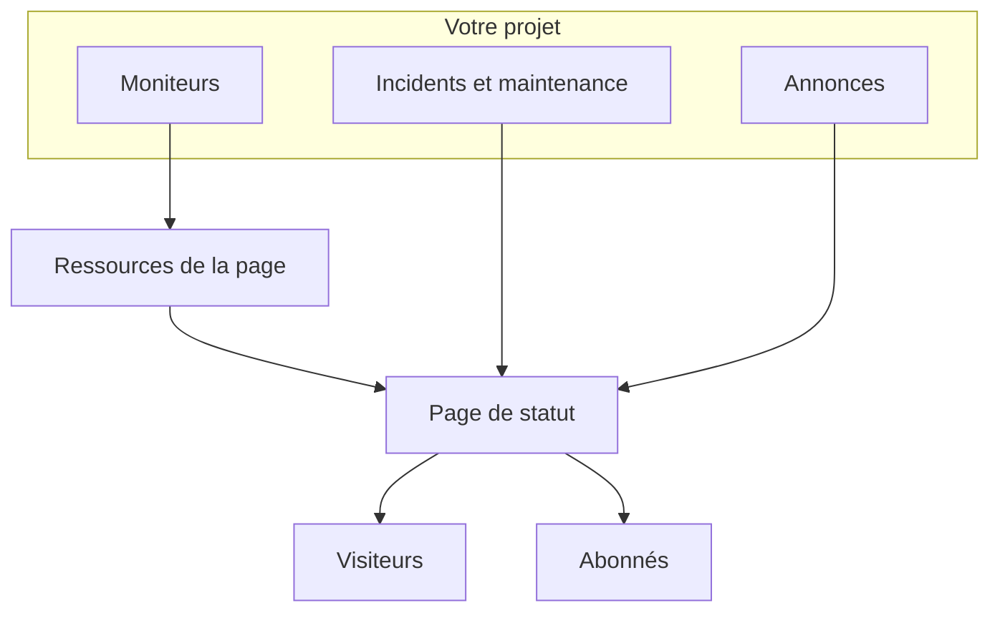

# Vue d'ensemble des pages de statut

Une page de statut est la vitrine publique de tout ce que vous surveillez : une URL unique que vos clients peuvent ouvrir au lieu de vous écrire pour demander si le problème vient d'eux. Elle montre l'état actuel des services que vous choisissez d'exposer, les incidents sur lesquels vous travaillez, la maintenance que vous avez prévue et toute annonce que vous souhaitez épingler en haut.

Quand quelque chose casse à 2 h du matin, la page de statut est la première chose vers laquelle votre file de support renvoie. C'est aussi d'elle que partent les notifications à vos abonnés — elle vaut donc d'être mise en place avant d'en avoir besoin, pas pendant la panne.

:::cards
- [Créer une page de statut](#créer-une-page-de-statut): Deux champs pour commencer, tout le reste ensuite.
- [Choisir ce qu'elle affiche](#choisir-ce-qui-saffiche-sur-la-page): Incidents, épisodes, annonces, maintenance et disponibilité, dans une seule carte.
- [Décider qui peut la voir](#restreindre-qui-peut-voir-la-page): Toute personne disposant du lien, uniquement les personnes qui se connectent, ou toute personne disposant du mot de passe.
- [Archiver une page de statut](#archiver-une-page-de-statut): Mettre une page hors ligne sans la supprimer.
:::

## Comment ça marche

Les pages de statut se trouvent sous **Pages de statut** dans le menu **Produits** de la barre du haut, parmi l'essentiel. Tout ce qui figure sur cette page s'applique par page de statut : un projet peut en exploiter autant qu'il le souhaite — une page publique pour les clients, une page privée pour un public interne, une page par région pour un marché donné.

La page montre les moniteurs que vous y placez comme ses ressources. Les incidents et la maintenance planifiée l'atteignent par ces moniteurs, et vous y publiez les annonces directement. Les visiteurs lisent la page, et les abonnés sont informés de chaque changement sur les canaux qu'ils ont choisis.

## En un coup d'œil

- **Créée avec deux champs.** Une nouvelle page de statut ne demande que **Nom** et **Description**. Les ressources, l'image de marque et les domaines se configurent ensuite.
- **Les ressources sont ce que voient les visiteurs.** Chaque ligne de la page est une **Ressource de la page de statut** — un moniteur (ou un groupe de moniteurs) avec son propre nom d'affichage, son infobulle et ses options de disponibilité. Les groupes découpent une longue page en sections et peuvent s'imbriquer.
- **Une URL d'aperçu dès le premier jour.** Chaque page de statut reçoit un lien d'aperçu pour que vous puissiez la regarder avant même qu'un domaine personnalisé existe.
- **Les routes visibles des visiteurs dépendent des paramètres.** Les incidents, les épisodes, les annonces et les événements planifiés n'apparaissent chacun que tant que leur interrupteur dans **Ce que montre votre page de statut** (sur **Paramètres avancés**) est activé, et la page d'abonnement uniquement tant que **Afficher la page des abonnés** est activé.
- **Qui peut la voir est un seul choix.** Toute personne disposant du lien, uniquement les personnes qui se connectent (utilisateurs privés, SSO SAML ou OIDC), ou toute personne disposant du mot de passe — sur l'écran **Accès** de la page, avec une liste d'autorisation IP facultative sous **Plus de paramètres**.
- **Les abonnés sont informés automatiquement.** Des abonnés par e-mail, SMS, Slack, Microsoft Teams et webhook peuvent suivre une page, chaque canal derrière son propre interrupteur.

## Termes clés

| Terme | Ce qu'il signifie |
| --- | --- |
| **Page de statut** | Une page publique (ou privée), avec sa propre image de marque, ses domaines, ses ressources et ses abonnés. Le modèle `StatusPage`. |
| **Ressource** | Une ligne que voient les visiteurs — un moniteur ou un groupe de moniteurs affiché sur la page avec un nom d'affichage et des options de disponibilité. |
| **Groupe** | Une section nommée qui contient des ressources. Les groupes s'imbriquent dans d'autres groupes, et chaque niveau agrège l'état de tout ce qui se trouve en dessous. |
| **Annonce** | Un message que vous publiez sur une ou plusieurs pages de statut, avec une heure de début et une heure de fin facultative. |
| **Abonné** | Quelqu'un (ou quelque chose) qui suit la page par e-mail, SMS, Slack, Microsoft Teams ou webhook. |
| **Domaine personnalisé** | Un domaine à vous — `status.example.com` — pointé vers la page par un enregistrement CNAME. OneUptime émet gratuitement son certificat SSL et le renouvelle. |
| **Utilisateur privé** | Un compte qui peut se connecter à une page de statut privée. Distinct des utilisateurs de votre projet OneUptime. |

## Créer une page de statut

:::steps
### Ouvrir le formulaire

Ouvrez **Pages de statut → Toutes les pages de statut** et cliquez sur **Créer une page de statut**.

### Nommer la page

Dans la fenêtre **Créer : Page de statut**, renseignez **Nom** (obligatoire, au moins deux caractères) et, si vous le souhaitez, **Description**, puis cliquez sur **Créer une page de statut**.

C'est tout le formulaire. La liste sur laquelle vous revenez affiche **Nom**, **Description**, **Étiquettes** et **Propriétaires**, et peut être filtrée par **ID de la page de statut**, **Nom** et **Description**.

### Ouvrir la nouvelle page

Ouvrez la nouvelle page : vous arrivez sur son écran **Vue d'ensemble**, qui porte deux cartes : **Status Page Preview URL**, avec un lien vers la page elle-même, et **Détails de la page de statut**, où vous pouvez modifier le nom, la description et les étiquettes que vous venez de définir. Dès que le projet a des champs personnalisés de page de statut, une carte **Champs personnalisés** les suit.
:::

Une page créée via l'API ou Terraform est soumise aux mêmes formules que les paramètres décrits ci-dessous. Sur OneUptime Cloud, créer une page avec un paramètre activé que votre formule n'inclut pas — par exemple privée, une liste masquée, du HTML, CSS ou JavaScript personnalisé, des rapports par e-mail, des abonnés SMS, Slack, Microsoft Teams ou webhook, une liste d'autorisation IP — est refusé avec `402 Payment Required`, et le message nomme la formule. La formule de chaque paramètre est indiquée avec lui ci-dessous. Les paramètres laissés à leur valeur par défaut, comme ce formulaire les laisse, fonctionnent avec toutes les formules.

Ensuite, à peu près par ordre d'utilité :

- Ajoutez des ressources pour que la page affiche quelque chose — voir [Ressources et groupes de la page de statut](/docs/status-pages/resources-and-groups).
- Définissez le titre de la page, le favicon, le logo et la couverture, puis rattachez un domaine personnalisé — voir [Personnalisation et domaines de la page de statut](/docs/status-pages/branding-and-domains).
- Décidez par quels canaux on peut s'abonner — voir [Abonnés et annonces](/docs/status-pages/subscribers).
- Ajustez ce qui apparaît sur la page sous **Paramètres avancés**.

## Où se trouve chaque chose

Une fois une page de statut ouverte, son propre menu latéral gauche est réparti en neuf sections. Servez-vous-en comme d'une carte pour le reste de cette partie de la documentation.

| Section | Ce qu'elle contient |
| --- | --- |
| **Basique** | **Vue d'ensemble**, **Annonces**, **Propriétaires**. |
| **Ressources** | Un seul écran **Ressources** — les groupes à gauche, les moniteurs du groupe sélectionné à droite — et **Règles de moniteurs**. |
| **Abonnés** | **Abonnés e-mail**, **Abonnés SMS**, **Abonnés Slack**, **Abonnés MS Teams**, **Abonnés au webhook**, **Paramètres des abonnés**. |
| **Journaux de notification** | **Journaux de notification** — ce qui a été envoyé aux abonnés. |
| **Image de marque** | **Image de marque** (logo, titre, favicon, liens, pied de page, couleurs et langues, sur une seule page), **Domaines personnalisés**, **HTML, CSS et JavaScript**. |
| **Sécurité** | **Accès** (qui peut voir la page), **Utilisateurs privés**, **SSO**, **OIDC**, **SCIM**. |
| **IA** | **MCP**. |
| **Développeurs** | **Terraform**, **API**, **Assistants IA** — la page en tant que code. |
| **Avancé** | **Statut intégré**, **Rapports**, **Champs personnalisés**, **Paramètres avancés**, **Journaux d'audit**, **Supprimer la page de statut**. |

Seules **Basique** et **Ressources**, ce que la page montre, sont ouvertes au départ. Toutes les autres sections sont repliées au départ, comme les sections peu utilisées de chaque menu de OneUptime : cliquez sur le titre d'une section pour afficher ses pages. Une section s'ouvre d'elle-même dès que vous êtes sur l'une de ses pages, comme **Paramètres avancés** ou **Abonnés e-mail**.

Deux particularités de nommage à connaître avant de chercher :

- L'élément **Ressources** ne s'appelle **Ressources** que lorsque le projet a activé les groupes de moniteurs. Sinon, il s'appelle **Moniteurs**. C'est le même écran dans les deux cas.
- Il n'y a pas de page Groupes distincte. Les groupes et les ressources ont été fusionnés, et l'ancienne route `/groups` redirige désormais vers l'écran des ressources.

En dehors d'une page donnée, la section **Pages de statut** elle-même liste **Toutes les pages de statut**, et une section **Plus** contient **Annonces**. Une section **Paramètres** repliée contient **Modèles d'annonce**, **Modèles d'abonnés**, **Champs personnalisés**, **Règles de propriétaire** et **Règles d'étiquettes**, qui s'appliquent à tout le projet et sont partagés par toutes les pages de statut. Une section **Avancé** repliée contient **Archivé** : les pages de statut que vous avez mises hors ligne (voir [Archiver une page de statut](#archiver-une-page-de-statut)).

Les **Règles d'étiquettes** et **Règles de propriétaire** étiquettent les nouvelles pages de statut et leur attribuent des propriétaires. Une règle se fait en deux étapes — **Correspondance**, les conditions qu'une page de statut doit remplir, puis **Étiquettes** (ou **Propriétaires**), ce que la règle ajoute — et son **Nom** est rempli à partir de vos choix. Une nouvelle règle doit ajouter au moins une étiquette ou un propriétaire ; la modification d'une règle n'insiste jamais, et la liste marque une règle plus ancienne qui n'ajoute rien avec **N'ajoute rien**. Voir [Règles d'étiquettes et de propriétaires](/docs/configuration/label-and-owner-rules).

## Ce que voient les visiteurs

La page publique est une application à part, avec un petit ensemble de routes :

- `/` — l'**Aperçu**.
- `/incidents` et `/incidents/:id` — la liste des incidents et un incident donné.
- `/announcements` et `/announcements/:id`.
- `/scheduled-events` et `/scheduled-events/:id`.
- `/subscribe/email`, `/subscribe/sms`, `/subscribe/slack`, `/subscribe/microsoft-teams`, `/subscribe/webhooks`.
- `/confirm-subscription/:id`, `/update-subscription/:id` et `/unsubscribe/:token` — les liens des messages que reçoivent les abonnés.
- `/rss` — le flux.
- `/login`, `/sso` et `/master-password` — utiles uniquement sur une page privée.

La barre de navigation du haut affiche toujours **Aperçu** ; le reste n'apparaît que s'il est activé. **Incidents**, **Annonces** et **Événements planifiés** ont chacun besoin de leur interrupteur ; **S'abonner** a besoin à la fois de **Afficher la page des abonnés** et d'au moins un canal d'abonnement activé. Une page privée reçoit aussi un élément **Se déconnecter**.

Un incident, un épisode, une annonce ou un événement planifié ne s'ouvre seul que si la page le listerait, quelle que soit sa fenêtre d'historique : un incident ou un épisode privé, un élément masqué des pages de statut, un événement planifié masqué des pages de statut ou une annonce programmée pour plus tard n'est pas trouvé non plus par son lien.

### La page de vue d'ensemble

La vue d'ensemble est la page que la plupart des visiteurs voient. De haut en bas, elle affiche :

1. **Toutes les annonces en cours** — les annonces dont l'heure de début est passée et dont l'heure de fin ne l'est pas.
2. **Un bandeau d'état global** — une seule ligne qui résume si toutes les ressources ou seulement certaines sont touchées.
3. **Un pourcentage de disponibilité global**, si vous l'avez activé : à la fin du bandeau d'état global, tant que toutes les ressources sont opérationnelles. Désactivé par défaut.
4. **Les groupes de ressources**, chacun avec ses ressources, leur état actuel et leurs barres d'historique de disponibilité.
5. **Incidents actifs**, avec les épisodes actifs.
6. **Événements de maintenance planifiée**.

Une page toute neuve sans contenu affiche un état vide qui vous invite à ajouter des ressources depuis le tableau de bord — le signal pour vous rendre sur l'écran **Ressources**.

La vue d'ensemble que voit un visiteur a au plus 15 secondes, et tout ce que vous retirez de la page en disparaît en moins d'une seconde : un incident, un épisode ou un événement planifié que vous masquez des pages de statut, rendez privé, limitez à d'autres pages ou supprimez, une annonce que vous terminez, repoussez ou supprimez, une note publique que vous supprimez, et une ressource, un groupe ou un moniteur que vous retirez de la page ou supprimez. Les autres modifications, comme un nouveau titre, apparaissent dans ces 15 secondes.

Pour savoir ce qui met un incident sur cette page et ce qui l'en retire, voir [États et sévérités des incidents](/docs/incidents/states-and-severities).

## Choisir ce qui s'affiche sur la page

Ce que voient les visiteurs se règle dans une seule carte : **Ce que montre votre page de statut**, sur **Pages de statut → votre page → Avancé → Paramètres avancés**. Elle a une ligne pour chaque liste que la page peut afficher, puis **Historique de disponibilité** (avec le pourcentage de disponibilité global et les statuts qui comptent comme indisponibilité) et la ligne « Powered by OneUptime ». Il n'y a pas de bouton de modification : un interrupteur enregistre dès que vous le basculez, un nombre de jours quand vous quittez sa case ou appuyez sur Entrée, et un choix dans une liste dès que vous le faites.

- **Afficher les incidents** (`showIncidentsOnStatusPage`) — activé par défaut. En dessous, **Afficher … jours d'historique** (`showIncidentHistoryInDays`, 14 par défaut) indique jusqu'où remonte la liste des incidents, et **Afficher les étiquettes d'incident** (`showIncidentLabelsOnStatusPage`) est désactivé par défaut.
- **Afficher uniquement les incidents limités à cette page** (`onlyShowScopedIncidents`) — également dans la ligne des incidents, désactivé par défaut. Activez-le et la page n'affiche, et ne notifie à ses abonnés, que les incidents qui lui sont limités avec **Limiter à ces pages de statut**. Les incidents qui ne sont limités à aucune page, y compris ceux qu'un moniteur, Slack, Microsoft Teams, l'API ou l'IA ouvre de lui-même, ne l'atteignent jamais tant que quelqu'un n'y ajoute pas la page. Il décide aussi quels incidents amènent leurs épisodes sur la page, c'est pourquoi il reste quand **Afficher les incidents** est désactivé. Pour des pages qui partagent des moniteurs mais servent des publics différents, voir [Une page de statut par public](/docs/status-pages/one-status-page-per-audience).
- **Afficher les épisodes** (`showEpisodesOnStatusPage`) — activé par défaut, avec **Afficher … jours d'historique** (`showEpisodeHistoryInDays`, 14 par défaut) et **Afficher les étiquettes d'épisode** (`showEpisodeLabelsOnStatusPage`, désactivé par défaut). Les épisodes sont un modèle à part avec leurs propres points de terminaison, pas une vue des incidents.
- **Afficher les annonces** (`showAnnouncementsOnStatusPage`) — activé par défaut, avec **Afficher … jours d'historique** (`showAnnouncementHistoryInDays`, 14 par défaut).
- **Afficher les événements de maintenance planifiée** (`showScheduledMaintenanceEventsOnStatusPage`) — activé par défaut, avec **Afficher … jours d'historique** (`showScheduledEventHistoryInDays`, 14 par défaut) et **Afficher les étiquettes d'événement** (`showScheduledEventLabelsOnStatusPage`, désactivé par défaut).
- **Historique de disponibilité** — tout ce qui concerne la disponibilité de la page, en une ligne :
  - **Afficher … jours d'historique** (`showUptimeHistoryInDays`) est la longueur de la barre de disponibilité à côté de chaque ressource. 90 par défaut, et la valeur doit être comprise entre 1 et 90. Chaque option **Afficher le % de disponibilité** et **Afficher le graphique de l'historique des états** d'une ressource ou d'un groupe lit ce nombre, tout comme le pourcentage de disponibilité global.
  - **Afficher le pourcentage de disponibilité global** (`showOverallUptimePercentOnStatusPage`) — désactivé par défaut. Activez-le et le bandeau d'état global se termine par un pourcentage de disponibilité pour toute la page, la moyenne de ses ressources et groupes, tant que tout est opérationnel. Tant qu'il est activé, **Précision** (`overallUptimePercentPrecision`) choisit combien de décimales il affiche : `99%`, `99.9%`, `99.99%` (la valeur par défaut) ou `99.999%`. Chaque ressource et chaque groupe a sa propre précision.
  - **Compte comme indisponibilité** (`downtimeMonitorStatuses`) — les statuts de moniteur dont le temps compte contre chaque pourcentage de disponibilité de la page : celui de chaque ressource, de chaque groupe et le global. Chaque statut est une puce de sa propre couleur. Ajoutez-en un depuis la liste ou retirez-en un avec son **×**, et la modification est enregistrée aussitôt. Une nouvelle page de statut commence avec tous les statuts du projet qui ne sont pas opérationnels. Au moins un statut reste : le dernier ne peut pas être retiré, car sans aucun, chaque disponibilité de la page afficherait 100%.
- **Afficher la mention « Propulsé par OneUptime »** — activé par défaut, si bien que le pied de page visiteur affiche « Powered by OneUptime ». Désactivez-le pour masquer la ligne. La colonne l'enregistre à l'inverse, sous `hidePoweredByOneUptimeBranding`.

**Une liste désactivée** disparaît de la page, avec son élément dans la barre de navigation s'il en a un ; son point de terminaison public refuse, et les abonnés de la page ne sont pas notifiés de ce type d'événement. Sa ligne n'affiche alors que son interrupteur : jusqu'où remonte une liste masquée, et si elle affiche des étiquettes, ne change rien.

**Formules.** Sur OneUptime Cloud, un paramètre que votre formule ne peut pas modifier affiche à côté la formule dont il a besoin. Les quatre interrupteurs de liste, les trois interrupteurs d'étiquettes et l'historique des épisodes nécessitent **Growth** ; afficher le pourcentage de disponibilité global et masquer la ligne « Powered by OneUptime » nécessitent **Scale**. Les autres fenêtres d'historique, **Historique de disponibilité**, **Précision**, **Compte comme indisponibilité** et **Afficher uniquement les incidents limités à cette page** peuvent être modifiés avec toutes les formules, et chacun s'enregistre seul : une page dont le pourcentage de disponibilité global est déjà activé peut changer sa précision avec n'importe quelle formule. Remettre un paramètre comme l'a une nouvelle page — afficher de nouveau une liste, masquer les étiquettes ou le pourcentage de disponibilité global, afficher la ligne « Powered by OneUptime », ramener l'historique des épisodes à 14 jours — fonctionne avec toutes les formules, si bien que rien de ce qu'un essai a modifié ne reste ainsi faute de formule : l'interrupteur indique qu'il peut encore revenir en arrière, et quelle formule il faut pour le modifier de nouveau.

Le fait que la page affiche un élément **S'abonner** (**Afficher la page des abonnés**, `showSubscriberPageOnStatusPage`, activé par défaut), et les canaux par lesquels les visiteurs peuvent s'abonner, ne se règlent pas sur cet écran : les deux se trouvent dans la carte **Canaux** de **Abonnés → Paramètres des abonnés** (voir [Canaux d'abonnement](/docs/status-pages/subscribers#canaux-dabonnement)).

Sous la carte se trouvent **Exporter au format JSON : Page de statut**, qui télécharge les paramètres propres de la page de statut dans un fichier que vous pouvez réimporter, et **Archive status page** (voir [Archiver une page de statut](#archiver-une-page-de-statut)). Le pourcentage de disponibilité global et les statuts d'indisponibilité étaient autrefois deux cartes à part ici, chacune derrière un bouton **Modifier** ; ce sont désormais des lignes de la carte.

**Où sont les couleurs.** Les couleurs des barres de disponibilité ne sont pas ici — la **Couleur de barre par défaut** et les règles de couleur des barres se trouvent sous **Plus de paramètres** sur **Pages de statut → votre page → Image de marque → Image de marque**. Il n'y a de réglage de thème ou de couleur de marque nulle part ; tout ce qui va au-delà de ces contrôles se fait avec **CSS personnalisé**.

## Prévisualiser avant la mise en ligne

L'écran **Vue d'ensemble** de chaque page de statut porte une carte **Status Page Preview URL** avec un lien direct vers la page. Utilisez-la pendant que vous ajoutez encore des ressources et avant qu'un domaine personnalisé existe.

En coulisses, chaque route publique a un jumeau d'aperçu sous `/status-page/{statusPageId}/...` — un aperçu de la vue d'ensemble, un aperçu de la liste des incidents, un aperçu de la page d'abonnement, et ainsi de suite. Une URL ou une capture d'écran prise depuis l'aperçu du tableau de bord ne correspondra donc pas à ce que voit un client une fois un domaine personnalisé rattaché : vérifiez tout lien que vous collez dans un runbook ou un e-mail.

## Restreindre qui peut voir la page

Toutes les pages de statut ne sont pas destinées au public. Qui peut voir une page est un seul choix, la première carte de **Pages de statut → votre page → Sécurité → Accès**, **Qui peut voir cette page de statut** :

- **Toute personne disposant du lien** — la page est publique. Toute nouvelle page de statut commence ici.
- **Uniquement les personnes qui se connectent** — les visiteurs arrivent sur `/login` et se connectent en tant qu'utilisateur privé, ou avec votre fournisseur SSO ou OIDC (voir ci-dessous). Sous le choix, la carte liste la connexion mise en place pour la page — combien d'utilisateurs privés elle compte, et si SSO et OIDC sont activés, chacun avec un lien vers son écran — et, tant que c'est le choix, indique quand personne ne peut encore se connecter.
- **Toute personne disposant du mot de passe** — les visiteurs arrivent sur `/master-password` et déverrouillent la page avec un mot de passe que vous leur communiquez. Personne n'a besoin de compte. Ce choix demande le mot de passe dans la même fenêtre si la page n'en a pas ; si elle en a un, vous pouvez le garder ou en saisir un nouveau. Ensuite, **Changer le mot de passe** sous le choix le remplace. Le mot de passe est stocké sous forme de hachage et ne peut pas être réaffiché, et les personnes qui ont saisi l'ancien peuvent continuer à voir la page pendant jusqu'à 7 jours.

Faire un choix demande une confirmation, indique ce qui change pour les visiteurs, et enregistre aussitôt. Il n'y a pas de bouton de modification.

**Images.** Une image dans ce que montre la page — une note publique, une annonce, une description — s'ouvre par sa propre adresse longue et impossible à deviner, qui fonctionne sans connexion, afin que les e-mails de vos abonnés puissent l'afficher aussi. La page elle-même demande toujours la connexion ou le mot de passe.

**Ce qui est enregistré.** Le choix tient en trois colonnes, que l'API et Terraform lisent et écrivent comme avant : `isPublicStatusPage`, `enableMasterPassword` et `masterPassword`. Le mot de passe n'est demandé aux visiteurs que sur une page qui n'est pas publique, avec `enableMasterPassword` activé et un mot de passe défini ; une page privée avec l'interrupteur activé mais sans mot de passe est une page de connexion. Choisir **Toute personne disposant du lien** désactive aussi `enableMasterPassword`, puisqu'une page publique ne le demande jamais. L'écran **Accès** n'écrit que les colonnes qu'un choix modifie.

**Formules.** Sur OneUptime Cloud, rendre une page privée nécessite la formule **Growth** : avec une formule inférieure, les deux choix privés affichent la formule dont ils ont besoin et ne peuvent pas être choisis. La rendre de nouveau publique — **Toute personne disposant du lien** — fonctionne avec toutes les formules, si bien qu'une page restée privée à la fin d'un essai, ou après un passage à une formule inférieure, peut toujours être rouverte ; la fenêtre indique que la rendre de nouveau privée nécessite **Growth**. Passer de **Uniquement les personnes qui se connectent** à **Toute personne disposant du mot de passe** fonctionne avec toutes les formules, tout comme **Changer le mot de passe**.

### Utilisateurs privés

Ajoutez les personnes autorisées à se connecter sur **Pages de statut → votre page → Sécurité → Utilisateurs privés**. Il existe une action **Ajouter en masse** — collez une liste d'adresses e-mail et chacune reçoit un e-mail d'invitation. Les utilisateurs privés ont leur propre parcours « mot de passe oublié » et « réinitialisation », distinct des comptes de votre projet OneUptime.

**Utilisateurs privés et mot de passe ne se cumulent pas.** Tant que **Toute personne disposant du mot de passe** est le choix, les utilisateurs privés ne peuvent pas se connecter — ils saisissent eux aussi le mot de passe — et l'écran **Utilisateurs privés** le signale, avec un lien vers **Accès**.

### SSO et OIDC

Pour une page privée liée à votre fournisseur d'identité, **Pages de statut → votre page → Sécurité → SSO** configure SAML : vous saisissez l'URL de connexion, l'émetteur et le certificat x509, et les méthodes de signature et de condensat sont préremplies sous **Plus de champs**. **Pages de statut → votre page → Sécurité → OIDC** configure OpenID Connect : vous saisissez l'émetteur, l'ID client et le secret, et l'URL de découverte, les scopes et les noms de claims sont préremplis sous **Plus de champs**. **SCIM** provisionne automatiquement les utilisateurs privés depuis l'IdP. Sur OneUptime Cloud, les trois nécessitent la formule Scale ou supérieure. Sur une installation auto-hébergée, SSO et OIDC font partie de toutes les éditions, et SCIM nécessite l'[Édition Enterprise](/docs/self-hosted/enterprise).

Désactiver ou supprimer le fournisseur SSO ou OIDC d'une page de statut déconnecte les utilisateurs privés qu'il avait connectés : leurs sessions se terminent à leur prochaine requête, et réactiver le fournisseur ne les fait pas revenir — ils se reconnectent avec lui. Un nouveau certificat ou secret client, d'autres URL ou un nouveau nom laissent tout le monde connecté. Sur une page qui exige le SSO, désactiver son dernier fournisseur ne laisse plus personne se connecter tant que vous n'en réactivez pas un ou ne désactivez pas **Exiger le SSO pour la connexion** ; pour passer à un autre fournisseur, configurez et testez le nouveau avant de désactiver l'ancien.

Sous les fournisseurs, la carte **Paramètres SSO** contient l'interrupteur **Exiger le SSO pour la connexion** (`requireSsoForLogin`, désactivé par défaut), qui enregistre dès que vous le basculez. L'activer demande d'abord une confirmation, car dès lors les utilisateurs privés ne peuvent plus se connecter avec un e-mail et un mot de passe : seules les personnes que votre fournisseur SSO ou OIDC laisse entrer peuvent voir la page. Testez le SSO avec le lien de cet écran avant de l'activer. Il ne compte que tant que **Uniquement les personnes qui se connectent** est le choix, et l'écran **Accès** l'affiche comme **SSO exigé** sous ce choix. Tant qu'il est activé, un utilisateur privé connecté avec un e-mail et un mot de passe est lui aussi déconnecté à sa prochaine requête : seules comptent les sessions qu'un fournisseur SSO ou OIDC a ouvertes. Sur OneUptime Cloud, l'activer nécessite la formule **Scale**, et le désactiver fonctionne avec toutes les formules. Une page qui exige encore le SSO après la fin d'un essai Scale, ou après un passage à une formule inférieure, continue de l'exiger jusqu'à ce que quelqu'un le désactive : ses pages **SSO** et **OIDC** affichent l'interrupteur sous l'incitation à la formule pour cela.

### Liste d'autorisation IP

Sous **Plus de paramètres** sur **Accès**, la section **Liste d'autorisation IP** (la colonne `ipWhitelist`) limite une page à des réseaux connus. Elle s'applique quel que soit le public de la page : un visiteur venant de toute autre adresse est refusé, même avec le mot de passe ou un compte d'utilisateur privé. Saisissez une entrée par ligne — une adresse IPv4 ou IPv6, ou une plage IPv4 comme `10.0.0.0/8` ; une ligne qui n'est ni l'une ni l'autre est refusée à l'enregistrement. Laissez-la vide pour laisser passer toutes les adresses. Tant que la liste s'applique, l'en-tête replié **Plus de paramètres** affiche **Liste d'autorisation IP** avec le nombre d'entrées qu'elle contient. Sur OneUptime Cloud, la modifier nécessite la formule **Scale** ; la vider fonctionne avec toutes les formules.

## Le badge intégrable et le flux RSS

Deux façons d'afficher le statut ailleurs que sur la page elle-même.

**Badge de statut intégré.** Sur **Pages de statut → votre page → Avancé → Statut intégré**, activez **Activer le badge de statut intégré** (`enableEmbeddedOverallStatus`, désactivé par défaut), puis cliquez sur **Regénérer le jeton** sur la carte **Jeton de sécurité** pour donner au badge son jeton (`embeddedOverallStatusToken`). Le badge est servi depuis `/api/status-page/badge/<status-page-id>?token=<token>`, et l'écran l'affiche sous **Aperçu du badge** avec des extraits à copier, pour que vous puissiez placer le statut global actuel dans votre documentation, le pied de page de votre application ou une page marketing.

**Flux RSS.** Chaque page de statut sert `/rss` — un flux intitulé « {titre de la page} Updates », avec le **Titre de la page** défini dans **Image de marque**, ou son nom si elle n'en a pas, et dont les éléments commencent par `Incident: `, `Announcement: ` et `Scheduled Maintenance: `. Pratique pour ceux qui préfèrent faire passer vos mises à jour par un lecteur ou un chatbot plutôt que s'abonner par e-mail.

Si vous préférez récupérer les données vous-même, la page de statut s'appuie sur des points de terminaison publics en lecture pour la vue d'ensemble, les incidents, les événements de maintenance planifiée, les annonces et les épisodes — voir [API publique](/docs/status-pages/public-api).

## Archiver une page de statut

Archivez une page de statut pour la mettre hors ligne sans la supprimer. Une page de statut archivée :

- **Est hors ligne.** Son URL, ses domaines personnalisés, son badge intégré, son API publique et son serveur MCP répondent tous comme si la page n'existait pas (« Status Page not found »), si bien qu'un visiteur ne peut pas distinguer une page archivée d'une page qui n'a jamais existé. Le lien d'aperçu du tableau de bord cesse aussi de fonctionner.
- **N'envoie rien à ses abonnés.** Aucune notification d'incident, d'épisode, de maintenance ou d'annonce, aucun rapport, et aucune confirmation d'abonnement. Personne ne peut s'y abonner.
- **Quitte la liste des pages de statut.** Vous la retrouvez sous **Pages de statut → Avancé → Archivé**.
- **Garde tout.** Ses ressources, groupes, image de marque, domaines, utilisateurs privés et abonnés sont conservés, si bien que la désarchiver remet la page en ligne exactement comme elle était.

Pour archiver une page de statut, ouvrez-la et allez dans **Avancé → Paramètres avancés → Archive status page**. Pour en archiver plusieurs, sélectionnez-les dans la liste **Pages de statut** et choisissez **Archiver**. Pour en récupérer une, ouvrez **Pages de statut → Avancé → Archivé**, sélectionnez-la et choisissez **Désarchiver**, ou ouvrez-la et cliquez sur **Désarchiver** dans le bandeau en haut de ses pages.

## Étapes suivantes

:::cards
- [Ressources et groupes de la page de statut](/docs/status-pages/resources-and-groups): Placer des moniteurs sur la page et les organiser en sections.
- [Personnalisation et domaines de la page de statut](/docs/status-pages/branding-and-domains): Votre logo et vos couleurs, et la page sur votre propre domaine.
- [Abonnés et annonces](/docs/status-pages/subscribers): Les cinq canaux d'abonnement, et la publication d'annonces.
- [Une page de statut par public](/docs/status-pages/one-status-page-per-audience): Une page par client, site ou région, et lesquelles sont informées de chaque incident.
:::
