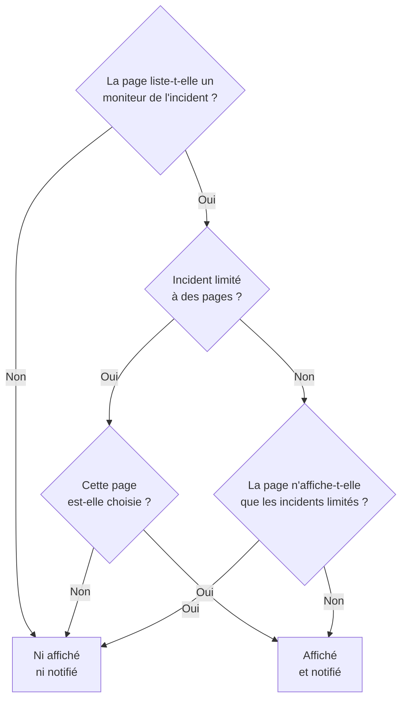

# Une page de statut par public

Des personnes différentes ont besoin de nouvelles différentes. Un client ne veut pas entendre parler de la panne d'un autre client, et le personnel d'un site ne veut pas recevoir un e-mail chaque fois qu'un autre site perd son réseau. Dans OneUptime, l'unité de public est la page de statut : chacune a ses propres abonnés, sa propre image de marque et sa propre confidentialité. Donnez donc à chaque public sa propre page, et décidez incident par incident quelles pages en sont informées.

L'infrastructure partagée rendait cela difficile. Un incident atteint une page de statut par ses moniteurs, si bien qu'un moniteur partagé par dix pages de site informait les dix sites d'une panne qui n'en touchait que deux. Le seul contournement était une page, ou un moniteur, pour chaque combinaison de sites. Cette page couvre les réglages qui règlent cela :

- **Limiter à ces pages de statut** sur un incident, pour qu'il ne s'affiche que sur les pages que vous choisissez et ne notifie qu'elles.
- **Afficher uniquement les incidents limités à cette page** sur une page de statut, pour qu'un incident que personne n'a encore délimité n'atteigne aucune de ces pages tant que quelqu'un n'a pas décidé. Cela inclut les incidents qu'un moniteur, Slack, Microsoft Teams, l'API ou l'IA ouvre de lui-même.
- Un enregistrement des pages informées de la création d'un incident, pour qu'une page ajoutée plus tard soit informée une fois et que les autres ne le soient pas de nouveau.
- Un résumé **Seront notifiés** qui montre qui sera informé d'un incident avant que vous ne le déclariez ou ne publiiez une note publique, et **Aperçu**, qui montre ce que recevront les abonnés de chaque page.

:::cards
- [Le mettre en place](#mettre-en-place-une-page-par-public): Une page par public, et l'interrupteur qui tient les incidents non délimités à l'écart.
- [Limiter un incident](#limiter-un-incident-à-des-pages-de-statut): Choisir les pages quand vous le déclarez, ou plus tard.
- [Ajouter ou retirer des pages](#ajouter-et-retirer-des-pages-de-statut): Qui est informé d'une page que vous ajoutez, et ce que le retrait d'une page rappelle.
- [Ce que porte chaque message](#ce-que-porte-chaque-message): Les valeurs que reçoit chaque page, et ce qu'elles disent à chaque public.
:::

## Quand l'utiliser

- **Un fournisseur de services gérés** avec une page de statut par client, sur des moniteurs que les clients partagent.
- **Une organisation avec des sites, des usines ou des régions**, chacun avec son propre personnel à prévenir.
- **L'informatique interne** avec une page par service ou par bâtiment.

Si votre public est content de choisir lui-même, une seule page peut suffire : laissez les abonnés choisir les ressources qui les intéressent (voir [Abonnés et annonces](/docs/status-pages/subscribers)). Utilisez une page par public quand vous faites le choix pour eux, incident par incident, ou quand un public ne doit pas du tout voir les incidents d'un autre public.

## Comment un incident atteint une page de statut

Un incident atteint une page de statut par ses moniteurs. Une page affiche un incident, et en notifie ses abonnés, quand l'une des ressources de la page est l'un des moniteurs de l'incident, directement ou par un groupe de moniteurs de la page. Deux réglages restreignent cela :

- **Limiter à ces pages de statut** sur l'incident (`statusPages`). Laissé vide, l'incident atteint, comme toujours, chaque page qui liste ses moniteurs. Avec des pages choisies, il n'atteint que les pages choisies **parmi** celles qui listent ses moniteurs.
- **Afficher uniquement les incidents limités à cette page** sur la page de statut (`onlyShowScopedIncidents`, désactivé par défaut). Activé, la page n'affiche jamais, et ne notifie jamais personne à propos d'un incident qui n'est pas limité à des pages de statut précises.



Pour une page qui liste l'un des moniteurs de l'incident :

| L'incident est | Page avec **Afficher uniquement les incidents limités à cette page** désactivé | Page avec ce réglage activé |
| --- | --- | --- |
| Limité à aucune page de statut | Affiché et notifié | Ni affiché ni notifié |
| Limité à des pages de statut, et cette page est choisie | Affiché et notifié | Affiché et notifié |
| Limité à des pages de statut, mais pas à celle-ci | Ni affiché ni notifié | Ni affiché ni notifié |

Une page qui ne liste aucun des moniteurs de l'incident ne l'affiche jamais, quoi que vous choisissiez, et un incident sans moniteurs ne notifie aucun abonné de page de statut. Les règles habituelles s'appliquent en plus : l'incident doit être **Visible sur la page de statut** et non privé, la page doit avoir **Afficher les incidents** activé, et un abonné qui n'a choisi que certaines ressources ou certains types d'événements ne reçoit que ce qu'il a choisi.

Les mêmes règles décident de tout ce qui dépend des pages qu'atteint un incident :

- les listes d'incidents, la vue d'ensemble et la page propre de l'incident sur la page de statut publique, ainsi que l'[API publique](/docs/status-pages/public-api) de la page de statut ;
- les messages par e-mail, SMS, Slack, Microsoft Teams et webhook envoyés quand l'incident est créé, change d'état, reçoit une note publique ou un post-mortem ;
- le nombre d'incidents dans les rapports de page de statut envoyés par e-mail, qui ne comptent que les incidents que la page affiche.

Un épisode d'incident atteint une page quand au moins un de ses incidents l'atteint. Ses notifications partent vers chaque page qu'atteignent ses incidents, et sa page sur une page de statut qu'aucun d'eux n'atteint est introuvable. Un incident privé n'atteint aucune page, si bien qu'il n'y amène jamais son épisode, et un épisode privé ne s'affiche sur aucune page.

## Mettre en place une page par public

:::steps
### Créer une page de statut pour chaque public

Créez une page par public, par exemple `Site 01` à `Site 10`. Rendez-les privées si le public est interne (voir [Restreindre qui peut voir la page](/docs/status-pages/index#restreindre-qui-peut-voir-la-page)). Les abonnés d'une page privée peuvent quand même se désabonner sans se connecter, par le lien de chaque message (voir [Gérer et annuler un abonnement](/docs/status-pages/subscribers#gérer-et-annuler-un-abonnement)). Donnez-leur des étiquettes comme `Region East`, pour que le sélecteur puisse ajouter en un clic chaque page qui porte une étiquette.

### Placer le moniteur partagé sur chaque page

Ajoutez le moniteur partagé à chaque page comme ressource (voir [Ressources et groupes de la page de statut](/docs/status-pages/resources-and-groups)). Une règle sous **Ressources → Règles de moniteurs** peut le faire pour vous à partir des étiquettes du moniteur.

### Activer Afficher uniquement les incidents limités à cette page

Sur chacune de ces pages, activez-le. Il se trouve dans la carte **Ce que montre votre page de statut** sur **Pages de statut → votre page → Avancé → Paramètres avancés**, sous **Afficher les incidents**, et il enregistre dès que vous le basculez. À partir de là, plus rien n'atteint une page de site tant que personne ne la choisit.

### Ajouter les abonnés de chaque public

Pour le personnel, utilisez **Ajouter en masse** sur **Abonnés e-mail**, et préférez l'adresse propre de chaque personne à une liste de diffusion comme `site03-all@` : n'importe qui sur la liste peut la désabonner pour tous ceux qui y figurent. Si un abonné que vous avez ajouté se désabonne, les propriétaires de la page et la personne qui l'a ajouté reçoivent un e-mail (voir [Adresses partagées et listes de diffusion](/docs/status-pages/subscribers#adresses-partagées-et-listes-de-diffusion)).

### Laisser les intervenants lire les pages de statut

Le sélecteur ne liste que les pages de statut que la personne peut lire, et les rôles d'incident ne peuvent pas lire les pages de statut. Donnez aux intervenants le rôle **Status Page Viewer** en plus de leur rôle d'incident ; il peut être limité aux pages qui portent certaines étiquettes. Sans lui, le sélecteur est vide.

### Décider de ce que dit chaque message

Dans **Incidents → Paramètres → Champs personnalisés**, définissez les champs personnalisés d'incident auxquels votre équipe répond à chaque fois, par exemple `Impact` (une liste déroulante), `Expected Resolution` (une date et heure) et `Acknowledgement` (un interrupteur oui/non). Faites-les glisser dans l'**Ordre** dans lequel vous voulez qu'ils soient demandés et listés, et activez **Afficher à la création** pour que le formulaire de déclaration les demande, **Obligatoire à la création** quand une réponse est indispensable, et **Inclure dans les notifications aux abonnés** pour ceux que chaque public peut lire. Ils figurent alors dans l'e-mail par défaut de chaque page. Voir [Champs personnalisés](/docs/incidents/settings#champs-personnalisés).

### Personnaliser l'e-mail de chaque page (facultatif)

Avec la formule **Scale**, donnez à chaque page une **Configuration SMTP personnalisée** et liez des modèles personnalisés pour les événements d'incident ; ils peuvent placer n'importe quel champ avec `{{incident.customFields.<key>}}`. Pendant que vous rédigez un modèle, **Aperçu en direct** en dessous le montre rempli avec des valeurs d'exemple. Voir [Ce qu'un modèle personnalisé nécessite](/docs/status-pages/subscribers#ce-quun-modèle-personnalisé-nécessite), et [Ce que porte chaque message](#ce-que-porte-chaque-message) avant d'utiliser `{{affectedStatusPages}}`.

### Enregistrer des modèles d'incident avec des pages choisies (facultatif)

Un modèle `Region East outage` peut porter les pages des sites de l'Est, et des réponses par défaut pour les champs personnalisés.

### Vérifier l'e-mail de chaque page avant la première panne

Lancez **Déclarer un incident** avec le moniteur partagé et deux des pages de site choisies, et sur le résumé avant l'envoi, ouvrez **Aperçu**, à côté de **Oui** : il montre l'e-mail que recevraient les abonnés de chaque page, et quel modèle il utilise et pourquoi. **M'envoyer un test** en envoie un dans votre propre boîte. Personne d'autre ne reçoit quoi que ce soit tant que vous ne déclarez pas l'incident ; quittez donc le formulaire sans l'envoyer quand vous avez terminé. Voir [Qui sera notifié](#qui-sera-notifié).
:::

## Limiter un incident à des pages de statut

### Lorsque vous le déclarez

Sur **Incidents → Tous les incidents → Déclarer un incident**, l'étape **Ressources affectées** a **Limiter à ces pages de statut** sous **Plus de champs**, après les moniteurs et les autres ressources. Son texte indicatif, **Toutes les pages de statut qui répertorient les moniteurs**, est ce que signifie le laisser vide. Choisissez des pages par leur nom, ou ouvrez l'onglet **Étiquettes** du sélecteur et choisissez une étiquette pour ajouter chaque page qui la porte.

Le formulaire vous avertit :

- quand une page choisie ne liste aucun des moniteurs de l'incident, ou qu'aucun moniteur n'est rattaché. L'incident ne s'affichera pas sur cette page et n'en notifiera pas les abonnés ;
- quand vous définissez aussi **Changer le statut du moniteur en**, juste sous les moniteurs à la même étape. Voir [Le statut d'un moniteur est partagé](#le-statut-dun-moniteur-est-partagé) ;
- quand vous cochez aussi **Incident privé**, sous **Plus de champs** à l'étape **Détails de l'incident**. Les incidents privés sont masqués de toutes les pages de statut, y compris celles que vous avez choisies.

L'étape **Détails**, juste après **Ressources affectées**, demande les champs personnalisés d'incident marqués **Afficher à la création** (voir [Déclarer un incident](/docs/incidents/declaring-incidents)). Ses réponses partent vers chaque page qu'atteint l'incident : les valeurs des champs personnalisés appartiennent à l'incident, pas à une page de statut.

**Créer à partir d'un modèle** remplit le champ à partir du modèle. Les pages d'un modèle se définissent à son étape **Ressources affectées** quand vous le créez, puis sur sa carte **Portée des pages de statut** (**Incidents → Paramètres → Modèles d'incident**). Comme pour les autres champs de modèle, une liste que vous définissez vous-même l'emporte. Les pages d'un modèle sont remplies même pour un intervenant qui ne peut pas lire les pages de statut : la personne qui a configuré le modèle les a choisies pour tous ceux qui déclarent à partir de lui.

### Qui sera notifié

Sous **Notifier les abonnés de la page de statut**, juste sous le sélecteur sous **Plus de champs** à l'étape **Ressources affectées**, et de nouveau sur le résumé avant l'envoi, le formulaire montre qui l'incident atteindra :

> Seront notifiés :
>
> - Site 03 (jusqu'à 41 par e-mail)
> - Site 07 (jusqu'à 18 par e-mail)

En dessous, sous **Non notifiés :**, il liste les pages qui listent les moniteurs mais ne seront pas informées, et pourquoi : ce n'est pas l'une des pages auxquelles l'incident est limité, c'est une page qui n'affiche que les incidents qui lui sont limités, ou une page qui n'affiche pas les incidents.

Quand personne ne sera informé, le résumé n'affiche rien : l'incident n'a pas de moniteurs, aucune page de statut ne les liste, les pages n'ont pas encore d'abonnés, **Notifier les abonnés de la page de statut** est désactivé, ou l'incident est privé. Il n'avertit que lorsque la portée des pages de statut en est la raison, et nomme les pages qu'elle laisse de côté : l'incident n'est pas limité et les pages qui listent ses moniteurs n'affichent que les incidents qui leur sont limités, il est limité à d'autres pages, ou les pages auxquelles il est limité ne listent aucun de ses moniteurs. Sur le résumé, **Notifier les abonnés de la page de statut** indique **Oui** ou **Non** comme toutes les autres cases, avec **Aperçu** à côté de **Oui** ; il n'est pas proposé tant que la case est décochée, que l'incident est privé ou qu'aucun moniteur n'est rattaché.

Le même résumé apparaît sous **Notifier les abonnés de la page de statut** quand vous rédigez une note sur la page **Notes publiques** de l'incident, pour l'incident tel qu'il est. Là, il indique aussi quand l'incident est masqué des pages de statut, puisque rien ne sera envoyé alors.

Les comptes sont des « jusqu'à ». Ils comptent par canal les abonnés confirmés de chaque page qui ne se sont pas désabonnés, et un abonné qui n'a choisi que certaines ressources ou certains types d'événements peut ne pas recevoir ce message. Les pages que vous ne pouvez pas lire ne sont pas nommées. Elles sont comptées comme « autres pages de statut auxquelles vous n'avez pas accès ».

**Aperçu**, à côté de **Oui** sur le résumé et à côté de la case de la note, montre ce qu'ils recevront : choisissez une page pour voir son e-mail tel que ses abonnés le recevront, avec son objet, et quel modèle il utilise et pourquoi, par exemple que le modèle personnalisé d'une page n'est pas utilisé parce que la page n'a pas de **Configuration SMTP personnalisée**. **M'envoyer un test** envoie l'e-mail de la page à l'adresse e-mail de votre propre compte, et à personne d'autre. Les pages que vous ne pouvez pas lire sont comptées mais pas prévisualisées. Voir [Prévisualiser l'e-mail avant son envoi](/docs/status-pages/subscribers#prévisualiser-le-mail-avant-son-envoi).

### Après sa déclaration

Ouvrez l'incident et allez dans **Avancé → Paramètres**. La carte **Portée des pages de statut** liste les pages auxquelles l'incident est limité, et **Modifier la portée des pages de statut** les change. La **Vue d'ensemble** de l'incident affiche la même liste sous **Portée des pages de statut**, en lecture seule, avec un lien **Modifier dans les paramètres**.

Sur **Incidents → Tous les incidents**, le filtre **Page de statut** trouve les incidents limités aux pages que vous choisissez, ou ceux qui ne sont limités à aucune page.

### Via l'API

`statusPages` est une liste d'ID de pages de statut, sur `POST /api/incident` et sur les mises à jour d'un incident, ainsi que sur les modèles d'incident. Chaque page doit appartenir au projet de l'incident ; une page d'un autre projet est refusée. Chaque page que vous ajoutez doit aussi être une page que vous pouvez lire, comme dans le sélecteur, sinon la requête est refusée. Les pages que l'incident ou le modèle porte déjà sont conservées, que vous puissiez les lire ou non, et une page d'un modèle d'incident que vous pouvez lire peut être choisie quand vous déclarez un incident. Deux autres colonnes en découlent, et aucune n'est à vous de définir :

- `isScopedToStatusPages` est calculé à partir de `statusPages`. Tout ce que vous envoyez pour lui est ignoré.
- `statusPagesNotifiedOnCreation` est l'enregistrement des pages qui ont été informées de la création de l'incident. Voir [Ajouter des pages de statut](#ajouter-des-pages-de-statut).

Pour voir qui un incident atteindrait sans rien envoyer, appelez le point de terminaison d'audience :

```bash
curl -X POST https://oneuptime.com/api/incident/subscriber-audience \
  -H "apikey: $ONEUPTIME_API_KEY" \
  -H "Content-Type: application/json" \
  -d '{
    "monitorIds": ["<monitor-id>"],
    "statusPageIds": ["<status-page-id>"]
  }'
```

Envoyez plutôt `{"incidentId": "<incident-id>"}` pour un incident existant. La réponse liste chaque page qui sera notifiée avec un compte par canal (`email`, `sms`, `slack`, `microsoftTeams`, `webhook`), les pages laissées de côté et pourquoi, et `hiddenStatusPageCount` pour les pages que l'appelant ne peut pas lire. Elle ne renvoie jamais d'adresse.

## Incidents que personne n'a encore délimités

Les critères de moniteur, Slack, Microsoft Teams, l'API et l'IA peuvent tous ouvrir un incident d'eux-mêmes, et aucun d'eux ne sait quels sites une défaillance sur un moniteur partagé touche. Un tel incident n'est limité à aucune page, si bien que chaque page qui liste le moniteur l'afficherait, et en notifierait ses abonnés, en une minute environ. Une fois qu'un e-mail est parti vers un abonné, on ne peut plus le reprendre.

**Afficher uniquement les incidents limités à cette page** est ce qui l'empêche. Une page où il est activé ignore tout incident non délimité. L'incident est quand même ouvert, les politiques d'astreinte alertent quand même les intervenants, et ses propriétaires sont quand même informés, mais aucune de ces pages n'en est informée. Un intervenant détermine ensuite qui est touché et ajoute ces pages dans l'onglet **Paramètres** de l'incident, avec **Envoyer la notification de création de l'incident aux pages nouvellement ajoutées** coché. Leurs abonnés sont informés en une minute environ.

## Ajouter et retirer des pages de statut

### Ajouter des pages de statut

Les abonnés d'une page apprennent une fois qu'un incident a été créé. Quand vous ajoutez des pages sur la carte **Portée des pages de statut**, le formulaire de modification propose donc **Envoyer la notification de création de l'incident aux pages nouvellement ajoutées**, coché par défaut :

- Coché, la notification « créé » de l'incident est de nouveau mise en file, et elle ne part que vers les pages qui n'ont pas encore été informées. L'incident conserve un enregistrement des pages informées, si bien que les autres ne l'apprennent pas deux fois.
- Décoché, les pages ajoutées commencent à afficher l'incident, et sont informées de tout à partir de maintenant, mais on ne leur dit pas qu'il a été créé.

La case n'apparaît que lorsque la cocher enverrait quelque chose : au moins une page que vous ajoutez n'a pas encore été informée, et l'incident a été déclaré avec **Notifier les abonnés de la page de statut** activé, est visible sur les pages de statut et n'est pas privé. Certains cas sont gérés pour vous :

- **La notification est encore en file, ou en cours d'envoi en ce moment.** Un envoi en file lit les pages au moment où il part, et un envoi en cours les relit quand il se termine puis informe les pages ajoutées entre-temps. Il n'y a donc pas de case : les pages que vous ajoutez sont informées dans tous les cas. (Si cet envoi échoue, les pages ajoutées entre-temps font partie de celles vers lesquelles son **Réessayer** envoie.)
- **Chaque page que vous ajoutez a déjà été informée**, par exemple une page que vous avez retirée puis rajoutée, ou un incident qui a atteint chaque site et qui est maintenant restreint à deux d'entre eux. Personne n'est informé de nouveau, il n'y a donc pas de case.
- **L'incident n'a jamais été annoncé.** Quand il a été publié sans **Notifier les abonnés que cet incident a été créé**, ou déclaré sans moniteurs, personne n'a été informé. Cocher la case n'informe que les pages que vous ajoutez, pas les pages auxquelles il était déjà limité.
- **L'incident a été déclaré avant la sortie de cette fonctionnalité.** Sa notification « créé » est partie vers chaque page qui listait ses moniteurs, et il n'existe aucun enregistrement de ces pages. Ajouter des pages ne l'envoie pas de nouveau, la case n'est donc pas proposée.
- **L'incident est masqué.** Rien n'est envoyé tant qu'il est masqué. Quand vous réactivez **Visible sur la page de statut**, la carte **Paramètres des incidents** propose **Notifier les abonnés que cet incident a été créé** pour les pages de sa portée qui n'ont jamais été informées, comme celles ajoutées pendant qu'il était masqué.

Une page ajoutée plus tard est informée de ce qui se passe ensuite : les notes publiques suivantes, les changements d'état et le post-mortem. Elle ne reçoit pas les notes et les changements d'état partis avant son ajout. Si elle doit rattraper son retard, publiez une note publique.

Le même enregistrement fait reprendre **Réessayer**, sur une notification « créé » en échec, là où elle s'était arrêtée : les pages déjà informées sont sautées. Une page ne compte comme informée que lorsque chacun de ses abonnés a reçu le message ; une page où un message a échoué, ou que l'envoi a interrompue en cours de route, le reçoit de nouveau en entier. L'enregistrement est écrit à mesure que chaque page se termine, si bien que cela vaut même pour un envoi interrompu. Il est conservé par page, pas par abonné : les abonnés d'une page que l'envoi a interrompue en cours de route et qui avaient déjà reçu le message le reçoivent une seconde fois.

Pour repartir de zéro à la place, par exemple après avoir corrigé un modèle ou un réglage SMTP, cochez **La renvoyer à chaque page de statut, y compris les pages déjà atteintes** dans la confirmation de **Réessayer** : le bouton devient **Renvoyer à toutes les pages**, l'enregistrement est vidé, et chaque page que l'incident atteint maintenant la reçoit de nouveau. Après une notification partie en entier, le **Statut de notification de l'abonné** sur la **Vue d'ensemble** de l'incident propose **Renvoyer**, qui fait la même chose. Les deux confirmations listent les pages qu'elle atteindrait maintenant, ou indiquent qu'elle n'atteindrait personne ; la confirmation simple de **Réessayer** liste les pages déjà atteintes comme non renvoyées, puisqu'elle les saute. Aucun n'est proposé pour une notification sautée, ou encore en file ou en cours d'envoi, ni à une personne qui ne peut pas modifier l'incident.

Via l'API, envoyez `"miscDataProps": {"notifyAddedStatusPagesOfIncidentCreated": true}` avec la mise à jour qui change `statusPages`. Remettre vous-même `subscriberNotificationStatusOnIncidentCreated` à `Pending` renvoie toujours la notification « créé » vers chaque page qu'atteint l'incident, comme cela a toujours été le cas : l'enregistrement est vidé avec. Après un échec, elle reprend à la place là où l'envoi en échec s'est arrêté. Pour l'envoyer aussi à chaque page après un échec, ajoutez `"miscDataProps": {"resendIncidentCreatedToAllStatusPages": true}` à cette mise à jour. Cette requête est refusée pour une notification sautée, ou en file ou en cours d'envoi.

Écrire `shouldStatusPageSubscribersBeNotifiedOnIncidentCreated` n'en fait pas partie. Il est choisi quand l'incident est déclaré, et aucun rôle de projet ne peut le changer via l'API ensuite. Un workflow, qui écrit en tant que système, et l'administrateur principal d'une instance le peuvent, mais cela ne fait qu'enregistrer la nouvelle valeur. Le réécrire inchangé, comme le fait un workflow qui copie tout l'incident, n'envoie rien de nouveau, et l'activer plus tard n'envoie pas la notification « créé » sans laquelle l'incident a été déclaré. Désactivé avant que cette notification soit partie, elle est sautée.

### Retirer des pages de statut

Retirer une page ne rappelle rien. La page cesse d'afficher l'incident, et ses abonnés n'en entendent plus parler, pas même de sa résolution. Quand vous retirez une page déjà informée de l'incident, le formulaire de modification vous avertit et suggère une note publique de clôture. Publiez d'abord cette note, pendant que la page est encore dans la liste, puis retirez la page.

Vider toute la liste est différent de retirer des pages : l'incident n'est alors plus limité du tout. Il s'affiche de nouveau sur chaque page qui liste ses moniteurs, et la notifie, sauf les pages qui n'affichent que les incidents qui leur sont limités. Le formulaire vous en avertit aussi.

### Quand une page de statut choisie est supprimée

Supprimer une page de statut la retire de chaque incident qui lui était limité. Un incident dont toutes les pages choisies ont été supprimées reste limité, à rien : il est masqué de chaque page de statut au lieu de s'afficher sur chaque page qui liste ses moniteurs. La carte **Portée des pages de statut** l'indique. Choisissez d'autres pages, ou videz la liste, pour l'afficher de nouveau.

Les modèles d'incident fonctionnent de la même façon. Un modèle dont toutes les pages ont été supprimées reste limité : un incident qu'un [formulaire](/docs/forms/on-submit#le-modèle-dincident) ou l'étape **Create One Incident** d'un workflow déclare à partir de lui est masqué de chaque page de statut, la carte **Portée des pages de statut** du modèle vous avertit, et **Déclarer un incident** commence sans page choisie et vous demande de choisir les pages auxquelles l'incident est destiné. Choisissez d'autres pages sur le modèle, ou enregistrez sa liste vide pour cesser de limiter les incidents déclarés à partir de lui.

## Un e-mail par personne

Pour un incident limité à des pages de statut précises, une adresse e-mail ou un numéro de téléphone abonné sur plus d'une de ces pages reçoit un e-mail ou un SMS par envoi, pas un par page. Les pages sont parcourues dans l'ordre de leur nom, si bien que le modèle, l'image de marque et le lien de désabonnement de la première page sont ceux que reçoit cette personne.

Les messages webhook, Slack et Microsoft Teams ne sont jamais fusionnés. Leurs charges utiles nomment la page de statut à laquelle elles sont destinées, et une intégration qui écoute par page doit voir chaque page.

Cela ne vaut qu'au sein d'un envoi. Une personne abonnée sur `Site 03` et `Site 05` qui a reçu l'e-mail « créé » par `Site 03` le reçoit de nouveau quand `Site 05` est ajouté plus tard. Un incident limité à aucune page envoie un message par abonnement, comme toujours.

## Ce que porte chaque message

Chaque page qu'atteint l'incident reçoit les mêmes valeurs : elles appartiennent à l'incident, pas à une page de statut.

- **Des champs personnalisés dans les messages par défaut.** Les champs personnalisés d'incident dont **Inclure dans les notifications aux abonnés** est activé sont listés dans les messages de création, de changement d'état, de note publique et de post-mortem de chaque page, dans leur **Ordre** : e-mail, Slack, Microsoft Teams et webhooks, mais pas SMS. Cela ne nécessite ni la formule Scale ni un SMTP personnalisé. Voir [Champs personnalisés d'incident dans les notifications](/docs/status-pages/subscribers#champs-personnalisés-dincident-dans-les-notifications).
- **Mises à jour.** Changer un champ personnalisé seul n'informe personne. La note publique ou le changement d'état suivant porte les valeurs actuelles ; pour dire aux sites que `Expected Resolution` a bougé, changez donc le champ puis publiez une note publique.
- **Modèles de note.** Choisir un modèle de note remplit des espaces réservés comme `{{incident.title}}` et `{{incident.customFields.<key>}}` avec les valeurs actuelles de l'incident, et vous pouvez toujours modifier la note avant de la publier. Voir [Modèles de note](/docs/incidents/settings#modèles-de-notes).
- **Les noms des autres publics.** `{{affectedStatusPages}}` dans un modèle d'abonné personnalisé, et `{{incident.affectedStatusPages}}` dans un modèle de note, listent les pages qu'atteint l'incident, et tous ceux à qui part le message lisent la liste : les abonnés de `Site 03` apprennent que `Site 07` est touché aussi. Entre les sites d'une même organisation, c'est peut-être ce que vous voulez. Entre clients, cela renseigne un client sur un autre ; laissez donc les deux hors des modèles et des notes que reçoivent ces pages.

## En quoi cela diffère de la maintenance planifiée

Les événements de maintenance planifiée ont aussi une liste **Pages de statut**, mais elle fonctionne différemment :

- **La maintenance planifiée remplace.** L'événement s'affiche exactement sur les pages de sa liste, qu'elles listent ses moniteurs ou non.
- **Un incident restreint.** Sa liste ne choisit que parmi les pages qui listent déjà ses moniteurs. Choisir une page qui n'en liste aucun ne fait rien, et le formulaire le dit. Placez d'abord le moniteur sur cette page.

Cela évite qu'un mauvais choix place un incident sur une page qui parle de tout autre chose. Cela signifie aussi qu'un incident sans moniteurs n'atteint aucune page de statut, quel que soit le nombre de pages que vous choisissez.

## Le statut d'un moniteur est partagé

Un moniteur a un seul statut, et chaque page de statut qui liste le moniteur l'affiche. Limiter un incident n'y change rien. Si l'incident définit **Changer le statut du moniteur en**, ou si le moniteur tombe de lui-même, le moniteur passe au rouge sur chaque page qui le liste, y compris les pages auxquelles l'incident n'est pas limité et les pages qui n'affichent que les incidents qui leur sont limités. Le formulaire de déclaration vous avertit quand vous combinez un changement de statut avec des pages choisies.

**Quand chaque site a besoin de son propre statut, donnez à chaque site un moniteur manuel.** Créez un moniteur manuel par site ([Surveillance manuelle](/docs/monitor/manual-monitor)), par exemple `Site 03 network`, et listez-le uniquement sur la page de ce site. Rattachez à l'incident les moniteurs manuels des sites touchés, avec **Changer le statut du moniteur en** si vous voulez que leur statut change, et laissez le moniteur partagé aux pages qui doivent le voir. L'incident atteint alors exactement les sites dont il porte les moniteurs, et un changement de statut ne s'affiche que sur leurs pages.

## Ce qui est enregistré

- **Le fil de l'incident.** L'entrée « créé » d'un incident limité liste les pages auxquelles il est limité. Chaque modification de la liste ajoute une entrée qui liste les pages ajoutées et retirées, et indique si les pages ajoutées recevront la notification « créé ».
- **Chaque notification aux abonnés.** L'entrée **Notification aux abonnés envoyée** du fil de l'incident a un panneau **Plus d'informations** qui liste chaque page vers laquelle l'envoi est parti : combien de messages ont été envoyés et combien ont échoué sur chaque canal, et l'objet sous lequel son e-mail est parti. Il liste aussi les pages qu'il a laissées de côté et pourquoi (déjà informées, ou n'affichant pas les incidents), les pages que la portée a exclues, et si l'e-mail et le SMS ont été envoyés une fois par adresse. Quand l'envoi a placé des valeurs de champs personnalisés dans un message, le panneau se termine par elles, sous **Custom fields sent**.
- **Le statut de la notification.** Le message de statut de chaque notification indique, pour chaque page, combien de messages ont été envoyés et combien ont échoué sur chaque canal, et après un échec ce que fera **Réessayer**. Un envoi interrompu en cours de route, parce que son serveur a redémarré ou cessé de répondre, est marqué en échec avec un message qui commence par `Interrupted:`, au lieu de rester en cours. Voir [Vérifier ce qui a été envoyé](/docs/status-pages/subscribers#vérifier-ce-qui-a-été-envoyé).
- **Journaux de notification** sur chaque page de statut montre chaque message que cette page a envoyé.

Voir [Notes, propriétaires et fil d'incident](/docs/incidents/notes-owners-and-feed) pour le fil lui-même.

## Autorisations

- **Choisir une page de statut nécessite un accès en lecture à celle-ci.** Les pages de statut se lisent selon les rôles de page de statut, pas selon les rôles d'incident, et une page de statut peut être restreinte par étiquette. Donnez aux intervenants **Status Page Viewer**, limité à des étiquettes si vous le souhaitez. Sans lui, le sélecteur est vide, et l'API refuse une page que l'appelant ne peut pas lire, sur les incidents comme sur les modèles d'incident.
- **Les pages que le rédacteur ne voit pas sont conservées.** Un rédacteur qui ne peut lire que certaines des pages d'un incident ne voit que celles-là dans le sélecteur, et l'enregistrement conserve les pages qu'il ne voit pas.
- **Les pages auxquelles un incident est limité font partie de l'incident.** Comme ses moniteurs, toute personne qui peut lire l'incident voit leurs noms, sur la carte **Portée des pages de statut**, la vue d'ensemble et dans le fil de l'incident, qu'elle puisse lire ces pages de statut ou non.
- **Ce qu'un envoi a atteint fait aussi partie de l'incident.** Une fois une notification partie, son message de statut et son élément de fil nomment chaque page de statut vers laquelle elle est partie, avec ce qui a été envoyé et ce qui a échoué sur chacune, et toute personne qui peut lire l'incident les voit, qu'elle puisse lire ces pages de statut ou non. Seuls le résumé et l'aperçu ci-dessous, qui regardent vers l'avant, s'en tiennent aux pages que la personne peut lire.
- **Le résumé d'audience** est ouvert aux rôles qui peuvent déclarer ou modifier un incident ou y publier une note publique. Il ne nomme que les pages que la personne peut lire. Les autres pages que l'incident notifiera sont comptées comme « autres pages de statut auxquelles vous n'avez pas accès », et il n'affiche jamais d'adresses.
- **Aperçu** est ouvert aux mêmes rôles, et ne prévisualise que les pages que la personne peut lire, au plus soixante fois toutes les dix minutes. Comme le résumé, il n'affiche jamais d'adresse. **M'envoyer un test** n'envoie qu'à l'adresse e-mail du compte de la personne, une fois celle-ci vérifiée, au plus dix fois toutes les 15 minutes.
- **Envoyer de nouveau une notification** nécessite l'autorisation de modifier l'incident, pour sa notification « créé », et à la fois l'autorisation de modifier les notes publiques et l'autorisation de publier des notes publiques qui notifient les abonnés, pour une note — et il en va de même pour informer les abonnés de la modification d'une note. Aucune n'est acceptée pendant que cette notification est en cours d'envoi.

## Mettre à niveau un serveur auto-hébergé

Ce sont les workers qui envoient les notifications aux abonnés qui maintiennent un incident sur les pages auxquelles il est limité. Pendant qu'une mise à niveau vers une version dotée de cette fonctionnalité se déploie, un worker encore sur la version précédente envoie les notifications qu'il prend en charge comme il l'a toujours fait : vers chaque page de statut qui liste les moniteurs de l'incident, y compris les pages qui n'affichent que les incidents qui leur sont limités. Laissez donc le déploiement des workers se terminer, ou réduisez les anciens workers à zéro, avant que quelqu'un ne limite un incident à des pages de statut ou n'active **Afficher uniquement les incidents limités à cette page**. Avec Helm, `migrate.hook: true` exécute aussi les migrations de base de données avant le démarrage de tout nouveau pod.

## Étapes suivantes

:::cards
- [Abonnés et annonces](/docs/status-pages/subscribers): Les canaux d'abonnement, et ce que chaque événement envoie.
- [Déclarer un incident](/docs/incidents/declaring-incidents): Le formulaire de déclaration, étape par étape.
- [États et sévérités des incidents](/docs/incidents/states-and-severities): Ce qui peut encore tenir un incident à l'écart d'une page de statut.
- [Surveillance manuelle](/docs/monitor/manual-monitor): Des moniteurs dont vous définissez le statut vous-même.
:::
