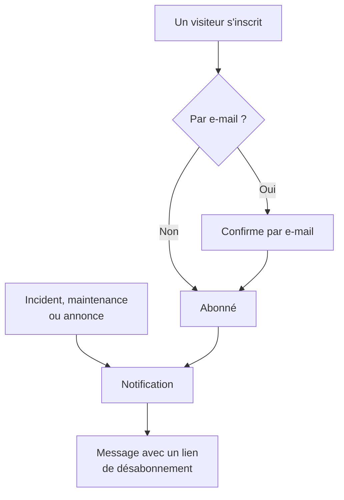

# Abonnés et annonces

Une page de statut est un endroit où l'on se rend. Les abonnés sont les personnes qui préféreraient ne pas avoir à le faire : elles vous confient une fois une adresse e-mail, un numéro de téléphone, un webhook Slack ou un point de terminaison HTTP, et ensuite vos mises à jour viennent à elles.

Les annonces sont l'autre moitié du même travail. Un moniteur peut dire à vos visiteurs que le paiement renvoie des erreurs 500 ; aucun moniteur ne peut leur dire que vous migrez des bases de données samedi, qu'un fournisseur tiers passe une mauvaise journée ou que l'incident dont ils ont lu le récit hier est entièrement clos. Les annonces sont le canal en texte libre pour tout ce que vos contrôles ne voient pas, et elles partent vers la même liste d'abonnés.

Cette page couvre les deux : les cinq canaux d'abonnement et la manière dont les visiteurs s'inscrivent, ce que les abonnés peuvent choisir de recevoir, les parcours de double confirmation et de désabonnement, le rapport par e-mail que les abonnés peuvent recevoir chaque mois, et la façon de rédiger, planifier et modéliser les annonces.

:::cards
- [Canaux d'abonnement](#canaux-dabonnement): Les canaux sur lesquels les visiteurs s'inscrivent, et la page où ils le font.
- [Ce qu'on dit aux abonnés](#ce-dont-les-abonnés-sont-notifiés): Annonces, maintenance, incidents et épisodes, et leurs modifications.
- [Vérifier ce qui a été envoyé](#vérifier-ce-qui-a-été-envoyé): Le statut de chaque notification, Réessayer et Renvoyer.
- [Annonces](#annonces): Publier un avis sur une ou plusieurs pages de statut.
:::

## Comment ça marche



Chaque page de statut a ses propres abonnés. Un visiteur s'inscrit sur la page **S'abonner** de la page de statut, où une adresse e-mail se confirme par un lien avant de recevoir quoi que ce soit, ou votre équipe l'ajoute depuis le tableau de bord. Dès lors, chaque incident, événement de maintenance planifiée et annonce qui atteint la page notifie ses abonnés, chacun sur le canal par lequel il s'est inscrit, et chaque message porte le lien qui annule l'abonnement.

## Canaux d'abonnement

Une page de statut prend en charge cinq canaux. Eux, et la page sur laquelle les visiteurs s'inscrivent, se règlent à un seul endroit : la carte **Canaux** dans **Pages de statut → votre page → Abonnés → Paramètres des abonnés**. Chaque interrupteur enregistre dès que vous le basculez :

- **Afficher la page des abonnés** (`showSubscriberPageOnStatusPage`) — activé par défaut. Place l'élément **S'abonner** dans la barre de navigation de la page de statut, où les visiteurs s'inscrivent par les canaux ci-dessous.
- **E-mail** (`enableEmailSubscribers`) — activé par défaut. Tout le reste est désactivé jusqu'à ce que vous l'activiez.
- **SMS** (`enableSmsSubscribers`) — désactivé par défaut. Sur OneUptime Cloud, chaque SMS est payé sur le solde SMS et appels du projet, sauf si la page a sa propre **Configuration Twilio** (voir [plus bas](#pied-de-page-de-le-mail-smtp-personnalisé-et-twilio)). Pour l'activer, il faut aussi que **SMS** soit activé pour le projet, dans la carte **Canaux de notification** sur **Paramètres du projet > Notifications > Paramètres de notification**, ce que peut faire un propriétaire du projet, un **Billing Admin** ou une personne disposant de **Manage Billing**.
- **Slack** (`enableSlackSubscribers`) — désactivé par défaut.
- **Microsoft Teams** (`enableMicrosoftTeamsSubscribers`) — désactivé par défaut.
- **Webhook** (`enableWebhookSubscribers`) — désactivé par défaut.

Les interrupteurs décident comment les visiteurs peuvent s'inscrire eux-mêmes, et la page de statut refuse une inscription par un canal désactivé. Ils n'arrêtent pas les notifications : les abonnés que votre équipe ajoute depuis le tableau de bord, avec l'API ou par un workflow reçoivent les mises à jour quels que soient les canaux activés.

Sur OneUptime Cloud, un interrupteur que votre formule n'inclut pas porte le nom de la formule à côté : **Growth** pour **SMS** et **Afficher la page des abonnés**, **Scale** pour **Slack**, **Microsoft Teams** et **Webhook**. Désactiver un canal fonctionne avec toutes les formules, si bien qu'un canal activé pendant un essai peut toujours être désactivé ; l'interrupteur l'indique en dessous.

Chaque canal a aussi sa propre liste dans le menu latéral de la page de statut, sous **Abonnés** : **Abonnés e-mail**, **Abonnés SMS**, **Abonnés Slack**, **Abonnés MS Teams** et **Abonnés au webhook**. C'est là que vous voyez qui est inscrit, ajoutez quelqu'un à la main ou vous laissez une entrée **Notes** (`internalNote`) sur un abonné donné. Tant qu'un canal est désactivé, le haut de sa liste l'indique, avec l'interrupteur du canal juste à côté, pour que vous puissiez l'activer sans quitter la liste.

**Un seul interrupteur ne suffit pas.** L'élément **S'abonner** de la barre de navigation de la page de statut n'apparaît que lorsque **Afficher la page des abonnés** est activé *et* qu'au moins un canal est activé. Si vous activez **E-mail** mais laissez **Afficher la page des abonnés** désactivé, les visiteurs n'ont aucun moyen d'atteindre le formulaire.

## Ce qu'un visiteur voit sur la page S'abonner

La page **S'abonner** a un sous-menu avec un onglet par canal activé. Chaque onglet demande le strict nécessaire :

| Onglet | Adresse | Titre | Ce qu'il demande |
| --- | --- | --- | --- |
| **E-mail** | `/subscribe/email` | **S'abonner par e-mail** | **Votre e-mail**, avec l'exemple `subscriber@company.com`. |
| **SMS** | `/subscribe/sms` | **S'abonner par SMS** | **Votre numéro de téléphone**, avec l'exemple `+11234567890`. |
| **Slack** | `/subscribe/slack` | **S'abonner via Slack** | **Nom de l'espace de travail Slack** (sert à la validation) et **URL du webhook entrant Slack**, avec l'exemple `https://hooks.slack.com/services/...`. |
| **MS Teams** | `/subscribe/microsoft-teams` | **S'abonner via Microsoft Teams** | **Nom de l'espace de travail Microsoft Teams** et **URL du webhook entrant Microsoft Teams**, avec l'exemple `https://outlook.office.com/webhook/...`. |
| **Webhooks** | `/subscribe/webhooks` | **S'abonner par webhook** | **URL du webhook**, avec l'exemple `https://example.com/webhook`. Une requête JSON `POST` y est envoyée à chaque événement de la page de statut. |

Le bouton d'envoi s'intitule **S'abonner**. Une inscription par SMS, Slack, Microsoft Teams ou webhook affiche *Vous avez été abonné avec succès.* Une inscription par e-mail indique qu'un lien de confirmation a été envoyé et qu'il faut vérifier le dossier des indésirables s'il n'arrive pas (voir [Double confirmation par e-mail](#double-confirmation-par-e-mail)). Les onglets **E-mail**, **SMS**, **Slack** et **MS Teams** portent aussi la séparation **Nouvel abonnement** / **Gérer l'abonnement existant**, pour qu'une personne déjà abonnée retrouve ses préférences sans chercher un vieux message.

## Laisser les abonnés choisir ressources et types d'événements

Par défaut, un abonné reçoit tout ce qui concerne la page. Deux interrupteurs de la carte **Paramètres d'abonné avancés** changent cela :

- **Permettre aux abonnés de choisir les ressources** (`allowSubscribersToChooseResources`) — désactivé par défaut. Activez-le et le formulaire d'abonnement gagne un interrupteur **S'abonner à toutes les ressources** ; désactivez-le et **Sélectionner les ressources à suivre** apparaît pour que le visiteur choisisse des ressources une à une.
- **Permettre aux abonnés de choisir les types d'événements** (`allowSubscribersToChooseEventTypes`) — désactivé par défaut. Même principe : un interrupteur **S'abonner à tous les types d'événements**, et **Sélectionner les types d'événements à suivre** en dessous quand il est désactivé.

Avec l'un ou l'autre activé, le formulaire d'abonnement tient toujours sur une page. Sous la destination des mises à jour (l'adresse e-mail, le numéro de téléphone, l'espace de travail ou le webhook) vient **Préférences**, replié sur une ligne qui dit ce que le visiteur recevra. Chaque ressource et chaque type d'événement sont déjà choisis, si bien qu'elle commence par « Vous recevrez toutes les mises à jour de cette page de statut. », et un visiteur qui veut tout appuie sur **S'abonner** sans l'ouvrir. Les autres ouvrent **Préférences** et réduisent les ressources ou les types d'événements ; une fois replié, la ligne suit leur choix (« Vous ne recevrez que les mises à jour des ressources que vous avez choisies. »). Avec les deux désactivés, il n'y a pas de **Préférences** : le formulaire est la destination des mises à jour, puis **S'abonner**.

La page **Mettre à jour l'abonnement** (voir plus bas) montre les mêmes choix ouverts, puisque c'est pour les modifier qu'un abonné s'y rend.

Les types d'événements sont `Incident`, `Announcement` et `Scheduled Event`.

**Un groupe de moniteurs vaut pour chaque moniteur qu'il contient.** Une ressource de la page est soit un moniteur, soit un groupe de moniteurs, et un abonné qui choisit un groupe de moniteurs est informé des incidents, des événements de maintenance planifiée (leurs notes comprises) et des annonces concernant n'importe quel moniteur du groupe, exactement comme s'il avait choisi ce moniteur, ce qui est aussi la manière dont la page de statut les affiche. Une personne qui n'a choisi que d'autres ressources n'est pas informée, et une personne qui a choisi un moniteur et le groupe qui le contient reçoit une notification, pas deux.

Les choix sont enregistrés sur l'abonné sous **Abonné à toutes les ressources** (`isSubscribedToAllResources`, true par défaut), **Abonné à tous les types d'événements** (`isSubscribedToAllEventTypes`, true par défaut), **Subscribed to Resources** et **Subscribed to Event Types**.

**Un abonné choisit parmi les ressources de sa propre page.** **Subscribed to Resources** désigne des ressources de la propre page de statut de l'abonné, qui que ce soit qui l'écrive : un visiteur sur la page, un membre de l'équipe dans le tableau de bord, une clé d'API ou un workflow. Un visiteur choisit parmi ce que la page lui montre, si bien qu'une ressource dont le moniteur est archivé, que la page masque, n'est pas une ressource qu'il peut choisir. Une ressource d'une autre page de statut, ou une ressource que la page cache à un visiteur, est refusée avec le `400` qui nomme le champ et l'ID, comme un ID qui ne correspond à rien. Une modification ne vérifie que les ressources qu'elle ajoute, si bien qu'un abonnement garde une ressource qu'il désigne déjà, comme une ressource dont le moniteur a été archivé après avoir été choisie. Un abonné n'est informé d'un événement que par les ressources de sa propre page.

Utile pour : une page qui couvre plusieurs produits. Un client qui n'utilise que votre API ne veut pas être prévenu chaque fois que le site marketing vacille — laissez-le réduire la liste lui-même plutôt que de le voir se désabonner complètement.

La même carte contient aussi **Fuseaux horaires des abonnés**.

## Double confirmation par e-mail

Les abonnés par e-mail confirment toujours. Lorsqu'un abonné est créé avec une adresse e-mail et n'a pas été créé déjà confirmé, **Abonnement confirmé** (`isSubscriptionConfirmed`) est forcé à `false` et un **Subscription Confirmation Token** à six chiffres est généré. OneUptime envoie alors un lien de confirmation de la forme `{statusPageUrl}/confirm-subscription/{statusPageSubscriberId}?verification-token={token}`. Le visiteur arrive sur une page **Confirmer l'abonnement** et, une fois la confirmation passée, voit *Abonnement confirmé avec succès*.

Les abonnés SMS, Slack, Microsoft Teams et webhook sautent cette étape — ils sont créés avec `isSubscriptionConfirmed` déjà à `true`. Il en va de même des abonnés e-mail que votre équipe ajoute sur **Abonnés e-mail** : **Ne pas envoyer de lien de confirmation** y est activé par défaut. Désactivez-le pour que l'adresse confirme comme lors d'une inscription.

**Non confirmé signifie silencieux.** La requête qui récupère les abonnés pour une notification filtre sur `isUnsubscribed: false` et `isSubscriptionConfirmed: true`. Une adresse e-mail qui n'a jamais cliqué sur le lien reste dans votre liste **Abonnés e-mail** et ne reçoit rien. Si quelqu'un jure être abonné mais ne reçoit rien, vérifiez d'abord cette colonne.

Il n'y a pas d'interrupteur pour désactiver la confirmation par e-mail — elle s'applique sans condition à toute personne qui s'inscrit via la page de statut. Une colonne distincte par abonné, **Send You Have Subscribed Message** (`sendYouHaveSubscribedMessage`, true par défaut), contrôle l'e-mail « vous êtes abonné » qui part une fois l'abonné confirmé.

## Gérer et annuler un abonnement

Chaque message qu'un abonné reçoit porte un lien de désabonnement de la forme `{statusPageUrl}/unsubscribe/{statusPageSubscriberId}-{token}` : en bas d'un e-mail, dans le texte d'un message SMS, Slack ou Microsoft Teams, et sous `unsubscribeUrl` dans la charge utile d'un webhook. Le jeton est un secret aléatoire propre à cet abonnement, si bien que le lien fonctionne sans connexion. Y compris sur une page de statut privée, où tout le reste nécessite un visiteur connecté.

La seule exception est un SMS envoyé depuis une page de statut **publique**, qui porte à la place le lien **Mettre à jour l'abonnement** de l'abonné (voir plus bas). Cette page fonctionne sans connexion sur une page de statut publique, et son lien est plus court de 57 caractères. Un SMS est facturé par segment de 160 caractères, si bien que le lien plus long ferait passer la plupart des textes par défaut dans un segment de plus. Le `{{unsubscribeUrl}}` d'un modèle SMS personnalisé suit la même règle. Un SMS envoyé depuis une page de statut privée porte le lien de désabonnement.

Le journal des SMS (l'onglet **SMS** de **Journaux de notification**, sur la page de statut et dans les paramètres du projet) conserve le texte de chaque SMS, et davantage de membres du projet peuvent le lire qu'il n'y en a qui peuvent gérer les abonnés. Le journal affiche donc un lien de désabonnement dont le jeton est remplacé par `[redacted]`, par exemple `{statusPageUrl}/unsubscribe/{statusPageSubscriberId}-[redacted]`. Seul le téléphone de l'abonné reçoit le lien qui fonctionne. L'API ne renvoie jamais non plus le jeton d'un nouvel abonné, pas même dans la réponse à la requête qui l'a créé.

**Ouvrir le lien ne change rien.** La page affiche le nom et le logo de la page de statut et l'abonnement auquel le lien appartient : une adresse e-mail en entier, un numéro de téléphone masqué jusqu'à ses quatre derniers chiffres, un nom d'espace de travail Slack ou Microsoft Teams, ou l'hôte d'un webhook. Elle demande *Voulez-vous ne plus recevoir de notifications de cette page de statut ?* et seul un clic sur **Se désabonner** annule l'abonnement, si bien que les scanners de courrier et les aperçus de liens qui ouvrent chaque lien d'un message ne peuvent désabonner personne. Rien d'autre de la page n'est affiché, et aucun de ses JavaScript personnalisés ne s'exécute. Confirmer deux fois, ou ouvrir le lien d'un abonnement déjà annulé, indique simplement qu'il est annulé. Sur une page de statut publique, la page de désabonnement renvoie aussi vers la page **Mettre à jour l'abonnement** de l'abonné, pour choisir à la place les notifications qu'il reçoit.

La page **Mettre à jour l'abonnement**, `{statusPageUrl}/update-subscription/{statusPageSubscriberId}`, s'intitule **Mettre à jour l'abonnement** et indique au visiteur qu'il peut y modifier ses préférences ou se désabonner. Elle contient :

- Les sélecteurs de ressources et de types d'événements que la page autorise.
- Un interrupteur **Se désabonner**, décrit comme un désabonnement de toutes les ressources. Il écrit **Est désabonné** (`isUnsubscribed`, false par défaut).
- Un bouton d'envoi **Mettre à jour l'abonnement** ; l'enregistrement affiche *Vos modifications ont été enregistrées.*

Sur une page de statut privée, elle nécessite un visiteur connecté, comme le reste de la page. Une personne qui a perdu le lien utilise **Gérer l'abonnement existant** sur la page **S'abonner** et appuie sur **Envoyer le lien de gestion**. Le lien part vers l'abonnement lui-même — son adresse e-mail, son numéro de téléphone, ou son canal Slack ou Microsoft Teams —, jamais vers une adresse de la requête, et la page répond de la même façon qu'un abonnement corresponde ou non, si bien qu'elle ne permet pas de savoir qui est abonné. Ce message renvoie vers la page **Mettre à jour l'abonnement**, et transmet les deux liens à un modèle personnalisé : `manageSubscriptionUrl` et `unsubscribeUrl`.

Les points de terminaison derrière tout cela sont `POST .../subscribe/:statusPageId`, `POST .../manage-subscription/:statusPageId`, `POST .../get-subscription/:statusPageId/:subscriberId`, `PUT .../update-subscription/:statusPageId/:subscriberId`, ainsi que `GET` et `POST .../unsubscribe/:statusPageId/:subscriberId/:token`. Le `GET` de désabonnement décrit seulement le lien. Le `POST` annule l'abonnement quel que soit son corps, y compris le corps `List-Unsubscribe=One-Click` d'une demande de désabonnement en un clic. Les deux donnent la même réponse pour un jeton erroné, un abonné supprimé et un abonné d'une autre page de statut, si bien qu'ils ne permettent pas de savoir qui est abonné.

Le désabonnement bascule un indicateur au lieu de supprimer une ligne, si bien que l'enregistrement reste dans la liste du canal avec **Est désabonné** défini — utile quand vous devez expliquer plus tard pourquoi une adresse a cessé de recevoir du courrier. Il enregistre aussi **Désabonné le** (`unsubscribedAt`), qui que ce soit qui ait annulé l'abonnement : l'abonné via le lien ou la page **Mettre à jour l'abonnement**, ou un membre de l'équipe dans le tableau de bord ou via l'API. Chaque liste d'abonnés a une colonne et un filtre **Désabonné le**. Désactiver de nouveau **Est désabonné** l'efface. Les abonnements annulés avant que OneUptime n'enregistre cela n'ont pas de date.

Les liens des messages envoyés avant l'existence de la page de désabonnement continuent de fonctionner : un lien **Mettre à jour l'abonnement** ouvre toujours cette page. Les très anciens messages portaient `/api/status-page-subscriber/unsubscribe/{statusPageSubscriberId}`, qui désabonnait dès qu'on l'ouvrait. Il ne change plus rien : il mène à la page de désabonnement, qui indique que le lien est périmé et qu'il faut utiliser celui d'un message récent.

### Adresses partagées et listes de diffusion

Toute personne qui peut lire une boîte aux lettres peut la désabonner. Pour une adresse que quelqu'un a inscrite lui-même, c'est voulu. Pour une adresse que votre équipe a ajoutée, comme la liste de diffusion d'un site du type `site03-all@`, cela signifie qu'un seul lecteur peut retirer tout le monde de la page avant la prochaine panne. Donc :

- **Ajoutez les personnes avec leur propre adresse quand vous le pouvez.** Le formulaire **Ajouter en masse** et le formulaire d'abonné e-mail le disent, dans la description du champ e-mail.
- **L'équipe est informée.** Un abonné ajouté par votre équipe est un abonné ajouté depuis le tableau de bord, avec une clé d'API (l'API REST, Terraform, un script) ou par un workflow ; l'API le lit comme **Ajouté par l'équipe** (`isAddedByTeam`). Lorsqu'un tel abonné se désabonne, par son lien ou par la page **Mettre à jour l'abonnement**, les propriétaires de la page de statut (ses utilisateurs propriétaires et les membres de ses équipes propriétaires) reçoivent chacun un e-mail qui nomme l'abonné, avec un lien vers la liste des abonnés de la page. Le membre de l'équipe qui l'a ajouté aussi, quand c'est un membre de l'équipe. Une page sans propriétaires n'écrit qu'à ce membre, si bien qu'un abonné qu'une clé d'API ou un workflow a ajouté à une page sans propriétaires n'est pas signalé. Les personnes qui se sont inscrites elles-mêmes sur la page de statut ne sont jamais signalées. Les abonnés qu'une clé d'API ou un workflow a ajoutés avant que OneUptime n'enregistre cela ne peuvent pas être distingués des inscriptions, et ne sont pas signalés non plus.
- **Les listes d'abonnés le montrent.** Au-dessus de chaque liste, un avis nomme les abonnés ajoutés par votre équipe qui se sont désabonnés au cours des 30 derniers jours.

La page de désabonnement avertit le lecteur d'un tel abonnement avant qu'il ne confirme : s'il s'agit d'une adresse partagée, se désabonner arrête les notifications pour tous ceux qui les reçoivent, et l'équipe en sera informée.

## Ce dont les abonnés sont notifiés

Les abonnés sont informés des trois types d'événements ci-dessus, mais chaque source a son propre interrupteur, si bien que rien n'est envoyé par accident.

### Notifications d'annonce

L'annonce elle-même porte **Should subscribers be notified?** (`shouldStatusPageSubscribersBeNotified`), exposé dans le formulaire de création comme la case **Notifier les abonnés de la page de statut** sous **Planification et notifications**, et activé par défaut. Les abonnés sont informés une fois, quand l'annonce commence à s'afficher, si bien que cela se décide à la création de l'annonce ; une modification ne peut pas le changer. Un workflow qui l'écrit plus tard ne fait que l'enregistrer : le réécrire inchangé n'envoie jamais de nouveau l'annonce, l'activer ne l'envoie pas, et le désactiver avant que la notification soit partie la saute. Si l'annonce nomme des moniteurs sous **Moniteurs affectés**, la notification est limitée à ces moniteurs : sur une page où les abonnés choisissent des ressources, elle part vers les abonnés de ces moniteurs, des groupes de moniteurs qui les contiennent, et de toutes les ressources. Laissez le champ vide et tous les abonnés sont notifiés. Sur une page de statut qui ne liste aucun de ces moniteurs, ni directement ni par un groupe, l'annonce s'adresse à tous ceux qui lisent cette page, si bien que chaque abonné de cette page qui reçoit les annonces est notifié.

### Événements de maintenance planifiée

Un événement de maintenance planifiée a son propre ensemble de colonnes pour les abonnés : **Should subscribers be notified when event is created?**, **Should subscribers be notified when event is changed to ongoing?**, **Should subscribers be notified when event is changed to ended?**, plus **Subscriber notifications before the event** et **Prochaine notification aux abonnés avant l'événement à ?** pour les avertissements préalables. **Pages de statut** sur l'événement décide des pages où il apparaît, et **Should be visible on status page?** décide s'il apparaît tout court.

**Créer un événement de maintenance planifiée** se fait en deux étapes, puis une vérification, comme **Déclarer un incident** :

1. **Événement** — **Titre**, **Description**, **Commence le** et **Se termine le**. Un nouvel événement commence à la prochaine heure pleine de votre horloge et dure une heure ; ne changez les heures que si elles sont fausses. Déplacer **Commence le** déplace **Se termine le** avec, si bien que la fenêtre garde sa durée, et l'événement doit se terminer après avoir commencé. **Propriétaires** et **Étiquettes** attendent sous **Plus de champs**.
2. **Ressources affectées** — d'abord **Moniteurs**, puis **Changer le statut du moniteur en** juste en dessous une fois un moniteur choisi : les moniteurs passent à ce statut quand l'événement commence, et reviennent à opérationnel quand il se termine. Ensuite **Autres ressources affectées** : les hôtes, clusters, hôtes de conteneurs, bases de données, flottes IoT, sites réseau et services que la maintenance touche. Ensuite **Afficher l'événement sur ces pages de statut**, puis **Notifications aux abonnés**, replié sur une ligne qui dit ce qui va se passer. Par défaut, elle indique « Les abonnés des pages de statut de l'événement sont notifiés lorsqu'il est planifié, lorsqu'il commence et lorsqu'il se termine. » Ouvrez-la pour changer **Lorsque l'événement est planifié**, **Lorsque l'événement commence**, **Lorsque l'événement se termine** et **Rappels avant l'événement** ; la ligne suit ce que vous cochez, et l'étape de vérification l'affiche aussi.

Depuis l'onglet **Maintenance planifiée** d'un hôte, d'un cluster Kubernetes, Proxmox, Ceph ou Docker Swarm, d'un hôte Docker ou Podman, d'un vCenter, d'une baie de stockage, d'une flotte IoT, d'une base de données, d'un service ou d'un site réseau, **Créer un événement de maintenance planifiée** (et **Créer à partir d'un modèle**) ouvre le même formulaire avec cette ressource déjà choisie sous **Autres ressources affectées**, et le fil d'Ariane ramène à cet onglet. L'onglet **Maintenance planifiée** d'un élément d'inventaire choisit l'hôte, le service ou le cluster Kubernetes vers lequel pointe l'élément, et le fil d'Ariane ramène par l'onglet de cette ressource.

Seul le titre doit être saisi : tout le reste a une valeur par défaut, si bien que **Suivant** parcourt les autres étapes sans rien demander, et **Créer un événement de maintenance planifiée** se trouve sur la vérification à la fin. Personne n'est notifié tant que vous n'avez pas choisi de page de statut. Les trois réglages **Lorsque l'événement…** se choisissent à la création de l'événement, et un workflow qui écrit **Lorsque l'événement est planifié** plus tard ne fait que l'enregistrer : réécrit inchangé ou activé, il n'envoie rien, et désactivé avant que la notification « planifié » soit partie, cette notification est sautée. Le bouton **Modifier** de la carte **Détails de la maintenance** de l'événement change son titre, sa fenêtre et ses étiquettes (**Événement**) ainsi que ses pages de statut et ses rappels (**Pages de statut**). Le bouton **Modifier** de sa carte **Ressources affectées** demande de la même façon que le formulaire : **Moniteurs**, puis **Changer le statut du moniteur en** dès qu'il y a un moniteur, puis **Autres ressources affectées**, et la carte affiche le statut sous les moniteurs. Toute personne qui peut modifier l'événement peut changer son statut de moniteur jusqu'à ce que l'événement commence. Quand il commence — à son heure de début, ou quand quelqu'un le fait passer dans un état en cours à la main, depuis Slack ou Microsoft Teams, ou via l'API —, ses moniteurs passent au statut qu'il porte à ce moment, et les moniteurs ajoutés pendant qu'il se déroule aussi. Le faire passer de **Scheduled** directement dans un état personnalisé placé entre **Ongoing** et **Ended**, comme « Verifying », le démarre de la même façon : ses moniteurs passent à son statut, comme ils le feraient dans **Ongoing**, et reviennent à opérationnel quand il se termine. À partir de là, le statut ne peut plus être changé : le bouton **Modifier** de la carte l'affiche en lecture seule, avec « L'événement a commencé, cela ne peut donc plus être modifié. », et l'API refuse une modification avec « Change Monitor Status to can no longer be changed: this event has already started. » Réécrire le statut que l'événement porte déjà reste accepté. Les modèles de maintenance planifiée (**Paramètres → Modèles d'événement**) utilisent les mêmes étapes, avec le nom du modèle en tête et sa planification récurrente à la fin. Un modèle demande **Changer le statut du moniteur en** qu'il nomme des moniteurs ou non, car son statut s'applique aussi aux moniteurs choisis quand un événement est planifié à partir de lui. La carte **Ressources affectées** d'un modèle existant demande de la même façon et affiche le statut que choisit le modèle, ou **Les moniteurs gardent leur statut.** quand il n'en choisit aucun ; toute personne qui peut modifier le modèle peut le changer là.

**Quelles pages de statut ?** Dès que l'événement nomme des moniteurs, les pages de statut qui les affichent sont suggérées sous **Afficher l'événement sur ces pages de statut** : « Pages de statut qui affichent les moniteurs concernés : » suivi du nom de chaque page. Cliquez sur un nom pour ajouter cette page, ou sur **Tout ajouter** pour les ajouter toutes. Une page compte quand elle liste l'un des moniteurs, directement ou par un groupe de moniteurs. Seules les pages de statut que vous pouvez voir sont suggérées, et les pages archivées et celles qui n'affichent pas les événements de maintenance planifiée sont laissées de côté. Rien n'est choisi pour vous : une page de statut que vous choisissez affiche l'événement et, avec les notifications par défaut, en informe ses abonnés, si bien que cela reste votre choix. L'étape **Pages de statut** du bouton **Modifier** de l'événement et les formulaires d'un modèle de maintenance planifiée suggèrent de la même façon, à partir des moniteurs de l'événement ou du modèle.

**États personnalisés.** Un événement est en cours dans **Ongoing** et dans chaque état personnalisé placé entre **Ongoing** et **Ended** — une étape « Verifying », par exemple. Un état personnalisé placé avant **Ongoing** n'a pas encore commencé, et un état placé après **Ended** — « Reviewing » — est terminé. Tout ce qui demande si un événement est en cours applique cette seule règle. Un tel événement figure comme en cours sur ses pages de statut — sur la vue d'ensemble, sur la page de l'événement et dans le flux RSS —, ainsi que dans les listes **En cours** sous **Maintenance planifiée** et **Accueil**, leurs badges de menu et la tuile **Maintenance en cours** sur **Accueil**, et l'application Microsoft Teams le liste comme maintenance en cours. Ses moniteurs restent en maintenance, les sites réseau et les séries de télémétrie qu'il couvre restent silencieux, et les alertes de taux de consommation des SLO sur ses moniteurs sont retenues. À son **Se termine le**, il se termine comme un événement en cours, et ses abonnés sont informés si **Lorsque l'événement se termine** est activé. Le faire passer de **Ongoing** ou « Verifying » directement dans un état personnalisé placé après **Ended** le termine comme **Ended** : ses moniteurs reviennent à opérationnel, et l'en-tête de l'événement indique combien de temps il a duré. Le faire avancer de **Ongoing** à « Verifying », ou de **Ended** à « Reviewing », ne démarre ni ne termine rien de nouveau. La place d'un état est sa place dans la liste de la page **État de l'événement**, sous **Maintenance planifiée → Paramètres**.

**En attente de démarrage, terminé et achevé.** La même place dit le reste. Un événement attend son **Commence le** dans **Scheduled** et dans chaque état personnalisé placé entre **Scheduled** et **Ongoing** — une étape « Confirmed », par exemple. À son heure de début, il démarre de là comme il démarre depuis **Scheduled** : il passe dans **Ongoing**, ses moniteurs passent à son **Changer le statut du moniteur en**, ses propriétaires sont informés et ses abonnés aussi si **Lorsque l'événement commence** est activé. D'ici là, il figure parmi les événements à venir — sur la vue d'ensemble, la page des événements planifiés et le flux RSS de ses pages de statut, et quand quelqu'un demande la maintenance planifiée à l'application Microsoft Teams —, et les rappels avant l'événement partent toujours vers ses abonnés. Son fil et la chronologie de sa page de statut affichent un tel état avec l'horloge qu'ils affichent pour **Scheduled**. Un état personnalisé placé avant **Scheduled** — un « Draft » ou une étape d'approbation — n'a pas commencé non plus, mais attend une personne : rien n'y démarre un événement à son heure, et il ne figure pas parmi les événements à venir. Un événement est terminé dans **Ended**, dans **Completed** et dans chaque état personnalisé placé après **Ended**, et la **Vue d'ensemble** de l'événement le traite partout comme terminé — son en-tête, sa carte **Mesures** et la chronologie qu'elle affiche. Il est achevé dans **Completed** et dans chaque état personnalisé placé après lui — « Archived » : c'est ce qui arrête les rappels de ses propriétaires (**Remind until event is Completed**), ce pour quoi Slack et Microsoft Teams refusent **Mark as Complete**, et ce que son fil et la chronologie de sa page de statut marquent comme fait. Dans **Ended**, ou dans « Reviewing » entre **Ended** et **Completed**, il est terminé mais pas encore achevé.

**Les sites réseau suivent chaque changement d'état.** Les sites réseau qu'un événement couvre cessent de compter sa panne prévue contre les sites au-dessus d'eux tant qu'il est en cours. Chaque changement d'état de l'événement recalcule leur statut aussitôt, dans les deux sens — y compris quand il revient en arrière, comme lorsque l'entrée de l'état dans lequel il se trouve est supprimée de sa **Chronologie d'état** : ramené de « Verifying » à **Scheduled**, il cesse aussitôt de les rendre silencieux, au lieu d'attendre le prochain passage, qui tourne toujours toutes les cinq minutes par sécurité.

**Ce que le fil enregistre pour une modification.** Une modification ajoute une entrée **Scheduled Maintenance was updated.** au **Fil d'activité de la maintenance planifiée** de l'événement — publiée aussi dans ses canaux Slack et Microsoft Teams — avec une ligne pour chaque chose qu'elle a changée : le titre, **Commence le**, **Se termine le**, la description, les rappels avant l'événement, ce que l'événement touche, **Changer le statut du moniteur en**, les pages de statut où il s'affiche et ses étiquettes, chacun avec sa nouvelle valeur. Une valeur enregistrée telle quelle n'a pas de ligne, si bien qu'enregistrer la carte **Détails de la maintenance** sans rien changer — elle envoie à chaque fois le titre, la fenêtre, les étiquettes, les pages de statut et les rappels — ou un client d'API, un workflow ou Terraform qui réécrit l'événement tel quel n'ajoute aucune entrée. Une heure est la même quand elle désigne le même instant, quelle que soit sa forme — une heure écrite sans fuseau horaire est en UTC, comme elle est stockée —, et les rappels, les pages de statut, les ressources affectées et les étiquettes forment le même ensemble dans n'importe quel ordre. Retirer tous les rappels, toutes les pages de statut ou toutes les étiquettes est enregistré comme « No reminders before the event. », « Not shown on any status page. » ou « All labels removed. », et retirer la dernière ressource affectée en dehors des moniteurs — le dernier hôte, cluster ou service, par exemple — comme « No other affected resources. ». La règle de rappel de l'événement n'est réévaluée, et l'attente de son prochain rappel ne repart de zéro, que lorsque ses étiquettes changent ou que son interrupteur **Envoyer des rappels** est basculé. Une règle de rappel (**Maintenance planifiée → Règles → Reminder Rules**) avec **Remind While Event is Scheduled** désactivé compte le premier rappel à partir du début de l'événement, si bien que déplacer **Commence le** à une autre heure déplace ce rappel avec lui tant que le début est à venir ; les rappels d'une règle qui rappelle pendant que l'événement est planifié restent où ils sont. Le fil d'un moniteur enregistre de la même façon une modification de son nom, de sa description et de ses étiquettes.

Si un événement est créé avec **Lorsque l'événement est planifié** désactivé (sous **Notifications aux abonnés** à l'étape **Ressources affectées** du formulaire de création), les nouvelles notes publiques sur cet événement commencent avec **Notifier les abonnés à la page de statut** désactivé, avec une ligne sous la case qui en explique la raison. Cela s'applique sur la page **Notes publiques** de l'événement et dans **Ajouter une note publique** du **Fil d'activité de la maintenance planifiée**, qui ouvre le même éditeur de notes. Les notes publiées sans choix explicite suivent le même réglage **Lorsque l'événement est planifié** : les notes Slack et Microsoft Teams, les workflows et les requêtes d'API qui omettent `shouldStatusPageSubscribersBeNotifiedOnNoteCreated`. Un `true` ou `false` explicite est toujours conservé. **Lorsque l'événement est planifié** ne désactive que l'annonce envoyée à la création de l'événement. Les rappels (**Subscriber notifications before the event**, réglés avec **Rappels avant l'événement** dans le formulaire de création) et les notifications réglées par **Lorsque l'événement commence** et **Lorsque l'événement se termine** sont des réglages distincts et partent toujours. Si les abonnés ont déjà entendu parler de l'événement par ce biais, par exemple par un rappel ou la notification « en cours », cochez la case pour les notifier de la note.

La fenêtre **Marquer la maintenance planifiée comme `<state name>`**, ouverte depuis les boutons en haut de la page **Vue d'ensemble** de l'événement, a une seule case **Notifier les abonnés de la page de statut** qui couvre à la fois le changement d'état et la **Note publique** de la fenêtre (repliée sous **Ajouter une note publique**). Sur un événement créé avec **Lorsque l'événement est planifié** activé, elle commence cochée, comme avant. Sur un événement créé avec ce réglage désactivé, elle commence décochée, avec la même ligne en dessous, sauf dans deux cas où elle commence cochée, conformément à ce que le changement d'état automatique annoncerait :

- Vous faites passer l'événement dans son état en cours, ou d'un état où il n'a pas commencé dans un état personnalisé placé entre **Ongoing** et **Ended** (il démarre), et **Lorsque l'événement commence** est activé.
- Vous faites passer l'événement dans un état terminé ou achevé, ou d'un état où il est en cours dans un état personnalisé placé après **Ended** (il se termine), et **Lorsque l'événement se termine** est activé.

**Une note envoyée avec un changement d'état est le seul message.** Rédigez une **Note publique** dans cette fenêtre (ou dans l'action groupée **Modifier l'état**) avec **Notifier les abonnés de la page de statut** coché, et les abonnés reçoivent la note, sur chaque canal, au lieu d'un message de changement d'état distinct : un message, pas deux. Le changement d'état affiche **Notifications envoyées**, et son message de statut indique que la note l'a porté. La note est publiée une fois le changement d'état enregistré : elle suit le changement dans le fil de l'événement et dans Slack et Microsoft Teams, et un changement d'état qui n'est pas enregistré ne publie aucune note et n'informe personne. Une note qui ne contient que des espaces n'est pas publiée, et les abonnés reçoivent le message de changement d'état. Avec la case décochée, ni le changement d'état ni sa note n'informent personne. Via l'API, la note accompagne le changement d'état dans `"miscDataProps": {"publicNote": "..."}` sur `POST /api/scheduled-maintenance-state-timeline`, et `shouldStatusPageSubscribersBeNotified` décide pour les deux (omis, le changement d'état notifie et sa note non). Les incidents fonctionnent de la même façon ; voir [États et sévérités des incidents](/docs/incidents/states-and-severities#prévenir-les-abonnés-de-la-page-de-statut-dun-changement-détat).

**La note nomme le nouvel état.** Comme elle est le seul message, une note envoyée avec un changement d'état dit ce qu'est maintenant l'événement, sur chaque canal, comme le faisait le message de changement d'état : l'objet de l'e-mail est `[Ongoing Scheduled Maintenance] <title>` et ses détails affichent une ligne **Statut**, le SMS dit `Maintenance <title> on <status page> is Ongoing.`, les messages Slack et Microsoft Teams portent une ligne `**Status:** Ongoing`, et la charge utile `ScheduledMaintenanceNoteCreated` du webhook porte `scheduledMaintenanceState` dans `data`. Une note publiée seule se lit comme toujours. Publier la note nécessite **Create Scheduled Maintenance Status Page Note** (les rôles intégrés de maintenance planifiée et de projet l'ont) : une personne qui ne l'a pas ne se voit pas proposer **Ajouter une note publique**, et un changement d'état qu'elle envoie avec une note est refusé, si bien que l'événement garde son état au lieu de changer sans que personne ne soit informé.

Le formulaire manuel de la page **Chronologie d'état** de l'événement et l'action groupée **Modifier l'état** de la liste de maintenance planifiée ne tiennent pas compte de ces réglages : leur case **Notifier les abonnés de la page de statut** commence toujours cochée.

Les événements créés à partir d'un modèle reprennent **Lorsque l'événement est planifié** du modèle, avec ses autres réglages d'abonnés. **Créer à partir d'un modèle** remplit le formulaire de création avec les valeurs du modèle, et les événements récurrents planifiés par un modèle sous **Paramètres → Modèles d'événement** les copient.

### Incidents

`Incident` est le troisième type d'événement. Ce qui fait qu'un incident atteint une page de statut — les ressources qu'il touche et les états qui le gardent visible — est expliqué dans [États et sévérités des incidents](/docs/incidents/states-and-severities). Les notes publiques d'un incident déclaré sans notifier les abonnés commencent avec **Notifier les abonnés de la page de statut** désactivé ; voir [Notes, propriétaires et fil d'incident](/docs/incidents/notes-owners-and-feed#publier-une-note-publique).

Les messages d'un incident — créé, changement d'état, note publique et post-mortem — partent vers les abonnés de chaque page de statut qui liste l'un de ses moniteurs. Deux réglages restreignent cela. **Limiter à ces pages de statut** sur l'incident le garde sur les pages que vous choisissez parmi celles-ci, et **Afficher uniquement les incidents limités à cette page** sur une page de statut tient à l'écart tout incident qui ne lui est pas limité. Pour un incident limité à des pages précises, une adresse e-mail ou un numéro de téléphone abonné sur plusieurs d'entre elles reçoit un e-mail ou un SMS par envoi, pas un par page ; les messages webhook, Slack et Microsoft Teams ne sont jamais fusionnés. Le formulaire de déclaration et la page **Notes publiques** montrent qui sera notifié avant que quoi que ce soit ne parte. Voir [Une page de statut par public](/docs/status-pages/one-status-page-per-audience).

#### Le post-mortem

Les abonnés sont informés du post-mortem d'un incident une fois, quand il est publié : la première fois que la page de statut l'affiche. La page de statut affiche un post-mortem quand **Publier sur la page de statut** est activé et que le post-mortem a une note ; ses pièces jointes s'affichent avec la note, jamais sans. Activer la publication sur une note rédigée le publie donc, tout comme rédiger la note d'un post-mortem activé. **Notifier les abonnés**, dans le même formulaire, décide s'ils sont informés tout court. Ensuite :

- **Enregistrer de nouveau n'informe personne.** Le formulaire **Modifier la note de post-mortem** envoie tout le post-mortem à chaque enregistrement, et un client d'API, Terraform ou un workflow peut réécrire tout l'incident ; ce qui était déjà publié n'est pas une nouvelle.
- **Modifier un post-mortem publié n'informe personne non plus.** La page de statut affiche aussitôt la nouvelle note, et le fil de l'incident l'enregistre une fois, sous **Postmortem Note updated**, mais les abonnés ont déjà été informés. Les espaces autour de la note ne comptent pas comme un changement.
- **Le retirer de la page de statut n'informe personne, et le republier les informe de nouveau** : ils l'ont vu partir. Vider la note d'un post-mortem publié le retire aussi de la page de statut.
- **Un post-mortem activé sans note n'affiche rien**, si bien que personne n'est informé tant que sa note n'est pas rédigée.
- **Un post-mortem publié pendant que son incident est masqué est envoyé quand l'incident est rendu visible.** La page de statut n'affiche un post-mortem que sur un incident qu'elle affiche — **Visible sur la page de statut** activé, et l'incident non privé —, si bien que personne n'est informé tant que l'incident est masqué, et le statut de la notification indique **Pas encore envoyé : incident masqué sur les pages de statut**. Activer **Visible sur la page de statut** l'envoie, une fois (pour un incident privé, en même temps que la désactivation de **Incident privé**), et l'interrupteur de la page **Paramètres** de l'incident vous le dit avant que vous n'enregistriez. Masquer l'incident puis l'afficher de nouveau n'envoie rien de plus, et afficher un incident dont le post-mortem a déjà été envoyé, ou n'est pas publié, n'envoie rien. Un post-mortem qu'une version antérieure a sauté de cette façon est envoyé de la même manière si son incident était encore masqué lors de votre mise à niveau ; un post-mortem dont l'incident a été rendu visible depuis reste non envoyé, car la page de statut l'a affiché depuis.
- **Notifier les abonnés est lu quand la notification part.** Un post-mortem publié avec ce réglage désactivé n'est pas annoncé, et l'activer ensuite n'envoie pas la notification sans laquelle il a été publié.

Le statut de la notification se trouve sur la page **Post-mortem** de l'incident ; une notification en échec propose **Réessayer** (voir [Réessayer et renvoyer](#réessayer-et-renvoyer)). Via l'API, écrire `showPostmortemOnStatusPage` à `true` sur un `postmortemNote` rédigé le publie, même quand la requête réécrit tout l'incident, statut de notification actuel compris, et rendre visible un incident masqué — écrire `isVisibleOnStatusPage` à `true`, et `isPrivate` à `false` pour un incident privé — envoie un post-mortem qui l'attend. Écrire `subscriberNotificationStatusOnPostmortemPublished` à `Pending` l'envoie de nouveau. Une notification déjà en attente ou en cours d'envoi n'est pas mise en file une seconde fois, et un post-mortem publié pendant qu'une notification était en préparation est tout de même annoncé une fois. Le brouillon automatique de post-mortem par l'IA n'est jamais écrit dans un post-mortem activé, si bien qu'un brouillon non relu n'atteint jamais les abonnés.

#### Prévisualiser l'e-mail avant son envoi

**Aperçu** est un petit lien à côté de la valeur qu'il prévisualise : à côté de **Oui** sous **Notifier les abonnés de la page de statut** à la dernière étape de **Déclarer un nouvel incident**, et à côté de la case **Notifier les abonnés de la page de statut** pendant que vous rédigez une note publique. Il ouvre **Aperçu de la notification**, qui montre l'e-mail que recevront les abonnés de chaque page de statut, construit et rendu par le même code, le même modèle et les mêmes réglages que ceux avec lesquels la notification est envoyée — ce que vous voyez est ce qu'ils reçoivent :

- choisissez une page de statut pour voir son e-mail, avec son objet et ses comptes « jusqu'à » par canal ;
- une ligne indique quel modèle est utilisé et pourquoi, par exemple que le modèle personnalisé de la page n'est pas utilisé parce que la page n'a pas de **Configuration SMTP personnalisée** ;
- quand rien ne sera envoyé (aucun moniteur, un incident privé ou masqué, **Notifier les abonnés de la page de statut** désactivé, ou aucune page de statut qui affiche l'incident), il le dit au lieu d'afficher un e-mail.

Seules les pages de statut que vous pouvez voir sont prévisualisées ; les autres sont comptées. L'e-mail s'affiche dans un cadre isolé qui n'exécute aucun script. Son lien de désabonnement est un exemple, car l'e-mail de chaque abonné porte le sien.

**M'envoyer un test** envoie l'e-mail de la page affichée à l'adresse e-mail de votre propre compte, avec `[Test]` au début de l'objet, par la **Configuration SMTP personnalisée** de la page quand elle en a une. Il n'envoie jamais à une autre adresse, nécessite que l'e-mail de votre compte soit vérifié, et chaque personne peut envoyer dix e-mails de test toutes les 15 minutes.

#### Champs personnalisés d'incident dans les notifications

Les champs personnalisés d'incident dont **Inclure dans les notifications aux abonnés** est activé (dans **Incidents → Paramètres → Champs personnalisés**) partent avec les messages de l'incident — créé, changement d'état, note publique publiée ou mise à jour, et post-mortem. Cela fonctionne avec toutes les formules qui ont des champs personnalisés ; cela ne nécessite ni modèle personnalisé ni SMTP personnalisé.

- **E-mail** les liste dans l'encadré des détails, sous les lignes propres à l'incident, dans l'**Ordre** des champs. Un champ sans valeur pour l'incident est omis. Un champ oui/non affiche **Oui** ou **Non**, une date est le jour choisi (le même jour pour chaque destinataire, où qu'il soit, pour une date choisie dans n'importe quel fuseau horaire de UTC−10:59 à UTC+13), une date et heure s'affiche dans les fuseaux horaires des abonnés de la page de statut, un texte long garde ses lignes, et un texte enrichi s'affiche mis en forme, avec les mêmes règles de liens que les notes. Ses images intégrées sont rendues visibles pour les personnes à qui il est envoyé, quand le premier message qui le porte est envoyé.
- **Slack** et **Microsoft Teams** les listent de la même façon, un par ligne.
- Les charges utiles **Webhook** les portent dans `data.customFields`, indexés par la **Variable de modèle** de chaque champ : `{ "name": ..., "type": ..., "value": ... }`, avec la valeur telle qu'elle est stockée (`null` quand l'incident n'en a pas). Les clés ne changent pas quand un champ est renommé.
- **SMS** les omet. Un SMS est facturé par segment et le message par défaut en remplit déjà presque un ; un modèle SMS personnalisé peut placer n'importe quel champ avec `{{incident.customFields.<key>}}`.
- Les notifications d'**Incident episode** ne portent aucun champ personnalisé : un épisode regroupe des incidents qui ont chacun leurs propres valeurs. Les notifications propres à chaque incident membre portent ses champs.

L'entrée **Notification aux abonnés envoyée** du fil de l'incident liste, sous **Custom fields sent**, les valeurs que chaque envoi a placées dans un message. Les abonnés sont généralement extérieurs à votre équipe : n'activez le réglage que pour des champs qu'il est sans risque de partager avec eux.

La section **Journaux de notification** du menu latéral de la page de statut (`{id}/notification-logs`) est l'endroit où aller quand vous devez voir ce que la page a réellement envoyé.

### Épisodes d'incident

Un épisode d'incident enregistre dans `shouldStatusPageSubscribersBeNotifiedOnEpisodeCreated` si les abonnés ont été informés de sa création. Les épisodes créés avec le bouton **Créer un épisode** ou par les **Règles de regroupement** l'ont activé ; une requête d'API peut en créer un avec la valeur `false`.

Sur un épisode créé avec la valeur `false`, les nouvelles notes publiques commencent avec **Notifier les abonnés à la page de statut** désactivé, avec une ligne en dessous qui en explique la raison, sur la page **Notes publiques** de l'épisode et dans **Ajouter une note publique** du **Flux de l'épisode**, qui ouvre le même éditeur de notes. Vous pouvez quand même la cocher. Les notes publiées sans choix explicite suivent le même réglage : les notes Slack, les workflows et les requêtes d'API qui omettent `shouldStatusPageSubscribersBeNotifiedOnNoteCreated`. Un `true` ou `false` explicite est toujours conservé. Seul ce réglage compte : contrairement à un incident, rendre un épisode privé ne change pas l'état initial de la case.

Cela ne concerne que les notes publiques. Les changements d'état de l'épisode (**Prendre en compte**, **Résoudre** et la résolution automatique) notifient toujours les abonnés, car ni la fenêtre de changement d'état de l'épisode ni le formulaire de sa page **Chronologie d'état** n'ont de case **Notifier les abonnés de la page de statut**.

Un épisode créé dans un état ultérieur — avec **État initial** dans le formulaire **Créer un épisode**, ou un état envoyé via l'API — est annoncé une fois, par sa notification de création : son premier état n'est jamais envoyé seul comme changement d'état, quel qu'il soit, et un épisode créé avec `shouldStatusPageSubscribersBeNotifiedOnEpisodeCreated` à `false` ne l'annonce pas du tout. La première ligne de sa chronologie d'état enregistre cette notification comme sautée, avec la raison.

### Informer les abonnés d'une modification

Les abonnés sont informés d'une annonce ou d'une note publique une fois, quand elle est publiée. La modifier ensuite change ce que montre la page de statut mais n'informe personne, sauf si vous le demandez lors de cette modification.

Le formulaire de modification d'une annonce, et d'une note publique sur un incident, un événement de maintenance planifiée ou un épisode d'incident, a une case **Notifier les abonnés de cette mise à jour**. Elle commence décochée à chaque fois, si bien qu'une correction de coquille reste discrète ; cochez-la quand le changement compte — une nouvelle fenêtre de maintenance, un impact révisé, une mise à jour client corrigée. Elle n'existe pas dans les formulaires de création, qui ont leur propre choix **Notifier les abonnés de la page de statut**. Sur une annonce, elle se trouve à l'étape **Annonce**, juste sous la description.

Quand vous enregistrez avec la case cochée, les abonnés reçoivent le contenu modifié marqué comme une mise à jour plutôt que comme une nouvelle publication :

- **E-mail** utilise son propre modèle — par exemple l'objet `[Announcement Updated] <title>` et le titre `Announcement Updated: <title>`, ou **Updated Note** dans l'encadré des détails d'un e-mail de note.
- **SMS**, **Slack** et **Microsoft Teams** indiquent que l'annonce ou la note a été mise à jour.
- Les abonnés **Webhook** reçoivent `AnnouncementUpdated`, `IncidentNoteUpdated`, `ScheduledMaintenanceNoteUpdated` ou `EpisodeNoteUpdated` comme `eventType`, avec le dernier contenu dans `data`.

La mise à jour part vers les mêmes personnes que celles que l'original atteindrait aujourd'hui : les mêmes interrupteurs de canaux, les mêmes préférences de ressources et de types d'événements, et les mêmes contrôles de visibilité (un incident masqué ou une page avec **Afficher les annonces** désactivé n'envoie toujours rien).

Deux cas n'envoient rien volontairement, et en enregistrent la raison :

- **La notification d'origine n'est pas encore partie.** Si une annonce ou une note attend encore d'être annoncée, cette notification lit l'élément au moment de l'envoi et porte déjà votre modification, si bien qu'un message « mis à jour » distinct ne ferait que semer la confusion. Si l'original est en cours d'envoi à ce moment-là, la mise à jour attend à la place et part une fois l'original terminé : cet envoi a lu l'élément avant votre modification, si bien que les abonnés ont peut-être reçu le texte d'avant.
- **L'annonce est programmée pour plus tard.** Tant que **Commencer à afficher l'annonce à** n'est pas passé, elle ne figure sur aucune page de statut, et les personnes notifiées à sa mise en ligne voient la version modifiée.

L'élément modifié affiche un **Statut de notification de mise à jour** à côté de celui d'origine, avec les mêmes états (**Sending Soon**, **Notifications envoyées**, **Échec** et ainsi de suite). **Réessayer** sur une notification de mise à jour en échec renvoie la mise à jour, jamais le message « publié » d'origine. Chaque page de statut peut personnaliser ces messages avec les types d'événements de modèle **Subscriber Announcement Updated**, **Subscriber Incident Note Updated**, **Subscriber Scheduled Maintenance Note Updated** et **Subscriber Episode Note Updated** ; sans modèle personnalisé, la formulation de mise à jour intégrée est utilisée.

Via l'API, envoyez le choix à côté des champs que vous modifiez, dans `miscDataProps` :

```json
{
  "data": {
    "description": "The maintenance now starts on Sunday at 02:00 UTC."
  },
  "miscDataProps": {
    "notifySubscribersOfUpdate": true
  }
}
```

comme corps de `PUT /api/status-page-announcement/<announcement-id>` (ou `incident-public-note`, `scheduled-maintenance-public-note`, `incident-episode-public-note`). Omettez `miscDataProps` et la modification reste silencieuse, comme avant.

## Vérifier ce qui a été envoyé

Chaque notification aux abonnés a son propre statut, à côté de ce qu'elle concerne. Pour un incident, il s'agit de sa notification « créé » sur la **Vue d'ensemble** de l'incident, de chaque ligne de sa **Chronologie d'état**, de chaque note publique et de son **Post-mortem**. Les événements de maintenance planifiée et les annonces affichent les leurs de la même façon, et les épisodes d'incident sur leurs notes publiques. Cliquez sur le statut pour lire son message, qui dit ce qui s'est passé. Les notes publiques affichent le statut sous forme de badge avec leur propre formulation :

| Statut | Sur une note publique | Ce que cela signifie |
| --- | --- | --- |
| **Sending Soon** | **Notification prochaine des abonnés** | En file d'attente. La tâche qui l'envoie tourne chaque minute. |
| **Notifications en cours d'envoi** | **Notification des abonnés** | La tâche traite les abonnés. |
| **Notifications envoyées** | **Subscribers notified** | Elle est partie. Voir plus bas ce que cela signifie. |
| **Échec** | **Échec de la notification** | Tous les abonnés ne l'ont pas reçue, ou l'envoi s'est arrêté. Le message dit ce qui a été envoyé et ce que fait **Réessayer**. |
| **Notifications ignorées.** | **Subscribers not notified** | Rien ne devait être envoyé, par exemple parce que l'incident est masqué des pages de statut. Le message dit pourquoi. |

### Comment un envoi est compté

Les notifications des incidents et des épisodes d'incident — créé, changement d'état, note publique publiée ou mise à jour, et post-mortem — sont comptées message par message :

- **Un message compte comme envoyé** dès que le serveur de messagerie ou le fournisseur SMS l'a pris en charge, ou dès que le point de terminaison Slack, Microsoft Teams ou webhook a répondu. « Envoyé » est ce que OneUptime peut voir : un serveur de messagerie peut encore rejeter un e-mail plus tard.
- **Un message compte comme en échec** quand il est refusé, quand son envoi produit une erreur, ou quand il n'obtient pas de réponse en 4 minutes. Un seul échec rend la notification **Échec** ; les autres abonnés la reçoivent quand même.
- **Chaque abonné est atteint.** Les abonnés d'une page de statut sont lus par 10 000 jusqu'au dernier, avec 20 messages en vol à la fois. Une notification cesse de démarrer de nouveaux messages 20 minutes après son début : les pages de statut et les abonnés qu'elle n'a pas atteints d'ici là sont listés comme non envoyés, et elle est marquée **Échec**.
- **Les comptes sont enregistrés par page de statut.** Le message de statut liste, pour chaque page de statut, combien de messages ont été envoyés et ont échoué sur chaque canal, par exemple `Site 03: 41 email sent. Site 07: 16 email, 2 SMS sent; 2 email failed.` L'entrée **Notification aux abonnés envoyée** du fil de l'incident liste les mêmes comptes avec l'objet sous lequel l'e-mail de chaque page est parti. **Journaux de notification** sur chaque page de statut montre chaque message.

Les notifications de maintenance planifiée et d'annonce ne sont pas encore comptées ainsi. Leurs messages sont remis aux expéditeurs sans attendre de réponse, si bien que **Notifications envoyées** signifie qu'ils ont été remis, et un envoi atteint au plus 10 000 abonnés de chaque page de statut.

### Envois interrompus

Un envoi dont le serveur redémarre ou cesse de répondre en cours de route ne peut pas se terminer, et rien d'autre ne le réglerait. Une notification encore **Notifications en cours d'envoi** au bout de 40 minutes, plus longtemps que n'importe quel envoi n'est autorisé à durer, est donc marquée **Échec**, avec un message qui commence par `Interrupted:` et dit ce que fera **Réessayer**. Cela couvre toutes les notifications ci-dessus, maintenance planifiée et annonces comprises. La vérification tourne toutes les 5 minutes.

### Réessayer et renvoyer

**Réessayer** est proposé sur une notification en **Échec**. Il remet la notification dans la file, et la prochaine exécution de la tâche d'envoi, dans la minute, l'envoie de nouveau. Sur un incident, renvoyer après qu'une notification est partie est aussi proposé : **Renvoyer la notification** sur une note publique, et **Renvoyer** sur la notification « créé » de l'incident, sur sa **Vue d'ensemble**. Les deux demandent d'abord confirmation, en listant les pages de statut qu'elle atteindrait maintenant avec un compte « jusqu'à » par canal. Aucun n'est proposé sur une notification sautée, ni tant qu'une notification est encore en file ou en cours d'envoi. Voir [Notes, propriétaires et fil d'incident](/docs/incidents/notes-owners-and-feed#quand-une-note-publique-atteint-vraiment-les-abonnés).

Une notification envoyée de nouveau est envoyée selon la situation au moment où elle part : vers les pages de statut qu'elle atteint alors, et vers leurs abonnés d'alors. Pour un incident, cela signifie que les pages ajoutées à sa portée ou retirées depuis comptent, tout comme les personnes qui se sont abonnées ou désabonnées depuis.

**La progression est conservée par page de statut, pas par abonné.**

- **La notification « créé » de l'incident** enregistre chaque page de statut dès que chacun de ses abonnés l'a reçue, et **Réessayer** saute ces pages. Une page où un message a échoué, ou que l'envoi a interrompue en cours de route, la reçoit de nouveau en entier, si bien que les abonnés de cette page qui l'avaient déjà reçue la reçoivent une seconde fois. Pour l'envoyer de nouveau à chaque page, utilisez **Renvoyer à toutes les pages** (voir [Ajouter des pages de statut](/docs/status-pages/one-status-page-per-audience#ajouter-des-pages-de-statut)).
- **Toute autre notification** — un changement d'état, une note publique, un post-mortem, et celles des épisodes, des événements de maintenance planifiée et des annonces — ne conserve pas un tel enregistrement. **Réessayer** l'envoie de nouveau à chaque page de statut, y compris aux abonnés qui l'avaient déjà reçue.

Pour un incident limité à des pages de statut précises, un e-mail ou un SMS par personne s'applique au sein de chaque envoi, si bien qu'une nouvelle tentative, qui est un envoi à part entière, peut atteindre quelqu'un qui a reçu le premier. Voir [Un e-mail par personne](/docs/status-pages/one-status-page-per-audience#un-e-mail-par-personne).

## Rapports par e-mail

Une page de statut peut envoyer à ses abonnés un rapport par e-mail selon une planification : pour chaque ressource de la page, sa disponibilité, son indisponibilité et ses incidents sur une période. Cela se règle dans la carte **Rapports par e-mail** sur **Pages de statut → votre page → Avancé → Rapports**.

- **Envoyer des rapports par e-mail** active et désactive les rapports, et enregistre dès que vous le basculez. Il n'y a rien à remplir dans un cas comme dans l'autre.
- **La première fois que les rapports sont activés**, la page reçoit une planification : un rapport le 1er de chaque mois à 09:00, à partir du prochain 1er du mois, chacun couvrant le mois civil entier qui le précède, si bien que le rapport envoyé le 1er novembre couvre octobre. 09:00 s'entend dans le fuseau horaire du rapport, qui est UTC sauf si vous le changez.
- **Tant que les rapports sont activés**, la carte indique quand part le prochain rapport et les dates qu'il couvre, à quelle fréquence partent les rapports, ce que couvre chacun et le fuseau horaire. **Modifier la planification** les change sur une seule page : **Fréquence**, et **Premier rapport le**, que chaque rapport suivant suit selon la fréquence d'envoi, à la même heure de la journée. Sous **Plus de champs** se trouvent le **Fuseau horaire du rapport** et la **Période du rapport** : la période civile entière précédente (un rapport hebdomadaire couvre du lundi au dimanche) ou un nombre de jours glissant qui se termine à l'envoi du rapport. Le prochain rapport et ses dates sont calculés pendant que vous modifiez, avant d'enregistrer. Si la carte indique **Pas encore planifié** alors que les rapports sont activés, enregistrez la planification avec **Modifier la planification** : cela calcule quand part le prochain rapport.
- **Désactiver les rapports** conserve la planification. Réactivés, les rapports repartent selon elle à partir de sa prochaine date, si bien qu'une page désactivée pendant un mois n'envoie pas le rapport qu'elle a manqué.
- **Envoyer un rapport de test**, sous la carte, envoie un rapport à une adresse que vous indiquez, pour que vous voyiez ce que reçoivent les abonnés, que les rapports soient activés ou non. Il nécessite ce que nécessite l'activation des rapports : l'autorisation de modifier la page et, sur OneUptime Cloud, la formule **Growth**.

Les rapports partent vers les abonnés e-mail de la page ; les abonnés SMS, Slack, Microsoft Teams et webhook ne les reçoivent pas. Un modèle **Subscriber Report** lié à la page remplace l'e-mail intégré quand la page a une **Configuration SMTP personnalisée** (voir [Personnaliser les modèles de notification](#personnaliser-les-modèles-de-notification)). Sur OneUptime Cloud, activer les rapports nécessite la formule **Growth** ou supérieure, et avec une formule inférieure l'interrupteur porte le nom de la formule à côté. Les désactiver fonctionne avec toutes les formules, si bien qu'une page qu'un essai a laissée envoyer des rapports peut toujours s'arrêter : l'interrupteur l'indique en dessous, et réactiver les rapports nécessite **Growth**.

**Via l'API ou Terraform**, activer `isReportEnabled` sans `reportStartDateTime` ni `reportRecurringInterval` donne à la page la même planification par défaut, au lieu de laisser les rapports activés sans rien de planifié. Une planification que vous envoyez avec est conservée, tout comme celle que la page a déjà. Envoyez `reportRecurringInterval` sans `reportStartDateTime` et le premier rapport part à 09:00 au début de la prochaine période de cet intervalle : le lendemain pour une planification quotidienne, le lundi suivant pour une hebdomadaire, le 1er du mois suivant pour une mensuelle et le 1er janvier pour une annuelle ; une planification horaire commence à la prochaine heure pleine. Le serveur calcule `sendNextReportBy`, l'heure à laquelle part le prochain rapport, et refuse un `reportStartDateTime` ou un `reportRecurringInterval` qu'il ne sait pas lire.

## Personnaliser les modèles de notification

L'onglet **Modèles de notification** de **Paramètres des abonnés** liste les modèles qu'utilise cette page de statut, avec les colonnes **Nom du modèle**, **Type d'événement** et **Méthode de notification** — pour que vous puissiez varier la formulation par type d'événement et par canal plutôt que d'accepter un seul message maison pour tout.

Les modèles à l'échelle du projet se trouvent un niveau au-dessus, dans **Pages de statut → Paramètres → Modèles d'abonnés**, à côté de **Modèles d'annonce**.

### Ce qu'un modèle personnalisé nécessite

Sur OneUptime Cloud, les modèles de notification aux abonnés sont une fonctionnalité de la formule **Scale** ; les installations auto-hébergées n'ont pas de limites de formule. Un modèle n'est utilisé qu'une fois lié à une page de statut dans l'onglet **Modèles de notification** de cette page, et deux canaux exigent aussi que la page envoie par votre propre fournisseur :

| Canal | Un modèle lié est utilisé quand la page a |
| --- | --- |
| **E-mail** | une **Configuration SMTP personnalisée** (voir [plus bas](#pied-de-page-de-le-mail-smtp-personnalisé-et-twilio)) |
| **SMS** | une **Configuration Twilio** |
| **Slack** et **Microsoft Teams** | rien de plus |

Sans eux, la page envoie son e-mail ou son SMS par défaut. Quand un modèle E-mail ou SMS lié ne peut pas être utilisé pour cette raison, l'onglet **Modèles de notification** le signale avec **Les modèles personnalisés nécessitent une configuration**. Les configurations SMTP et Twilio personnalisées nécessitent la formule **Growth** ou supérieure. Les abonnés webhook reçoivent toujours la charge utile JSON standard.

Rien de tout cela n'est nécessaire pour mettre des champs personnalisés d'incident dans les messages. Les champs marqués **Inclure dans les notifications aux abonnés** figurent dans les messages par défaut par e-mail, Slack, Microsoft Teams et webhook avec toutes les formules qui ont des champs personnalisés (voir [Champs personnalisés d'incident dans les notifications](#champs-personnalisés-dincident-dans-les-notifications)). Un modèle personnalisé sert à les placer vous-même, n'importe où dans votre propre mise en page.

### Variables d'incident

Les modèles des cinq types d'événements d'incident — **Subscriber Incident Created**, **Subscriber Incident State Changed**, **Subscriber Incident Note Created**, **Subscriber Incident Note Updated** et **Subscriber Incident Postmortem Published** — peuvent utiliser celles-ci en plus de leurs propres variables :

| Variable | Remplie avec |
| --- | --- |
| `{{incidentLabels}}` | Les étiquettes de l'incident, séparées par des virgules. |
| `{{affectedStatusPages}}` | Les noms de toutes les pages de statut où l'incident s'affiche, séparés par des virgules. |
| `{{incident.customFields.<key>}}` | La valeur d'un champ personnalisé d'incident, par la **Variable de modèle** du champ, que le champ soit marqué **Inclure dans les notifications aux abonnés** ou non. |

La clé est la **Variable de modèle** du champ, qui ne change pas quand le champ est renommé ; le formulaire du modèle liste les champs personnalisés d'incident du projet, chacun avec sa variable, sous le corps du modèle (voir [Insérer des variables](#insérer-des-variables)). Les modèles enregistrés avec l'ancien `{{customFields.<key>}}` sont remplis de la même façon. Un champ sans valeur pour l'incident reste vide. Dans le corps d'un e-mail, un champ simple est échappé comme toute autre valeur, tandis qu'un champ texte enrichi, texte long ou date et heure est inséré en HTML : du Markdown mis en forme, ses lignes, ou une ligne par fuseau horaire des abonnés. Les images intégrées d'un champ texte enrichi sont rendues visibles pour les personnes à qui il est envoyé.

**Deux d'entre elles sont des données internes.** `{{affectedStatusPages}}` nomme chaque public que l'incident atteint : avec [une page de statut par public](/docs/status-pages/one-status-page-per-audience), les abonnés d'un site apprennent quels autres sites sont touchés, et un client apprend le nom d'autres clients. Un champ personnalisé peut contenir des notes destinées à votre équipe. Ne les placez que dans des modèles dont les abonnés peuvent les voir.

**Placer des étiquettes et des champs personnalisés nécessite un accès aux incidents.** `{{incidentLabels}}` et `{{incident.customFields.<key>}}` lisent les dossiers d'incident de votre équipe, que la page de statut n'affiche pas. Un modèle qui les place ne peut donc être enregistré que par une personne qui peut lire chaque incident et ses champs personnalisés — **Project Owner**, **Project Admin**, **Project Member** ou **Viewer**, ou **Incident Admin**, **Incident Member** ou **Incident Viewer**, sans limitation à certaines étiquettes ou aux incidents dont elle est propriétaire. **Status Page Admin** et **Status Page Member** seuls peuvent rédiger des modèles, mais pas ajouter ces espaces réservés ; ils peuvent toujours modifier le reste d'un modèle qui les contient déjà. `{{affectedStatusPages}}` ne nécessite rien de plus que le modèle.

### L'état dans les modèles de note

Les modèles **Subscriber Incident Note Created** et **Subscriber Scheduled Maintenance Note Created** peuvent nommer l'état de l'événement avec `{{incidentState}}` et `{{scheduledMaintenanceState}}`. Pour une note publiée avec un changement d'état, c'est l'état vers lequel le changement est passé, même si l'événement a évolué au moment de l'envoi du message ; pour toute autre note, c'est l'état de l'événement à l'envoi du message. Les modèles **Note Updated** reçoivent l'état de l'événement à l'envoi de la mise à jour. Un modèle d'e-mail personnalisé sans objet propre se rabat, pour une note publiée avec un changement d'état, sur l'objet du changement d'état : `[Incident Resolved] <title>` ou `[Scheduled Maintenance Ongoing] <title>`.

### Insérer des variables

Vous n'avez jamais besoin de taper le nom d'une variable. Sous le corps du modèle — et sous l'objet d'un modèle d'e-mail —, **Variables de modèle** liste chaque variable que l'événement du modèle peut utiliser, avec ce dont elle est remplie : celles de la page de statut, celles propres à l'événement et, pour un événement d'incident, les champs personnalisés d'incident du projet par leur nom. La liste reste repliée tant que vous ne l'ouvrez pas, et un clic sur une variable l'insère à l'emplacement du curseur. L'éditeur HTML d'un modèle d'e-mail a aussi **Insérer une variable** dans sa barre d'outils, et dans chacun de ces champs, taper `{{` ouvre la liste sous le curseur : continuez à taper pour la réduire, choisissez avec les flèches et appuyez sur Entrée ou Tab. Pour un modèle de rapport, la liste se termine par ce que ses boucles atteignent, comme `{{this.resourceName}}` dans `{{#each report.resources}}`. La page propre d'un modèle conserve la **Référence des variables de modèle** complète.

### Valeurs dans les modèles

Le corps d'un modèle **E-mail** est envoyé en HTML, si bien que les valeurs que OneUptime y place sont échappées : un titre, un nom, une sévérité ou un état et une URL se lisent comme les caractères qu'ils contiennent, et le balisage qu'ils renferment (un incident intitulé `<a href="...">`, par exemple) s'affiche comme du texte au lieu de devenir un lien. Les descriptions, les notes, le post-mortem et `{{resourcesAffected}}` sont déjà du HTML et sont insérés tels quels. Le HTML propre au modèle est envoyé tel que vous l'avez écrit. Un objet et un SMS affichent le texte tel qu'il est écrit, si bien qu'ils reçoivent chaque valeur simple inchangée, et les descriptions, les notes, le post-mortem et les champs texte enrichi en texte brut : leur mise en forme Markdown disparaît, tout comme les balises et commentaires HTML, tels que `<b>`, `</p>` ou `<!-- draft -->`. Un `<` qui n'en commence pas un, comme dans `p99 < 200 ms`, reste. Pour garder des chevrons, placez le texte dans un fragment de code en ligne, comme `Map<String, Integer>` entre de simples accents graves : un bloc de code délimité est omis, tout comme tout ce qui se trouve dans un commentaire. Un message Slack ou Microsoft Teams est du Markdown, si bien que dans chaque message aux abonnés — celui d'un incident, d'un épisode d'incident, d'un événement de maintenance planifiée ou d'une annonce, ainsi que les messages de bienvenue et de test —, chaque valeur simple (un titre, le nom de la page de statut, une sévérité ou un état, les ressources affectées, le texte d'un champ personnalisé) est échappée pour Markdown, dans les messages par défaut comme dans vos propres modèles : elle se lit comme les caractères qu'elle contient, sur une ligne, et les crochets, `<` ou une mention comme `<!channel>` qu'elle contient s'affichent comme du texte au lieu de devenir un lien, une image ou une notification. Les descriptions et les notes sont déjà du Markdown et sont insérées telles quelles.

Les liens et les images dans le Markdown qui atteint un e-mail (descriptions, notes, annonces) ne sont conservés que pour les adresses `http`, `https` et `mailto` (`http` et `https` pour les images) ; tout autre lien s'affiche sous forme de son texte.

### Aperçu en direct

Pendant que vous rédigez un modèle, **Aperçu en direct** sous le corps du modèle le remplit avec des valeurs d'exemple, comme chaque notification est remplie avec des valeurs réelles. Un modèle d'e-mail s'affiche tel que serait l'e-mail, dans un cadre isolé, avec les valeurs HTML en HTML et toutes les autres valeurs échappées ; les autres canaux affichent le texte qu'ils enverraient. Les espaces réservés que l'événement du modèle ne propose pas sont listés sous l'aperçu : ils sont envoyés tels quels. Les modèles de rapport n'ont pas d'aperçu, car ils sont remplis avec les données propres du rapport au moment de son envoi.

## Pied de page de l'e-mail, SMTP personnalisé et Twilio

Trois autres cartes de **Paramètres des abonnés** contrôlent la façon dont les messages aux abonnés quittent votre projet :

- **Paramètres du pied de page de l'e-mail** — **Activer le texte personnalisé du pied de page de l'e-mail** et **Texte de pied de page des notifications par e-mail aux abonnés** placent votre propre pied de page sur les e-mails aux abonnés.
- **SMTP personnalisé** — **Configuration SMTP personnalisée** envoie les e-mails aux abonnés par votre propre serveur de messagerie au lieu de celui par défaut.
- **Configuration Twilio** — **Configuration Twilio** est le compte Twilio utilisé pour les abonnés SMS.

Le SMTP personnalisé vaut la peine d'être configuré tôt si vous avez des abonnés par e-mail : le courrier qui vient de votre propre domaine est bien moins susceptible d'être filtré, et bien plus susceptible d'inspirer confiance au client qui le lit à 2 h du matin.

## Annonces

Une annonce est un enregistrement au niveau du projet (le modèle `StatusPageAnnouncement`) que vous diffusez sur une ou plusieurs pages de statut, éventuellement limité à des moniteurs précis, avec une fenêtre pendant laquelle elle s'affiche.

Vous en créez une depuis **Pages de statut → Plus → Annonces**, ou depuis **Annonces** dans le menu latéral d'une page de statut. Créée depuis une page de statut, cette page est déjà choisie, si bien qu'un titre et une description suffisent : **Suivant** parcourt le reste, et **Créer une annonce**, sur la vérification, vous ramène à la liste **Annonces** de la page (ou à la liste du projet, si vous avez retiré cette page en chemin). Le formulaire de création a deux étapes, puis une vérification :

1. **Annonce** — **Titre** (obligatoire, au moins deux caractères) et **Description** (Markdown, obligatoire : c'est le texte que les gens lisent sur la page de statut). **Pièces jointes**, pour des fichiers qui doivent être disponibles avec l'annonce sur la page de statut, attendent sous **Plus de champs**.
2. **Pages de statut** — **Afficher l'annonce sur ces pages de statut**, une sélection multiple obligatoire (une annonce peut viser plusieurs pages à la fois), et **Moniteurs affectés** : si vous n'en sélectionnez aucun, tous les abonnés sont notifiés. Dès que des moniteurs sont choisis, les pages de statut qui les affichent sont suggérées sous le sélecteur de pages de statut (« Pages de statut qui affichent les moniteurs concernés : », puis le nom de chaque page). Cliquez sur un nom pour ajouter cette page, ou sur **Tout ajouter** ; rien n'est choisi pour vous. En dessous, **Planification et notifications** est replié sur une ligne qui dit ce qui va se passer : « S'affiche dès maintenant et reste affichée jusqu'à ce que vous y mettiez fin. Les abonnés sont notifiés dès qu'elle s'affiche. » Ouvrez-le pour changer **Commencer à afficher l'annonce à** (maintenant par défaut), **Fin de l'affichage de l'annonce à** (vide : l'annonce reste affichée jusqu'à ce que vous fixiez une fin) ou **Notifier les abonnés de la page de statut** (activé par défaut). La ligne suit vos réponses. La fin doit venir après le début et, pour une nouvelle annonce, être encore à venir : une annonce déjà terminée ne s'afficherait jamais.

L'étape de vérification affiche la même ligne. **Créer à partir d'un modèle** remplit le formulaire à partir d'un modèle ; créée depuis une page de statut, les pages de statut propres au modèle sont conservées à côté de cette page.

La page propre de l'annonce la modifie en suivant les mêmes deux étapes. **Notifier les abonnés de cette mise à jour** se trouve sous la description (voir [Informer les abonnés d'une modification](#informer-les-abonnés-dune-modification)), et **Planification** contient le début et la fin. Fixer une fin déjà passée est la façon de retirer une annonce.

Les visiteurs lisent les annonces sur `/announcements`, réparties entre **Annonces actives** et **Annonces passées**, chacune marquée **Annoncé le**. Les annonces en cours sont aussi épinglées en haut de la page de vue d'ensemble. Quand il n'y a rien à afficher, la page indique *Aucune annonce* avec la mention qu'aucune n'a encore été publiée.

Les pièces jointes sont servies depuis `GET {statusPageCrudPath}/status-page-announcement/attachment/:statusPageId/:announcementId/:fileId`, derrière le même contrôle de lecture que la page de statut elle-même — une pièce jointe sur une page privée reste donc privée.

## Comment fonctionne la planification des annonces

**Show At** (`showAnnouncementAt`) et **Fin le** (`endAnnouncementAt`) pilotent tout, mais la page de vue d'ensemble et la liste des annonces posent des questions différentes, et la différence piège souvent.

- **La page de vue d'ensemble** affiche une annonce quand `showAnnouncementAt` est dans le passé et que `endAnnouncementAt` est soit dans le futur, soit vide.
- **La liste `/announcements`** affiche les annonces dont `showAnnouncementAt` tombe dans la fenêtre d'historique des annonces (`showAnnouncementHistoryInDays`, 14 par défaut), puis les répartit côté client entre actives et passées.

Deux conséquences à anticiper :

- **Une annonce sans date de fin n'expire jamais.** Laissez **Fin de l'affichage de l'annonce à** vide et elle reste épinglée en haut de la page de vue d'ensemble indéfiniment. Fixez une date de fin pour tout ce qui est limité dans le temps.
- **Une annonce ancienne mais encore active peut disparaître de la liste.** Si elle a commencé il y a plus de `showAnnouncementHistoryInDays`, elle sort de `/announcements` tout en restant sur la vue d'ensemble. Augmentez la fenêtre d'historique si vous gardez des avis de longue durée.

**Les images suivent l'annonce.** Une image dans la description d'une annonce s'ouvre pour tout le monde à partir de **Commencer à afficher l'annonce à**, pas avant. Tant qu'une annonce est programmée pour plus tard, ses images ne s'ouvrent que pour les membres de votre projet, tout comme l'annonce elle-même n'apparaît que dans le tableau de bord. Dès qu'elle commence à s'afficher, ses images s'ouvrent pour tout le monde, sur la page de statut et dans les e-mails que reçoivent les abonnés. Elles le restent après sa fin, car ses pages de statut la listent encore sous **Annonces passées** et son lien continue de fonctionner. Déplacez une annonce à plus tard et ses images redeviennent privées jusque-là.

Le fait que les annonces apparaissent tout court se règle dans la carte **Ce que montre votre page de statut** sur **Paramètres avancés** : **Afficher les annonces** (`showAnnouncementsOnStatusPage`, true par défaut) et, en dessous, **Afficher … jours d'historique** (`showAnnouncementHistoryInDays`, 14 par défaut). Avec **Afficher les annonces** désactivé, le point de terminaison des annonces refuse purement et simplement la requête.

## Modèles d'annonce

Si vous publiez souvent le même genre d'avis — un préavis de maintenance mensuel, une dégradation récurrente d'un tiers —, préparez-le à l'avance. **Pages de statut → Paramètres → Modèles d'annonce** stocke le modèle `StatusPageAnnouncementTemplate`. Son formulaire passe par **Informations du modèle** (**Nom du modèle**, **Description du modèle**), puis par les étapes propres à l'annonce : **Annonce** (**Titre**, **Description**) et **Pages de statut** (**Afficher l'annonce sur ces pages de statut**, **Moniteurs affectés** et **Notifier les abonnés de la page de statut**, activé par défaut), si bien que la diffusion et la décision de notifier sont prises une fois au lieu de chaque fois. Un modèle ne contient aucune planification : une annonce créée à partir de lui commence à s'afficher dès sa création, sauf si vous changez cela sous **Planification et notifications**.

## Abonnés webhook et protection SSRF

Les abonnés webhook reçoivent une requête JSON `POST` à chaque événement de la page de statut, ce qui en fait le moyen le plus simple de faire passer les mises à jour de la page de statut dans un système à vous — un chatbot, un tableau de bord interne, une file de tickets. Les charges utiles d'incident incluent `data.customFields`, les champs personnalisés de l'incident marqués **Inclure dans les notifications aux abonnés** (voir [Champs personnalisés d'incident dans les notifications](#champs-personnalisés-dincident-dans-les-notifications)).

Comme l'abonnement est une opération publique sur une page publique, OneUptime protège la cible :

- Une **URL du webhook** générique est validée avant d'être acceptée, et les adresses privées, de bouclage, de liaison locale et de métadonnées cloud sont refusées. Vous ne pouvez pas pointer un abonnement vers quelque chose à l'intérieur du réseau propre au déploiement OneUptime.
- Une **URL du webhook entrant Slack** doit commencer par `https://hooks.slack.com/services/`.
- Une **URL du webhook entrant Microsoft Teams** doit être une adresse `https` sur `office.com`, `office365.com`, `logic.azure.com` ou `environment.api.powerplatform.com`, ou un sous-domaine de l'un d'eux.

Si un abonnement webhook est refusé à l'inscription, une URL interne ou mal formée est la première chose à vérifier.

## Étapes suivantes

:::cards
- [Vue d'ensemble des pages de statut](/docs/status-pages/index): Ce qu'est une page de statut, et comment elle est construite.
- [Ressources et groupes de la page de statut](/docs/status-pages/resources-and-groups): Les moniteurs et les groupes entre lesquels les abonnés choisissent.
- [Une page de statut par public](/docs/status-pages/one-status-page-per-audience): Limiter un incident aux pages dont les abonnés doivent en être informés.
- [Personnalisation et domaines de la page de statut](/docs/status-pages/branding-and-domains): L'apparence de la page vers laquelle renvoient vos messages.
:::
