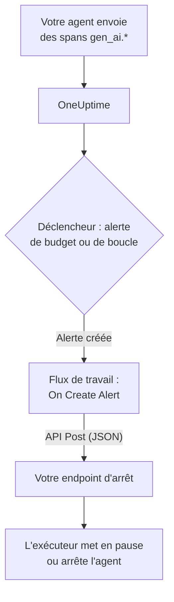

# Disjoncteurs pour agents IA

Un agent IA tombe rarement en panne en plantant. Il tombe en panne en continuant : il relance un outil cassé, replanifie la même étape ou lance d'autres sous-agents, pendant que chaque tour facture davantage de tokens. Cette page construit un disjoncteur pour ce cas à partir de pièces que OneUptime a déjà : une alerte qui repère l'agent emballé, et un flux de travail qui appelle un endpoint à vous pour l'arrêter.

:::cards
- [Choisir un déclencheur](#choisir-un-déclencheur): Alerter sur la dépense, ou sur un outil appelé encore et encore.
- [Construire l'endpoint d'arrêt](#construire-lendpoint-darrêt): Le petit service qui met votre agent en pause.
- [Construire le flux de travail](#construire-le-flux-de-travail): D'une nouvelle alerte à un appel à votre endpoint.
- [Tester le disjoncteur](#tester-le-disjoncteur): Le déclencher à la main, puis pour de vrai.
:::

## Fonctionnement



Le disjoncteur observe l'OpenTelemetry que votre agent envoie déjà, directement ou [via une passerelle](/docs/telemetry/ai-gateways), et agit à côté du chemin des requêtes, pas dedans. Rien n'est ajouté à chaque appel au modèle, et changer de fournisseur, de SDK ou de passerelle ne le casse pas.

Le prix, c'est la vitesse : il arrête un agent emballé en minutes, pas en millisecondes. Gardez les limites d'étapes et les délais d'expiration dans l'agent lui-même, et laissez le disjoncteur rattraper ce qui leur échappe.

| Déclencheur | Ce qu'il détecte | Délai avant l'alerte |
| --- | --- | --- |
| Une alerte de budget, issue d'un moniteur de métriques | Une dépense qui ne cesse de monter, quelle qu'en soit la cause | Jusqu'à 15 minutes, plus une minute pour le moniteur |
| Une alerte de boucle, issue d'un moniteur de traces | Le même outil appelé encore et encore | De 1 à 5 minutes |

## Avant de commencer

- Votre agent envoie des spans GenAI à OneUptime. Voir [Observabilité IA / LLM](/docs/telemetry/ai-llm-observability).
- Un endpoint HTTPS capable de mettre en pause ou d'arrêter l'exécuteur de votre agent, joignable depuis OneUptime. Vous le construisez dans [Construire l'endpoint d'arrêt](#construire-lendpoint-darrêt).
- L'autorisation de créer des moniteurs et des flux de travail dans le projet.

## Choisir un déclencheur

Les deux déclencheurs finissent de la même façon : un moniteur crée une alerte, et la nouvelle alerte démarre le flux de travail. Vous pouvez configurer les deux : le flux de travail ne se soucie pas de celui qui s'est déclenché.

### Une alerte de budget

La dépense est le signe le plus sûr d'un agent emballé. Un budget additionne toutes les 15 minutes la dépense IA du jour et la publie sous forme de deux métriques, `oneuptime.llm.budget.spend.usd` et `oneuptime.llm.budget.percent.used`, chacune avec l'ID du budget dans `oneuptime.llm.budget.id`.

:::steps
1. Ouvrez **Produits → IA / LLM → Budgets** et cliquez sur **Créer : Budget de coûts LLM**. Fixez un **Budget quotidien (USD)**, et choisissez le service de l'agent dans **Service (facultatif)** pour que le budget ne surveille que cet agent.
2. Dans le menu de la ligne du nouveau budget, choisissez **Afficher l'ID** et copiez l'ID.
3. Créez un [moniteur de métriques](/docs/monitor/metrics-monitor) sur `oneuptime.llm.budget.percent.used`, filtré par l'attribut `oneuptime.llm.budget.id` avec l'ID copié, et réglez sa **Plage temporelle** sur **Past 30 Minutes**.
4. Ajoutez un critère **Greater Than Or Equal To** `100` qui crée une alerte, et donnez-lui un **Titre de l'alerte** qui nomme l'agent, par exemple `LLM budget exceeded: support-bot`. Le flux de travail et votre endpoint lisent tous deux ce titre.
:::

Filtrez par l'ID, pas par le nom : renommer un budget renomme sa série, et un moniteur filtré sur l'ancien nom cesserait de correspondre sans prévenir. Gardez la plage à 30 minutes : un budget publie un point toutes les 15 minutes, donc une plage plus courte ne trouve rien entre deux points et l'alerte s'ouvre et se résout sans arrêt.

Un second critère à `80` avec une gravité plus faible prévient d'abord une personne, via la politique d'astreinte de l'alerte, avant que le disjoncteur ne saute à `100`.

### Une alerte de boucle

Un agent bloqué laisse une trace reconnaissable : le même span d'outil, encore et encore. Une exécution saine n'appelle pas un outil des dizaines de fois en quelques minutes, donc un comptage repère la boucle bien avant le budget.

:::steps
1. Ouvrez **Moniteurs**, cliquez sur **Créer un moniteur** et choisissez **Traces** sous **Plus de types de moniteurs**.
2. Sous **Plus de champs**, réglez **Filtrer par service de télémétrie** sur le service de l'agent, et **Filtrer par attributs** sur `gen_ai.tool.name` égal à l'outil sur lequel vous attendez une boucle, par exemple `search_web`. Si votre instrumentation nomme le span de chaque outil, mettez plutôt ce nom dans **Nom du span**.
3. Réglez **Surveiller les traces pendant (durée)** sur **Dernières 5 minutes**.
4. Ajoutez un critère **Span Count** **Greater Than** un nombre qu'aucune exécution saine n'atteint en cinq minutes, par exemple `50`, qui crée une alerte intitulée comme `Agent loop: support-bot`.
:::

Un second moniteur de traces avec **Filtrer par statut de span** réglé sur **Erreur** et un comptage plus bas repère les tempêtes de relances : un outil qui échoue sans cesse et un agent qui le relance sans cesse.

## Construire l'endpoint d'arrêt

Le flux de travail envoie un `POST` avec un corps JSON à un endpoint que vous exploitez. Ce que « arrêter » veut dire, c'est à vous de le décider. De l'effet le plus petit au plus grand :

| Action | Effet |
| --- | --- |
| Arrêter le nouveau travail | L'exécuteur ne lance plus de nouvelles exécutions pour cet agent |
| Annuler ses exécutions | Les exécutions en cours de cet agent sont annulées |
| Mettre le pool en pause | Chaque worker se vide jusqu'à ce que quelqu'un réarme le disjoncteur |

Un endpoint minimal en Express qui déclenche un disjoncteur par agent :

```typescript title="circuit-breaker.ts"
import express from "express";

const app = express();
app.use(express.json());

const tripped = new Set<string>(); // agents whose breaker is open

app.post("/circuit-breaker", (req, res) => {
  if (req.headers["authorization"] !== `Bearer ${process.env.KILL_TOKEN}`) {
    return res.status(401).end();
  }

  const alertTitle: string = req.body.alertTitle ?? "";

  // "LLM budget exceeded: support-bot" -> "support-bot"
  const agent: string = alertTitle.split(": ").pop() ?? "unknown";

  tripped.add(agent); // your run loop checks this set
  abortActiveRuns(agent); // cancel that agent's runs in flight

  // Answer fast; do the slow cleanup in the background.
  return res.status(200).json({ tripped: agent });
});
```

Construisez-le selon ces règles :

- Rendez le déclenchement idempotent. Un avertissement puis un dépassement, ou une alerte de budget et une alerte de boucle ensemble, peuvent le déclencher plus d'une fois, et un second déclenchement ne doit rien changer.
- Répondez en une ou deux secondes, et nettoyez en arrière-plan. Le flux de travail compte toute réponse 2xx comme un succès.
- Exigez un secret. Quiconque peut appeler l'endpoint peut arrêter vos agents, donc vérifiez un jeton bearer, que le flux de travail envoie depuis une variable globale secrète.
- Réarmez à la main. Un disjoncteur déclenché le reste jusqu'à ce que quelqu'un ait examiné l'exécution : ouvrez la conversation de l'agent sous **Produits → IA / LLM → Conversations** pour lire ou rejouer ce qu'il a fait.

La requête part de OneUptime. Sur OneUptime Cloud, votre endpoint doit être joignable depuis internet. Une installation auto-hébergée refuse les adresses de réseau privé sauf si un administrateur les autorise : voir [Accès réseau sortant](/docs/workflows/configuration#accès-réseau-sortant).

## Construire le flux de travail

Enregistrez d'abord le jeton de l'endpoint là où le flux de travail peut l'utiliser sans l'afficher : ouvrez **Flux de travail → Variables globales**, cliquez sur **Créer : Variable de flux de travail**, nommez-la `AGENT_KILL_TOKEN`, mettez le jeton dans **Contenu** et activez **Secret**. Une valeur secrète est retirée des journaux d'exécution et des traces d'étapes.

:::steps
### Créer le flux

Ouvrez **Produits → Flux de travail** et cliquez sur **Créer un flux de travail**. Cliquez sur **Partir de zéro**, nommez-le `AI agent circuit breaker` et cliquez sur **Créer un flux de travail**. Il s'ouvre dans le **Constructeur**, désactivé.

### Ajouter le déclencheur

Cliquez sur le bloc en pointillés **Choisissez ce qui démarre ce flux de travail** et choisissez **On Create Alert** dans le panneau **Add Trigger**. Cliquez sur le déclencheur, cochez le titre et la description dans **Select Fields**, puis cliquez sur **Enregistrer**. L'ID affiché sur le bloc, `alert-on-create-1`, est la façon dont les blocs suivants s'y réfèrent.

### Vérifier le titre

Cliquez sur **Ajouter un composant**, choisissez **If / Else** et reliez-lui le point **Success** du déclencheur. Réglez **Value to check** sur le titre de l'alerte (cliquez sur **{ }** et choisissez-le), **Comparison** sur **contient**, et **Compare with** sur le début commun aux titres de vos déclencheurs, par exemple `LLM budget exceeded`.

### Appeler votre endpoint

Ajoutez **API Post (JSON)** et reliez-lui le point **Yes** du **If / Else**. Réglez son **URL** sur votre endpoint, par exemple `https://agents.example.com/circuit-breaker`, et remplissez les en-têtes et le corps ci-dessous.

### Signaler un échec

Ajoutez **Send Message to Slack**, ou **Send Email**, et reliez-lui le point **Error** du bloc API. Un disjoncteur qui ne parvient pas à se déclencher est l'alerte qu'une personne doit voir.

### L'activer

Activez **Activé** en haut du **Constructeur**.
:::

Les **Request Headers** du bloc API :

```json title="Request Headers"
{
  "Authorization": "Bearer {{global.variables.AGENT_KILL_TOKEN}}",
  "Content-Type": "application/json"
}
```

Son **Request Body** :

```json title="Request Body"
{
  "source": "oneuptime-circuit-breaker",
  "alertId": "{{local.components.alert-on-create-1.returnValues.model._id}}",
  "alertTitle": "{{local.components.alert-on-create-1.returnValues.model.title}}",
  "alertDescription": "{{local.components.alert-on-create-1.returnValues.model.description}}"
}
```

Pour réagir à plusieurs déclencheurs, faites commencer tous leurs titres de la même façon, ou chaînez d'autres blocs **If / Else** depuis le point **No**. Voir [Créer un flux de travail](/docs/workflows/authoring) pour le canevas et [Variables](/docs/workflows/variables) pour les références `{{…}}`.

## Tester le disjoncteur

:::steps
1. Déclenchez-le à la main. Ouvrez **Alertes**, cliquez sur **Créer une alerte** et créez-en une intitulée `LLM budget exceeded: test`. L'exécution apparaît sous **Flux de travail → Journaux → Exécutions**, et votre endpoint reçoit l'appel.
2. Déclenchez-le pour de vrai. Créez un budget avec une limite minuscule, par exemple `0.01` USD, sur le service d'un agent de test, pointez un moniteur de budget dessus et laissez l'agent tourner : le pourcentage dépasse 100, l'alerte s'ouvre, le flux de travail s'exécute et le disjoncteur saute. Pour l'alerte de boucle, donnez à un agent de test un outil qui échoue toujours.
3. Déclenchez-le deux fois. Créez à nouveau la même alerte : votre endpoint doit accepter le second déclenchement sans rien changer.
:::

## Comment le disjoncteur se comporte dans le temps

- Le flux de travail s'exécute quand une alerte est créée, donc un déclencheur fait sauter le disjoncteur une fois par alerte, pas une fois par évaluation.
- Un budget compte la journée UTC, donc son pourcentage repart de 0 à minuit UTC. Une alerte de budget peut alors se résoudre, et le prochain mauvais jour ouvre une nouvelle alerte qui fait de nouveau sauter le disjoncteur.
- Un moniteur garde son alerte ouverte tant que ses critères sont remplis. Avec **Résoudre automatiquement l'alerte** activé, l'alerte se résout quand ils cessent de l'être, et le dépassement suivant ouvre une nouvelle alerte.
- Réarmer est la décision d'une personne, des deux côtés : résolvez l'alerte dans OneUptime, et réarmez le disjoncteur dans votre exécuteur.
- Chaque nouvelle alerte du projet démarre le flux de travail. C'est le **If / Else** qui tient les autres alertes à l'écart du disjoncteur : ne le supprimez pas.

## Dépannage

:::details Le flux de travail ne s'exécute pas
Vérifiez que **Activé** est activé en haut du **Constructeur** : les flux de travail sont créés désactivés. Vérifiez ensuite que l'alerte a été créée après l'activation du flux de travail : le déclencheur ne démarre une exécution que pour une nouvelle alerte.
:::

:::details Le flux de travail s'exécute, mais prend toujours la branche No
Le titre est vide ou ne correspond pas. Un champ non coché dans **Select Fields** du déclencheur arrive vide, donc cochez le titre. Comparez ensuite le titre de l'alerte avec **Compare with** : **contient** doit y trouver exactement ce texte.
:::

:::details Votre endpoint répond 401
L'en-tête `Authorization` ne correspond pas au jeton qu'attend votre endpoint. Vérifiez le nom dans `{{global.variables.AGENT_KILL_TOKEN}}` et la valeur enregistrée dans la variable globale. La valeur d'une variable secrète ne peut pas être relue, donc en cas de doute, saisissez-la de nouveau avec **Update Content**.
:::

:::details L'alerte de budget s'ouvre et se résout sans arrêt
La **Plage temporelle** du moniteur est plus courte que les 15 minutes qui séparent deux points du budget. Réglez-la sur **Past 30 Minutes**.
:::

:::details La requête n'atteint jamais votre endpoint
Ouvrez l'exécution sous **Flux de travail → Journaux → Exécutions** et l'étape **API Post (JSON)** : elle indique pourquoi la requête a échoué. Sur OneUptime Cloud, l'endpoint doit être joignable depuis internet ; une installation auto-hébergée refuse les adresses de réseau privé sauf si un administrateur les autorise.
:::

## Étapes suivantes

:::cards
- [Observabilité IA / LLM](/docs/telemetry/ai-llm-observability): Budgets, coûts et les spans que surveille le disjoncteur.
- [Moniteur de traces](/docs/monitor/traces-monitor): Filtres de spans et critères en détail.
- [Flux de travail](/docs/workflows/index): Déclencheurs, composants, variables et exécutions.
- [Passerelles IA](/docs/telemetry/ai-gateways): Les appels au modèle de tous les agents par un seul export.
:::
