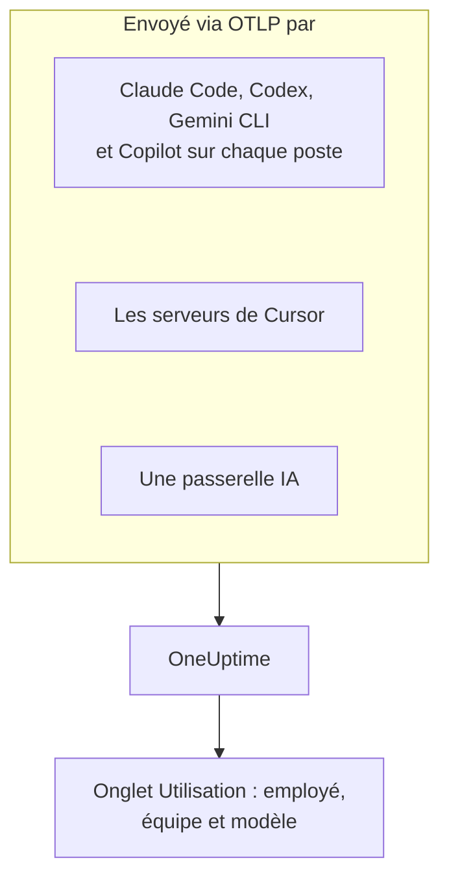

# Assistants de code IA

Vos ingénieurs utilisent Claude Code, Cursor, Codex, Gemini CLI et Copilot, et les factures ne cessent de grossir. Cette page répond aux questions qu'un responsable se pose : **qui utilise quel outil, avec quels modèles, et ce que dépense chaque personne et chaque équipe**.

La plupart des assistants de code exportent eux-mêmes OpenTelemetry, il n'y a donc rien à installer sur les postes des développeurs : dirigez l'export vers OneUptime, et les jetons, les coûts et l'usage des outils arrivent à côté des appels d'IA de vos propres applications. Tout ici arrive via OpenTelemetry ; OneUptime n'interroge l'API d'administration ou de facturation d'aucun fournisseur.

:::cards
- [Matrice de prise en charge](#matrice-de-prise-en-charge): Ce que chaque outil envoie, et s'il nomme une personne.
- [Attribution aux employés et aux équipes](#attribution-aux-employés-et-aux-équipes): Les clés qui mettent un nom et une équipe sur les dépenses.
- [L'onglet Utilisation](#longlet-utilisation): Ce que les tableaux de dépenses peuvent montrer ou non pour un assistant de code.
- [Par où commencer](#par-où-commencer): Un ordre de déploiement qui montre des résultats dès le premier jour.
:::

## Fonctionnement

Chaque outil envoie sa télémétrie au point de terminaison OTLP de OneUptime avec votre clé d'ingestion : depuis chaque poste de développeur, depuis les serveurs du fournisseur (Cursor), ou depuis une passerelle par laquelle passe votre trafic vers les modèles.



## Avant de commencer

1. Créez une clé d'ingestion de télémétrie sous **Paramètres du projet → Télémétrie & APM → Clés d'ingestion**.
2. Votre point de terminaison OTLP est `https://oneuptime.com/otlp`, ou `https://YOUR-ONEUPTIME-HOST/otlp` si vous hébergez OneUptime vous-même.
3. Chaque export envoie la clé dans l'en-tête `x-oneuptime-token`.

Une seule clé d'ingestion pour toute la flotte suffit. Elle se retrouve sur chaque poste de développeur : traitez-la comme un identifiant partagé qui ne peut qu'envoyer des données, et renouvelez-la comme n'importe quel autre.

## Matrice de prise en charge

Trois choses décident de ce que vous obtenez d'un outil : s'il envoie de l'OpenTelemetry, comment sa télémétrie atteint OneUptime, et si quelque chose dedans nomme une personne.

| Outil | Ce qu'il envoie | Comment il atteint OneUptime | Qui il nomme | Guide |
| --- | --- | --- | --- | --- |
| Claude Code | Métriques et logs ; traces en bêta | Depuis chaque poste ; variables d'environnement ou fichier de paramètres gérés | `user.email`, une fois connecté avec un compte Claude | [Claude Code](/docs/telemetry/claude-code) |
| Cursor | Métriques et logs | Depuis les serveurs de Cursor, configuré une fois dans le tableau de bord de Cursor ; offre Enterprise uniquement | `cursor.user.id`, un entier | [Cursor](/docs/telemetry/cursor) |
| OpenAI Codex | Traces, métriques et logs, chacun activé dans `~/.codex/config.toml` | Depuis chaque poste, une URL complète par signal | Personne dans les spans ou les métriques : vous définissez `user.id` et `user.email` dans `[otel.span_attributes]` | [OpenAI Codex](/docs/telemetry/openai-codex) |
| Gemini CLI | Traces, métriques et logs | Depuis chaque poste, généralement via un collector local | `user.email`, une fois connecté | [Gemini CLI et GitHub Copilot](/docs/telemetry/gemini-cli-and-copilot) |
| GitHub Copilot | Traces, métriques et logs, depuis ses surfaces d'agent uniquement | Depuis l'éditeur ou l'hôte d'agent | Personne : vous définissez `enduser.id` et `user.email` sur chaque poste | [Gemini CLI et GitHub Copilot](/docs/telemetry/gemini-cli-and-copilot) |
| Cline | Métriques et logs | Configuré de façon centrale, dans le tableau de bord d'organisation de Cline | Un `user_id` anonymisé | — |
| LiteLLM et Portkey | Traces de chaque appel qui passe par la passerelle | Depuis le processus de la passerelle | Avec LiteLLM, le propriétaire de la clé virtuelle | [Passerelles IA](/docs/telemetry/ai-gateways) |
| Vos propres applications | Ce qu'envoie votre instrumentation GenAI | Depuis votre application | Celui que vous définissez comme `user.id` | [Observabilité IA / LLM](/docs/telemetry/ai-llm-observability) |
| Windsurf, JetBrains AI, Amazon Bedrock, Azure OpenAI | Aucun OpenTelemetry propre | Seulement via une passerelle placée devant | Celui que nomme la passerelle | [Passerelles IA](/docs/telemetry/ai-gateways) |

Un tiret signifie que OneUptime n'a pas encore de guide pour l'outil. Sa télémétrie est quand même ingérée comme n'importe quel OpenTelemetry.

:::details Ce que GitHub Copilot exporte exactement
Copilot n'exporte OpenTelemetry que depuis ses surfaces d'agent : le chat et le mode agent de VS Code, l'hôte d'agent derrière Copilot CLI, le Copilot SDK, et les workflows d'agent dans les IDE JetBrains via le plugin Copilot. GitHub ne documente aucun export pour les complétions en ligne, Copilot sur github.com ou la revue de code de Copilot. Copilot n'envoie aucun attribut d'utilisateur, alors définissez `enduser.id` et `user.email` par poste via `resourceAttributes` ou `OTEL_RESOURCE_ATTRIBUTES`.
:::

:::details Amazon Bedrock, Azure OpenAI, Windsurf et JetBrains AI
- **Amazon Bedrock** : les API `InvokeModel` et `Converse` n'envoient pas d'OpenTelemetry. Bedrock AgentCore est différent : AWS y documente des métriques, des spans et des logs, envoyés à CloudWatch par défaut. Définir `DISABLE_ADOT_OBSERVABILITY=true` désactive la configuration ADOT par défaut du runtime, pour que vous puissiez diriger le SDK ADOT vers OneUptime.
- **Azure OpenAI** : le service n'envoie rien, et ses métriques Azure Monitor n'ont aucune dimension utilisateur. Instrumentez le client, ou placez API Management ou une autre passerelle devant.
- **Windsurf** : ne documente aucun export de télémétrie. Les données par utilisateur se trouvent dans l'API Enterprise de Windsurf, que OneUptime n'interroge pas.
- **JetBrains AI Assistant et Junie** : n'exportent aucun usage. Le plugin OpenTelemetry de JetBrains reçoit la télémétrie de votre propre application dans l'IDE ; il n'envoie rien vers l'extérieur.
:::

## Attribution aux employés et aux équipes

OneUptime copie la personne qui a fait un appel, et son équipe, dans des colonnes à l'arrivée de la télémétrie, pour que l'onglet **Utilisation** puisse classer personnes et équipes sans filtres d'attributs.

### Attributs lus comme l'employé

Sur un span, la première clé présente l'emporte, dans cet ordre :

| Colonne | Clés, de la préférée à la moins préférée |
| --- | --- |
| Identifiant de l'employé | `user.id`, `enduser.id`, `litellm.metadata.user_api_key_user_id`, `metadata.user_api_key_user_id`, `traceloop.association.properties.user_id`, `langfuse.user.id`, `user.account_uuid`, `user.account_id`, `cursor.user.id` |
| E-mail de l'employé | `user.email`, `litellm.metadata.user_api_key_user_email`, `metadata.user_api_key_user_email`, `traceloop.association.properties.user_email`, `enduser.email` |
| Équipe / centre de coûts | `team.id`, `team`, `cost_center`, `department`, `litellm.metadata.user_api_key_team_id`, `litellm.team.id`, `metadata.user_api_key_team_id`, `cursor.team.id` |

Sur un point de métrique, la liste est plus courte et commence par l'e-mail, car les assistants de code qui envoient des métriques envoient eux-mêmes `user.email` :

| Colonne | Clés, de la préférée à la moins préférée |
| --- | --- |
| Employé | `user.email`, `user.id`, `user.account_uuid`, `user.account_id`, `cursor.user.id` |
| Équipe / centre de coûts | `team.id`, `team`, `cost_center`, `department`, `cursor.team.id` |
| Modèle | `gen_ai.request.model`, `model`, `cursor.model.name` |

Comment ces clés sont lues :

- **Chaque clé est aussi lue avec un préfixe `resource.`.** L'ingestion OTLP range les attributs de ressource sous ce préfixe, donc `OTEL_RESOURCE_ATTRIBUTES=team.id=platform` arrive comme `resource.team.id`. Les clés sans préfixe sont essayées en premier, si bien qu'une valeur sur le span l'emporte sur une valeur pour tout le processus.
- **L'onglet Utilisation affiche l'e-mail d'une personne quand l'appel en a un, et l'identifiant sinon.** Les lignes qui affichent le même e-mail sont additionnées, si bien qu'un ingénieur sur deux postes forme une seule ligne.
- **L'identité n'est lue que sur les appels d'IA.** `user.id`, `user.email` et `team.id` sont des clés génériques que portent aussi les spans du navigateur et du backend ; seuls les spans déjà reconnus comme appels d'IA reçoivent les colonnes.
- **Les enregistrements de log ne sont pas lus pour l'identité.** Cela compte pour Codex, qui ne met `user.email` que dans ses logs.
- LiteLLM écrit ces clés de deux façons : son callback `otel` par défaut utilise le préfixe `metadata.`, et son mode OpenTelemetry v2 optionnel (`LITELLM_OTEL_V2=true`) l'espace de noms `litellm.`. OneUptime lit les deux, donc un proxy standard fonctionne sans configuration supplémentaire.

### Équipes et centres de coûts

Aucune instrumentation n'envoie `team.id`, `team`, `cost_center` ou `department` : c'est votre organisation qui les définit, généralement via `OTEL_RESOURCE_ATTRIBUTES` sur le processus de l'outil.

```bash
export OTEL_RESOURCE_ATTRIBUTES="team.id=platform,team=Platform_Engineering,cost_center=eng-123,department=engineering"
```

Définissez-la là où vous provisionnez déjà les postes des développeurs : un profil MDM, un fichier de paramètres gérés ou un profil de shell issu de vos dotfiles. Les valeurs ne peuvent pas contenir d'espaces : utilisez des tirets bas, ou l'encodage pourcent comme `%20`. Codex n'a pas d'attributs de ressource, définissez donc les mêmes clés dans son `[otel.span_attributes]`.

Pour séparer les dépenses par application, utilisez le nom du service (`OTEL_SERVICE_NAME`, ou le paramètre propre à l'outil). La ventilation **Application / Service** ne couvre que les outils qui envoient des spans GenAI.

### Ce qui n'est délibérément pas traité comme l'employé

Un appel peut porter deux personnes différentes : l'employé qui l'a fait, et le client pour qui il a été fait. Ces clés portent le client, et OneUptime ne les lit jamais dans une colonne d'identité :

- `gen_ai.user` et `llm.user` : la façon dont les instrumentations reprennent le paramètre de requête `user` d'OpenAI, qu'OpenAI décrit comme un identifiant de vos utilisateurs finaux.
- `litellm.metadata.user_api_key_end_user_id`, `metadata.user_api_key_end_user_id` et `litellm.end_user.id` : l'utilisateur final de LiteLLM, par opposition au propriétaire de la clé, qui est l'employé.

Lire un identifiant client comme un employé transformerait un bot de support qui sert 40 000 clients en 40 000 employés fantômes, tandis que l'ingénieur à qui appartiennent les dépenses semblerait ne rien dépenser. Les clés restent dans les attributs du span, et l'onglet **LLM** de la visionneuse de traces les affiche comme utilisateur final.

### Confidentialité

La colonne de l'e-mail de l'employé contient des données personnelles. Les **Règles de masquage** des traces la couvrent exactement comme l'attribut d'où elle a été lue, si bien qu'une règle qui masque les e-mails masque aussi la colonne. Vous les trouvez sous **Traces → Paramètres**.

## Métriques des assistants de code lues par OneUptime

Les assistants de code nomment leurs métriques avec leur propre préfixe plutôt que `gen_ai.*`, donc OneUptime connaît chacune par son nom :

| Métrique | Outil | Unité |
| --- | --- | --- |
| `claude_code.token.usage` | Claude Code | Jetons |
| `claude_code.cost.usage` | Claude Code | USD |
| `cursor.token.usage` | Cursor | Jetons |
| `cursor.cost.usage` | Cursor | USD, une estimation de l'aveu même de Cursor |
| `codex.turn.token_usage` | OpenAI Codex | Jetons |
| `codex.turn.cost_microusd` | OpenAI Codex | Millionièmes d'USD : OneUptime la convertit, ne le faites pas |

OneUptime lit aussi les jetons depuis `gen_ai.client.token.usage`, `gen_ai.client.token.count`, `llm.token.usage` et `llm.usage.tokens`, et le coût depuis `gen_ai.client.cost`, `gen_ai.client.cost.usd`, `gen_ai.usage.cost`, `litellm_spend_metric` et `litellm.cost.total`.

Deux choses à savoir avant de lire les chiffres :

- **`gemini_cli.token.usage` est laissée de côté exprès.** Gemini CLI envoie ses jetons deux fois, comme sa propre métrique et comme `gen_ai.client.token.usage`, et lire les deux les doublerait. Ses jetons sont comptés une fois, via `gen_ai.client.token.usage`. Gemini CLI n'envoie aucune métrique de coût : activez ses traces pour que chaque appel soit tarifé.
- **Seuls les jetons en entrée et en sortie sont comptés.** Le type de jeton est lu depuis `gen_ai.token.type`, `llm.token.type`, `type`, `cursor.token.type` ou `token_type`, et seuls `input` et `output` (ou les anciens `prompt` et `completion`) comptent. Les lectures et écritures de cache, le `total` de Codex (qui répète les autres) et `reasoning_output` (une partie de `output`) sont laissés de côté, si bien qu'un total issu des métriques est plus petit que la somme de tout ce qu'envoie un outil.

## L'onglet Utilisation

Ouvrez **Produits → IA / LLM** et allez dans **Utilisation**. Il classe **Employé**, **Équipe**, **Modèle**, **Fournisseur** et **Application / Service** par dépenses, sur les 7 derniers jours si vous ne choisissez pas une autre période. Les appels qui ne nomment personne sont comptés sous **Non attribué** : une grosse ligne **Non attribué** vous dit quel outil a encore besoin de son identité.

### Les métriques des assistants de code sont un relais, pas un ajout

Les spans GenAI passent en premier : les métriques ne sont lues que pour un chiffre que les spans n'ont pas fourni, et les deux ne sont jamais additionnés ([pourquoi](/docs/telemetry/ai-llm-observability#les-spans-dabord-les-métriques-en-relais)). Pour les assistants de code, cela a une conséquence brutale : **si le même projet reçoit des spans GenAI avec un coût, les dépenses des assistants de code n'apparaissent pas.** Donnez aux assistants de code un projet à eux, avec sa propre clé d'ingestion.

Quand le relais s'applique, voici ce que chaque ventilation peut montrer pour un outil qui n'envoie que des métriques :

| Ventilation | Depuis les métriques |
| --- | --- |
| **Employé** | Oui, depuis chaque clé d'identité ci-dessus, avec ou sans le préfixe `resource.` |
| **Équipe** | Oui, depuis les clés d'équipe |
| **Modèle** | Oui : Claude Code et Codex envoient un `model` sans préfixe, Cursor `cursor.model.name` |
| **Fournisseur** | Non : les métriques des assistants de code ne nomment aucun fournisseur |
| **Application / Service** | Non : leurs métriques n'appartiennent à aucun service OneUptime |

Une ligne lue depuis les métriques ne porte que le coût : ses cellules d'appels et de jetons affichent `—`, car un compteur de dépenses n'a aucun détail par appel, et un 0 à cet endroit prétendrait que la personne n'a fait aucun appel. Le tableau est marqué **depuis les métriques GenAI**.

## Pas d'OpenTelemetry ? Placez une passerelle devant

Pour Windsurf, JetBrains AI, les API de modèles de Bedrock, Azure OpenAI et tout ce qui n'a pas son propre export, placez une passerelle IA devant. Chaque appel passe alors par un seul processus qui envoie de l'OpenTelemetry, et vous configurez l'export une fois.

**Utilisez LiteLLM avec une clé virtuelle par employé.** LiteLLM inscrit l'identifiant et l'e-mail du propriétaire de la clé sur chaque span, ce que OneUptime lit comme l'employé, et l'équipe de la clé comme l'équipe. Il tarifie aussi chaque appel lui-même, avec les tarifs personnalisés que vous définissez sur le proxy, et son coût fourni l'emporte sur l'estimation de OneUptime. N'utilisez pas pour cela son identifiant d'utilisateur final : c'est le client. La mise en place est décrite dans [Passerelles IA](/docs/telemetry/ai-gateways).

Deux limites avant de tout bâtir autour d'une passerelle :

- **Une passerelle ne voit que le trafic qui passe par elle.** La surcharge d'URL de base propre à Cursor est un réglage par utilisateur qui ne couvre que les modèles de chat (la complétion Tab continue d'utiliser les modèles de Cursor), préférez donc l'export natif de Cursor.
- **Une passerelle voit l'appel au modèle, pas l'agent.** Elle enregistre les prompts et les réponses, mais pas les appels d'outils, les modifications de fichiers ni les décisions d'accepter ou de refuser que rapporte la télémétrie propre d'un outil.

## Contenu des prompts : les valeurs par défaut diffèrent selon l'outil

Les prompts et les réponses sont les données les plus risquées de cette chaîne : ils contiennent régulièrement du code source, des données client et des identifiants collés. Vérifiez la valeur par défaut de chaque outil :

| Outil | Contenu des prompts par défaut |
| --- | --- |
| Claude Code | Désactivé : chaque type de contenu a sa propre variable à activer |
| Cursor | Désactivé : seule la famille optionnelle `conversation_content` envoie le texte des messages |
| OpenAI Codex | Désactivé : `log_user_prompt` vaut `false` par défaut |
| Gemini CLI | **Activé** : `logPrompts` vaut `true` par défaut, donc passez-le à `false` quand vous activez la télémétrie |
| GitHub Copilot | Désactivé : `captureContent`, que les paramètres gérés peuvent verrouiller avec `lockCaptureContent` |
| LiteLLM | Activé avec le callback `otel` par défaut (désactivez-le avec `turn_off_message_logging`) ; désactivé en mode OpenTelemetry v2 |

Codex envoie aussi ses métriques à OpenAI par défaut : voir [OpenAI Codex](/docs/telemetry/openai-codex). Là où vous capturez du contenu volontairement, les **Règles de masquage** et les **Filtres de suppression** des traces s'y appliquent comme à toute autre télémétrie.

## Ce que OneUptime ne fait pas encore

- **Aucun connecteur d'administration ou de facturation des fournisseurs.** OneUptime n'interroge ni l'API d'administration d'Anthropic, ni celle de Cursor, ni les points de terminaison d'usage et de coûts d'OpenAI, ni la facturation Copilot de GitHub, ni les API de Windsurf ou de JetBrains. Pour des chiffres au niveau de la facture, récupérez-les auprès du fournisseur.
- **Le coût est une estimation, sauf si un outil le fournit.** Un coût fourni est utilisé tel quel ; sinon OneUptime tarifie les jetons aux prix catalogue. Le `cursor.cost.usage` de Cursor est lui-même une estimation.
- **L'identité des enregistrements de log n'est pas lue.** Le `user.email` de Codex, qu'il n'envoie que dans les logs, n'est pas relié aux dépenses.
- **Le `cursor.user.email` de Cursor n'est pas encore lu**, donc les utilisateurs de Cursor apparaissent sous leur entier `cursor.user.id`.
- **Les spans de Codex ne nomment aucun modèle**, donc OneUptime ne peut pas les tarifer : Codex affiche les jetons par personne, et son coût seulement dans les totaux.
- **Les outils changent vite.** Si cette page dit qu'un outil n'a pas d'export, vérifiez sa documentation actuelle avant de tout bâtir autour d'une passerelle.

## Par où commencer

Déployez dans cet ordre ; chaque étape est utile à elle seule. Utilisez un projet qui ne reçoit pas déjà des spans GenAI de vos propres applications, sinon [la règle du relais](#les-métriques-des-assistants-de-code-sont-un-relais-pas-un-ajout) tient les dépenses des assistants de code hors de la page.

1. **Gemini CLI**, si quelqu'un l'utilise. Il envoie `user.email` sans configuration, il montre donc l'attribution de bout en bout. Activez aussi ses traces : il n'envoie aucune métrique de coût.
2. **Claude Code** : un fichier de paramètres gérés pour la flotte, `user.email` sans effort, une vraie métrique de coût, ainsi que le taux d'acceptation, les commits, les pull requests et les lignes de code par développeur.
3. **Cursor**, avec l'offre Enterprise : un écran dans le tableau de bord de Cursor, aucun poste de développeur touché, même si les personnes arrivent sous forme d'entiers.
4. **Copilot et Codex**, qui ont tous deux besoin d'une identité définie sur chaque poste. Faites-le lors du provisionnement : les appels arrivés sans identité ne peuvent pas être attribués après coup.
5. **Une passerelle LiteLLM** pour tout le reste, avec une clé virtuelle par employé.

## Étapes suivantes

:::cards
- [Claude Code](/docs/telemetry/claude-code): Activer l'export de Claude Code pour un poste ou toute la flotte.
- [Cursor](/docs/telemetry/cursor): Envoyer la télémétrie d'équipe de Cursor depuis le tableau de bord de Cursor.
- [OpenAI Codex](/docs/telemetry/openai-codex): Configurer les trois exportateurs de Codex et apposer une identité sur ses spans.
- [Observabilité IA / LLM](/docs/telemetry/ai-llm-observability): Conversations, alertes, coûts et budgets pour chaque appel d'IA.
:::
