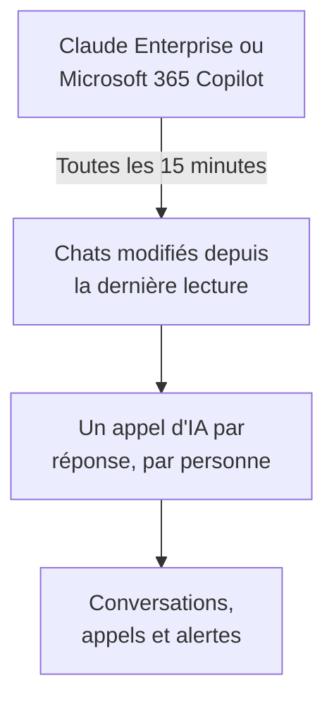

# Outils d'IA de l'entreprise

Voyez ce que vos équipes demandent aux outils d'IA que paie votre entreprise, sous forme de conversations par personne. Connectez Claude Enterprise ou Microsoft 365 Copilot avec un identifiant qui ne peut que lire, et OneUptime ramène chaque nouveau chat dans **Conversations** toutes les 15 minutes. Seuls les propriétaires et administrateurs du projet peuvent les lire, sauf si vous en décidez autrement.

:::cards
- [Prévenez d'abord vos équipes](#prévenez-dabord-vos-équipes): Leurs chats sont leurs propres mots.
- [Connecter un outil](#connecter-un-outil): Collez l'identifiant, choisissez qui peut lire, testez et connectez.
- [Confidentialité](#confidentialité): Qui peut lire les conversations, et si les mots sont conservés.
- [Autres outils d'IA](#autres-outils-dia): ChatGPT Enterprise, Gemini, Open WebUI, LibreChat et assistants de code.
:::

## Prévenez d'abord vos équipes

> [!IMPORTANT]
> Ce sont les propres mots de vos équipes. Avant de connecter un outil, dites-leur que leurs chats avec lui sont conservés et qui peut les lire, et vérifiez avec votre service juridique ou RH ce que demandent vos politiques et la loi locale.

## Comment ça marche

Toutes les 15 minutes, OneUptime demande à l'outil les chats qui ont changé depuis sa dernière lecture. Chaque réponse devient un appel d'IA de la personne qui a posé la question, avec les questions posées depuis la réponse précédente, et chaque chat devient une conversation.

Les chats arrivent comme les appels d'IA de vos applications, donc les règles de nettoyage, les filtres de rejet, la rétention et les alertes IA s'y appliquent. Les outils sont payés par licence, donc ces appels ne portent ni jetons ni coût. Une question restée sans réponse pendant une heure arrive seule, si bien qu'un chat auquel l'IA n'a jamais répondu apparaît quand même.

## Avant de commencer

- Le rôle Project Owner ou Project Admin. Eux seuls peuvent connecter, modifier ou retirer un outil.
- Un administrateur de l'outil, pour créer l'identifiant : la section de chaque outil, plus bas, indique lequel.
- Vos équipes prévenues, et la réponse de votre service juridique ou RH.

## Connecter un outil

:::steps
### Ouvrir Connecter

Ouvrez **Produits → IA / LLM → Connecter**. Sous **Les outils d'IA de votre entreprise**, cliquez sur la tuile de l'outil.

### Coller l'identifiant

Dans **Identifiants**, remplissez ce que demande l'outil. Les secrets sont stockés chiffrés et ne sont plus jamais affichés.

### Choisir qui peut lire

Dans **Confidentialité**, réglez **Qui peut lire les conversations** et **Conserver ce qui a été écrit**, comme l'explique [Confidentialité](#confidentialité).

### Le tester

Dans **Tester**, cliquez sur **Tester la connexion**. OneUptime compte les chats des 7 derniers jours : rien de ce que quelqu'un a écrit n'est lu, affiché ni conservé.

### Connecter

Cliquez sur **Connecter**. La première lecture commence en moins d'une minute et ramène les 7 derniers jours.
:::

## Claude Enterprise

OneUptime lit chaque chat claude.ai de votre organisation via la Compliance API : qui a posé la question, ce qui a été demandé à Claude, ce qu'il a répondu et quel modèle il a utilisé. Un chat qui reçoit un nouveau message est relu, et les réponses déjà ramenées sont reconnues et ignorées.

:::steps
### Activer la Compliance API

Le propriétaire principal de votre organisation ouvre Organization settings, API dans claude.ai et active la Compliance API.

### Créer une clé d'accès de conformité

Là, créez une clé avec la portée `read:compliance_user_data`. Elle commence par `sk-ant-api01-`.

### Connecter Claude Enterprise

Collez la clé comme **Clé d'accès de conformité**.
:::

## Microsoft 365 Copilot

OneUptime lit l'historique des interactions Copilot de chaque personne depuis Microsoft Graph : ce qu'elle a demandé à Copilot dans Teams, Outlook, Word, Excel, PowerPoint, Loop ou Copilot Chat, ce qu'il a répondu, et dans quelle application. Un prompt et ses réponses deviennent un appel d'IA, et une session Copilot une conversation. Un grand tenant est lu par parties, en reprenant là où la dernière lecture s'est arrêtée.

:::steps
### Inscrire une application

Dans Microsoft Entra ID, inscrivez une application et créez-lui un secret client.

### Accorder les permissions

Donnez à l'application les permissions d'application `AiEnterpriseInteraction.Read.All` et `User.Read.All` de Microsoft Graph, et accordez le consentement administrateur.

### Connecter Copilot

Remplissez **ID de l'annuaire (tenant)**, **ID d'application (client)** et **Secret client**. Pour ne lire que certaines personnes, mettez l'ID d'objet d'un groupe dans **Uniquement les personnes de ce groupe**, sous **Plus de champs**, et donnez aussi `GroupMember.Read.All` à l'application. Pour Azure Government, changez **Cloud** au même endroit.
:::

## Confidentialité

| Réglage | Ce qu'il fait |
| --- | --- |
| **Qui peut lire les conversations** | **Propriétaires et administrateurs du projet**, la valeur par défaut : personne d'autre dans le projet ne voit ces conversations, ni les appels d'IA qui les composent, nulle part dans OneUptime. **Toutes les personnes autorisées à lire les appels d'IA** : tous ceux qui peuvent lire les traces du projet. |
| **Conserver ce qui a été écrit** | Activé, la valeur par défaut : les questions et les réponses sont conservées. Désactivé : OneUptime garde qui a demandé, quand, avec quel modèle et dans quelle application, mais pas les mots. |

Un changement de qui peut lire s'applique en moins d'une minute. Désactiver **Conserver ce qui a été écrit** s'applique aux chats lus ensuite ; ce qui a été conservé avant reste jusqu'à la fin de sa rétention.

Pour garder les mots mais en masquer des parties, comme des adresses e-mail ou des numéros de carte, utilisez **Règles de masquage** sous **Traces → Paramètres** : elles s'appliquent avant que quoi que ce soit soit stocké. Les conversations sont conservées aussi longtemps que le service de la connexion conserve ses traces : voir [Rétention des données](/docs/telemetry/data-retention). Retirer une connexion arrête ses lectures ; ce qu'elle a lu reste, lisible par les mêmes personnes, jusqu'à la fin de sa rétention.

## Autres outils d'IA

Ces outils n'ont pas d'API avec laquelle OneUptime puisse lire les chats des gens, ou demandent un autre chemin.

### ChatGPT Enterprise

OpenAI n'ouvre sa Compliance API à un workspace que sur demande et ne publie pas ce que contiennent ses enregistrements, donc OneUptime ne peut pas encore lire les chats de ChatGPT Enterprise. Connecter votre organisation OpenAI comme [compte de fournisseur](/docs/telemetry/ai-provider-accounts#openai) montre son utilisation et son coût d'API, qui n'incluent pas ChatGPT.

### Gemini pour Google Workspace

Google n'offre aucune API pour lire les chats Gemini des gens. Google Vault les conserve pour l'eDiscovery.

### Assistants de code

Claude Code, Codex, Gemini CLI, GitHub Copilot et Cursor envoient leur propre OpenTelemetry : voir [Assistants de code IA](/docs/telemetry/ai-coding-assistants).

### Open WebUI et LibreChat

Les applications de chat auto-hébergées appellent les modèles via une API que vous définissez. Placez un proxy LiteLLM devant les modèles et envoyez ses traces à OneUptime comme le montre [Passerelles IA](/docs/telemetry/ai-gateways#litellm-proxy) : les prompts et les réponses de chaque chat arrivent comme des appels d'IA. Une clé virtuelle par personne indique qui a posé la question ; une clé que tout le monde partage ne nomme personne. L'export OpenTelemetry propre à Open WebUI trace ses requêtes web et ses appels à la base de données, pas les chats.

## Dépannage

:::details Le test ne trouve aucun chat
Personne n'a utilisé l'outil ces 7 derniers jours, ou l'identifiant appartient à une autre organisation ou à un autre tenant. Pour Copilot, vérifiez que le groupe sous **Uniquement les personnes de ce groupe** est bien celui que vous visez.
:::

:::details L'identifiant fonctionne, mais ne peut pas lire ce dont la connexion a besoin
Pour Copilot, accordez le consentement administrateur pour les permissions Graph de l'application, et aussi `GroupMember.Read.All` quand vous nommez un groupe. Pour Claude Enterprise, créez la clé avec la portée `read:compliance_user_data`.
:::

:::details Quelqu'un ne voit pas les conversations
**Qui peut lire les conversations** est réglé sur **Propriétaires et administrateurs du projet**. Un propriétaire ou un administrateur peut le changer avec **Modifier** dans la ligne de la connexion.
:::

:::details Les conversations montrent qui a demandé, mais pas les mots
**Conserver ce qui a été écrit** était désactivé quand elles ont été lues. L'activer s'applique aux chats lus ensuite.
:::

## Étapes suivantes

:::cards
- [Observabilité IA / LLM](/docs/telemetry/ai-llm-observability): Lisez et rejouez les conversations, et soyez prévenu quand les réponses tournent mal.
- [Comptes de fournisseurs d'IA](/docs/telemetry/ai-provider-accounts): Utilisation et coût de vos comptes OpenAI, Anthropic, Azure, Bedrock et Vertex AI.
- [Assistants de code IA](/docs/telemetry/ai-coding-assistants): Dépenses par ingénieur pour les outils de code.
- [Rétention des données](/docs/telemetry/data-retention): Combien de temps les conversations sont conservées.
:::
