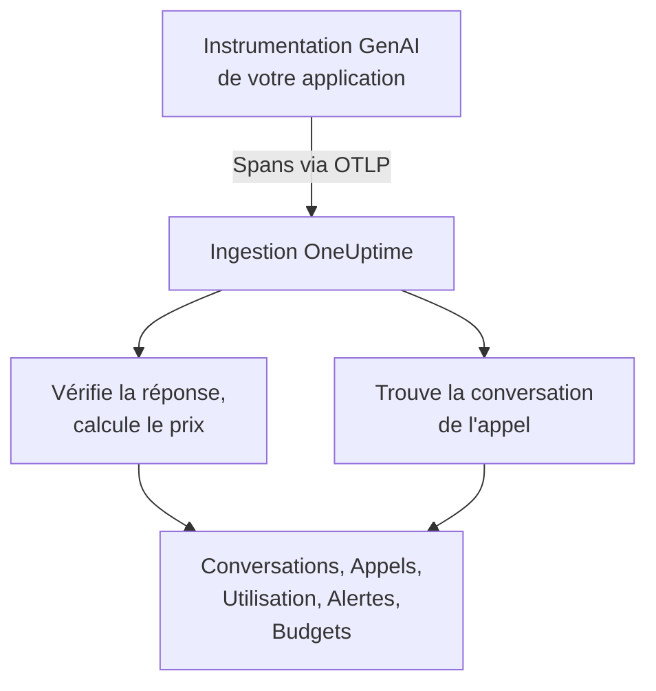
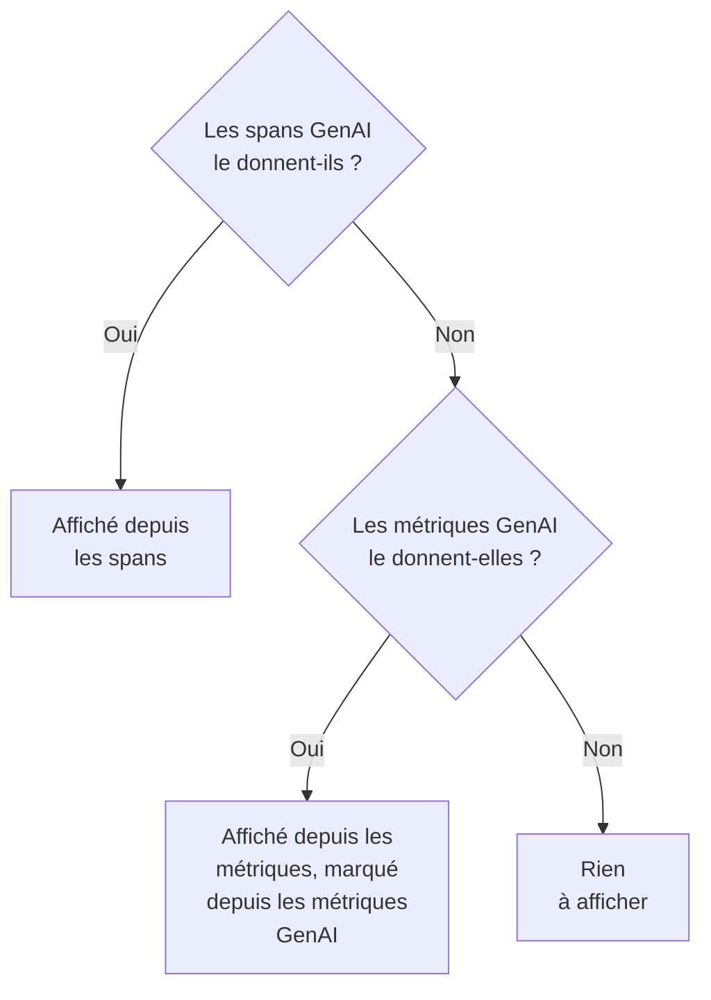

# Observabilité IA / LLM

Lisez chaque conversation de votre IA, rejouez-la telle qu'elle s'est déroulée et soyez prévenu quand elle répond mal. OneUptime construit tout cela à partir d'OpenTelemetry standard : si votre application envoie des spans avec les **conventions sémantiques GenAI** (`gen_ai.*`), vous obtenez conversations, alertes, utilisation et coûts, sans SDK propriétaire.

:::cards
- [La mettre en place](#la-mettre-en-place-en-cinq-étapes): Cinq étapes, du premier span aux réponses signalées.
- [Rejouer une conversation](#lire-et-rejouer-une-conversation): Lire un échange comme la personne l'a vu, au rythme où il s'est déroulé.
- [Être alerté](#être-prévenu-quand-lia-répond-mal): Des alertes prêtes à l'emploi pour les réponses en échec, refusées, tronquées, signalées ou lentes.
- [Suivre les dépenses](#voir-qui-dépense-quoi): Le coût par personne, équipe, modèle et application, avec des budgets quotidiens.
:::

## Fonctionnement

L'instrumentation GenAI de votre application exporte chaque appel au modèle sous forme de span OpenTelemetry. À l'arrivée du span, OneUptime lit ses attributs `gen_ai.*`, vérifie la réponse, calcule le prix de l'appel et le range dans sa conversation.



Ouvrez **Produits → IA / LLM**, sous **Observabilité**. Le produit compte sept onglets :

| Onglet | Ce qu'il montre |
| --- | --- |
| **Conversations** | Chaque conversation de votre IA, celles qui demandent de l'attention en premier. Au-dessus de la liste : conversations, réponses de l'IA, combien demandent de l'attention, coût et temps de réponse habituel. |
| **Appels** | Chaque appel de modèle, d'embedding, d'agent et d'outil. Filtrez par service, fournisseur, modèle, opération, personne, équipe ou conversation ; un clic ouvre l'appel dans la visionneuse de traces. |
| **Utilisation** | Les appels, jetons et coûts d'une période, classés par employé, équipe, modèle, fournisseur ou application. |
| **Alertes** | Des alertes prêtes à l'emploi pour quand l'IA répond mal, et vos moniteurs IA / LLM. |
| **Budgets** | Des plafonds de coût quotidiens, publiés sous forme de métriques sur lesquelles alerter. |
| **Tarifs** | Vos propres prix pour les modèles que la liste de prix intégrée ne connaît pas. |
| **Configuration** | Les cinq étapes ci-dessous, avec le point de terminaison de votre projet. |

Dans la visionneuse de traces, le span de chaque appel d'IA a aussi un onglet **LLM** : fournisseur, modèle, jetons, coût, paramètres de la requête, ainsi que le prompt et la réponse.

## Avant de commencer

- Un projet OneUptime dans lequel vous pouvez créer une clé d'ingestion de télémétrie.
- Une application qui appelle un modèle, et une instrumentation GenAI pour son langage : **OpenLLMetry** (Traceloop), **OpenInference** (Arize), le **Vercel AI SDK**, ou les instrumentations OpenTelemetry pour OpenAI, Anthropic et Gemini.

> [!TIP]
> Le trafic vers les modèles qui passe par une passerelle comme LiteLLM ou Portkey peut être exporté depuis la passerelle plutôt que depuis chaque application : voir [Passerelles IA](/docs/telemetry/ai-gateways). Pour les assistants de code de vos ingénieurs, voir [Assistants de code IA](/docs/telemetry/ai-coding-assistants).

## La mettre en place en cinq étapes

La première étape suffit pour voir les appels. Chaque étape suivante en montre davantage.

:::steps
### Envoyer vos appels d'IA

Créez une clé d'ingestion sous **Paramètres du projet → Télémétrie & APM → Clés d'ingestion** (le [démarrage rapide OpenTelemetry](/docs/telemetry/open-telemetry#créer-une-clé-dingestion) montre comment). Pointez ensuite votre instrumentation vers OneUptime :

:::tabs
@tab Python
```bash
pip install traceloop-sdk opentelemetry-exporter-otlp
```

```python
from traceloop.sdk import Traceloop

Traceloop.init(
    app_name="my-ai-agent",
    api_endpoint="https://oneuptime.com/otlp",
    headers={"x-oneuptime-token": "YOUR_INGESTION_TOKEN"},
)
# Your OpenAI, Anthropic and LangChain calls are now traced.
```
@tab Node.js
```bash
npm install @traceloop/node-server-sdk
```

```typescript
import * as traceloop from "@traceloop/node-server-sdk";

traceloop.initialize({
  appName: "my-ai-agent",
  baseUrl: "https://oneuptime.com/otlp",
  headers: { "x-oneuptime-token": "YOUR_INGESTION_TOKEN" },
});
```
@tab OpenTelemetry SDK
```bash
export OTEL_EXPORTER_OTLP_ENDPOINT="https://oneuptime.com/otlp"
export OTEL_EXPORTER_OTLP_HEADERS="x-oneuptime-token=YOUR_INGESTION_TOKEN"
export OTEL_EXPORTER_OTLP_PROTOCOL="http/protobuf"
export OTEL_SERVICE_NAME="my-ai-agent"
```
:::

Vous hébergez OneUptime vous-même ? Utilisez `https://YOUR-ONEUPTIME-HOST/otlp` au lieu de `https://oneuptime.com/otlp`. Appelez votre modèle une fois, et l'appel apparaît sous **Appels**.

### Enregistrer ce qui a été dit

Une conversation montre ce que les gens ont demandé et ce que l'IA a répondu seulement si votre instrumentation l'enregistre. OpenLLMetry enregistre les prompts et les réponses sauf si vous définissez `TRACELOOP_TRACE_CONTENT=false`. Les instrumentations OpenTelemetry ne les enregistrent que si vous le demandez :

```bash
export OTEL_INSTRUMENTATION_GENAI_CAPTURE_MESSAGE_CONTENT=true
```

Les instrumentations OpenTelemetry plus récentes attendent `span_only`, `event_only` ou `span_and_event` au lieu de `true`. Sans contenu enregistré, une conversation montre quand même ses durées, son coût et ses problèmes. Les prompts peuvent contenir des données sensibles : [Confidentialité et masquage](#confidentialité-et-masquage) montre comment les masquer avant leur stockage.

### Regrouper les appels en conversations

Une application de chat appelle le modèle une fois par tour. Définissez `gen_ai.conversation.id` (ou `session.id`) sur l'identifiant de votre chat à chaque appel d'IA, et chaque chat apparaît comme une seule conversation, quel que soit le nombre d'appels et de traces. Avec OpenLLMetry, définissez-le une fois par requête :

```python
from traceloop.sdk import Traceloop

Traceloop.set_association_properties({
    "session_id": chat.id,
    "user_email": user.email,
})
```

Avec le Vercel AI SDK, passez l'identifiant du chat dans `experimental_telemetry: { metadata: { sessionId } }`. Les appels sans identifiant de conversation apparaissent quand même, une requête (une trace) à la fois.

### Dire qui a demandé

Définissez `user.id` ou `user.email` à chaque appel d'IA (la propriété d'association ci-dessus définit l'e-mail). Chaque conversation montre alors avec qui elle a eu lieu, vous pouvez chercher dans la liste par personne, et l'onglet **Utilisation** classe les dépenses par employé. [Attribution aux employés et aux équipes](/docs/telemetry/ai-coding-assistants#attribution-aux-employés-et-aux-équipes) liste chaque clé d'identité que lit OneUptime.

### Signaler les mauvaises réponses

OneUptime vérifie chaque réponse à son arrivée et marque ce qui s'est mal passé :

| Problème | Ce que cela signifie | Détecté par |
| --- | --- | --- |
| En échec | L'appel s'est terminé par une erreur, aucune réponse n'est arrivée | Le statut de span Error, `error.type`, ou un motif de fin `error` |
| Refusée | L'IA a refusé, ou un filtre de sécurité a bloqué la réponse | Un motif de fin de refus ou de sécurité (`content_filter`, `refusal`, `SAFETY` et autres), un refus dans la réponse, ou une réponse qui commence par une formule de refus anglaise toute faite |
| Tronquée | La réponse s'est arrêtée à la limite de jetons | Un motif de fin `length`, `max_tokens` ou `MAX_TOKENS` |
| Vide | Aucun texte et aucun appel d'outil | Un contenu enregistré qui ne contient rien, ou 0 jeton en sortie |
| Signalée | Une évaluation envoyée par votre application juge la réponse mauvaise | Un événement `gen_ai.evaluation.result` |

Les quatre premiers ne vous demandent rien. Pour signaler une réponse que votre garde-fou, votre évaluation ou un bouton « pouce baissé » rejette, ajoutez au span de la réponse, tant qu'il est ouvert, un événement `gen_ai.evaluation.result` avec `gen_ai.evaluation.score.label` à `fail` :

```python
from opentelemetry import trace

trace.get_current_span().add_event(
    "gen_ai.evaluation.result",
    {
        "gen_ai.evaluation.name": "relevance",
        "gen_ai.evaluation.score.label": "fail",
        "gen_ai.evaluation.explanation": "The answer is about another product.",
    },
)
```

Des libellés comme `incorrect`, `wrong`, `unhelpful`, `toxic`, `unsafe` et `hallucination` comptent aussi comme un échec. OneUptime n'envoie jamais vos conversations à une autre IA pour les juger : chaque vérification lit seulement ce que l'appel transporte lui-même.
:::

## Lire et rejouer une conversation

Une conversation s'ouvre en entier, comme une application de chat montre son historique : ce que la personne a dit à droite, les réponses de l'IA à gauche avec leur modèle, leur heure, leurs jetons et leur coût, les appels d'outils entre les deux, et ce qui a mal tourné marqué là où c'est arrivé. **Détails** sous une réponse montre pourquoi elle s'est arrêtée, ses évaluations et un lien vers l'appel dans Traces.

La barre du bas rejoue la conversation telle que la personne l'a vécue :

| Commande | Ce qu'elle fait |
| --- | --- |
| **Rejouer** | Joue la conversation depuis le premier message, au rythme où elle s'est déroulée. « L'IA répond… » compte le temps pendant qu'une réponse arrive. Cliquez sur l'heure d'un message pour rejouer à partir de là. |
| **Passer les attentes** | Activé par défaut : raccourcit tout silence de plus de 3 secondes. |
| `1x` | Change la vitesse : 1x, 2x, 4x ou 8x. |
| **K**, **J** ou **←**, **L** ou **→** | Lire ou mettre en pause, revenir d'un message, avancer d'un message. |

L'adresse de la page garde le message où un rejeu s'est arrêté (`?step=`), si bien qu'un lien partagé s'ouvre sur ce moment.

## Être prévenu quand l'IA répond mal

L'onglet **Alertes** liste les alertes que veulent la plupart des applications d'IA. En choisir une ouvre **Créer un moniteur** déjà rempli, et vous pouvez tout modifier avant d'enregistrer :

| Alerte | Quand elle vous prévient | Gravité |
| --- | --- | --- |
| Les réponses tournent mal | Plus de 5 % des réponses en 15 minutes sont en échec, refusées, tronquées, vides ou signalées | Warning |
| Les appels d'IA échouent | Plus de 10 % des appels au modèle en 5 minutes se terminent par une erreur | Critical |
| L'IA refuse de répondre | Plus de 5 % des réponses en 30 minutes sont des refus | Warning |
| Les réponses sont tronquées | 3 réponses ou plus en 30 minutes s'arrêtent à la limite de jetons | Warning |
| Les réponses sont signalées | Une évaluation juge une réponse mauvaise | Warning |
| Les réponses sont lentes | Plus de 10 % des réponses en 15 minutes prennent plus de 30 secondes | Warning |
| L'IA cesse de répondre | L'IA ne donne aucune réponse pendant 30 minutes | Critical |

Les alertes sur une part des réponses attendent aussi au moins 3 mauvaises réponses, si bien qu'une mauvaise réponse sur deux n'alerte personne. Une alerte Critical prend la gravité d'alerte la plus élevée de votre projet et une alerte Warning la suivante : High et Low dans un nouveau projet.

Chaque alerte est un moniteur **IA / LLM**. Ses paramètres disent ce qui compte comme une mauvaise réponse (**Compter une réponse comme mauvaise lorsqu'elle**, **Ou prend plus de (secondes)**), jusqu'où chaque vérification remonte (**Fenêtre de temps**, 15 minutes par défaut), quelles **Applications** il surveille et, sous **Plus de champs**, quel **Modèle**. Un **Aperçu** montre ce que le moniteur compterait maintenant. Ses critères comparent trois nombres : **Mauvaises réponses de l'IA (en %)**, **Mauvaises réponses de l'IA** et **Réponses de l'IA**.

Une alerte prête à l'emploi déclenche une alerte qui se résout d'elle-même, et affiche le moniteur comme **Degraded** tant que les réponses sont mauvaises. Son incident est rempli mais désactivé : activez-le pour alerter quelqu'un à la place.

## Voir qui dépense quoi

L'onglet **Utilisation** montre les appels, jetons et coûts d'une période (les 7 derniers jours si vous n'en choisissez pas une autre), et un tableau des 25 premiers selon l'une de cinq ventilations : **Employé**, **Équipe**, **Modèle**, **Fournisseur** et **Application / Service**. Les appels qui ne nomment personne sont comptés sous **Non attribué**, jamais écartés.

Les personnes et les équipes viennent des attributs d'identité de l'appel : voir [Attribution aux employés et aux équipes](/docs/telemetry/ai-coding-assistants#attribution-aux-employés-et-aux-équipes).

### Les spans d'abord, les métriques en relais

Les spans GenAI portent le modèle, les jetons et le coût d'un appel : là où ils existent, ils répondent à tout. Certains outils publient des métriques de jetons et de coût sans spans GenAI, comme la plupart des assistants de code. OneUptime lit ces métriques seulement pour un chiffre que les spans n'ont pas fourni, et n'additionne jamais les deux : beaucoup d'instrumentations envoient les deux pour le même appel, et les additionner compterait chaque dollar deux fois.



| Où | Ce qui passe aux métriques | Quand |
| --- | --- | --- |
| Jetons en entrée et en sortie | Les deux totaux | Les totaux de jetons des spans valent tous deux 0 |
| Coût (USD) | Le coût, avec le coût en micro-USD de Codex converti en USD | Le total des coûts des spans vaut 0 |
| Appels LLM | Rien : spans uniquement | — |
| Tableaux **Employé**, **Équipe**, **Modèle** | Le coût seulement ; les cellules des appels et des jetons affichent `—` | Ce tableau n'a trouvé aucune ligne de span |
| Tableaux **Fournisseur**, **Application / Service** | Rien : spans uniquement | — |
| Conversations | Rien : les conversations sont construites à partir des spans | — |

Un chiffre tiré des métriques est marqué **depuis les métriques GenAI**, car il n'a pas de lignes correspondantes dans **Appels**. Ainsi, dès que vos spans GenAI fournissent un chiffre, la part d'un outil qui n'envoie que des métriques n'apparaît pas. Pour voir les dépenses d'un tel outil à part, envoyez-le dans un projet à lui, où n'arrive aucun span GenAI.

## Ce que coûte un appel

Un coût que votre instrumentation fournit (`gen_ai.usage.cost`) est utilisé tel quel, même s'il vaut 0. Sinon, OneUptime en estime un à l'arrivée du span, à partir de ses nombres de jetons et d'une liste de prix intégrée pour les modèles courants d'OpenAI, Anthropic, Google Gemini, Mistral, DeepSeek, xAI, Cohere, Amazon Nova et Meta Llama. Le modèle servi est tarifé en premier, puis le modèle demandé.

Les modèles sont associés par le plus long préfixe de nom, si bien que des identifiants datés ou décorés par un fournisseur comme `gpt-4o-2024-08-06` et `us.anthropic.claude-sonnet-4-5-20250929-v1:0` trouvent le prix de leur famille. Un modèle que la liste ne connaît pas, nouvelle version comprise, n'est jamais deviné : son coût reste à 0 jusqu'à ce que vous lui donniez un prix. Les estimations utilisent les prix catalogue, sans remise de cache ni de lot.

Pour tarifer un modèle vous-même (un tarif négocié, un modèle affiné ou un modèle que vous hébergez), ajoutez-le dans l'onglet **Tarifs**, sous **Tarification LLM personnalisée** : un **Préfixe de modèle**, un **Prix en entrée (USD par 1M jetons)** et un **Prix en sortie (USD par 1M jetons)**. Le plus long préfixe correspondant l'emporte entre vos prix et la liste intégrée ; à égalité, votre prix l'emporte. Un prix s'applique aux appels qui arrivent environ une minute après son enregistrement ; les appels déjà stockés gardent leur coût.

## Budgets de coût quotidiens

Un budget suit les dépenses d'une journée, en USD, sur la journée UTC. Toutes les 15 minutes, OneUptime additionne les dépenses d'IA du jour (depuis les spans, ou depuis les métriques de coût GenAI quand aucun span n'en a fourni), les affiche sur le budget et publie deux métriques :

| Métrique | Ce qu'elle est |
| --- | --- |
| `oneuptime.llm.budget.spend.usd` | Les dépenses du jour jusqu'ici, en USD |
| `oneuptime.llm.budget.percent.used` | Les dépenses en pourcentage de la limite quotidienne |

Les deux portent `oneuptime.llm.budget.id` et `oneuptime.llm.budget.name`, ainsi que la portée du budget s'il en a une.

:::steps
### Créer le budget

Dans l'onglet **Budgets**, cliquez sur **Créer : Budget de coûts LLM**. Donnez-lui un nom et un **Budget quotidien (USD)**, et laissez la portée vide pour tout le projet, ou choisissez un **Service (facultatif)**, un **Fournisseur LLM (facultatif)** ou un **Modèle LLM (facultatif)**. Plusieurs budgets peuvent surveiller des portées différentes.

### Alerter dessus

Créez une [surveillance des métriques](/docs/monitor/metrics-monitor) sur `oneuptime.llm.budget.percent.used`, filtrée par `oneuptime.llm.budget.id` (le nom change si vous renommez le budget). Ajoutez un critère `>= 80` qui déclenche un avertissement et un critère `>= 100` qui déclenche une alerte critique.

### Élargir la fenêtre

Réglez la fenêtre glissante du moniteur sur 30 minutes. Un budget publie un point toutes les 15 minutes, si bien que la fenêtre par défaut de 1 minute ne trouverait rien entre deux points.
:::

Une alerte de budget peut aussi lancer un workflow qui arrête un agent incontrôlé : voir [Disjoncteurs pour agents IA](/docs/telemetry/ai-agent-circuit-breaker).

## Tableaux de bord et alertes sur métriques

Les métriques GenAI comme `gen_ai.client.token.usage` et `gen_ai.client.operation.duration` arrivent comme des métriques OpenTelemetry ordinaires. Représentez-les sur un [tableau de bord](/docs/dashboards/index), ou alertez dessus avec une [surveillance des métriques](/docs/monitor/metrics-monitor), par exemple quand le p95 de `gen_ai.client.operation.duration` dépasse un seuil, regroupé par modèle.

## Confidentialité et masquage

Les appels d'IA sont stockés comme spans de trace, donc les **Règles de masquage** et les **Filtres de suppression** des traces s'appliquent à eux : masquez un attribut, ou écartez un span, avant son stockage. Vous les trouvez tous deux sous **Traces → Paramètres**. La colonne de l'e-mail de l'employé est nettoyée avec l'attribut d'où elle a été lue, si bien qu'une règle qui masque les e-mails la couvre aussi.

Les conversations sont lues avec la même permission que les traces : quiconque peut lire les traces du projet peut lire ses conversations, et personne d'autre.

## Attributs lus par OneUptime

OneUptime lit les conventions GenAI d'OpenTelemetry, ainsi que les variantes qu'utilisent OpenLLMetry, OpenInference, le Vercel AI SDK et LiteLLM, si bien que les bibliothèques courantes fonctionnent telles quelles. Pour chaque valeur, la première clé que porte un span l'emporte :

| Valeur | Clés, dans l'ordre où elles sont essayées |
| --- | --- |
| Fournisseur | `gen_ai.system`, `gen_ai.provider.name`, `llm.system`, `llm.provider` |
| Opération | `gen_ai.operation.name`, `llm.request.type`, `openinference.span.kind` |
| Modèle demandé | `gen_ai.request.model`, `llm.model_name`, `llm.request.model` |
| Modèle servi | `gen_ai.response.model`, `llm.response.model` |
| Jetons en entrée | `gen_ai.usage.input_tokens`, `gen_ai.usage.prompt_tokens`, `llm.token_count.prompt`, `llm.usage.prompt_tokens` |
| Jetons en sortie | `gen_ai.usage.output_tokens`, `gen_ai.usage.completion_tokens`, `llm.token_count.completion`, `llm.usage.completion_tokens` |
| Jetons au total | `gen_ai.usage.total_tokens`, `llm.token_count.total`, `llm.usage.total_tokens` |
| Coût (USD) | `gen_ai.usage.cost`, `gen_ai.usage.cost_usd`, `gen_ai.usage.total_cost`, `llm.usage.total_cost`, `gen_ai.cost.total_cost`, `litellm.cost.total` |
| Conversation | `gen_ai.conversation.id`, `session.id`, `langfuse.session.id`, `traceloop.association.properties.session_id`, `ai.telemetry.metadata.sessionId` |
| Agent | `gen_ai.agent.name`, `agent.name` |
| Outil | `gen_ai.tool.name`, `tool.name`, `ai.toolCall.name` |
| Motif de fin | `gen_ai.response.finish_reasons`, `gen_ai.response.finish_reason`, `llm.response.finish_reason`, `ai.response.finishReason` |
| Erreur | `error.type` |

Un span compte comme un appel d'IA s'il porte l'une de ces valeurs, ou n'importe quel attribut qui commence par `gen_ai.`, `llm.` ou `traceloop.`. Le total de jetons vaut entrée plus sortie quand aucun total n'est fourni. Les clés `gen_ai.usage.total_tokens` et `gen_ai.usage.cost` ne font pas partie des conventions, qui ne définissent ni l'une ni l'autre ; OneUptime les lit parce que les instrumentations courantes les envoient.

Les clés d'identité (qui a fait l'appel, et son équipe) sont listées sous [Attribution aux employés et aux équipes](/docs/telemetry/ai-coding-assistants#attribution-aux-employés-et-aux-équipes).

### D'où sont lus les prompts et les réponses

La vue de conversation lit les messages d'un appel, dans cet ordre, depuis :

- l'événement `gen_ai.client.inference.operation.details` ;
- les attributs `gen_ai.input.messages`, `gen_ai.output.messages` et `gen_ai.system_instructions` ;
- les anciens événements par rôle : `gen_ai.system.message`, `gen_ai.user.message`, `gen_ai.assistant.message`, `gen_ai.tool.message` et `gen_ai.choice` ;
- les attributs indexés : `gen_ai.prompt.N.content` et `gen_ai.completion.N.content` d'OpenLLMetry, `llm.input_messages.N.message.content` et `llm.output_messages.N.message.content` d'OpenInference ;
- les tableaux de messages dans `gen_ai.prompt`, `gen_ai.completion`, `ai.prompt.messages`, `ai.response.text`, `input.value` et `output.value`.

## Dépannage

:::details Des appels arrivent, mais aucune conversation n'affiche de texte
Votre instrumentation n'enregistre pas le contenu. Activez-le comme le montre [Enregistrer ce qui a été dit](#enregistrer-ce-qui-a-été-dit) ; les appels antérieurs restent sans texte.
:::

:::details Chaque appel d'un chat apparaît comme sa propre conversation
Les appels ne portent aucun identifiant de conversation. Définissez `gen_ai.conversation.id` ou `session.id` sur chaque appel du chat, comme le montre [Regrouper les appels en conversations](#regrouper-les-appels-en-conversations).
:::

:::details Les appels affichent des jetons mais coûtent 0 $
Le modèle ne figure pas dans la liste de prix intégrée, ou le span ne nomme aucun modèle. Ajoutez les prix du modèle dans l'onglet **Tarifs** ; les appels qui arrivent ensuite sont tarifés.
:::

:::details L'onglet Utilisation indique depuis les métriques GenAI et affiche `—` pour les appels et les jetons
Les chiffres viennent d'un outil qui envoie des métriques sans spans GenAI, comme un assistant de code. Une métrique porte le coût mais aucun détail par appel, donc ces cellules restent vides. Voir [Les spans d'abord, les métriques en relais](#les-spans-dabord-les-métriques-en-relais).
:::

:::details Un moniteur de budget oscille entre deux états
La fenêtre glissante du moniteur fait moins de 15 minutes, si bien qu'il ne trouve parfois aucun point. Réglez-la sur 30 minutes.
:::

## Étapes suivantes

:::cards
- [Assistants de code IA](/docs/telemetry/ai-coding-assistants): Les dépenses par ingénieur pour Claude Code, Cursor, Codex, Gemini CLI et Copilot.
- [Passerelles IA](/docs/telemetry/ai-gateways): Tracer les appels de modèle de chaque application depuis une passerelle LiteLLM ou Portkey.
- [Disjoncteurs pour agents IA](/docs/telemetry/ai-agent-circuit-breaker): Arrêter un agent incontrôlé quand une alerte de budget se déclenche.
- [OpenTelemetry](/docs/telemetry/open-telemetry): Points de terminaison, clés d'ingestion et limites pour chaque signal.
:::
