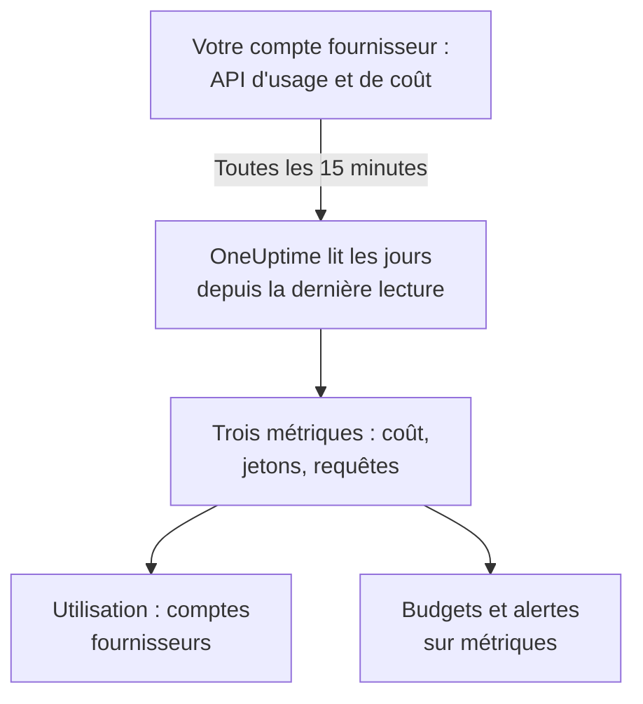

# Comptes de fournisseurs d'IA

Voyez ce que vos comptes de fournisseurs d'IA ont consommé et ce qu'ils ont coûté, sans rien changer à vos applications. Connectez un compte OpenAI, Anthropic, Azure OpenAI et Microsoft Foundry, Amazon Bedrock ou Google Vertex AI avec un identifiant qui ne peut que lire, et OneUptime lit son utilisation toutes les 15 minutes dans **Utilisation**, **Budgets** et des métriques sur lesquelles vous pouvez alerter.

:::cards
- [Connecter un compte](#connecter-un-compte): Choisissez le fournisseur, collez l'identifiant, testez-le et connectez.
- [Ce que donne chaque fournisseur](#ce-que-donne-chaque-fournisseur): Coût, jetons et requêtes, et comment chaque fournisseur les regroupe.
- [Voir l'utilisation](#voir-lutilisation): Par modèle, personne, projet ou ressource, clé d'API et connexion.
- [Budgets et alertes](#budgets-et-alertes): Un budget quotidien sur la facture, et des alertes sur les métriques.
:::

## Comment ça marche

Toutes les 15 minutes, OneUptime demande à chaque compte connecté son utilisation par jour UTC et la conserve sous forme de trois métriques du service propre à la connexion. Chaque lecture prend les jours depuis la dernière lecture, et de nouveau les 3 derniers jours, aujourd'hui compris, car les fournisseurs complètent sans cesse la journée en cours et corrigent les jours tout juste passés.

L'utilisation d'un compte est ce qui lui a été facturé, jour après jour. Elle ne contient ni conversations, ni prompts, ni réponses : pour cela, envoyez les appels d'IA de vos applications comme le montre [Observabilité IA / LLM](/docs/telemetry/ai-llm-observability). Les deux restent séparés, donc rien n'est compté deux fois.

## Avant de commencer

- Le rôle Project Owner ou Project Admin. Eux seuls peuvent connecter, modifier ou retirer un compte ; tous ceux qui lisent la télémétrie du projet voient les connexions et l'utilisation.
- Un identifiant pour le compte, fourni par quelqu'un qui l'administre. La section de chaque fournisseur, plus bas, indique lequel et où il se crée.
- Rien à installer : OneUptime appelle l'API du fournisseur depuis ses propres serveurs.

## Connecter un compte

:::steps
### Ouvrir Connecter

Ouvrez **Produits → IA / LLM → Connecter**. Sous **Vos comptes de fournisseurs d'IA**, cliquez sur la tuile du fournisseur.

### Coller l'identifiant

Dans **Identifiants**, remplissez ce que demande le fournisseur. Les secrets sont stockés chiffrés et ne sont plus jamais affichés, ni dans le Dashboard ni par l'API. **Nom** et les réglages que la plupart des gens laissent tels quels se trouvent sous **Plus de champs**.

### Le tester

Dans **Tester**, cliquez sur **Tester la connexion**. OneUptime lit l'utilisation des 7 derniers jours et montre ce qu'il a trouvé : coût, jetons, requêtes, modèles, personnes, clés et projets. Rien n'est conservé tant que vous ne connectez pas.

### Connecter

Cliquez sur **Connecter**. La première lecture commence en moins d'une minute et ramène les 30 derniers jours.
:::

Les comptes connectés sont listés sous les tuiles, avec leur **Statut** et leur **Dernière lecture**. **Lire maintenant** lit tout de suite, **Tester** revérifie les réglages enregistrés, **Désactiver** arrête la lecture et garde ce qui a été lu, et **Modifier** modifie les réglages : un secret laissé vide garde celui qui est enregistré. **Voir l'erreur** montre pourquoi une lecture a échoué, sans aucun secret.

## Ce que donne chaque fournisseur

| Fournisseur | Coût | Regroupé par | Identifiant |
| --- | --- | --- | --- |
| OpenAI | Ce que déclare OpenAI | Projet, clé d'API, personne et modèle | Une clé d'administration |
| Anthropic | Ce que déclare Anthropic | Workspace, clé d'API, personne et modèle | Une clé d'administration |
| Azure OpenAI et Microsoft Foundry | Estimé à partir des jetons | Ressource et modèle | Une application avec Monitoring Reader |
| Amazon Bedrock | Estimé à partir des jetons | Région et modèle | Une clé d'accès qui lit CloudWatch |
| Google Vertex AI | Estimé à partir des jetons | Région et modèle | Un compte de service avec Monitoring Viewer |

Tous les fournisseurs sauf Anthropic comptent aussi les requêtes : le rapport d'utilisation d'Anthropic n'en a pas. Un coût estimé utilise la liste de prix de [Ce que coûte un appel](/docs/telemetry/ai-llm-observability#ce-que-coûte-un-appel) et vos propres prix de **Tarifs**, et il est marqué comme estimation. Un modèle que la liste de prix ne connaît pas n'a aucun coût tant que vous ne lui donnez pas de prix là-bas.

Aucun de ces identifiants ne peut appeler un modèle : chacun lit l'utilisation, les coûts ou des métriques, et rien d'autre.

## OpenAI

OneUptime lit votre organisation OpenAI avec une clé d'administration : l'utilisation des completions et des embeddings par jour, modèle, projet, clé d'API et personne, et les coûts de chaque jour par projet et par poste. Un poste de coût est réparti entre les clés et les personnes qui ont utilisé son modèle, si bien que la ligne d'une personne a aussi un coût. Les noms des projets et des clés et les e-mails des personnes remplacent les identifiants d'OpenAI.

:::steps
### Créer une clé d'administration OpenAI

Dans le tableau de bord d'OpenAI, ouvrez Settings, Organization, Admin keys et créez une clé. Seuls les propriétaires de l'organisation le peuvent. Elle commence par `sk-admin-`.

### Connecter OpenAI

Collez la clé comme **Clé d'administration**.
:::

## Anthropic

OneUptime lit votre organisation de l'API Claude avec une clé d'administration : le rapport d'utilisation des messages par jour, modèle, workspace, clé d'API et personne, et le rapport de coûts par workspace et par poste, réparti de la même façon. Claude Code utilisé avec les clés ou les connexions Console de l'organisation figure aussi dans ces rapports, sous la personne ou la clé qui l'a utilisé.

:::steps
### Créer une clé d'administration Anthropic

Dans la Claude Console, ouvrez Settings, Admin keys et créez une clé. Seuls les administrateurs de l'organisation le peuvent. Elle commence par `sk-ant-admin01-`.

### Connecter Anthropic

Collez la clé comme **Clé d'administration**.
:::

## Azure OpenAI et Microsoft Foundry

OneUptime lit chaque ressource Azure OpenAI et Foundry d'un abonnement depuis Azure Monitor : jetons et requêtes par jour, ressource et modèle. Azure Monitor compte des jetons, pas de l'argent, et ne nomme ni personne ni clé, donc le coût est l'estimation de OneUptime et la personne et la clé restent vides.

:::steps
### Inscrire une application

Dans Microsoft Entra ID, inscrivez une application et créez-lui un secret client.

### Lui permettre de lire les métriques

Sur l'abonnement, donnez à l'application le rôle Monitoring Reader.

### Connecter Azure

Remplissez **ID de l'annuaire (tenant)**, **ID d'application (client)**, **ID d'abonnement** et **Secret client**. Pour Azure Government, changez **Cloud** sous **Plus de champs**.
:::

## Amazon Bedrock

OneUptime lit les métriques CloudWatch `AWS/Bedrock` de chaque région que vous indiquez : jetons d'entrée, de sortie et de cache, et invocations, par jour et par modèle. CloudWatch compte des jetons, pas de l'argent, et ne nomme ni personne ni clé : le coût est l'estimation de OneUptime, et chaque région est listée comme un projet.

:::steps
### Créer une clé d'accès

Créez un utilisateur ou un rôle IAM dont la stratégie autorise `cloudwatch:GetMetricData` et `cloudwatch:ListMetrics`, et une clé d'accès pour lui.

### Connecter Bedrock

Remplissez **ID de clé d'accès**, **Clé d'accès secrète** et **Régions**, séparées par des virgules : `us-east-1` si vous ne le changez pas.
:::

## Google Vertex AI

OneUptime lit les métriques Cloud Monitoring que Vertex AI publie pour ses modèles, Gemini et des modèles partenaires comme Claude : jetons d'entrée et de sortie, et invocations, par jour, région et modèle. Cloud Monitoring compte des jetons, pas de l'argent, et ne nomme ni personne ni clé : le coût est l'estimation de OneUptime.

:::steps
### Créer un compte de service

Dans le projet, créez un compte de service avec le rôle Monitoring Viewer, et une clé JSON pour lui.

### Connecter Vertex AI

Remplissez **ID du projet** et collez le fichier de clé entier comme **Clé du compte de service (JSON)**.
:::

## Voir l'utilisation

Ouvrez **Utilisation** et choisissez **Comptes fournisseurs**. Vous y voyez le coût, les jetons et les requêtes que vos comptes ont déclarés pour la période, classés par **Modèle**, **Personne**, **Fournisseur**, **Projet ou ressource**, **Clé API** ou **Connexion**. La période commence à minuit UTC de son premier jour, car les fournisseurs déclarent des jours entiers.

**Comptes fournisseurs** et **Vos appels d'IA** ne sont jamais additionnés. Un appel que votre application fait avec une clé d'un compte connecté figure dans les deux, donc les additionner le compterait deux fois.

## Budgets et alertes

Un budget compte l'un ou l'autre. Dans **Budgets**, créez un budget et réglez **Compter les dépenses à partir de** sur **Comptes fournisseurs** : il compte ce qui a été facturé aux comptes connectés pour la journée UTC, restreint par **Fournisseur LLM (facultatif)** et **Modèle LLM (facultatif)** quand vous les renseignez. Les fournisseurs déclarent l'utilisation d'une journée avec des minutes ou des heures de retard, donc pour des alertes en quelques minutes, budgétez plutôt **Vos appels d'IA**.

L'utilisation de chaque compte est conservée sous forme de trois métriques, que vous pouvez tracer sur un [tableau de bord](/docs/dashboards/index) ou surveiller avec une [Surveillance des métriques](/docs/monitor/metrics-monitor) :

| Métrique | Ce que c'est |
| --- | --- |
| `oneuptime.llm.provider.cost` | Le coût d'une journée, en USD |
| `oneuptime.llm.provider.tokens` | Les jetons d'une journée, par `gen_ai.token.type` : `input` (jetons en cache compris), `output`, `cache_read` et `cache_write` |
| `oneuptime.llm.provider.requests` | Les requêtes d'une journée |

Chaque point est horodaté au début de sa journée UTC. Il porte `oneuptime.llm.connection.id` et `oneuptime.llm.connection.name`, et ce que nomme le fournisseur : `gen_ai.provider.name`, `gen_ai.request.model`, `user.email`, `oneuptime.llm.provider.project` et `oneuptime.llm.provider.api_key`. Un coût estimé porte `oneuptime.llm.cost.estimated`.

## Quand les lectures ont lieu

| Lecture | Quand |
| --- | --- |
| La première | Moins d'une minute après la connexion, 30 jours en arrière |
| Les suivantes | Toutes les 15 minutes |
| Après le refus d'une clé ou d'une permission | 60 minutes plus tard |
| Après tout autre échec | 15 minutes plus tard |
| Désactivée | Aucune tant qu'elle n'est pas réactivée |

Une offre sans fonctions de télémétrie ne lit rien. Retirer une connexion arrête ses lectures et garde ce qu'elle a lu jusqu'à ce que la rétention du service le supprime.

## Pourquoi OneUptime n'a pas de passerelle à lui

OneUptime lit vos comptes ; il ne se place jamais entre vos applications et les fournisseurs. Un proxy détiendrait vos clés de fournisseur et ajouterait un saut à chaque appel de modèle que font vos applications. Si votre trafic de modèles passe déjà par LiteLLM, Portkey ou OpenRouter, envoyez les traces de la passerelle à OneUptime comme le montre [Passerelles IA](/docs/telemetry/ai-gateways), et connectez le compte pour sa facture.

## Dépannage

:::details Le test indique que la clé ou le secret n'a pas été accepté
Vérifiez que vous l'avez copiée en entier, qu'elle n'a pas été révoquée et que c'est le type que demande ce fournisseur : une clé d'administration OpenAI ou Anthropic, pas une clé de projet ou d'API.
:::

:::details L'identifiant fonctionne, mais ne peut pas lire ce dont la connexion a besoin
Donnez-lui le rôle que cette page nomme pour le fournisseur : Monitoring Reader sur l'abonnement Azure, les deux actions CloudWatch sur AWS, Monitoring Viewer sur le projet Google Cloud.
:::

:::details Le test réussit, mais rien n'apparaît pour aujourd'hui
Les fournisseurs déclarent l'utilisation d'une journée des minutes ou des heures après, et la corrigent pendant un jour ou deux. Les lectures suivantes la ramènent.
:::

:::details Le coût diffère de la facture
Un coût déclaré est le chiffre du fournisseur avant taxes, crédits et remises. Un coût estimé correspond aux jetons au prix catalogue, ou à vos propres prix de **Tarifs**.
:::

## Étapes suivantes

:::cards
- [Observabilité IA / LLM](/docs/telemetry/ai-llm-observability): Conversations, alertes et coût des appels d'IA de vos propres applications.
- [Outils d'IA de l'entreprise](/docs/telemetry/ai-company-tools): Ce que vos équipes demandent à Claude Enterprise et Microsoft 365 Copilot.
- [Passerelles IA](/docs/telemetry/ai-gateways): Tracez chaque appel de modèle via LiteLLM, Portkey ou OpenRouter.
- [Surveillance des métriques](/docs/monitor/metrics-monitor): Alertez sur les métriques des fournisseurs.
:::
