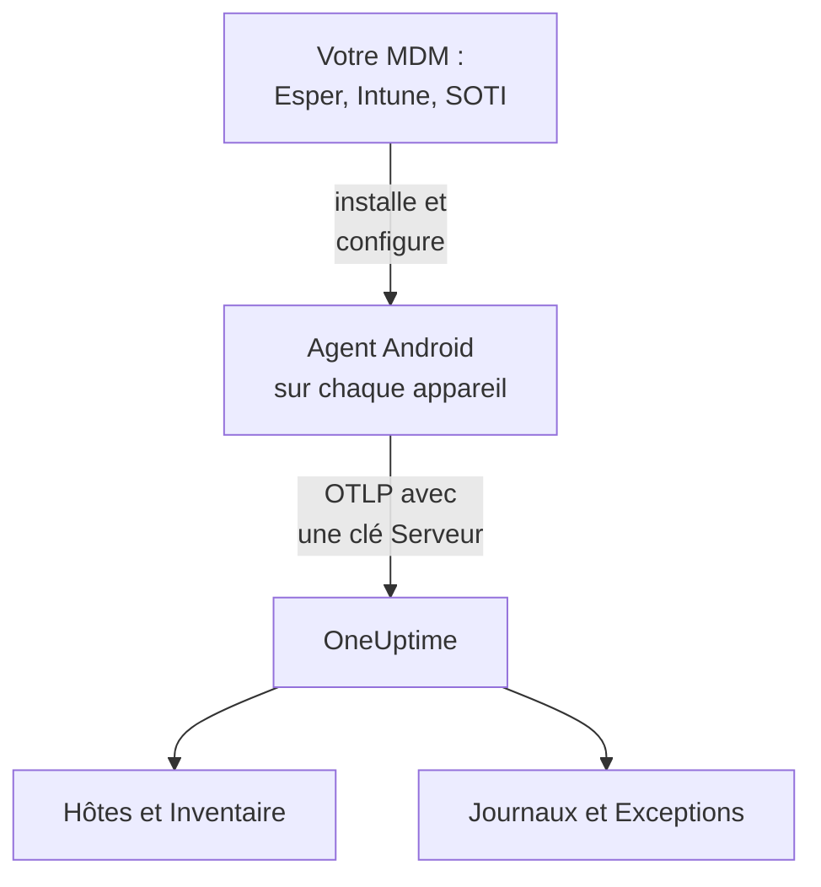

# Agent Android

L'agent Android de OneUptime signale à OneUptime un appareil Android qui appartient à votre organisation, comme une borne de commande, un terminal de point de vente, un terminal portable ou un lecteur d'affichage dynamique : sa mémoire, son stockage, son réseau, sa batterie et sa température, ses redémarrages, les applications qui y sont installées, ainsi que les plantages et les journaux de ces applications. Votre gestionnaire d'appareils l'installe et le configure sur tout le parc en une seule fois. Chaque appareil devient un hôte dans **Hôtes** et un élément dans **Inventaire**, à côté de vos serveurs et de vos machines Windows.

:::cards
- [Quand l'utiliser](#lagent-ou-linstrumentation-de-lapplication): L'agent voit l'appareil, l'instrumentation de l'application voit votre application.
- [Déployer avec Esper](#déployer-avec-esper): Téléverser l'APK, envoyer ses paramètres, le démarrer une fois.
- [Paramètres](#paramètres): Chaque clé de sa configuration gérée.
- [Lire les journaux des autres applications](#lire-les-journaux-des-autres-applications): Accorder READ_LOGS une fois, avec adb ou votre gestionnaire d'appareils.
:::

## Fonctionnement

L'agent est une petite application qui s'exécute comme service de premier plan. Chaque minute, il lit l'état de santé de l'appareil et l'envoie, avec les redémarrages, les applications installées et les journaux de l'appareil, à votre instance OneUptime via OTLP avec une clé d'ingestion **Serveur**. Il se lance de lui-même au démarrage de l'appareil, conserve sur l'appareil ce qu'il collecte tant que le réseau est coupé, et l'envoie dès que le réseau revient. Il ne maintient jamais éveillé un appareil en veille, et il compresse ce qu'il envoie.



## L'agent ou l'instrumentation de l'application

| | [OpenTelemetry Android](/docs/rum/android-setup) dans votre application | L'agent Android |
| --- | --- | --- |
| Ce qu'il voit | Votre application : ses plantages, ses ANR, ses écrans, ses sessions, ses requêtes et ses flux de travail | L'appareil : mémoire, stockage, réseau, batterie, redémarrages, applications installées, et les plantages et les ANR de chaque application |
| Où cela apparaît | **Surveillance des utilisateurs réels**, **Traces** et **Exceptions** | **Hôtes**, **Inventaire**, **Journaux** et **Exceptions** |
| Comment l'installer | Dans le code de votre application | Comme une application, via votre gestionnaire d'appareils |

Sur les appareils qui vous appartiennent, utilisez les deux, et donnez à l'appareil le même nom des deux côtés : dans le paramètre `device_name` de l'agent et dans le `host.name` que définit votre application. L'appareil forme alors un seul élément dans **Inventaire**, qui réunit la télémétrie de l'application et celle de l'appareil.

## Avant de commencer

- Des appareils sous Android 7.0 ou ultérieur, administrés par un gestionnaire d'appareils qui prend en charge les configurations gérées d'Android : Esper, Microsoft Intune, Workspace ONE, SOTI et les autres gestionnaires d'appareils Android Enterprise. Pour un seul appareil, adb suffit.
- Une clé d'ingestion **Serveur**, créée sous **Paramètres du projet → Télémétrie & APM → Clés d'ingestion** avec **Créer une clé d'ingestion**.
- L'agent : `oneuptime-android-agent.apk`, joint à chaque [version de OneUptime](https://github.com/OneUptime/oneuptime/releases/latest).
- Un accès HTTPS sortant depuis les appareils vers votre URL OneUptime. L'agent refuse toute URL qui ne commence pas par `https://`, puisque chaque requête transporte la clé d'ingestion.

## Déployer avec Esper

:::steps
### Téléverser l'APK

Dans la console Esper, téléversez `oneuptime-android-agent.apk` dans l'**App Library**, puis ajoutez-le au blueprint des appareils à surveiller.

### Envoyer ses paramètres

Dans le blueprint, ouvrez la **Managed Configuration** de l'agent et collez-y ses paramètres. Esper remplit les espaces réservés sur chaque appareil, avec Esper Agent 8.00.0764 ou ultérieur :

```json title="Managed configuration"
{
  "oneuptime_url": "https://oneuptime.com",
  "oneuptime_token": "YOUR_TELEMETRY_INGESTION_TOKEN",
  "device_name": "${esper.deviceName}",
  "device_serial": "${esper.serialNumber}",
  "device_type": "kiosk",
  "labels": "region=emea"
}
```

Si vous hébergez OneUptime vous-même, indiquez votre propre URL dans `oneuptime_url`. Lancez ensuite un Converge des appareils, pour qu'ils lisent les nouveaux paramètres.

### Démarrer l'agent une fois

Android ne lance pas au démarrage une application fraîchement installée tant qu'elle n'a pas été ouverte une fois. Activez **Launch on Start** pour l'agent dans le blueprint, en mode Multi-App, ou ouvrez l'agent une fois sur chaque appareil. Dès lors, il se lance de lui-même à chaque démarrage de l'appareil, ainsi qu'après chaque mise à jour.

### Retrouver les appareils dans OneUptime

En moins d'une minute, chaque appareil apparaît sous **Hôtes**, nommé d'après son `device_name`, ainsi que dans **Inventaire**. L'écran de l'agent sur l'appareil indique s'il envoie ses données, et ce qui l'en empêche si ce n'est pas le cas.
:::

Les autres gestionnaires d'appareils fonctionnent de la même façon : ajoutez l'APK comme application métier ou comme application interne, définissez les mêmes clés dans sa configuration d'application, et ouvrez-la une fois sur chaque appareil.

## Paramètres

L'agent lit ces clés dans sa configuration gérée. Un appareil qui n'en a pas peut être configuré à la place depuis l'écran de l'agent, avec l'URL, la clé d'ingestion et le nom de l'appareil. Une clé d'ingestion saisie à cet endroit est stockée chiffrée avec l'Android Keystore.

| Clé | Ce qu'elle définit | Par défaut |
| --- | --- | --- |
| `oneuptime_url` | Votre URL OneUptime | `https://oneuptime.com` |
| `oneuptime_token` | Une clé d'ingestion **Serveur** | Aucune : sans clé, l'agent n'envoie rien |
| `device_name` | Le nom de l'appareil dans **Hôtes** et **Inventaire**, qui y fait office d'identité | Son modèle et le début de son Android ID |
| `device_serial` | Son numéro de série, qu'Android ne communique plus aux applications depuis Android 10 | Aucune |
| `device_type` | Ce qu'il est, par exemple une borne, un terminal de point de vente ou un terminal portable | `Android device` |
| `device_location` | Où il se trouve, par exemple le numéro d'un magasin | Aucune |
| `labels` | Les étiquettes de l'hôte, sous forme de paires `name=value` séparées par des virgules | Aucune |
| `collection_interval_seconds` | La fréquence de ses envois, de 30 à 600 secondes | `60` |
| `logcat_enabled` | S'il envoie ce qu'il lit dans Logcat | `true` |
| `logcat_min_level` | Le niveau de gravité minimal des lignes Logcat qu'il envoie sous Android 12 et versions antérieures : `verbose`, `debug`, `info`, `warn`, `error` ou `fatal` | `warn` |
| `installed_apps_enabled` | S'il envoie la liste des applications installées | `true` |

Un espace réservé que votre gestionnaire d'appareils n'a pas rempli, comme un `${esper.deviceName}` envoyé tel quel, est ignoré, et l'écran de l'agent le signale. Gardez le même `device_name` une fois qu'un appareil envoie ses données : un nouveau nom correspond à un nouvel hôte.

## Lire les journaux des autres applications

Android ne permet à une application de lire les journaux des autres applications qu'avec l'autorisation READ_LOGS, et seul adb peut l'accorder : ni l'application elle-même, ni une stratégie d'appareil. Accordez-la une fois sur chaque appareil, et elle reste accordée malgré les redémarrages et les mises à jour :

```bash
adb shell pm grant com.oneuptime.androidagent android.permission.READ_LOGS
```

Avec Esper, lancez cette commande via **Secure Remote ADB** : activez l'accès ADB pour l'appareil, connectez-vous avec `espercli secureadb connect -d DEVICE_ID`, puis lancez la commande. Android redémarre l'agent quand l'autorisation est accordée, et l'agent commence aussitôt à lire.

Ce que l'agent lit ensuite dépend de la version d'Android :

- Android 13 et versions ultérieures : les plantages et les ANR de chaque application. Android ne montre les lignes de journal des autres applications qu'à une application affichée à l'écran, après que la personne devant l'appareil l'a autorisé : un agent qui tourne en arrière-plan ne peut donc pas les lire.
- Android 12 et versions antérieures : les plantages et les ANR de chaque application, ainsi que les lignes de journal de chaque application de niveau `logcat_min_level` ou supérieur.

Sans READ_LOGS, l'agent signale tout le reste, et son écran comme les journaux de l'appareil indiquent comment l'accorder.

## Ce que l'agent signale

| Quoi | Où cela apparaît dans OneUptime |
| --- | --- |
| Mémoire, stockage, réseau et temps de fonctionnement | La page de l'appareil dans **Hôtes** : les mêmes métriques que celles qu'envoie le collecteur d'un serveur, si bien que les modèles d'alerte pour hôtes fonctionnent |
| Charge de la batterie et température, et si l'appareil est branché sur une alimentation externe | Les métriques `hw.battery.charge`, `hw.temperature` et `android.battery.plugged` |
| État thermique | Les métriques `android.thermal.status` et `android.thermal.headroom` |
| Redémarrages | **Journaux**, avec `@event.name:device.boot` : depuis combien de temps l'appareil tournait, s'il s'est arrêté proprement, combien de temps il est resté éteint, et les boucles de redémarrage |
| Applications installées | **Journaux**, avec `@event.name:android.package.inventory` une fois par jour, ainsi qu'à chaque installation, mise à jour et suppression |
| Plantages et ANR de chaque application | **Exceptions**, comme non gérés, nommés d'après l'application |
| Marque, modèle, numéro de série, version de l'OS et firmware | L'élément de l'appareil dans **Inventaire** |

À partir d'Android 8, Android cache aux applications l'utilisation du processeur de l'appareil : l'agent ne signale donc l'utilisation du processeur que sous Android 7, et sur les builds qui le permettent.

Les modèles d'alerte pour hôtes adaptés à un appareil sont Host Stopped Reporting, High Memory Utilization, High Filesystem Usage et Host Restarted. Un appareil qui redémarre sans cesse écrit un avertissement dans ses journaux à chaque démarrage, avec `android.boot.recent_count` égal à son nombre de démarrages au cours de la dernière heure.

## Dépannage

:::details Un appareil n'apparaît pas dans Hôtes
Ouvrez l'agent sur l'appareil : son écran indique ce qui manque, comme une clé d'ingestion, une URL qu'il ne peut pas utiliser, ou un envoi qui a échoué et pourquoi. Sur un appareil où l'agent n'a jamais été ouvert après son installation, l'agent n'a pas démarré : ouvrez-le une fois, ou activez **Launch on Start**.
:::

:::details L'agent indique que OneUptime a refusé la clé d'ingestion
Utilisez une clé **Serveur** activée et non expirée. Une clé **Navigateur** est refusée depuis un appareil.
:::

:::details Aucun journal des autres applications
Accordez READ_LOGS, comme l'explique [Lire les journaux des autres applications](#lire-les-journaux-des-autres-applications). Sous Android 13 et versions ultérieures, seuls les plantages et les ANR des autres applications sont lus.
:::

:::details Deux appareils apparaissent comme un seul hôte
Ils ont le même `device_name`. Utilisez un espace réservé qui diffère d'un appareil à l'autre, comme `${esper.deviceName}` ou `${esper.serialNumber}`.
:::

## Prochaines étapes

:::cards
- [Configuration Android](/docs/rum/android-setup): Instrumenter votre propre application avec OpenTelemetry Android.
- [Hôtes](/docs/telemetry/hosts): Les pages, les mesures et les alertes d'un hôte.
- [Surveillance des hôtes](/docs/monitor/host-monitor): Être alerté quand un appareil cesse d'envoyer des données ou manque d'espace de stockage.
- [Exceptions](/docs/telemetry/exceptions): Trier les plantages et les ANR que signalent vos appareils.
:::
