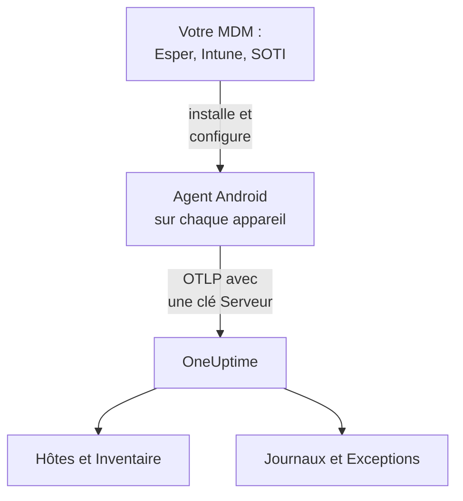

# Agent Android

L'agent Android de OneUptime signale à OneUptime un appareil Android qui appartient à votre organisation, comme une borne de commande, un terminal de point de vente, un terminal portable ou un lecteur d'affichage dynamique : sa mémoire, son stockage, son réseau, sa batterie et sa température, ses redémarrages, les applications qui y sont installées, ainsi que les plantages et les journaux de ces applications. Votre gestionnaire d'appareils l'installe et le configure sur tout le parc en une seule fois. Chaque appareil devient un hôte dans **Hôtes** et un élément dans **Inventaire**, à côté de vos serveurs et de vos machines Windows.

:::cards
- [Quand l'utiliser](#lagent-ou-linstrumentation-de-lapplication): L'agent voit l'appareil, l'instrumentation de l'application voit votre application.
- [Déployer avec Esper](#déployer-avec-esper): Téléverser l'APK, envoyer ses paramètres, le démarrer une fois.
- [Paramètres](#paramètres): Chaque clé de sa configuration gérée.
- [Lire les journaux des autres applications](#lire-les-journaux-des-autres-applications): Accorder READ_LOGS une fois, avec adb ou votre gestionnaire d'appareils.
- [Sessions de journaux](#sessions-de-journaux): Les journaux de toutes les applications pendant un moment, autorisés par la personne devant l'appareil.
:::

## Fonctionnement

L'agent est une petite application qui s'exécute comme service de premier plan. Chaque minute, il lit l'état de santé de l'appareil et l'envoie, avec les redémarrages, les applications installées et les journaux de l'appareil, à votre instance OneUptime via OTLP avec une clé d'ingestion **Serveur**. Il se lance de lui-même au démarrage de l'appareil, conserve sur l'appareil ce qu'il collecte tant que le réseau est coupé, et l'envoie dès que le réseau revient. Il ne maintient jamais éveillé un appareil en veille, et il compresse ce qu'il envoie.



## L'agent ou l'instrumentation de l'application

| | [OpenTelemetry Android](/docs/rum/android-setup) dans votre application | L'agent Android |
| --- | --- | --- |
| Ce qu'il voit | Votre application : ses plantages, ses ANR, ses écrans, ses sessions, ses requêtes et ses flux de travail | L'appareil : mémoire, stockage, réseau, batterie, redémarrages, applications installées, et les plantages et les ANR de chaque application |
| Où cela apparaît | **Surveillance des utilisateurs réels**, **Traces** et **Exceptions** | **Hôtes**, **Inventaire**, **Journaux** et **Exceptions** |
| Comment l'installer | Dans le code de votre application | Comme une application, via votre gestionnaire d'appareils |

Sur les appareils qui vous appartiennent, utilisez les deux, et donnez à l'appareil le même nom des deux côtés : dans le paramètre `device_name` de l'agent et dans le `host.name` que définit votre application. L'appareil forme alors un seul élément dans **Inventaire**, qui réunit la télémétrie de l'application et celle de l'appareil.

## Avant de commencer

- Des appareils sous Android 7.0 ou ultérieur, administrés par un gestionnaire d'appareils qui prend en charge les configurations gérées d'Android : Esper, Microsoft Intune, Workspace ONE, SOTI et les autres gestionnaires d'appareils Android Enterprise. Pour un seul appareil, adb suffit.
- Une clé d'ingestion **Serveur**, créée sous **Paramètres du projet → Télémétrie & APM → Clés d'ingestion** avec **Créer une clé d'ingestion**.
- L'agent : `oneuptime-android-agent.apk`, joint à chaque [version de OneUptime](https://github.com/OneUptime/oneuptime/releases/latest).
- Un accès HTTPS sortant depuis les appareils vers votre URL OneUptime. L'agent refuse toute URL qui ne commence pas par `https://`, puisque chaque requête transporte la clé d'ingestion.

## Déployer avec Esper

:::steps
### Téléverser l'APK

Dans la console Esper, téléversez `oneuptime-android-agent.apk` dans l'**App Library**, puis ajoutez-le au blueprint des appareils à surveiller.

### Envoyer ses paramètres

Dans le blueprint, ouvrez la **Managed Configuration** de l'agent et collez-y ses paramètres. Esper remplit les espaces réservés sur chaque appareil, avec Esper Agent 8.00.0764 ou ultérieur :

```json title="Managed configuration"
{
  "oneuptime_url": "https://oneuptime.com",
  "oneuptime_token": "YOUR_TELEMETRY_INGESTION_TOKEN",
  "device_name": "${esper.deviceName}",
  "device_serial": "${esper.serialNumber}",
  "device_type": "kiosk",
  "labels": "region=emea"
}
```

Si vous hébergez OneUptime vous-même, indiquez votre propre URL dans `oneuptime_url`. Lancez ensuite un Converge des appareils, pour qu'ils lisent les nouveaux paramètres.

### Démarrer l'agent une fois

Android ne lance pas au démarrage une application fraîchement installée tant qu'elle n'a pas été ouverte une fois. Activez **Launch on Start** pour l'agent dans le blueprint, en mode Multi-App, ou ouvrez l'agent une fois sur chaque appareil. Dès lors, il se lance de lui-même à chaque démarrage de l'appareil, ainsi qu'après chaque mise à jour.

### Retrouver les appareils dans OneUptime

En moins d'une minute, chaque appareil apparaît sous **Hôtes**, nommé d'après son `device_name`, ainsi que dans **Inventaire**. L'écran de l'agent sur l'appareil indique s'il envoie ses données, et ce qui l'en empêche si ce n'est pas le cas.
:::

Les autres gestionnaires d'appareils fonctionnent de la même façon : ajoutez l'APK comme application métier ou comme application interne, définissez les mêmes clés dans sa configuration d'application, et ouvrez-la une fois sur chaque appareil.

## Paramètres

L'agent lit ces clés dans sa configuration gérée. Un appareil qui n'en a pas peut être configuré à la place depuis l'écran de l'agent, avec l'URL, la clé d'ingestion et le nom de l'appareil. Une clé d'ingestion saisie à cet endroit est stockée chiffrée avec l'Android Keystore.

| Clé | Ce qu'elle définit | Par défaut |
| --- | --- | --- |
| `oneuptime_url` | Votre URL OneUptime | `https://oneuptime.com` |
| `oneuptime_token` | Une clé d'ingestion **Serveur** | Aucune : sans clé, l'agent n'envoie rien |
| `device_name` | Le nom de l'appareil dans **Hôtes** et **Inventaire**, qui y fait office d'identité | Son modèle et le début de son Android ID |
| `device_serial` | Son numéro de série, qu'Android ne communique plus aux applications depuis Android 10 | Aucune |
| `device_type` | Ce qu'il est, par exemple une borne, un terminal de point de vente ou un terminal portable | `Android device` |
| `device_location` | Où il se trouve, par exemple le numéro d'un magasin | Aucune |
| `labels` | Les étiquettes de l'hôte, sous forme de paires `name=value` séparées par des virgules | Aucune |
| `collection_interval_seconds` | La fréquence de ses envois, de 30 à 600 secondes | `60` |
| `logcat_enabled` | S'il envoie ce qu'il lit dans Logcat | `true` |
| `logcat_min_level` | Le niveau de gravité minimal des lignes Logcat qu'il envoie sous Android 12 et versions antérieures : `verbose`, `debug`, `info`, `warn`, `error` ou `fatal` | `warn` |
| `installed_apps_enabled` | S'il envoie la liste des applications installées | `true` |

Un espace réservé que votre gestionnaire d'appareils n'a pas rempli, comme un `${esper.deviceName}` envoyé tel quel, est ignoré, et l'écran de l'agent le signale. Gardez le même `device_name` une fois qu'un appareil envoie ses données : un nouveau nom correspond à un nouvel hôte.

L'écran de l'agent, ses notifications ainsi que les titres et les descriptions que votre gestionnaire d'appareils affiche pour ces clés sont dans la langue de l'appareil, dans toutes les langues que parle le tableau de bord de OneUptime.

## Lire les journaux des autres applications

Android ne permet à une application de lire les journaux des autres applications qu'avec l'autorisation READ_LOGS, et seul adb peut l'accorder : ni l'application elle-même, ni une stratégie d'appareil. Accordez-la une fois sur chaque appareil, et elle reste accordée malgré les redémarrages et les mises à jour :

```bash
adb shell pm grant com.oneuptime.androidagent android.permission.READ_LOGS
```

Avec Esper, lancez cette commande via **Secure Remote ADB** : activez l'accès ADB pour l'appareil, connectez-vous avec `espercli secureadb connect --device DEVICE_ID`, puis lancez la commande. Android redémarre l'agent quand l'autorisation est accordée, et l'agent commence aussitôt à lire. La colonne **ID dans le gestionnaire d'appareils** de l'inventaire contient le `DEVICE_ID` de chaque appareil.

Ce que l'agent lit ensuite dépend de la version d'Android :

- Android 13 et versions ultérieures : les plantages et les ANR de chaque application. Android ne montre les lignes de journal des autres applications qu'à une application affichée à l'écran, après que la personne devant l'appareil l'a autorisé : un agent qui tourne en arrière-plan ne peut donc pas les lire. Demandez-les pendant un moment avec une [session de journaux](#sessions-de-journaux).
- Android 12 et versions antérieures : les plantages et les ANR de chaque application, ainsi que les lignes de journal de chaque application de niveau `logcat_min_level` ou supérieur.

Sans READ_LOGS, l'agent signale tout le reste, et son écran comme les journaux de l'appareil indiquent comment l'accorder.

### Stack traces des plantages et motifs de redémarrage

Android conserve dans sa DropBox le rapport complet de chaque plantage d'application, de chaque plantage natif et de chaque ANR, ainsi que le motif de chaque redémarrage. L'agent les lit pour toutes les applications lorsqu'il dispose de READ_LOGS et de l'accès aux données d'utilisation, et, sous Android 15 et versions ultérieures, de READ_DROPBOX_DATA. Accordez-les une fois avec adb, comme READ_LOGS :

```bash
adb shell pm grant com.oneuptime.androidagent android.permission.READ_DROPBOX_DATA
adb shell appops set com.oneuptime.androidagent GET_USAGE_STATS allow
```

La première commande concerne Android 15 et versions ultérieures ; l'accès aux données d'utilisation peut aussi être activé sur l'appareil dans **Paramètres → Accès aux données d'utilisation**. Une stratégie d'appareil ne peut pas les accorder, et l'écran de l'agent liste les commandes qui restent à lancer. Avec elles, chaque plantage dans **Exceptions** a sa stack trace complète, un plantage natif son signal et la bibliothèque dans laquelle il s'est produit, un ANR la pile de son thread principal, et un redémarrage dans **Journaux** le motif qu'Android en donne. Les numéros de carte, adresses e-mail, jetons et mots de passe présents dans ce que lit l'agent sont remplacés par `[card number]`, `[email]`, `[token]` et `[redacted]` avant l'envoi.

### Les accorder sur tout le parc

Chaque rapport de l'agent indique lesquelles de ces autorisations lui manquent encore. Pour lister les appareils qui en ont besoin, ouvrez **Inventaire**, puis **Tous les éléments**, et filtrez par **Autorisations de l'agent** : **Manquant**. Activez la colonne **Autorisations de l'agent** pour voir ce qui manque à chaque appareil, et exportez la liste en CSV. Activez aussi la colonne **ID dans le gestionnaire d'appareils**, et l'export contient l'ID Esper de chaque appareil, le `DEVICE_ID` qu'attend `espercli secureadb connect --device`.

Une stratégie d'appareil ne peut pas les accorder : READ_LOGS et READ_DROPBOX_DATA sont des autorisations que seuls adb, le système ou le fabricant de l'appareil peuvent donner, et l'accès aux données d'utilisation est activé par adb ou par la personne devant l'appareil. Ce que propose Esper, et pourquoi rien de tout cela ne les accorde :

- **Autorisations d'application**, dans un blueprint ou avec la commande `SET_APP_PERMISSION`, passent par l'API Android du propriétaire de l'appareil, qui n'accorde que les autorisations qu'une application demande à la personne devant l'appareil. Android refuse celles de l'agent.
- **Configuration gérée** définit les paramètres propres à l'agent, jamais les autorisations d'Android.
- **Run Shell Script** s'exécute sur les appareils Linux et Windows, pas sur les appareils Android.
- **Secure Remote ADB** atteint un appareil à la fois, depuis un ordinateur qui exécute `espercli`. Sur les appareils Esper Foundation, personne n'a besoin d'être devant l'appareil. Sur les autres appareils, quelqu'un devant l'appareil accepte **Allow USB debugging?** la première fois.

Accordez-les donc avec adb :

- **Avant l'expédition d'un appareil**, quand il est préparé avec un câble USB. Ceci accorde les trois autorisations sur chaque appareil connecté à l'ordinateur :

  ```bash
  for serial in $(adb devices | awk 'NR > 1 && $2 == "device" { print $1 }'); do
    adb -s "$serial" shell pm grant com.oneuptime.androidagent android.permission.READ_LOGS
    adb -s "$serial" shell pm grant com.oneuptime.androidagent android.permission.READ_DROPBOX_DATA
    adb -s "$serial" shell appops set com.oneuptime.androidagent GET_USAGE_STATS allow
  done
  ```

  Sous Android 14 et versions antérieures, la deuxième commande indique que l'autorisation est inconnue : cet appareil n'en a pas besoin.
- **Sur un appareil déjà déployé**, via Secure Remote ADB, un appareil de la liste **Manquant** à la fois.
- **Seul l'accès aux données d'utilisation** peut être activé par la personne devant l'appareil, dans **Paramètres → Accès aux données d'utilisation**, ou avec le bouton de l'écran de l'agent.

Le rapport suivant de l'appareil, dans la minute, le retire de la liste **Manquant**.

### Utilisation du processeur

À partir d'Android 8, Android cache aux applications l'utilisation du processeur d'un appareil. Seule une application propriétaire de l'appareil peut la lire, et seulement sur les appareils dont le matériel la fournit. L'agent la lit lorsqu'il est le propriétaire de l'appareil, ce que vous définissez avec adb sur un appareil qui n'a aucun compte ni aucun autre propriétaire :

```bash
adb shell dpm set-device-owner com.oneuptime.androidagent/.admin.AgentDeviceAdminReceiver
```

Un appareil dont votre gestionnaire d'appareils est déjà propriétaire ne peut pas avoir de second propriétaire : son utilisation du processeur n'est donc pas disponible, et l'écran de l'agent le signale. Son utilisation du processeur est alors absente de la liste des hôtes, et le modèle **High CPU Utilization** ne lui est pas proposé.

## Sessions de journaux

Une session de journaux envoie pendant un moment les journaux de toutes les applications d'un appareil, pour le dépanner. Sous Android 13 et versions ultérieures, c'est le seul moyen de lire les lignes de journal des autres applications, car Android ne les montre qu'à une application affichée à l'écran, après que la personne devant l'appareil l'a autorisé.

:::steps
### En demander une

Ouvrez l'appareil dans **Hôtes**, puis **Journaux**, et cliquez sur **Demander une session de journaux** dans **Sessions de journaux**. Choisissez pendant combien de temps l'appareil envoie ses journaux, de 15 minutes à 4 heures, et le niveau le plus bas qu'il envoie : **Info**, **Débogage** ou **Détaillé**. Ajoutez une **Note** pour dire pourquoi vous la demandez, par exemple « Vérifier pourquoi l'application de paiement plante après 18 h ».

### L'autoriser sur l'appareil

En moins d'une minute, l'appareil affiche une notification indiquant que quelqu'un a demandé ses journaux, avec son nom et votre note. La personne devant l'appareil ouvre l'agent, où la demande s'affiche avec votre note en dessous, et appuie sur **Autoriser**. Sous Android 13 et versions ultérieures, Android demande ensuite d'autoriser l'accès à tous les journaux de l'appareil, et elle l'autorise aussi.

### Lire les lignes

La session indique **Collecte en cours**, et les lignes de toutes les applications arrivent dans les journaux de l'appareil. Cliquez sur **Afficher les lignes** pour ne voir que les lignes de la session, ou sur **Télécharger les lignes** pour les enregistrer dans un fichier. La session se termine quand son temps est écoulé, ou quand quelqu'un l'arrête sur l'appareil ou l'annule dans OneUptime.
:::

La note tient en une ligne de 200 caractères au plus. L'appareil l'affiche telle que vous l'avez écrite, entre guillemets, dans la notification et sur l'écran de l'agent tant que la session attend ou s'exécute ; elle n'est jamais traduite. Les sauts de ligne deviennent des espaces, et les numéros de carte, adresses e-mail, jetons et mots de passe qu'elle contient sont remplacés par `[card number]`, `[email]`, `[token]` et `[redacted]` avant qu'elle soit enregistrée, comme dans ce qu'envoie l'agent. La liste des sessions l'affiche sous le nom de la personne qui a fait la demande, et les **Journaux d'audit** de l'hôte la conservent avec la demande.

**Télécharger les lignes** enregistre les lignes de la session dans un fichier texte au format que produit `logcat -v threadtime`, que le support d'un fournisseur sait lire : chaque ligne avec son heure à la milliseconde près, son processus et son thread, son niveau, son tag et son message. Les heures sont en UTC. Les premières lignes du fichier indiquent la session, l'appareil et la note dont il s'agit, ainsi que la personne qui a fait la demande. Il contient les lignes affichées dans **Journaux**, telles que l'agent les a masquées, et nécessite donc la même autorisation que la lecture des journaux de l'appareil. Un fichier contient au plus 100 000 lignes et 32 Mo ; le fichier d'une session plus longue se termine en indiquant combien de lignes compte la session.

Une session a besoin de READ_LOGS et de `logcat_enabled` ; sans eux, elle indique **Indisponible**. Une seule session à la fois s'exécute sur un appareil. Une demande que personne n'autorise dans l'heure expire, et une session pendant laquelle l'appareil redémarre se termine avec ce redémarrage, puisque l'autorisation d'Android prend fin avec le processus de l'agent. Demander une session nécessite l'autorisation de modifier l'hôte, et les **Journaux d'audit** de l'hôte conservent qui l'a demandée, et quand.

## Ce que l'agent signale

| Quoi | Où cela apparaît dans OneUptime |
| --- | --- |
| Mémoire, stockage, réseau et temps de fonctionnement | La page de l'appareil dans **Hôtes** : les mêmes métriques que celles qu'envoie le collecteur d'un serveur, si bien que les modèles d'alerte pour hôtes fonctionnent |
| Charge de la batterie et température, et si l'appareil est branché sur une alimentation externe | Les métriques `hw.battery.charge`, `hw.temperature` et `android.battery.plugged` |
| État thermique | Les métriques `android.thermal.status` et `android.thermal.headroom` |
| Utilisation du processeur | La métrique `system.cpu.utilization` : sous Android 7, et sous Android 8 et versions ultérieures quand l'agent est le [propriétaire de l'appareil](#utilisation-du-processeur) |
| Redémarrages | **Journaux**, avec `@event.name:device.boot` : depuis combien de temps l'appareil tournait, s'il s'est arrêté proprement, combien de temps il est resté éteint, pourquoi il a redémarré, et les boucles de redémarrage |
| Applications installées | **Journaux**, avec `@event.name:android.package.inventory` une fois par jour, ainsi qu'à chaque installation, mise à jour et suppression |
| Plantages et ANR de chaque application | **Exceptions**, comme non gérés, nommés d'après l'application, avec leurs piles quand l'agent lit la [DropBox](#stack-traces-des-plantages-et-motifs-de-redémarrage) |
| Marque, modèle, numéro de série, version de l'OS, niveau de correctif de sécurité et firmware | L'élément de l'appareil dans **Inventaire**, avec le filtre et la colonne **Niveau du correctif de sécurité** |
| L'ancienneté de son niveau de correctif de sécurité | La métrique `android.os.security_patch.age`, en jours |
| Les autorisations qui manquent encore à l'agent | L'élément de l'appareil dans **Inventaire**, avec le filtre et la colonne **Autorisations de l'agent** |

Dans **Hôtes**, l'OS de l'appareil indique Android, avec le logo d'Android.

Un appareil est en retard sur ses correctifs de sécurité quand son niveau de correctif de sécurité date de plus de 90 jours. Google publie chaque mois un bulletin de sécurité Android, et Android Enterprise Recommended impose au fabricant d'un appareil de livrer chacun d'eux sous 90 jours, si bien qu'il manque à un appareil plus en retard des corrections que son fabricant aurait dû livrer. Dans **Inventaire**, le filtre **Niveau du correctif de sécurité** liste les appareils **Pas à jour** ; le modèle **Security Patch Out of Date** déclenche une alerte pour chacun. Un appareil Android qu'un gestionnaire d'appareils importe et sur lequel l'agent ne tourne pas reçoit l'alerte du modèle de sa connexion, comme **Esper Security Patch Out of Date**, d'après le niveau de correctif que rapporte le gestionnaire d'appareils ; un appareil sur lequel l'agent tourne est laissé à ce modèle-ci, si bien qu'il n'alerte jamais deux fois.

Les démarrages de l'appareil au cours de la dernière heure forment la métrique `android.boot.recent_count`, et un appareil qui redémarre sans cesse écrit un avertissement dans ses journaux à chaque démarrage. Dans **Hôtes**, un appareil Android se voit proposer ses propres modèles d'alerte : Device Unplugged, Low Battery, Device Overheating, Restart Loop, Storage Nearly Full et Security Patch Out of Date, avec Host Stopped Reporting, Host Restarted et High Memory Utilization, et High CPU Utilization dès qu'il signale son utilisation du processeur. Les premières commandes de débogage de chaque alerte sont des commandes adb. Voir [Surveillance des hôtes](/docs/monitor/host-monitor#appareils-android).

## Dépannage

:::details Un appareil n'apparaît pas dans Hôtes
Ouvrez l'agent sur l'appareil : son écran indique ce qui manque, comme une clé d'ingestion, une URL qu'il ne peut pas utiliser, ou un envoi qui a échoué et pourquoi. Sur un appareil où l'agent n'a jamais été ouvert après son installation, l'agent n'a pas démarré : ouvrez-le une fois, ou activez **Launch on Start**.
:::

:::details L'agent indique que OneUptime a refusé la clé d'ingestion
Utilisez une clé **Serveur** activée et non expirée. Une clé **Navigateur** est refusée depuis un appareil.
:::

:::details Aucun journal des autres applications
Accordez READ_LOGS, comme l'explique [Lire les journaux des autres applications](#lire-les-journaux-des-autres-applications). Sous Android 13 et versions ultérieures, seuls les plantages et les ANR des autres applications sont lus, sauf si une [session de journaux](#sessions-de-journaux) est en cours.
:::

:::details Une session de journaux reste sur En attente d'approbation
Personne devant l'appareil ne l'a encore autorisée. Quelqu'un doit ouvrir l'agent sur l'appareil et appuyer sur **Autoriser**, puis, sous Android 13 et versions ultérieures, autoriser aussi la demande d'Android, pendant que l'agent est affiché à l'écran. Une session que la demande d'Android a refusée indique **Refusé** : demandez-en une autre.
:::

:::details Deux appareils apparaissent comme un seul hôte
Ils ont le même `device_name`. Utilisez un espace réservé qui diffère d'un appareil à l'autre, comme `${esper.deviceName}` ou `${esper.serialNumber}`.
:::

## Prochaines étapes

:::cards
- [Configuration Android](/docs/rum/android-setup): Instrumenter votre propre application avec OpenTelemetry Android.
- [Hôtes](/docs/telemetry/hosts): Les pages, les mesures et les alertes d'un hôte.
- [Surveillance des hôtes](/docs/monitor/host-monitor): Être alerté quand un appareil cesse d'envoyer des données ou manque d'espace de stockage.
- [Exceptions](/docs/telemetry/exceptions): Trier les plantages et les ANR que signalent vos appareils.
:::
