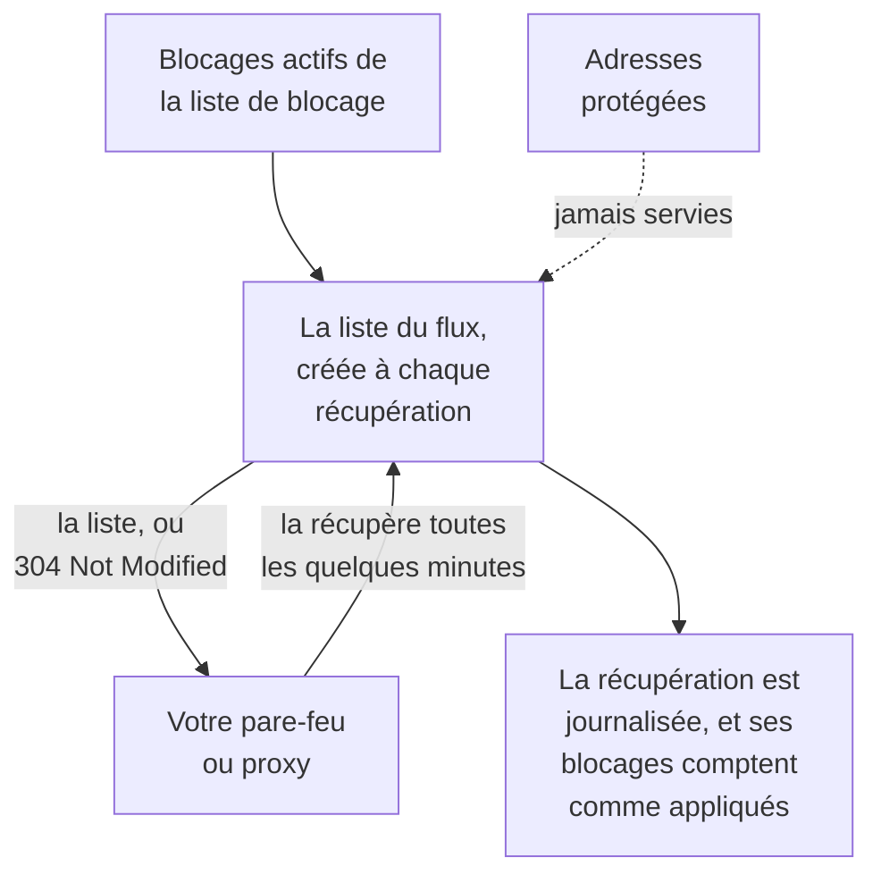

# Flux de liste de blocage pour les pare-feu et les proxies

Un flux de liste de blocage est une URL secrète à partir de laquelle votre pare-feu ou votre proxy lit la [liste de blocage](/docs/telemetry/security-cases#liste-de-blocage) de votre projet, toutes les quelques minutes. Palo Alto Networks, FortiGate, Check Point, Cisco Secure Firewall, OPNsense et pfSense la lisent comme une liste externe, et des commandes que vous copiez depuis OneUptime l'appliquent avec nftables, ipset, nginx, HAProxy ou le Pare-feu Windows. C'est votre pare-feu qui contacte OneUptime : OneUptime n'a jamais besoin d'une route vers votre réseau ni d'un mot de passe pour votre pare-feu.

:::cards
- [Créer un flux](#créer-un-flux): Choisir le pare-feu, copier le secret, suivre ses étapes.
- [Configurer votre pare-feu](#configurer-votre-pare-feu): Les étapes pour chaque pare-feu et proxy, et la fréquence à laquelle il récupère le flux.
- [Quand un blocage est appliqué](#quand-un-blocage-est-appliqué): Seulement une fois qu'un pare-feu a récupéré une liste qui le contient.
- [Renouveler ou révoquer le secret](#renouveler-ou-révoquer-le-secret): Un nouveau secret avec un jour de chevauchement, ou plus aucun, sur-le-champ.
:::

## Fonctionnement



Chaque récupération constitue la liste à partir des blocages actifs à ce moment-là. Un blocage qui expire ou qui est levé disparaît de la récupération suivante, et une adresse protégée n'y figure jamais, même si elle a été protégée après avoir été bloquée. Un blocage ne compte comme appliqué sur le flux qu'une fois qu'un pare-feu a récupéré une liste qui le contient.

## Avant de commencer

- Un pare-feu ou un proxy qui lit une liste d'adresses depuis une URL `https`, ou un hôte Linux ou Windows sur lequel vous pouvez exécuter des commandes en tant que root ou administrateur.
- Un accès sortant vers OneUptime en HTTPS depuis le pare-feu : `https://oneuptime.com`, ou l'adresse de votre propre serveur OneUptime.
- Un rôle qui peut créer des flux : Propriétaire du projet, Administrateur du projet ou Administrateur de la sécurité. Membre de la sécurité et Lecteur de la sécurité peuvent lire les flux et leurs récupérations. Voir [Rôles](/docs/permissions/reference#rôles).

## Créer un flux

:::steps
### Ouvrir les flux de liste de blocage

Ouvrez **Produits → Événements de sécurité → Playbooks → Flux de liste de blocage**.

### Créer le flux

Cliquez sur **Créer : Flux de liste de blocage** et choisissez le **Pare-feu** qui le lit. **Nom** est le nom que la liste de blocage donne au flux là où un blocage est appliqué ; laissé vide, il prend le nom du pare-feu, par exemple « FortiGate feed ». Sous **Plus de champs**, **Adresses servies** choisit entre IPv4 et IPv6, IPv4 uniquement ou IPv6 uniquement, et **Adresses sources autorisées** limite qui peut lire le flux.

### Copier le secret

La page du flux s'ouvre sur son secret, affiché une seule fois : OneUptime n'en conserve que le hachage. Copiez-le, puis cliquez sur **Terminé**. Tant que vous ne quittez pas la page, ses étapes remplissent le secret pour vous.

### Suivre les étapes de votre pare-feu

**Configurer votre pare-feu** affiche l'URL à coller, la façon dont votre pare-feu envoie le secret, et les étapes dans sa propre console, déjà remplies. Choisissez-y un autre pare-feu pour voir ses étapes à la place. Après la première récupération de votre pare-feu, le statut du flux indique **Lecture**, et **Récupérations** liste la récupération.
:::

## Ce que fournit un flux

| Fichier | Pour | Ce qu'il contient |
| --- | --- | --- |
| `blocklist.txt` | Palo Alto Networks, pfSense, ipset, HAProxy, Pare-feu Windows et tout autre pare-feu | Une adresse ou une plage par ligne. |
| `blocklist.txt?comments=1` | FortiGate, Check Point, Cisco Secure Firewall et OPNsense, qui ignorent les lignes commençant par `#` | Chaque adresse ou plage après une ligne qui indique pourquoi elle est bloquée. |
| `nftables.nft` | nftables | Un fichier pour `nft -f` qui vide les ensembles `blocklist_v4` et `blocklist_v6` de la table `inet oneuptime` et les remplit à nouveau. |
| `nginx.conf` | nginx | Une ligne `deny` pour chaque adresse ou plage. |
| Le nom d'un fichier suivi de `.md5`, comme `blocklist.txt.md5` | Cisco Secure Firewall | Le MD5 du fichier, pour que le pare-feu ne télécharge la liste que lorsqu'elle a changé. |

L'URL d'un flux est `https://oneuptime.com/api/blocklist-feed/<feed ID>/<file>`, et la page du flux l'affiche remplie pour votre pare-feu. Avec `?comments=1`, la liste se présente ainsi :

```text
# OneUptime case CASE-42 until 2026-11-21 10:42 UTC
203.0.113.7
# OneUptime blocklist until lifted
198.51.100.0/24
```

Un flux fournit les blocages actifs dont l'action est **Bloquer**. Il ne fournit jamais de défi, qu'un pare-feu ne sait pas faire, et un flux qui ne fournit que l'IPv4 ou que l'IPv6 laisse de côté les autres adresses. Le fichier nftables omet une adresse qu'une plage de la liste contient déjà, car nftables refuse les entrées qui se chevauchent dans un ensemble.

Quand rien n'est bloqué, `blocklist.txt` contient une seule adresse, `192.0.2.1` (`2001:db8::1` pour un flux qui ne fournit que l'IPv6). C'est une adresse réservée à la documentation, d'où ne provient aucun trafic sur Internet : Palo Alto Networks et Cisco conservent la dernière liste qu'ils ont lue quand une liste revient vide, si bien qu'une liste vide continuerait de bloquer ce que vous avez levé.

Chaque réponse porte un `ETag`. Un pare-feu qui le renvoie dans `If-None-Match` reçoit `304 Not Modified` tant que la liste n'a pas changé, et les commandes que OneUptime vous fournit le font.

## Comment un pare-feu envoie le secret

| Méthode | Ce que le pare-feu envoie | Utilisée par |
| --- | --- | --- |
| Authentification de base | N'importe quel nom d'utilisateur, comme `oneuptime`, avec le secret comme mot de passe | Palo Alto Networks (en HTTPS uniquement), FortiGate et Check Point |
| Jeton bearer | `Authorization: Bearer <secret>` | Les commandes pour nftables, ipset, nginx, HAProxy et le Pare-feu Windows |
| Secret dans l'URL | `https://oneuptime.com/api/blocklist-feed/<feed ID>/<secret>/blocklist.txt` | Cisco Secure Firewall, OPNsense et pfSense, qui ne documentent aucune façon d'en envoyer un |

Une requête sans secret, ou avec un mauvais secret, reçoit `401 Unauthorized`. Une URL qui contient un mauvais secret reçoit `404 Not Found`, comme une adresse qui n'existe pas. Le serveur web de OneUptime n'écrit pas les URL des flux dans son journal d'accès : un secret dans une URL ne s'y retrouve donc pas.

## Limiter qui peut lire un flux

**Adresses sources autorisées**, sous **Plus de champs**, accepte jusqu'à 50 adresses et plages, une par ligne, comme `203.0.113.7` ou `198.51.100.0/24`. Une requête venant de toute autre adresse reçoit `403 Forbidden`, même avec le bon secret. Laissez le champ vide pour que toute adresse qui possède le secret puisse lire le flux.

Chaque adresse peut récupérer un flux 60 fois par minute, et récupérer des flux 600 fois par minute au total. Au-delà, elle reçoit `429 Too Many Requests` avec un en-tête `Retry-After`.

## Quand un blocage est appliqué

Un blocage compte comme appliqué sur un flux dès qu'un pare-feu a récupéré une liste qui le contient, après la création du blocage, et pendant dix minutes après chacune de ces récupérations. Une réponse `304 Not Modified` compte comme une récupération de la même liste. Sur la **Liste de blocage**, la puce du flux dans **Appliqué sur** passe alors au vert, et son info-bulle indique combien de temps après le blocage le pare-feu l'a récupéré, par exemple « Un pare-feu a récupéré ce blocage depuis FortiGate feed 3 min après sa création. Dernière récupération il y a 2 minutes. »

Après dix minutes sans récupération, la puce indique que le pare-feu n'a pas récupéré le flux depuis : le pare-feu bloque peut-être encore l'adresse, mais OneUptime ne peut pas le savoir. Faites donc récupérer le flux par votre pare-feu toutes les cinq minutes ou plus souvent. Un pare-feu qui récupère moins souvent, comme OPNsense, bloque quand même entre ses récupérations, et OneUptime n'y considère le blocage comme appliqué que pendant les dix minutes qui suivent chacune d'elles.

Un blocage qui expire ou qui est levé disparaît de la récupération suivante, et sa puce attend qu'un pare-feu récupère la liste sans lui. Quand OneUptime ne peut pas lire quelles adresses sont protégées, le flux répond `503 Service Unavailable` avec `Retry-After: 60` plutôt qu'une liste qui pourrait en contenir une, et le pare-feu conserve la liste qu'il a.

## Quand un pare-feu cesse de lire

OneUptime apprend à quelle fréquence chaque flux est récupéré. Quand un flux n'a pas été récupéré pendant trois fois son intervalle habituel, et au moins dix minutes, son statut indique **Lecture arrêtée**, la **Liste de blocage** le nomme au-dessus de sa liste, et les Propriétaires du projet reçoivent un seul e-mail : « Your firewall stopped reading the blocklist feed _nom du flux_ ». Tant qu'un pare-feu n'a pas récupéré un flux deux fois, OneUptime attend une récupération toutes les cinq minutes, toutes les heures pour OPNsense et tous les jours pour pfSense.

La récupération suivante l'efface, et un arrêt ultérieur envoie un autre e-mail. Un flux dont le secret a été révoqué ne compte jamais comme arrêté.

## Renouveler ou révoquer le secret

**Renouveler le secret**, sur la page du flux, crée un nouveau secret et l'affiche une seule fois. Le secret qu'il remplace continue de fonctionner pendant 24 heures, pour que vous puissiez donner le nouveau à chaque pare-feu ; **Récupérations** marque une récupération qui a encore envoyé l'ancien comme **Secret précédent**. Renouveler à nouveau dans ces 24 heures met fin immédiatement au plus ancien secret.

**Révoquer le secret** met fin au secret, et à celui d'avant, immédiatement : utilisez-le quand un secret a fuité. Le flux ne répond alors plus à personne, et ses pare-feu conservent la liste qu'ils ont sans l'actualiser, jusqu'à ce que **Renouveler le secret** crée un nouveau secret. Supprimer un flux met fin au flux, à son secret et à ses récupérations.

## Configurer votre pare-feu

La page du flux affiche ces étapes pour le pare-feu que vous choisissez, avec l'URL, le nom d'utilisateur et, juste après la création du secret, le secret déjà renseignés.

| Pare-feu | Fichier | Secret | Intervalle de récupération | Contient au plus |
| --- | --- | --- | --- | --- |
| Palo Alto Networks | `blocklist.txt` | Authentification de base | 5 minutes, le plus court proposé | 30 listes personnalisées, et 50 000 adresses au total (150 000 sur les séries PA-3200, PA-5200 et PA-7000) |
| FortiGate | `blocklist.txt?comments=1` | Authentification de base | 5 minutes (de 1 à 43 200 ; 5 par défaut) | 300 000 adresses, tous ses flux de menaces confondus |
| Check Point | `blocklist.txt?comments=1`, IPv4 | Authentification de base | 5 minutes (toutes les heures par défaut) | 50 000 adresses par flux |
| Cisco Secure Firewall | `blocklist.txt?comments=1` et son MD5 | Dans l'URL | 5 minutes (2 heures par défaut) | |
| OPNsense | `blocklist.txt?comments=1` | Dans l'URL | 1 heure, le plus court proposé | |
| pfSense | `blocklist.txt` | Dans l'URL | 1 jour, le plus court proposé | |
| nftables, ipset, nginx, HAProxy, Pare-feu Windows | Le leur | Jeton bearer | 1 minute | |

### Palo Alto Networks

1. Dans l'interface web, accédez à **Objects → External Dynamic Lists** et cliquez sur **Add**.
2. Réglez **Type** sur **IP List** et **Source** sur l'URL du flux, `https://oneuptime.com/api/blocklist-feed/<feed ID>/blocklist.txt`.
3. Activez **Client Authentication**, avec **Username** `oneuptime` et le secret du flux comme **Password**.
4. Réglez **Check for updates** sur **Every Five Minutes**, cliquez sur **OK** et faites un commit.
5. Dans **Policies → Security**, ajoutez une règle avec la liste comme **Source Address** et l'action **Deny**, puis faites un commit.

Palo Alto Networks n'envoie le nom d'utilisateur et le mot de passe qu'en HTTPS. Il ne lit un commentaire qu'après une adresse, jamais sur une ligne à part : son flux est donc la liste simple. Voir [Configure the Firewall to Access an External Dynamic List](https://docs.paloaltonetworks.com/pan-os/11-1/pan-os-admin/policy/use-an-external-dynamic-list-in-policy/configure-the-firewall-to-access-an-external-dynamic-list).

### FortiGate

1. Accédez à **Security Fabric → External Connectors**, cliquez sur **Create New** et choisissez **IP Address** sous **Threat Feeds**.
2. Réglez **URL of external resource** sur l'URL du flux, `https://oneuptime.com/api/blocklist-feed/<feed ID>/blocklist.txt?comments=1`.
3. Activez **HTTP basic authentication**, avec **Username** `oneuptime` et le secret du flux comme **Password**.
4. Réglez **Refresh Rate** sur 5 minutes et cliquez sur **OK**.
5. Dans **Policy & Objects → Firewall Policy**, utilisez le flux comme **Source** d'une politique et réglez **Action** sur **DENY**.

Voir [Configuring a threat feed](https://docs.fortinet.com/document/fortigate/7.6.0/administration-guide/379433/configuring-a-threat-feed).

### Check Point

1. Dans SmartConsole, ouvrez l'**Object Explorer** et choisissez **New → More → Network Object → Network Feed**.
2. Réglez **Feed URL** sur l'URL du flux, `https://oneuptime.com/api/blocklist-feed/<feed ID>/blocklist.txt?comments=1`, **Format** sur **Flat list** et **Data type** sur **IP Address**.
3. Sous **Advanced Settings**, saisissez **Username** `oneuptime` et le secret du flux comme mot de passe pour **Authentication**.
4. Réglez **Check feed interval** sur 5 minutes, cliquez sur **Test Feed**, puis sur **OK**.
5. Utilisez le flux comme **Source** d'une règle Access Control dont l'action est **Drop**, et installez la politique.

Check Point documente des adresses IPv4 pour un Network Feed : un flux créé pour lui ne fournit donc que de l'IPv4. Voir [Network Feed](https://sc1.checkpoint.com/documents/R82/WebAdminGuides/EN/CP_R82_SecurityManagement_AdminGuide/Content/Topics-SECMG/Network_Feed.htm).

### Cisco Secure Firewall

1. Dans le centre de gestion, choisissez **Objects → Security Intelligence** et cliquez sur **Add Network Lists and Feeds**.
2. Réglez **Type** sur **Feed**, **Feed URL** sur l'URL du flux, `https://oneuptime.com/api/blocklist-feed/<feed ID>/<secret>/blocklist.txt?comments=1`, et **MD5 URL** sur la même URL avec `.md5` après `blocklist.txt`.
3. Réglez **Update Frequency** sur 5 minutes et enregistrez.
4. Dans votre politique de contrôle d'accès, ouvrez **Security Intelligence → Networks**, ajoutez le flux à la **Block List**, puis enregistrez et déployez.

Cisco exige une URL MD5 pour une fréquence de mise à jour de 30 minutes ou moins, et ses équipements gérés reçoivent les mises à jour du centre de gestion toutes les 30 minutes : un blocage les atteint donc jusqu'à 30 minutes après la récupération du flux. Voir [Creating Security Intelligence feeds](https://docs.manage.security.cisco.com/cdfmc/t_creating_security_intelligence_feeds.html).

### OPNsense

1. Accédez à **Firewall → Aliases** et ajoutez un alias de type **URL Table (IPs)**.
2. Réglez **Content** sur l'URL du flux, `https://oneuptime.com/api/blocklist-feed/<feed ID>/<secret>/blocklist.txt?comments=1`, et **Refresh Frequency** sur 0 jour et 1 heure.
3. Enregistrez et cliquez sur **Apply**, puis, dans **Firewall → Rules**, ajoutez une règle qui bloque le trafic dont la **Source** est l'alias.

OPNsense récupère une table d'URL au plus une fois par heure : OneUptime ne confirme donc ses blocages que pendant les dix minutes qui suivent chaque récupération. OPNsense continue de les bloquer entre-temps. Voir [Aliases](https://docs.opnsense.org/manual/aliases.html).

### pfSense

1. Accédez à **Firewall → Aliases**, cliquez sur **Add** et choisissez **URL Table (IPs)**.
2. Saisissez l'URL du flux, `https://oneuptime.com/api/blocklist-feed/<feed ID>/<secret>/blocklist.txt`, et réglez l'actualisation sur 1 jour.
3. Cliquez sur **Save** et sur **Apply Changes**, puis, dans **Firewall → Rules**, ajoutez une règle avec l'alias comme **Source** et l'action **Block**.

> [!WARNING]
> pfSense récupère une table d'URL au plus une fois par jour : c'est trop lent pour bloquer une attaque pendant qu'elle a lieu. Utilisez-le pour les blocages longs, en complément d'un pare-feu qui récupère le flux toutes les quelques minutes.

Voir [Alias Types](https://docs.netgate.com/pfsense/en/latest/firewall/aliases-types.html).

### nftables

En tant que root, exécutez une fois les commandes qu'affiche la page du flux. Elles créent la table `inet oneuptime` avec deux ensembles, `blocklist_v4` et `blocklist_v6`, des règles dans ses chaînes `input` et `forward` qui abandonnent le trafic des adresses qu'ils contiennent, et le script `/usr/local/sbin/oneuptime-blocklist`, qui conserve le secret dans `/etc/oneuptime-blocklist`, lisible par root uniquement.

```bash
# Run once, as root.
install -d -m 700 /etc/oneuptime-blocklist /var/lib/oneuptime-blocklist
printf 'Authorization: Bearer %s\n' 'YOUR_FEED_SECRET' > /etc/oneuptime-blocklist/auth
chmod 600 /etc/oneuptime-blocklist/auth
cat > /usr/local/sbin/oneuptime-blocklist <<'SCRIPT'
#!/bin/sh
# Loads the OneUptime blocklist into nftables when it changed.
set -eu
URL='https://oneuptime.com/api/blocklist-feed/<feed ID>/nftables.nft'
STATE=/var/lib/oneuptime-blocklist
if ! nft list table inet oneuptime >/dev/null 2>&1; then
  rm -f "$STATE/etag"
  nft -f - <<'NFT'
table inet oneuptime {
  set blocklist_v4 { type ipv4_addr; flags interval; auto-merge; }
  set blocklist_v6 { type ipv6_addr; flags interval; auto-merge; }
  chain input {
    type filter hook input priority filter; policy accept;
    ip saddr @blocklist_v4 drop
    ip6 saddr @blocklist_v6 drop
  }
  chain forward {
    type filter hook forward priority filter; policy accept;
    ip saddr @blocklist_v4 drop
    ip6 saddr @blocklist_v6 drop
  }
}
NFT
fi
TMP=$(mktemp)
trap 'rm -f "$TMP" "$TMP.h"' EXIT
ETAG=$(cat "$STATE/etag" 2>/dev/null || true)
CODE=$(curl --silent --show-error --max-time 60 --header @/etc/oneuptime-blocklist/auth \
  ${ETAG:+--header "If-None-Match: $ETAG"} \
  --dump-header "$TMP.h" --output "$TMP" --write-out '%{http_code}' "$URL")
[ "$CODE" = 304 ] && exit 0
[ "$CODE" = 200 ] || { echo "oneuptime-blocklist: the feed answered $CODE" >&2; exit 1; }
nft -f "$TMP"
sed -n 's/^[Ee][Tt][Aa][Gg]:[[:space:]]*//p' "$TMP.h" | tr -d '\r' > "$STATE/etag"
SCRIPT
chmod 700 /usr/local/sbin/oneuptime-blocklist
echo '* * * * * root flock -n /run/oneuptime-blocklist.lock /usr/local/sbin/oneuptime-blocklist' > /etc/cron.d/oneuptime-blocklist
/usr/local/sbin/oneuptime-blocklist
```

Le script s'exécute chaque minute depuis `/etc/cron.d/oneuptime-blocklist`. Il ne charge `nftables.nft` que lorsque la liste a changé, en une seule transaction : les ensembles ne sont donc jamais à moitié remplis. Voir [Sets](https://wiki.nftables.org/wiki-nftables/index.php/Sets).

### ipset et iptables

En tant que root, exécutez une fois les commandes qu'affiche la page du flux. Elles créent deux ensembles, `oneuptime_v4` et `oneuptime_v6`, et des règles dans la chaîne `PREROUTING` de la table `raw`, pour iptables et ip6tables, qui abandonnent le trafic des adresses qu'ils contiennent.

Le script s'exécute chaque minute depuis cron. Lorsque la liste a changé, il remplit deux nouveaux ensembles et les substitue aux anciens, pour que les règles ne voient jamais un ensemble à moitié rempli. Voir [ipset](https://ipset.netfilter.org/ipset.man.html).

### nginx

Ajoutez la ligne include au bloc `server` de chaque site à protéger, puis exécutez une fois, en tant que root, les commandes qu'affiche la page du flux :

```nginx
server {
    include /etc/nginx/oneuptime-blocklist.conf;
}
```

```bash
# Run once, as root.
install -d -m 700 /etc/oneuptime-blocklist /var/lib/oneuptime-blocklist
printf 'Authorization: Bearer %s\n' 'YOUR_FEED_SECRET' > /etc/oneuptime-blocklist/auth
chmod 600 /etc/oneuptime-blocklist/auth
touch /etc/nginx/oneuptime-blocklist.conf
cat > /usr/local/sbin/oneuptime-blocklist <<'SCRIPT'
#!/bin/sh
# Writes the OneUptime blocklist for nginx when it changed, and reloads nginx.
set -eu
URL='https://oneuptime.com/api/blocklist-feed/<feed ID>/nginx.conf'
STATE=/var/lib/oneuptime-blocklist
TMP=$(mktemp)
trap 'rm -f "$TMP" "$TMP.h"' EXIT
ETAG=$(cat "$STATE/etag" 2>/dev/null || true)
CODE=$(curl --silent --show-error --max-time 60 --header @/etc/oneuptime-blocklist/auth \
  ${ETAG:+--header "If-None-Match: $ETAG"} \
  --dump-header "$TMP.h" --output "$TMP" --write-out '%{http_code}' "$URL")
[ "$CODE" = 304 ] && exit 0
[ "$CODE" = 200 ] || { echo "oneuptime-blocklist: the feed answered $CODE" >&2; exit 1; }
cp /etc/nginx/oneuptime-blocklist.conf "$STATE/last.conf"
cp "$TMP" /etc/nginx/oneuptime-blocklist.conf
if nginx -t -q; then nginx -s reload; else cp "$STATE/last.conf" /etc/nginx/oneuptime-blocklist.conf; exit 1; fi
sed -n 's/^[Ee][Tt][Aa][Gg]:[[:space:]]*//p' "$TMP.h" | tr -d '\r' > "$STATE/etag"
SCRIPT
chmod 700 /usr/local/sbin/oneuptime-blocklist
echo '* * * * * root flock -n /run/oneuptime-blocklist.lock /usr/local/sbin/oneuptime-blocklist' > /etc/cron.d/oneuptime-blocklist
/usr/local/sbin/oneuptime-blocklist

# Then add this line to the server block of the site to protect, and reload nginx:
#   include /etc/nginx/oneuptime-blocklist.conf;
```

Le script s'exécute chaque minute depuis cron. Lorsque la liste a changé, il écrit `/etc/nginx/oneuptime-blocklist.conf`, vérifie la configuration avec `nginx -t` et recharge nginx, et remet le fichier précédent en place si la vérification échoue.

Derrière un répartiteur de charge ou un CDN, nginx voit l'adresse du répartiteur, et non celle du visiteur, sauf si le module realip est configuré : réglez `set_real_ip_from` sur les adresses du répartiteur et `real_ip_header` sur l'en-tête qu'il envoie, ou bloquez plutôt au niveau du répartiteur. Voir [ngx_http_access_module](https://nginx.org/en/docs/http/ngx_http_access_module.html).

### HAProxy

En tant que root, créez le fichier de liste et ajoutez deux lignes à `haproxy.cfg`, puis rechargez HAProxy une fois : son API Runtime ne met à jour qu'une liste que HAProxy lit déjà.

```text
global
    stats socket /run/haproxy/admin.sock mode 660 level admin

frontend www
    http-request deny if { src -n -f /etc/haproxy/oneuptime-blocklist.lst }
```

Exécutez ensuite le reste des commandes qu'affiche la page du flux. Le script s'exécute chaque minute depuis cron et, lorsque la liste a changé, écrit `/etc/haproxy/oneuptime-blocklist.lst` et met à jour HAProxy via son API Runtime, sans rechargement. Voir [The Runtime API](https://docs.haproxy.org/3.4/management.html#9.3).

### Pare-feu Windows

Dans PowerShell, en tant qu'administrateur, exécutez une fois les commandes qu'affiche la page du flux. Elles enregistrent un script et le secret dans `C:\ProgramData\OneUptime\Blocklist`, que seuls SYSTEM et le groupe Administrators peuvent lire, et inscrivent la tâche planifiée « OneUptime Blocklist », qui exécute le script chaque minute en tant que SYSTEM.

Le script maintient des règles de trafic entrant qui bloquent chaque adresse de la liste, 1 000 par règle : « OneUptime blocklist 0 », « OneUptime blocklist 1 », et ainsi de suite. Voir [Set-NetFirewallRule](https://learn.microsoft.com/en-us/powershell/module/netsecurity/set-netfirewallrule).

### Autres pare-feu

1. Pointez votre pare-feu ou votre proxy vers l'URL du flux, `https://oneuptime.com/api/blocklist-feed/<feed ID>/blocklist.txt` : une adresse ou une plage par ligne.
2. Envoyez le secret du flux comme mot de passe d'authentification de base, avec n'importe quel nom d'utilisateur, ou comme jeton bearer.
3. Faites-lui récupérer la liste toutes les 5 minutes ou plus souvent : un blocage y compte comme appliqué pendant dix minutes après chaque récupération.

### Kubernetes

Bloquez à la périphérie ou au niveau du WAF cloud placé devant le cluster, connecté comme destination de la liste de blocage sous **Connexions de sécurité** ou **Connexions cloud**, ou sur un proxy que vous exécutez devant lui avec les commandes nginx ou HAProxy. Le contrôleur communautaire Ingress NGINX a été retiré, et son dépôt archivé en mars 2026 : OneUptime ne documente donc pas ses annotations. Voir [Ingress NGINX Retirement](https://kubernetes.io/blog/2025/11/11/ingress-nginx-retirement/).

## Limites

| Quoi | Limite |
| --- | --- |
| Entrées dans un flux | 20 000 |
| Adresses sources autorisées | 50 adresses et plages |
| Récupérations d'un flux depuis une adresse | 60 par minute |
| Récupérations de tous les flux depuis une adresse | 600 par minute |
| Un secret remplacé continue de fonctionner | 24 heures |
| Un blocage compte comme appliqué après une récupération | 10 minutes |
| Récupérations conservées | 30 jours |

## Dépannage

:::details Le pare-feu reçoit 401 Unauthorized
Le secret qu'il envoie n'est pas celui du flux. Vérifiez que le mot de passe, ou le jeton bearer, est le secret entier, sans rien avant ni après. Un secret remplacé il y a plus de 24 heures ne fonctionne plus : **Renouveler le secret** en crée un nouveau.
:::

:::details Le pare-feu reçoit 404 Not Found
L'URL désigne un flux qui n'existe pas, un fichier qu'un flux ne fournit pas, ou contient un mauvais secret. Copiez de nouveau l'URL depuis la page du flux.
:::

:::details Le pare-feu reçoit 403 Forbidden
Le champ **Adresses sources autorisées** du flux ne contient pas l'adresse depuis laquelle le pare-feu récupère le flux. **Récupérations** affiche l'adresse d'où vient chaque récupération.
:::

:::details La puce d'un blocage indique qu'elle attend qu'un pare-feu récupère le flux
Aucun pare-feu n'a récupéré le flux depuis la création du blocage. Consultez **Récupérations** sur la page du flux : un pare-feu qui récupère le flux toutes les cinq minutes applique le blocage en moins de cinq minutes.
:::

## Étapes suivantes

:::cards
- [Dossiers de sécurité et playbooks](/docs/telemetry/security-cases): Bloquer une adresse depuis un dossier, à la main ou depuis un playbook.
- [Renseignement sur les menaces](/docs/telemetry/threat-intelligence): Faire entrer dans OneUptime les adresses malveillantes connues.
- [Événements de sécurité](/docs/telemetry/security-events): Trouver les adresses qui méritent d'être bloquées.
:::
