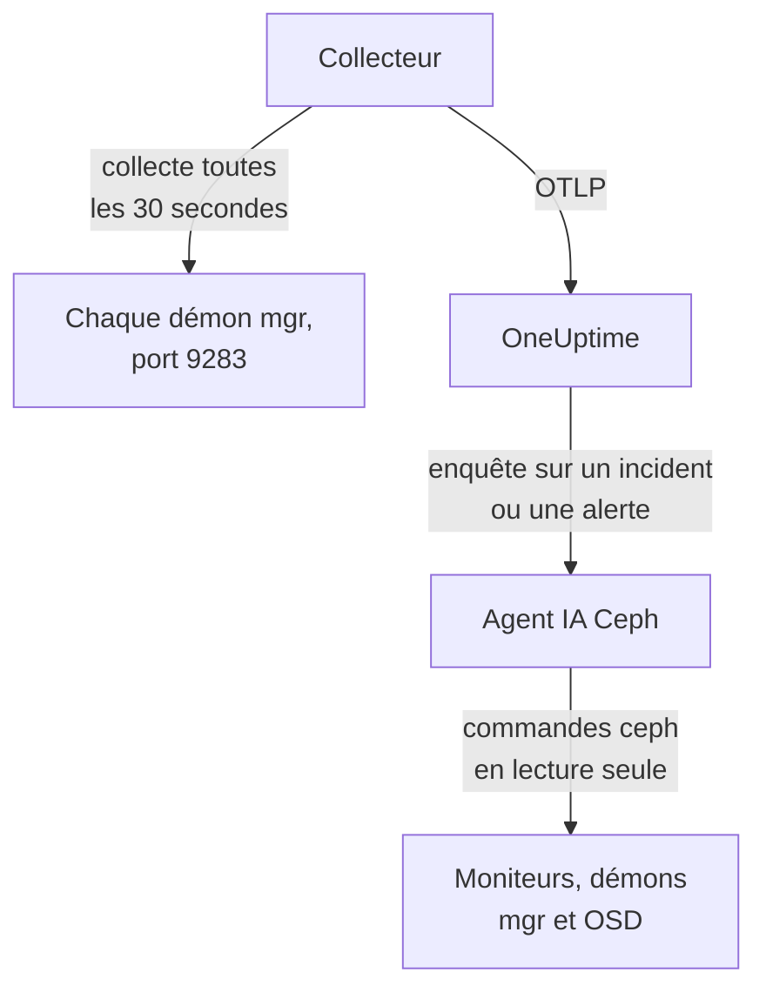

# Agent Ceph

L'agent Ceph de OneUptime surveille un cluster Ceph : sa santé, le quorum des moniteurs, les OSD, les pools et les placement groups. Il collecte le module `prometheus` du mgr Ceph sur chaque démon mgr, appose le nom de votre cluster sur chaque métrique et l'envoie à OneUptime, où le cluster apparaît avec ses OSD, ses pools et ses démons. Les [moniteurs Ceph](/docs/monitor/ceph-monitor) alertent sur ce qui arrive.

:::cards
- [Installer l'agent](#installer-lagent): Activer le module mgr, puis le script d'installation ou Docker Compose.
- [Ce que l'agent collecte](#ce-que-collecte-lagent): Les séries derrière les pages Ceph, les métriques et les modèles d'alerte.
- [Agent IA](#agent-ia): Laisser OneUptime AI lire le cluster pendant qu'elle enquête.
- [Dépannage](#dépannage): Un script de diagnostic, et les problèmes habituels.
:::

## Fonctionnement

L'agent se compose de deux conteneurs que vous exécutez avec Docker Compose sur une machine. Un OpenTelemetry Collector collecte le module `prometheus` du mgr sur chaque démon mgr toutes les 30 secondes. Seul le mgr actif répond avec des métriques : quand il bascule vers un mgr de secours, les métriques continuent donc d'arriver sans aucun changement. L'agent IA Ceph, à côté, permet à OneUptime AI d'exécuter des commandes `ceph` en lecture seule pendant qu'elle enquête sur un incident ou une alerte.



Le cluster s'enregistre avec ses premières données, sous le nom que l'agent appose sur chaque métrique en tant que `ceph.cluster.name`.

## Avant de commencer

- Docker Engine 20.10 ou ultérieur avec le plugin Docker Compose v2, sur une machine qui peut joindre vos démons mgr Ceph sur le port 9283.
- Un shell sur un nœud d'administration Ceph, où la CLI `ceph` fonctionne avec les droits d'administration.
- Une clé d'ingestion. Créez-en une sous **Paramètres du projet → Télémétrie & APM → Clés d'ingestion** et copiez sa valeur.
- Du HTTPS sortant de cette machine vers votre URL OneUptime.

## Installer l'agent

:::steps
### Activer le module prometheus du mgr

Sur un nœud d'administration Ceph :

```bash
ceph mgr module enable prometheus
```

Chaque démon mgr sert alors des métriques Prometheus sur le port `9283` à `/metrics`. Seul le mgr actif renvoie des métriques : les mgr de secours répondent par une réponse vide, ou par une erreur HTTP si `mgr/prometheus/standby_behaviour` vaut `error`. C'est pourquoi l'agent collecte chaque mgr. Listez-les :

```bash
ceph mgr stat                    # active mgr
ceph orch ps --daemon-type mgr   # all mgrs (cephadm clusters)
```

### Installer et démarrer l'agent

:::tabs
@tab install.sh
Téléchargez le script d'installation et exécutez-le sur la machine qui hébergera l'agent :

```bash
curl -sSL https://raw.githubusercontent.com/OneUptime/oneuptime/master/agents/CephAgent/install.sh -o install.sh
bash install.sh
```

Le script demande votre URL OneUptime, la clé d'ingestion, un nom pour le cluster et les endpoints mgr, puis si l'[agent IA](#agent-ia) peut appliquer des corrections. Là où `ceph` fonctionne avec les droits d'administration, il propose aussi de créer le client Ceph propre à l'agent IA. Il s'installe dans `/opt/oneuptime-ceph-agent`, écrit un fichier `.env` en `0600` et démarre l'agent avec Docker Compose. Relancer le script réutilise tout le contenu de ce `.env` au lieu de poser de nouveau les questions, et c'est ainsi que vous [mettez à jour l'agent](#mettre-à-jour-lagent).
@tab Docker Compose
Téléchargez `docker-compose.yml` et `otel-collector-config.yaml` depuis le [répertoire CephAgent](https://github.com/OneUptime/oneuptime/tree/master/agents/CephAgent) dans un nouveau dossier :

```bash
mkdir oneuptime-ceph-agent && cd oneuptime-ceph-agent
curl -fsSLO https://raw.githubusercontent.com/OneUptime/oneuptime/master/agents/CephAgent/docker-compose.yml
curl -fsSLO https://raw.githubusercontent.com/OneUptime/oneuptime/master/agents/CephAgent/otel-collector-config.yaml
```

Créez un fichier `.env` à côté :

```bash title=".env"
ONEUPTIME_URL=YOUR_ONEUPTIME_URL
ONEUPTIME_TELEMETRY_INGESTION_KEY=YOUR_TELEMETRY_INGESTION_TOKEN
CEPH_CLUSTER_NAME=my-ceph-cluster
CEPH_MGR_ENDPOINTS=[ceph-mon-1:9283,ceph-mon-2:9283,ceph-mon-3:9283]
```

Listez chaque démon mgr, l'actif comme ceux de secours, séparés par des virgules et entre crochets : les crochets font lire la valeur au collecteur comme une liste de cibles de collecte. Démarrez l'agent :

```bash
docker compose up -d
```

Le conteneur de l'agent IA démarre aussi, et attend un client Ceph qui lui soit propre : voir [Agent IA](#agent-ia).
:::

### Vérifier que l'agent s'exécute

```bash
docker compose ps
docker logs -f oneuptime-ceph-agent
```

`docker compose ps` liste le collecteur (`oneuptime-ceph-agent`) et l'agent IA (`oneuptime-ceph-ai-agent`). Les journaux du collecteur doivent afficher cette ligne une fois qu'il a démarré :

```text
Everything is ready. Begin running and processing data.
```

### Trouver le cluster dans OneUptime

Ouvrez **Produits → Infrastructure → Ceph → Tous les clusters**. Le cluster apparaît sous son `CEPH_CLUSTER_NAME` en une minute environ, avec ses OSD, ses pools et ses démons.
:::

## Variables d'environnement

Le script d'installation les écrit dans `/opt/oneuptime-ceph-agent/.env` ; une installation Docker Compose les lit dans le `.env` situé à côté de `docker-compose.yml`. Après en avoir modifié une, exécutez `docker compose up -d` dans ce dossier.

| Variable | Obligatoire | Description |
| --- | --- | --- |
| `ONEUPTIME_URL` | Oui | Votre URL OneUptime, comme `https://oneuptime.com` ou votre instance auto-hébergée. Utilisez `http://` et son port si l'instance ne parle que HTTP. |
| `ONEUPTIME_TELEMETRY_INGESTION_KEY` | Oui | La clé d'ingestion de **Paramètres du projet → Télémétrie & APM → Clés d'ingestion**. |
| `CEPH_CLUSTER_NAME` | Oui | Le nom du cluster dans OneUptime, apposé sur chaque métrique comme attribut de ressource `ceph.cluster.name`. Gardez-le stable : le modifier plus tard enregistre un second cluster. Par défaut `ceph`. |
| `CEPH_MGR_ENDPOINTS` | Oui | Chaque démon mgr, en liste `host:port` séparée par des virgules entre crochets, comme `[ceph-mon-1:9283,ceph-mon-2:9283,ceph-mon-3:9283]`. Le script d'installation ajoute les crochets pour vous. |

Les réglages propres à l'agent IA se trouvent sous [Agent IA](#agent-ia).

## Comment l'agent collecte

- **Chaque mgr, toutes les 30 secondes.** Le module `prometheus` du mgr met chaque collecte en cache pendant `mgr/prometheus/scrape_interval` (15 secondes par défaut). Ne collectez jamais plus souvent : vous ne feriez que relire le cache.
- **`honor_labels: true`.** Les labels exportés par Ceph (`ceph_daemon`, `pool_id`, labels d'instance par démon) sont conservés tels quels. Sans ce réglage, le label `instance` serait réécrit pour chaque cible de collecte et changerait à chaque changement de mgr actif, ce qui casse toutes les séries.

## Ce que collecte l'agent

L'agent envoie tout ce qu'exporte le module `prometheus` du mgr. Les pages Ceph, le catalogue de métriques et les modèles d'alerte de OneUptime reposent sur ces séries :

| Catégorie | Métriques |
| --- | --- |
| Santé du cluster | `ceph_health_status` (0 = OK, 1 = WARN, 2 = ERR), `ceph_health_detail` (une série par contrôle de santé actif, avec les labels `name` et `severity`, depuis Quincy ; à la base des modèles d'alerte de contrôle de santé et des **Vérifications de santé actives** de la vue d'ensemble), `ceph_healthcheck_slow_ops`, `ceph_daemon_health_metrics` (par démon, indexé par `type`), `ceph_mon_quorum_status`, `ceph_mon_metadata`, `ceph_cluster_total_bytes`, `ceph_cluster_total_used_bytes` |
| OSD | `ceph_osd_up`, `ceph_osd_in`, `ceph_osd_apply_latency_ms`, `ceph_osd_commit_latency_ms`, `ceph_osd_stat_bytes`, `ceph_osd_stat_bytes_used`, `ceph_osd_numpg`, `ceph_osd_metadata`, par OSD via le label `ceph_daemon` (comme `osd.3`) |
| Pool | `ceph_pool_stored`, `ceph_pool_max_avail`, `ceph_pool_objects`, `ceph_pool_rd`, `ceph_pool_wr`, `ceph_pool_rd_bytes`, `ceph_pool_wr_bytes`, `ceph_pool_metadata`. Les séries de données ne portent qu'un label `pool_id` ; le nom du pool figure sur `ceph_pool_metadata`. |
| Placement groups | `ceph_pg_total`, `ceph_pg_active`, `ceph_pg_clean`, `ceph_pg_degraded`, `ceph_pg_undersized` (tous par pool, via `pool_id`), `ceph_num_objects_degraded`, `ceph_num_objects_misplaced` |
| Démons | `ceph_mgr_metadata`, `ceph_mds_metadata` et `ceph_rgw_metadata`, en plus des métadonnées des moniteurs et des OSD ci-dessus. Chacune nomme un démon et porte sa version dans le label `ceph_version` : la page **Daemons** les liste. |

### Autres cibles de collecte

Le module mgr couvre la santé et la capacité du cluster. Pour y regarder de plus près, ajoutez d'autres jobs sous `scrape_configs` dans `otel-collector-config.yaml` :

- **`ceph-exporter` (Reef 18.2 et ultérieur).** cephadm exécute un démon `ceph-exporter` sur chaque hôte du cluster, qui sert des compteurs de performance par démon sur le port `9926`. Ajoutez une cible par hôte.
- **`node_exporter`.** Le compagnon habituel pour les métriques CPU, mémoire, disque et réseau de chaque hôte Ceph, sur le port `9100` par défaut.

Les deux reçoivent l'attribut de ressource `ceph.cluster.name` du processeur `resource` fourni, et arrivent donc sur le même cluster dans OneUptime.

## Facultatif — Envoyer le journal du cluster Ceph

L'agent peut suivre `/var/log/ceph/ceph.log` et l'envoyer à OneUptime, ce qui remplit la page **Journal du cluster** du cluster. C'est désactivé par défaut, car l'agent doit alors tourner sur un hôte qui possède le journal du cluster : un hôte moniteur, par défaut.

:::steps
### Activer le receiver

Dans `otel-collector-config.yaml`, décommentez le récepteur `filelog` et le pipeline `logs`.

### Monter le répertoire des journaux

Dans `docker-compose.yml`, décommentez le volume qui monte le répertoire dans le collecteur :

```yaml
- /var/log/ceph:/var/log/ceph:ro
```

### Redémarrer l'agent

```bash
docker compose up -d
```
:::

Les lignes sont envoyées au fil de leur écriture. OneUptime lit le format de `ceph.log` (heure, démon, niveau `INF`/`WRN`/`ERR`, message) quand il les affiche, et le processeur `resource` appose `ceph.cluster.name`, si bien que le journal arrive sur ce cluster.

## Étiqueter le cluster avec des étiquettes de projet

Un attribut de ressource qui commence par `oneuptime.label.` devient une étiquette de projet sur le cluster : `oneuptime.label.<dimension>=<value>` correspond à l'étiquette `<dimension>:<value>`. Ajoutez les attributs au processeur `resource` dans `otel-collector-config.yaml`, à côté de `ceph.cluster.name` :

```yaml
processors:
  resource:
    attributes:
      # ...existing attributes...
      - key: oneuptime.label.team
        value: storage
        action: upsert
      - key: oneuptime.label.env
        value: production
        action: upsert
```

Le collecteur ne lit sa configuration qu'au démarrage : exécutez `docker compose restart oneuptime-ceph-agent`. Le cluster affiche alors les étiquettes `team:storage` et `env:production`. Les étiquettes sont comparées sans tenir compte de la casse : une étiquette `Production` existante est donc réutilisée plutôt que dupliquée, et l'agent ne retire jamais une étiquette que quelqu'un a ajoutée dans OneUptime.

## Exécuter comme service systemd

Pour démarrer l'agent avec la machine et le relancer en cas d'échec, installez son unité systemd. Elle suppose que l'agent se trouve dans `/opt/oneuptime-ceph-agent`, là où le script d'installation le place :

```bash
sudo curl -fsSL https://raw.githubusercontent.com/OneUptime/oneuptime/master/agents/CephAgent/systemd/oneuptime-ceph-agent.service -o /etc/systemd/system/oneuptime-ceph-agent.service
sudo systemctl daemon-reload
sudo systemctl enable --now oneuptime-ceph-agent
```

## Mettre à jour l'agent

L'agent signale comme **Version de l'agent** la version du collecteur qu'épinglent ses fichiers. Lorsque celle-ci est plus ancienne que la version qu'épingle cette version de OneUptime, un signe d'avertissement apparaît à côté dans la **Vue d'ensemble** du cluster. Sélectionnez-le pour voir ces commandes. Un agent installé avant que ses fichiers ne signalent une version n'en affiche aucune tant qu'il n'a pas été mis à jour de cette façon.

L'image du collecteur est épinglée dans `docker-compose.yml` et sa configuration est un fichier situé à côté : tirer les images ne suffit donc pas à faire avancer l'agent. Relancez `install.sh` : il réutilise chaque valeur de votre `.env` existant (aucune question n'est reposée), actualise `docker-compose.yml` et `otel-collector-config.yaml` (un fichier que vous avez modifié est conservé sous `<file>.bak.<timestamp>`), tire les images et recrée l'agent pour que le collecteur lise sa nouvelle configuration. Le dossier `ceph/` de l'agent IA reste tel quel.

```bash
curl -sSL https://raw.githubusercontent.com/OneUptime/oneuptime/master/agents/CephAgent/install.sh -o install.sh
bash install.sh
```

Vous l'avez plutôt installé avec Docker Compose ? Dans le dossier de l'agent, téléchargez de nouveau les deux fichiers (et refaites toute modification que vous y aviez apportée), puis tirez les images et recréez l'agent :

```bash
curl -fsSLO https://raw.githubusercontent.com/OneUptime/oneuptime/master/agents/CephAgent/docker-compose.yml
curl -fsSLO https://raw.githubusercontent.com/OneUptime/oneuptime/master/agents/CephAgent/otel-collector-config.yaml
docker compose pull
docker compose up -d --force-recreate
```

## Désinstaller l'agent

```bash
cd /opt/oneuptime-ceph-agent
docker compose down
```

Si vous avez créé le client Ceph de l'agent IA, supprimez-le sur un nœud d'administration avec `ceph auth del client.oneuptime-ai`.

## Agent IA

Le `docker-compose.yml` de l'agent exécute aussi l'**Agent IA Ceph**, `oneuptime-ceph-ai-agent` (image `oneuptime/resource-ai-agent:release`). Pendant que OneUptime AI enquête sur un incident ou une alerte sur ce cluster, elle exécute à travers lui des commandes `ceph` en lecture seule — `ceph health detail`, `ceph osd tree`, `ceph pg dump_stuck`, `ceph crash ls` — et, uniquement si vous l'autorisez, applique des corrections comme remettre un OSD à l'état in ou retirer `noout`. Il s'enregistre comme le cluster nommé `CEPH_CLUSTER_NAME`, comme le collecteur, et apparaît sur la page **IA → Agent IA** du cluster dans OneUptime.

- **Les enquêtes IA sont activées par défaut.** Dès que l'agent se connecte, OneUptime AI enquête avec lui sur les incidents et les alertes de ce cluster, et la **Vue d'ensemble** du cluster affiche l'état de l'agent. Pour arrêter, définissez `ONEUPTIME_AI_INVESTIGATION=false` là où l'agent s'exécute (**Modifier**, sous **Ce que l'IA peut faire** sur la page de l'agent IA, montre comment), ou ne lancez pas l'agent.
- **Son propre client Ceph est la limite stricte.** Il se connecte en tant que `client.oneuptime-ai`, avec le `ceph.conf` minimal du cluster et le keyring de ce client dans un dossier `ceph/` à côté de `docker-compose.yml` (monté en lecture seule sur `/etc/ceph`). Avec des caps de lecture, rien de ce qu'il exécute ne peut modifier le cluster. Lors d'une nouvelle installation, `install.sh` propose de créer le client ; le relancer ne le fait jamais. Ne placez jamais le keyring admin dans ce dossier.
- Il est en **lecture seule**, sauf si vous définissez `ONEUPTIME_AI_ALLOW_WRITES=true` et donnez au client les caps des corrections (le README de l'agent les liste) ; `ONEUPTIME_AI_WRITE_TARGETS` (par exemple `osd.*,cluster`) limite ce qu'une correction peut toucher. `ONEUPTIME_AI_FIXES`, dans le même `.env`, indique comment les corrections s'exécutent — `ask-for-approval` (une personne approuve chacune), `automatic` ou `bypass-approval` — et la page de l'agent IA l'affiche en lecture seule ([Ce que l'IA peut faire, défini par l'agent](/docs/ai/infrastructure-ai-agents#what-ai-may-do-set-by-the-agent)).
- Il se connecte en sortie aux moniteurs (TCP 3300 et 6789) et aux démons mgr et OSD (TCP 6800–7300), s'exécute en UID 1000 sans capabilities, et n'exécute jamais `auth`, `config-key`, `tell` ni rien qui supprime des données. Supprimez le service `oneuptime-ceph-ai-agent` de `docker-compose.yml` si vous n'utilisez pas OneUptime AI.

Pour créer le client à la main, exécutez ceci sur un nœud d'administration Ceph, dans le dossier de l'agent (copiez les deux fichiers dans le dossier `ceph/` de la machine de l'agent s'il s'agit d'une autre machine) :

```bash
mkdir -p ceph
ceph config generate-minimal-conf > ceph/ceph.conf
ceph auth get-or-create client.oneuptime-ai mon 'allow r' mgr 'allow r' osd 'allow r' -o ceph/ceph.client.oneuptime-ai.keyring
sudo chown 1000:1000 ceph/ceph.client.oneuptime-ai.keyring
sudo chmod 600 ceph/ceph.client.oneuptime-ai.keyring
docker compose up -d
```

Ce qu'il peut exécuter, comment fonctionnent les corrections et comment le dépanner : [Infrastructure AI Agents](/docs/ai/infrastructure-ai-agents#ceph-clusters).

## Dépannage

:::details Exécutez d'abord le script de diagnostic
L'agent est livré avec un script, [`troubleshoot.sh`](https://github.com/OneUptime/oneuptime/blob/master/agents/CephAgent/troubleshoot.sh), qui vérifie toute la chaîne : le runtime de conteneurs, chaque endpoint mgr configuré, le nom du cluster apposé sur chaque métrique, la forme du jeton, les métriques propres au collecteur, et si OneUptime accepte la clé d'ingestion. Il avertit quand aucun endpoint ne renvoie `ceph_health_status`, ou quand un seul est configuré, puisque seul le mgr actif sert des métriques. La vérification de la clé est la plus importante. OneUptime refuse une clé erronée avec `401` (`422` pour une clé désactivée ou une clé de navigateur), et le collecteur traite les deux comme définitifs : il supprime le lot et journalise une seule erreur `Exporting failed`, facile à manquer alors que le conteneur reste en bonne santé. Le script interroge `GET <url>/otlp/v1/validate` depuis le réseau de l'agent pour obtenir directement `200` (valide) ou `401` (invalide), et se rabat sur `POST /fluentd/v1/logs` avec les serveurs plus anciens.

```bash
curl -sSL https://raw.githubusercontent.com/OneUptime/oneuptime/master/agents/CephAgent/troubleshoot.sh -o troubleshoot.sh
bash troubleshoot.sh    # add -d <dir> if you installed outside /opt/oneuptime-ceph-agent
```

Il se termine par un verdict qui nomme la cause la plus probable.
:::

:::details Aucun cluster n'apparaît dans OneUptime
1. Lisez les journaux du collecteur : `docker logs oneuptime-ceph-agent`. Un `401` à l'export signifie une clé d'ingestion erronée ; une connexion refusée signifie une `ONEUPTIME_URL` erronée.
2. Vérifiez qu'un mgr sert des métriques : `curl http://ACTIVE_MGR_HOST:9283/metrics | head` doit afficher des lignes `ceph_*`. Sinon, activez le module avec `ceph mgr module enable prometheus`.
3. Vérifiez que `CEPH_MGR_ENDPOINTS` est entre crochets. Sans eux, le collecteur lit toute la liste séparée par des virgules comme une seule cible, qui n'existe pas.
:::

:::details Le cluster apparaît comme déconnecté
Un cluster passe à l'état déconnecté quand OneUptime n'a rien reçu de lui pendant 15 minutes ; OneUptime vérifie toutes les 5 minutes, et le temps pendant lequel il ne recevait lui-même pas de données ne compte pas. Vérifiez que le collecteur tourne (`docker compose ps`), que ses journaux ne montrent aucune erreur d'export et que la machine joint toujours votre URL OneUptime. Le cluster repasse à l'état connecté avec ses données suivantes.
:::

:::details Les métriques s'arrêtent après une bascule du mgr
Vous ne collectez probablement que le mgr qui était actif auparavant. Listez chaque démon mgr dans `CEPH_MGR_ENDPOINTS` : collecter les mgr de secours ne coûte presque rien, et ils répondent par des réponses vides.
:::

:::details Erreurs de collecte pour les mgr de secours dans les journaux du collecteur
C'est attendu quand `mgr/prometheus/standby_behaviour` vaut `error` sur votre cluster : les mgr de secours répondent alors par HTTP 500. La collecte du mgr actif réussit toujours, ces erreurs ne sont donc que du bruit ; remettez le comportement à `default` pour les faire taire.
:::

:::details Les métriques arrivent dans le mauvais cluster
OneUptime enregistre un cluster Ceph par son `ceph.cluster.name`, que l'agent tire de `CEPH_CLUSTER_NAME`. Le modifier après les premières données crée un second cluster au lieu de renommer le premier.
:::

## Étapes suivantes

:::cards
- [Surveillance Ceph](/docs/monitor/ceph-monitor): Alerter sur la santé, les OSD, les placement groups, la capacité, les crashs et les opérations lentes.
- [Agent Proxmox](/docs/telemetry/proxmox): Ceph tourne sous Proxmox VE ? Surveillez aussi le cluster.
- [Infrastructure AI Agents](/docs/ai/infrastructure-ai-agents): Ce que l'agent IA Ceph peut exécuter, et comment fonctionnent les corrections.
- [Collecteur OpenTelemetry sur l'hôte](/docs/telemetry/host-otel-collector): La vue système de chaque hôte Ceph.
:::
