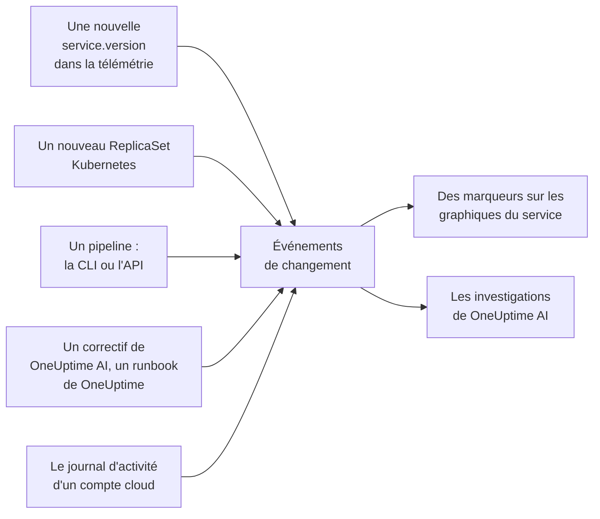

# Déploiements et changements

OneUptime garde une trace de ce qui a changé dans votre projet : déploiements, rollouts Kubernetes, changements de configuration, changements dans vos comptes cloud connectés et correctifs qu'il a exécutés lui-même. Chaque changement est dessiné comme un marqueur sur les graphiques de son service ou de sa ressource cloud, et OneUptime AI les lit quand il investigue un incident : « ça a commencé juste après le déploiement de 10:02 » est ainsi la première chose que vous apprenez, pas la dernière.

:::cards
- [Ce que OneUptime enregistre de lui-même](#ce-que-oneuptime-enregistre-de-lui-même): Les déploiements et les rollouts tirés de la télémétrie, les changements de vos comptes cloud, et ses propres correctifs.
- [Enregistrer un déploiement depuis un pipeline](#enregistrer-un-déploiement-depuis-un-pipeline): La CLI, GitHub Actions et l'API.
- [Comment OneUptime AI utilise les changements](#comment-oneuptime-ai-utilise-les-changements): Les changements suspects de chaque investigation.
- [Référence](#référence): Champs, attributs et limites.
:::

## Fonctionnement



## Ce que OneUptime enregistre de lui-même

Pour ceux-là, vous n'avez rien à envoyer. OneUptime les enregistre à partir de la télémétrie qu'il reçoit déjà, et de ce qu'il fait lui-même.

| Changement | Enregistré quand | Source |
| --- | --- | --- |
| Un déploiement | Un service commence à signaler une `service.version` qu'il n'avait encore jamais signalée dans son environnement | `service-version` |
| Un rollout | Les pods d'un Deployment Kubernetes commencent à exécuter un ReplicaSet qu'ils n'avaient encore jamais exécuté : une nouvelle image, une variable d'environnement ou une référence de configuration modifiée, ou un redémarrage | `kubernetes` |
| Un correctif exécuté par OneUptime AI | Un agent IA signale le résultat d'une commande qui modifie quelque chose, comme `kubectl rollout restart` | `oneuptime-ai` |
| Un runbook | Un runbook exécuté par OneUptime se termine, échoue ou est annulé après avoir démarré | `runbook` |
| Un changement cloud | Le journal d'activité d'un compte cloud connecté enregistre un changement : AWS CloudTrail, le journal d'activité Azure ou le journal d'audit Admin Activity de Google Cloud | `cloud` |
| Un événement du fournisseur | Le fournisseur cloud publie un événement de santé sur le compte : AWS Health, Azure Service Health ou Resource Health, ou Google Cloud Service Health | `cloud-health` |

- **La première version qu'un service signale est sa référence, pas un déploiement.** Un service qui tourne depuis des mois n'est pas déployé au moment où OneUptime commence à recevoir sa télémétrie.
- **Un retour arrière vers une version vue au cours des 30 derniers jours n'est pas enregistré,** car cette version n'est pas nouvelle. Un retour arrière exécuté par OneUptime AI est enregistré comme un correctif.
- **Au-delà de 6 nouvelles versions ou nouveaux ReplicaSets en une heure, plus rien n'est enregistré jusqu'à la fin de l'heure.** Sinon, une « version » qui change avec chaque pod, comme un horodatage de build, enregistrerait un déploiement pour chaque pod.

Un déploiement n'est enregistré que pour un service qui signale `service.version`. Définissez-la, avec l'environnement et le commit, dans les attributs de ressource de votre SDK ou de votre collector OpenTelemetry :

```bash
OTEL_RESOURCE_ATTRIBUTES="service.version=2.3.1,deployment.environment.name=production,vcs.ref.head.revision=$GIT_SHA"
```

Un rollout nécessite l'[agent Kubernetes](/docs/telemetry/kubernetes-agent), qui marque la télémétrie de chaque pod avec son Deployment et son ReplicaSet.

Un changement cloud ou un événement du fournisseur nécessite un [compte cloud connecté](/docs/telemetry/cloud-accounts). Chacun est lié à la ressource cloud qu'il nomme, quand OneUptime liste cette ressource, et dessiné sur les graphiques de la ressource. Son type vient de l'opération : `deployment`, `scaling` ou `rollback` quand le nom de l'opération le dit, `config-change` sinon, et `provider-event` pour un événement de santé. Les graphiques filtrés sur aucune ressource laissent de côté le journal d'activité d'un compte cloud, pour qu'un compte chargé n'éclipse pas vos déploiements ; les événements de santé du fournisseur y restent.

## Enregistrer un déploiement depuis un pipeline

Un pipeline peut enregistrer un déploiement, ou tout autre changement, au moment où il se produit : un changement de configuration, une migration, un drapeau de fonctionnalité. Il écrit avec une clé d'ingestion de télémétrie de votre projet, celle avec laquelle vos applications envoient leur télémétrie. Créez-en une sous **Paramètres du projet → Télémétrie & APM → Clés d'ingestion**.

Une clé épinglée à un service enregistre chaque changement sous ce service.

:::tabs
@tab CLI
```bash
oneuptime deploy \
  --service checkout \
  --service-version 2.3.1 \
  --commit "$GIT_SHA" \
  --environment production \
  --url https://oneuptime.com \
  --ingestion-key "$ONEUPTIME_TELEMETRY_INGESTION_KEY"
```
@tab GitHub Actions
```yaml title=".github/workflows/deploy.yml"
- name: Record the deploy in OneUptime
  env:
    ONEUPTIME_URL: https://oneuptime.com
    ONEUPTIME_TELEMETRY_INGESTION_KEY: ${{ secrets.ONEUPTIME_TELEMETRY_INGESTION_KEY }}
  run: |
    npx -y @oneuptime/cli deploy \
      --service checkout \
      --service-version "${{ github.ref_name }}" \
      --commit "${{ github.sha }}" \
      --repository "${{ github.server_url }}/${{ github.repository }}" \
      --environment production
```
@tab API
```bash
curl -X POST https://oneuptime.com/telemetry/change-events/v1/ingest \
  -H "Content-Type: application/json" \
  -H "x-oneuptime-token: $ONEUPTIME_TELEMETRY_INGESTION_KEY" \
  -d '{"events": [{"serviceName": "checkout", "version": "2.3.1", "commit": "1a2b3c4", "environment": "production"}]}'
```
:::

Sur un OneUptime auto-hébergé, utilisez votre propre adresse au lieu de `https://oneuptime.com`. L'API répond avec le nombre d'événements qu'elle a stockés et le nombre qu'elle a ignorés :

```json
{ "ingested": 1, "skipped": 0 }
```

Voir [`oneuptime deploy`](/docs/cli/command-reference#oneuptime-deploy) pour toutes les options de la CLI.

## Comment OneUptime AI utilise les changements

Chaque [investigation IA](/docs/ai/ai-sre) d'un incident ou d'une alerte part des changements enregistrés dans les 2 heures qui précèdent, et dans les 10 minutes qui suivent, pour un pipeline qui enregistre son déploiement une fois le rollout terminé. Les changements des services, clusters, hôtes et ressources cloud auxquels l'incident est lié passent en premier.

Pour au plus 4 d'entre eux qui nomment un service, OneUptime lit la télémétrie du service dans les 30 minutes avant et après le changement, et marque le changement comme **suspect** quand le service s'est dégradé de façon mesurable juste après :

| Signal | Suspect quand |
| --- | --- |
| Spans en échec | Le taux d'erreur a au moins doublé et a augmenté d'au moins un point de pourcentage, sur au moins 10 spans en échec |
| Latence | Le p99 a augmenté d'au moins la moitié, et d'au moins 100 ms |
| Exceptions | Au moins trois fois plus par minute, et au moins 10 d'entre elles |
| Nouvelles exceptions | Un type d'exception vu pour la première fois dans la version livrée par le changement, entre 10 minutes avant le changement et 30 minutes après, s'est produit au moins 3 fois |

OneUptime décide quel changement est suspect à partir de ces chiffres, pas de ce que dit le titre d'un changement. L'investigation vérifie d'abord un changement suspect, dit s'il a causé l'incident, et dit si un retour arrière est le correctif sûr le plus rapide.

Quand le changement suspect est un rollout Kubernetes sur un cluster dont les [correctifs IA](/docs/ai/ai-sre#fonctionnement-des-correctifs) sont activés, OneUptime AI effectue d'abord un retour arrière de ce rollout, avec un `kubectl rollout undo` que OneUptime construit à partir du changement enregistré. Pour un déploiement qui livre du code, le retour arrière passe par ses commits : l'investigation nomme le commit ou la pull request qui a causé le problème, pour qu'une [pull request de correctif](/docs/ai/ai-sre#correctifs-de-code-automatiques) puisse annuler exactement cela.

OneUptime vérifie aussi chaque déploiement de lui-même, que quelqu'un soit alerté ou non. Une fois écoulées les 30 minutes qui suivent un déploiement, il les compare aux 30 minutes précédentes selon les mêmes seuils, et quand le service s'est dégradé, une [analyse IA](/docs/ai/ai-sre#analyses-détection-proactive) nomme le déploiement sur ce service.

Une pull request de correctif que OneUptime AI a ouverte est vérifiée de la même façon : dès qu'un déploiement enregistré contient son commit, OneUptime y surveille ce à quoi servait le correctif - l'exception, l'opération qu'il a accélérée, le moniteur derrière l'incident ou l'alerte, la télémétrie qu'il ajoute - et indique si le correctif a fonctionné (voir [Correctifs de code automatiques](/docs/ai/ai-sre#correctifs-de-code-automatiques)). Le correctif déployé n'est lu dans la version du déploiement que lorsque la télémétrie du service signale elle-même cette version, et sinon à partir de 10 minutes après le déploiement, une fois les anciennes instances arrêtées.

Dans une investigation et dans [Demander à l'IA](/docs/ai/ask-ai), `recent_changes` liste les changements sur n'importe quelle période, et `get_change_details` montre ce qu'un déploiement a livré : les commits depuis le déploiement précédent du service, leurs auteurs, les pull requests et les fichiers qu'ils ont modifiés. Il faut pour cela le commit sur le changement et un dépôt connecté via la [GitHub App](/docs/ai/github-app).

## Référence

### Champs

| Champ | Ce que c'est |
| --- | --- |
| `title` | Ce qui a changé, comme `Deploy 2.3.1`. Un déploiement qui envoie `version` peut l'omettre |
| `eventType` | Le type de changement : `deployment` (par défaut), `config-change`, `scaling`, `rollback`, `feature-flag` ou le vôtre |
| `serviceName` | Le service auquel il appartient. Sans service, le changement concerne tout le projet |
| `time` | Quand il a eu lieu, en ISO 8601 ou en secondes ou millisecondes epoch. Par défaut, le moment où il est arrivé |
| `description` | Les détails du changement |
| `version` | La version déployée |
| `previousVersion` | La version qu'elle a remplacée |
| `commit` | Le commit déployé (aussi `commitSha` ou `sha`) |
| `repository` | Le dépôt du commit (aussi `repositoryUrl`) |
| `branch` | La branche déployée |
| `pullRequest` | La pull request déployée |
| `environment` | L'environnement de déploiement |
| `attributes` | Jusqu'à 50 attributs supplémentaires, en texte, en nombres ou en booléens |

Les champs de premier niveau sont stockés comme attributs sous les noms OpenTelemetry : `version` comme `service.version`, `commit` comme `vcs.ref.head.revision`, `repository` comme `vcs.repository.url.full`, `branch` comme `vcs.ref.head.name`, `pullRequest` comme `vcs.change.id` et `environment` comme `deployment.environment.name`. Un attribut envoyé sous l'un de ces noms l'emporte sur son champ.

Les attributs dont le nom commence par `oneuptime.` appartiennent à OneUptime et sont retirés de ce qu'un pipeline envoie. Chaque changement qu'un pipeline enregistre l'indique dans `oneuptime.change.source`, qui vaut `api`.

Un changement lu dans un compte cloud nomme le compte et la ressource sous les noms d'OpenTelemetry, `cloud.provider`, `cloud.account.id`, `cloud.region` et `cloud.resource_id`, et garde l'opération dans `oneuptime.cloud.operation`, qui l'a lancée dans `oneuptime.cloud.actor`, si elle a échoué dans `oneuptime.change.status` et son compte cloud dans `oneuptime.cloud_account.id`.

### Limites

| Limite | Valeur |
| --- | --- |
| Événements par requête | 100 |
| Titre | 500 caractères |
| Description | 5 000 caractères |
| Attributs | 50 |
| Heure | Une heure située plus de 366 jours dans le passé, ou plus de 60 minutes dans le futur, est remplacée par l'heure d'arrivée de l'événement |

## Étapes suivantes

:::cards
- [AI SRE](/docs/ai/ai-sre): Ce qu'une investigation lit, et comment elle corrige ce qu'elle trouve.
- [Référence des commandes](/docs/cli/command-reference): Chaque commande de la CLI.
- [OpenTelemetry](/docs/telemetry/open-telemetry): Envoyer la télémétrie de vos services, avec leurs versions.
- [Connecter un compte cloud](/docs/telemetry/cloud-accounts): Les changements et les événements de santé de vos comptes AWS, Azure et Google Cloud.
:::
