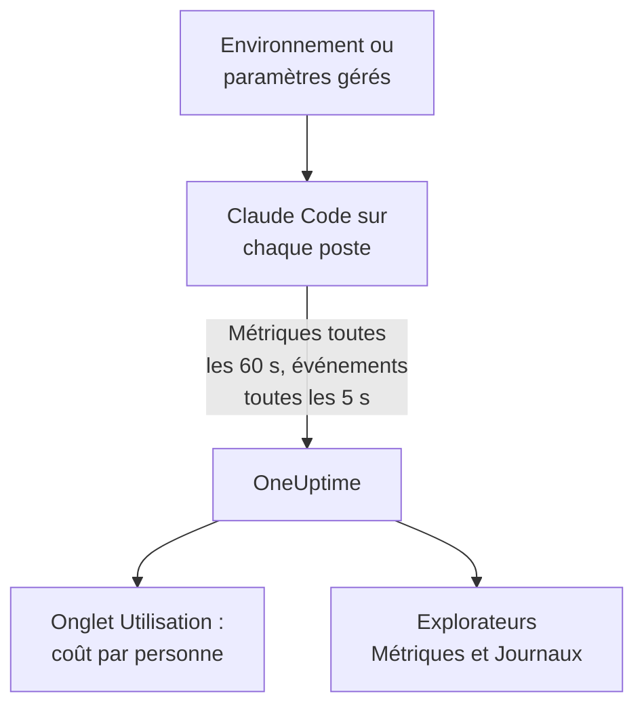

# Claude Code

Claude Code exporte lui-même des métriques et des événements OpenTelemetry, directement vers OneUptime : aucun collector ni aucune passerelle entre les deux. Activez-le avec quelques variables d'environnement, ou pour toute une flotte avec un seul fichier de paramètres gérés, et voyez le coût, les jetons, les sessions, les commits et les modifications acceptées par développeur.

:::cards
- [Configurer un poste](#configurer-un-poste): Six variables d'environnement et un redémarrage.
- [Déployer sur la flotte](#déployer-sur-la-flotte): Un fichier de paramètres gérés sur chaque poste.
- [Attribuer les dépenses aux personnes](#attribuer-lusage-aux-personnes-et-aux-équipes): Qui est connecté, et quand vous devez définir l'identité vous-même.
- [Dépannage](#dépannage): Que vérifier quand rien n'arrive.
:::

## Fonctionnement



Claude Code envoie :

- **Coût et jetons** : `claude_code.cost.usage` (USD) et `claude_code.token.usage`, par modèle, par agent principal ou sous-agent, et par l'agent, la skill, le plugin ou le serveur MCP qui a fait l'appel.
- **Activité** : sessions, commits, pull requests, lignes de code ajoutées et supprimées, et temps actif.
- **Décisions de modification** : `claude_code.code_edit_tool.decision` compte les modifications acceptées et refusées, si bien que le taux d'acceptation vaut `accept / (accept + reject)`, par langage et par outil.
- **Événements** : prompts, résultats d'outils, requêtes et erreurs d'API, changements de mode de permission et connexions aux serveurs MCP, sous forme d'enregistrements de log OTLP.

Chaque point de métrique et chaque événement porte `user.email` quand le développeur est connecté avec un compte Claude, et OneUptime le lit comme l'employé sur les métriques, là où se trouvent le coût et les jetons.

## Avant de commencer

1. Créez une clé d'ingestion de télémétrie sous **Paramètres du projet → Télémétrie & APM → Clés d'ingestion**.
2. Votre point de terminaison OTLP est `https://oneuptime.com/otlp`, ou `https://YOUR-ONEUPTIME-HOST/otlp` si vous hébergez OneUptime vous-même.
3. Utilisez une seule clé pour toute la flotte. Elle se retrouve sur chaque poste de développeur : traitez-la comme un identifiant partagé qui ne peut qu'envoyer des données, et renouvelez-la comme n'importe quel autre.

## Configurer un poste

:::steps
### Exporter les variables

Ajoutez-les à votre profil de shell (`.zshrc` ou `.bashrc`), ou exportez-les dans le terminal depuis lequel vous lancez Claude Code :

```bash
export CLAUDE_CODE_ENABLE_TELEMETRY=1
export OTEL_METRICS_EXPORTER=otlp
export OTEL_LOGS_EXPORTER=otlp
export OTEL_EXPORTER_OTLP_PROTOCOL=http/protobuf
export OTEL_EXPORTER_OTLP_ENDPOINT="https://oneuptime.com/otlp"
export OTEL_EXPORTER_OTLP_HEADERS="x-oneuptime-token=YOUR_INGESTION_TOKEN"
```

| Variable | Ce qu'elle fait |
| --- | --- |
| `CLAUDE_CODE_ENABLE_TELEMETRY` | L'interrupteur principal : sans lui, rien n'est exporté. |
| `OTEL_METRICS_EXPORTER`, `OTEL_LOGS_EXPORTER` | `otlp` envoie à OneUptime. `otlp,console` affiche aussi ce qui est envoyé, pratique pendant la configuration. |
| `OTEL_EXPORTER_OTLP_PROTOCOL` | `http/protobuf` ; `http/json` et `grpc` fonctionnent aussi. |
| `OTEL_EXPORTER_OTLP_ENDPOINT` | L'URL de base. Claude Code ajoute lui-même `/v1/metrics` et `/v1/logs`. |
| `OTEL_EXPORTER_OTLP_HEADERS` | Des paires `key=value` séparées par des virgules ; ici, votre clé d'ingestion. |

### Redémarrer Claude Code

Les variables sont lues au démarrage de Claude Code. Les métriques sont envoyées toutes les 60 secondes et les événements toutes les 5 secondes : utilisez donc Claude Code une minute avant de regarder.

### Vérifier que les données arrivent

Ouvrez **Métriques** et cherchez `claude_code.token.usage`, puis ouvrez **Produits → IA / LLM** et allez dans **Utilisation** : votre coût apparaît sous votre e-mail, marqué **depuis les métriques GenAI**.
:::

Pour envoyer les métriques et les événements à des endroits différents, définissez plutôt `OTEL_EXPORTER_OTLP_METRICS_ENDPOINT` et `OTEL_EXPORTER_OTLP_LOGS_ENDPOINT`, avec le chemin complet (`https://oneuptime.com/otlp/v1/metrics`, `https://oneuptime.com/otlp/v1/logs`).

## Déployer sur la flotte

Pour une organisation, livrez les mêmes variables dans un fichier de paramètres gérés. Il a la forme de `settings.json`, avec les variables dans un bloc `env` :

```json title="managed-settings.json"
{
  "env": {
    "CLAUDE_CODE_ENABLE_TELEMETRY": "1",
    "OTEL_METRICS_EXPORTER": "otlp",
    "OTEL_LOGS_EXPORTER": "otlp",
    "OTEL_EXPORTER_OTLP_PROTOCOL": "http/protobuf",
    "OTEL_EXPORTER_OTLP_ENDPOINT": "https://oneuptime.com/otlp",
    "OTEL_EXPORTER_OTLP_HEADERS": "x-oneuptime-token=YOUR_INGESTION_TOKEN",
    "OTEL_RESOURCE_ATTRIBUTES": "team.id=platform,cost_center=eng-123"
  }
}
```

:::steps
### Placer le fichier là où Claude Code le lit

| Plateforme | Chemin |
| --- | --- |
| macOS | `/Library/Application Support/ClaudeCode/managed-settings.json` |
| Linux et WSL | `/etc/claude-code/managed-settings.json` |
| Windows | `C:\Program Files\ClaudeCode\managed-settings.json` |

Claude Code ne lit plus l'ancien chemin Windows `C:\ProgramData\ClaudeCode\managed-settings.json`. Si vous livrez déjà un fichier de paramètres gérés, ajoutez plutôt un fichier complémentaire, comme `managed-settings.d/10-telemetry.json` à côté : Claude Code fusionne d'abord `managed-settings.json`, puis chaque fichier `*.json` de `managed-settings.d/` par ordre alphabétique.

### Vérifier un poste

Lancez `/status` dans Claude Code. La ligne `Setting sources` doit indiquer `Enterprise managed settings (file)`, ou `(drop-ins)` ou `(file + drop-ins)` pour un fichier complémentaire. Une autre source entre parenthèses signifie qu'une source de rang supérieur l'a emporté, et que la vôtre n'a pas été utilisée.

### Voir arriver la flotte

Dans l'onglet **Utilisation**, chaque développeur apparaît sous forme de ligne dès qu'il a utilisé Claude Code avec les nouveaux paramètres.
:::

Le même JSON peut aussi venir des paramètres gérés par le serveur dans la console d'administration de claude.ai (récupérés au démarrage et toutes les heures), d'un profil de configuration macOS dans le domaine `com.anthropic.claudecode`, ou d'une valeur `Settings` sous `HKLM\SOFTWARE\Policies\ClaudeCode` sous Windows.

:::details Quelle source gérée l'emporte, et comment se combinent les variables de télémétrie
Par défaut, Claude Code utilise la source de plus haut rang qui définit une clé de politique, et ignore les autres : les paramètres gérés par le serveur, puis une politique MDM ou du système, puis les fichiers de paramètres gérés, puis la valeur de registre `HKCU` par utilisateur. Le bloc `env` est l'exception : depuis la version 2.1.223, il est fusionné variable par variable entre les sources d'administration.

Les variables de télémétrie, non : les variables `OTEL_EXPORTER_OTLP_*`, les interrupteurs de contenu `OTEL_LOG_*`, `OTEL_LOGS_EXPORTER` et les variables du traçage bêta viennent ensemble de la source de plus haut rang qui en définit une, si bien qu'un point de terminaison d'une source n'est jamais associé aux identifiants d'une autre. Si une source de rang supérieur en définit une, un fichier complémentaire de télémétrie n'apporte rien.

Les paramètres gérés par le serveur demandent une étape de plus : un `OTEL_EXPORTER_OTLP_ENDPOINT` non vide ne s'applique qu'après que chaque développeur a accepté une fenêtre d'approbation de sécurité dans une session interactive, et les changements des paramètres de l'exportateur s'appliquent au lancement suivant. Les fichiers et les politiques MDM n'ont pas de fenêtre.
:::

:::details Renouveler la clé d'ingestion sans modifier chaque poste
Au lieu d'un en-tête fixe, définissez `"otelHeadersHelper": "/path/to/generate-otel-headers.sh"` dans les paramètres. Le script affiche un objet JSON plat d'en-têtes, comme `{"x-oneuptime-token":"..."}`. Claude Code l'exécute au démarrage puis toutes les `CLAUDE_CODE_OTEL_HEADERS_HELPER_DEBOUNCE_MS` millisecondes (`1740000` par défaut, 29 minutes). Les échecs apparaissent dans `/status`.
:::

## Attribuer l'usage aux personnes et aux équipes

**L'employé, c'est `user.email`.** Claude Code l'envoie quand le développeur est connecté avec un compte Claude, et aucune variable ne permet de le désactiver. OneUptime le lit sur chaque point de coût et de jetons, sans configuration.

**Les autres connexions n'envoient pas d'e-mail.** Avec une clé d'API, ou avec Claude sur Amazon Bedrock, Google Cloud ou Microsoft Foundry, il n'y a pas de compte Claude dans la session, et Claude Code n'envoie que `user.id` et `session.id`. Définissez l'identité vous-même, par poste, dans les paramètres gérés ou un script de lancement :

```bash
export OTEL_RESOURCE_ATTRIBUTES="user.email=jdoe@example.com,team.id=platform"
```

**`user.id` n'est pas une personne.** C'est un identifiant aléatoire que Claude Code écrit dans `~/.claude.json` au premier lancement : un par installation, et un nouveau si le fichier est supprimé. Sans e-mail, chaque installation apparaît sur sa propre ligne. Une exception : une session connectée à une passerelle d'applications Claude envoie l'identité connectée (`user.id` est le sujet du fournisseur d'identité, `user.email` l'e-mail) et ignore les clés `user.*` que vous définissez vous-même.

**Les équipes et centres de coûts** viennent de `OTEL_RESOURCE_ATTRIBUTES` : OneUptime lit `team.id`, `team`, `cost_center` et `department`. Les valeurs ne peuvent pas contenir d'espaces, et les guillemets ne les protègent pas : écrivez `team=Platform_Engineering`, ou encodez en pourcent, comme `team=Platform%20Engineering`. Claude Code copie ces clés sur chaque point de données (`OTEL_METRICS_INCLUDE_RESOURCE_ATTRIBUTES`, activé par défaut), et OneUptime les lit dans les deux cas. Une clé que vous définissez ne remplace jamais une clé que Claude Code définit lui-même.

## Ce que montre OneUptime

Sous **Produits → IA / LLM → Utilisation**, `claude_code.cost.usage` alimente les tableaux **Employé**, **Équipe** et **Modèle**, et `claude_code.token.usage` les totaux de jetons. Deux règles décident de ce que vous voyez :

- **Les métriques prennent le relais des spans ; elles ne s'y ajoutent jamais.** Si le même projet reçoit des spans GenAI avec un coût depuis vos propres applications, les dépenses de Claude Code n'apparaissent pas. Envoyez Claude Code dans un projet à lui. Voir [Les spans d'abord, les métriques en relais](/docs/telemetry/ai-llm-observability#les-spans-dabord-les-métriques-en-relais).
- **Une ligne issue des métriques ne porte que le coût.** Ses cellules d'appels et de jetons affichent `—`, et les tableaux **Fournisseur** et **Application / Service** restent vides : les métriques ne nomment aucun fournisseur et n'appartiennent à aucun service OneUptime.

Tout le reste, comme le taux d'acceptation, les lignes de code, les commits et les pull requests par développeur, ou les dépenses par `query_source`, se représente sur un [tableau de bord](/docs/dashboards/index) à partir des métriques ci-dessous, et s'alerte avec une [surveillance des métriques](/docs/monitor/metrics-monitor).

## Métriques

Chaque métrique est un compteur, et porte les attributs standard en plus des siens.

| Métrique | Unité | Ses propres attributs |
| --- | --- | --- |
| `claude_code.session.count` | aucune | `start_type` : `fresh`, `resume`, `continue`, `agents_view` |
| `claude_code.lines_of_code.count` | aucune | `type` : `added`, `removed` ; `model` |
| `claude_code.commit.count` | aucune | aucun |
| `claude_code.pull_request.count` | aucune | aucun |
| `claude_code.cost.usage` | USD | `model` ; `query_source` : `main`, `subagent`, `auxiliary` ; `speed` : `fast`, `normal` ; `effort` ; `agent.name`, `skill.name`, `plugin.name`, `marketplace.name`, `mcp_server.name`, `mcp_tool.name` |
| `claude_code.token.usage` | jetons | `type` : `input`, `output`, `cacheRead`, `cacheCreation` ; et les mêmes attributs que `claude_code.cost.usage` |
| `claude_code.code_edit_tool.decision` | aucune | `tool_name` : `Edit`, `Write`, `NotebookEdit` ; `decision` : `accept`, `reject` ; `source` ; `language` |
| `claude_code.active_time.total` | s | `type` : `user` (au clavier), `cli` (outils et réponses du modèle) |

Les attributs standard sont `session.id`, `app.version`, `app.entrypoint`, `organization.id`, `user.account_uuid`, `user.account_id`, `user.id`, `user.email` et `terminal.type`, plus vos `OTEL_RESOURCE_ATTRIBUTES`. Certains peuvent être désactivés : voir [Limiter le volume des métriques](#limiter-le-volume-des-métriques).

- Les types de jetons de cache sont en camelCase : `cacheRead` et `cacheCreation`. Les totaux de jetons de OneUptime ne comptent que `input` et `output`.
- Sur les métriques de coût et de jetons, les noms de vos propres agents et serveurs MCP, ainsi que des plugins et skills tiers, valent `custom` ou `third-party` sauf si `OTEL_LOG_TOOL_DETAILS=1` est défini (Claude Code 2.1.273 ou plus récent).

## Événements

Les événements arrivent sous forme d'enregistrements de log OTLP, chacun avec `event.name`, `event.timestamp` et `event.sequence`. Ceux que vous utiliserez le plus :

| Événement | Ce qu'il enregistre |
| --- | --- |
| `claude_code.user_prompt` | Un prompt : sa longueur et sa commande ; le texte seulement si vous l'activez |
| `claude_code.api_request` | Une requête au modèle : `model`, `cost_usd`, `cost_usd_micros`, `duration_ms`, `input_tokens`, `output_tokens`, jetons de cache |
| `claude_code.api_error` | Une requête qui a échoué après ses nouvelles tentatives : `model`, `error`, `status_code`, `attempt` |
| `claude_code.tool_result` | Une exécution d'outil : `tool_name`, `success`, `duration_ms`, et la décision qui l'a autorisée |
| `claude_code.tool_decision` | Si un outil a été autorisé, et par quoi |
| `claude_code.mcp_server_connection` | Un serveur MCP qui se connecte ou échoue |

Claude Code en envoie beaucoup d'autres, comme les refus, les changements de mode de permission et les événements de plugins, de hooks et de skills : la [référence de supervision](https://code.claude.com/docs/en/monitoring-usage) d'Anthropic les liste tous. Dans `cost_usd_micros`, le coût est un nombre entier de millionièmes d'USD, qui s'additionne sans dérive d'arrondi.

## Limiter le volume des métriques

Claude Code met `session.id` sur chaque point de données par défaut, et chaque session crée une nouvelle série. Sur une flotte, ce seul attribut fait grimper le volume des métriques, et le suivi des coûts n'en a pas besoin :

```bash
export OTEL_METRICS_INCLUDE_SESSION_ID=false
```

| Variable | Défaut | Ajoute |
| --- | --- | --- |
| `OTEL_METRICS_INCLUDE_SESSION_ID` | `true` | `session.id`, une nouvelle valeur à chaque session |
| `OTEL_METRICS_INCLUDE_VERSION` | `false` | `app.version` |
| `OTEL_METRICS_INCLUDE_ACCOUNT_UUID` | `true` | `user.account_uuid` et `user.account_id` |
| `OTEL_METRICS_INCLUDE_ENTRYPOINT` | `false` | `app.entrypoint` |
| `OTEL_METRICS_INCLUDE_RESOURCE_ATTRIBUTES` | `true` | Vos clés `OTEL_RESOURCE_ATTRIBUTES` |
| `OTEL_METRICS_INCLUDE_REPOSITORY` | `false` | Les attributs `vcs.*` du dépôt |

`user.email`, `user.id`, `organization.id` et `terminal.type` n'ont pas d'interrupteur. Les événements sont le signal le plus bavard : chaque développeur actif envoie toutes les 5 secondes (`OTEL_LOGS_EXPORT_INTERVAL`, en millisecondes). Augmentez cette valeur pour envoyer des lots moins nombreux et plus gros, ou définissez `OTEL_LOGS_EXPORTER=none` si vous n'avez besoin que du coût et de l'usage, qui se trouvent tous dans les métriques.

## Le contenu des prompts et des outils est désactivé par défaut

Claude Code n'exporte ni les prompts, ni les réponses, ni les arguments ou les sorties d'outils, sauf si vous activez chacun d'eux :

| Variable | Défaut | Ce que `1` active |
| --- | --- | --- |
| `OTEL_LOG_USER_PROMPTS` | désactivé | Le texte des prompts |
| `OTEL_LOG_ASSISTANT_RESPONSES` | désactivé | Le texte des réponses ; sans valeur, il suit `OTEL_LOG_USER_PROMPTS` |
| `OTEL_LOG_TOOL_DETAILS` | désactivé | Les paramètres d'outils, les commandes Bash, et les vrais noms des agents, plugins, skills et serveurs MCP |
| `OTEL_LOG_TOOL_CONTENT` | désactivé | L'entrée et la sortie des outils, sur les spans de trace uniquement |
| `OTEL_LOG_RAW_API_BODIES` | désactivé | Les corps complets des requêtes et réponses d'API (`file:<dir>` les écrit plutôt sur le disque) |

Nous recommandons de les laisser désactivés : les métriques et les événements masqués disent déjà qui a dépensé quoi, avec quel modèle et quel taux d'acceptation. La capture de contenu déplace les prompts, le code source et les sorties d'outils dans un stockage de télémétrie aux contrôles d'accès différents de ceux de vos dépôts. Si vous l'activez pour une investigation, `CLAUDE_CODE_OTEL_CONTENT_MAX_LENGTH` (`61440` par défaut) limite ce qui transite par enregistrement, et les **Règles de masquage** et les **Filtres de suppression** des traces, sous **Traces → Paramètres**, le masquent ou l'écartent avant son stockage.

## Les métriques arrivent en deltas

Claude Code envoie par défaut des métriques delta : chaque point est l'augmentation depuis le dernier export, pas un total cumulé. Quand vous les représentez ou alertez dessus, additionnez les points sur la fenêtre, et n'appliquez pas de fonction de taux ou de remise à zéro de compteur comme pour un compteur cumulatif : les chiffres deviennent faux sans en avoir l'air.

```bash
export OTEL_EXPORTER_OTLP_METRICS_TEMPORALITY_PREFERENCE=cumulative
```

Ne fixez `cumulative` que si chaque exportateur de votre organisation l'utilise, et ne mélangez pas les deux dans une flotte.

## Traces (bêta)

Claude Code a aussi un exportateur de traces en bêta, qui dessine chaque interaction comme un arbre de spans : `claude_code.interaction`, avec `claude_code.llm_request` et `claude_code.tool` en dessous.

```bash
export CLAUDE_CODE_ENHANCED_TELEMETRY_BETA=1
export OTEL_TRACES_EXPORTER=otlp
```

> [!WARNING]
> Gardez la bêta des traces hors du projet que vous utilisez pour les dépenses. Ses spans de modèle portent `gen_ai.system` et `gen_ai.request.model`, donc OneUptime les liste sous **Appels**, mais leurs jetons sont dans `input_tokens` et `output_tokens`, pas dans les clés `gen_ai.usage.*`, si bien qu'ils arrivent sans jetons et sans coût. Dès qu'ils existent, ce sont les lignes qu'affichent les tableaux **Employé**, **Équipe** et **Modèle**, à 0 $, à la place des dépenses des métriques.

Dans les sessions de l'Agent SDK et les sessions non interactives `-p`, Claude Code reprend un `TRACEPARENT` entrant, pour que ses spans rejoignent la trace de l'appelant ; les sessions interactives l'ignorent. Il n'envoie l'en-tête `traceparent` au modèle que si `ANTHROPIC_BASE_URL` n'est pas défini ou pointe vers l'API d'Anthropic ; derrière votre propre proxy, définissez `CLAUDE_CODE_PROPAGATE_TRACEPARENT=1`.

## Dépannage

:::details Rien n'arrive du tout
Vérifiez d'abord `CLAUDE_CODE_ENABLE_TELEMETRY=1` : sans elle, aucune autre variable n'a d'effet. Ajoutez ensuite `console` aux exportateurs (`OTEL_METRICS_EXPORTER=otlp,console`) et regardez le terminal : si des points s'affichent, Claude Code fonctionne et le problème vient du point de terminaison, de la clé ou du réseau.
:::

:::details Le fichier de paramètres gérés semble ignoré
Lancez `/status` et lisez la ligne `Setting sources`. Si aucune source gérée n'est indiquée, le fichier est au mauvais chemin, n'est pas un JSON valide ou ne peut pas être lu par le compte du développeur. Si une autre source est indiquée, elle l'a emporté, et la vôtre n'a pas été utilisée. Les paramètres gérés par le serveur attendent aussi que le développeur accepte la fenêtre d'approbation dans une session interactive.
:::

:::details Les dépenses apparaissent comme Non attribué, ou une ligne par installation
Ces développeurs ne sont pas connectés avec un compte Claude : ils utilisent une clé d'API, Amazon Bedrock, Google Cloud ou Microsoft Foundry. Définissez pour eux `user.email` dans `OTEL_RESOURCE_ATTRIBUTES`, comme le montre [Attribuer l'usage aux personnes et aux équipes](#attribuer-lusage-aux-personnes-et-aux-équipes).
:::

:::details L'équipe ou le centre de coûts manque
Vérifiez que `OTEL_RESOURCE_ATTRIBUTES` est défini sur le poste, ne contient pas d'espaces et ne réutilise pas une clé que Claude Code définit lui-même : la valeur de Claude Code l'emporte.
:::

:::details Les chiffres semblent trop petits ou trop grands
Claude Code envoie des deltas : additionnez les points sur la fenêtre, comme l'explique [Les métriques arrivent en deltas](#les-métriques-arrivent-en-deltas). Et attendez une minute entière : les métriques sont envoyées toutes les 60 secondes.
:::

:::details La clé est refusée
OneUptime refuse un `x-oneuptime-token` erroné. Copiez à nouveau la clé depuis **Paramètres du projet → Télémétrie & APM → Clés d'ingestion**, et vérifiez que l'en-tête est `x-oneuptime-token=YOUR_INGESTION_TOKEN` sans espace autour du `=`.
:::

## Étapes suivantes

:::cards
- [Assistants de code IA](/docs/telemetry/ai-coding-assistants): Comment les dépenses sont attribuées pour chaque assistant de code.
- [Observabilité IA / LLM](/docs/telemetry/ai-llm-observability): Conversations, alertes, coûts et budgets pour vos propres appels d'IA.
- [Surveillance des métriques](/docs/monitor/metrics-monitor): Alerter sur les dépenses ou les jetons par développeur.
:::
